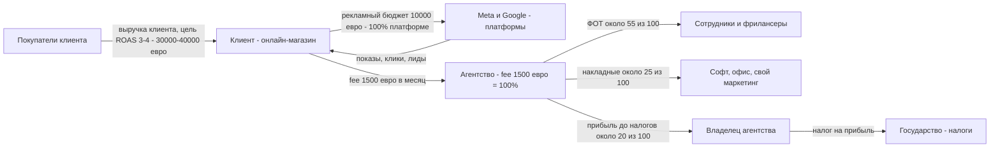
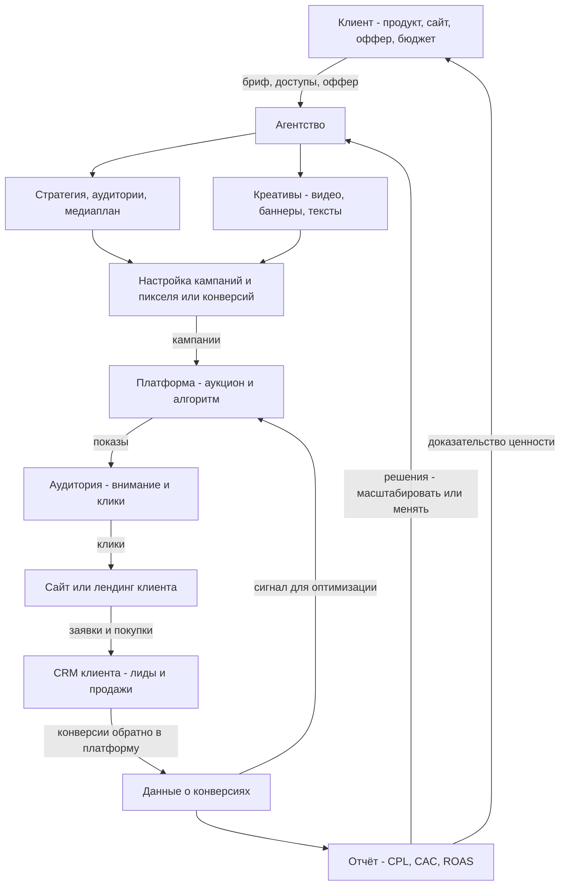
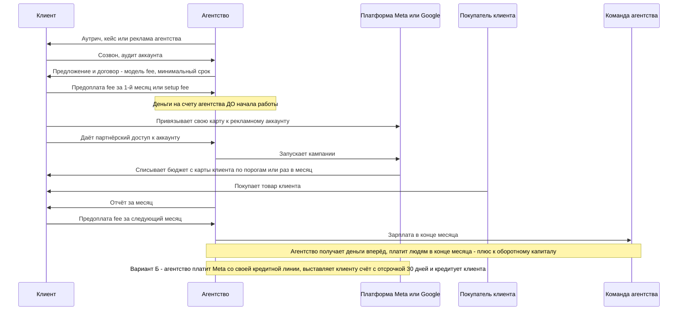

# Агентство по настройке рекламы (performance, Meta Ads и Google Ads)

Агентство продаёт клиенту экспертизу и часы специалистов, которые тратят **чужие** рекламные деньги на платформах (Meta, Google), и берёт за это fee, а бюджет уходит платформе.

## Суть за 30 секунд

- **Клиент** — малый и средний бизнес (e-com, локальные услуги, онлайн-школы, B2B), которому нужны заявки или продажи из рекламы, но нет своего маркетолога.
- **Что покупает** — не рекламу, а управление рекламой: стратегия, креативы, запуск кампаний, оптимизация, отчёт. Сама реклама (показы, клики) покупается у Meta или Google на деньги клиента.
- **За что платит агентству** — fee по одной из моделей: фикс-ретейнер в месяц, % от рекламного бюджета, оплата за лид, % от выручки (rev share) или гибрид. Самая частая модель у PPC-агентств — фиксированная оплата: 59% агентств, % от бюджета — 21%, оплата за результат — 4% [1].
- **Откуда прибыль** — разница между fee и зарплатами специалистов. Агентство продаёт время людей, поэтому главная статья расходов — ФОТ, ориентир около 55% валового дохода агентства [7]. Чистая маржа у агентств в среднем около 13%, у узких специализированных — до 30% [3].
- **Главная разница с остальными бизнесами** — через агентство проходят чужие деньги (бюджет). Агентство отвечает за результат, но не владеет ни продуктом клиента, ни платформой, поэтому клиенты уходят быстро: годовой отток у PPC-агентств около 49% [4].

## Участники и кто кому платит

| Участник | Что даёт | Что получает | Платит кому и за что |
|---|---|---|---|
| Клиент (бизнес-рекламодатель) | Рекламный бюджет, fee, доступ к аккаунтам, продукт, сайт | Лиды, продажи, отчёты | Платформе — за показы и клики (бюджет). Агентству — fee за управление |
| Агентство | Стратегию, настройку, креативы, оптимизацию, аналитику | Fee | Сотрудникам и фрилансерам — зарплату. Сервисам — подписки. Себе — прибыль. Государству — налоги |
| Платформа (Meta, Google) | Аудиторию, аукцион, алгоритм показа, статистику | 100% рекламного бюджета | Никому из участников сделки. Платформа — конечный получатель бюджета |
| Покупатель клиента (конечный потребитель) | Внимание, данные, деньги за товар клиента | Товар или услугу клиента | Клиенту — за его продукт |
| Сотрудники агентства (медиабайер, таргетолог, креатор, аккаунт-менеджер) | Часы и навыки | Зарплату, бонусы | — |
| Подрядчики (дизайнеры, видеографы, копирайтеры) | Креативы на аутсорсе | Оплату за задачу | — |
| Софт (аналитика, отчёты, CRM, сервисы для креативов) | Инструменты | Подписку | — |
| Государство | Правила, юрлицо | Налоги (НДС с fee, налог на прибыль, налоги с зарплат) | — |

Ключевое: **бюджет и fee — два разных денежных потока.** В нормальной схеме бюджет идёт с карты клиента напрямую в Meta или Google, агентство его вообще не касается. Есть второй вариант: агентство платит платформе со своего аккаунта и перевыставляет счёт клиенту. Тогда агентство кредитует клиента и несёт его кредитный риск [5].

## Схема денег

Условный пример: клиент — онлайн-магазин, в месяц 10 000 € рекламного бюджета плюс fee агентства 1 500 € (ретейнер). Fee агентства принимаем за 100 € и раскладываем по ориентиру AMI «55 / 25 / 20» [7].

Под схемой — откуда доли:
- 55 / 25 / 20 (люди / накладные / прибыль) — ориентир Agency Management Institute, проценты от AGI. AGI — это доход агентства за вычетом прямых сквозных затрат: бюджета, покупных подрядов [7]. Для чисто performance-агентства с бюджетом на карте клиента AGI почти равен fee.
- На практике чистая маржа ниже, чем 20: средняя чистая маржа агентств после налогов — 13%, у студий до 10 человек — 19%, у агентств от 50 человек — 8% [3].
- Крупные холдинги для сравнения: у WPP ФОТ с бонусами около 68% от выручки за вычетом сквозных затрат (мой расчёт: 7 761 / 11 359 млн £), заголовочная операционная маржа — 15,0% [2]. У Omnicom операционная маржа 14,5%, чистая — около 9,4% от выручки [6].
- ROAS 3–4 в схеме — **условный пример для иллюстрации, не отраслевая цифра.** Проверенного бенчмарка ROAS по SMB я не нашёл. Нормальный ROAS определяется маржой клиента (см. «Как получается прибыль»).
- Пропорция «10 000 бюджета на 1 500 fee» — тоже иллюстрация: 15% от бюджета. По опросу Lunio большинство агентств, берущих процент, берут 6–10% от бюджета [1]. На малых бюджетах фикс-минимум обычно выше процента.

Важно для понимания масштаба: из 11 500 €, которые клиент тратит в месяц, 87% уходит Meta и Google. Операционная маржа Meta в 2024 году — 42%, рекламная выручка — 160,6 млрд $ [8]. Основную прибыль в цепочке зарабатывает платформа, агентство живёт на тонкой прослойке fee.

## Схема ценности и товара/услуги

Что важно видеть на схеме:
- Агентство контролирует только середину цепочки: креатив, настройку, оптимизацию. **Оффер, цену, сайт, отдел продаж и сам продукт контролирует клиент.** Плохой оффер не спасти рекламой, а винят всё равно агентство.
- Данные о конверсиях — топливо алгоритма. Чем лучше клиент передаёт продажи обратно в платформу, тем дешевле лид. Поэтому хорошие агентства лезут в CRM и аналитику клиента.
- Креатив сегодня — главный рычаг. Таргетинг всё больше делает алгоритм, а креатив остаётся за людьми. Отсюда рост агентств, которые продают «креатив плюс медиабаинг».

## Момент оплаты

Как устроены сроки и кто кого кредитует:
- **Вариант А, бюджет на карте клиента** — стандарт для SMB. Агентство не платит платформе ни цента. Если карта клиента не проходит, реклама просто останавливается, и риск агентства минимальный [5].
- **Вариант Б, агентство платит платформе** со своей кредитной линии или по месячному инвойсингу Meta с оплатой в течение 30 дней. Агентство юридически отвечает перед платформой за весь потраченный бюджет. Если клиент не заплатил, платит агентство. Рекомендуемая защита — депозит 20–50% с новых клиентов, пауза после двух просроченных счетов, пеня за просрочку [5]. Так работают крупные холдинги, им это выгодно: «float» на чужих деньгах.
- **Fee берут предоплатой**, и это главный инструмент оборотного капитала маленького агентства. Постоплата fee — это кредит клиенту и риск не получить деньги после ухода клиента.
- **При модели «за лид» или rev share** деньги приходят после результата, иногда через месяц и позже: сначала нужно посчитать лиды или выручку клиента. Агентство финансирует работу команды из своего кармана.

## Как получается прибыль

### Модели fee — кто несёт риск

| Модель | Как считается | Риск неокупаемой рекламы несёт | Плюс для агентства | Минус для агентства |
|---|---|---|---|---|
| Фикс-ретейнер | X € в месяц, например 1 000–4 000 $ (самый частый диапазон у PPC-агентств) [1] | Клиент: бюджет и fee потрачены в любом случае | Предсказуемая выручка, дольше живут клиенты (в среднем 56 мес. у ретейнерных против 30 у performance) [4] | Нет апсайда при росте клиента. Клиент давит при плохом результате |
| % от рекламного бюджета | Обычно 6–10% [1], в РФ встречается 10% на бюджетах от 1 млн ₽ [10] | Клиент | Растёт вместе с бюджетом клиента | Конфликт интересов: выгодно уговаривать тратить больше. На малых бюджетах копейки |
| Оплата за лид (CPL) | X € за квалифицированную заявку | Агентство: платит за рекламу или работает в долг, пока нет лидов | Легко продать («платите только за результат») | Споры о «качестве лида». Агентство несёт риск плохого оффера клиента |
| % от выручки (rev share) | X% от продаж из рекламы | Делят: агентство не получает fee, если продаж нет | Огромный апсайд на сильном клиенте | Атрибуция: кто «привёл» продажу. Зависимость от честности клиента. Хормози считает, что ретейнер лучше для ценности бизнеса из-за проблем атрибуции [9] |
| Гибрид | Фикс-минимум плюс % от бюджета или бонус за KPI | Делят | Пол защищает ФОТ, процент даёт апсайд | Сложнее продавать |

Главный вывод по риску: **платформа не несёт никакого риска** — она получает деньги за показ, а не за продажу клиента. Весь риск «реклама не окупилась» лежит на клиенте, если модель фиксированная, и частично переносится на агентство, если модель за результат. Поэтому performance-модели дороже по fee, если окупились, и чаще рвутся: отток 33% в год против 18% у ретейнерных [4].

### Ключевые метрики (на стороне клиента)

- **CPL** (cost per lead) — бюджет / число заявок. В среднем по Google Ads в 2025 году — 70,11 $ (в 2024 — 66,69 $). Средняя цена клика — 5,42 $, средняя конверсия — 8,18%, по данным WordStream/LocaliQ по 16 000+ кампаний [11]. Внутри статьи есть расхождения в цифрах, см. источник.
- **CAC** (cost of acquiring a customer) — бюджет плюс fee агентства плюс расходы на продажи / число новых клиентов. Именно CAC, а не CPL, говорит, окупается ли всё.
- **ROAS** — выручка из рекламы / рекламный бюджет. Безубыточный ROAS = 1 / валовая маржа клиента. При марже 40% нужно минимум 2,5, чтобы просто отбить закупку товара и рекламу. Fee агентства и прочие расходы сверху. Это формула, а не отраслевой бенчмарк.
- **LTV / CAC** — если клиент клиента покупает повторно, можно себе позволить ROAS первой покупки ниже 1.

### P&L агентства (на 100 € fee)

| Строка | Типичный ориентир | Источник |
|---|---|---|
| Выручка (billings, вместе с бюджетом, если он проходит через агентство) | Может быть в 5–10 раз больше fee, это «сквозные» деньги | WPP показывает отдельно revenue и revenue less pass-through costs: 14 741 против 11 359 млн £ [2] |
| AGI / валовый доход = fee | 100 | [7] |
| Прямые затраты: ФОТ на исполнителей и подрядчиков | около 55 | [7]. У WPP около 65–68 [2] |
| Валовая маржа на проектах | около 35% средняя «маржа проекта» | Promethean Research через Agiled [3] |
| Накладные: софт, офис, продажи и маркетинг агентства, админ | около 25 | [7] |
| Операционная прибыль | около 20 цель. У WPP 15,0, у Omnicom 14,5 | [7], [2], [6] |
| Налоги | по юрисдикции. WPP ожидает эффективную ставку около 29% на 2025 год | [2] |
| Чистая прибыль | в среднем 13, у специализированных агентств 30, у агентств 50+ человек 8. У Omnicom около 9,4% от выручки | [3], [6] |

Ориентир по EBITDA для продаваемых digital-агентств — 20–35%. У PPC-специалистов целевая EBITDA-маржа 22–32% (по данным M&A-консультанта, заинтересованного в сделках, перепроверять) [12].

### Главные рычаги прибыли

1. **Цена против загрузки людей.** Прибыль = fee − часы × ставка сотрудника. Один медиабайер на 15 мелких клиентов против одного на 5 крупных — разная экономика.
2. **Узкая ниша.** Специализированные агентства — 30% чистой маржи против 13% в среднем [3]. Нишевые агентства продаются с премией 15–25% к мультипликатору [12]. Шаблоны, кейсы и креативы переиспользуются.
3. **Размер клиента.** По Хормози, отток у клиентов с 50+ сотрудниками — около 1% в месяц, у клиентов до 10 человек — 10–15% в месяц. «Отток — проблема аватара, а не операционки» [9]. Это пересказ интервью, а не исследование.
4. **Удержание.** Каждый месяц жизни клиента — fee без затрат на продажу.
5. **Продуктизация.** Стандартный пакет вместо кастома снижает часы на клиента.

## Откуда клиенты

| Канал | Как работает | Комментарий |
|---|---|---|
| Холодный аутрич (email, DM, звонки, персональные Loom-видео) | Список целевых компаний → персональное сообщение → созвон | Charlie Morgan (Imperium Academy) учит агентства DM-аутричу, холодным письмам с персонализированным Loom-видео, которое записывает ассистент, и холодным звонкам [13]. Источник — обзор конкурента, поэтому оценки субъективны. Подтверждённой информации о его VSL-воронке я не нашёл. По Хормози, холодный аутрич окупается только при чеке от 10 000 $. Ниже выигрывают контент и платная реклама [9] |
| Кейсы и рекомендации | Довольный клиент приводит похожего. Кейс с цифрами ROAS или CPL — главный продающий актив | Работает лучше всего в узкой нише: «мы сделали 200 заявок стоматологии по 15 €» |
| VSL и своя реклама | Агентство само крутит рекламу на видео-продажник → запись на звонок → продажа на созвоне | Типичная схема agency-коучей. Агентство показывает навык на себе. Конкретных цифр конверсии с проверяемым источником не нашёл |
| Контент (YouTube, LinkedIn, Telegram) | Экспертный контент как доверие | По Хормози: минимум 3 поста в неделю в одном канале, чтобы закрыть проверку профиля после аутрича. Контент как прогрев, а не как основной канал [9] |
| Рейтинги и каталоги (РФ: Рейтинг Рунета, Ruward, Workspace) | Платное или бесплатное размещение, тендеры | Пример из практики: агентство потратило на рейтинги 1,5 млн ₽ и получило контрактов на 400 тыс. ₽ [14] |
| Партнёрства (веб-студии, CRM-интеграторы, платформы) | Перекрёстные рекомендации | Отдельных данных не нашёл |

**Удержание и отток.** Данные Focus Digital (методология не раскрыта, проверить первоисточник не удалось) [4]:
- годовой отток у агентств платной рекламы (PPC) — **49%**, самый высокий среди всех типов, у full-service — 25%;
- средняя жизнь клиента: при ретейнере 56 месяцев, при гибриде 36, при performance-модели 30, при проектной работе 24.

Почему PPC-клиенты уходят быстрее всех: результат измерим каждый день. Клиент видит CPL в кабинете и сравнивает с конкурентом, который «обещает дешевле». Переключение стоит дёшево: дал доступ другому — и всё. Плюс результат зависит от оффера клиента, а не только от агентства.

**Русскоязычный рынок для сравнения:**
- Фрилансер-таргетолог против агентства. Средняя зарплата таргетолога по 98 вакансиям — 44 000 ₽ в месяц, разброс от 1 000 до 200 000 ₽ (дата данных на странице не указана) [15]. Цены на ведение таргета: до 10 000 ₽ в месяц у фрилансеров, 10 000–30 000 ₽ — основной сегмент, 30 000–60 000 ₽ у опытных специалистов и агентств, от 70 000 ₽ — для бюджетов от 1 млн ₽. Процент от бюджета, например 10%, — для крупных бюджетов от 1 млн ₽ (vc.ru, 2023) [10].
- Рынок сильно фрагментирован, порог входа почти нулевой: курс плюс аккаунт. Отсюда демпинг и массовые фрилансеры.
- Топ агентств таргетированной рекламы 2024 по Рейтингу Рунета: Kokoc Performance, Rocket10, Wunder Digital, MediaNation и др. Выручку рейтинг не публикует [16].
- Отличие от Запада: в РФ после 2022 года Meta недоступна, основа — VK Реклама и Яндекс. На Западе — Meta и Google. Модели fee те же.

## Риски: кто несёт и в чём именно

| Риск | Кто несёт | В чём конкретно | Как снижают |
|---|---|---|---|
| Реклама не окупилась | Клиент (при фиксе и % от бюджета), агентство (при CPL и rev share) | Бюджет сожжён, продаж нет. Деньги ушли платформе безвозвратно | Тестовый бюджет, расчёт безубыточного ROAS до старта, проверка оффера и сайта, гибридная модель |
| Отток клиентов | Агентство, инвестор агентства | Ушёл клиент — ушла выручка, а команда осталась на зарплате. У PPC отток 49% в год [4] | Минимальный срок договора 3–6 месяцев, ниша, крупнее клиенты [9], регулярные отчёты и стратегические созвоны |
| Зависимость от платформы | Агентство и клиент | Изменение алгоритма, бан рекламного аккаунта, отмена таргетинга (iOS 14, cookies), рост цены клика (CPC в Google +16% за год: 4,66 → 5,42 $) [11] | Несколько платформ, серверная передача конверсий, резервные аккаунты, креатив как компетенция |
| Неоплата бюджета (вариант Б) | Агентство | Агентство уже заплатило Meta, клиент не платит. Агентство юридически отвечает перед платформой [5] | Бюджет на карте клиента, депозит 20–50%, пауза при просрочке [5] |
| Неоплата fee | Агентство | Постоплата, клиент ушёл и не заплатил за последний месяц | Предоплата fee, автосписание |
| Концентрация клиентов | Агентство, инвестор | Один клиент даёт 30–40% выручки. Его уход — кассовый разрыв | Лимит доли одного клиента, диверсификация |
| Ключевые люди | Агентство | Медиабайер ушёл с клиентами или к конкуренту. Ценность в головах | Процессы, документация, неконкурентные пункты, доля для ключевых людей |
| Зависимость от основателя | Инвестор, покупатель | Продажи и экспертиза завязаны на владельца | Отдел продаж, менеджеры. Покупатели дисконтируют мультипликатор на 0,5–1,0x [12] |
| Выгорание и загрузка | Сотрудники | 15–50 мелких клиентов на человека, постоянные «почему CPL вырос» [17] | Меньше клиентов при большем чеке, продуктизация |
| Конфликт интересов при % от бюджета | Клиент | Агентству выгодно, чтобы клиент тратил больше, а не эффективнее | Фикс или гибрид, KPI по CAC, а не по объёму |
| Репутационный и юридический риск | Клиент и агентство | Реклама нарушила правила платформы или закон: медицина, финансы, маркировка рекламы в РФ | Комплаенс-чек креативов, договор с распределением ответственности |
| Автоматизация и ИИ | Агентство | Advantage+ и Performance Max автоматизируют настройку. Ценность ручного таргетинга падает | Сдвиг в креатив, аналитику, стратегию, обучение команд клиента [17] |

## Заинтересованные лица

| Кто | Чего хочет | Почему это важно бизнесу |
|---|---|---|
| Владелец агентства | Прибыль, предсказуемую выручку, не работать руками, возможность продать | Без процессов агентство — это самозанятость с сотрудниками. Цена при продаже зависит от доли регулярной выручки [12] |
| Клиенты | Окупаемую рекламу (CAC ниже LTV), прозрачность, связь | Клиенты — единственный источник денег. Плохая коммуникация — частая названная причина ухода [4] |
| Сотрудники (медиабайеры, креаторы, аккаунты) | Нормальную загрузку, рост, деньги, интересных клиентов | Их часы — это продукт агентства. Ушёл человек — просела услуга |
| Платформы (Meta, Google) | Больше бюджета в своих аукционах | Дают агентствам партнёрские статусы, поддержку, кредитные линии, бета-доступ. Могут забанить аккаунты |
| Подрядчики (креаторы UGC, дизайнеры) | Стабильный поток задач, оплату вовремя | Гибкость: переменные затраты вместо постоянного ФОТ |
| Инвесторы и покупатели агентства | Регулярную выручку, маржу, рост, независимость от основателя | Определяют мультипликатор при выходе [12] |
| Банки | Возвратность кредита, кредитной линии | Нужны, если агентство фронтирует бюджет (вариант Б) |
| Государство | Налоги, соблюдение законов о рекламе и данных (GDPR в ЕС, маркировка рекламы в РФ) | Штрафы, блокировки |
| Конечные покупатели клиента и общество | Нерелевантная реклама не нужна. Важны приватность и честные обещания | Лживая реклама бьёт по репутации клиента, а потом и агентства |

## Как на это смотрит инвестор

Классический венчур в сервисные агентства почти не идёт: нет масштабирования без найма людей. Смотрят частные покупатели, PE и холдинги, которые скупают агентства.

**Мультипликаторы (ориентиры от M&A-консультанта, заинтересованного в сделках, перепроверять) [12]:**
- digital-агентства в целом — 3–7x EBITDA;
- PPC-специалисты — 3,8–5,2x, медиана 4,4x;
- нишевые — 5,2–7,0x;
- маленькие (EBITDA до 300 тыс. $) — 3,2–4,0x, крупные (3+ млн $) — 5,0–7,0x.

Для сравнения: у публичного холдинга WPP в 2024 году выручка за вычетом сквозных затрат упала на 4,2%, прогноз на 2025 — от 0 до −2% LFL. Отрасль крупных холдингов стагнирует, рынок ждёт консолидации [2].

**Что ценят:**
- долю регулярной выручки: при ретейнерах 90%+ мультипликатор 5,2–6,8x, при 0–30% — 3,5–4,2x [12];
- нишевость (+15–25%), рост выше 25% в год (+0,4–0,8x), маржу EBITDA 22–30% и выше [12];
- низкий отток клиентов и долгий срок жизни клиента;
- диверсификацию: нет клиента больше 10–15% выручки;
- процессы и команду, которая работает без основателя;
- собственные технологии и данные (+0,3–0,6x) [12].

**Что пугает:**
- зависимость от основателя (−0,5–1,0x) [12];
- концентрацию на одном клиенте или одной платформе;
- высокий отток. У PPC он самый высокий в сервисах [4];
- проектную выручку вместо регулярной;
- маржу ниже 15% — сигнал проблем с ценой или операционкой [12];
- риск ИИ-автоматизации основной услуги.

**Метрики, которые спросит покупатель:** выручка и fee отдельно от сквозного бюджета, EBITDA и её «нормализация» (возврат зарплаты владельца), MRR, отток в месяц, LTV клиента, CAC агентства, выручка на сотрудника, доля топ-5 клиентов, загрузка (utilization).

## Что берём себе

1. **Не трогать чужие деньги и брать предоплату.** Бюджет — на карте клиента, fee — вперёд. Продюсерский центр может работать так же: вложения в трафик эксперта эксперт оплачивает напрямую платформе, а центр берёт fee вперёд. Кредитовать клиента своими деньгами — это банковский риск без банковской маржи.
2. **Гибрид «пол плюс процент» — самая здоровая модель для нас.** Фикс-минимум покрывает ФОТ команды. Процент от оборота эксперта (rev share) даёт апсайд. Чистый rev share — это риск атрибуции и неоплаты, его признаёт даже Хормози [9]. Чтобы снять спор «чья это продажа», нужны общий кабинет оплат или эквайринг под контролем центра и прозрачная аналитика.
3. **Отвечаем только за то, что контролируем, и контролируем больше.** Агентства страдают, потому что оффер, цена и продажи — у клиента. Продюсерский центр сильнее агентства ровно тем, что упаковывает оффер, воронку и продажи целиком. Это нужно прописать в договоре и на одностраничнике оффера.
4. **Ниша и размер клиента решают отток и маржу.** Узкие агентства — 30% чистой маржи против 13% [3]. Мелкие клиенты дают 10–15% оттока в месяц [9]. Брать экспертов с уже работающим продуктом и оборотом, а не новичков «с нуля».
5. **Канал лидов как у agency-коучей.** Аутрич плюс кейсы плюс интервью как контент. Интервью с экспертом — это одновременно персонализированный аутрич (Loom-подход Charlie Morgan [13]), прогрев через контент и кейс. По Хормози, холодный аутрич окупается при чеке от 10 000 $ [9]. Значит, оффер центра должен стоить столько же или давать такой LTV через процент.
6. **Строить сразу «продаваемый» бизнес.** Регулярная выручка, процессы без Руслана в каждом звене, лимит доли одного эксперта. Именно это инвестор оплачивает мультипликатором [12].

## Источники

1. Lunio, PPC Agencies Pricing Survey 2021 (883 ответа: модели fee, ставки, ретейнеры) — https://www.lunio.ai/blog/ppc-agencies-pricing-survey
2. WPP, 2024 Preliminary Results (revenue, revenue less pass-through, headline margin 15,0%, staff costs, headcount, прогноз 2025) — https://www.businesswire.com/news/home/20250226079314/en/WPP-2024-Preliminary-Results и https://www.wpp.com/en/news/2025/02/preliminary-results-2024 (на странице WPP указана RLPT 11 395 млн £, в Business Wire — 11 359. Маржа в обоих случаях около 15,0%)
3. Agiled, Agency Profitability Statistics (пересказ Promethean Research 2026 State of Digital Services: чистая маржа по размерам и типам агентств) — https://agiled.app/statistics/agency-profitability-statistics
4. Agiled, Client Retention Statistics (пересказ Focus Digital, Average Marketing Agency Churn 2026: отток и срок жизни клиента по моделям и услугам. Методология не раскрыта) — https://agiled.app/statistics/client-retention-statistics
5. Adamigo, Agency playbook — Meta ad spend without credit cards (кто платит Meta, инвойсинг с оплатой в течение 30 дней, риск агентства, депозиты) — https://www.adamigo.ai/blog/meta-ad-spend-no-credit-cards-agency-playbook-monthly-invoicing
6. Omnicom, Q4 и полный 2024 год (выручка 15,69 млрд $, операционная маржа 14,5%, чистая прибыль 1,48 млрд $) — https://investor.omc.com/news/news-details/2025/Omnicom-Reports-Fourth-Quarter-and-Full-Year-2024-Results/default.aspx
7. Agency Management Institute, Payroll ratios (ФОТ около 55% AGI, правило 55/25/20) — https://agencymanagementinstitute.com/video/payroll-ratios-whats-too-low/
8. Meta, Q4 и полный 2024 год (рекламная выручка 160,6 млрд $, операционная маржа 42%) — https://investor.atmeta.com/investor-news/press-release-details/2025/Meta-Reports-Fourth-Quarter-and-Full-Year-2024-Results/default.aspx
9. Daniliants, конспект интервью Alex Hormozi 2026 (отток по размеру клиента, аутрич от чека 10 000 $, ретейнер лучше rev share) — https://daniliants.com/insights/alex-hormozi-2026-ai-agencies-cold-email/
10. vc.ru, «Сколько стоит настройка таргетированной рекламы ВКонтакте», 2023 (цены фрилансеров и агентств, % от бюджета) — https://vc.ru/marketing/961165-skolko-stoit-nastroika-targetirovannoi-reklamy-vkontakte
11. Search Engine Land, Google Ads costs keep rising (WordStream/LocaliQ 2025: CPC 5,42 $, CR 8,18%, CPL 70,11 $) — https://searchengineland.com/google-ads-costs-keep-rising-but-conversion-rates-improved-in-2025-477927
12. Lightning Path Partners, Digital agency EBITDA multiples (мультипликаторы по размеру и типу, премии и дисконты. Автор — покупатель агентств, есть внутренние расхождения) — https://lightningpathpartners.com/agency-blog/digital-agency-ebitda-multiples
13. Ippei, Imperium Acquisition Review (методы аутрича Charlie Morgan. Обзор от конкурента) — https://ippei.com/imperium-acquisition/
14. vc.ru, «Где купить рекламу для агентства? Потратили на рейтинги 1,5 млн рублей» (кейс окупаемости рейтингов) — https://vc.ru/marketing/155737-gde-kupit-reklamu-dlya-agentstva-potratili-na-reitingi-15-mln-rublei-poluchili-kontraktov-na-400-tysyach
15. Workspace.ru, зарплата таргетолога (44 000 ₽ по 98 вакансиям) — https://workspace.ru/salary/targetolog/
16. Рейтинг Рунета / Ruward, рейтинг агентств таргетированной рекламы 2024 — https://ruward.ru/context-ratings/rating-runeta-target-2024/
17. StartupSpells, Alex Hormozi Fulfill & Integrate Agency Model (проблемы классического агентства, ретейнеры по 1 500 $ на 50 клиентов, модель «сделай и обучи») — https://startupspells.com/p/alex-hormozi-fulfill-integrate-agency-model-best-alternative-agency-model

Пункты [4], [12], [13] — вторичные источники с нераскрытой методологией или с конфликтом интересов автора. Цифры из них — ориентиры, а не факты. Проверенного отраслевого бенчмарка ROAS для SMB и данных о конверсии VSL-воронок agency-коучей не нашёл.
