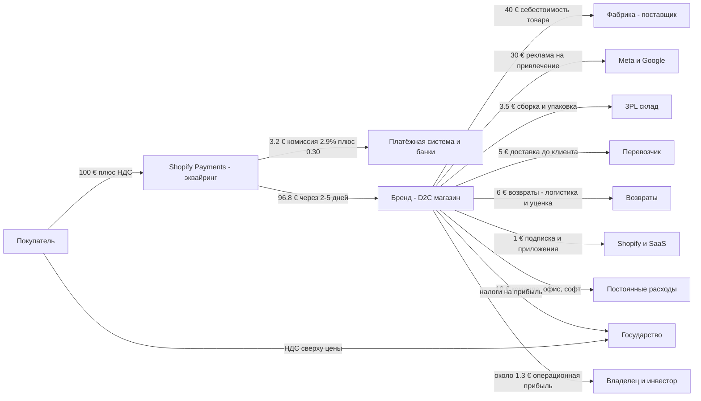
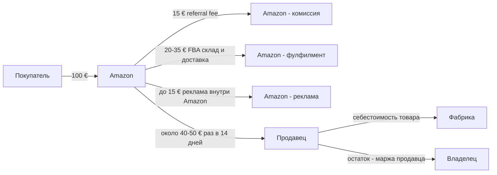
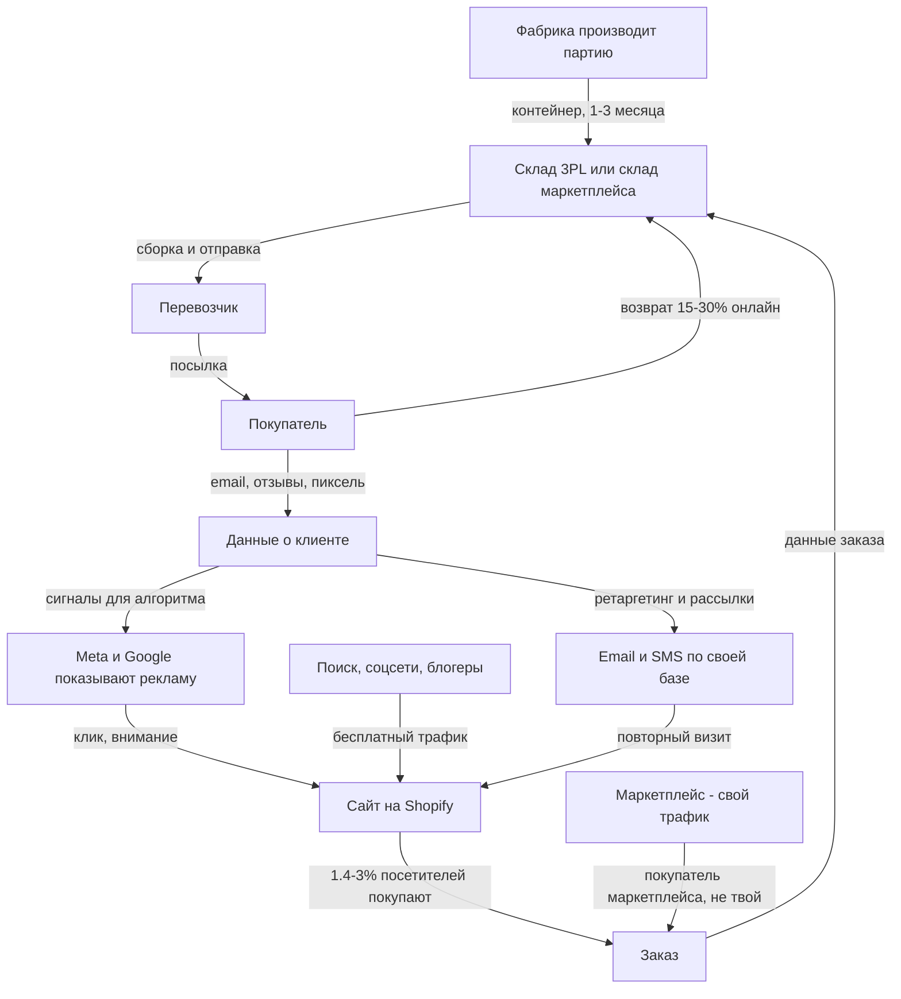
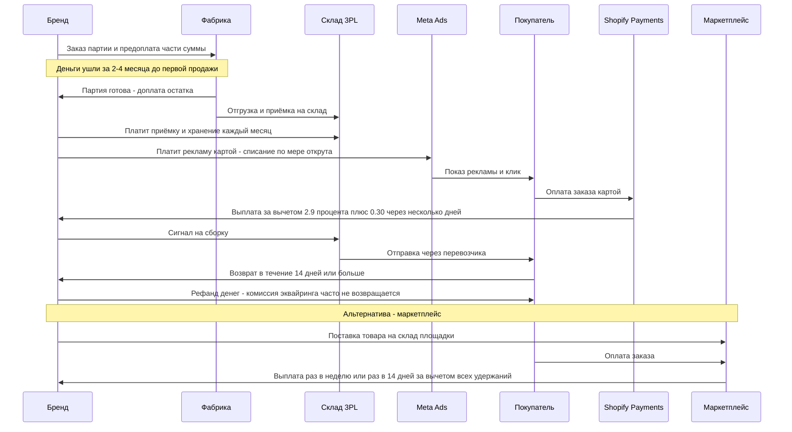

# Интернет-магазин: D2C-бренд на Shopify и продавец на маркетплейсе

Бизнес покупает или производит товар заранее на свои деньги, покупает внимание в Meta или Google, продаёт товар через свой сайт или через маркетплейс и живёт на разнице, которая остаётся после себестоимости, комиссий, доставки, возвратов и рекламы.

## Суть за 30 секунд

- **Клиент** — частный покупатель (B2C). Он платит за товар, доставленный к двери, и за право бесплатно его вернуть. В Германии в онлайн-моде возвращается 33,6% проданных вещей [8].
- **Платит** один раз в момент заказа, картой или PayPal. Деньги проходят через эквайринг: на Shopify Payments это 2,9% + 0,30 $ на тарифе Basic [1]. Бизнес получает их через несколько дней, а на маркетплейсе — через одну-две недели (Amazon выплачивает примерно раз в 14 дней [12], WB — по недельным отчётам [7]).
- **Прибыль** = цена − себестоимость товара − комиссии платформы и эквайринга − фулфилмент и доставка − возвраты − реклама на привлечение. На первом заказе после рекламы обычно остаётся мало или ничего. Деньги зарабатываются на **повторных покупках**, где реклама уже оплачена.
- **Главная разница двух моделей.** Shopify — твой магазин: клиент, данные и email-база принадлежат тебе, трафик ты покупаешь сам. Маркетплейс даёт трафик, склад и доставку, но забирает в сумме больше 50% выручки (Amazon [3]) и держит клиента у себя.
- **Главный риск** — деньги, замороженные в товаре. Ты платишь фабрике за месяцы до продажи, и непроданный товар остаётся твоей проблемой, а не платформы.

## Участники и кто кому платит

| Участник | Что даёт | Что получает | Платит кому и за что |
|---|---|---|---|
| Покупатель | деньги, данные, отзывы | товар, доставку, право возврата | бизнесу или маркетплейсу — цену товара с НДС |
| Бизнес-бренд | товар, бренд, сервис | маржу, базу клиентов | фабрике за товар, платформам за трафик и софт, 3PL за склад, перевозчику за доставку, государству налоги |
| Фабрика или поставщик | готовый товар | оплату, часто частично заранее | — |
| Shopify | движок магазина, checkout, приложения | подписку от 29 до 2300 $ в месяц и долю с платежей [1] | — |
| Эквайер или платёжка: Shopify Payments, Stripe, PayPal | приём платежей | 2,25–2,9% + 0,30 $ с транзакции [1] | банкам-эмитентам interchange |
| Meta или Google | внимание аудитории | рекламный бюджет: медианный CPA в Meta 31,26 $ [4] | — |
| 3PL — склад и фулфилмент | хранение, сборку, упаковку | ~20 $ за паллету в месяц, ~2–3 $ за сборку заказа [10] | — |
| Перевозчик: DHL, DPD, Hermes | доставку и возвраты | тариф за посылку | — |
| Маркетплейс: Amazon, WB, Ozon | трафик, склад, доставку, доверие | комиссию ~15%, FBA 20–35%, рекламу до 15% [3] | продавцу — выручку минус удержания, раз в 1–2 недели |
| Государство | рынок и правила | НДС с каждой продажи, налог на прибыль | — |
| Инвестор или банк | деньги на товар и рекламу | долю или проценты | — |

## Схема денег

Модель на один заказ в D2C-магазине: **100 € выручки без НДС**. НДС собирается сверху и уходит государству. Цифры — модель для понимания, собранная из бенчмарков ниже. Свои цифры подставь сам.

Как читать: из 100 € после товара (40), платежей (3,2), склада (3,5), доставки (5), возвратов (6) и софта (1) остаётся **41,3 € маржи до маркетинга**. Реклама на нового клиента съедает 30 €, остаётся 11,3 € маржи после маркетинга. Постоянные расходы забирают ещё 10 €, и на первом заказе бизнес работает почти в ноль. Повторный заказ того же клиента без 30 € рекламы даёт ~41 € маржи. **Вся прибыль — в повторах.**

Откуда доли:
- Себестоимость 40% — между валовыми маржами публичных D2C: Warby Parker 55,3% [5], Allbirds 42,7% [6].
- Эквайринг 2,9% + 0,30 $ — тариф Shopify Basic, США [1].
- Склад 3,5 € — модель Fulfill.com: 3,61–3,87 $ на заказ при 200–5000 заказов в месяц до доставки [10].
- Реклама 30 € — медианный CPA в Meta 31,26 $ (Triple Whale, 40 000+ брендов) [4].
- Возвраты — онлайн возвращается 15–30% покупок против ~8% в офлайне [9], в немецкой онлайн-моде 33,6% вещей [8]. 6 € — условная оценка обратной доставки, обработки и уценки.
- Доставка 5 € и постоянные 10 € — **не из бенчмарка**, это допущение модели. Подставь свой тариф перевозчика и свой ФОТ.

Для сравнения — **тот же товар за 100 € на Amazon с FBA** (по Marketplace Pulse [3]):

Marketplace Pulse: Amazon в сумме забирает **больше 50% выручки продавца**, а пятью годами раньше брал около 40% [3]. Для WB пример uniseller: на 100 000 ₽ выручки уходит 15 000 ₽ комиссии, 10 000 ₽ логистики, 2 000 ₽ хранения, 1 000 ₽ эквайринга и 5 000 ₽ рекламы. Итого 33% эффективной ставки [11]. Номинальная комиссия WB — 5–25% по категориям, а реальная ставка обычно выше её на 6–8 п.п. [11].

## Схема ценности и товара/услуги

Ключевое: **в D2C ты владеешь данными** (email, история покупок), и это канал повторных продаж почти бесплатно. На маркетплейсе клиент принадлежит площадке: повторную продажу ты снова покупаешь у неё через комиссию и рекламу.

## Момент оплаты

Что здесь главное:
- **Порядок оплаты против бизнеса.** Ты платишь фабрике и рекламе **раньше**, чем клиент платит тебе. Условия фабрики (предоплата, сроки) в открытых бенчмарках не нашёл — проверь у своих поставщиков. Отсюда цикл: деньги → товар на складе → реклама → продажа → выплата. Пока он не закрылся, деньги заморожены.
- **Эквайринг** отдаёт деньги быстро. Shopify позволяет выбрать выплаты раз в день, неделю или месяц [2], но сроки зачисления зависят от страны.
- **Маркетплейс** держит деньги дольше. Amazon выплачивает примерно раз в 14 дней и держит резерв под возвраты и претензии, у новых аккаунтов дольше [12]. WB считает к выплате по еженедельным отчётам, отчёт утверждается 14 дней, вывод — до 7 рабочих дней. Платный досрочный вывод (4,3%) на сентябрь 2026 временно недоступен [7].
- **Реклама** списывается с карты сразу, а выручка с неё приходит позже. При быстром росте магазин может быть прибыльным на бумаге и без денег на счету.

## Как получается прибыль

**P&L D2C-бренда на 100 € выручки (модель из схемы):**

| Строка | € | Комментарий |
|---|---|---|
| Выручка без НДС | 100 | после скидок и возвратов |
| Себестоимость товара, landed cost | −40 | товар + доставка до склада + пошлины |
| **Валовая прибыль** | **60** | валовая маржа 60%. Warby Parker — 55,3% [5], Allbirds — 42,7% [6] |
| Эквайринг | −3,2 | 2,9% + 0,30 [1] |
| Фулфилмент и доставка | −8,5 | 3PL ~3,6–3,9 $ [10] + доставка (допущение) |
| Возвраты | −6 | допущение при 15–30% возвратов [9] |
| Софт | −1 | Shopify от 29 $ в месяц [1] + приложения |
| **Contribution margin 1 — до маркетинга** | **41,3** | маржа с заказа до рекламы |
| Реклама на привлечение | −30 | CPA ~31 $ в Meta [4] |
| **Contribution margin 2 — после маркетинга** | **11,3** | главная метрика здоровья |
| Постоянные расходы: команда, офис | −10 | допущение |
| **Операционная прибыль, EBITDA** | **~1,3** | |
| Налог на прибыль | −часть | |
| **Чистая прибыль** | **~1** | |

**Реальность у публичных D2C:**
- **Warby Parker, 2024:** выручка 771,3 млн $, валовая маржа 55,3%. SG&A (зарплаты, магазины, маркетинг) — 59,2% выручки, то есть больше валовой маржи. Чистый убыток 20,4 млн $, скорректированная EBITDA 73,1 млн $ (9,5%). 2,51 млн активных клиентов, 307 $ выручки на клиента в год [5].
- **Allbirds, 2024:** выручка 189,8 млн $, валовая маржа 42,7%, чистый убыток 93,3 млн $ — почти половина выручки. Товарный запас 44,1 млн $ при 66,7 млн $ кэша [6]. Пример того, как хороший бренд с высокой валовой маржой годами сжигает деньги на привлечении и постоянных расходах.

**Формулы, которые надо знать:**
- **AOV**, средний чек = выручка / число заказов. Медиана по платному трафику (Triple Whale) — 61,22 $. По нишам от 42,79 $ (онлайн-курсы) до 130,91 $ (багаж) [4].
- **Конверсия сайта** = заказы / сессии. Средняя по Shopify — около 1,4%, топ-20% магазинов — 3,2%+, топ-10% — 4,7%+. Медиана по платному трафику — 1,69% [4].
- **CAC** = маркетинг на привлечение / новые клиенты. По данным SimplicityDX, потеря на каждом новом клиенте выросла с 9 $ в 2013 до 29 $ в 2022 (+222%) [13].
- **LTV по марже** = contribution margin 1 × среднее число заказов клиента за 2–3 года. В модели: 41,3 € × 1,5 заказа ≈ 62 €.
- **LTV / CAC.** Цель покупателей бизнеса — 3:1 и выше [14]. В модели 62 / 30 ≈ 2:1. Значит, нужно поднимать повторы, чек или снижать CAC.
- **ROAS** = выручка с рекламы / расход на рекламу. Медиана по нишам — от 1,27 до 3,27 [4]. При ROAS 2 и марже до маркетинга 41% ты теряешь деньги на первом заказе.

**Главные рычаги прибыли (по силе влияния):**
1. **Повторные покупки** — заказы без CAC. Бенчмарк repeat rate — 20–30% в среднем, в расходниках и косметике 30–40%, в электронике 10–20% [15].
2. **Валовая маржа** — цена против себестоимости. Бренд и уникальный товар позволяют держать цену.
3. **Конверсия и AOV.** Рост конверсии с 1,4% до 2,8% при том же трафике вдвое снижает CAC. Бандлы и пороги бесплатной доставки поднимают AOV.
4. **Возвраты** — размерные сетки, фото, платный возврат.
5. **Оборачиваемость запаса** — меньше денег заморожено, меньше уценки.

## Откуда клиенты

| Канал | Как работает | Стоимость | Комментарий |
|---|---|---|---|
| Meta: Instagram, Facebook | креативы, ретаргетинг, Advantage+ | медианный CPA 23,20 $ по всем платным каналам, CTR 1,93%, CVR 1,69% [4]; Meta — 31,26 $ [4] | главный канал холодного трафика для D2C |
| Google: Search, Shopping, PMax | ловит спрос, который уже есть | данных по Google в найденном бенчмарке нет [4] | дешевле на брендовых запросах |
| Маркетплейс | трафик площадки | комиссия + внутренняя реклама до 15% выручки [3] | клиент не твой |
| Email и SMS | своя база | почти бесплатно | главный канал повторов. Своя база повышает оценку бизнеса при продаже [14] |
| Органика: SEO, соцсети, блогеры, сарафан | контент, PR, отзывы | время и бартер | Warby Parker прямо пишет в 10-K, что многие клиенты приходят по сарафану и неплатным рекомендациям [5] |
| Офлайн-магазины, шоурумы | точка контакта | аренда | Warby Parker называет свои магазины ключевым каналом привлечения [5] |

Что важно понять:
- **Платный трафик — это аренда клиентов.** Если выключить рекламу, продажи падают, и покупатели бизнеса это знают: «купленный спрос» оценивают ниже [14].
- **CAC растёт со временем** (данные SimplicityDX выше [13]): аукцион дорожает, конкуренция растёт, отслеживание ухудшается.
- **Удержание** держится на email-цепочках, подписке на расходники, программах лояльности и качестве товара.

## Риски: кто несёт и в чём именно

| Риск | Кто несёт | В чём конкретно | Как снижают |
|---|---|---|---|
| Непроданный товар | **Бренд**, а не платформа и не фабрика | Партия оплачена, спрос не пришёл: деньги заморожены, растёт плата за хранение, потом распродажа ниже себестоимости или утилизация. Модная одежда теряет 20–50% стоимости за 8–16 недель [9] | Маленькие первые партии, предзаказы, данные о спросе, частые поставки |
| Кассовый разрыв | Бренд, владелец | За товар и рекламу платишь раньше, чем приходят деньги клиента. Быстрый рост съедает кэш | Короче цикл, отсрочка от фабрики, кредит под товар, контроль запасов |
| Рост CAC и зависимость от Meta | Бренд | Алгоритм поменялся или аукцион подорожал — и юнит-экономика ушла в минус. Потеря на новом клиенте выросла с 9 $ до 29 $ [13] | Свои каналы: email, органика, сарафан. Повторы. Несколько каналов |
| Возвраты | Бренд | Обратная доставка, обработка, уценка. Онлайн-возвраты 15–30% [9], немецкая онлайн-мода — 33,6% вещей и 64,3% посылок [8]. 15% возвратов и претензий в США — мошенничество [16] | Таблицы размеров, качественный контент, платный возврат, анти-фрод |
| Зависимость от маркетплейса | Продавец | Площадка меняет комиссии и правила. Общий сбор Amazon вырос с ~40% до 50%+ за 5 лет [3]. Может заблокировать аккаунт и держать деньги в резерве [12] | Второй канал, свой сайт, своя база. Покупатели считают риском больше 70% выручки из одного канала [14] |
| Чарджбэки и фрод | Бренд — у Shopify Payments продавец отвечает за спор | Клиент оспорил платёж: деньги списали плюс штраф | Антифрод-сервисы, трекинг доставки |
| Брак или срыв поставки | Бренд, частично фабрика | Опоздал контейнер к сезону — пропущены продажи, а реклама уже оплачена | Второй поставщик, инспекция до отгрузки |
| Долговая нагрузка | Инвестор, кредиторы | Thrasio (агрегатор Amazon-брендов) привлёк ~3,4 млрд $ и ушёл в банкротство, списав ~495 млн $ долга [17] | Не масштабировать на долг без устойчивой юнит-экономики |
| Качество и ответственность за товар | Бренд, импортёр | Отзывы продукции, штрафы, требования ЕС к маркировке и упаковке | Сертификация, страхование |
| Недоставка или повреждение | Бренд, частично перевозчик | Повторная отправка за свой счёт | Страховка посылок, хорошая упаковка |
| Клиент | Покупатель | Не тот размер, брак, мошеннический магазин | Право возврата, защита платежа картой |

Главная мысль: **в D2C почти весь риск на бренде.** Shopify, Meta, эквайер и 3PL получают свои деньги в любом случае, с каждого заказа или клика. Фабрика получает деньги до продажи. Только бренд зарабатывает, если товар продался **и** клиент вернулся.

## Заинтересованные лица

| Кто | Чего хочет | Почему это важно бизнесу |
|---|---|---|
| Владелец, основатель | прибыль, рост стоимости, свободу от операционки | Бизнес, зависящий от основателя, при продаже стоит дешевле [14] |
| Инвестор | рост выручки при здоровой юнит-экономике, выход с мультипликатором | Даёт деньги на товар и рекламу, требует отчётность и метрики |
| Банк, кредитор | своевременный возврат, залог в виде товара | Кредит под запас помогает пережить кассовый разрыв, но долг убивает при падении продаж (Thrasio [17]) |
| Покупатели | товар как на фото, быстро, лёгкий возврат | Отзывы и повторы — главный источник прибыли |
| Сотрудники и подрядчики: маркетолог, агентство, склад | понятные задачи, оплата, рост | От маркетолога и креативов зависит CAC |
| Поставщики, фабрики | регулярные заказы, предоплата | Отсрочка платежа от фабрики — бесплатное финансирование |
| Платформы: Shopify, Meta, маркетплейсы | оборот на их площадке | Меняют правила в одностороннем порядке |
| Государство | НДС, налоги, соблюдение прав потребителей | Право на возврат в ЕС и маркировка — обязательные затраты |
| Общество | меньше отходов и пустой логистики | Возвраты в США — около 5 млрд фунтов отходов в год на свалках [9], давление на бренды растёт |

## Как на это смотрит инвестор

**Что смотрит в первую очередь:**
1. **Contribution margin** по SKU и каналам за 24 месяца — стабильна или падает [14].
2. **LTV / CAC ≥ 3:1** и **срок окупаемости CAC** — сколько месяцев клиент отбивает рекламу [14].
3. **Доля повторных заказов** — 25–40% заказов от повторных клиентов оценивается заметно выше разовых продаж [14].
4. **Структура каналов** — органика, брендовый поиск и своя email-база ценятся. Больше 70% выручки из одного канала — красный флаг [14].
5. **Запасы** — оборачиваемость, доля старого стока. Ликвидный товар добавляют к цене по себестоимости, залежавшийся — дисконтируют или исключают [14].
6. **Валовая маржа и путь к прибыли.** Публичный рынок видит разницу: у Warby Parker положительная скорректированная EBITDA 9,5% [5], а Allbirds теряет почти половину выручки [6].

**Мультипликаторы (FE International [14]):**
- Маленькие бренды, где всё держится на владельце: **2–4× SDE** (прибыль владельца до его зарплаты).
- Бренды с командой: **3–6× EBITDA**. Премиальные диверсифицированные: **6–10×+**.
- Публичные e-commerce компании: около **12,6× EBITDA**.
- Подписочные модели: **4–10× годовой рекуррентной выручки**.
- Дропшиппинг и Amazon с одним товаром — в низу диапазона, потому что спрос «арендован».
- Товарный запас обычно оплачивается **сверху** по себестоимости. 25–40% цены сделки часто выплачивается по результатам после продажи (earnout).

**Что пугает:** падающая маржа, рост на рекламе без повторов, один канал, неряшливый учёт, раздутые «разовые» корректировки прибыли, склад залежавшегося товара [14]. Урок Thrasio: когда пандемийный бум e-commerce закончился, схема «купить много Amazon-брендов на заёмные деньги» не сработала [17].

## Что берём себе

1. **Contribution margin после маркетинга — главная метрика и для эксперта.** Для продюсерского центра это выручка эксперта минус реклама, платформа, эквайринг, кураторы и наша доля. Если на «первом заказе» (первом запуске) экономика в ноль, деньги должны приходить с повторных продаж той же базе: наставничество, клуб, следующий поток.
2. **У нас нет товарного запаса — это огромное преимущество.** Инфопродукт не морозит деньги на складе и не возвращается посылкой. Основной риск у нас — кассовый разрыв между рекламой и оплатой. Продаём через предоплату и рассрочку, где деньги приходят до затрат: это наш аналог предзаказа.
3. **Своя база вместо арендованного трафика.** Как email-база D2C против маркетплейса: телеграм-канал и email эксперта — актив, который повышает стоимость проекта. Каждый проект строит свою базу, а не только покупает трафик в Meta.
4. **Интервью и контент как органика.** У Warby Parker сарафан и неплатные рекомендации — заметная часть клиентов [5]. Интервью с экспертами — наш дешёвый канал лидов, который снижает средний CAC.
5. **Модель «процент от оборота» — это позиция маркетплейса.** Маркетплейс берёт 15–50% за трафик и инфраструктуру [3][11]. Если мы берём % от оборота эксперта, мы должны давать то же самое: трафик, систему продаж, инфраструктуру. Иначе эксперт уйдёт «на свой Shopify».
6. **Считать юнит-экономику каждого запуска таблицей** (AOV, конверсия воронки, CAC, LTV/CAC, срок окупаемости). С этой таблицей идём к экспертам и инвесторам.

## Источники

1. https://www.shopify.com/pricing — тарифы Shopify (США): подписка 29–2300 $ в месяц, онлайн-эквайринг 2,9% / 2,7% / 2,5% / 2,25% + 30¢, комиссия за сторонние платёжки 2% / 1% / 0,6% / 0,2%.
2. https://help.shopify.com/en/manual/payments/shopify-payments/payouts/payout-schedule — выплаты Shopify Payments: можно выбрать раз в день, неделю или месяц.
3. https://www.marketplacepulse.com/articles/amazon-takes-a-50-cut-of-sellers-revenue — Marketplace Pulse, 2023: Amazon забирает больше 50% выручки продавца (referral 15%, FBA 20–35%, реклама до 15%); пятью годами раньше — около 40%.
4. https://www.triplewhale.com/blog/ecommerce-benchmarks — Triple Whale: конверсия, AOV, CPA, ROAS, CPM по нишам, 53 000+ брендов, август 2025 – июль 2026.
5. https://www.sec.gov/Archives/edgar/data/1504776/000150477625000007/warbyparkerincearningsrele.htm и https://www.sec.gov/Archives/edgar/data/1504776/000150477625000010/wrby-20241231.htm — Warby Parker, итоги 2024 и 10-K: выручка, маржа, EBITDA, клиенты, каналы привлечения.
6. https://allbirds.gcs-web.com/news-releases/news-release-details/allbirds-reports-fourth-quarter-and-full-year-2024-financial — Allbirds, итоги 2024: выручка 189,8 млн $, маржа 42,7%, убыток 93,3 млн $, запас, кэш.
7. https://selsup.ru/blog/vyvod-deneg-na-wildberries-instruktsiya-dlya-sellerov-sroki-komissii-limity-i-chastye-problemy/ — как и когда WB выплачивает продавцам, досрочный вывод.
8. https://www.textilwirtschaft.de/business/news/retourenforscher-legen-european-return-o-meter-vor-so-hoch-sind-die-retourenquoten-im-deutschen-online-modehandel-237248 — Бамбергский университет, 2022: в немецкой онлайн-моде возвращается 64,3% посылок и 33,6% вещей.
9. https://www.ajot.com/news/cbre-forecasts-online-returns-could-total-as-much-as-41.6-billion-this-holiday-season — CBRE и Optoro, 2019: онлайн-возвраты 15–30% против ~8% в офлайне, потеря стоимости возвращённых товаров, отходы.
10. https://fulfill.com/3pl-pricing — стоимость 3PL: хранение, сборка, полная стоимость заказа до доставки (опрос 600+ складов, 2025).
11. https://uniseller.io/blog/effektivnaya-stavka-wildberries — эффективная ставка WB: пример расчёта на 33%, диапазон комиссий 5–25%.
12. https://www.inventoryhero.ai/blog/amazon-payout-schedule — Amazon выплачивает примерно раз в 14 дней и держит резерв под возвраты.
13. https://www.marketingdive.com/press-release/20220720-brands-losing-a-record-29-for-each-new-customer-acquired/ — SimplicityDX, 2022: потеря на новом клиенте выросла с 9 $ до 29 $ (+222% с 2013).
14. https://www.feinternational.com/blog/shopify-ecommerce-brand-valuation — FE International: мультипликаторы e-commerce, на что смотрят покупатели, красные флаги.
15. https://www.polaranalytics.com/post/repeat-purchase-rate-ecommerce — бенчмарки повторных покупок (Klaviyo, Yotpo) по категориям.
16. https://apprissretail.com/resources/2024-consumer-returns-report/ — Appriss Retail, 2024: уровень возвратов 13,21%, фрод в возвратах.
17. https://www.cnbc.com/2024/02/28/top-amazon-aggregator-thrasio-files-for-bankruptcy.html — CNBC: банкротство Thrasio, привлечено 3,4 млрд $, списано 495 млн $ долга.
