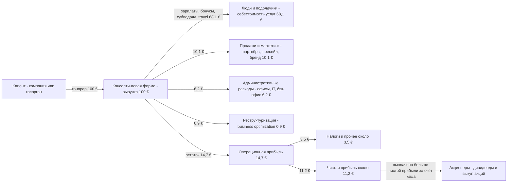
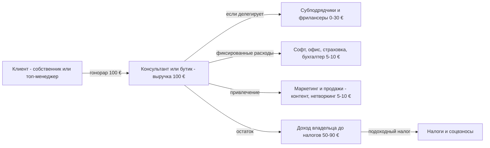
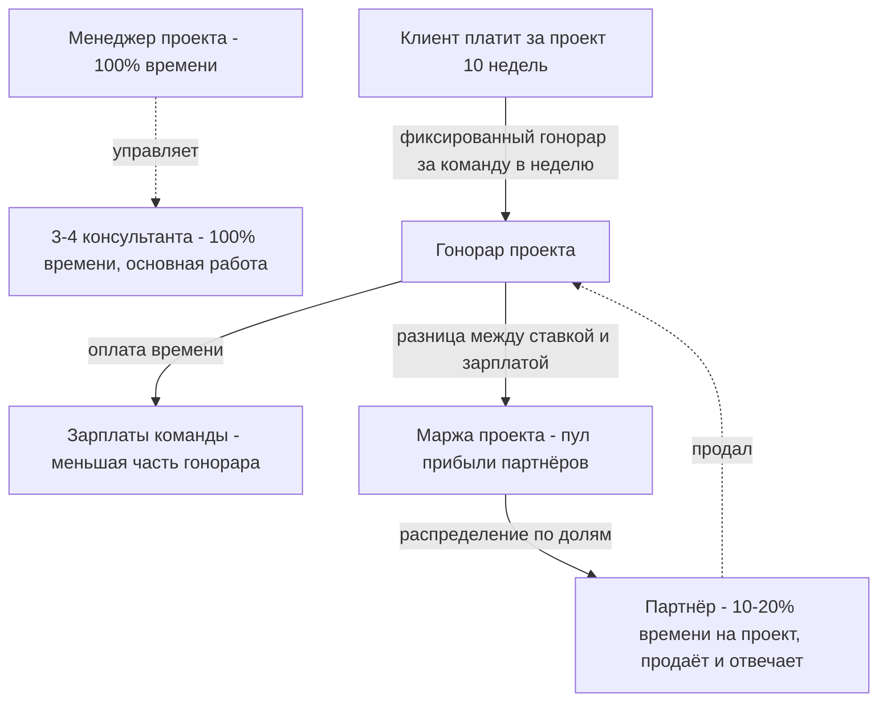
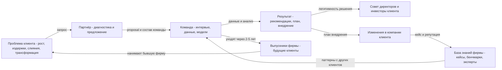
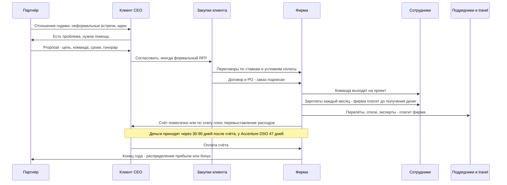
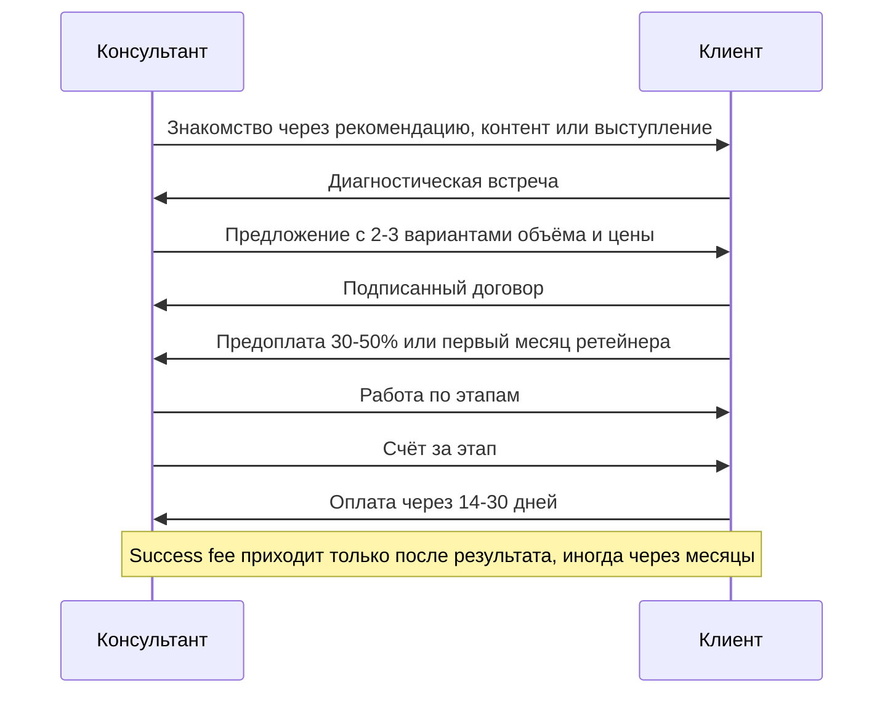

# Консалтинговая фирма

Консалтинг продаёт время и голову экспертов: клиент платит за решение задачи и за уверенность, что решение правильное, а фирма зарабатывает на разнице между ставкой, по которой продаёт часы людей, и тем, сколько им платит.

Разбираем две модели:
- **A. Большая стратегическая фирма** (McKinsey, BCG, Bain) и её публичный родственник **Accenture**. По Accenture есть открытая отчётность, поэтому все цифры P&L ниже взяты оттуда.
- **B. Бутик или соло-консультант**: 1–20 человек, продаёт партнёр-основатель, работает он же.

## Суть за 30 секунд

- **Кто клиент.** Компании и госорганы. Accenture зарабатывает «в основном на компаниях из Forbes Global 2000, правительствах и госагентствах» [1]. Бутик работает со средним бизнесом и собственниками. Соло-консультант работает с отдельным топ-менеджером или основателем.
- **Что покупают.** Ответ на вопрос, которого внутри нет: стратегию, оптимизацию, трансформацию, внедрение. Вместе с ответом клиент покупает три неочевидные вещи: внешний авторитет, свободные руки на время проекта и **перенос риска решения на бренд консультанта**. Отсюда поговорка «nobody gets fired for hiring McKinsey» [7].
- **За что платят.** За время команды (time & materials), за результат-проект (fixed fee), за доступ (retainer), за ценность (value-based) или за долю в результате (success fee).
- **Откуда прибыль.** Из **leverage** («рычага»): партнёр продаёт проект по высокой ставке, а делают его в основном младшие консультанты, которые стоят фирме в разы меньше, чем она за них берёт. Вторая часть — **utilization**: какую долю оплаченного времени люди реально продают. Чем выше обе величины, тем выше маржа.
- **Масштаб.** Accenture в FY2025 получила выручку $69,7 млрд, операционная маржа 14,7%, 779 тыс. сотрудников [1][2]. BCG: $13,5 млрд в 2024 [9]. McKinsey: около $16 млрд, это оценка, потому что фирма частная [10][11].

## Участники и кто кому платит

| Участник | Что даёт | Что получает | Платит кому и за что |
|---|---|---|---|
| Клиент: CEO, совет директоров, руководитель функции | Задачу, доступ к данным, бюджет | Решение, план, внедрение, «прикрытие» решения брендом | Платит фирме по счетам: помесячно, по этапам или по результату |
| Закупки клиента (procurement) | RFP, тендер, договор, давление на ставки | Экономию, соответствие процедурам | Сам не платит, но режет ставки и сроки оплаты |
| Партнёр («finder») | Продажу, отношения с CEO, ответственность за проект | Долю прибыли фирмы, если он equity-партнёр | Платит «взнос» своим временем: 80%+ времени уходит на продажи и работу с аккаунтами [5] |
| Менеджер проекта («minder») | Управление командой и качеством | Зарплату и бонус, путь в партнёры | Никому |
| Консультанты и аналитики («grinders») | Анализ, модели, слайды, 60–80 часов в неделю | Зарплату, бонус, обучение, бренд в резюме | Никому. Их «плата» — разница между ставкой клиенту и их зарплатой |
| Экспертная сеть и фрилансеры | Узкую экспертизу, интервью с отраслевыми экспертами | Почасовую оплату | Фирма платит им как субподрядчикам |
| Технологические партнёры (у Accenture: Microsoft, SAP, AWS и т.д.) | Софт и платформы, которые фирма внедряет | Продажи лицензий через фирму | Клиент платит вендору за лицензии, фирма — за внедрение. 60% выручки Accenture в FY2025 пришлось на работу с топовыми экосистемными партнёрами [1] |
| Арендодатели, travel, IT | Офисы, перелёты, отели, инфраструктуру | Деньги | Фирма платит. Командировочные часто перевыставляются клиенту |
| Государство | Правовую среду, а также выступает клиентом | Налоги. Федеральное правительство США дало 8% выручки Accenture [1] | Фирма платит налоги и соблюдает требования к госзакупкам |
| Акционеры (Accenture) или партнёры-владельцы (MBB, бутик) | Капитал, хотя он почти не нужен, и бренд | Дивиденды, выкуп акций или распределение прибыли | Accenture вернула акционерам $8,3 млрд за FY2025 [2] |
| Выпускники (alumni) | Новых клиентов: бывшие консультанты становятся CEO и нанимают свою фирму | Связь с брендом | Никому. Это бесплатный канал продаж [7] |

## Схема денег

**Модель A. Accenture на 100 € выручки** (FY2025, GAAP, публичная отчётность [2])



Как считали: выручка $69,67 млрд; себестоимость услуг $47,44 млрд, это 68,1%; продажи и маркетинг $7,04 млрд, 10,1%; G&A $4,35 млрд, 6,2%; GAAP-операционная прибыль $10,23 млрд, 14,7%; скорректированная 15,6% [2]. Разница между 15,6% и 14,7% — это расходы на оптимизацию бизнеса. Чистая прибыль $7,83 млрд, то есть 11,2% от выручки. Строка «налоги и прочее» получена вычитанием и равна разнице между операционной и чистой прибылью. Свободный денежный поток $10,87 млрд, то есть 15,6 € на каждые 100 €. Акционерам вернули $8,3 млрд: $3,7 млрд дивидендами и $4,6 млрд выкупом акций [2].

**Модель B. Соло-консультант или бутик на 100 € выручки.** Это условная модель, а не статистика. Отраслевых данных о структуре P&L соло-консультантов я не нашёл.



Главное отличие. У соло-консультанта «прибыль» и «зарплата» — одни и те же деньги. Себестоимость — это его собственное время. Поэтому маржа на бумаге высокая, а потолок дохода — это его часы. Ориентир по ставке: средний фрилансер в DACH, по данным Freelancer-Kompass 2026, берёт 103 € в час, причём это первый год, когда ставки не выросли [16]. Отдельной цифры по management consulting в источнике нет.

**Модель A внутри: как работает leverage.** Ниже условный расчёт, чтобы понять механику. Это не данные конкретной фирмы.



Соотношение «1 партнёр : 1 менеджер : 1 консультант» — пример стратегического проекта с низким leverage. Соотношение «1 : 4 : 15» — пример проекта по цепочке поставок с высоким leverage [4]. Чем больше младших людей на одного партнёра, тем ниже средняя ставка, но выше общая прибыль [4][5].

## Схема ценности и товара/услуги



Что важно понять:
- **Знания текут по кругу.** Фирма учится на клиенте А и продаёт этот паттерн клиенту Б. Это главный актив, и он не стоит на балансе.
- **Люди — это и продукт, и канал продаж.** McKinsey держит около 1 из 6 нанятых дольше пяти лет. Остальные уходят и часто становятся клиентами: в 2011 году более 150 выпускников McKinsey руководили компаниями стоимостью от $1 млрд [7].
- **Стратегия — меньшая часть работы.** Чистая стратегия даёт около 20% работы крупных фирм против 60–70% тридцать лет назад. Остальное — операционные улучшения, технологии и внедрение [8].
- **У Accenture поток другой: «консалтинг + managed services».** В FY2025 выручка разделилась так: Consulting $35,1 млрд, Managed Services $34,6 млрд. Managed Services — это многолетняя операционная работа за клиента, с более длинными контрактами [2].

## Момент оплаты

**Крупная фирма, типичный проект**



**Соло-консультант**



Механика денег во времени:
- **Фирма кредитует клиента.** Зарплаты уходят каждый месяц, а деньги клиента приходят через 1–3 месяца после выставления счёта. У Accenture DSO (дни до оплаты дебиторки) — 47 дней на 31 августа 2025 [2]. Отсюда потребность в оборотном капитале.
- **Капитал почти не нужен.** Нет заводов и складов: у Accenture капзатраты в FY2025 составили всего $0,6 млрд при операционном потоке $11,47 млрд [2]. Поэтому почти вся прибыль превращается в кэш и раздаётся владельцам.
- **В модели B предоплата — норма и главная защита.** Ретейнер (помесячная оплата за доступ) даёт консультанту предсказуемый денежный поток. Условия оплаты в модели B — практика рынка; статистики по ним я не нашёл.

## Как получается прибыль

**P&L на примере Accenture FY2025 [2]**

| Строка | $ млрд | % выручки |
|---|---|---|
| Выручка | 69,67 | 100% |
| Себестоимость услуг — в основном люди | 47,44 | 68,1% |
| **Валовая маржа** | 22,24 | 31,9% |
| Продажи и маркетинг | 7,04 | 10,1% |
| G&A | 4,35 | 6,2% |
| Оптимизация бизнеса | около 0,6 | 0,9% |
| **Операционная прибыль GAAP** | 10,23 | 14,7% |
| Операционная прибыль скорр. | 10,84 | 15,6% |
| **Чистая прибыль** | 7,83 | 11,2% |
| Свободный денежный поток | 10,87 | 15,6% |

По MBB открытого P&L нет: это партнёрства, прибыль распределяется между партнёрами. По средним фирмам есть бенчмарк SPI Research 2025: средняя EBITDA профессиональных сервисных фирм — 9,8%, самый низкий уровень более чем за десять лет; средняя billable utilization — 68,9% [3].

**Уравнение прибыли консалтинга.** Это классическая формула Мейстера в упрощённом виде [4][5]:

```
Прибыль на партнёра = Маржа × Ставка × Загрузка × Leverage
  Ставка (rate)          — сколько клиент платит за час или неделю
  Загрузка (utilization) — доля оплаченных часов из доступных
  Leverage               — сколько не-партнёров приходится на одного партнёра
  Маржа                  — что остаётся после зарплат и накладных
```

**Модели оплаты: кто несёт риск**

| Модель | Как платят | Риск перерасхода времени | Где применяют |
|---|---|---|---|
| Time & materials | Часы или дни × ставка плюс расходы | На клиенте | Внедрение, госсектор, неясный объём. Почасовую модель использует 29% независимых консультантов [12] |
| Fixed fee, проект | Фиксированная сумма за результат или этап | На фирме | Стратегия у MBB (цена за команду в неделю); проектную модель использует 30% консультантов [12] |
| Retainer | Ежемесячный платёж за доступ и регулярную работу | Делится | Советник CEO, постоянный консалтинг. Используют 16% [12] |
| Value-based | Цена от ценности для клиента, а не от часов | На фирме, но с большим апсайдом | Бутики и соло. Используют 15% [12]. Подход описан у Alan Weiss в «Value-Based Fees» [13] |
| Daily rate | Дневная ставка | На клиенте | Фрилансеры. Используют 10% [12] |
| Success fee | Процент от экономии, сделки или роста | Почти целиком на фирме | M&A-консультанты, cost-cutting, «outcome-based» контракты. У Accenture многие контракты привязаны к уровням сервиса и вехам [1] |

**Главные рычаги прибыли**
1. **Leverage.** Больше младших на одного партнёра — больше прибыли, но ниже ставка и выше риск качества [4].
2. **Utilization.** SPI считает оптимальной загрузку 70–80%; стандарт отрасли — 75%. Выше 80% растут выгорание и текучесть [3].
3. **Ставка.** Её держит бренд. По IG-аудиту GSA ставки McKinsey в госконтракте оказались как минимум на 10% выше изначально предложенных [14].
4. **Ценообразование не от часов.** Fixed fee и value-based отвязывают доход от времени. Если команда работает эффективнее плана, маржа растёт [13].
5. **Повторные продажи тому же клиенту.** Продать новому клиенту дорого. 195 из 200 крупнейших клиентов Accenture работают с ней 10+ лет [1].
6. **Пирамида «up or out».** Кто не растёт, уходит. Фонд зарплат остаётся молодым и дешёвым, а выпускники становятся клиентами [7].

## Откуда клиенты

| Канал | Как работает | Кто использует |
|---|---|---|
| Отношения партнёра с CEO | Годы встреч, «trusted advisor», следующий проект продаётся во время текущего | MBB, все крупные фирмы. Партнёры тратят 80%+ времени на развитие бизнеса и аккаунты [5] |
| Повторные продажи | Расширение работы внутри клиента, переход в соседнее подразделение | Все. 79% покупателей хотели бы купить у текущего провайдера больше, но почти половина не знает, что ещё он продаёт [18] |
| Рекомендации | Клиент рекомендует другому клиенту | 71% покупателей ищут фирму через других людей, 11% — через поиск [18]. В исследовании 2018 года к рекомендациям обращались менее 60% (было больше 70% в 2013), поисковиками пользовался почти каждый пятый [17] |
| Выпускники | Бывший консультант стал CEO и нанимает свою бывшую фирму | MBB [7] |
| Thought leadership | Отчёты, исследования, McKinsey Quarterly, HBR-статьи, конференции | Создаёт репутацию: репутация — главный критерий выбора, а цена решила исход только в 8% случаев [18] |
| RFP или тендер | Формальный конкурс через закупки, сравнение ставок | Госсектор, крупные IT-проекты. Госсектор США — 8% выручки Accenture [1] |
| Экосистемы вендоров | Microsoft, SAP, AWS приводят проекты по внедрению | Accenture, интеграторы [1] |
| Контент, LinkedIn, выступления, книга | Личный бренд эксперта | Соло и бутики. 62% фрилансеров в DACH называют поиск клиентов главной проблемой [16] |

**Стоимость привлечения.** Как отдельную цифру CAC в консалтинге публично не считают: продажа спрятана во времени партнёров. Ближайший прокси — строка «Sales and marketing» у Accenture: 10,1% выручки [2]. У MBB продажи растворены в compensation партнёров.

**Удержание.** У Accenture 9 000 клиентов, 305 из них — «Diamond» (крупнейшие отношения), и 195 из топ-200 работают с ней 10+ лет [1].

## Риски: кто несёт и в чём именно

| Риск | Кто несёт | В чём конкретно | Как снижают |
|---|---|---|---|
| Низкая загрузка | Фирма, сотрудники | Люди на зарплате сидят «на бенче» без проекта: затраты есть, выручки нет. Средняя загрузка упала до 68,9% [3] | Гибкий найм, фрилансеры, внутренние проекты, сокращения. Число сотрудников McKinsey упало примерно с 45,1 тыс. до 40 тыс. [8] |
| Перерасход по fixed fee | Фирма | Проект занял больше времени, чем заложено в цену; маржа уходит в минус. В риск-факторах Accenture: прибыльность контракта «сильно зависит от прогнозов усилий и затрат» [1] | Чёткий scope, change requests, этапы, запас в цене |
| Неоплата и задержка оплаты | Фирма | Работа сделана, деньги придут через 47+ дней или не придут вовсе [2] | Предоплата, помесячные счета, проверка клиента |
| Success fee не сработал | Фирма или консультант | Результат не наступил или его трудно измерить; работа сделана бесплатно | Минимальный фикс плюс бонус, понятная метрика результата в договоре |
| Плохой совет | Клиент | Клиент заплатил и реализовал неверную стратегию; консультант обычно отвечает только репутацией. Пример: в 1980 году McKinsey прогнозировала для AT&T 900 тыс. абонентов мобильной связи к 2000 году, а реальность — более 109 млн [7] | Сам клиент проверяет гипотезы и требует измеримый результат; консультанты ограничивают ответственность в договоре |
| Этика и репутация | Фирма, партнёры, общество | Работа на «токсичного» клиента бьёт по бренду и приводит к штрафам. McKinsey заплатила $650 млн Минюсту США за работу на Purdue Pharma по продажам OxyContin; ранее — около $765 млн штатам и местным властям; бывший старший партнёр согласился признать вину в воспрепятствовании правосудию [15]. В ЮАР McKinsey обязалась вернуть R1 млрд за контракт с Eskom [19] | Комитеты по рискам и выбору клиентов, отказ от проектов |
| Госзакупки и аудиты | Фирма | Аудит может признать расходы невозмещаемыми, придётся возвращать деньги [1]. По McKinsey генинспектор GSA рекомендовал разорвать контракты: фирма отказалась дать данные для аудита, а переплата для налогоплательщиков оценена до $69 млн [14] | Комплаенс, отдельные юрлица под госсектор |
| Уход партнёра с клиентами | Фирма | Отношения принадлежат человеку, а не фирме; партнёр уходит и уводит клиентов | Несколько контактов у каждого клиента, non-solicit, бренд фирмы сильнее имени |
| Выгорание | Сотрудники | 60–80 часов в неделю, up or out; при загрузке выше 80% растёт выгорание и текучесть [3]. Добровольная текучесть в Accenture в FY2025 — 14% [1] | Бонусы, ротация, путь в партнёры, бренд в резюме |
| AI и замещение | Фирма, инвесторы, младшие сотрудники | AI делает работу «грайндеров» (анализ, слайды, ресёрч) дешевле, и пирамида может сжаться. Акции Accenture упали примерно на 40% за год на страхах, что AI снизит спрос на IT-консалтинг [20] | Продавать AI-внедрения: у BCG тех- и AI-услуги дают более 40% выручки [8][9]. Переход на outcome-based цены |
| Цикличность | Фирма, сотрудники | В кризис клиенты первыми режут консультантов. В 2024 году у 30% немецких консалтинговых фирм упала выручка [21] | Диверсификация: managed services, госсектор, долгие контракты |
| Зависимость соло от одного клиента | Соло-консультант | Один клиент даёт 50%+ дохода; ушёл клиент — ушёл доход | Ретейнеры с несколькими клиентами, продукты, вебинары |

## Заинтересованные лица

| Кто | Чего хочет | Почему важно бизнесу |
|---|---|---|
| Партнёры-владельцы (MBB, бутик) | Прибыль на партнёра, контроль, престиж | Это и владельцы, и продавцы. Если прибыль на партнёра падает, звёзды уходят и уводят клиентов. McKinsey в 2024 году сделала партнёрами около 200 человек против примерно 290 в обычный год до пандемии [10] |
| Акционеры (Accenture) | Рост выручки, маржа, EPS, дивиденды и выкуп | Цена акции — валюта для поглощений и мотивации сотрудников [2][20] |
| Клиенты | Результат, предсказуемость, «прикрытие» решения | Без повторных продаж модель не работает: приобрести нового клиента дорого [1] |
| Сотрудники | Обучение, деньги, бренд в резюме, путь наверх | Сотрудники — это и есть продукт. Ориентир для первого года после MBA в консалтинге: база $190 000, бонус до $60 000 и подписной бонус $35 000 [22] |
| Выпускники | Связь с брендом, доступ к сети | Будущие покупатели и рекомендатели [7] |
| Государство | Налоги, честные госзакупки | Крупный клиент и регулятор одновременно [1][14] |
| Общество и СМИ | Чтобы консультанты не помогали вредить | Скандалы стоят сотен миллионов и бьют по найму [15][19] |
| Банки | Возврат кредитных линий | Нужны только для оборотного капитала: долг в консалтинге небольшой |
| Технологические партнёры | Продажа лицензий через фирму | Канал сделок: 60% выручки Accenture [1] |

## Как на это смотрит инвестор

Прямо вложиться в MBB нельзя: это частные партнёрства, капитал — у партнёров. Публичный рынок смотрит на Accenture, Booz Allen, IT-консалтинг и Big Four, хотя последние тоже частные.

**Ключевые метрики**
- **Рост выручки в местной валюте и новые заказы (bookings).** В FY2025 у Accenture выручка выросла на 7%, а заказы — $80,6 млрд, на 1% меньше прошлого года [2]. Book-to-bill больше 1 значит, что будущей выручки заказано больше, чем отгружено сейчас.
- **Операционная маржа и её динамика.** У Accenture 14,7% по GAAP и 15,6% скорректированная [2].
- **Свободный денежный поток и доля, возвращённая акционерам.** FCF $10,87 млрд, возвращено $8,3 млрд [2].
- **Utilization, текучесть, численность.** Это опережающие индикаторы маржи [1][3].
- **Концентрация и удержание клиентов.** 195 из топ-200 клиентов Accenture работают с ней 10+ лет [1].
- **Доля AI, цифры и managed services.** Рынок платит за то, что не умрёт от автоматизации [8][20].
- **Мультипликаторы.** Консалтинг оценивают по P/E и EV/EBITDA. В 2025–2026 у Accenture P/E сжался на 32,7% за год, акция упала примерно на 40% [20]. Точное текущее значение P/E в найденном источнике не дано.

**Что ценят**
- Почти нет капзатрат: прибыль превращается в кэш [2].
- Долгие отношения с клиентами и повторяемость выручки [1].
- Масштабируемость через пирамиду и managed services.

**Что пугает**
- Бизнес «уходит домой каждый вечер»: главные активы — люди.
- Цикличность, когда клиенты режут бюджеты [21].
- AI, который съедает работу младших консультантов, а с ней и leverage [20].
- Репутационные и юридические скандалы [15].
- Для покупателя бутика: если всё держится на основателе, без него бизнес ничего не стоит. Поэтому сделки по продаже консалтинговых бутиков часто содержат earn-out — доплату по результатам после сделки. Earn-out как риск упомянут в 10-K Accenture в контексте поглощений [1]; рыночную статистику по бутикам я не нашёл.

**Масштаб рынка.** Оценки сильно расходятся из-за разных определений: от $120 млрд (Source Global, только верхний сегмент) до примерно $280 млрд (FEACO) [6]. Рынок Германии в 2024 году — €48,7 млрд, +4,3%; прогноз на 2025 — €51,8 млрд [21].

## Что берём себе

1. **Продавать результат, а не часы.** Jetix продаёт эксперту не «услуги продюсера по часам», а проект с понятным итогом (запуск, поток лидов, выручка). Для этого подходят fixed fee за этап и value-based. Почасовая оплата сажает нас в ловушку «доход = наше время» [12][13].
2. **Гибрид: фикс + success fee, то есть процент от оборота клиента.** Чистый success fee — это весь риск на нас, и деньги приходят поздно. Рабочая формула: ретейнер или фикс покрывает себестоимость команды, а процент от выручки эксперта даёт апсайд. И обязательно предоплата, потому что консалтинг живёт на оборотном капитале [2].
3. **Строить свою пирамиду и leverage.** Руслан — «finder»: продаёт и держит отношения. Продюсер-менеджер — «minder». Монтажёры, дизайнеры, таргетологи и AI — «grinders». Прибыль появляется, когда на одного Руслана работает много более дешёвых рук и AI, а не когда Руслан всё делает сам [4][5].
4. **Интервью и контент — это thought leadership и канал лидов.** В консалтинге 71% покупателей приходят через других людей, а репутация важнее цены [18]. Интервью с экспертами даёт сразу три вещи: контент (репутацию), отношения с экспертом (будущий клиент) и кейс. Так же у MBB работают исследования и выпускники.
5. **Перенос риска и «прикрытие» — тоже продукт.** Клиент платит MBB за уверенность, а не только за слайды [7]. Эксперту нужна уверенность «меня запустят профессионально». Значит, нужны кейсы, цифры результатов и понятная методология. Это и есть наш бренд.
6. **Расширение внутри клиента.** 79% клиентов купили бы больше, но не знают, что ещё ты продаёшь [18]. Каждому эксперту надо показывать лестницу услуг: аудит → запуск → ведение → масштабирование.

## Источники

1. [Accenture Form 10-K FY2025 (SEC)](https://www.sec.gov/Archives/edgar/data/1467373/000146737325000217/acn-20250831.htm) — 779 тыс. сотрудников, текучесть 14%, 9 000 клиентов, 195 из топ-200 клиентов 10+ лет, риск-факторы. Цитаты про 8% госсектора, 60% экосистемы и Global 2000 взяты из годового отчёта для акционеров (ARS): [Accenture ARS FY2025](https://www.sec.gov/Archives/edgar/data/1467373/000130817925000653/acn014223-ars.pdf).
2. [Accenture: результаты Q4 и FY2025, пресс-релиз](https://newsroom.accenture.com/content/4q-full-fy25-earnings/accenture-reports-fourth-quarter-and-full-year-fiscal-2025-results.pdf) — выручка, P&L по строкам, заказы, FCF, дивиденды и выкуп, DSO 47 дней.
3. [SPI Research: The Truth About Billable Utilization](https://spiresearch.com/the-truth-about-billable-utilization/) — загрузка 68,9%, EBITDA 9,8% (бенчмарк 2025), оптимум 70–80%.
4. [Consultant's Mind: Leverage is how consulting firms make money](https://www.consultantsmind.com/2014/03/16/consultant-whats-your-leverage-model/) — пирамиды 1:1:1 и 1:4:15, «Brains» против «Procedural» проектов по Мейстеру.
5. [Think Insights: Finders, Minders, Grinders](https://thinkinsights.net/insights/finders-minders-grinders) — роли в пирамиде, 80%+ времени партнёров на развитие бизнеса.
6. [Consultancy.eu: Consulting market](https://www.consultancy.eu/consulting-industry/consulting-market) — оценки мирового рынка от $120 до $280 млрд.
7. [Think Insights: Why McKinsey Stays in the News](https://thinkinsights.net/insights/why-mckinsey-stays-news) — «nobody gets fired for hiring McKinsey», выпускники, 1 из 6 остаётся, прогноз для AT&T.
8. [StrategyU: Christensen consulting disruption](https://strategyu.co/christensen-consulting-disruption) — разбор статьи HBR 2013 года, выручка MBB, доля стратегии около 20%, численность McKinsey.
9. [Consulting Magazine: BCG record revenue $13.5B (2024)](https://www.consultingmag.com/2025/05/02/christoph-schweizer-reelected-ceo-as-bcg-sees-growth-and-record-revenue) — выручка BCG за 2024 год.
10. [Consultor.fr: промоушены партнёров McKinsey 2024](https://www.consultor.fr/articles/2024-pire-annee-de-promotion-de-partners-chez-mckinsey-depuis-longtemps) — около 3 000 партнёров, около 200 новых, около 45 тыс. сотрудников.
11. [Craft.co: McKinsey](https://craft.co/mckinsey-company) — оценка выручки $16 млрд.
12. [Consulting Success: Consulting Fees Study](https://www.consultingsuccess.com/consulting-fees-study) — доли моделей оплаты у почти 1 000 консультантов.
13. [Summary: Alan Weiss, Value-Based Fees](https://scottburleson.substack.com/p/book-summary-value-based-fees) — логика value-based и ретейнеров.
14. [Consulting.us: GSA stops McKinsey's contract](https://www.consulting.us/news/4278/gsa-stops-mckinseys-contract-claims-fees-were-too-high) — ставки +10%, до $69 млн переплаты, около $500 млн контрактов.
15. [AP via Boston.com: McKinsey to pay $650M over Purdue](https://www.boston.com/news/health/2024/12/13/mckinsey-company-pay-650m-purdue-pharma-boost-opioid-sales/) — урегулирование по опиоидам.
16. [Gründerküche: Freelancer-Kompass 2026](https://www.gruenderkueche.de/news/gruender-news/freelancer-kompass-2026-stundensaetze-sinken-arbeitsbelastung-steigt/) — средняя ставка 103 €/час, 62% называют привлечение клиентов главной проблемой.
17. [Hinge: изменения в поведении покупателей, 2018](https://hingemarketing.com/blog/story/new-research-study-shows-significant-changes-in-professional-services-buyer-behavior) — рекомендации и поиск.
18. [Hinge: How Buyers Buy Professional Services](https://hingemarketing.com/library/article/new_study_highlights_how_buyers_buy_professional_services) — 71% через рекомендации, цена решила исход в 8% случаев, 79% хотят купить больше.
19. [BusinessTech: McKinsey will pay back R1bn Eskom contract](https://businesstech.co.za/news/business/211103/mckinsey-says-it-will-pay-back-the-r1-billion-eskom-contract/) — история с Eskom, 2017.
20. [TIKR: Accenture after 40% decline](https://www.tikr.com/blog/accenture-stock-after-last-years-40-decline-is-a-recovery-coming-in-2026) — падение акций, сжатие P/E, AI-страхи.
21. [BDU via Presseportal](https://www.presseportal.de/pm/9562/6002413) — рынок консалтинга Германии €48,7 млрд в 2024, у 30% фирм упала выручка.
22. [Poets&Quants: Consulting pay 2024 (MBA)](https://poetsandquants.com/2025/01/29/consulting-pay-what-mbas-earned-in-2024/2/) — оценка Management Consulted по стартовой оплате MBA в консалтинге.
