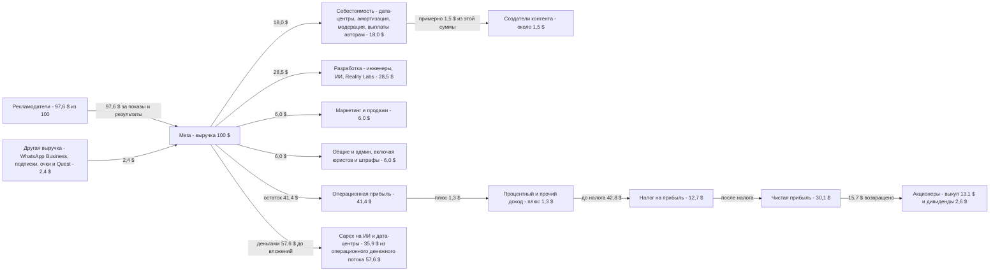
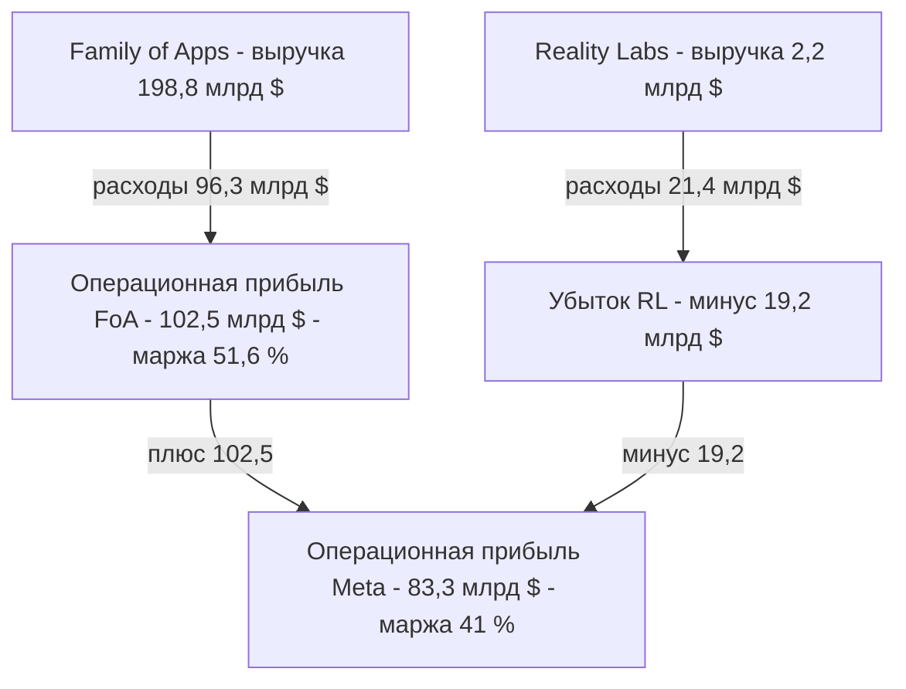
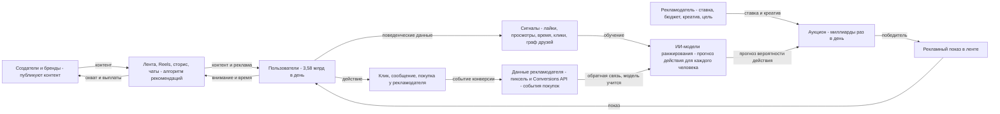
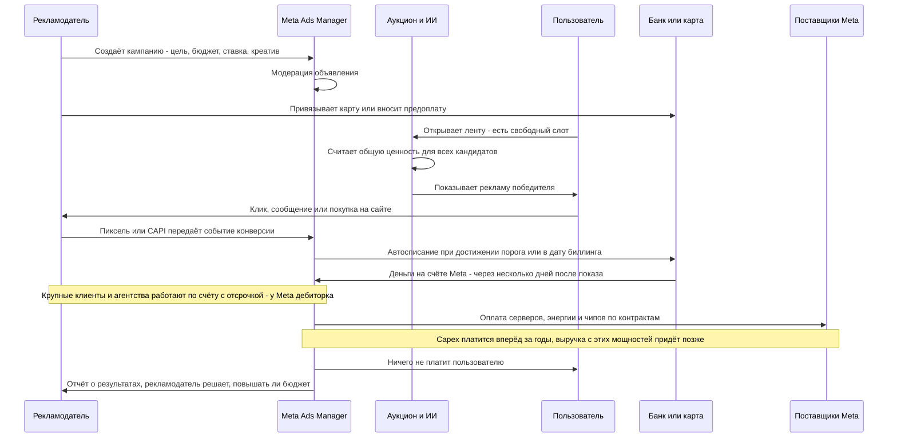

# Meta / Facebook (Family of Apps)

Двусторонняя платформа: 3,58 млрд человек бесплатно пользуются Facebook, Instagram, WhatsApp и Messenger, а Meta продаёт рекламодателям их внимание через аукцион показов.

Цифры за 2025 год взяты из годового отчёта 10-K за 2025 и пресс-релиза Q4 2025 [1][2][3]. Последний квартал на дату разбора, Q2 2026, вынесен отдельно [9]. Все суммы в долларах США.

## Суть за 30 секунд

- **Кто клиент.** Платит не пользователь, а рекламодатель: от лавки с бюджетом 5 $ в день до Procter & Gamble. Большинство рекламодателей работает через самообслуживание в Ads Manager [1]. Последнее публичное число — 10 млн активных рекламодателей в Q3 2020 [13]. Свежих данных Meta не раскрывает.
- **Что покупает.** Показ рекламы конкретному человеку с высокой вероятностью нужного действия: клика, покупки, заявки или сообщения в WhatsApp. По сути он покупает прогноз результата, а не место на странице.
- **За что платит.** За показы (CPM) или за результат. Цену определяет аукцион: побеждает не самая большая ставка, а лучшая «общая ценность» = ставка × прогноз действия + качество рекламы [12].
- **Откуда прибыль.** Контент для Meta почти бесплатный, его делают пользователи и авторы. Создателям Facebook платит около 3 млрд $ в год, это примерно 1,5 % выручки [10]. Главные затраты — инженеры и серверы. Поэтому сегмент Family of Apps даёт 51,6 % операционной маржи [3].
- **Главный конфликт.** Вся прибыль рекламного бизнеса частично сжигается в двух местах. Reality Labs (очки и VR) теряет 19,2 млрд $ в год. Ещё 72 млрд $ в год уходит в capex на ИИ и дата-центры, а в 2026 году план — 130–145 млрд $ [3][9].

## Участники и кто кому платит

| Участник | Что даёт | Что получает | Платит кому и за что |
|---|---|---|---|
| Пользователь, 3,58 млрд DAP [2] | Внимание, время, данные о поведении, контент, социальный граф | Бесплатную связь с людьми, ленту, развлечения, мессенджер | Никому за основной продукт. В ЕС можно платить Meta за подписку без рекламы [1][15]. Покупатели очков Ray-Ban Meta и Quest платят за железо |
| Создатель контента | Ролики и посты, которые удерживают внимание | Охват, аудиторию, выплаты из программ монетизации: в 2025 году почти 3 млрд $ на Facebook [10] | Ничего. Иногда сам становится рекламодателем, когда продвигает себя |
| Рекламодатель | Деньги, рекламные креативы, данные о конверсиях через пиксель или Conversions API | Показы, клики, продажи, лиды | Meta, за показы или результат. 196,2 млрд $ в 2025 году [3] |
| Рекламное агентство или маркетолог | Настройку, креатив, аналитику | Гонорар или процент от бюджета клиента | Деньги клиента идут через него или напрямую в Meta. Сам Meta ему не платит |
| Бизнес в WhatsApp | Переписку с клиентами | Канал продаж и поддержки | Meta за платные сообщения через WhatsApp Business API. Годовой темп выручки больше 2 млрд $ [14] |
| Поставщики железа и энергии: Nvidia, производители серверов, стройка, электросети | Чипы, серверы, электричество, здания | Деньги Meta | Получают capex: 72,2 млрд $ в 2025 году [3] |
| Сотрудники, 78 865 человек [2] | Код, модели, продажи | Зарплату и акции. SBC составил 20,4 млрд $ [4] | Получают деньги, ничего не платят |
| Акционеры | Капитал, исторически | Байбэки и дивиденды | Получили 26,3 млрд $ выкупа акций и 5,3 млрд $ дивидендов [2] |
| Государства | Правила игры: GDPR, DMA, налоги | Налоги и штрафы | Получают 25,5 млрд $ налога на прибыль в 2025 году [4] и штрафы, например 1,2 млрд € по GDPR [16] и 200 млн € по DMA [15] |
| Apple и Google | Платформы iOS и Android, через которые пользователь заходит | Контроль над данными и комиссии магазинов | Meta зависит от их правил, пример — ATT [1][11] |

## Схема денег

На каждые 100 $ выручки Meta в 2025 году. Расчёт мой, исходные данные из income statement [4] и сегментной отчётности [3].

Как считалось:
- Выручка 200 966 млн. Себестоимость 36 175 (18,0 %), R&D 57 372 (28,5 %), маркетинг и продажи 11 991 (6,0 %), G&A 12 152 (6,0 %). Операционная прибыль 83 276 (41,4 %), налог 25 474 (12,7 %), чистая прибыль 60 458 (30,1 %) [4].
- Реклама 196 174 млн, то есть 97,6 % выручки. Прочая выручка 4 791: 2 584 в Family of Apps и 2 207 в Reality Labs [3].
- Операционный денежный поток 115,8 млрд (57,6 %), capex 72,2 млрд (35,9 %), свободный денежный поток 43,6 млрд (21,7 %) [2][3].
- Выплаты авторам взяты так: почти 3 млрд $ на Facebook [10], делённые на выручку. Это моя оценка доли. В какую строку P&L Meta их относит, в 10-K отдельно не раскрыто, и Instagram в эту сумму не входит.
- Ставка налога 30 % в 2025 году — разовая. На неё повлиял списание отложенных налоговых активов из-за One Big Beautiful Bill Act. Без него ставка была бы 13 % [2].

**Где на самом деле прибыль.** Если разрезать по сегментам:

Источники: [1] (расходы FoA 96,29 млрд и RL 21,40 млрд), [3] (выручка и операционный результат сегментов).

**Куда идёт выручка по регионам.** Реклама в 2025 году по месту пользователя, по данным [3]:

| Регион | Рекламная выручка, млн $ | Доля |
|---|---|---|
| США и Канада | 85 278 | 43,5 % |
| Европа | 47 163 | 24,0 % |
| Азия и Тихий океан | 38 285 | 19,5 % |
| Остальной мир | 25 448 | 13,0 % |

## Схема ценности и товара/услуги

**Сетевой эффект. Почему это крепость.**
- **Прямой эффект.** Ценность Facebook или WhatsApp для тебя растёт с числом твоих знакомых внутри. Уйти дорого: туда не перейдут твои 300 контактов.
- **Перекрёстный эффект, двусторонний рынок.** Больше пользователей дают больше рекламодателей. Больше рекламодателей — больше денег на ИИ и авторов. Лучше контент и реклама — ещё больше времени в приложениях.
- **Эффект данных.** Каждая покупка, о которой рекламодатель сообщает через пиксель, учит модель. Точнее прогноз — выше ROI рекламодателя. Выше ROI — он поднимает бюджет. Именно поэтому ATT ударил так больно: Apple перерезала этот обратный канал на iOS [11].
- **Внимание — товар, контент — сырьё.** Meta не производит контент, она его распределяет. Поэтому выплаты авторам составляют около 1,5 % выручки [10], а не 50 %, как у стримингов.

## Момент оплаты

Как устроены деньги во времени:
- **Мелкий рекламодатель** платит картой. Meta списывает деньги по мере открутки, когда набирается порог списания или наступает дата биллинга. Деньги приходят почти сразу, это почти как предоплата.
- **Крупные бренды и агентства** работают по счёту с отсрочкой. У Meta появляется дебиторская задолженность. Конкретный срок оборачиваемости в этом разборе не проверял — нет данных.
- **Свой оборотный капитал Meta получает дёшево**: продаёт цифровой товар без склада и запасов. Операционный денежный поток в 2025 году — 115,8 млрд $, это 57,6 % выручки [2].
- **Обратный разрыв во времени**: capex. Meta платит за дата-центры и чипы сейчас, а выручку с них ждёт годами. В 2025 году capex съел 62 % операционного денежного потока (72,2 из 115,8) [2][3]. В 2026 году план 130–145 млрд $ [9]. Это больше всего операционного денежного потока 2025 года.
- **Сезонность**: Q4 самый сильный, рекламные бюджеты перед праздниками [1]. Q4 2025 — 59,9 млрд $ из 201 за год [3].

## Как получается прибыль

**P&L 2025, млн $** [4]

| Строка | 2025 | % выручки | 2024 |
|---|---|---|---|
| Выручка | 200 966 | 100 % | 164 501 |
| Себестоимость | 36 175 | 18,0 % | 30 161 |
| **Валовая прибыль** | 164 791 | **82,0 %** | 134 340 |
| R&D | 57 372 | 28,5 % | 43 873 |
| Маркетинг и продажи | 11 991 | 6,0 % | 11 347 |
| G&A | 12 152 | 6,0 % | 9 740 |
| **Операционная прибыль** | 83 276 | **41,4 %** | 69 380 |
| Процентный и прочий доход | 2 656 | 1,3 % | 1 283 |
| Налог | 25 474 | 12,7 % | 8 303 |
| **Чистая прибыль** | 60 458 | **30,1 %** | 62 360 |

Неденежные статьи 2025 года: амортизация 18,6 млрд $, выплаты акциями (SBC) 20,4 млрд $ [4].

**Юнит-экономика на одного пользователя.**
- ARPP, выручка на человека, в Q4 2025 — 16,56 $ за квартал [7].
- За год получается примерно 56 $ на человека: 200,97 млрд $, делённые на 3,58 млрд DAP. Это мой расчёт по DAP декабря [2].
- Разброс по регионам огромный. После Q4 2023 Meta перестала раскрывать ARPU по регионам [6]. Последние данные — ARPU Facebook за Q4 2023: США и Канада 68,44 $ за квартал, Европа 23,14 $, Азия 5,52 $, остальной мир 4,50 $, в среднем по миру 13,12 $ [8]. Американец приносит в 15 раз больше индийца или бразильца.
- Себестоимость обслуживания одного пользователя в 10-K отдельно не раскрыта — нет данных.

**Формула выручки:** выручка = показы × цена показа. В 2025 году показы выросли на 12 %, средняя цена показа — на 9 % [2]. В Q2 2026 показы выросли на 14 %, цена — на 12 % [9].
- **Показы** растут от числа пользователей, времени в приложениях и рекламной нагрузки, особенно в Reels, Threads и WhatsApp.
- **Цена показа** растёт от качества таргетинга (ИИ), спроса рекламодателей и конверсии.

**Юнит-экономика рекламодателя**, то есть зачем он платит. Отраслевые бенчмарки Facebook-рекламы за 2024–2025 годы [17]:
- средний CPM 7,47 $;
- CPC 1,06–1,72 $;
- CTR 0,72–1,49 %;
- конверсия 2–14 %;
- ROAS в среднем 2,79.

Пока рекламодатель получает примерно 2,8 $ выручки на 1 $ рекламы, он платит. Meta держит цену так, чтобы этот ROAS не ушёл ниже порога окупаемости клиента.

**Главные рычаги прибыли:**
1. **Качество ИИ-таргетинга.** Выше конверсия — выше ставка, которую рекламодатель готов платить. Meta прямо связывает рост выручки с моделями ранжирования, например с GEM [14].
2. **Время в приложениях и рекламная нагрузка**: Reels, Threads, реклама в WhatsApp и Threads.
3. **Монетизация бедных регионов.** Там аудитория огромная, а ARPU в 15 раз ниже США [8]. Здесь огромный потенциал роста.
4. **Новые потоки денег**: платные сообщения WhatsApp (больше 2 млрд $ годового темпа [14]), подписки, бизнес-ИИ-агенты.
5. **Дисциплина расходов.** 2022–2023 годы назывались «год эффективности». Сейчас обратный цикл: в Q2 2026 расходы выросли на 55 %, операционная маржа упала до 31 % против 43 % годом раньше [9].
6. **Reality Labs.** Минус 19,2 млрд $ в год [3]. В 2026 году убыток планируют на том же уровне [2]. Любое сокращение здесь сразу превращается в прибыль.

## Откуда клиенты

У Meta две воронки: пользователей и рекламодателей.

**Пользователи:**
- **Каналы**: сарафан и сетевой эффект («все друзья там»), предустановка и магазины приложений, кросс-промо между Facebook, Instagram, WhatsApp, Threads (Threads вырос на аудитории Instagram).
- **Стоимость привлечения**: весь маркетинг и продажи — 6,0 % выручки [4]. Это бюджет на продажи рекламодателям и на бренд вместе. Отдельный CAC на пользователя не раскрывается — нет данных.
- **Удержание**: лента на ИИ-рекомендациях, уведомления, социальный граф. DAP в декабре 2025 — 3,58 млрд, плюс 7 % за год [2]. В июне 2026 — 3,60 млрд, плюс 3 % [9]: рост замедляется, рынок почти насыщен.

**Рекламодатели:**
- **Самообслуживание**: Ads Manager и кнопка «Продвигать» на странице. Основная масса рекламодателей, малый и средний бизнес, приходит сама [1].
- **Отдел продаж и агентства** работают с крупными брендами.
- **Автоматизация**: Advantage+, где ИИ сам подбирает аудиторию и креатив. Порог входа для малого бизнеса падает почти до нуля.
- **Удержание** рекламодателя держится на одном: окупается ли реклама. Повторная покупка у Meta ежедневная: бюджет откручивается каждый день, пока ROAS выше порога. Это подписка без подписки.
- **Слабое место**: зависимость от конверсионных данных. После ATT рекламодатели хуже видели результат, и часть урезала бюджеты [1][11].

## Риски: кто несёт и в чём именно

| Риск | Кто несёт | В чём конкретно | Как снижают |
|---|---|---|---|
| Платформенная зависимость от Apple и Google | Meta, рекламодатели | ATT (2021): пользователь iOS отказывается от трекинга, и Meta хуже таргетирует и измеряет. Оценка CFO — минус 10 млрд $ выручки в 2022 году [11]. В 10-K до сих пор указано как фактор, ухудшивший выручку [1] | Conversions API (данные с сервера рекламодателя), ИИ-моделирование конверсий без персональных данных, свои устройства (очки) как попытка уйти из-под Apple |
| Регуляторы ЕС: GDPR и DMA | Meta, европейские пользователи и рекламодатели | Штраф 1,2 млрд € за передачу данных в США (2023) [16]. Штраф 200 млн € по DMA за модель «плати или соглашайся» (апрель 2025) [15]. Возможны новые изменения модели и «существенно худший опыт» для пользователей ЕС [1]. Европа даёт 24 % рекламной выручки [3] | Подписка без рекламы, вариант «менее персонализированной рекламы» (с ноября 2024) [1], апелляции |
| Штрафы от глобальной выручки | Акционеры | По 10-K штрафы всё чаще считаются от мировой выручки [1]. DMA допускает до 10 % | Юристы, переговоры, адаптация продукта |
| Детская безопасность и суды в США | Meta, акционеры | Meta предупреждала, что суды 2026 года по вреду для подростков могут закончиться «существенным убытком» [4]. В Q2 2026 начислено 2,4 млрд $ юридических расходов [9] | Подростковые аккаунты, родительский контроль, судебная защита |
| Антимонопольный риск | Акционеры | FTC требовала отделить Instagram и WhatsApp. Meta выиграла дело в ноябре 2025 [18] | Судебная защита. Риск снижен, но не исчез |
| Перегрев capex на ИИ | Инвесторы, Meta | 72 млрд $ в 2025 и 130–145 млрд $ в 2026 году [3][9]. Если ИИ не даст роста выручки, это амортизация без отдачи и падение маржи. Операционная маржа Q2 2026 уже 31 % против 43 % [9] | Обещание, что операционная прибыль 2026 года будет выше 2025-го [4]. Долг и лизинг вместо одних только собственных денег. Долгосрочный долг 58,7 млрд $ [2] |
| Reality Labs — ставка на метавселенную и очки | Акционеры | Минус 19,2 млрд $ в год [3], выручка 2,2 млрд $. Окупаемость не доказана | Сдвиг на очки: 70 % расходов RL в 2026 году на носимые устройства [1]. Продажи очков выросли больше чем втрое [14] |
| Конкуренция за внимание | Meta | TikTok, YouTube, ИИ-ассистенты забирают время. Нет внимания — нет показов | Reels, переманивание авторов деньгами: Creator Fast Track, 1–3 тыс. $ в месяц гарантии [10] |
| Цикличность рекламы | Meta, сотрудники | В кризис бизнес первым режет рекламу | Миллионы мелких рекламодателей с бюджетом на перформанс, а не на бренд |
| Падение ROAS у рекламодателя | Рекламодатель | Рост цены показа (плюс 9–12 %) съедает его маржу. Платит он, а результат не гарантирован | Тестирование, свои данные, диверсификация в Google, TikTok, Amazon |
| Качество метрик | Инвесторы | Погрешность DAP около 3 %. Меньше 5 % DAP — аккаунты-нарушители [1] | Раскрытие методологии |
| Ключевой человек и контроль | Акционеры класса A | У Цукерберга контроль голосов через акции класса B (342 млн акций класса B против 2,19 млрд класса A) [1]. Акционеры не могут остановить, например, траты на RL | Никак. Это цена входа в акцию |
| Модерация и репутация | Сотрудники, общество | Дезинформация, вредный контент, давление и выгорание модераторов | Модерация, ИИ-фильтры, Oversight Board |

## Заинтересованные лица

| Кто | Чего хочет | Почему это важно бизнесу |
|---|---|---|
| **Цукерберг**, основатель с контролем голосов [1] | Долгие ставки: ИИ «персонального суперинтеллекта», очки, метавселенная [14] | Компания может вкладывать сотни миллиардов против воли рынка. Это и сила, и риск |
| **Акционеры и инвесторы** | Рост выручки, маржу, свободный денежный поток, байбэки | Байбэки и дивиденды — 31,6 млрд $ в 2025 году [2]. Если рынок разочаруется capex, упадёт капитализация, а с ней стоимость акций для найма |
| **Пользователи** | Бесплатность, интересную ленту, приватность, безопасность | Нет пользователей — нет товара. Их время и доверие и есть сырьё |
| **Создатели контента** | Охват и деньги | Без них лента пустеет и время уходит в TikTok или YouTube. Meta платит почти 3 млрд $ в год [10] |
| **Рекламодатели** | ROAS, измеримость, дешёвый CPM | 97,6 % выручки [4]. Они голосуют бюджетами каждый день |
| **Агентства** | Удобные инструменты и бюджеты клиентов | Канал крупных денег. Автоматизация Advantage+ частично отнимает у них работу |
| **Сотрудники**, 75–79 тыс. [2][9] | Зарплаты, акции, интересные задачи | SBC — 20,4 млрд $ [4]. Конкуренция за ИИ-таланты с OpenAI и Google |
| **Поставщики**: Nvidia, энергетики, стройка | Долгие крупные контракты | От них зависят сроки запуска ИИ-мощностей |
| **Apple и Google** | Контроль над платформой и данными | Могут одним обновлением ОС отрезать данные [11] |
| **Государства и регуляторы**: ЕС, FTC, налоговые органы | Защиту граждан, конкуренцию, налоги | Штрафы, запреты моделей монетизации, налог 25,5 млрд $ [4] |
| **Банки и держатели облигаций** | Возврат долга | Долг 58,7 млрд $ [2] растёт вместе с capex. Кредиторы смотрят на денежный поток |
| **Общество и СМИ** | Отсутствие вреда детям, дезинформации, манипуляций выборами | Репутация превращается в суды и новые законы. Пример — суды по подросткам 2026 года [4][9] |

## Как на это смотрит инвестор

**Ключевые метрики рекламной платформы:**

| Метрика | Значение | Что показывает |
|---|---|---|
| DAP, ежедневные пользователи всех приложений | 3,58 млрд в декабре 2025, плюс 7 % [2]. 3,60 млрд в июне 2026, плюс 3 % [9] | Размер товара. Рост почти исчерпан |
| ARPP, выручка на человека | 16,56 $ за Q4 2025 [7] | Умение монетизировать внимание. Главный драйвер теперь |
| Рост показов и цены показа | Плюс 12 % и плюс 9 % в 2025 году [2]. Плюс 14 % и плюс 12 % в Q2 2026 [9] | Из чего состоит рост выручки |
| Рост выручки | Плюс 22 % в 2025 году [2]. Плюс 28 % в Q2 2026 [9] | Для компании на 200 млрд $ это исключительно много |
| Операционная маржа | 41 % в 2025 году [2], 31 % в Q2 2026 [9]. FoA — 51,6 % [3] | Насколько дорого стоит рост |
| Свободный денежный поток | 43,6 млрд $ в 2025 году [2] | Деньги, реально доступные акционерам после capex |
| Capex и его отношение к выручке | 72,2 млрд $, 36 % выручки [3]. План на 2026 год — 130–145 млрд $ [9] | Главный страх рынка в 2026 году |
| Убыток Reality Labs | Минус 19,2 млрд $ [3] | «Налог Цукерберга» на прибыль |
| P/E | Около 27 по прошлой прибыли, капитализация около 1,83 трлн $ на 12.10.2026 [19] | Сколько лет прибыли платят за компанию |
| Выручка на сотрудника | Около 2,5 млн $: 201 млрд $ на 78,9 тыс. человек, мой расчёт [2][4] | Эффективность масштаба |

**Что ценят инвесторы:**
- маржу рекламного ядра выше 50 %;
- огромный денежный поток;
- сетевой эффект, который почти невозможно повторить;
- ИИ, который уже окупается в рекламе через рост цены показа;
- байбэки.

**Что пугает инвесторов:**
- capex без понятной отдачи. Пример — реакция на рост расходов на 55 % в Q2 2026 при падении операционной прибыли на 8 % [9];
- вечный убыток Reality Labs;
- регуляторы ЕС;
- суды по детям;
- зависимость от Apple;
- контроль одного человека.

**Исторический урок.** В феврале 2022 года Meta сообщила, что ATT стоит ей около 10 млрд $, и показала первый спад пользователей. Акции упали примерно на 23 % за вечер [11]. Рынок наказывает не за убыток, а за угрозу механике роста.

## Что берём себе

1. **Платит не тот, кто потребляет.** У Meta пользователь бесплатно отдаёт внимание, а платит бизнес, которому это внимание нужно. Для Jetix: бесплатный контент эксперта (интервью, подкасты, эфиры) собирает аудиторию, а платят те, кому нужна эта аудитория или результат: сам эксперт за продюсирование или процент, а позже спонсоры и партнёры.
2. **Продавай результат, а не часы.** Рекламодатель у Meta платит за прогноз действия и считает ROAS. Эксперту надо продавать в его же логике: «вложил X — получил выручку Y». Отсюда модель с процентом от оборота клиента. Мы, как Meta, берём долю, пока ROAS клиента положительный, и клиент сам наращивает «бюджет».
3. **Петля данных — главный актив.** Meta богата обратной связью от конверсий. Нам нужна своя: какие темы, форматы и офферы экспертов реально продают. Каждый запуск записываем в git как данные. Это наш «пиксель» и защита от конкурентов.
4. **Авторов надо кормить.** Meta платит авторам около 3 млрд $ и даёт гарантию 1–3 тыс. $ в месяц новичкам, чтобы перетащить их от конкурентов [10]. Для нас: экспертам на старте нужен гарантированный быстрый результат (первый запуск, первые лиды), иначе они уйдут к другому продюсеру.
5. **Не зависеть от чужой платформы.** ATT за один день отрезал Meta 10 млрд $ [11]. Если весь трафик экспертов идёт из Instagram или YouTube, нас может обнулить их алгоритм. Нужны свои активы: email-база, Telegram-канал, CRM.
6. **Ядро кормит эксперименты, но с лимитом.** Reality Labs съедает почти пятую часть прибыли ядра [3]. Правило для Jetix: новые направления финансировать из прибыли основной услуги, с заранее заданным потолком убытка и сроком.

## Источники

1. [Meta 10-K FY2025, SEC](https://www.sec.gov/Archives/edgar/data/1326801/000162828026003942/meta-20251231.htm) — годовой отчёт: реклама как «практически вся выручка», расходы FoA и RL, ATT, DMA и вариант LPA, риски штрафов, погрешность DAP, структура акций.
2. [Meta Reports Fourth Quarter and Full Year 2025 Results, через Finviz](https://finviz.com/news/290695/meta-reports-fourth-quarter-and-full-year-2025-results) — итоги 2025 года: выручка, маржа, DAP, показы и цена, FCF, capex, байбэки, долг, прогноз на 2026 год.
3. [Earnings Presentation Q4 2025, Meta IR](https://s21.q4cdn.com/399680738/files/doc_financials/2025/q4/Earnings-Presentation-Q4-2025-FINAL.pdf) — сегменты, выручка по регионам, capex, FCF.
4. [Exhibit 99.1 Q4 2025, пресс-релиз с отчётностью](https://s21.q4cdn.com/399680738/files/doc_financials/2025/q4/Meta-12-31-2025-Exhibit-99-1-FINAL.pdf) — income statement 2025 и 2024 по строкам, амортизация, SBC, прогноз CFO, риск судов по подросткам.
5. [Meta Form ARS FY2025, SEC](https://www.sec.gov/Archives/edgar/data/1326801/000162828026025534/meta-12312025x10kars.htm) — годовой отчёт акционерам: Reality Labs снизил прибыль на 19,19 млрд $.
6. [Supplemental Earnings Slide Q4 2023, Meta IR](https://s21.q4cdn.com/399680738/files/doc_financials/2023/q4/Supplemental-Earnings-Slide-Q4-2023.pdf) — Meta прекращает раскрывать DAU, MAU и ARPU с 2024 года и переходит на DAP и ARPP.
7. [Zacks через Finviz: ключевые метрики Q4 2025](https://finviz.com/news/290992/meta-platforms-meta-q4-earnings-taking-a-look-at-key-metrics-versus-estimates) — ARPP 16,56 $, рост рекламы по регионам.
8. [FourWeekMBA: Facebook ARPU](https://fourweekmba.com/facebook-arpu/) — последний ARPU Facebook по регионам, конец 2023 года.
9. [Meta Reports Second Quarter 2026 Results, Meta IR](https://s21.q4cdn.com/399680738/files/doc_news/Meta-Reports-Second-Quarter-2026-Results-2026.pdf) — Q2 2026: выручка плюс 28 %, маржа 31 %, capex, прогноз на 2026 год, 2,4 млрд $ юридических расходов.
10. [Meta Newsroom: Creator Fast Track, март 2026](https://about.fb.com/news/2026/03/creator-fast-track-grow-your-audience-earn-money-on-facebook/) — почти 3 млрд $ выплат авторам в 2025 году, плюс 35 %, гарантии 1–3 тыс. $ в месяц.
11. [CNBC, 02.02.2022: iOS privacy change will cost $10 billion](https://www.cnbc.com/2022/02/02/facebook-says-apple-ios-privacy-change-will-cost-10-billion-this-year.html) — оценка ущерба от ATT и падение акций на 23 %.
12. [Dotidot: Meta Ads auction](https://www.dotidot.io/post/meta-ads-auction-how-facebook-decides-which-ads-win) — формула аукциона: ставка × прогноз действия + качество. Это упрощённое объяснение; официальная справка Meta не открылась, robots.
13. [Statista: active advertisers on Facebook](https://www.statista.com/statistics/778191/facebook-advertising-costs/) — 10 млн активных рекламодателей в Q3 2020, последнее раскрытое число.
14. [Barchart: Meta Q4 deep dive](https://www.barchart.com/story/news/37301858/meta-q4-deep-dive-ai-acceleration-drives-revenue-outperformance-and-guidance-upside) — ИИ-ранжирование (GEM), платные сообщения WhatsApp больше 2 млрд $ годового темпа, очки, Threads.
15. [RDJ: EU fines Apple and Meta under DMA](https://www.rdj.ie/insights/eu-fines-apple-and-meta-700m-for-non-compliance-with-digital-markets-act) — штраф 200 млн € от 23.04.2025 за модель «плати или соглашайся».
16. [BDO: DPC imposes €1.2 billion fine on Meta](https://www.bdo.co.uk/en-gb/insights/advisory/risk-and-advisory-services/irish-data-protection-commissioner-imposesa-1-2-billion-fine-on-meta-ireland) — крупнейший штраф по GDPR, 2023 год, передача данных в США.
17. [WebFX: Meta benchmarks](https://www.webfx.com/blog/social-media/meta-benchmarks/) — CPM, CPC, CTR, конверсия, ROAS Facebook-рекламы за 2024–2025 годы.
18. [ABC7: Meta prevails in FTC antitrust case](https://abc7news.com/post/meta-prevails-historic-ftc-antitrust-case-have-break-off-whatsapp-instagram/18170444/) — Meta не обязана продавать Instagram и WhatsApp.
19. [Equibles: META summary](https://equibles.com/stocks/meta/summary) — капитализация около 1,83 трлн $ и P/E около 27,1 на 12.10.2026. Котировка плавает, данные агрегатора.
