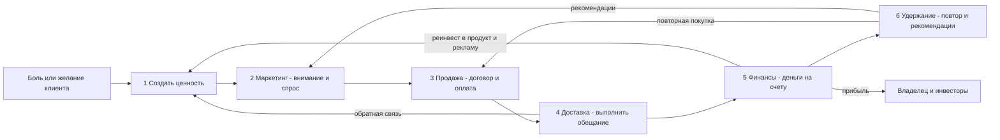
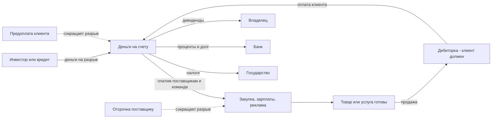
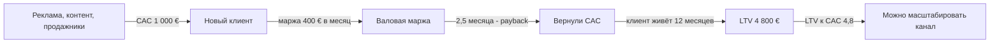
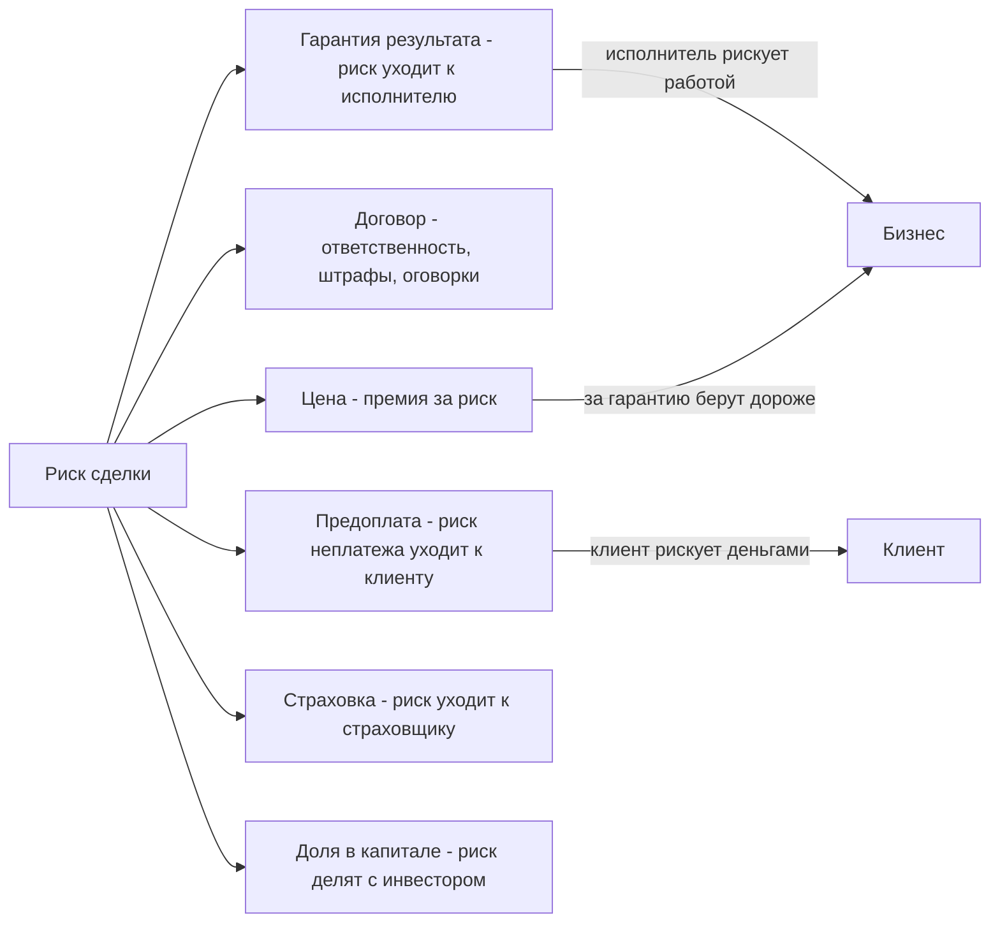
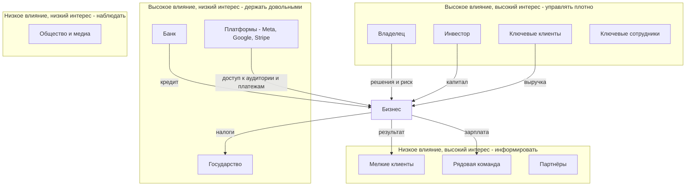

# Системная рамка: как разбирать любой бизнес

Одна линза для любого бизнеса: что он обязан делать, как через него идут деньги, на чём он зарабатывает, кто несёт риск, кому он нужен и как его оценивает инвестор.

Как пользоваться: супермаркет, консалтинг, рекламное агентство, Meta и интернет-магазин разобраны в соседних файлах. Этот файл — общий каркас. Каждый разбор прогоняй через 6 блоков ниже и через чек-лист в конце.

## Что бизнес обязан делать

**Josh Kaufman, «The Personal MBA»** — у любого бизнеса пять частей [1]:

| # | Часть | Что это | Если её нет |
|---|---|---|---|
| 1 | Создание ценности | понять, что людям нужно, и сделать это | продавать нечего |
| 2 | Маркетинг | привлечь внимание и создать спрос | никто не знает |
| 3 | Продажи | превратить интерес в оплату | интерес есть, денег нет |
| 4 | Доставка ценности | выполнить обещание так, чтобы клиент остался доволен | возвраты, плохие отзывы, клиент не вернётся |
| 5 | Финансы | получать достаточно денег, чтобы продолжать и чтобы оно того стоило | хобби или банкротство |

Формулировка Кауфмана: «уберите любую из пяти частей, и это уже не бизнес» [1]. Шестой пункт, **удержание**, у Кауфмана сидит внутри доставки и финансов. Мы выносим его отдельно, потому что повторная покупка — самые дешёвые деньги.

**Business Model Canvas (Остервальдер, Пинье)** — тот же бизнес в виде 9 блоков [2]. Справа рынок, слева то, что нужно, чтобы его обслужить, в центре ценностное предложение. Внизу — затраты и доходы, и они «держатся, только если верны семь блоков над ними» [2].

| Сторона | Блоки |
|---|---|
| Рынок | сегменты клиентов, каналы, отношения с клиентами |
| Центр | ценностное предложение |
| Кухня | ключевые ресурсы, ключевые действия, ключевые партнёры |
| Деньги | потоки доходов, структура затрат |



**Как применять:** в каждом разобранном бизнесе ищи, какое из 6 звеньев самое слабое. Обычно ограничение одно, и рост упирается именно в него.

## Как деньги проходят через любой бизнес

### Денежный цикл

Деньги в бизнесе ходят по кругу: деньги → закупка или зарплаты → продукт или услуга → продажа → дебиторка (клиент должен) → деньги. Чем короче круг, тем меньше своих денег надо вложить, чтобы расти.

**Цикл конверсии денег** = дни запасов + дни дебиторки − дни кредиторки.
- Положительный цикл: ты платишь поставщикам и сотрудникам раньше, чем платит клиент. Рост съедает кэш.
- Отрицательный цикл: клиент платит раньше, чем ты платишь поставщику. Рост *даёт* кэш. Так работают супермаркеты с отсрочкой поставщикам и сервисы с предоплатой (подробно — в разборе супермаркета).



### Оборотный капитал

Оборотный капитал = запасы + дебиторка − кредиторка. Это деньги, «замороженные» в операционке. Его надо профинансировать: своими деньгами, кредитом, отсрочкой поставщика или предоплатой клиента. **Прибыльный бизнес может обанкротиться**, если рост съел весь кэш. По отчёту CB Insights (март 2026, 431 закрытый стартап) 70% называли причиной «кончились деньги», и это «почти всегда финальная причина смерти, а не корневая проблема». Корневые: плохое попадание в рынок (43%), тайминг (29%), неработающая юнит-экономика (19%) [9].

### P&L против кэша

| | P&L (отчёт о прибылях) | Cash flow (движение денег) |
|---|---|---|
| Отвечает на вопрос | заработали ли мы | есть ли деньги платить |
| Выручка | когда услуга оказана | когда деньги пришли |
| Пример | продал годовой контракт за 12 000 €, в P&L по 1 000 € в месяц | 12 000 € пришли в январе одной суммой |
| Ловушка | «мы в плюсе», а платить нечем | «на счету много», а это предоплата, которую ещё надо отработать |

a16z прямо разделяет **bookings** (сумма подписанных контрактов) и **revenue** (признанная выручка по мере оказания услуги), а «письма о намерениях и устные договорённости — ни то, ни другое» [3].

### Структура P&L

```
Выручка
− Себестоимость (прямые затраты: товар, подрядчик, часы исполнителей)
= Валовая прибыль           → валовая маржа = валовая / выручка
− Операционные расходы (маркетинг, продажи, офис, админ, зарплаты не в себестоимости)
= Операционная прибыль (EBIT) ; + амортизация = EBITDA
− Проценты
− Налоги
= Чистая прибыль            → чистая маржа
```

Чистая маржа очень разная по отраслям (Damodaran, январь 2026, США) [6]:

| Отрасль | Чистая маржа |
|---|---|
| Продуктовый ритейл | 1,32% |
| Ритейл общий | 5,61% |
| Бизнес- и потребительские услуги | 7,03% |
| Реклама | −0,30% |
| Софт | 25,49% |
| Весь рынок | 9,74% |

### Точка безубыточности

Точка безубыточности (в штуках) = постоянные расходы / (цена − переменные затраты на единицу).

Условный пример (не данные, а иллюстрация): постоянные 5 000 € в месяц, услуга стоит 2 000 €, прямые затраты на неё 500 €. Маржинальный доход 1 500 €. Безубыточность = 5 000 / 1 500 ≈ 3,4 клиента в месяц. Четвёртый клиент — первая прибыль.

### Юнит-экономика

| Метрика | Формула | Что показывает |
|---|---|---|
| CAC | все затраты на привлечение / число новых клиентов | сколько стоит один клиент |
| LTV | приведённая будущая *чистая прибыль* с клиента | сколько клиент принесёт |
| LTV / CAC | — | окупается ли привлечение |
| Payback | CAC / маржа с клиента в месяц | за сколько месяцев вернём деньги на привлечение |
| Churn | доля ушедших клиентов за период | как быстро утекает база |

Важные уточнения a16z [3]: LTV считают по чистой прибыли, а не по выручке и не по валовой марже. CAC лучше считать «платный», а не «смешанный» с органикой, иначе не видно, масштабируется ли платный канал. И CAC растёт, когда выходишь на более широкую аудиторию. Отток смотрят «валовый», потому что чистый отток (с допродажами) «занижает потери».



Цифры на схеме — условный пример для понимания формулы, не бенчмарк.

## Типы моделей заработка

| Модель | Кто платит | За что | Когда платит | Кто несёт риск результата | Пример |
|---|---|---|---|---|---|
| Продажа товара | покупатель | вещь | в момент покупки или раньше | бизнес — запасы, неликвид; клиент — брак в пределах гарантии | супермаркет, интернет-магазин |
| Услуга по часам | клиент | время исполнителя | после, по таймшиту | клиент — платит за часы, даже если результата нет | юрист, фрилансер |
| Проект с фикс-ценой | клиент | результат по ТЗ | частями — аванс, этапы, финал | бизнес — перерасход часов | консалтинг, разработка |
| Ретейнер или подписка | клиент | доступ или объём работ в месяц | заранее, каждый месяц | поровну; клиент может уйти | агентство, SaaS |
| Комиссия или маркетплейс | продавец, иногда покупатель | доступ к сделке | из суммы сделки | продавец — товар; площадка — спрос и доверие | Amazon, Booking |
| Реклама | третья сторона — рекламодатель | внимание пользователей | за показы, клики, действия | рекламодатель — конверсия; площадка — аудитория | Meta, Google |
| % от результата | клиент | прирост выручки или прибыли | после того как результат получен | исполнитель — несёт почти весь риск | performance-агентство, success fee |

**Правило:** чем позже платит клиент, тем больше риска на исполнителе и тем больше оборотного капитала ему нужно. Плата за риск — более высокая цена.

### Отдельно: модель «% от оборота клиента»

Варианты:
- **Revenue share** — доля от всей выручки клиента или от выручки конкретного продукта или канала.
- **Success fee** — разовый процент от сделки или результата: привлечённые деньги, закрытая продажа.
- **Гибрид** — фикс (покрывает затраты исполнителя) + процент сверху от прироста.
- **Доля в капитале** — не процент оборота, а кусок компании. По открытым данным Acquisition.com Хормози позиционирует себя как партнёр для фаундеров с EBITDA 1–10 млн $ [13]; конкретные условия (доля, кэш) на сайте не раскрыты [13].

**Пример Hormozi.** Gym Launch (основан в 2016) учил владельцев фитнес-залов продавать и удерживать клиентов, помог более 4 500 залам [11]. Публичного прайса нет. Обзор usekilo — с оговоркой, что цифры не подтверждены компанией — пишет о предоплате от 5 000 до 40 000 $ и о варианте с процентом с выручки новых клиентов, без размера процента [12]. В январе 2022 года в Gym Launch и Prestige Labs вошёл фонд прямых инвестиций American Pacific Group (рекапитализация), сумма в релизе не раскрыта [11]. Сторонняя статья называет 66% за 46,2 млн $, но без источника — проверять [15]. Вывод: Хормози на старте брал **крупную предоплату**, а не чистый процент. Процент — надстройка, а не основа.

**Как считают:**
1. **База.** От чего процент: вся выручка, выручка канала, прирост к базовому периоду, валовая прибыль. Чем ближе к прибыли, тем честнее, но сложнее проверить.
2. **Базовая линия.** Что было бы без тебя: среднее за 3–6 месяцев или тот же период прошлого года [10].
3. **Окно атрибуции.** Сколько месяцев клиент или лид считается «твоим». На длинных циклах сделки это определение «во многом определяет экономику» [10].
4. **Источник правды.** Какая система главная, если цифры расходятся: CRM, платёжка, бухгалтерия [10].
5. **Период и расчёт.** Когда закрываем месяц, когда платят, что делать со сделками на границе периода [10].

**Плюсы:**
- Клиенту легко сказать «да»: нет большого чека на входе.
- Интересы совпадают: ты зарабатываешь, когда клиент растёт.
- Потолок дохода выше, чем у почасовки: растёт вместе с клиентом.
- Сильный аргумент в продаже: «я в одной лодке с тобой».

**Риски:**

| Риск | В чём конкретно |
|---|---|
| Ты финансируешь клиента | работаешь месяцами, а деньги приходят потом или не приходят |
| Нет контроля | на результат влияют продукт клиента, его продажи, сезон, цены — не ты [10] |
| Нет прозрачности | клиент может занижать выручку, проводить продажи мимо отслеживаемых каналов |
| Спор об атрибуции | «это не твои клиенты, они пришли сами» |
| Кредитный риск | клиент заработал, но не заплатил |
| Концентрация | один-два крупных клиента делают весь доход |
| Перекос стимулов | метрика вознаграждает не то: например, % от рекламного бюджета награждает за трату, а не за прибыль [10] |

**Как контролировать:**
- Фикс на входе, покрывающий себестоимость, + процент сверху. Чистый процент — только с проверенными клиентами.
- Доступ к данным на чтение: платёжка (Stripe, Digistore), CRM, рекламный кабинет — прописано в договоре.
- Право аудита и штраф за сокрытие выручки.
- Минимальный платёж (пол) и, если нужно для продажи, потолок.
- Обязанности клиента письменно: скорость ответа лидам, кто продаёт, сроки согласований [10].
- Срок действия и выход: что положено исполнителю после расторжения (хвост 3–6 месяцев с атрибутированных клиентов).
- Лучше всего — когда деньги проходят через твою инфраструктуру (твоя платёжка или лендинг), и ты сам удерживаешь свою долю до перевода клиенту.

## Риски: кто несёт и в чём

| Риск | Кто несёт | В чём конкретно | Как переносят или снижают |
|---|---|---|---|
| Рыночный | бизнес, инвестор | спрос упал, пришёл конкурент, продукт никому не нужен — у 43% закрытых стартапов это корневая причина [9] | проверка спроса до вложений, предпродажи, несколько сегментов |
| Операционный | бизнес, клиент | не доставили обещанное: срыв сроков, брак, ошибка подрядчика | процессы, SLA, страховка, подрядчик отвечает по договору |
| Финансовый и ликвидность | бизнес, владелец | прибыль на бумаге есть, кэша нет; кончились деньги — 70% закрытых стартапов [9] | предоплата, кредитная линия, запас кэша на 3–6 месяцев, контроль цикла конверсии денег |
| Кредитный | бизнес | клиент получил услугу и не заплатил | предоплата, этапные платежи, депозит, работа после оплаты, проверка клиента |
| Регуляторный | бизнес, владелец | закон, налог, лицензии, защита данных, правила рекламы, ответственность за обещания результата | юрист, оговорки в договоре, соблюдение норм |
| Ключевой человек | бизнес, инвестор, клиент | всё держится на одном: заболел или ушёл — бизнес встал | регламенты, второй исполнитель, бренд компании, а не только человека |
| Концентрация клиентов | бизнес, инвестор | один клиент — большая доля выручки. Покупатели бизнеса начинают давить, когда один клиент выше 20–25% выручки или топ-3 — выше 40–50% [7] | диверсификация, длинные контракты с крупными клиентами |
| Репутационный | бизнес, партнёры | один громкий провал или скандал клиента бьёт по тебе | отбор клиентов, публичные кейсы, отказ от сомнительных проектов |
| Риск поставщика | бизнес | платформа сменила правила, подрядчик ушёл, бан рекламного кабинета | несколько поставщиков и каналов, свои данные клиентов |

**Как риск переносится с одного участника на другого:**



Главная логика: **кто платит раньше, тот рискует.** Предоплата переносит риск на клиента, гарантия результата и % от результата переносят риск на исполнителя. Тот, кто берёт риск на себя, должен брать за это больше.

## Заинтересованные лица

Определение Фримана (1984): стейкхолдер — это «любая группа или человек, который может повлиять или на кого влияет» достижение целей организации [8]. Смысл теории: бизнес живёт, только пока каждая важная группа получает достаточно, чтобы остаться.

| Кто | Чего хочет | Что даёт | Почему важно бизнесу |
|---|---|---|---|
| Владелец | прибыль, рост стоимости, свобода | деньги, решения, риск | несёт последний риск, получает остаток |
| Инвестор | возврат с кратностью, выход | капитал | без него нет денег на рост; влияет на решения |
| Банк | вернуть кредит с процентом | долг | платить нужно при любой прибыли; может забрать залог |
| Клиенты | результат за свои деньги | выручку | единственный источник денег |
| Сотрудники и подрядчики | деньги, стабильность, рост | работу и знания | качество доставки; уход ключевых — риск |
| Поставщики и платформы | объём, своевременная оплата | товар, инструмент, доступ к аудитории | могут поменять условия или отключить |
| Партнёры | взаимная выгода | клиентов, каналы | дешёвые лиды или потеря канала |
| Государство | налоги, соблюдение закона | рынок, правила | штрафы, лицензии, запреты |
| Общество и медиа | польза, отсутствие вреда | репутацию | отзывы, доверие, бойкоты |

**Карта влияние × интерес** (матрица Менделоу): у кого высокое влияние и высокий интерес — управлять плотно, с низким интересом — держать довольными, с низким влиянием — информировать или наблюдать.



## Как смотрит инвестор

### Стадии денег

| Источник | Что даёт | Что хочет взамен | На что смотрит |
|---|---|---|---|
| Свои деньги и выручка (bootstrapping) | свобода, контроль | ничего | прибыль с первого клиента, кэш |
| Друзья и семья | небольшой старт | доверие, доля или возврат | человека |
| Ангелы | первые деньги под идею | долю, кратный возврат | команду, рынок, первые продажи |
| Венчур | крупные деньги на рост | долю, возврат в 10 раз и больше, выход | темп роста, размер рынка, удержание, unit economics |
| Частный капитал (private equity) | покупка доли или контроля в прибыльном бизнесе | стабильную прибыль, рост EBITDA, выход через 3–7 лет | EBITDA, кэш, зависимость от владельца, концентрация клиентов |
| Публичный рынок | ликвидность, капитал | предсказуемый рост и прибыль | прибыль, маржу, прогноз, рентабельность капитала |
| Банк (кредит) | долг без потери доли | проценты и возврат при любом исходе | денежный поток, залог, долговую нагрузку |

### Что смотрит инвестор

- **Рост.** YC: хороший темп во время программы — 5–7% в неделю, 10% — исключительный. Лучшая метрика — выручка [4].
- **Маржа.** Насколько прибыльна выручка; в себестоимость обязательно включать производство, доставку, поддержку [3].
- **Удержание.** Валовый отток клиентов; чистый отток занижает потери [3].
- **Юнит-экономика.** LTV к CAC, платный CAC, payback [3].
- **Burn.** Сколько денег сгорает в месяц; компании умирают, когда кончаются деньги [3].
- **Рынок.** Насколько большим может стать бизнес.
- **Команда.** Может ли она это сделать; держится ли всё на одном человеке.
- **Риски.** Концентрация, зависимость от владельца, регуляторка.
- **Возврат на вложенный капитал.** Классика McKinsey: стоимость создают рост и рентабельность вложенного капитала (ROIC) выше стоимости капитала. Рост без нормальной рентабельности стоимость разрушает. Книга — «Valuation: Measuring and Managing the Value of Companies», 8-е издание [14].

### Мультипликаторы оценки

Стоимость бизнеса = мультипликатор × метрика.

| Мультипликатор | Когда применяют | Логика |
|---|---|---|
| EV / выручка | быстрый рост, прибыли пока нет, высокая маржа (софт, SaaS) | «за каждый доллар выручки, который потом станет прибылью» |
| EV / EBITDA | зрелый бизнес, сделки частного капитала, услуги | «сколько лет операционной прибыли платим» |
| P / E (цена / чистая прибыль) | публичные компании | «сколько лет чистой прибыли» |
| SDE (прибыль для владельца) | малый бизнес, где владелец сам работает | прибыль + зарплата владельца |

Реальные цифры по публичным компаниям США, январь 2026, Damodaran [5][6]:

| Отрасль | EV / выручка | EV / EBITDA |
|---|---|---|
| Софт | 11,41 | 24,48 |
| Ритейл общий | 2,11 | 17,38 |
| Бизнес- и потребительские услуги | 2,53 | 14,26 |
| Реклама | 2,12 | 12,00 |
| Продуктовый ритейл | 0,49 | 8,94 |
| Весь рынок | 3,97 | 19,73 |

EV/EBITDA — по компаниям с положительной EBITDA.

Частный рынок услуг (обзор Iconic, 2025–2026) [7]:
- B2B-услуги с EBITDA 1–10 млн $ — **4,0–6,5× EBITDA**; при 50%+ контрактной повторяющейся выручки — 7–9×.
- Чистые проектные студии — **3,5–4,5× EBITDA**.
- Зависимость от владельца — **дисконт 1–2×**, часто съедает всю премию за повторяющуюся выручку.
- Малый бизнес — медиана **2,38× SDE** (BizBuySell, по цитате в том же обзоре).

### Почему сервисный бизнес оценивают ниже продуктового

1. **Выручка не масштабируется без людей.** Удвоить выручку = почти удвоить команду. Маржа не растёт с объёмом. Чистая маржа софта 25%, услуг 7% [6].
2. **Нет повторяемости.** Проекты заканчиваются, ретейнеры отменяются. Покупатель платит за предсказуемость [7].
3. **Ключевой человек.** Клиенты покупают конкретного эксперта. Ушёл он — ушли клиенты [7].
4. **Концентрация.** У агентств часто 2–3 клиента делают половину выручки [7].
5. **Нет актива.** Нет IP, продукта, базы данных, которые работают без людей.

Что поднимает оценку услуги: контракты на годы, повторяющаяся выручка, процессы без владельца, свой продукт или IP поверх услуги, распределённая база клиентов.

## Вопросы-чеклист

Задавай каждому бизнесу при разборе:

1. Кто конкретно клиент и какую боль или желание он закрывает?
2. Кто платит — тот же, кто пользуется, или третья сторона (рекламодатель, работодатель, государство)?
3. За что именно платят: вещь, время, результат, доступ, внимание?
4. Когда деньги приходят и когда уходят — какой цикл конверсии денег, кто кого кредитует?
5. Какая валовая маржа и что съедает выручку до неё?
6. Сколько стоит привлечь клиента (CAC), сколько он приносит (LTV), за сколько месяцев окупается?
7. Покупает ли клиент повторно и почему уходит?
8. Какое из пяти звеньев Кауфмана сейчас ограничивает рост?
9. Что будет, если уйдёт ключевой человек?
10. Какая доля выручки у крупнейшего клиента и у топ-3?
11. Какие риски на бизнесе, а какие он переложил на клиента, поставщика, платформу — и чем?
12. От какой платформы или поставщика бизнес зависит так, что смена правил его убьёт?
13. Кто стейкхолдеры с высоким влиянием и что будет, если кто-то из них уйдёт?
14. Как его бы оценил инвестор: по выручке, по EBITDA или по прибыли владельца — и почему?
15. Что из этой механики можно украсть себе?

## Что это значит для продюсерского центра Jetix

Jetix — услуги экспертам, оплата частично через % от их оборота, на старте всё делает один Руслан. Через рамку:

**Модель.** Это гибрид «проект или ретейнер + % от результата». По таблице моделей именно % от результата сильнее всего перекладывает риск на исполнителя. Значит, Jetix де-факто **кредитует эксперта своим временем**. Без фикса на входе денежный цикл сильно положительный: работаешь сейчас, деньги через месяцы.

**Что делать:**
1. **Фикс на входе + процент сверху.** Фикс должен покрывать хотя бы твоё время на запуск. Так делал и Хормози в Gym Launch: крупная предоплата, процент — надстройка [12]. Чистый процент — только для эксперта с уже доказанными продажами.
2. **Деньги через твою инфраструктуру.** Если оплаты за продукт эксперта идут через платёжку и лендинг, которые контролирует Jetix, кредитный риск и риск сокрытия выручки почти исчезают: свою долю удерживаешь до перевода.
3. **Договор со всеми пунктами из раздела про % от оборота:** база, базовая линия, окно атрибуции, источник правды, доступ к данным, аудит, пол, хвост после расторжения [10].
4. **Ключевой человек — главный риск дважды.** Ты — ключевой человек для Jetix. Эксперт — ключевой человек для своего бизнеса. Это ровно то, за что покупатели бьют дисконтом 1–2× EBITDA [7]. С первого клиента пиши регламенты, чтобы потом передавать работу.
5. **Концентрация.** С одним-двумя экспертами вся выручка зависит от них. Цель — чтобы ни один эксперт не давал больше 25% дохода [7], на старте это недостижимо, но нужно понимать риск.
6. **Считай юнит-экономику с первого эксперта.** CAC (часы на интервью и продажу), маржа с эксперта в месяц, срок жизни эксперта, payback. Если LTV не перекрывает CAC с запасом, масштабировать нечего.
7. **Для роста оценки — продукт поверх услуги.** Повторяющиеся ретейнеры, своя методика, шаблоны, база — то, что работает без Руслана. Иначе это консалтинг с оценкой 3,5–6× EBITDA [7], а не продукт.

**Главная мысль:** % от оборота — сильный аргумент продажи, но плохой фундамент для кэша. Фундамент — предоплата и контроль над потоком денег.

## Источники

1. [Josh Kaufman, The Personal MBA — 5 Parts of Every Business](https://personalmba.com/5-parts-of-every-business/) — пять частей бизнеса и цитата «уберите одну — это не бизнес».
2. [Strategyzer — The Business Model Canvas](https://www.strategyzer.com/library/the-business-model-canvas) — 9 блоков, логика «рынок справа, кухня слева, деньги внизу»; полные названия блоков — в книге Business Model Generation.
3. [a16z — 16 Startup Metrics](https://a16z.com/16-startup-metrics/) — bookings против revenue, валовая маржа, CAC платный против смешанного, LTV по чистой прибыли, валовый отток, burn.
4. [Paul Graham — Startup = Growth](http://www.paulgraham.com/growth.html) — YC: хороший рост 5–7% в неделю, выручка как главная метрика.
5. [Damodaran, NYU Stern — EV/EBITDA по отраслям, январь 2026](https://pages.stern.nyu.edu/~adamodar/New_Home_Page/datafile/vebitda.html) — мультипликаторы EBITDA публичных компаний США.
6. [Damodaran, NYU Stern — Price/Sales, EV/Sales и маржа по отраслям, январь 2026](https://pages.stern.nyu.edu/~adamodar/New_Home_Page/datafile/psdata.html) — мультипликаторы выручки и чистая маржа.
7. [Iconic — Selling a B2B Services Business](https://iconic.co/blog/selling-a-b2b-services-business/) — мультипликаторы сервисных бизнесов, дисконт за зависимость от владельца, пороги концентрации клиентов.
8. [Wikiquote — R. Edward Freeman](https://en.wikiquote.org/wiki/R._Edward_Freeman) — определение стейкхолдера из «Strategic Management: A Stakeholder Approach», 1984, с. 46.
9. [CB Insights — Why Startups Fail](https://www.cbinsights.com/research/report/startup-failure-reasons-top/) — март 2026, 431 закрытый стартап: 70% кончились деньги, 43% рынок, 19% юнит-экономика.
10. [COR — Performance pricing for agencies: measurement, attribution, and control](https://live.projectcor.com/blog/performance-pricing-for-agencies-measurement-attribution-and-control) — базовая линия, окно атрибуции, источник правды, обязанности клиента, перекос стимулов.
11. [Capstone Partners — Gym Launch and Prestige Labs recapitalization with American Pacific Group](https://www.capstonepartners.com/?p=12370) — сделка января 2022, 4 500+ залов, сумма не раскрыта.
12. [Kilo — Gym Launch Review](https://usekilo.com/gym-launch-review-in-everything-you-need-to-know/) — оценочные цены Gym Launch и вариант с % от выручки; цифры компанией не подтверждены.
13. [Acquisition.com](https://www.acquisition.com/) — партнёрство с фаундерами с EBITDA 1–10 млн $; условия сделок не раскрыты.
14. [Wiley — Valuation, 8th Edition, McKinsey & Company](https://www.wiley-vch.de/en/areas-interest/finance-economics-law/valuation-978-1-394-27941-8) — стандартный учебник по оценке: рост и ROIC как драйверы стоимости.
15. [Foundry — Alex Hormozi: Gym Launch to $250M](https://www.builtbyfoundry.io/blog/alex-hormozi-gym-launch-to-250m-empire) — 66% за 46,2 млн $; в статье без первоисточника, требует проверки.

Нет данных: точный размер процента в модели Gym Launch и условия партнёрства Acquisition.com публично не раскрыты.
