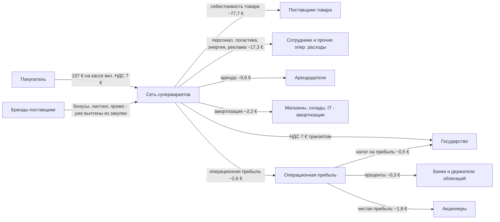
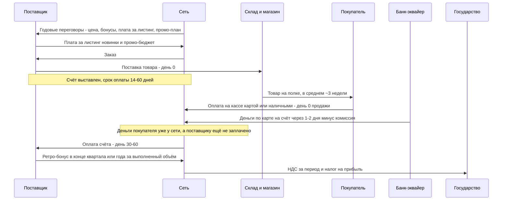

# Супермаркет (продуктовая розница)

Сеть покупает еду у производителей крупным оптом, продаёт её людям в розницу с наценкой ~25 % и зарабатывает 1–3 копейки с рубля — но на огромном обороте и на деньгах поставщиков.

Опорные примеры с открытой отчётностью: **Kroger** (США, 10-K), **Tesco** (Великобритания, годовые результаты), **REWE Group** и **Schwarz (Lidl/Kaufland)** (Германия), **Aldi** (дискаунтер, отчётность закрыта — данные из открытых заявлений компании и прессы).

## Суть за 30 секунд

- **Клиент** — домохозяйство. Покупает еду и бытовую химию часто (раз в несколько дней), платит сразу на кассе картой или наличными. Kroger обслуживает около 62 млн домохозяйств в год [1].
- **Что продаёт сеть на самом деле** — не товар, а *удобство + цену + доверие*: «всё нужное рядом, дёшево и свежее». Товар делают другие.
- **Деньги платят две стороны**: покупатель (за товар) и **поставщик** (за полку, промо, рекламу, объём — бонусы, плата за листинг, ретро-бонусы, ритейл-медиа). Вторая сторона часто и есть разница между убытком и прибылью.
- **Прибыль** = валовая маржа (~22–26 % от выручки) минус персонал, аренда, логистика, потери (~20–23 %) → операционная прибыль 2–4,5 %, чистая 1–2 % [1][2][3][8].
- **Главный финансовый фокус**: покупатель платит сегодня, поставщику сеть платит через 2–8 недель. Сеть живёт на **отрицательном оборотном капитале** — её склад и рост частично финансируют поставщики.

## Участники и кто кому платит

| Участник | Что даёт | Что получает | Платит кому и за что |
|---|---|---|---|
| Покупатель | Деньги, частоту визитов, данные (через карту лояльности) | Товар, цену, удобство, бонусы | Сети — цену товара с НДС, сразу на кассе |
| Сеть (ритейлер) | Полку, трафик, логистику до полки, бренд, данные о покупателях | Розничную наценку + деньги от поставщиков | Поставщикам — закупочную цену (с отсрочкой); персоналу — зарплату; арендодателям — аренду; государству — НДС и налог на прибыль; банкам — проценты; акционерам — дивиденды и обратный выкуп |
| Поставщик брендов (Nestlé, Danone и т. п.) | Товар, рекламу бренда, промо-бюджет | Доступ к покупателю, объём продаж | Сети — плату за листинг/полку, ретро-бонусы за объём, деньги на промо и рекламу, ритейл-медиа |
| Производитель собственной марки (СТМ) | Товар под брендом сети по её спецификации | Большой гарантированный объём | Обычно почти ничего сверх цены — зато низкая маржа производителя |
| Фермер / мелкий поставщик | Свежие продукты | Сбыт | Обычно не платит бонусов, но страдает от давления по цене; в ЕС защищён директивой о недобросовестных практиках [12] |
| Логисты / дистрибьюторы | Доставку на РЦ и в магазины | Оплату за перевозку | — |
| Арендодатель | Помещение, парковку | Аренду | — |
| Сотрудники | Труд в магазинах, на складах | Зарплату | — |
| Банк / эквайер | Приём карт | Комиссию с каждого платежа по карте | — |
| Платформы доставки (Wolt, Instacart и т. п.) | Доставку на дом | Комиссию / наценку | Покупатель платит за доставку; сеть — комиссию |
| Рекламодатели (бренды) в ритейл-медиа | Рекламный бюджет | Показы в приложении, на экранах, данные о продажах | Сети — за рекламу на её «территории» |
| Государство | Инфраструктуру, правила | НДС (в Германии на еду 7 %, на прочее 19 %), налог на прибыль, соцвзносы | — |
| Акционеры / владельцы | Капитал | Дивиденды, выкуп акций, рост стоимости | — |

Кейс с цифрами: Tesco за 2024/25 выплатила £864 млн дивидендов и выкупила акций на £1 млрд [2]; Kroger за 2024 год — $883 млн дивидендов и $4,2 млрд выкупа [1].

## Схема денег

Условный чек: **100 € выручки без НДС** (покупатель отдаёт на кассе ~107 €, если всё продовольствие под немецким НДС 7 %). Доли взяты из отчёта Kroger за 2024 финансовый год: выручка $147,1 млрд, валовая маржа 22,3 %, OG&A (операционные, общие и административные расходы, в т. ч. персонал) 17,3 %, аренда $877 млн, амортизация $3,2 млрд, операционная прибыль $3,85 млрд, проценты $450 млн, налог $670 млн, чистая прибыль $2,67 млрд [1]. Пересчёт в евро на 100 — мой.

Под схемой:
- 77,7 € — это 100 % минус валовая маржа 22,3 % у Kroger [1]. Деньги поставщиков (бонусы, плата за полку, промо) в отчётности обычно **уменьшают себестоимость**, поэтому отдельной строкой их не видно.
- 17,3 € — OG&A Kroger [1]. Сумма строк не сходится до копейки с операционной прибылью 2,6 % из-за LIFO-корректировки и прочих статей, которые Kroger считает отдельно.
- Аренда 0,6 € у Kroger низкая, потому что около половины магазинов в собственности [9]. У сети, которая всё арендует, аренда (или по IFRS 16 — амортизация права пользования + проценты по лизингу) заметно больше.
- Персонал в немецких супермаркетах — около **13 % выручки** по исследованию EHI [10].
- Для сравнения по отрасли: на январь 2026 у публичных продуктовых ритейлеров (выборка Дамодарана) валовая маржа 26,3 %, EBITDA 5,4 %, операционная маржа до налогов 2,55 %, чистая 1,32 % [8]. Средняя EBIT европейских продуктовых сетей в 2024 — около 2,8 %, EBITDA упала с 6,9 % (2019) до 6,2 % (2024) [3].
- REWE Group в 2025: выручка €100,4 млрд, чистая прибыль ~€525 млн, чистая рентабельность 1,7 % [11]. Tesco 2024/25: продажи £63,6 млрд, скорректированная операционная маржа группы 4,5 % [2].

## Схема ценности и товара/услуги

```mermaid
flowchart LR
    farm["Фермеры и сырьё"]
    mfr["Производители брендов"]
    pl["Производители собственной марки"]
    dc["Распределительный центр сети"]
    store["Магазин - полка и касса"]
    online["Онлайн-заказ и доставка"]
    cust["Покупатель"]
    data["Данные карты лояльности"]
    media["Ритейл-медиа и аналитика"]
    brands["Бренды как рекламодатели"]

    farm -->|"сырьё"| mfr
    farm -->|"сырьё"| pl
    mfr -->|"товар паллетами"| dc
    pl -->|"товар по спецификации сети"| dc
    mfr -->|"прямая доставка в магазин - хлеб, напитки"| store
    dc -->|"сборные машины"| store
    dc -->|"сборка заказов"| online
    store -->|"товар, цена, удобство"| cust
    online -->|"доставка"| cust
    cust -->|"чеки и поведение"| data
    data -->|"сегменты и замер продаж"| media
    media -->|"реклама и инсайты"| brands
    brands -->|"бюджеты на промо"| store
    store -->|"списания - просрочка, бой, кражи"| waste["Потери"]
```

Как читать: товар течёт слева направо, **внимание и данные покупателя текут обратно** к брендам и продаются им. Kroger прямо пишет в 10-K, что использует данные и трафик розницы для «быстрорастущих высокомаржинальных альтернативных бизнесов» — аналитики и ритейл-медиа (Kroger Precision Marketing); более 95 % транзакций привязаны к карте лояльности [9]. Рынок ритейл-медиа в Европе — €14 млрд в 2024, прогноз €31 млрд в 2028 [3].

### Дискаунтер против обычного супермаркета

| Параметр | Дискаунтер (Aldi, Lidl, Penny) | Супермаркет (REWE, Edeka, Kroger, Tesco) |
|---|---|---|
| Ассортимент | ~1 400 постоянных позиций в Aldi US [13], ~1 800 в Aldi Süd [14] | 12 000–60 000 позиций в Edeka [14]; у Kroger в среднем 12 600+ только позиций СТМ [9] |
| Доля собственной марки | >90 % ассортимента Aldi US [13] | Kroger Our Brands — более $31 млрд продаж за 2023 [9], это около пятой части выручки (мой расчёт) |
| Плата за полку, бонусы | Aldi заявляет: нет slotting fees, нет ретро-бонусов, нет платы за рекламу и промо, оплата счетов вовремя [13] | Широко распространены: листинг, ретро-бонусы, промо-бюджеты, ритейл-медиа [6][7] |
| Как зарабатывает | Низкие издержки: мало SKU → огромный объём на позицию → лучшая закупочная цена; товар выставляется в коробках, малый штат, стандартные магазины | Широта выбора, свежие отделы, сервис, «деньги поставщиков», данные и реклама |
| Логистика | Только через свой РЦ, целыми паллетами/машинами [13] | РЦ + прямые поставки в магазин |
| Цена для клиента | Постоянно низкая, мало промо | Выше базовая, много акций и купонов по карте |
| Пример масштаба | Lidl — €132,1 млрд продаж магазинов, Schwarz — €175,4 млрд (2024) [15] | REWE Group — €100,4 млрд (2025) [11] |

Суть разницы: **дискаунтер зарабатывает на себестоимости процесса** (мало позиций — дёшево всё), **супермаркет — на марже ассортимента плюс деньгах поставщиков за доступ к покупателю.**

## Момент оплаты

Что здесь главное:
- **Покупатель платит сразу**, дебиторки почти нет. У Kroger дебиторская задолженность $2,2 млрд на $147 млрд выручки — ~5 дней продаж (мой расчёт по [16]).
- **Товар лежит недолго**: запасы Kroger $7,0 млрд при себестоимости ~$114 млрд → ~22 дня (мой расчёт по [16]).
- **Поставщикам платят позже**: кредиторка $10,1 млрд → ~32 дня (мой расчёт по [16]).
- Итог: **цикл оборота денег около минус 4 дней**. Сеть получает деньги покупателя раньше, чем платит поставщику, — это и есть **отрицательный оборотный капитал**. Чем быстрее растёт выручка, тем больше «бесплатных» денег поставщиков сидит у сети. Обратная сторона: если продажи падают, этот поток разворачивается и съедает кэш.
- **Регулирование**: в ЕС с директивой 2019/633 оплата позже **30 дней за скоропорт и 60 дней за прочие агропродукты** запрещена (для защищаемых поставщиков) [12]. В Великобритании регулятор GCA в 2016 признал, что Tesco в 2013–2015 «необоснованно» долго платила поставщикам, чтобы улучшить своё финансовое положение; после этого Tesco ввела 14-дневные сроки для малых британских поставщиков [17]. Aldi в Ирландии сократила оплату малым поставщикам до 14 дней [18].
- **Ретро-бонус** — деньги, которые поставщик возвращает сети **после** продаж (за объём, рост, выполнение плана). Сеть получает их в конце периода — ещё один приток кэша, который не виден в цене на полке.

## Как получается прибыль

P&L на 100 € выручки (Kroger 2024 [1], отраслевые средние [3][8]):

| Строка | Kroger 2024 | Средняя по отрасли | Что внутри |
|---|---|---|---|
| Выручка | 100 | 100 | Продажи без НДС, вкл. аптеки и топливо у Kroger |
| Себестоимость | ~77,7 | ~74 | Закупка минус бонусы поставщиков, плюс логистика до полки, плюс потери |
| **Валовая маржа** | **22,3** | **26,3** [8] | |
| Операционные расходы | ~17,3 OG&A + 0,6 аренда + 2,2 амортизация | — | Персонал (~13 % в немецком супермаркете [10]), энергия, реклама, IT |
| **Операционная прибыль** | **2,6** | **2,55** [8]; Европа EBIT ~2,8 [3]; Tesco 4,5 [2] | |
| Проценты | 0,3 | — | Долг и лизинг |
| Налог на прибыль | 0,5 | — | |
| **Чистая прибыль** | **1,8** | **1,32** [8]; REWE 1,7 [11] | |

### Почему с 2 % можно быть богатым

Маржа маленькая, но **деньги крутятся очень быстро** и капитал частично чужой. Схематично: 2,6 € операционной прибыли с каждых 100 €, а оборотного капитала отрицательно — значит, вся прибыль получена на капитал, вложенный в магазины, склады и IT. Kroger вложил в 2024 капитальные затраты $4,0 млрд при операционном денежном потоке $5,8 млрд [16].

### Главные рычаги прибыли

1. **Закупочная цена и деньги поставщиков** — +1 п. п. к валовой марже = +40 % к операционной прибыли при марже 2,6 %. Поэтому переговоры с поставщиками — главная война отрасли. Пример крайности: Edeka после покупки Plus требовала от ~500 поставщиков «бонус синергии», «партнёрскую плату» за ремонт магазинов, бонус за расширение ассортимента и выравнивание на лучшую цену; BGH в 2018 признал это злоупотреблением рыночной властью [19].
2. **Собственная марка (СТМ)** — у сети нет посредника-бренда с его маркетингом, поэтому покупатель платит меньше, а сеть оставляет себе большую маржу (конкретную разницу компании не раскрывают — данных нет). Доля СТМ в европейской рознице — 39,1 % в 2024, прогноз 40–42 % к 2030; сети с долей выше средней в 2,8 раза чаще растят рыночную долю [3]. Kroger производит ~30 % единиц своих марок на собственных 33 заводах [9].
3. **Потери и списания (shrink)** — у американских ритейлеров в среднем 1,6 % продаж в 2022 (1,4 % в 2021), из них 36 % — внешние кражи [20]. Непроданная еда в рознице США — $28,7 млрд, около 3 % розничных продаж; больше всего — овощи-фрукты и молочка [21]. При чистой марже 1–2 % потери сопоставимы со всей прибылью: снизить их на 0,5 п. п. = +25–50 % к чистой прибыли.
4. **Персонал и производительность** — самая большая операционная статья (~13 % [10]). Отсюда кассы самообслуживания, коробочная выкладка у дискаунтеров, меньше часов работы.
5. **Аренда против своей недвижимости** — Tesco владеет 59 % торговой площади группы, рыночная стоимость собственной недвижимости ~£17 млрд; при этом лизинговые обязательства £7,7 млрд из £9,5 млрд чистого долга [2]. У Kroger около 50 % магазинов в собственных зданиях [9]. Своя недвижимость: меньше постоянных платежей, актив под залог, защита от роста аренды; но много капитала заморожено. Аренда: быстрее растёшь на тот же капитал, но фиксированные обязательства на 10–20 лет, при падении продаж магазин не закроешь без штрафов. Частый ход — sale-and-leaseback (продать здание и взять в аренду): разовый кэш, но выше постоянные расходы.
6. **Альтернативная прибыль** — ритейл-медиа, данные, финуслуги (у Tesco £155 млн операционной прибыли от страхования и банка [2]).
7. **Масштаб** — сети на 35–50 % крупнее соседей имеют EBITDA на 0,8 п. п. выше среднего [3].

## Откуда клиенты

- **Локация** — главный канал. Супермаркет у дома не «привлекает» клиента рекламой — он стоит на пути. Ошибка в выборе места почти не исправляется.
- **Цена и листовки/промо** — еженедельные акции, проспекты, ТВ. Дискаунтеры — крупнейшие рекламодатели в Германии (рейтинг дискаунтеров по рекламным расходам ведёт Statista [22], точные суммы за пейволлом — данных у меня нет).
- **Карта лояльности и приложение** — удержание и персональные купоны. 95 %+ транзакций Kroger идёт через карту [9]; у Tesco 23 млн+ домохозяйств с Clubcard и 84 % продаж в UK по карте [2]. «Цифровые» домохозяйства тратят в Kroger примерно втрое больше [23].
- **Стоимость привлечения (CAC)** — отрасль её как отдельную метрику не публикует; данных нет. Вместо CAC смотрят на **частоту визитов, средний чек, долю кошелька и рыночную долю** (Tesco UK — 28,3 % [2]).
- **Удержание** — высокое по природе: еду покупают постоянно. Но лояльность хрупкая — в 2024 около 25 % европейцев перешли на более дешёвые варианты и столько же на более дорогие [3]. Переход к дискаунтеру — главная угроза супермаркету.
- **Онлайн** — дополнительный канал, обычно с меньшей маржой из-за сборки и доставки.

## Риски: кто несёт и в чём именно

| Риск | Кто несёт | В чём конкретно | Как снижают |
|---|---|---|---|
| Ценовая война / дискаунтеры | Сеть, акционеры | Маржа 2 %: снижение цен на 1 % без снижения закупки съедает ~половину прибыли | Масштаб, СТМ, снижение издержек |
| Отрицательный оборотный капитал разворачивается | Сеть, банки | При падении продаж поставщикам платить за старые объёмы, а новых денег меньше — кассовый разрыв | Резервы ликвидности, кредитные линии |
| Давление на поставщиков | Поставщик, фермер | Поздняя оплата, бонусы «ни за что», возвраты непроданного, выход из ассортимента как угроза | Директива ЕС 2019/633 [12], GCA в UK [17], кейс Edeka в BGH [19] |
| Регуляторный и антимонопольный | Сеть | Штрафы, запрет сделок, ограничения сроков оплаты | Комплаенс, прозрачные договоры |
| Потери и кражи | Сеть (в UTP-рамках нельзя перекладывать на поставщика без договора) | 1,6 % продаж shrink [20], ~3 % непроданной еды [21] | Прогноз спроса, уценка, видеонаблюдение, передача фудбанкам |
| Долгая аренда | Сеть, кредиторы | Обязательства на 10–20 лет, неудачную точку нельзя быстро закрыть | Своя недвижимость, гибкие договоры |
| Рост зарплат и дефицит персонала | Сеть, сотрудники | Персонал ~13 % выручки [10]; 65 % сотрудников Kroger в профсоюзах, ~350 коллективных договоров [9] — риск забастовок | Автоматизация, самообслуживание |
| Энергия и логистика | Сеть | Холодильники, топливо — рост тарифов прямо бьёт по марже | Долгосрочные контракты, энергоэффективность |
| Продуктовая безопасность | Сеть, покупатель, производитель СТМ | По СТМ ответственность и репутационный удар на сети | Аудиты, отзыв товара |
| Перекос ассортимента / неликвид | Сеть или поставщик (кто берёт возвраты) | Просрочка, сезонка | Договорённости о возвратах, данные о продажах |
| Слабая лояльность покупателя | Сеть | Переход к конкуренту в 5 минутах ходьбы | Карта лояльности, локальная цена |
| Падение доверия инвесторов | Инвестор | Низкие мультипликаторы, медленный рост объёмов: в Европе +0,2 % в год до 2030 [3] | Дивиденды и выкуп акций как основной аргумент |

## Заинтересованные лица

| Кто | Чего хочет | Почему это важно бизнесу |
|---|---|---|
| Владельцы / акционеры | Стабильный кэш, дивиденды, выкуп | Отрасль медленно растёт, поэтому ценность для акционера — в выплатах (Tesco £864 млн дивидендов + £1 млрд выкупа за год [2]) |
| Семьи-владельцы (Schwarz, Aldi) | Долгосрочность и контроль | Без публичных инвесторов можно годами держать низкую цену ради доли рынка |
| Кредиторы и банки | Возврат долга | Лизинг и облигации — значимая часть финансирования (лизинг Tesco £7,7 млрд [2]) |
| Покупатели | Низкая цена, свежесть, близость | Единственный источник выручки; уходят быстро |
| Сотрудники и профсоюзы | Зарплата, график, безопасность | Самая большая статья расходов и лицо магазина |
| Поставщики | Справедливая цена, быстрая оплата, предсказуемость | Их деньги финансируют сеть; давление ведёт к регулированию и потере качества |
| Фермеры | Выживание | Политически чувствительно: давление на молочных фермеров — тема госдокладов в Германии [24] |
| Государство и регуляторы | Налоги, конкуренция, продовольственная безопасность | Четыре группы держат ~85 % немецкого рынка [24] — это постоянное внимание антимонопольщиков |
| Местные сообщества | Магазин рядом, рабочие места | Разрешения на строительство, репутация |
| Общество и экоактивисты | Меньше отходов и пластика | Пищевые отходы — публичная тема и потеря денег одновременно [21] |

## Как на это смотрит инвестор

**Ключевые метрики:**
- **Like-for-like (LFL) продажи** — рост в тех же магазинах, без новых точек. Показывает, растёт ли бизнес по-настоящему.
- **Рыночная доля** — Tesco отчитывается +67 б. п. до 28,3 % в UK [2].
- **Валовая и операционная маржа** — и их тренд в б. п. (базисных пунктах).
- **Свободный денежный поток (FCF)** — Tesco £1,75 млрд за 2024/25 [2].
- **Чистый долг / EBITDA с лизингом** — лизинг считают долгом.
- **Оборотный капитал** — отрицательный и стабильный — хорошо; ухудшение — сигнал.
- **Капзатраты к выручке**, окупаемость нового магазина.
- **Возврат денег акционерам** — дивиденды плюс выкуп.

**Мультипликаторы**: публичные продуктовые сети на январь 2026 — EV/EBITDA ~8,9–9,1x и EV/EBIT ~26,5x против ~20–24x EV/EBITDA по рынку в целом [7]. То есть рынок платит за них **вдвое дешевле** средней компании: стабильно, но медленно и с низкой маржой.

**Что ценят**: предсказуемый кэш, лидерство по доле, рост СТМ, высокомаржинальные «добавки» (ритейл-медиа, данные), дисциплину в капзатратах.

**Что пугает**: ценовые войны и дискаунтеры, рост зарплат, регулирование, падение объёмов (в Европе рост объёмов ~0,2 % в год [3]), большие долгосрочные аренды, зависимость от бонусов поставщиков, которые регулятор может зарезать.

## Что берём себе

1. **Деньги вперёд, расходы потом.** Супермаркет живёт на том, что клиент платит сразу, а поставщику — через месяц. Продюсерскому центру: предоплата от эксперта/клиента до запуска, оплата подрядчикам по факту или после выхода — отрицательный оборотный капитал в услугах.
2. **Две стороны платят за одну полку.** Сеть берёт деньги и с покупателя, и с поставщика за доступ к покупателю. Аналог: если у Jetix есть аудитория (подкаст, интервью, канал), за доступ к ней может платить и эксперт (продвижение), и партнёр/бренд (реклама, интеграции). Интервью — это «полка», а запись интервью с экспертом — одновременно контент и лид.
3. **Ретро-бонус = доля от результата.** Супермаркет получает бонус от поставщика за выполненный объём. Модель «фикс + % от оборота клиента» — тот же механизм: базовая оплата за работу и бонус за рост продаж эксперта.
4. **Собственная марка.** Сеть со временем делает свой продукт и забирает маржу бренда. Аналог: упакованный продукт/формат Jetix (свой курс-шаблон, свой формат шоу), который тиражируется на разных экспертов, вместо уникальной ручной работы каждый раз.
5. **Мало SKU — дешевле процесс (модель дискаунтера).** 1 400 позиций против 60 000. Начинать с 1–3 стандартных пакетов услуг, а не делать всё для всех — дешевле продавать, проще выполнять, выше маржа.
6. **Данные о клиенте — отдельный актив.** Kroger продаёт брендам знания о покупателях. Своя база контактов аудитории экспертов и данные о том, что продаётся, — то, что делает центр незаменимым и позволяет брать % от результата.

## Источники

1. Kroger, «Fourth Quarter and Full-Year 2024 Results» (март 2025) — выручка, валовая маржа, OG&A, аренда, амортизация, прибыль, дивиденды, выкуп. https://ir.kroger.com/news/news-details/2025/Kroger-Reports-Fourth-Quarter-and-Full-Year-2024-Results-Announces-Guidance-for-2025/
2. Tesco PLC, Preliminary Results 2024/25 (10.04.2025) — продажи, маржа 4,5 %, доля рынка, собственная недвижимость 59 %, лизинг, Clubcard, выплаты акционерам. https://www.stockopedia.com/share-prices/tesco-LON:TSCO/news/reg-tesco-plc-preliminary-results-2024-25-urn:newsml:reuters.com:20250410:nRSJ4125Ea/
3. McKinsey & EuroCommerce, «The State of Grocery Retail Europe 2025» — EBITDA/EBIT сектора, СТМ 39,1 %, ритейл-медиа, объёмы, поведение покупателей. https://www.mckinsey.com/industries/retail/our-insights/state-of-grocery-europe-report-2025
4. Tesco, страница для инвесторов. https://www.tescoplc.com/investors
5. EuroCommerce, пресс-релиз к State of Grocery 2025. https://eurocommerce.eu/app/uploads/2025/04/the-state-of-grocery-retail-2025-europe-press-release-draft-vshared.pdf
6. FTC, «Slotting Allowances in the Retail Grocery Industry» (2003) — плата за полку $2 313–21 768 за позицию на сеть на город; 80–90 % новинок у опрошенных поставщиков. https://www.ftc.gov/sites/default/files/documents/reports/use-slotting-allowances-retail-grocery-industry/slottingallowancerpt031114.pdf
7. Damodaran (NYU Stern), EV/EBITDA по отраслям, январь 2026 — Retail (Grocery and Food). https://pages.stern.nyu.edu/~adamodar/New_Home_Page/datafile/vebitda.html
8. Damodaran (NYU Stern), маржи по отраслям, январь 2026 — Retail (Grocery and Food). https://pages.stern.nyu.edu/~adamodar/New_Home_Page/datafile/margin.html
9. Kroger, Form 10-K за 2023 ф. г. — 2 722 супермаркета, ~50 % в собственных зданиях, Our Brands $31 млрд+, 95 % транзакций по карте, профсоюзы, альтернативная прибыль. https://www.sec.gov/Archives/edgar/data/56873/000155837024004603/kr-20240203x10k.htm
10. Lebensmittel Praxis, «EHI-Studie: Personal kostet 13 Prozent des Umsatzes» (2022). https://lebensmittelpraxis.de/handel-aktuell/34850-ehi-studie-handel-muss-13-prozent-umsatz-fuer-personal-einrechnen.html
11. Lebensmittel Praxis, «Rewe meldet Umsatzrekord – und Gewinneinbruch» (2026) — REWE Group 2025. https://lebensmittelpraxis.de/handel-aktuell/48426-jahreszahlen-rewe-meldet-umsatzrekord-und-gewinneinbruch.html
12. Европейская комиссия, Unfair Trading Practices Directive 2019/633 — сроки оплаты 30/60 дней, чёрный и серый списки практик. https://transition-pathways.europa.eu/legislation/unfair-trading-practices-utps-directive
13. Aldi US, «Partnership with ALDI» — >90 % эксклюзивных марок, ~1 400 позиций, нет slotting fees и ретро-бонусов. https://corporate.aldi.us/suppliers/partnership-with-aldi-video-transcript/
14. Dr. Web, «1.800 statt 60.000: Wie Aldi mit weniger Sortiment…» — ассортимент Aldi Süd vs Edeka. https://www.drweb.de/aldi/
15. Lebensmittel Praxis, «Schwarz-Gruppe steigert Umsatz auf 175 Milliarden Euro» — 2024 ф. г. https://lebensmittelpraxis.de/handel-aktuell/44477-lidl-mutter-legt-zahlen-vor-schwarz-gruppe-steigert-umsatz-auf-175-milliarden-euro.html
16. Kroger, Exhibit 99.1 к 8-K (март 2025) — баланс и денежный поток: запасы, кредиторка, дебиторка, капзатраты. https://www.sec.gov/Archives/edgar/data/56873/000110465925021187/tm258221d1_ex99-1.htm
17. Euromoney, «Tesco late payments: a case of old-fashioned bargaining power?» (2016) — расследование GCA. https://www.euromoney.com/article/b12kp62yzlryv4/tesco-late-payments-a-case-of-old-fashioned-bargaining-power
18. Irish Times, «Aldi cuts time it takes to pay its small suppliers to 14 days». https://www.irishtimes.com/business/retail-and-services/aldi-cuts-time-it-takes-to-pay-small-suppliers-to-14-days-1.3202198
19. LTO, «BGH erteilt Edeka deutliche Absage wegen Lieferbedingungen» (KVR 3/17, 23.01.2018) — «Hochzeitsrabatte». https://www.lto.de/recht/nachrichten/n/bgh-kvr3-17-edeka-uebernahme-plus-lieferanten-konditionen-missbrauch-marktmacht
20. Loss Prevention Research Council / NRF, National Retail Security Survey 2023 — shrink 1,6 %. https://lpresearch.org/2023-nrss-release-9-26-23/
21. ReFED, «Retail sector» — $28,7 млрд непроданной еды, ~3 % продаж. https://refed.org/uploads/by-sector-retail.pdf
22. Statista, «Discounter mit den höchsten Werbeausgaben 2023» (платно). https://de.statista.com/statistik/daten/studie/1480850/umfrage/discounter-nach-werbeausgaben
23. Modern Retail, «Retail media & private label are helping boost Kroger's margins» (2023). https://www.modernretail.co/operations/retail-media-private-label-are-helping-boost-krogers-margins/
24. ZDFheute, «Lidl, Rewe und Co.: Wie sich der Lebensmittelhandel konzentriert» — ~85 % рынка у четырёх групп. https://www.zdfheute.de/wirtschaft/unternehmen/lidl-rewe-aldi-edeka-supermarkt-discounter-marktmacht-bundeskartellamt-100.html
