# Блог и соцсети: что уже есть и что предлагаю

> Заказ 18.10 11:43: «ещё походить по серверу — ещё какие-то отдельно предложения, исходя из
> моих заметок, мне показать, мне предложить».
>
> ⛔ **Заметка на 30 минут от 18.10 (`raw/transcripts/tg-2026-10-18-114413.md`) здесь НЕ
> разбирается** — её берёт другая линия, файл `2026-10-18-razbor-zametki.md`. Этот документ —
> про всё остальное, что он говорил про блог **за всю историю**, и про то, что уже стоит на
> сервере.
>
> ⚠️ **Чей текст.** Всё в кавычках «…» — его слово, адрес файла и дата рядом. Расшифровки
> сделаны whisper и местами кривые: цитируется **как есть**, не причёсывается. Всё остальное —
> мой текст. Где данных нет, стоит «ДАННЫХ НЕТ».
>
> ⛔ Ни одна строка отсюда не идёт наружу. Публикует он сам. Доли, проценты и цены про людей
> здесь не считаются — домовой стоп. В Notion ничего не заносилось.

```
§0  откуда взято и чем мерил
§1  что он говорил за всю историю — восемь смысловых групп + таймлайн
§2  ⭐ что уже РЕШЕНО и где это записано — отдельно от обронённого
§3  ⭐ противоречия: где он говорил разное
§4  что построено руками — замером, а не по документам
§5  ⭐ двенадцать предложений
§6  чего нет вообще
§7  слоты ему
⚠️  что здесь слабого
```

---

## §0 Откуда взято и чем мерил

| Источник | Объём | Чем брал |
|---|---|---|
| `jetix-os/raw/transcripts/` | 924 файла с 08.04.2026 | прогон по 24 ключевым словам, 231 фрагмент |
| `jetix-os/tochka-b/` | 200 файлов | grep + чтение 9 карточек-заказов целиком |
| `jetix-production-company/docs/resheniya/README.md` | журнал решений | чтение целиком — ⭐ главный источник §2 |
| `jetix-production-company/projects/` | 11 проектов | чтение документов про контент, сайт, позиционирование |
| `jetix-os/projects/`, `entities/`, `reports/`, `wiki/` | весь корпус | два прохода агентами |
| Живой сервер и сеть | docker, DNS, HTTP, база, git | команды, не документы — см. §4 |
| Notion «Контент и блог» | страница + 5 баз | fetch 18.10 |

Расшифровки, где он говорит про блог и соцсети, идут **сплошной полосой с 08.04 по 18.10** —
это не разовая мысль, а полгода возвращения к одной теме.

---

## §1 Что он говорил за всю историю

### 1.1 Как менялся взгляд — одной схемой

```mermaid
%%{init: {"theme":"base","themeVariables":{"background":"#05070D","primaryColor":"#0E2A4D","primaryTextColor":"#EAF2FF","primaryBorderColor":"#3D7BFF","secondaryColor":"#132038","secondaryTextColor":"#D6E6FF","secondaryBorderColor":"#2B6CB0","tertiaryColor":"#0A1830","tertiaryTextColor":"#EAF2FF","tertiaryBorderColor":"#24406E","lineColor":"#5B8DEF","textColor":"#EAF2FF","titleColor":"#8FC0FF","clusterBkg":"#0A1830","clusterBorder":"#2B4A7A","nodeBorder":"#3D7BFF","edgeLabelBackground":"#0E2647","fontFamily":"Inter, Arial, sans-serif"}}}%%
flowchart LR
    A["🧭 апрель<br/>соцсети = СЫРЬЁ<br/>скрапим YouTube,<br/>блогеры = клиенты"]:::direction
    B["⚠️ 11.05<br/>соцсети = ПОМОЙКА<br/>«всё это дерьмо не должно<br/>попадать в меня лично»"]:::accent
    C["🔨 июнь<br/>СТРИМЫ<br/>«я уже машу стримы»<br/>камера и микрофон есть"]:::project
    D["🧩 20-22.08<br/>РАЗДЕЛЕНИЕ<br/>личные соцсети ≠ рабочие,<br/>публичная роль отдельно"]:::crosscut
    E["🎯 09.09<br/>ЦЕЛИ С ЧИСЛАМИ<br/>100 000 просмотров,<br/>статья на Вастрике"]:::goal
    F["🐵 15-18.09<br/>ПОТРЕБЛЕНИЕ<br/>«отказаться нахуй<br/>от этого ютуба»"]:::personal
    G["⭐ 09.10<br/>РЕШЕНИЕ<br/>«начинаю вести соцсети<br/>с этого дня»"]:::system
    H["🔨 10-14.10<br/>позиционирование,<br/>ценности, интервью,<br/>труба записи"]:::project

    A --> B --> C --> D --> E --> F --> G --> H

    %% --- Семантическая палитра узлов ---
    classDef goal fill:#3A1A02,stroke:#FF8C1A,stroke-width:2px,color:#FFD9A6
    classDef system fill:#052E38,stroke:#00E5FF,stroke-width:2px,color:#B8F6FF
    classDef direction fill:#10233F,stroke:#4C8DFF,stroke-width:2px,color:#CFE0FF
    classDef project fill:#241640,stroke:#A06BFF,stroke-width:2px,color:#E7DAFF
    classDef task fill:#0E2E1C,stroke:#35C86B,stroke-width:2px,color:#C7F5D6
    classDef entity fill:#1C2530,stroke:#8595A8,stroke-width:2px,color:#DCE6F0
    classDef personal fill:#3A0F1E,stroke:#FF5C8A,stroke-width:2px,color:#FFD6E3
    classDef crosscut fill:#33290A,stroke:#FFD34E,stroke-width:2px,color:#FFECB0
    classDef accent fill:#3A0A16,stroke:#FF3B5C,stroke-width:3px,color:#FFD0D8
```



**Главное движение за полгода:** соцсети прошли путь от **чужого рынка, который мы скрапим**
(апрель) через **помойку, от которой надо защищаться** (май) и **личную зависимость, из которой
надо выйти** (сентябрь) — к **своему инструменту, за который он берёт ответственность**
(октябрь). Три разных отношения к одному предмету, и все три его.

---

### 1.2 Группа А — соцсети как сырьё и рынок (апрель–май)

Самая ранняя линия. Блог тут — не его, а **чужой**: блогеры = клиенты, YouTube = источник лидов.

| Цитата | Дата | Файл |
|---|---|---|
| «раньше занимался продвижением блогеров, сейчас последние полгода внедрился в разработку этой системы жизни» | 05.05 | `raw/transcripts/audio_103@05-05-2026_02-11-27.txt` |
| «у джетик уже есть приложение и скрипт которые вытягивают из youtube а все видео по теме которая только возможно все каналы» | 21.04 | `raw/transcripts/audio_514@21-04-2026_16-40-55.txt` |
| «все люди которые делают youtube все компании которые делают youtube они в принципе ну заинтересованы в своем развитии» | 21.04 | там же |
| «для начала такие онлайн-сферы, как продюсирование, продажа этих курсов, блогерство ведение каналов… в этой нише разобраться изучить прям очень подробно» | 17.04 | `raw/transcripts/audio_475@17-04-2026_05-21-01.txt` |
| «мы идем нахуй в ютуберство и мы сука ищем лучших блогеров делаем их самыми пиздатыми и они нахуй выходцы jetix» | 27.04 | `raw/transcripts/audio_567@27-04-2026_15-00-29.txt` |
| «люди у которых есть аудитории уже и блоги соответственно можно строить именно клан» | 13.05 | `raw/transcripts/audio_652@13-05-2026_05-30-52.txt` |
| «по всем ёбаным соцсетям linkedin блять twitter сука facebook по всем нахуй по всем пройтись катком» | 13.05 | там же |

⭐ Строка про «продвижение блогеров» — **единственное место в корпусе, где он называет свой
прежний опыт в этой профессии**. Через пять месяцев он скажет то же самое иначе: «два года
опыта в продвижении онлайн» (11.10). Это его доказательная база, и она пока нигде не оформлена
так, чтобы её мог прочитать посторонний.

---

### 1.3 Группа Б — соцсети как помойка (май, антипозиция)

Самая сильная и самая неудобная линия. Её нет ни в одном нашем документе про блог.

> «все вот это нахуй в мусорку сразу автоматом даже ну даже не обсуждается все эти ебаные тик
> токе риусы шорсы и так далее все какие-то, блядь, эти сообщения, чтобы мне что-то продать.
> Вся эта залупа, эти посты в блогах тоже, чтобы кому-то еще что-то продать, блядь. Вся вот эта
> залупа, чтобы мне вот, ну, то есть, меня как-то наебать, я вас, гнида, блядь, отхуярю нахуй.
> Ну, короче, все это дерьмо не должно попадать в меня лично»
> — 11.05, `raw/transcripts/audio_647@11-05-2026_21-41-59.txt`

> «меня волнует вот смысл и человеческие сука я среди человеков блять нахожусь и мне хочется
> вот слушать людей… чувство смысл блять от людей реальный адекватный что они туда заложили»
> — 11.05, тот же файл

| Цитата | Дата | Файл |
|---|---|---|
| «человек, который ежедневно втыкает в ТикТоке И человек, который ежедневно развивается У них вообще разная культура и мышление» | 16.05 | `raw/transcripts/audio_665@16-05-2026_11-36-26.txt` |
| «Насмотрелся ебаных, блядь, ютубов, просто, ну, каких-то невоображающих там монтажа и прочих залупы. И все. И уже там книжку читать не хочется» | 16.05 | `raw/transcripts/audio_666@16-05-2026_11-59-40.txt` |
| «соцсети стараются людей пичкать просто тем, что им не нужно или вообще негативно влияет на их жизнь» | 11.09 | `raw/transcripts/tg-2026-09-11-231614.md` |
| «чтобы его [свободное время] проводить тоже вот с пользой, а не просто сидеть в обоссанных соцсетях» | 16.09 | `raw/transcripts/tg-2026-09-16-210625.md` |

⭐ **Это не случайная ругань — это позиция, повторённая в мае, сентябре и снова в октябре.**
Она даёт блогу то, чего нет ни у одного из 13 референсов в черновике 11.10: **своего врага**.
Человек, который сам ненавидит ленту, делающий контент против ленты, — редкая и честная рамка.
В документах дома она сейчас не используется вообще.

---

### 1.4 Группа В — «вести себя как публичная компания» (апрель–май)

| Цитата | Дата | Файл |
|---|---|---|
| «одна из идей… с первого дня джетикс должен быть публичной компанией вести себя как публичная компания чтобы любой аналитик мог проверить посмотреть» | 26.04 | `raw/transcripts/audio_556@26-04-2026_11-26-32.txt` |
| «в открытом доступе это все сделать и по сути без пизды начать вот именно уже трекать и публичную какую-то эту деятельность вести с нуля вот реально с нуля» | 26.04 | `raw/transcripts/audio_553@26-04-2026_10-19-20.txt` |
| «главное это трекать и записывать чтобы потом это можно было но вот показать предоставить» | 26.04 | там же |
| «это будет как часть мастерской… какую-то часть можно будет показывать публично Там достижения, какие-то трек Ну вот, смотрите, мой трек» | 09.05 | `raw/transcripts/audio_632@09-05-2026_08-23-51.txt` |
| «свои соцсети тоже довольно детально проработать, описать, кто я, чем занимаюсь… Упаковать именно еще там несколько видео каких-то разговорных» | 09.04 | `raw/transcripts/audio_395@09-04-2026_04-18-29.txt` |

⭐ Замысел «блог = открытый трек стройки» у него **с 26 апреля**, за пять с половиной месяцев до
решения 09.10. Решение октября — не новая идея, а **исполнение старой**.

---

### 1.5 Группа Г — стримы и запись (июнь)

> «я я уже и машу стримы вот совсем скоро тогда надо будет описать какие там темы… просто зря
> время не тратить совмещать вот приятно с полезным потихоньку и материалы записывать что потом
> можно было нарезать блять ответы на вопросы и библиотека так будет расти»
> — 06.06, `raw/transcripts/audio_2026-06-06_23-45-15.txt`

> «у меня сейчас сетап такой базовый хата свободная вот пожалуйста там камеру можно ебануть
> микрофон в целом плюс-минус все есть»
> — 06.06, тот же файл

| Цитата | Дата | Файл |
|---|---|---|
| «потом там тоже эти все шорты нарезания шорсов продвижение где-либо для начала продвижения вот этой системы жизни» | 06.06 | `raw/transcripts/audio_2026-06-06_23-45-15.txt` |
| «вот прямые эфиры видео записывать как раз проанализировать вот вообще всех этих стримеров которые только есть как они там общаются с аудиторией» | 06.06 | там же |
| «тренерство блогерство это один из способов соответственно сейчас надо будет изучить очень глубоко все про это стримерство как они зарабатывают» | 06.06 | `raw/transcripts/audio_2026-06-06_23-45-20.txt` |
| «либо стримы ввести как работаешь иногда… Ну и вот так вот стримы, ну или видосы, видосы тоже. Видосы даже еще лучше. У них влияние больше» | 14.04 | `raw/transcripts/audio_444@14-04-2026_11-51-59.txt` |

⭐ **Стримов нет ни в одном нашем документе про блог** — ни в черновике 11.10 (пять рубрик), ни
в `12-KONTENT.md` (четыре рубрики). При этом он сам 06.06 выбрал стрим **как формат, который ему
подходит по обстановке**: своя квартира, свободное время, тяга к живому общению. Дыра между его
словом и нашими черновиками.

---

### 1.6 Группа Д — разделение и фильтры (август–сентябрь)

Самая аккуратная его мысль по теме: он сам поставил три шва. Ни один не исполнен.

**Шов 1 — личное против рабочего:**

> «по соцсетям тоже это важно будет уже где-то зафиксировать то что у меня отдельно тогда будут
> соцсети личные именно тоже с такой вот целью ну просто там вот показывает лайфстайл или вот
> снова таки чтобы девочек как-то заинтересовать… а другой тогда еще instagram мы делаем как
> такой более рабочий вот именно рабочий чтобы для партнеров… я конкретно вот как специалистом
> джей тикс или как такой вот именно профессионал — то есть это тоже надо будет еще отдельно
> прописать сделать чтобы она не смазалось»
> — 21.08, `raw/transcripts/tg-2026-08-21-141913.md`

**Шов 2 — публичная роль отдельно от личности:**

> «надо будет еще мою роль в такую вот публичную наверное публичную роль описать отдельно от
> личной… что меня там волнует такую прям роль тогда да вот этого ответственного человека
> который довольно прям сильно докапывается до сути и стараться ну как-то за свои слова
> отвечать»
> — 22.08, `raw/transcripts/tg-2026-08-22-170613.md`

**Шов 3 — фильтр «что можно говорить публично»:**

> «тоже вот разграничить жестко что все-таки в публичном пространстве я имею право говорить а
> что все-таки нет от чего все-таки лучше воздержаться да там будь то хуесосить какие-либо
> системы будь то… что там еще рассказывать о каких-то глобальных планах на первых этапах»
> — 07.09, `raw/transcripts/tg-2026-09-07-055950.md`

| Цитата | Дата | Файл |
|---|---|---|
| «соцсети перевесить под медиа центр» | 21.08 | `raw/transcripts/tg-2026-08-21-004606.md` |
| «контент медиа центр мы тоже берем сразу же фиксируем… подтверждаю подтверждаю сто процентов» | 20.08 | `raw/transcripts/tg-2026-08-20-231331.md` |
| «соцсети которые лично тоже там это референсы найти до подумать вообще стоит ли это уделенного времени или нет… как минимум в блок еще там задачу пару фотографий каких-то но просто красивых там статусных возможно этот в спортзале» | 22.08 | `raw/transcripts/tg-2026-08-22-041026.md` |
| «соцсети ну как-то не то что прям только полезное нет не только полезное конечно там развлекательный контент и попиздеть и ответить на вопросы и похуесосить кого-то и обзоры какие-то это тоже мы берем» | 07.09 | `raw/transcripts/tg-2026-09-07-055950.md` |
| «контент именно будет со смыслом и на том фундаменте стоять что я тут самую большую библиотеку для всех наработок мира собираюсь делать» | 07.09 | там же |
| «надо еще вот человек, у которого есть опыт работы с аудиторией, ну или в целом хотя бы ведения своего там блога… с ним и консультации взять и целом чувствую надо мне прям помощь в этом» | 15.09 | `raw/transcripts/tg-2026-09-15-222221.md` |
| «по контенту наверное тоже не сказал бы что я профессионал» | 07.09 | `raw/transcripts/tg-2026-09-07-060002.md` |
| «то, что я, по сути, всё, что могу делать, и то, блять, не сильно хорошо, это вот настроить сайт, это вести соцсети» | 14.10 | `raw/transcripts/tg-2026-10-14-180511.md` |

---

### 1.7 Группа Е — цели с числами (09.09) и потребление против производства (сентябрь)

**Цели он назвал сам, числом и сроком:**

> «по целям мы оставляем вот звезды на github 10000 звезд соответственно там через год до
> просмотр на ю тубе 100000 там до конца года 2026… потом написать статью на вастрике о системе
> это проект номер два»
> — 09.09, `raw/transcripts/tg-2026-09-09-235622.md`

Цель 100 000 просмотров заведена карточкой: `entities/goal-prosmotry-youtube.md`, deadline
`2026-12-31`, состояние `declared`. **Сегодня 18.10 — осталось 74 дня, снято ноль видео.**

**Потребление — отдельная линия того же месяца:**

| Цитата | Дата | Файл |
|---|---|---|
| «отказаться нахуй от этого ютуба от вот этих вот блять соцсетей ну конкретно от youtube вот этой бесконечной ленты от этого дерьма… это первая такая вот важная ступенька и решение выхода из этого режима зомби» | 15.09 | `raw/transcripts/tg-2026-09-15-222218.md` |
| «где моя дисциплина… где вот этот вот голод ну еще отсутствие youtube а вот мы ежедневная отчетность уже перед кем-то» | 15.09 | `raw/transcripts/tg-2026-09-15-222216.md` |
| «вижу закапываюсь что делать до вечером сижу чипсы жру что-то там смотрю youtube и втыкаю сериалы ну как-то толку-то от этого» | 25.08 | `raw/transcripts/tg-2026-08-25-011222.md` |
| «в привычки это трекинг… то есть youtube youtube 30 youtube или другие соцсети» | 17.09 | `raw/transcripts/tg-2026-09-17-211302.md` |
| «насчет 30 это я имел ввиду минут в день… 17 числа в youtube не заходил не втыкал» | 18.09 | `raw/transcripts/tg-2026-09-18-012853.md` |

⭐ **У него в дневнике стоит привычка «YouTube ≤ 30 минут в день» с 17.09.** Через три недели он
решает завести YouTube-канал. Эти две вещи ни в одном документе не сведены — см. Пр-2 и П-10.

---

### 1.8 Группа Ж — решение (октябрь)

Полный разбор голоса 09.10 — `tochka-b/179-OS-08-20.md`. Здесь только главное.

> «сегодня у нас цель и задача это упаковать меня как специалиста да то есть я начинаю вести
> соцсети с этого дня вот прям сука с сегодняшнего дня начинаю вести ебаные соцсети начинаю
> вести публичную деятельность начинаю сука брать ответственность за свои дела»
> — 09.10, `raw/transcripts/tg-2026-10-09-082106.md`

> «я к этому приклеиваюсь все уже минимум на один год будь то мне надо будет сука идти на работу
> идти я не знаю мыть полы блять еще кота хуйня мне похуй но блок [блог] я буду вести регулярно»
> — 09.10, тот же файл

> «хотя бы там, я не знаю, блядь, один-два шорца в день я обязан выкладывать»
> — 09.10, тот же файл

> «идею да то что я развивал ее не публично но я ее развивал сейчас я просто буду делать это
> публично это же регулярно просто будут другие люди видеть»
> — 09.10, тот же файл

| Цитата | Дата | Файл |
|---|---|---|
| «решить какие там соцсети, инстаграм, тикток для начала, потом далее ютуб будет, решить, что на какой там соцсети публикуется» | 09.10 | `raw/transcripts/tg-2026-10-09-082106.md` |
| «мы не просто это видео снимаем, а дальше, куда мы людей как бы зовем, призываем, что мы предлагаем, хотя бы базовую воронку» | 09.10 | там же |
| «насчет тематик идеи для риусов для видео у меня информации на сервере просто тонна» | 09.10 | там же |
| «результаты я жду от него тоже через пару лет, блядь, а не сейчас» | 09.10 | там же |
| **«Формат: снимаю, как строю продюсерский центр»** | 10.10 | `projects/upakovka-prodyuserskogo-centra/docs/00-BRIEF.md` §7 — ⭐ **его собственный документ**, `prose_authored_by: ruslan` |
| «я и веду себя так на камеру, я преподношу какие-то вот идеи тоже так» | 11.10 | `raw/transcripts/tg-2026-10-11-084207.md` |
| «у меня уже есть… два года опыта, ну или даже более, в продвижении онлайн, понимаю, как это работает, как инфоповоды происходят» | 11.10 | там же |
| «и дальше там за счёт блога это тоже всё будет развиваться» | 11.10 | там же |
| «у меня там есть несколько проектов, да, они, скажем так, приватные» | 11.10 | там же |
| «найти вот там хотя бы 35 примеров вот именно просто блогов которые мне нравятся» | 11.10 | `raw/transcripts/tg-2026-10-11-090310.md` |
| «как вот эти ценности прописать, потом вот как их в правила какие-то перевести, чтобы это тоже везде ощущалось — и в блоге, и на сайте, и при работе с клиентами» | 11.10 | там же |
| «просто продюсерский центр до что-то мы там делаем публичными… это хуета… Меня это не сильно интересует» | 12.10 | `raw/transcripts/tg-2026-10-12-163432.md` |
| «я сейчас вот это строю все публично» | 12.10 | там же |
| «хотя бы этом 5 делаю как-то бесплатно да просто вот интервью и потом нарезка там 10 15 шорта и там помогаю донести показать это до новых 100 или 1000 человек» | 14.10 | `raw/transcripts/tg-2026-10-14-181203.md` |
| «сейчас там что-то типа консалтинговая фирма на чем зарабатывать непонятно надо это более вот так четко уточнить» | 14.10 | `raw/transcripts/tg-2026-10-14-180511.md` |

**Его собственный §7 брифа 10.10** (это документ, который написал он, а не агент) —
о чём рассказываю: «почему продюсерский центр и для кого; кого ищу в команду; процесс сборки;
первые кейсы и ошибки; ИИ-инструменты, которыми пользуемся». О чём не рассказываю: «цифры
клиентов без согласия; внутренние договорённости с партнёрами; сырое долгосрочное видение
(корпорация кланов) до появления первых результатов».

⭐ **Это единственный написанный его рукой фильтр «что наружу».** Он помечен в самом брифе как
`[черновик]`, но это ближе всего к тому, что он заказывал 07.09.

---

## §2 ⭐ Что уже РЕШЕНО и где это записано

**Решение = его слово, зафиксированное карточкой-заказом или журналом решений.** Всё, чего здесь
нет, — не решение.

### 2.1 Решено его словом

| # | Решение (его слово) | Дата | Где записано |
|---|---|---|---|
| Р-1 | «хотя бы один-два шортса в день я **обязан** выкладывать» | 09.10 | `tochka-b/179-OS-08-20.md` §6 |
| Р-2 | проект долгосрочный: «не на неделю, не на пару месяцев, а как минимум на пару лет» | 09.10 | там же |
| Р-3 | «результаты я жду от него тоже через пару лет, а не сейчас» | 09.10 | там же |
| Р-4 | «я к этому приклеиваюсь… минимум на один год… но блог я буду вести регулярно» | 09.10 | там же |
| Р-5 | идея развивалась непублично — теперь делается **публично** | 09.10 | там же |
| Р-6 | «мы тогда **форк вастрик-клуба делаем**, и стараемся вокруг него аудиторию собрать» | 09.10 | там же |
| Р-7 | в личный Obsidian добавляются только те, с кем он **уже лично общался** | 09.10 | там же |
| Р-8 | площадки: «**инстаграм, тикток для начала, потом далее ютуб**» | 09.10 | там же §7 |
| Р-9 | порядок: **сначала идея и позиционирование, потом техника** | 09.10 | там же §7 |
| Р-10 | наружу идут **три вещи**: корпорация · группа · система взглядов. Фонды и 20 сущностей из публичной подачи сняты | 09.10 | там же §3 |
| Р-11 | ⭐ **«Первый канал — Vastrik Club**; YouTube есть как доступ, но позже» | 10.10 | `docs/resheniya/README.md` стр. 34 |
| Р-12 | ⭐ **«Своего YouTube нет**; есть чужие каналы, где можно записываться и помогать» | 10.10 | там же стр. 31 |
| Р-13 | ⭐ **темы блога**: «проект-менеджмент, аналитика, касдевы, хайповые темы. Источники для блога Руслан даёт сам» | 10.10 | там же стр. 19, 23 |
| Р-14 | **«Пост с бесплатными разборами пока не делаем**; касания — личка и видео» | 10.10 | там же стр. 32 |
| Р-15 | **в команду на старт берём блогера или ведущего аккаунта от 10–15 тыс. подписчиков + монтажёра** (плюс методолог и человек из продаж; технаря не берём) | 10.10 | там же стр. 18, 25 |
| Р-16 | **порядок работ:** сначала команда (≈5 человек, неделя 12–18.10), потом сайт Jetix Agency, потом его блог и касдев; клиенты — после | 10.10 | там же стр. 30 |
| Р-17 | «Формат блога: **снимаю, как строю продюсерский центр**» + списки «о чём рассказываю / о чём не рассказываю» | 10.10 | `projects/upakovka-prodyuserskogo-centra/docs/00-BRIEF.md` §7 (его документ) |
| Р-18 | **своя сборка** приложения записи видео (Cap) на Windows и на сервере; домен `jetixagency.com` на наш сервер; труба «записал → загрузил → ссылка» | 10.10 | `tochka-b/181-OS-15-59.md` |
| Р-19 | поддомены берём; **записи видит любой по ссылке**; восемь сайтов группы откладываются | 10.10 | `tochka-b/182-OS-16-17.md` |
| Р-20 | позиционирование: «я не фрилансер… я конкретно уже строю эту корпорацию»; помогаем **тем, у кого есть аудитория**, строить бизнес вокруг неё, «а не просто продавать чек-листы PDF» | 11.10 | `tochka-b/183-OS-08-42.md` |
| Р-21 | «Какие проекты берёт — **не рассказывает намеренно**; проекты приватные» | 11.10 | `docs/resheniya/README.md` стр. 15 |
| Р-22 | цепочка: собрать примеры блогов → прописать ценности → **перевести их в правила**; область действия — блог · сайт · работа с клиентами **целиком** | 11.10 | `tochka-b/184-OS-09-03.md`, `docs/resheniya/README.md` стр. 10 |
| Р-23 | задачи ведём **ещё и в ClickUp**: папка «Продюсерский центр», списки Команда · Клиенты · Сайт · **Блог**; истина остаётся в репозитории | 10.10 | `docs/resheniya/README.md` стр. 27 |
| Р-24 | в командном центре Notion **компания и Руслан — разные страницы**, продюсерский центр разбит на проекты Упаковка · Команда · Клиенты · Сайт · **Блог** | 11.10 | там же стр. 8 |
| Р-25 | публично строится **не продюсерский центр**; продюсирование — вход, а не суть | 12.10 | `tochka-b/185-OS-16-34.md` |
| Р-26 | поправка к Р-25: **это и не консалтинговая фирма**, слово взято только для сравнения | 12.10 | `tochka-b/186-OS-17-43.md` |
| Р-27 | первое предложение людям: **пятерым бесплатно интервью + нарезка 10-15 шортс** | 14.10 | `tochka-b/187-OS-18-05.md`, `projects/konsaltingovaya-firma/docs/03-KONTENT-I-INTERVYU.md` |
| Р-28 | цели числом: **100 000 просмотров YouTube до 31.12.2026**, 10 000 звёзд на GitHub за год, статья на Вастрике — «проект номер два» | 09.09 | `raw/transcripts/tg-2026-09-09-235622.md`, карточка `entities/goal-prosmotry-youtube.md` |
| Р-29 | соцсети перевешены под **медиа-центр**; личные соцсети отдельно от рабочих | 20-21.08 | `raw/transcripts/tg-2026-08-20-231331.md`, `tg-2026-08-21-141913.md` ⚠️ карточки-решения нет |

### 2.2 Это НЕ решения — это предложения агентов

Самое опасное место документа: ниже то, что легко принять за решённое. **Его слова здесь нет.**

| Что | Кто предложил | Где |
|---|---|---|
| «Telegram-канал — дом, туда ведёт всё остальное» | агент, 11.10 | `projects/blog/docs/2026-10-11-blog-bazovaya-nastrojka.md` §2 |
| 13 референсов (Вастрик, Levels, Hormozi, Fireship…) и формула голоса | агент, 11.10 | там же §1 |
| Пять рубрик (Строю Jetix · Разбор · Тренер тренируется · Интервью · Роботы в работе) | агент, 11.10 | там же §2 |
| «Мат в текстах можно, в видео нет (в шортах чуть-чуть)» | агент, 11.10 | там же §2 |
| Табу на 1–2 года: политика, религия, война, национальные темы | агент, 11.10 | там же §2 |
| Лестница из 6 шагов и «две двери» (эксперт-одиночка / деятельный человек) | агент, 11.10 | там же §3 |
| Лид-магниты: шаблон Live OS, чек-лист касдева | агент, 11.10 | там же §3 |
| Четыре **других** рубрики (Стройка центра / Кого ищу / Кейсы и ошибки / ИИ-инструменты) + 15 тем видео с хуками + 3 готовых сценария | агент, 10.10 | `projects/upakovka-prodyuserskogo-centra/docs/12-KONTENT.md` |
| Рекомендация 3 форматов на старт (интервью · build in public · карусели) | агент, 10.10 | `projects/plan-100k/docs/research/upakovka-bloga.md` |
| Стек монтажа: CapCut Free → Submagic → DaVinci + OpusClip | агент, 10.10 | `projects/plan-100k/docs/research/instrumenty-montazha.md` |
| Банк из 61 вопроса для интервью и план обкатки первых пяти | агент, 14.10 | `projects/konsaltingovaya-firma/docs/03-KONTENT-I-INTERVYU.md` |
| 25 видео-кандидатов | агент, 26.06 | `jetix-os/reports/content-plan-DRAFT-2026-06-26.md` (`draft-pending-partners`) |

⚠️ Пункт «мат в видео нет» — **прямо против того, как он говорит**. Во всех 924 расшифровках он
говорит с матом, это его интонация. Правило написал агент, его слова под ним нет. См. П-8.

⚠️ **Две разные пятёрки/четвёрки рубрик** живут в двух проектах одновременно и не сведены:
`blog/docs/2026-10-11…` даёт пять, `upakovka-prodyuserskogo-centra/docs/12-KONTENT.md` — четыре
других. Ни одна не принята его словом.

---

## §3 ⭐ Противоречия

По правилу дома **побеждает последнее слово**, и приводить старое в соответствие — работа
бригады, а не его. Но обе стороны должны быть видны, поэтому они здесь.

### Пр-1 · Соцсети как помойка ↔ соцсети как мой инструмент

| Когда | Что сказал |
|---|---|
| 11.05 | «все эти ебаные тик токе риусы шорсы и так далее… Вся эта залупа, эти посты в блогах тоже, чтобы кому-то еще что-то продать… я вас, гнида, блядь, отхуярю нахуй» (`audio_647@11-05-2026_21-41-59.txt`) |
| 09.10 | «начинаю вести ебаные соцсети… один-два шорца в день я обязан выкладывать» (`tg-2026-10-09-082106.md`) |

Это не слом, а **напряжение, из которого делается позиция**: он против ленты, которая продаёт и
крадёт внимание, — и делает контент, который этому противостоит. Но вслух это нигде не сведено,
и первый же собеседник спросит.

### Пр-2 · Выйти из YouTube ↔ зайти в YouTube

| Когда | Что сказал |
|---|---|
| 15.09 | «отказаться нахуй от этого ютуба от вот этих вот соцсетей… выхода из этого режима зомби» |
| 17.09 | привычка в дневнике: «трекинг… youtube 30 [минут в день]» |
| 09.09 | цель «просмотр на ю тубе 100000 там до конца года 2026» |
| 09.10 | «инстаграм, тикток для начала, потом далее ютуб» |

Содержательно это разные вещи (потреблять ≠ производить), но **в трекере дня они одна галочка**.
См. П-10.

### Пр-3 · ⭐ Четыре разных ответа на вопрос «где блог живёт первым»

Это самое важное расхождение в документе. Четыре источника внутри одной недели:

| Кто и когда | Что сказано |
|---|---|
| **Он, 09.10** | «инстаграм, тикток для начала, потом далее ютуб» |
| **Он, 10.10** (журнал решений) | «**Первый канал — Vastrik Club**; YouTube есть как доступ, но позже» |
| Он, 21.08 | «другой тогда еще instagram мы делаем как такой более рабочий… для партнеров» |
| Он, 06.06 | «я уже машу стримы… сетап такой базовый хата свободная камеру можно ебануть микрофон» |
| Черновик агента, 11.10 (`blog/`) | «Рекомендую: **Telegram-канал — дом**, туда ведёт всё остальное» |
| Слот агента, 10–11.10 (`11-POZICIONIROVANIE.md` К-2, `18-RESHENIYA-VLADELCA.md` Р-19) | вопрос помечен **открытым**, кандидат — Telegram |
| Документы 14.10 (`03-KONTENT`, `04-PORTRET`) | тот же вопрос считается **уже закрытым** цитатой от 09.10 |

Нижние две строки — прямой конфликт **внутри нашей же работы**: одни документы держат вопрос
открытым, другие считают его решённым. Телеграма в его собственных словах нет ни разу, при этом
**живая кнопка связи на его сайте ведёт именно в телеграм** (`t.me/ferheiser`). Стримов нет ни в
одном черновике.

⛔ **Это должно уйти к нему одним вопросом, а не решаться тем, какой документ прочитали последним.**

### Пр-4 · Кому мы это всё говорим — четыре адресата за месяц

| Когда | Адресат его словом |
|---|---|
| 16.09 | «люди которые занимаются бизнесом частными консультациями управляют командами от 5 до 2000 человек» (`tg-2026-09-16-210625.md`) |
| 09.10 | «собираем экспертов, которые работают с информацией… Учителей собираем» (`tg-2026-10-09-082106.md`) |
| 11.10 | «помогаем заработать уже тем, у кого есть аудитория» (`tg-2026-10-11-084207.md`) |
| 12.10 | «берем уже там каких-то крутых людей и помогаем вот им публично высказываться» (`tg-2026-10-12-163432.md`) |

Это уже отмечено в `tochka-b/183-OS-08-42.md` §5 как смена, не как противоречие. Здесь важно
другое: **от адресата зависит площадка**. Эксперты с аудиторией живут в Instagram и YouTube;
управленцы команд — в Telegram и LinkedIn; «душнилы» Вастрика — в клубе. Пока адресат плавает,
выбор площадки не обоснован ничем.

### Пр-5 · Что именно строим публично

| Когда | Что |
|---|---|
| 09.10 | «просто одна базовая идея строим корпорацию вот группа плюс система взглядов… фонд ещё какая-то хуйня, двадцать разных сущностей… Всё в пизду» |
| 10.10 (его бриф) | «Формат: **снимаю, как строю продюсерский центр**» |
| 12.10 | «просто продюсерский центр… это хуета. Меня это не сильно интересует» |
| 15.10 | схема фонд → монетизация → корпорация **возвращается** (`tochka-b/188-OS-21-37.md`) |

Четыре разные публичные вывески за шесть дней. Для блога это критично: **вывеска входит в первые
две секунды каждого ролика**, и менять её каждую неделю — значит начинать счёт заново.

### Пр-6 · Закрытый режим сайтов ↔ публичность

| Когда | Что |
|---|---|
| 17.08 | его вердикт З-4/Q-05: «закрытый режим публикации: **пароль + `noindex` + нигде не анонсируем**» (`jetix-os/entities/jetix-sites/decisions.md`, паспорт `entities/jetix-sites.md` §4а) |
| 09.10 | «начинаю вести публичную деятельность» |
| **Факт 18.10** | `https://jetixagency.com` отвечает **200**, `robots.txt` нет, `noindex` в коде нет, пароля нет. Живы ещё `/agency/`, `/firm/`, `/v/`. Режим З-4 снят фактом, в документах числится открытым стоппером С-9 |

### Пр-7 · Показываю всё ↔ про проекты не рассказываю

| Когда | Что |
|---|---|
| 09.10 | «я показываю в онлайне, что я как это строю, с кем там общаюсь, как ищу клиентов» |
| 11.10 | «у меня там есть несколько проектов, да, они, скажем так, приватные… я вот конкретно не буду рассказывать» |

Граница проведена только в его брифе 10.10 §7 и там помечена `[черновик]`. Это ровно тот фильтр,
который он заказал 07.09 — и он до сих пор черновик.

### Пр-8 · Результаты через два года ↔ деньги нужны сейчас

| Когда | Что |
|---|---|
| 09.09 | цель «100000 просмотров до конца года 2026» — то есть за 3,5 месяца |
| 09.10 | «результаты я жду от него тоже через пару лет, а не сейчас» |
| 14.10 | «сейчас там что-то типа консалдинговая фирма на чем зарабатывать непонятно» |

Три разных горизонта. Блог на два года и цель на 31 декабря — разные машины. Если блог начнут
мерить деньгами через месяц, он будет закрыт как провальный, хотя по его же решению Р-3 мерить
его надо не этим.

### Пр-9 · Первый канал — Вастрик ↔ Вастрик запрещает сгенерированный контент

Решение Р-11 ставит Вастрик-Клуб первым каналом. При этом в
`projects/konsaltingovaya-firma/docs/02-RASSKAZ.md` слот **В-25** стоит открытым: «Вастрик
Клуб: как заходим при их запрете на сгенерированный контент?» Варианты в слоте: только
человеческим текстом · не трогаем эту тему · решу сам. **Ответа нет.**

Это не мелочь: почти весь наш корпус написан агентами. Если в клуб идёт текст, он должен быть
написан его рукой — иначе первый же канал закрывается баном.

---

## §4 Что построено руками — замером

Всё ниже проверено командами 18.10, а не прочитано в документах.

```mermaid
%%{init: {"theme":"base","themeVariables":{"background":"#05070D","primaryColor":"#0E2A4D","primaryTextColor":"#EAF2FF","primaryBorderColor":"#3D7BFF","secondaryColor":"#132038","secondaryTextColor":"#D6E6FF","secondaryBorderColor":"#2B6CB0","tertiaryColor":"#0A1830","tertiaryTextColor":"#EAF2FF","tertiaryBorderColor":"#24406E","lineColor":"#5B8DEF","textColor":"#EAF2FF","titleColor":"#8FC0FF","clusterBkg":"#0A1830","clusterBorder":"#2B4A7A","nodeBorder":"#3D7BFF","edgeLabelBackground":"#0E2647","fontFamily":"Inter, Arial, sans-serif"}}}%%
flowchart TD
    subgraph ZH["✅ Живое — проверено командой 18.10"]
        CAP["⭐ Труба видео<br/>video.jetixagency.com<br/>5 контейнеров healthy"]:::system
        SITE["🔨 Сайт jetixagency.com<br/>200 · GitHub Pages<br/>4 живые страницы"]:::project
        NOTION["🔨 Notion «Контент и блог»<br/>5 баз, собран 11.10"]:::project
        IG["Instagram ~200<br/>единственная живая<br/>аудитория"]:::entity
        TG["t.me/ferheiser<br/>кнопка связи на сайте"]:::entity
    end

    subgraph PU["⚠️ Каркас есть, содержимого нет"]
        VID["videos.md — 0 строк<br/>база Cap — 0 видео"]:::accent
        BLOG["~/myblog<br/>заведён сегодня,<br/>posts/ пуст"]:::accent
        ART["статья на Вастрике<br/>не дописана с 18.09"]:::accent
        WIN["клиент Cap на Windows<br/>наряд ждёт с 10.10"]:::accent
    end

    subgraph NE["⛔ Нет вообще"]
        ACC["TikTok 0 · YouTube 0<br/>аккаунтов нет"]:::accent
        LANG["язык и имя наружу<br/>не названы"]:::accent
        PLAT["где блог живёт первым<br/>— 4 разных ответа"]:::accent
    end

    CAP --> VID
    CAP --> WIN
    SITE --> TG
    NOTION --> PLAT
    IG --> ACC

    classDef goal fill:#3A1A02,stroke:#FF8C1A,stroke-width:2px,color:#FFD9A6
    classDef system fill:#052E38,stroke:#00E5FF,stroke-width:2px,color:#B8F6FF
    classDef direction fill:#10233F,stroke:#4C8DFF,stroke-width:2px,color:#CFE0FF
    classDef project fill:#241640,stroke:#A06BFF,stroke-width:2px,color:#E7DAFF
    classDef task fill:#0E2E1C,stroke:#35C86B,stroke-width:2px,color:#C7F5D6
    classDef entity fill:#1C2530,stroke:#8595A8,stroke-width:2px,color:#DCE6F0
    classDef personal fill:#3A0F1E,stroke:#FF5C8A,stroke-width:2px,color:#FFD6E3
    classDef crosscut fill:#33290A,stroke:#FFD34E,stroke-width:2px,color:#FFECB0
    classDef accent fill:#3A0A16,stroke:#FF3B5C,stroke-width:3px,color:#FFD0D8
```



### 4.1 Живое

| Что | Состояние | Чем проверено |
|---|---|---|
| **Труба записи видео (Cap, своя сборка)** | 🟢 живая. `cap-web`, `cap-media-server`, `cap-mysql`, `cap-minio`, `cap-caddy` — все `Up`/`healthy`, 4–7 дней аптайма | `docker ps` 18.10 |
| **Адрес трубы** | 🟢 `https://video.jetixagency.com` → 307 на `/login`, сертификат доверенный. Старое имя `cap.` даёт 301 на новое | `curl -I` 18.10 |
| **Регистрация в трубе** | 🔒 закрыта: `CAP_ALLOWED_SIGNUP_DOMAINS: jetixagency.com`, почты на домене нет → новых никто не заведёт | `stack/docker-compose.yml` |
| **Порты** | 🟢 3000, 9000, 9001 только на `127.0.0.1`; наружу смотрят только 80/443 через Caddy | `ss -ltn` 18.10 |
| **Бэкап записей** | 🟢 `backup-zapisi.sh` на кроне 04:40 | `jetix-os/projects/truba-video/stack/` |
| **Сайт `jetixagency.com`** | 🟢 200. Astro на GitHub Pages, исходник — репозиторий `Bogersebekov/website-own-v1`, **134 файла, 21+ коммит**, последний 17.10 19:15. Заголовок «Руслан Романович · Jetix», описание «Помогаю экспертам и предпринимателям с продвижением, сайтами и воронками продаж». Разделы: Фирма · Проекты · Услуги · Опыт | `curl`, `git ls-tree origin/main` 18.10 |
| **Живые страницы сайта** | 🟢 `/` · `/agency/` · `/firm/` · `/v/` — все отдают 200 | `curl` 18.10 |
| **Единственная ссылка-выход с сайта** | 🟢 `https://t.me/ferheiser` — кнопка «Связь». Ссылок на Instagram, TikTok, YouTube на сайте **нет ни одной** | парсинг страницы 18.10 |
| **DNS** | 🟢 корень и `www` на GitHub Pages; `video.`, `cap.`, `s3.` на наш сервер `178.104.166.234` | `getent hosts` 18.10 |
| **Notion «Контент и блог»** | 🟢 страница собрана 11.10: голос, путь читателя, 5 баз — Референсы · Контент-план · Площадки · Рубрики · Задачи блога. В базе «Площадки» поля: Ссылка, Подписчики, Роль, Очередь (Старт/Потом), Всего публикаций. На странице прямо написано: «Ссылки на профили впишем, когда будут» | fetch 18.10 |
| **Аудитория** | 🟡 **Instagram ≈ 200 · TikTok 0 · YouTube 0** — его собственные числа, зафиксированы в `projects/konsaltingovaya-firma/docs/05-POCHEMU-STOIT-ZAYTI.md` §4.3 (14.10). ⚠️ Сам я их не проверял: доступа к его аккаунту у меня нет | чтение документа дома |

### 4.2 Каркас есть, содержимого нет

| Что | Состояние | Чем проверено |
|---|---|---|
| **Записанных видео** | 🔴 **ноль**. В базе Cap `videos = 0`, `users = 1` | запрос к `cap-mysql` 18.10 |
| **Реестр видео** | 🔴 `~/jetix-video/videos.md` — таблица с заголовками и **пустой строкой** | чтение файла |
| **`~/myblog`** | 🔴 заведён **сегодня, 18.10 11:30**. README: «⛔ Пока не решено им. Назначение он словом не задал». `posts/` и `docs/` пустые | `ls`, `git log` |
| **Статья на Вастрике** (его «проект номер два» от 09.09) | 🔴 черновик с 10.09, не дописана, 5 нерешённых вопросов | `jetix-os/projects/statya-vastrik/docs/99-SLOTY.md` |
| **Клиент Cap на Windows** | 🔴 наряд отдан 10.10, ждёт его агента — последнее звено трубы | `jetix-os/projects/truba-video/_index.md` |
| **Аккаунты TikTok и YouTube** | 🔴 нет. Ресёрч `jetix-os/reports/research-jetix-name-trademark-2026-06-10/REPORT.md` отдельно подтверждает: аккаунта Jetix нет ни на одной площадке, занято только чужое имя старого бренда Disney | ресёрч + grep по обоим репозиториям |
| **Контент-план** | 🟡 **частично есть, но не сведён**: 15 тем с хуками и 3 готовых сценария (`12-KONTENT.md`, 10.10) + 25 видео-кандидатов (`reports/content-plan-DRAFT-2026-06-26.md`, статус `draft-pending-partners`) + 61 вопрос интервью (14.10). **Ни один список не утверждён его словом, графика публикаций нет нигде** | чтение |

### 4.3 Что из этого мёртвое или протухло

- **Форк Вастрик-клуба (Р-6).** Контейнер `club_app` работает 8 недель, отвечает 200 — но
  только на `127.0.0.1:8000`. Публичного адреса нет: как площадка он не существует.
- **Проекты `rassylka-video`, `video-pajplajn`, `dima-video`** — тексты и планы, живого изделия
  ни в одном нет. `dima-video` — вообще не его блог, а проект для Димы.
- **Стоппер С-9 (закрытый режим З-4)** — в `jetix-os/entities/jetix-sites/plan/stoppers.md`
  числится открытым, при этом сайт уже публичный и индексируемый. Документ отстал на 9 дней.
- **Карточка `jetix-os/entities/domain-jetixagency.md`** — пишет «Пока не настроен (без
  сайта/DNS-конфига)». Домен настроен и отдаёт сайт. Отстала на 8 дней.
- **Локальная копия `~/website-own-v1` протухла**: в ней 1 коммит и пустые папки, тогда как на
  `origin/main` 134 файла и живой сайт. Любой агент, посмотревший локально, решит, что сайта
  нет. **Нужен `git pull`.**
- **Десять карточек-идей `wiki/ideas/*` от 16.04** про блог, YouTube и «AI-контент-машину» —
  все в статусе `raw`, ни одна никогда не двинулась.
- **Цели 09.09 со сроком «до конца сентября»** (манифест выложить, статья на Вастрике,
  презентация) — срок прошёл, ни одна не закрыта. Это уже зафиксировано в
  `jetix-os/reports/videnie-iz-golosovyh-2026-09-15/07-PROTIVORECHIYA-I-BROSHENNOE.md` §12.

### 4.4 Счёт по его же обязательствам

| Что обещано | Когда | Срок | Есть на 18.10 | Чем проверено |
|---|---|---|---|---|
| 1–2 шортса в день (Р-1) | 09.10 | ежедневно | **0** за 9 дней | аккаунтов нет |
| ≥ 1 записанное видео | 09.10 | «уже сегодня» | **0** | база Cap |
| 5 бесплатных интервью (Р-27) | 14.10 | не назван | **0** | `videos.md` пуст, CRM: 0 на этапе «интервью проведено» |
| 100 000 просмотров YouTube (Р-28) | 09.09 | 31.12.2026 | **0**, канала нет | карточка цели |
| Статья на Вастрике (Р-28) | 09.09 | «до конца сентября» | **черновик** | `statya-vastrik/` |
| Труба записи готова (Р-18) | 10.10 | — | **да**, кроме клиента на Windows | `docker ps` |
| Сайт живой | — | — | **да**, 4 страницы | `curl` |

⚠️ Это не упрёк — это замер. **Техника обогнала контент.** Узкое место не в инструментах: всё,
что нужно для записи, стоит и работает.

---

## §5 ⭐ Двенадцать предложений

Каждое выполнимо **им одним**, без команды и без денег. Решение по каждому — его.

---

### П-1 · Первое изделие — не шортс, а один рассказ на 20 минут в свою же трубу

Из его слова: «нам нужно сегодня всё подготовить, чтобы уже сегодня я мог начать записывать
видео» (09.10) и «хотя бы этом 5 делаю как-то бесплатно да просто вот интервью и потом нарезка
там 10 15 шорта» (14.10).

**Что нужно:** клиент Cap на Windows (последнее незакрытое звено, наряд с 10.10), 20 минут,
один дубль без монтажа. Тема готова — `konsaltingovaya-firma/docs/02-RASSKAZ.md`.

⚠️ **Чем легко разбить.** Он сам сказал 14.10, что умеет это «не сильно хорошо». Первый дубль
будет плохим, и соблазн переснять убьёт заход. Правило из нашего же
`rassylka-video/docs/01-STRUKTURA-VIDEO.md` подходит: **один дубль, запинка работает лучше
вылизанного**. Второй риск: 20 минут собственного рассказа могут не нарезаться на 10 шортсов —
в них должно быть 10 разных законченных мыслей, а не одна размазанная.

---

### П-2 · Снимать пачкой один день в неделю, публиковать каждый день

Из его решения Р-1 — и из замера: за девять дней записано ноль.

**Что нужно:** один блок 2–3 часа в неделю, список из 10–14 тем заранее (они уже есть, см. П-3),
одна точка съёмки. Выкладывание остаётся ежедневным, как он решил, — меняется только **когда
снимаем**.

⚠️ **Чем легко разбить.** Это правка его решения, а не исполнение: он сказал «в день». Второе:
пачка из 14 роликов за раз даёт одинаковую одежду, свет и настроение на две недели — видно, что
снято одним заходом. Третье: сорвалась неделя — сорваны сразу семь дней, а не один.

---

### П-3 · Свести три разных списка тем в один календарь на 30 дней

Сейчас по дому лежат **четыре несведённых списка**: 15 тем с хуками и 3 сценария
(`12-KONTENT.md`), 25 видео-кандидатов (`content-plan-DRAFT-2026-06-26.md`), 61 вопрос интервью
(`03-KONTENT-I-INTERVYU.md`) и 5+4 рубрики в двух проектах. Ни один не принят.

**Что нужно:** один проход — выбросить дубли, отсеять то, что требует гостя или кейса (кейсов
нет), оставить 30 тем, которые он может снять **сам, сегодня**, и поставить по одной на день.

⚠️ **Чем легко разбить.** Списки писались под разные вывески: 25 видео от июня — про «систему
жизни», 15 тем от 10.10 — про продюсерский центр, который он 12.10 назвал «хуетой». Сводить их
до того, как закрыт Пр-5 (какая вывеска), — работа в стол.

---

### П-4 · 921 расшифровка — это уже снятый контент, просто без камеры

Из его слова: «у меня информации на сервере просто тонна» (09.10) и «Источники для блога Руслан
даёт сам» (Р-13).

**Что нужно:** прогон агента по `raw/transcripts/` с одной задачей — вынуть 50 законченных
мыслей **его словами**, каждая на 30–60 секунд вслух, с датой и адресом файла. Банк тем, в
котором ничего не выдумано: он это уже сказал, надо повторить на камеру.

⚠️ **Чем легко разбить.** Расшифровки whisper кривые, половина не вытащится без додумывания — а
додумывать нельзя. Второе и важнее: **большинство расшифровок — внутренняя кухня**, суммы, люди,
планы. Без исполненного фильтра «что наружу» (П-9) этот банк опасен, а не полезен. Третье: Р-13
говорит, что источники даёт он сам, — агентский банк может это подменить.

---

### П-5 · Своя труба — не дубль площадок, а единственное, чего нет у конкурентов

Из его слова: «труба… чтобы они работали вместе, и у нас было место, направление под то, чтобы
можно было загрузить туда видео» (10.10), плюс мысль 11.05 про то, что платформы держат человека
и его данные у себя.

**Что нужно:** правило в одну строку — **оригинал каждого видео живёт на
`video.jetixagency.com`, площадки получают копию**. Страница `/v/` на сайте уже живая. Для
интервью это сразу и сильный аргумент гостю: исходники и нарезку он получает себе.

⚠️ **Чем легко разбить.** Свой хостинг **не даёт охвата вообще** — ноль алгоритма, ноль
рекомендаций. Если это прочитается как «можно не идти в Instagram», предложение сработает против
его же Р-8. Второе: регистрация в трубе закрыта, значит гости интервью туда не зайдут — для них
нужен отдельный путь.

---

### П-6 · Решить язык до первого ролика, а не после

Пустой слот В-5 в `tochka-b/179-OS-08-20.md`, не закрытый девять дней.

**Что нужно:** одно слово. Исходные: Вастрик-клуб (его Р-11, первый канал) и его заметки —
русский; Берлин, Rumsatz и «для начала немецкий» (его слово 07.10) — немецкий; Instagram-алгоритм
безразличен к языку, но аудитория — нет.

⚠️ **Чем легко разбить.** Это его решение, предлагать тут нечего, кроме «не откладывай». Но цена
отсрочки считаема: каждый ролик на неверном языке выброшен, а смена языка на 50-м ролике — это
счёт подписчиков с нуля.

---

### П-7 · Закрыть вопрос «где блог живёт первым» одним словом — он сейчас разорван на четыре

Самое дорогое расхождение в доме (Пр-3): его 09.10 говорит Instagram+TikTok, его же 10.10 —
Вастрик-Клуб, наши черновики — Telegram, его июнь — стримы. Три документа считают вопрос
закрытым, два — открытым.

**Что нужно:** его строка «дом — такой-то, витрины — такие-то». Раз он просил рекомендацию, а не
меню: **Вастрик-Клуб как первое касание** (его Р-11, там живая аудитория и 15 контактов в CRM),
**сайт + Telegram как дом** (оба уже живые и наши), **Instagram и TikTok как витрины** (его Р-8).
Так три его решения не противоречат друг другу, и ни одно не отменяется.

⚠️ **Чем легко разбить.** Это три места, которые надо кормить одновременно, а он один. И Вастрик
как первый канал упирается в Пр-9 — их запрет на сгенерированный текст. Если не решить В-25
раньше, первое касание упрётся в бан.

---

### П-8 · Мат: не запрещать, а поставить одно правило на первые три секунды

В черновике 11.10 написано «мат в текстах можно, в видео нет». Это **слова агента**. Во всех 924
расшифровках он говорит с матом, и 09.10 он сам сказал: «надо думать, кому говоришь, что
говоришь».

**Что нужно:** его решение по одной развилке. Предложение: мат остаётся везде, кроме **первых
трёх секунд шортса** — это место, где зритель решает смотреть или нет, и где незнакомый человек
считывает «продают» или «свой».

⚠️ **Чем легко разбить.** Замеров нет: ни одного своего ролика, ни одной цифры про то, как
площадки обходятся с матом в русскоязычном сегменте. Это рассуждение, а не данные. Правильный
ход — проверить на первых десяти роликах, а не решать заранее.

---

### П-9 · Довести до рабочего состояния фильтр «что наружу» — он уже написан его рукой

Он заказал фильтр 07.09, и **единственный его собственный вариант уже существует**: бриф 10.10
§7, списки «о чём рассказываю / о чём не рассказываю». Там же стоит метка `[черновик]` и строка
«Задача агенту: уточнить границы и составить список первых 10 тем» — не исполнена.

**Что нужно:** снять с этих двух списков метку «черновик» его словом и добавить третий столбец —
**говорю, но без имён и цифр**. Дальше это правило вешается на каждый ролик перед публикацией.

⚠️ **Чем легко разбить.** Список, написанный до первого ролика, всегда мимо: реальные развилки
вылезают на живом материале. И второе: слишком строгий фильтр убивает именно то, ради чего люди
смотрят стройку в открытую, — её изнанку. Его же собственный пункт «не рассказываю сырое
долгосрочное видение» прямо спорит с Р-10 («наружу идут корпорация, группа и система взглядов»).

---

### П-10 · Развести в дневнике «смотрю ленту» и «разбираю чужой контент»

Противоречие Пр-2: у него в привычках с 17.09 стоит «YouTube ≤ 30 минут в день», а с 09.10 он
заводит канал и будет часами смотреть чужие ролики по работе.

**Что нужно:** две строки вместо одной в шаблоне дня — **лента (вред, лимит 30 минут)** и
**разбор (работа)**. Файл — `jetix-os/dom/personal/day/_TEMPLATE-day.md`.

⚠️ **Чем легко разбить.** Это готовая лазейка: «я по работе смотрю» съест весь лимит за неделю.
Чтобы строка работала, у «разбора» должен быть выход — запись о том, что вынес. Без этого правило
лучше не менять вовсе: честный лимит полезнее удобного.

---

### П-11 · Первые пять интервью брать у тех, с кем он уже говорил

Его решения Р-27 (пятерым бесплатно интервью) и Р-7 («только те, с кем уже лично общался»)
сходятся в одной точке. Факт из CRM: **59 карточек, этапа «первое касание» достигли двое, этап
«интервью проведено» пуст** (`04-PORTRET-I-PREDLOZHENIE.md`).

**Что нужно:** взять этих двоих и тех, с кем контакт уже был, и предложить ровно то, что он
сформулировал 14.10.

⚠️ **Чем легко разбить.** Знакомые скажут «да», но у знакомого может не быть аудитории — и
нарезка «донесёт до новых 100 или 1000 человек» ровно никого. Наш же документ 14.10 §4.3 прямо
называет это главной дырой предложения: при Instagram ≈ 200, TikTok 0 и YouTube 0 обещание охвата
нечем обеспечить. **Если цель первых пяти — обкатка формата, ход верный; если охват — тупик.**
Какая из двух — его слово, и оно не сказано.

---

### П-12 · Привести документы в соответствие с фактом — полчаса работы, снимает три ложных тормоза

Три места, где документ противоречит живому серверу:

| Документ | Пишет | На деле |
|---|---|---|
| `jetix-os/entities/jetix-sites/plan/stoppers.md` С-9 | «пароль + `noindex` + нигде не анонсируем», стоппер открыт | сайт публичный, индексируемый, без пароля |
| `jetix-os/entities/domain-jetixagency.md` | «Пока не настроен (без сайта/DNS-конфига)» | настроен, отдаёт 4 живые страницы |
| `~/website-own-v1` локально | 1 коммит, пустые папки | на `origin/main` 134 файла и живой сайт |

**Что нужно:** его строка «З-4 снят», правка двух карточек и `git pull` в третьем месте.

⚠️ **Чем легко разбить.** Это уборка, а не рост: ни одного подписчика она не принесёт. Но пока
документ говорит «не анонсируем», любая линия, прочитавшая его буквально, затормозит работу по
блогу — и будет формально права.

---

## §6 Чего нет вообще

| Чего нет | Насколько это дыра |
|---|---|
| **Аккаунтов TikTok и YouTube** — ноль. Instagram есть, ≈200 человек | блокирующая для Р-1 и Р-28 |
| **Ни одного записанного видео** — 0 в базе Cap, 0 строк в `videos.md` | блокирующая |
| **Ни одной публикации** где-либо | блокирующая |
| **Единого утверждённого контент-плана.** Четыре несведённых списка, ни один не принят его словом, графика публикаций нет | высокая |
| **Его слова про язык блога** (слот В-5 открыт с 09.10) | высокая, цена растёт с каждым роликом |
| **Его слова про имя, под которым он выходит** — личное, Jetix или оба (слот В-4) | высокая: первая строка каждого профиля |
| **Ответа на В-25** — как заходить в Вастрик-Клуб при их запрете на сгенерированный контент, если Вастрик назван первым каналом | высокая: упирается первый же шаг |
| **Его собственного списка референсов.** Он заказал 11.10 «найти 35 примеров блогов, которые мне нравятся» — не исполнено. 13 референсов выбрал агент | средняя: чужой вкус вместо его |
| **Исполненного фильтра «что наружу»** — его черновик есть (бриф §7), статус до сих пор `[черновик]` | высокая |
| **Разделения личных и рабочих соцсетей** — заказано 21.08, не исполнено | средняя |
| **«Публичной роли отдельно от личной»** — заказано 22.08, не написано | средняя |
| **Промежуточного замера.** Есть только 100 000 просмотров к 31.12 и «результаты через пару лет» — между ними нечем понять, идёт дело или нет | средняя |
| **Исполнителя по монтажу.** Позиция решена (Р-15: монтажёр + блогер от 10–15к), человека нет | средняя |
| **Скрайпера YouTube**, на который он ссылался 08.10 («доступ там до десятков тысяч этих ютуберов») — на диске не найден | средняя: это его же заявленный актив |
| **Записи о том, что он сам смотрит и кого читает** — для блога это сырьё | низкая |
| Денег, цен и долей — ⛔ не считаю, домовой стоп | — |

---

## §7 Слоты ему

| № | Вопрос | Почему блокирует |
|---|---|---|
| **С-1** | ⭐ Где блог живёт первым: Вастрик (его 10.10) / Instagram+TikTok (его 09.10) / Telegram (черновики) / всё сразу по П-7 | четыре документа отвечают по-разному; без ответа любая работа может оказаться не в ту сторону |
| **С-2** | Язык блога: русский / немецкий / английский / два | каждый снятый до ответа ролик — риск брака |
| **С-3** | Имя наружу: Руслан Романович / Jetix / оба | первая строка каждого профиля |
| **С-4** | Публичная вывеска на год: корпорация / продюсерский центр / фирма / «не фирма» (Пр-5) | менять её каждую неделю = считать аудиторию заново |
| **С-5** | В-25: как заходим в Вастрик при их запрете на сгенерированный контент | упирается первый канал (Р-11) |
| **С-6** | Мат в видео: как в жизни / фильтр на первые 3 секунды / убрать (П-8) | правило в черновике 11.10 написано агентом, его слова под ним нет |
| **С-7** | Снимать каждый день или пачкой раз в неделю (П-2) | правка его же Р-1 — без его слова не делаем |
| **С-8** | Цель первых пяти интервью: обкатка формата или охват (П-11) | от этого зависит, кого звать, и можно ли вообще обещать охват |
| **С-9** | Режим З-4 снят? (П-12) | документ формально запрещает то, что уже сделано |
| **С-10** | «35 примеров блогов, которые мне нравятся» — 35 или 3–5? Заказ 11.10 не исполнен | объём работы отличается в разы |
| **С-11** | Цель 100 000 просмотров к 31.12 (Р-28) — в силе или переносится? | 74 дня, ноль видео, канала нет |

---

## ⚠️ Что здесь слабого

1. **Расшифровки whisper кривые.** Часть цитат содержит явные ошибки распознавания («блок»
   вместо «блог», «риусы» вместо «рилсы», «шорсы» вместо «шортсы», «соцсеты»). Я их **не
   исправлял** — поправка смысла в цитате хуже кривой цитаты. Где слово не разобрано, я его не
   цитировал вовсе.
2. **Полнота поиска не гарантирована.** Я искал по 24 ключевым словам и нашёл 231 фрагмент в 924
   файлах. Мысль про блог, сказанная без единого из этих слов, в выборку не попала.
3. **Группировка по смыслу — моя, не его.** Он говорил потоком; восемь групп §1 — моя разбивка,
   другой агент разбил бы иначе.
4. **Заметка на 30 минут от 18.10 не учтена** — её берёт другая линия. Если в ней он снял что-то
   из §2 или закрыл слот из §7, этот документ об этом не знает. **Сверять надо оба.**
5. **Противоречия §3 — моё чтение.** По правилу дома побеждает последнее слово, и часть из них
   он может не считать противоречиями вовсе. Я нигде не выбирал за него.
6. **Число «Instagram ≈ 200» я не проверял сам** — взято из документа дома от 14.10, где оно
   названо его собственным. Доступа к его аккаунту у меня нет и быть не должно. Если число
   устарело, весь разбор охвата в П-11 сдвигается.
7. **Содержимое баз Notion не проверено.** Схема прочитана, строки — нет: запрос к базам требует
   тарифа Business, инструмент ответил отказом. Поэтому «Контент-план пуст» я **не утверждаю** —
   ДАННЫХ НЕТ.
8. **Сайт собирает и выкладывает не эта линия.** Исходник живёт в `Bogersebekov/website-own-v1`,
   локальная копия устарела, деплой идёт через GitHub Actions. Что именно сейчас написано на
   сайте, я прочитал через `curl`, а не по исходнику — и ветки `feat/home-poster-v1` и
   `site/showable-2026-10-17` я не смотрел.
9. **Двенадцать предложений — предложения, а не план.** Ни одно не согласовано с другой линией, и
   часть может оказаться уже снятой его словом сегодня утром.
10. **Счёт «девять дней, ноль роликов» (§4.4) может быть несправедлив.** Я мерил по базе Cap и по
    отсутствию аккаунтов; если он снял и выложил что-то мимо нашей трубы, я этого не вижу.
