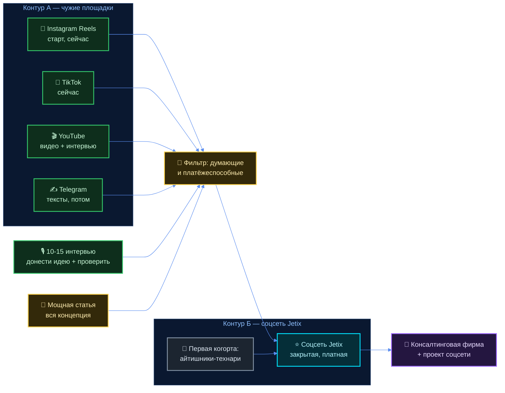
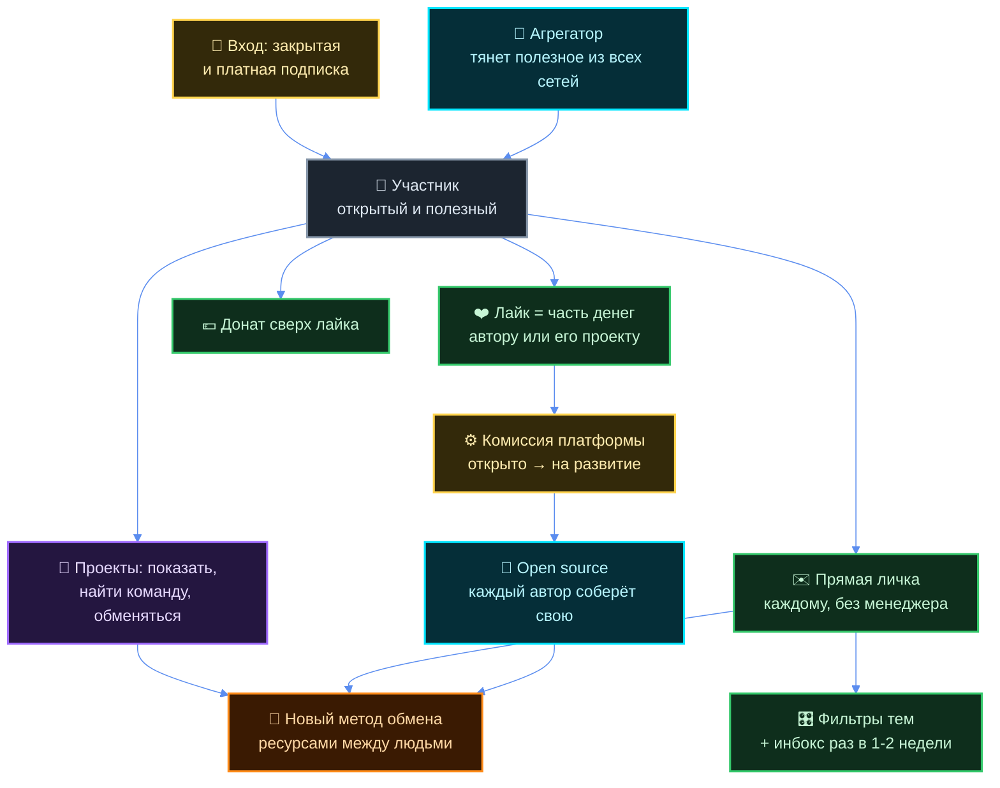
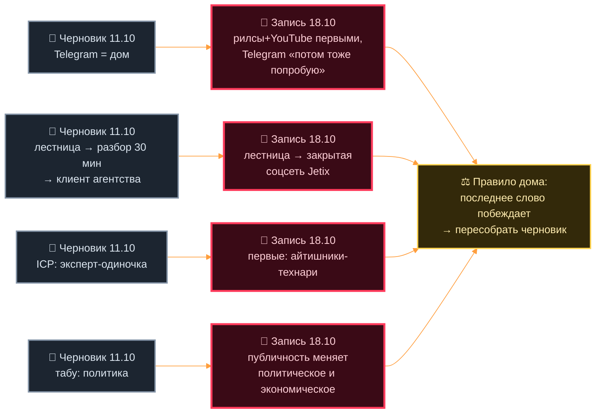

# Разбор заметки 18.10 — что в ней есть для блога

Источник: `raw/transcripts/tg-2026-10-18-114413.md` (3 196 слов, 18 155 знаков, одна сплошная
расшифровка голоса без пунктуации).
Заказ: `raw/transcripts/tg-2026-10-18-114359.md` — «вытянуть ключевые идеи, факты, идеи по
соцсетям, уникальность, отличие от других, направление».

## 0. Как читать

- **Цитаты дословные**, с матом, повторами и огрехами распознавания. Ничего не приглажено.
- `[≈NN%]` — место в записи: доля от начала расшифровки. 0% — первые слова, 100% — последние.
- **«кандидат агента»** — моя мысль, не его. Всё остальное в разделах 1-7 — его слово.
- ⚠️ ASR — место, где распознавание явно переврало звук (пишу как есть, рядом помечаю).
- ⛔ Долей, процентов и цен про людей я не считаю. Где он сам называет число — привожу его
  слово как цитату и не разворачиваю в расчёт.

---

## 1. Ключевые идеи — по смыслу

### Г1. Платформа следит и ловит на слабости

**Что сказал** `[≈4%]`:

> вот этот вот инстаграм и google в прямом смысле следят за тем что я вот говорил когда
> приложение было выключено просто вот там говорил и мне хуяк потом сразу дают рилз и на те
> темы которые я вот я даже не искал я даже в google и не писал ничего она мне просто на тебя
> и подкидывает

`[≈6%]`:

> это очень небезопасно платформа до которая следит за мной в прямом смысле слова следит это
> раз и 2 нацелена по сути на то чтобы меня вот сюда затянуть и чтобы я здесь бесконечно
> просто сидел листал эту ебучую ленту на моих вот слабостях такого вот исследовательского
> исследовательского ума

**Что из этого следует.** Враг у него назван точно: не «соцсети вообще», а **лента, настроенная
лично на твою слабость**. У него слабость названа своя — исследовательский ум, любопытство. Это
не «все дураки залипают», это «меня поймали за то, что во мне хорошее».

**В блог:** ⭐ да, это сильная личная тема. Заход от себя, а не от морали.

### Г2. Рилс-мейкеры подкидывают дров

`[≈8%]`:

> вот особенно вот эти рилз мейкеры да они ну из-за своей как был не до конца понимания
> насколько обширно и сильно но вот эти вот бесконечные ленты влияют там на психику на
> способность к концентрации они еще подкидывают дров в вагоне самостоятельно вот и показываю
> только круто снимать риусы и давай мы тебя научим и давайте какие-то еще хуки еще какие-то
> там тексты для сдвг шников и так далее

⚠️ ASR: «дров в вагоне» — почти наверняка «дров в огонь»; «риусы» = «рилсы».

`[≈70%]`:

> человек который снимает рилса как бы подкидывает в этот ров да то по сути он влияет
> негативно на жизнь того человека который видит этот блять рилз и то есть но если ты там
> этим людям ok с этим жить ну пусть живут мне лично не ok я бы хотел снимать что-то такое
> что будет полезным

**Что следует.** Он не обвиняет их в злом умысле — в недопонимании («из-за своей как был не
до конца понимания»). И тут же ставит **личную границу, а не всеобщее правило**: «ну пусть
живут мне лично не ok». Это и есть его этическая формула. Не проповедь.

**В блог:** ⭐ да, и это материал для первого манифестного ролика.

### Г3. Та же платформа — огромная возможность

`[≈10%]`:

> то что там столько людей крутится столько бабок крутится какие-то там разные бренды и так
> далее это ну круто открыла мне глаза что вот ну прям у меня к этому есть доступ сидя сидя
> дома даже вот ходить никуда не надо

`[≈12%]`:

> если нормально регулярно будешь делать какие-то правила платформы придерживаться будет тебе
> и аудитория сама тебя блять найдет и тебя подкинет тем кому кому ты нужен и может подфартить
> вот на миллионы на миллионы человек тебя покажет

`[≈13%]`:

> это довольно крутая технология на что можно коснуться там и найти реально людей которых
> просто так бы ты в обычной жизни не встретил бы и не увидел

`[≈14%]`:

> это то что я ранее фиксировал о публичности это круто ну то есть вот такие плюшки дает
> instagram там тик ток вот это вот публичности доверие там людей возможность поделиться
> чем-то но своим experience am возможно своей ситуации чтобы тебе помогли либо чтобы вот
> какую-то ситуацию там изменить будь там вот политическую или например экономическую

**Что следует.** В одной записи он держит обе стороны: машина против человека **и** машина как
доступ к людям. Он не выбирает одну — он идёт внутрь инструмента, чтобы увести людей наружу.
Это даёт блогу не позу «соцсети — зло», а рабочую позицию «пользуюсь, зная цену».

**В блог:** да. Это честный ответ на первый же вопрос в комментариях: «ты сам-то тут зачем».

### Г4. Решение: снимать, с понедельника и ежедневно

`[≈17%]`:

> и в итоге решение какие первое это то что начинаю снимать рилз и и youtube потом тоже очень
> активно и стабильно стабильно telegram там потом тоже попробую внутрь на тексты до вести но
> для начала рилз и плюс youtube видео и вот эти далее эти интервью ввиду регулярно ежедневно
> это просто золотая жила это вот упускать и этим не пользоваться это грех это грех

`[≈55%]`:

> и мне бы вообще поебать, блядь, что я там блогером ранее не был, что я до этого там какие-то,
> ну, то есть, видосы вообще не записывал, поебать я просто иду с вот этой темой с вот этим
> направлением этим ядром и просто ежедневно долблю хуярю

`[≈61%]`:

> вообще поебать что у меня там сейчас 3 копейки на счету что я там ну снова таки не имел
> experience of записи видео вообще поебать тут сейчас с этим кодом можно такой крутой контент
> делать да и в целом у меня все и у меня все есть для записи что еще раз это просто грех
> этого не делать

**Что следует.** Старт объявлен без условий: без опыта, без денег, без разрешения. Это сам по
себе формат — **публичный старт с нуля на глазах**.

**В блог:** ⭐ да, и это рубрика, а не один пост.

### Г5. Соцсеть Jetix — продукт, а не метафора

Весь блок разобран отдельно в разделе 3 — там его механика по пунктам.

### Г6. Ценность и принцип (золото для позиционирования)

Собрано в разделе 8 — там каждый принцип с цитатой-источником.

### Г7. Кем он выходит в кадр

`[≈65%]`:

> То есть я себя буду позиционировать как продюсер. плюс ну вот как такой здравомыслящий
> человек и как бы продюсер для тех, кто но он создает что-то что человека хоть чуточку
> развивать будет, да а не просто подкидывает дров в этот, блять большой котел деградации

`[≈91%]`:

> и вот как я там ранее говорил до тренер тренер но плюс такой исследователь

**Что следует.** Три слова о себе, и все три его: **продюсер · здравомыслящий человек ·
тренер-исследователь**. Продюсер — с фильтром на входе: берёт тех, кто развивает человека.

**В блог:** ⭐ да. Это готовая строка описания канала.

### Г8. Состояние, с которого запись начинается

`[0%]`:

> ой как интересно получается только перестал долбить начал более трезво смотреть на мир
> получается и все и все слушай гениальные мысли сразу пропали нету там и записи вот по 30
> минут и по часу офигеть да вот ну короче рефлексию потом буду записывать в отдельный чат

**Что следует.** Он сам замечает связь между своим состоянием и потоком идей, и сам это
откладывает в отдельный чат.

**В блог:** с оговоркой. Тема рабочая («откуда берутся идеи и чем за них платишь»), но он сам
решил держать рефлексию отдельно — значит, в блог только если он скажет.

---

## 2. Факты и мнения — раздельно

### Факты: что он видел и делал

| # | Его слово | Место | Проверяемо? |
|---|---|---|---|
| Ф1 | смотрел рилсы «часа четыре наверное вот прям без остановки» | ≈2% | только им (экранное время) |
| Ф2 | выдали рилсы на темы, которые он проговорил вслух и не искал | ≈4% | ⚠️ см. ниже |
| Ф3 | «Этих чуваков, которых я там ссылки скопировал» | ≈64% | да — ссылки у него есть |
| Ф4 | «вот сайт уже есть дальше его еще допилить может дизайнера найти» | ≈85% | да |
| Ф5 | «список людей есть блять группа с референсами короче все уже есть» | ≈87% | да |
| Ф6 | «3 копейки на счету» | ≈61% | его заявление о себе; ⛔ не считаю |
| Ф7 | «последние там пару месяцев до пилил хуйню какую-то» | ≈86% | да, по репозиторию |

### Заявления о платформах, поданные как факт

**З1. Прослушка при выключенном приложении** `[≈4%]` — «в прямом смысле следят за тем что я вот
говорил когда приложение было выключено».
Статус: **проверяемо в принципе, не доказано его наблюдением**. Совпадение темы объясняется не
одним механизмом (общая сеть, граф контактов, похожие интересы, недавние разговоры рядом с
другими устройствами). У него нет замера — он описывает совпадение, а не измерение.
Кандидат агента: эту вещь в блоге подавать **как опыт** («мне выдали то, что я только сказал
вслух»), а не как доказанный факт о Meta — иначе первый же технарь в комментариях разнесёт, а
именно технарей он зовёт первыми (см. раздел 3).

**З2. Лента нацелена удерживать** `[≈6%]` — «нацелена по сути на то чтобы меня вот сюда затянуть».
Статус: **проверяемо**, публично описано самими платформами как оптимизация вовлечения.

**З3. Данные уходят рекламодателям** `[≈73%]` — «сколько информации до которую потом она с
радостью передает там рекламодателям это но еще раз в лучшем случае тогда рекламодателям а хуй
знает куда еще может передавать».
Статус: **частично проверяемо**. Первая половина — да. «хуй знает куда еще» он сам помечает как
догадку, не выдаёт за факт.

**З4. Нельзя выгрузить данные и уйти** `[≈72%]`:

> потому что о них данные, она собирает о них данные раз, нет какого-то контроля над своим
> аккаунтом, еще что-то, выгрузить там свои данные как-то, перейти там на какую-то другую
> платформу, нету и бай даже возможности да то есть по сути ну люди там со своими видосами
> аудиторией заложники этой же ебаной платформы являются

Статус: **проверяемо и в этой форме спорно**. Выгрузка данных у крупных платформ существует
(право на переносимость в ЕС). А вот перенести **аудиторию** — действительно нельзя, и именно
это его настоящая мысль.
Кандидат агента: формулировку сузить до «аудиторию не унесёшь» — она бьёт точнее и не ломается
о первый же факт-чек. Решение за ним, логику его не правлю.

**З5. Люди сидят по 3-4 часа в день** `[≈67%]` — «Если некоторые люди вот там сидят, блять, по
3-4 часа в день в этих риусах, шортсах».
Статус: обобщение из собственного случая. Внешних данных в заметке нет — **ДАННЫХ НЕТ**.

### Мнения и прогнозы (он сам их так и маркирует)

- «как мне кажется она будет закрытой и она будет платной» `[≈24%]`
- «дальше денег, дохода будет больше, как мне кажется, в целом по населению в среднем» `[≈37%]`
- «но там успех обеспечен» `[≈85%]`
- «это буквально вопрос там нескольких недель» `[≈93%]`
- «для этого вот движения которое дальше повлияет сука на миллионы людей очень очень
  позитивно» `[≈90%]`
- «рилз мейкеры ... из-за своей как был не до конца понимания» — приписывание мотива `[≈8%]`

---

## 3. ⭐ Соцсети: как это будет работать у него

**Главное, что надо развести.** В записи два разных предмета, он их не разделяет вслух:

- **Контур А — он в ЧУЖИХ соцсетях.** Рилсы, шорты, YouTube, Telegram. Это блог, верх воронки.
- **Контур Б — СВОЯ соцсеть Jetix.** Закрытый платный продукт. Это дом, куда он ведёт.

Связь он называет сам `[≈81%]`:

> Ну и вот так вот по чуть-чуть там думающую и платежеспособную аудиторию будем перетаскивать
> на Jetix.

### 3.1 Контур А — его блог: площадки, порядок, частота

**Порядок и состав** `[≈17%]`:

> начинаю снимать рилз и и youtube потом тоже очень активно и стабильно стабильно telegram там
> потом тоже попробую внутрь на тексты до вести но для начала рилз и плюс youtube видео и вот
> эти далее эти интервью ввиду регулярно ежедневно

Второй раз, тот же порядок `[≈51%]`:

> ну и короче я в этих соцсетях что делаю конкретно instagram tick tock сейчас ну и потом
> youtube я вот эту свою позицию отстаиваю

**Частота:** «регулярно ежедневно» `[≈17%]`, «просто ежедневно долблю хуярю» `[≈56%]`.

**Форматы, которые он назвал:** рилсы · шорты · YouTube-видео · интервью · тексты в Telegram ·
одна большая статья.

**Две подачи — он сам их различает** `[≈62%]`:

> иногда вот так как я сейчас да спокойно рассказываю иногда прям накидать прям вот это вот
> чуть-чуть там под музычку зарядиться именно продавать эту идею на На шорты, на эти видео
> тоже надо будет это держать в уме.

То есть: **спокойный разговор** и **заряженный ролик под музыку**. Оба режима в работе, не
взамен друг друга.

**Откуда берёт ремесло** `[≈64%]`:

> Этих чуваков, которых я там ссылки скопировал, вот их тоже некоторые видео насчет проявления
> на камеру, насчет вот этого вот, тоже надо будет некоторые части из них брать.

Это важная деталь: **у рилс-мейкеров он забирает технику, отказываясь от их цели**. Он только что
их разнёс — и тут же идёт учиться у них держаться в кадре. Противоречия тут нет, но сказать это
вслух в ролике — сильный ход (кандидат агента).

**Что придерживает до времени** `[≈58%]`:

> вот эту мою как бы идею насчет того что мозг переработчик информации это что все есть
> информация тоже там понемногу в шортах как бы мне кажется потом можно будет рассказывать да
> ну хотя бы когда базовая аудитория будет вот

**Долгая форма** `[≈60%]`:

> упаковать вот эту всю концепцию в ну какую-то такую мощную статью это тоже надо будет
> сделать вот ну и но это прям да это прям мой долг

### 3.2 Контур Б — соцсеть Jetix: механика его словами

**Б1. Закрытая и платная** `[≈24%]`:

> тогда она будет вот как мне кажется она будет закрытой и она будет платной вот что-то типа
> вот этого икса доберем но только там она будет закрытой хотя бы там евро 10-15 в месяц будет
> стоить доступ

⛔ Цифру привожу как его слово. Ничего не считаю и не раскладываю.

**Б2. Лайк несёт деньги** `[≈25%]`:

> и тогда лайки какие-то то есть будем считать будут как-то считаться что там лайк это там
> какая-то часть денег идет там автору либо на поддержание его проекта либо вот
> непосредственно просто автору как бы спасибо помощь за его пост

**Б3. Донат сверх лайка** `[≈26%]`: «если нужно если интересно то человек сможет конечно там
этому автору еще больше задана тить вот и непосредственно непосредственно донатить вот автору».

**Б4. Open source и право собрать свою** `[≈27%]`:

> а сама эта платформа и это соцсеть она будет вот по сути open source я бы так сказал по сути
> open source вы таким инструментом где каждый автор может там себе свою блять платформу
> сделать да ну и короче мне похуй блять мне похуй

**Б5. Комиссия и куда она идёт** `[≈28%]`:

> просто платформа будет брать какой-то маленький процент и этот процент снова таки все чисто
> открыто будет идти на развитие самой этой платформы соцсети на доработку новых фич на
> привлечение вот блогеров новых там молодой крови разработчиков и так далее

**Б6. Прямая личка вместо менеджера** `[≈43%]`:

> то есть не так как сейчас в этих у больших блогеров до что у них вот у меня есть аудитория
> идите общайтесь с моим менеджером и ну все как бы нет а будет так что можно будет каждого
> человека написать напрямую

**Б7. Фильтры входящего и редкий инбокс** `[≈45%]`:

> дальше когда будет больше людей в соцсети просто человек сможет там какие-то фильтр ставить
> да по каким темам ему желательно писать по каким нет ну и там как бы раз в неделю либо раз
> там две недели он будет просматривать свой inbox

**Б8. Агрегатор вместо ленты** `[≈78%]`:

> плюс вот эта система я еще раз говорю где ты можешь четко поставить кто тебе интересен
> интересен, что ты хочешь там узнавать, получать, на какие темы и так далее. Вот это вот
> дальше мы к этому подключим и, по сути, вот будет такой агрегатор у человека ... она тебя
> подтягивает в виде, что вот тебе там нашли что-то полезное конкретно по твою тему,
> направление и т.д. на изучай. А не так, что бесконечно тебя кормят хуйней какой-то.

**Б9. Что там делают люди** `[≈21%]`:

> где люди смогут не только смотреть видосы но и в целом вот совместные какие-то проекты
> делать до стучаться там до других авторов в личку рассказывать о своих проектах искать там
> себе команды и так далее обмениваться инструментами наработками

`[≈41%]`:

> здесь можно будет рассказывать о своих проектах и в целом not показывать да как как там
> проект продвижения идет и not искать людей которые снова такие там авантюрные
> заинтересованы по сути в развитии своих проектов

⚠️ ASR: «not» здесь — обрывок «и» / «нот», смысла «не» не несёт.

**Б10. Норма поведения внутри** `[≈36%]`:

> Настрой быть в этой группе, в этой соцсети открытым и полезным. И как бы в целом, ну, такая
> надежда на то, что вокруг тебя такие же люди.

**Б11. Разговор, а не боты** `[≈35%]`:

> еще и возможность вот написать друг другу до обсудить какие-то реальные вещи там в
> комментариях то есть не ботов просто смотреть. Реально какие-то там глубокие разговоры, что
> ли.

**Б12. Кого берёт первыми** `[≈75%]`:

> и для начала это будут прям жесткие эти айтишники задроты технари которые ну все-таки как
> минимум переживают за там именно техническую часть передачи этих данных окей заебись я
> переживаю за такую более философскую часть

**Б13. Второй фильтр — платёжеспособность** `[≈38%]`:

> мы будем собирать сейчас в первую очередь тех кто хоть что-то зарабатывает и кто может
> позволить да там платить эти три копейки чтобы его внимание не растаскивали но при этом
> узнавать что-то новое и полезное

**Б14. Там никому не надо продавать** `[≈39%]`:

> это все будет вести к тому что этим людям и не надо будет чего-то продавать эти люди смогут
> просто между собой нормально на одном уровне общаться и точно так же вот открываться тогда
> таким же людям которые по сути тоже там платят деньги да за вот членство стараются там
> контрибутить

**Б15. Откуда ценности** `[≈33%]`:

> в этой же штуки вся суть логика вас три клуба будет вот прям с вас три клуба я беру ценности
> беру получается вот это вот все виденье и соответственно только на такую более широкую
> аудиторию

**Б16. Зачем всё это** `[≈34%]`:

> с вот этим вот виденьем и целью что разрабатывать в целом новый метод обмена ресурсами между
> людьми

`[≈57%]`: «это вот такой вот такое место синергии обмена знаниями обмена ресурсами будет вот это
вот именно соцсеть jetix».

**Б17. Куда её пристроить структурно** `[≈20%]`:

> надо будет еще к вот этой вот консалтинговой фирме точно также добавить ... добавить проект
> социальной сети но то что я рассказывал ранее вот тоже там добавить но и в целом описать
> более подробно что будет социальная сеть

### 3.3 Где он сам себе противоречит внутри записи

**П1. Open source «собери свою» ↔ закрытый платный доступ.**
`[≈24%]` «она будет закрытой и она будет платной ... евро 10-15 в месяц будет стоить доступ»
против `[≈27%]` «по сути open source ... где каждый автор может там себе свою блять платформу
сделать да ну и короче мне похуй блять мне похуй».
Он это не разводит. Одно другому не обязано мешать (открытый код + платный наш узел), но вслух
он ответа не дал. **Неразрешено.**

**П2. Деньги: не ради денег ↔ отбор по платёжеспособности.**
`[≈96%]`:

> но изначально я запускаю этот проект не для того чтобы заработать денег вот и поэтому мне
> как бы сложно это было начать я вас одной стороны хотел бы да вот на этом продюсирование
> денег зарабатывать с другой стороны вот это такой как бы проект масштабный который нацелен
> на развитие человека до который не нацелен на заработок блять денег потому что за раз
> заработать до по сути забрать у человека что-то ну как я вижу то а именно вот дать ему
> чего-то но тут с заработком денег она не сильно вяжется поэтому у меня были какие-то
> противоречия но сейчас вроде как все встает там пазлики на места

Против `[≈38%]` «мы будем собирать сейчас в первую очередь тех кто хоть что-то зарабатывает и
кто может позволить да там платить эти три копейки» и `[≈94%]` «бизнес зарабатывать бабки да нехуй делать нехуй делать».
Он **сам называет это противоречием** и говорит, что оно улеглось, — но **не говорит, как**.
Это самая ценная необработанная точка во всей записи.

**П3. «идете нахуй со своими консультациями, блять, по 500 баксов» ↔ он сам продюсер и
консалтинговая фирма.**
`[≈47%]`:

> многим этим экспертам еще и платить бабки за то, чтобы, видите ли, с ними пообщаться. Ну,
> как бы, пацаны, сейчас еще вам бабки платят, окей, дальше приходит Jetix и заходите, ебать,
> в коммунизм, ну, или вот даже не в коммунизм, но какую-то там соцсеть здорового человека,
> скажем так, и там уже идете нахуй со своими консультациями, блять, по 500 баксов

Против `[≈20%]` «надо будет еще к вот этой вот консалтинговой фирме ... добавить проект
социальной сети». Он платит за доступ к экспертам презрением — а сам строит фирму, которая
продаёт экспертизу. **Неразрешено, и это не слабость, а сюжет** (кандидат агента).

**П4. Против захвата внимания ↔ сам идёт долбить ленту ежедневно.**
Частично он это снимает сам `[≈66%]`: «ну в любом случае, да, эти мемы, приколы, это тоже круто,
надо, не вопрос, еще раз, не вопрос Но как минимум, когда ты это создаешь, ты должен понимать,
что ...». То есть его претензия не к формату, а к неосознанности. **Разрешено наполовину.**

---

## 4. ⭐ Уникальность и отличие — его словами

### От рилс-мейкеров, которых он смотрел

| Они | Он | Цитата-источник |
|---|---|---|
| учат «круто снимать риусы», хукам, текстам для сдвгшников | идёт с темой и ядром | ≈8%, ≈56% |
| подкидывают дров и не видят последствий | «мне лично не ok» | ≈8%, ≈70% |
| контент ради удержания | «снимать что-то такое что будет полезным» | ≈70% |

Полная цитата границы `[≈70%]`:

> но если ты там этим людям ok с этим жить ну пусть живут мне лично не ok я бы хотел снимать
> что-то такое что будет полезным и дальше я вот и строю эту соцсеть чтобы контент далее
> производился на благо но в целом этой группы

### От блогеров вообще

`[≈43%]` — доступ к телу:

> не так как сейчас в этих у больших блогеров до что у них вот у меня есть аудитория идите
> общайтесь с моим менеджером и ну все как бы нет а будет так что можно будет каждого человека
> написать напрямую

`[≈47%]` — плата за разговор:

> им там надо вот, блядь, многим этим экспертам еще и платить бабки за то, чтобы, видите ли, с
> ними пообщаться

`[≈29%]` — кого он НЕ зовёт:

> сюда люди приходят те которые как минимум не хотят прям жрать вот это вот да вот именно то
> которое там в инстаграме в этих рилсах в основном находится и не хотят быть вот этим
> человеком которого ну хотят на ебать хотят на ебать либо хотят его внимание забрать хотят
> дерьмом каким-то напичкать ну или просто там по выебываться своей какой-то крутой жизни вот
> именно еще раз просто да просто свое эго потешить вот это остается там в инстаграме
> пожалуйста кто хочет пользуйтесь

### Чем он сам считает отличие — прямая формулировка

`[≈29%]` «ее главное отличие как раз будет в том что сюда люди приходят те которые как минимум
не хотят прям жрать вот это вот».

`[≈41%]` «что отличие то что это сеть закрытая это что здесь можно будет рассказывать о своих
проектах и в целом ... показывать да как как там проект продвижения идет и ... искать людей
которые снова такие там авантюрные заинтересованы по сути в развитии своих проектов».

### Разделение труда, которое он произносит про себя

`[≈75%]`: «которые ну все-таки как минимум переживают за там именно техническую часть передачи
этих данных окей заебись **я переживаю за такую более философскую часть**».

Кандидат агента: это лучшая строка позиционирования во всей записи. Он не спорит с технарями за
их поле — он встаёт рядом со своим. Из неё выходит и описание канала, и первый закреп.

---

## 5. Направление блога по этой записи

Он называет его дважды, почти одинаково.

`[≈51%]` — что он делает в соцсетях:

> ну и короче я в этих соцсетях что делаю конкретно instagram tick tock сейчас ну и потом
> youtube я вот эту свою позицию отстаиваю ну и в целом тогда разбираюсь каких-то вот
> интересных штуках типа а как работает интернет а как работает экономика нормально ли это,
> что сейчас там есть люди, которые работать не могут, им нужен, ебать, второй монитор для
> того, чтобы смотреть сериал, либо какие-то, блядь, шорты, ну, то есть нормально ли это или
> же нет, вот конкретно там с психологами общаться, с коучами о таком вот психическом
> здоровье, вот это вот, о финансовом, да, тогда заработке тоже, вот, конкретно с людьми
> общаться, что, как зарабатывают и так дальше, вот, реальные какие-то примеры, как там,
> блядь, вот, технологии работают, как там инвестиции собираются и так далее, и вот это вот я
> буду освещать, разбираться в этом

`[≈56%]` — зачем:

> потому что это очень важно это реально важно вот эту идею jetix соцсети соцсети донести до
> людей которым это тоже будет важно и интересно и я вот таких как бы людей ищу создаю помогаю
> им и они дальше будут приходить в эту соцсеть

**Направление в одну строку (сборка из его слов, кандидат агента по форме, не по сути):**
отстаивать свою позицию про внимание и разбираться вслух, как устроены интернет, экономика,
заработок, технологии и психика, — чтобы собрать людей в соцсеть Jetix.

**Две функции блога, которые из этого следуют:**
1. **Позиция** — он отстаивает взгляд («я вот эту свою позицию отстаиваю»).
2. **Разбор** — он публично разбирается в том, чего не знает («разбираться в этом»).

Второе важнее первого для формата: он выходит **не как знающий, а как разбирающийся**. Это
снимает с него требование быть экспертом с первого ролика — чего у него и нет, и он это сам
говорит.

---

## 6. Темы будущих записей

| # | Тема | О чём | Цитата-родитель |
|---|---|---|---|
| Т1 | Четыре часа в рилсах | Личный заход: как залип и что увидел | «одной ногой вступил в говно» ≈1% |
| Т2 | Мне выдали то, что я сказал вслух | Опыт слежки, без вердикта о Meta | ≈4% |
| Т3 | Лента ловит на сильном | Поймали за любопытство, не за глупость | «на моих вот слабостях ... ума» ≈6% |
| Т4 | Хуки и тексты для сдвгшников | Разбор ремесла рилс-мейкеров и его цены | ≈8%, ≈10% |
| Т5 | Ты затыкаешь тишину с собой | Главная тема всей записи | ≈69% |
| Т6 | Блогер — заложник платформы | Данные, аккаунт, аудиторию не унесёшь | ≈72% |
| Т7 | Как работает интернет | Ликбез вслух, он сам разбирается | ≈51% |
| Т8 | Как работает экономика | То же | ≈51% |
| Т9 | Второй монитор с сериалом | Интервью с психологами и коучами | ≈52% |
| Т10 | Как люди реально зарабатывают | Серия интервью с примерами | ≈53% |
| Т11 | Как собираются инвестиции | Интервью с практиками | ≈53% |
| Т12 | Соцсеть здорового человека | Манифест: что строит и зачем | ≈48% |
| Т13 | Почему закрыто и платно | Входной порог как защита внимания | ≈24%, ≈38% |
| Т14 | Open source: собери свою | Право уйти с кодом | ≈27% |
| Т15 | Лайк, который несёт деньги | Экономика внимания наоборот | ≈25% |
| Т16 | Личка без менеджера | Прямой доступ к любому | ≈43% |
| Т17 | Агрегатор вместо ленты | Фильтр ставишь ты, а не алгоритм | ≈78%, ≈45% |
| Т18 | Эксперты по 500 баксов за разговор | Разнос платного доступа к людям | ≈47% |
| Т19 | Мозг — переработчик информации | Отложено до базовой аудитории | ≈58% |
| Т20 | Я не блогер, и мне похуй | Публичный старт с нуля | ≈55% |
| Т21 | 3 копейки на счету и оффлайн-работа | Честная стартовая точка | ≈61%, ≈84% |
| Т22 | Пару месяцев пилил хуйню | Что дала подготовка и что отняла | ≈86% |
| Т23 | Откуда я беру ценности | Вастрик.Клуб как источник | ≈33% |
| Т24 | Новый метод обмена ресурсами | Большая рамка всего проекта | ≈34% |
| Т25 | Заработать = забрать? | Его неразрешённое противоречие вслух | ≈96% |
| Т26 | Я учусь у тех, кого разнёс | Берёт у рилс-мейкеров технику кадра | ≈64% |

Т5, Т12, Т20, Т25 — кандидаты в первые четыре записи: в каждой есть он сам, а не рассуждение.

---

## 7. Ценное, но мимо блога

Чтобы не потерялось — он просил.

**Решения и шаги на сегодня-завтра**
- `[≈61%]` «сегодня днем там собираюсь силами и ... накидываю план вокруг вот этой идеи»
- `[≈89%]` «это блять еще там напечатаю буду каждое утро проговаривать вот это вот важно
  настроить не забывать» — ритуал утреннего прогона, распечатка
- `[≈84%]` «пойду там на эту обычную оффлайн работу мне вообще поебать ... с голоду точно не
  сдохну там один-два месяца поработаю» — решение про деньги на ближайшие 1-2 месяца
- `[≈85%]` «вот сайт уже есть дальше его еще допилить может дизайнера найти» — задача по сайту
  + наём дизайнера
- `[≈20%]` «надо будет еще к вот этой вот консалтинговой фирме точно также добавить ... проект
  социальной сети» — структурная задача в репозиторий, не в блог
- `[≈39%]` «конкретно там еще старые заметки подтягиваю» — поднять прежние записи о соцсети и
  слить с этой
- `[≈81%]` «мне, блядь, надо сейчас 10-15 интервью с этими людьми там что-то обсудить» —
  интервью здесь как **проверка идеи**, не как контент

**Активы, которые у него уже есть**
- `[≈87%]` «четкое понимание уже что говорить темы направлении уже блять список людей есть
  блять группа с референсами короче все уже есть»
- `[≈64%]` скопированные ссылки на авторов — референс-группа по подаче на камеру

**Про себя, в отдельный чат (его же решение)**
- `[0%]` «только перестал долбить начал более трезво смотреть на мир ... гениальные мысли сразу
  пропали нету там и записи вот по 30 минут и по часу»
- `[0%]` «рефлексию потом буду записывать в отдельный чат»
- `[≈94%]` «я не подведу все то что я там до этого делал анализировал и так далее это не прошло
  оно зря ... я красава в любом случае я красава и меня красавцы и люди окружают»

---

## 8. ⭐ Ценности и принципы — золото для позиционирования

Каждый — его цитатой. Это то, что можно ставить в шапку канала, в манифест и в закреп.

| # | Принцип | Его слово | Место |
|---|---|---|---|
| Ц1 | Не подкидывать дров в чужую деградацию | «ну пусть живут мне лично не ok» | ≈70% |
| Ц2 | Внимание человека не растаскивать | «чтобы его внимание не растаскивали» | ≈38% |
| Ц3 | Деньги платформы — открыто и на развитие | «все чисто открыто будет идти на развитие» | ≈28% |
| Ц4 | Человек не заложник: код открыт, уйти можно | «каждый автор может там себе свою блять платформу сделать» | ≈27% |
| Ц5 | Прямой доступ без прослойки | «можно будет каждого человека написать напрямую» | ≈43% |
| Ц6 | Открытость и польза как норма входа | «быть в этой группе ... открытым и полезным» | ≈36% |
| Ц7 | Заработать — не значит забрать | «заработать ... забрать у человека ... дать ему» | ≈97% |
| Ц8 | Контент должен развивать хоть чуточку | «человека хоть чуточку развивать будет» | ≈65% |
| Ц9 | Стартовые условия не отмазка | «поебать, блядь, что я там блогером ранее не был» | ≈55% |
| Ц10 | Делать ежедневно | «просто ежедневно долблю хуярю» | ≈56% |
| Ц11 | Своя часть работы — философская | «я переживаю за ... более философскую часть» | ≈75% |
| Ц12 | Люди — одна система | «люди вот как одна единая группа одна единая система» | ≈83% |

Полная цитата Ц7 `[≈97%]`:

> потому что за раз заработать до по сути забрать у человека что-то ну как я вижу то а именно
> вот дать ему чего-то

⚠️ ASR: фраза покорёжена, но формула читается: заработать = забрать; его ход — дать.
Кандидат агента: эту формулу стоит переспросить у него голосом и записать чисто — она тянет на
основание всей экономики Jetix, а в расшифровке она полуразрушена.

Полная цитата Ц12 `[≈83%]`:

> потому что ну по сути люди вот как одна единая группа одна единая система в любом случае вот
> это мне надо донести поспрашивать а там она дальше все закрутится

---

## 9. ⭐ Где он расходится со своими прежними словами

Сверено с `projects/blog/docs/2026-10-11-blog-bazovaya-nastrojka.md` (черновик 11.10, им не
акнутый — это предложения агента, а не его решения; расхождение с ним не нарушение, а правка).

**Р1. Порядок площадок развернулся.** Черновик 11.10: «Telegram-канал — дом, туда ведёт всё
остальное». Запись 18.10 `[≈17%]`: «для начала рилз и плюс youtube видео ... telegram там
потом тоже попробую внутрь на тексты до вести».

**Р2. Куда ведёт лестница.** Черновик: шорт → Telegram → бесплатная вещь → разбор 30 минут →
клиент агентства. Запись: шорт/видео/интервью → **закрытая соцсеть Jetix**. Агентство в записи
не отменено, но соцсеть встала впереди `[≈20%]`, `[≈81%]`.

**Р3. Кто первый.** Черновик: «эксперт-одиночка» и «деятельный человек». Запись `[≈75%]`: «для
начала это будут прям жесткие эти айтишники задроты технари».

**Р4. Политика.** Черновик: «табу на 1-2 года: политика, религия, война». Запись `[≈15%]`:
публичность ценна тем, что позволяет «какую-то ситуацию там изменить будь там вот политическую
или например экономическую». Прямого слова «буду говорить о политике» он не сказал — но табу он
тоже не подтвердил.

**Р5. Деньги как мотив.** В доме с 01.08 зафиксирован фокус «заработок через Jetix». Запись
`[≈96%]`: «изначально я запускаю этот проект не для того чтобы заработать денег». Он сам видит
натяжение и говорит, что оно улеглось, — но **как именно, не сказал**.

Кандидат агента: по дому действует его же правило «последнее слово побеждает». Значит, черновик
блога от 11.10 надо пересобрать под эту запись, а не спорить с ней. Четыре пункта Р1-Р4 — правки
в черновик. Р5 — не правка, а вопрос к нему.

---

## 10. ⭐ Сильные фразы — можно произносить почти без правки

Отобраны по одному признаку: звучат как его речь и держатся без контекста.

1. «я тут одной ногой вступил в говно а конкретно рилз» `[≈1%]`
2. «нацелена ... на то чтобы меня вот сюда затянуть ... на моих вот слабостях такого вот
   исследовательского исследовательского ума» `[≈6%]`
3. «они еще подкидывают дров» `[≈9%]` ⚠️ в расшифровке «дров в вагоне»
4. «давай мы тебя научим и давайте какие-то еще хуки еще какие-то там тексты для сдвг шников»
   `[≈9%]`
5. «аудитория сама тебя блять найдет и тебя подкинет тем кому кому ты нужен» `[≈12%]`
6. «это просто золотая жила это вот упускать и этим не пользоваться это грех это грех» `[≈18%]`
7. «вот это остается там в инстаграме пожалуйста кто хочет пользуйтесь» `[≈32%]`
8. «просто свое эго потешить» `[≈32%]`
9. «идете нахуй со своими консультациями, блять, по 500 баксов» `[≈49%]`
10. «нормально ли это ... им нужен, ебать, второй монитор для того, чтобы смотреть сериал»
    `[≈52%]`
11. ⭐ «они просто затыкают вот этот диалог с самим собой или вот эту тишину с самим собой, они
    затыкают этими рилсами» `[≈69%]`
12. «если ты там этим людям ok с этим жить ну пусть живут мне лично не ok» `[≈70%]`
13. «люди там со своими видосами аудиторией заложники этой же ебаной платформы являются» `[≈73%]`
14. ⭐ «я переживаю за такую более философскую часть» `[≈75%]`
15. «А не так, что бесконечно тебя кормят хуйней какой-то» `[≈80%]`
16. «мне бы вообще поебать, блядь, что я там блогером ранее не был» `[≈55%]`
17. «вообще поебать что у меня там сейчас 3 копейки на счету» `[≈61%]`
18. «просто ежедневно долблю хуярю» `[≈56%]`
19. «продюсер для тех, кто ... создает что-то что человека хоть чуточку развивать будет, да а не
    просто подкидывает дров в этот, блять большой котел деградации» `[≈65%]`
20. «тренер тренер но плюс такой исследователь» `[≈91%]`
21. «идите общайтесь с моим менеджером и ну все как бы нет а будет так что можно будет каждого
    человека написать напрямую» `[≈43%]`
22. «заходите, ебать, в коммунизм, ну, или вот даже не в коммунизм, но какую-то там соцсеть
    здорового человека» `[≈48%]`
23. «разрабатывать в целом новый метод обмена ресурсами между людьми» `[≈34%]`

Кандидат агента: №11 — самая сильная фраза записи. Из неё одной выходит первый ролик целиком.

---

## 11. Что из этого прямо идёт в план блога

Три вещи, которые эта запись добавляет к черновику 11.10 и которых там не было:

1. **Антагонист назван.** Не «плохой контент», а **лента, которая затыкает твою тишину**. У
   блога появился противник, а не только тема.
2. **Конечная точка воронки изменилась.** Не разбор-созвон, а **закрытая соцсеть Jetix**. Это
   меняет CTA в каждой записи.
3. **Роль автора изменилась.** Не эксперт, который учит, а **тот, кто разбирается вслух** и
   отстаивает позицию: «я переживаю за такую более философскую часть».

Это предложения к пересборке, не решения.

---

## ⚠️ Что здесь слабого

- **Одна запись — не план.** Это 30 минут голоса в один заход, после четырёх часов рилсов и на
  подъёме. Настроение в ней высокое («но там успех обеспечен», «это буквально вопрос там нескольких
  недель»). Часть
  решений может не пережить неделю — ни одно из них в этом документе не проверено временем.
- **Расшифровка местами битая.** ASR сломал минимум пять мест: «дров в вагоне», «риусы», «not
  показывать», «задана тить», формула про заработок в финале. Я помечал такие места, но
  гарантировать, что услышал его правильно, не могу. Самая важная из порченых — Ц7 про заработок
  как изъятие. Её надо переспросить.
- **Проценты-позиции приблизительные.** `[≈NN%]` — доля знаков от начала файла, а не тайм-код
  аудио. Для поиска годится, для цитирования в ролике нужен аудио-тайминг — его у меня нет.
- **Я не сверял запись со всеми прежними заметками о соцсети.** Он сам говорит `[≈39%]`
  «конкретно там еще старые заметки подтягиваю» — значит, где-то лежат прежние формулировки той
  же идеи. Я их не искал: задача была по одной заметке. Расхождения с ними не выявлены — **не
  потому что их нет, а потому что не проверялось**.
- **Противоречие П2 (деньги) я не разрешил и не должен был.** Он говорит «сейчас вроде как все
  встает там пазлики на места», но механизм не называет. Любая моя версия тут была бы выдумкой.
- **Раздел 6 — мой разрез его слов на темы.** Темы вытащены из его цитат, но нарезка и
  формулировки заголовков мои. Он ни одной такой темы вслух не назвал как «запишу ролик про X».
- **Про площадки нет ни одного ника и ни одной ссылки.** Где у него аккаунты, есть ли они —
  **ДАННЫХ НЕТ**.
- **Сроков и чисел по контенту в записи нет.** «регулярно ежедневно» — единственная частота,
  которую он назвал. Сколько роликов, с какого дня, какой длины — **ДАННЫХ НЕТ**.
- ⛔ Цену доступа и комиссию платформы я привёл только как его цитаты. Ни во что не считал и не
  раскладывал — это его поле.
