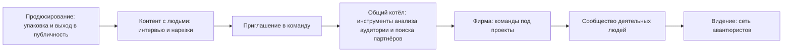

# 📜 Jetix: документ правды

Один документ, из которого берут всё остальное: сайт, рассказ на созвоне, аутрич, страницы Notion.
Собран 12.10 из голоса Руслана 12.10 16:34, проекта «Консалтинговая фирма», разборов бизнесов и
страницы Jetix Agency. Слова Руслана в кавычках. Остальное — формулировки агента, они помечены
и меняются по его слову. Решения и цифры про людей здесь фиксирует только он.

---

## 1. Одной строкой и за 30 секунд

**Одной строкой (кандидат агента).** Я строю консалтинговую фирму нового типа, а вход в неё —
продюсирование: помогаю специалистам выйти в публичность и зарабатывать на своей экспертизе.

**За 30 секунд — три версии.** Отличаются тем, кому говоришь. Каждая кончается вопросом, чтобы сразу
было «да-да, нет-нет».

**А. Специалисту, которого зовёшь внутрь (основная).**
> Я собираю консалтинговую фирму нового типа. Каждый в ней работает на себя и зарабатывает своё,
> но у фирмы есть общий котёл: инструменты, экспертиза, бренд, клиенты. Нужен монтажёр, айтишник,
> методолог под задачу — находишь внутри за день, а не ищешь месяц. Пришёл сложный проект, который
> один не сделаешь, — собираем команду из своих и делаем вместе. Взамен одно: ты вкладываешься в это
> как в своё дело и чуть-чуть помогаешь другим. Тебе это интересно?

**Б. Эксперту, которому продаёшь продюсирование.**
> Я помогаю специалистам выйти в публичность и зарабатывать на своей экспертизе: позиционирование,
> контент, интервью, сайт, продажи. Начинаем с интервью: записываем разговор с тобой, режем на
> короткие видео, и у тебя появляется контент и первые люди. Дальше, если зайдёт, — упаковка
> и продукт. Интересно попробовать с интервью?

**В. Универсальная, когда непонятно, кто перед тобой.**
> Я строю фирму, где люди работают на себя, но не в одиночку. Каждый со своим ремеслом, у всех общий
> пул инструментов и экспертизы, под сложный проект собирается команда из своих. Сейчас помогаю
> специалистам выйти в публичность и на этом зарабатываю. Беру тех, кто хочет развиваться и готов
> тянуть это как своё дело. Тебе это интересно или нет?

Версии А и В — из рассказа для партнёров ([02-RASSKAZ §1](#источники)). Б — новая, под продюсирование.

---

## 2. Что строим

**Консалтинговую фирму нового типа.**

> «я как бы вот это вот строю публично — строю публично тогда не продюсерский центр, а строю
> публично тогда консалтинговую фирму» — Руслан, 12.10

- **Как устроена.** Группа самостоятельных специалистов. Каждый со своим ремеслом, своими клиентами
  и своим делом. Общее у них: бренд, инструменты, накопленная экспертиза, клиенты и возможность
  собрать команду из своих, когда приходит проект, который одному не поднять.
- **Что получает участник.** Инструменты и наработки (шаблоны, системы управления, ИИ-агенты,
  инструменты анализа аудитории и поиска партнёров), людей под команду, проекты крупнее своего
  размера, бренд и публичность, обучение внутри.
- **Что участник обязан.**
  > «вкладываться на сто процентов, верить, ну и работать над этим как над своим собственным делом,
  > потому что это есть его собственное дело, но при этом чуть-чуть помогать другим»
- **Чего участник не теряет.** Своих клиентов, своё имя, своё дело.
- **Для кого фирма как исполнитель.** Средний и малый бизнес: «чтобы быть более проворной, что не
  смогут себе позволить, наверное, сейчас большие консалтинговые фирмы».

Эта модель уже была описана в апреле в Notion («База правды», 05.04): «у Jetix нет клиентов — есть
партнёры», партнёр-консультант продаёт под брендом и методологией Jetix. Апрельский домен
(AI-безопасность) снят, механика переиспользуется. Что из апреля забираем — решает Руслан.

---

## 3. Чем зарабатываем сейчас

**Продюсирование — вход в фирму.** Ищу специалистов, которые хотят публичности, и упаковываю их.

- **Что продаём.** Позиционирование, контент, интервью и нарезка на короткие видео, выход на камеру,
  упаковка сайта специалиста, продукт из знаний, воронки продаж. Каталог и пакеты — страница
  «Услуги» в Notion.
- **Кому.** Узкие специалисты, профессионалы и сильные небольшие команды. Ниши: менеджмент,
  программирование, построение команд. Первый сегмент — соло-эксперты. Подробно — страница ICP.
- **Откуда люди.** Vastrik Club, авторы из Telegram Руслана, интервью как канал. Все контакты — в CRM.
- **Как платят (кандидат агента по разборам бизнесов).** Фикс с предоплатой на входе плюс процент от
  оборота эксперта сверху. Чистый процент не берём: «% от оборота — сильный аргумент продажи, но
  плохой фундамент для кэша». Цены — его решение.

> ❓ **Открыто.** В голосе 12.10 16:34 первые деньги фирмы — автоматизация, ИИ и сайты для среднего
> бизнеса. Вечером 12.10 Руслан называет продюсирование. В документе пока стоит: «сейчас
> продюсирование, автоматизация и сайты следом». Ждёт его слова.

---

## 4. Как вход ведёт к фирме

> «я как бы всё начинаю с позиционирования, помощи с сайтами и так дальше — выбираю, ищу клиентов,
> которым это будет всё интересно, ну и плюс затягиваю их в консалтинговую фирму»

**Правило подачи (Руслан, после звонка 12.10).** Сначала говорим, что делаем сейчас, чётко: что
делаю, что человек получит, что от него нужно, для кого это и для кого нет. Видение — вторым слоем,
и на первых встречах его не озвучиваем.

---

## 5. Для кого: две стороны

| Сторона | Кто | Почему заходит |
|---|---|---|
| **Эксперт-клиент** | специалист, которому нужна публичность и деньги со своей экспертизы | получает упаковку, контент, аудиторию, продажи |
| **Участник фирмы** | самостоятельный специалист со своим ремеслом | получает общий котёл, команду под проект, бренд |
| **Клиент фирмы** | малый и средний бизнес с задачей | команда под его задачу, один ответственный, цена ниже большой фирмы |

Один человек может пройти путь с первой строки до второй: пришёл за продюсированием, остался в фирме.

---

## 6. Откуда деньги

Два потока, их не надо путать.

1. **Работа у клиента.** Деньги идут от клиента к участнику, который его держит. Часть уходит в
   общий котёл: инструменты, бренд, общие расходы.
2. **Проекты самих участников.** «закидывают проекты, которые у них есть либо которые хотели бы
   реализовать и конкретно заработать на этом денег». Группа здесь соучастник, а не подрядчик.

**Как делится котёл — слот Руслана.** Записанное 12.10 дословно: «ну там сколько, я не знаю, 15,
может, 10–15 процентов будет идти непосредственно в эту группу, доходов там и так далее, а всё
остальное будет оставаться партнёрам». Агенты это число не развивают и своего не предлагают.

**Что говорят разборы бизнесов.** Кто платит раньше, тот и рискует: нужна предоплата и свой контроль
над потоком денег. Сервисный бизнес, который держится на владельце и паре клиентов, стоит дёшево —
фирма с общим котлом и вторым узлом без Руслана как раз это лечит.

---

## 7. Культура, ценности и чем мы не являемся

**Ценности (Руслан, 11.10).** Ответственность · агентность · тяга к жизни и развитию · часть
коллектива · открытость. «при каких бы сложных ситуациях не было, вот, не сдаваться, искать выход».

**Как ценности видны в правилах (кандидат агента).** Результаты видны всем внутри · застрял —
приносишь в группу, а не исчезаешь · каждый проект кончается записанным уроком в общий котёл ·
кто не хочет развиваться — не берём · уход без штрафов · доля только за названный сервис · у каждого
проекта есть имя ответственного.

**Чем мы не являемся (Руслан, 11.10).** Не фрилансеры · не маркетинговое агентство, которое
производит нейрослоп · не продаём PDF-чек-листы и «запуск за неделю» · не работаем с теми, кто не
вкладывает в проект душу и силы · не работаем с теми, кто не разделяет ценности.
Плюс от ресёрча: не площадка-посредник, которая берёт процент за знакомство · не агентство со штатом
на бенче · не социальная защита: котёл — усилитель сильных, а не подушка.

---

## 8. 🎲 Гипотеза: авантюра века

Это не план, а ставка. Держим её в голове, проверяем фактами и честно признаём, если не сработает.

> «запрос объединить всех авантюристов вместе в самую большую авантюру. Ну вот ещё, но
> соответственно никто не знает ещё какую, но какую-то огромную» — Руслан, 09.04.2026

> «шкура на кону: значит время, деньги, внимание… это как играем в карты, но пожалуйста, чуваки,
> я олл-ин» — Руслан, 17.04.2026

**На что ставим.** Самостоятельные специалисты зарабатывают больше и берут проекты крупнее, когда
у них общий котёл и команда из своих. Из таких людей вырастает фирма на 1000–1500 участников,
а дальше — сеть деятельных людей, которые делают то, что поодиночке не делается.

**Что должно оказаться правдой.**
- Продюсирование приносит деньги и людей, которые хотят внутрь.
- Первые 3–7 партнёров сдают оплаченный проект командой из группы, а не силами одного Руслана.
- Второй узел собирает команду и сдаёт проект без Руслана.
- Общий котёл оплачивает внутренние роли, а не держится на бесплатном труде.

**Как поймём, что не работает (стоп-условия из плана).**
- Проект не собрался из группы — это личная практика, а не фирма.
- Без Руслана второй узел не поехал — форма не воспроизводится, 1000 недостижимо.
- Котёл не платит внутренние роли — это повтор кризиса Enspiral 2016–2018.

**Честно о масштабе.** Живого примера фирмы на 1000–1500 человек, которая собирает команды под
проекты, не найдено. Всё работающее — это 15–40 человек (Crisp, The Ready, August), Enspiral
сломался на 300 и ушёл в узлы. Значит, форму придётся изобретать, скорее всего как федерацию
узлов по 50–150 человек. Копировать не у кого — в этом и авантюра.

**Лестница этапов.** Э0 описание (он один) → Э1 первые партнёры, 3–7 человек → Э2 узел, 10–40 →
Э3 второй узел без Руслана → Э4 федерация узлов, 100–300 → Э5 сообщество-инфраструктура, 1000–1500.

---

## 9. Что решает только Руслан

- Первые деньги: продюсирование, автоматизация и ИИ, сайты — что идёт первым наружу.
- Как называется наружу: Jetix, Jetix Agency или новое имя.
- Что именно децентрализовано: собственность, решения, деньги, юрлицо — да, нет или позже.
- Кого считать в «1000–1500»: всех в сообществе или только тех, кто собирается в команды.
- Как делится котёл и на какой базе.
- Апрельская модель партнёра-консультанта: забираем целиком, по блокам или нет.
- Хартия Клана 12.05 говорит «не консалтинг-фирма» — правим её, оставляем про другое или снимаем.
- Вход: закрытое ядро, открытый набор или оба слоя.

Полный список из 15 развилок — в плане фирмы, раздел 5.

---

## Источники

Ссылки на GitHub:

- Голос 12.10 16:34, запись целиком: https://github.com/Bogersebekov/jetix-os/blob/main/tochka-b/185-OS-16-34.md
- Проект «Консалтинговая фирма», вход: https://github.com/Bogersebekov/jetix-production-company/blob/main/projects/konsaltingovaya-firma/_index.md
- План фирмы: этапы, развилки, стоп-условия: https://github.com/Bogersebekov/jetix-production-company/blob/main/projects/konsaltingovaya-firma/docs/01-PLAN.md
- Рассказ для партнёров: 30 секунд, 3 минуты, полный: https://github.com/Bogersebekov/jetix-production-company/blob/main/projects/konsaltingovaya-firma/docs/02-RASSKAZ.md
- Апрельский слой Notion «База правды»: https://github.com/Bogersebekov/jetix-production-company/blob/main/projects/konsaltingovaya-firma/research/A2-NOTION.md
- Живые примеры децентрализованных фирм: https://github.com/Bogersebekov/jetix-production-company/blob/main/projects/konsaltingovaya-firma/research/A3-ZHIVYE-PRIMERY.md
- Его заметки, включая «авантюристов»: https://github.com/Bogersebekov/jetix-production-company/blob/main/projects/konsaltingovaya-firma/research/B1-EGO-ZAMETKI.md
- Разборы бизнесов и системная рамка: https://github.com/Bogersebekov/jetix-production-company/tree/main/projects/biznes-reserch/docs/razbory
- Упаковка продюсерского центра (услуги, ЦА, позиционирование): https://github.com/Bogersebekov/jetix-production-company/tree/main/projects/upakovka-prodyuserskogo-centra/docs
- План на 100 000 $: https://github.com/Bogersebekov/jetix-production-company/blob/main/projects/plan-100k/docs/plan.md
