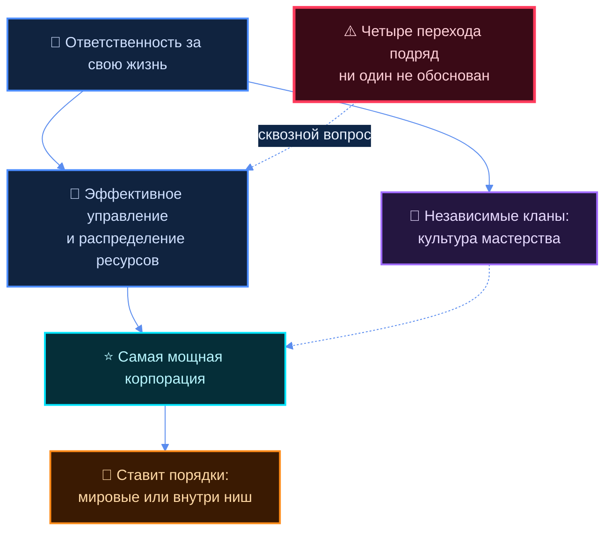
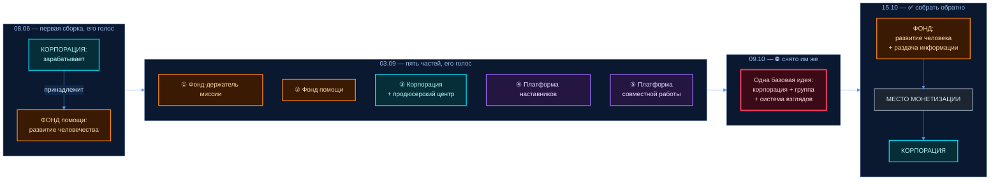

# V1 — Его слово о глобальной цели

> **Что это.** Ответ на его заказ 15.10 21:37: «пусть агенты посмотрят, поищут, что я там на эти
> темы пиздел, рассказывал». Сплошной проход по двум репозиториям: **что ОН САМ когда-либо
> говорил** про глобальную цель и то, к чему всё ведёт.
>
> **Куда пойдёт.** Его слово: «дальше я уже исходя из этого буду такую вот информацию на сайт
> добавлять, ну и в целом мы потом вот это как заготовку для презентации тоже будем
> использовать». Значит планка по точности выше обычной — выдуманный источник уедет на сайт.
>
> **Правила этого документа.**
> ⛔ Только **ДОСЛОВНЫЕ** цитаты. Пересказ не принимается; где цитаты нет — написано
> **ДАННЫХ НЕТ**. Ни один найденный файл не правился.
> ⛔ Ни одна доля, цена и процент про людей здесь не посчитаны и не предложены — домовой стоп.
> Его собственные числа, если попадаются в цитате, стоят как его слово и не развиваются.
> ⛔ В Notion ничего не занесено — его прямой запрет 14.10 в силе.
> ⬜ Соображения агента вынесены в один раздел §15 и помечены «наблюдение агента».
> Больше нигде агент не рассуждает.

---

## §1 Как читать этот документ

### Метки отношения к теме

| Метка | Что значит |
|---|---|
| **прямо** | он говорит ровно про это |
| **рядом** | та же мысль другими словами или про соседний предмет |
| **косвенно** | упоминание вскользь, годится как след, не как опора |

### Метки провенанса — чья это проза

| Метка | Что значит |
|---|---|
| 🎙 **его голос** | сырая расшифровка из `raw/` — речь как есть, без правки |
| 📝 **его текст** | пришло в пульт текстом, формулировки его собственные |
| 🗣 **его диктовка** | он надиктовал, агент записал связно — смысл его, порядок слов не всегда |
| 🤖 **текст агента** | написано агентом; берётся только как указатель, не как его слово |
| 🗄 **архивное** | лежит в `archive/` — старое, помечено как старое |

### Про источники

**919 расшифровок его голоса** лежат в `raw/transcripts/` с 30.04.2026. Из них **410 подняты из
истории git 12.10** — раньше они были физически невидимы в рабочей копии (`.gitignore` с 09.06).
Это самый плотный пласт фундамента.

⚠️ **Расшифровки рваные.** Это `whisper-large-v3` по быстрой речи с матом. Типовые искажения:
«кота хуйня» = «какая-то хуйня» · «до» = «то»/паразит · «планов» = **кланов** · «вентюристов» =
авантюристов · «нот» = «не»/мусор. Цитаты привожу **как есть**, не приглаживая: приглаженная
цитата — уже не цитата.

⚠️ **Дубли транскриптов.** Батч `audio_6xx@11-05-2026_21-4x-xx` — перезаливка более ранних
записей (`audio_643@11-05` дословно = `audio_630@09-05`). Дата в имени файла = дата загрузки,
не записи. Для датировки беру раннюю.

### Что уже было собрано до этого захода

Это **не первый** сбор его слова. Существующий пересекающийся корпус:

| Файл | Что внутри |
|---|---|
| `…/konsaltingovaya-firma/research/B1-EGO-ZAMETKI.md` (12.10, 🤖) | ~180 цитат; 12 противоречий ПР-1…ПР-12 |
| `…/konsaltingovaya-firma/research/B2-POHOZHIE-MYSLI.md` (12.10, 🤖) | похожие мысли из внешних источников |
| `projects/upakovka-vision/docs/13-POSLE-KARTY.md` §3 (06.10, 🤖) | 22 цитаты Ц-1…Ц-22, задающие vision |
| `reports/videnie-iz-golosovyh-2026-09-15/` (15.09, 🤖) | разбор его голосовых по темам |
| `reports/videnie-2026-08-30/00-VIDENIE-VLADELTSA.md` (30.08) | его диктовка видения, 3 853 слова |

Этот документ **не переписывает их заново**, а: ① берёт именно куст «глобальная цель», которого
там отдельно нет; ② перепроверяет ключевые цитаты по первичным файлам своей рукой; ③ закрывает
три места, которые он назвал прямо — фонд, кланы, «поставить порядки».

---

## §2 ⭐⭐ Его заказ 15.10 — дословно, чтобы дальше не спорить с пересказом

Источник: `tochka-b/188-OS-21-37.md` · 15.10.2026 21:37 · 📝 **его текст** (пришло текстом,
не голосом — значит формулировки его собственные, без потерь расшифровки).

### 2.1 Зачем нужен документ
> «мне нужно довольно детально и подробно описать тогда вот такую как бы глобальную цель, да,
> для чего она существует, и описать моё видение вот этого всего и конкретно то, к чему оно
> потом дальше приведёт»

### 2.2 ⭐ К чему ведёт — кланы и культура
> «к таким вот независимым кланам, где там культура, по сути, развития мастерства, развития
> человека, и как бы культура вот таких вот ответственных людей за свою жизнь — но при этом и
> ответственных людей, которые ещё и ответственно управляют тем, что у них есть, и своей жизнью
> в первую очередь, ну и потом соответственно теми инструментами и ресурсами, которые у них есть»

### 2.3 ⭐ Цепочка, которую он выстраивает
> «то, что я там видел, это приведёт к тому, что самое эффективное управление и распределение в
> первую очередь своей жизнью, а потом ресурсами — это приведёт к тому, что создаст такую самую
> мощную тогда компанию, корпорацию, которая в свою очередь сможет уже поставить порядки
> мировые, или хотя бы какие-то внутренние внутри каких-то ниш, которые она посчитает нужным»

### 2.4 ⭐⭐ Отличие — ценности закладываются при создании
> «моё предложение вот эту компанию, корпорацию как бы создать и при этом изначально при её
> создании закладывать ценности именно на развитие человека и человечества»

### 2.5 ⭐⭐ Не как страна и не как нация
> «в других там системах, странах — ну как бы эти системы нацелены на развитие самой себя, они
> как бы видят себя там как нация или как страна. Это же вот фирма для начала, потом группа —
> создаётся как бы изначально с пониманием того, что все люди, по сути, если хорошо и качественно
> используют свой интеллект и нацелены реально на развитие своей жизни, они могут сотрудничать и
> довольно эффективно обмениваться ресурсами, знаниями, информацией»

### 2.6 ⛔ Схема, которую он просит собрать обратно
> «у нас тогда вот эту базовую схему нужно мне собрать обратно — то, что я описывал: что у нас
> будет фонд, который нацелен на развитие человека и, ну вот, раздачу информации в первую
> очередь; потом место, где это всё монетизируется; и корпорация»

### 2.7 Кого он собирает сейчас
> «сейчас я вот собираю как бы людей для вот этой вот глобальной цели и как бы для тех, кто
> поддерживает вот это вот направление»

---

## §3 ⭐⭐ Зачем всё это существует — его формулировки цели по датам

Правило дома: **последнее слово побеждает**. Прежнее ставится рядом, а не стирается. Ниже —
линия формулировок от апреля к октябрю, чтобы видно было, что менялось, а что держится.

### 3.1 · 30.05.2026 · Почему Jetix вообще существует — самая короткая его формула
🎙 его голос · `raw/transcripts/audio_2026-05-30_18-43-49.txt` · **прямо**

> «не быть в этой системе до быть защищенным как-то вот с людьми которые разделяют твои взгляды
> и ценности лучше чем вот быть как-то в одиночку работать […] Лучше, лучше иметь возможность по
> любой точке планеты передвигаться, блять, открывать бизнес и так далее. Лучше и приятнее, чем
> не иметь этой возможности. **Вот поэтому, сука, Jetix и существует.** И вот как раз к этому
> идет и как раз вот это и воплощает в реальность»

⭐ Это единственное место во всём корпусе, где он говорит «вот поэтому Jetix и существует»
прямым текстом. Для раздела «для чего она существует» это опора №1.

### 3.2 · 24.08.2026 · Зерно и логический шаг
🎙 его голос · `raw/transcripts/tg-2026-08-24-174610.md` · **прямо**

> «вот вокруг этого зерна уже там дальше что этот ну что логично его продлевает скажем так
> философию и аксиомы […] как раз вот это именно стать да вот именно стать такой рабочей
> экосистемой что дальше но для нее будет **логический шаг это вот быть базовой операционной
> системой управления планетой** вот что-то типа такого и то есть не то есть **иметь столько
> наработок столько экспертов внутри столько вообще мастерства что то есть ни одна другая
> структура или же там система даже близко не сможет сравниться с качеством принимаемых решений
> с скоростью развития с отчетностью прозрачностью** и так дальше ну потому что они не были так
> спланированы скажем так»

⭐⭐ Это **прямой предок цепочки 15.10**: «мастерство внутри → никто не сравнится по качеству
решений → отсюда право быть базовой системой». Та же логика, только 15.10 она названа короче.

### 3.3 · 03.09.2026 · Формулировка цели, которую он велел зафиксировать дословно
🎙 его голос · `raw/transcripts/tg-2026-09-03-191620.md` · разбор `tochka-b/25-...-01-43.md` ·
**прямо**

> «значит цель это **быть вечно развивающийся и рабочей экосистемой которая нацелена и на
> развитие и на сохранение интеллекта и человеческой жизни которая помогает эффективно
> использовать распределять ресурсы между своими пользователями с амбицией на то чтобы стать
> базовой операционной системой управления планетой** все пункт . слово в слово и мы так это
> фиксируем и бате камнем сука кам вернее **на камни выжигаем** фиксируем вбиваем и все вот это
> везде используем именно вот так»

⚠️ Это его единственная формулировка цели, про которую он сам сказал «слово в слово» и
«на камни выжигаем». Она **прямо содержит** «распределять ресурсы» из заказа 15.10.

Та же ночь, более ранняя запись (01:43), чуть другая редакция:
🎙 `raw/transcripts/tg-2026-09-03-014342.md` · **прямо**

> «цель, да, это вот прям можно дословно еще раз зафиксировать, именно новую формулировку, от
> нее уже дальше отталкиваемся. Это **быть рабочей и эффективной экосистемой, которая эффективно
> и с пользой распределяет ресурсы и управляет действиями людей и специалистов, что позволит
> стать базовой операционной системой управления планетой**»

### 3.4 · 10.08.2026 · Сверх-цель в карточке — его диктовка
🗣 его диктовка · `entities/goal-jetix-supergoal.md` §2 · первооснова — голос 09.08 (msg 2299)

> «Стать настолько рабочей, проработанной и масштабной системой/экосистемой, что логичным и
> самым очевидным шагом будет: она становится базовой операционной системой для управления всей
> планетой. Экосистемой, которая помогает наибольшему числу людей и исследователей жить свою
> жизнь более осмысленно и интересно; системой, которая позволяет человечеству как системе в
> целом развиваться более экологичными и более быстрыми методами, на совместных рельсах»

Там же, в рабочей заготовке `projects/system-live/passes/00-meaning-values-supergoal.md`:

> «**Не сразу, не силой** — именно когда станет настолько проработанной. **НЕ под управлением
> ИИ**: программа помогает, может брать часть дел — но важные решения принимает и ответственным
> остаётся **ЧЕЛОВЕК**. […] И на этом масштабе — продвигать ценности совместной работы и жизни:
> культуры — наработки данных, а инструментов уже достаточно, чтобы **сделать базовую культуру
> на весь земной шарик**»

⭐ «Не сразу, не силой» — его собственный ограничитель к самой сильной формуле. Для сайта это
важнее самой формулы.

### 3.5 · 11.09.2026 · Несущая аксиома
🗣 его диктовка · `WAKE-UP.md`, блок «ФИЛОСОФИЯ» · 11.09.2026 · **прямо**

> «**ВСЁ ЕСТЬ ИНФОРМАЦИЯ. ИНТЕЛЛЕКТ ХОЧЕТ РЕШАТЬ ЗАДАЧИ.** Соответственно ЧЕМ ЛУЧШЕ МЫ ДАЁМ
> ИНФОРМАЦИЮ И КОНТЕКСТ, ТЕМ ЛУЧШЕ ОН МОЖЕТ РЕШАТЬ ЗАДАЧИ. И это касается И ЧЕЛОВЕЧЕСКОГО
> ИНТЕЛЛЕКТА, И ИСКУССТВЕННОГО. Поэтому система — уже в наших текущих реалиях — всё-таки
> В ПЕРВУЮ ОЧЕРЕДЬ НУЖНА ДЛЯ РАЗВИТИЯ РЕАЛЬНОГО ИНТЕЛЛЕКТА»

### 3.6 · 03.09.2026 · Главная задача группы — его формулировка
🎙 его голос · `raw/transcripts/tg-2026-09-03-002041.md` · **прямо**

> «из основной проблематике это то что вот объединить людей […] типа вот группа как-то собрать
> всех где не то что прям всех но **большую часть деятельных и развитых людей планеты** вот что
> важно не только вот авантюристов а в целом авантюристов так еще и тех людей у которых есть
> ресурсы, знания, энергия, время и так далее, **собрать на самую большую авантюру века, а
> именно, чтобы построить вот эту операционную систему для управления всем миром**, скажем так.
> Ну и в целом, построить операционную систему управления миром, что будет как бы полезно
> эффективно для всех для всего населения планеты»

### 3.7 · 05.06.2026 · «Как сделать мир лучше» как отдельный раздел системы
🎙 его голос · `raw/transcripts/audio_2026-06-05_17-30-25.txt` · **прямо**

> «а чего ты реально вот желаешь себе своей семье общество и так далее **ты хочешь мир улучшить**
> на нахуй все карты у тебя в зубах все инструменты есть […] у нас будет **отдельный прям раздел
> как бы как сделать общество лучше как сделать самый охуенный мир** до на планете еще раз на все
> ебаные планете для начала **как вот людей объединить как чтобы вот качество жизни каждого
> человека вот улучшилось**, да, и так далее. И потом всего общества»

### 3.8 · 28.08.2026 · Самая жёсткая формула влияния
🎙 его голос · `raw/transcripts/tg-2026-08-28-214948.md` · **прямо** ⚠️ сильная

> «но дальше на уровне человечества система jetix просто **запихает эти ценности эти взгляды этот
> подход к жизни** и основное да тогда **управление в целом планетой и ключевыми ресурсами да и
> решение ключевых вопросов будет проходить только через систему jetix** и только через вот это
> вот технологию не только бережливого производства в целом вот через эту систему которая
> старается и бережливым и максимально мастерским способом и довольно эффективным решить
> довольно сложные задачи»

⚠️ Самая сильная формулировка во всём корпусе. Наружу в таком виде не идёт — это запись для
понимания масштаба, а не текст для сайта. Рядом с ней обязателен его же ограничитель 10.08
(«не сразу, не силой») и 03.09 («система ничего не навязывает», см. §9.4).

---

## §4 Развитие человека и человечества

### 4.1 · 09.08.2026 · Смысл — первоисточник, сырой голос
🎙 его голос · `raw/notes-2026-08-09/COMBINED.txt` · **прямо**

> «смысл у делать что там человечество лучше наверное самыми экологичными или же я не знаю то
> есть точно не самыми легкими способами делать или или возможно и самыми легкими но в любом
> случае **самыми экологичными самыми полезными для самого человека** еще раз для самого человека
> вот тоже вот это для чего до **делать человека лучше** там самыми этими для пиздатыми способами
> **продлевать его жизнь** до жизнь в целом делать жизнь и человека ну и тогда в целом интеллекта
> да то есть это тоже можно подчеркнуть более интересной полезной разнообразной в целом долгой
> **если это реально у каждого но только одна жизнь одно сердечко** блять да […] как бы в течение
> жизни у тебя попыток много, а **жизнь в целом у тебя попытка одна**»

Причёсанная версия того же — 🗣 его диктовка 10.08, `entities/goal-jetix-meaning.md` §2:

> «Смысл группы Jetix — делать человека и человечество лучше самыми экологичными и самыми
> полезными для самого человека способами. Продлевать жизнь и защищать её […] **Жизнь только
> одна** — это очень важный и ценный ресурс»

### 4.2 · 24.08.2026 · Девиз, подтверждённый голосом
🎙 его голос · `raw/transcripts/tg-2026-08-24-192538.md` · **прямо**

> «Девиз **Делать человека лучше** и все. Сделать их жизнь лучше — я не знаю, толку-то от этого.
> Используем девиз делать человека лучше, да и все»

⭐ Это развод, который он сделал сам: «делать **ЧЕЛОВЕКА** лучше» (растим способность) против
«сделать **человеку** лучше» (угождение). Он держит его с 24.08 и ни разу не отменял.

### 4.3 · Лесенка «себе → семье → сообществу → человечеству» — у него с апреля

🎙 `raw/transcripts/audio_408@10-04-2026_04-55-25.txt` · 10.04.2026 · **прямо**
> «если все эти авантюристы должны работать вместе, **то их нужно и под один единственный миф
> вместе собрать. Это как раз миф: помощь себе, улучшение своей жизни, потом улучшение семьи,
> улучшение своего сообщества и потом уже улучшение всего человечества**»

🎙 `raw/transcripts/audio_561@27-04-2026_06-18-41.txt` · 27.04.2026 · **прямо**
> «джей тикс как бы в первую очередь зациклена на **сохранение себя** вот в первую очередь это
> безопасность себя и тех как бы партнеров и людей которые есть внутри jetix **потом развитие
> себя** и развитие всех тех партнеров и людей которые есть внутри jetix **и потом уже развитие
> как бы всего человечества**»

🎙 `raw/transcripts/audio_2026-05-30_18-44-01.txt` · 30.05.2026 · **прямо**
> «свою жизнь вот развивать. И я развиваю ее вот такими вот способами путем **развития системы,
> которая дальше будет развивать других людей. И они за счет этого будут развивать мир** […]
> для того, чтобы у меня был доступ к лучшим учителям и тренерам, а потом и у всей моей команды,
> блядь, а потом и у всего человечества. Вот и все. **То есть изначально, да, это все идет от
> меня, мне, блядь, надо**»

🎙 `raw/transcripts/audio_765@01-06-2026_13-45-15.txt` · 01.06.2026 · **прямо**
> «но при этом сама команда и семья разрасталась и чтобы в какой-то момент просто **это бульк и
> нахуй на все человечество разошлось** вот так вот как-то **таким спиральным** вот как развитие
> что ли но то как я раньше говорил **как будто это тупо позитивный вирус**»

⭐⭐ Эта лесенка — **прямая опора под цепочку 15.10**: «ответственность за свою жизнь → потом
ресурсы → потом масштаб». Он выстраивает её одинаково с апреля по октябрь, шесть месяцев подряд.

### 4.4 · 20.04.2026 · Стратегически — человечество, тактически — деньги
🎙 его голос · `raw/transcripts/audio_503@20-04-2026_07-05-23.txt` · **прямо**

> «важно будет уточнить, что **Jetix стратегически идет на пользу всему обществу, человечеству,
> развитию** и так далее. Это стратегически. Но вот именно **тактически**, на данный момент […]
> Jetix **максимально нацелен на прибыль, заработок**»

### 4.5 · 12.10.2026 · Амбиция на улучшение мира внутри консалтинговой рамки
🎙 его голос · `raw/transcripts/tg-2026-10-12-163432.md` · **прямо**

> «это все снова таки с не просто да там вот консалтинговая фирма а **с как бы амбиции на то
> чтобы по чуть-чуть собирать экспертизу на улучшение мира** конкретно на даже то что улучшение
> мира конкретно **накопление просто ресурсов у этой группы** соответственно каждый кто в нее
> будет вступать **должен будет вот эту вот культуру поддерживать**»

### 4.6 · 14.10.2026 · Зачем внедрения — за день до заказа
🎙 его голос · `raw/transcripts/tg-2026-10-14-181203.md` · **прямо**

> «в целом потом зарабатывать на внедрение вот этой всей хуйни, которое **внедрение конкретно
> нацеленное на децентрализованное и полезное качественное будущее для развития человечества**»

---

## §5 Ответственность за свою жизнь и управление ею

### 5.1 · 18.04.2026 · Jetix только для тех, кто берёт ответственность
🎙 его голос · `raw/transcripts/audio_496@18-04-2026_21-55-33.txt` · **прямо**

> «Jetix очень сфокусирован, и он сфокусирован **только на тех людях, которым не похуй**. Он
> сфокусирован на тех людях, **которые ответственные, которые готовы за свою жизнь как бы брать
> ответственность и нести ее**, выполнять определенные действия, рисковать и так дальше»

### 5.2 · 01.06.2026 · Порядок: сначала за себя
🎙 его голос · `raw/transcripts/audio_765@01-06-2026_13-45-15.txt` · **прямо**

> «**Чтобы взять за что-то ответственность еще, нужно в первую очередь за себя и за свою жизнь
> взять ответственность.** Чтобы, сука, полюбить кого-то или что-то, нужно для начала себя
> полюбить, сука»

### 5.3 · 02.06.2026 · Управление своей жизнью — только у самого человека
🎙 его голос · `raw/transcripts/audio_771@02-06-2026_01-47-25.txt` · **прямо**

> «я просто хочу это поместить в инструмент […] и чтобы **у человека было управление этим
> инструментом и только у этого человека**, и потом соответственно благодаря этому инструменту
> **у него было управление своей жизнью лично** — и вот так вот чтобы это работало только так»

Там же — про мастерство как побочный продукт режима работы:
> «это вот как раз как бы **развитие мастерство прокачка будь то своего навыка будь то своей
> системы будь своей жизни** и так далее»

### 5.4 · 07.08.2026 · Ответственность остаётся на человеке
🎙 его голос · `raw/voice-pack-2026-08-07/note-02.txt` · **прямо**

> «чтобы при этом всё равно вся **ответственность**… или большая её часть была **на самом вот
> человеке, чтобы он сам отвечал за свою информацию, за свои… действия** и так далее, но при
> этом ну давать… инструменты и безопасные, и для быстрой работы»

### 5.5 · 07.08.2026 · Одна жизнь — ты сам решаешь
🎙 его голос · `raw/voice-pack-2026-08-07/note-07.txt` · **прямо**

> «по сути, как бы, **тебе дана одна жизнь**, да. и, пожалуйста, **вот ты сам решаешь, как ее
> прожить**… Но при этом решают еще немного другие люди, и другие какие-то там идеи […] Хочешь,
> чтобы так происходило, не вопрос. Не хочешь — пожалуйста, можешь влиять на это. **Пользуйся,
> сука, своим интеллектом, способностями влиять на мир**»

### 5.6 · 30.08.2026 · Агентность как то, что человек получает
🎙 его голос · `raw/transcripts/tg-2026-08-30-193226.md` · **прямо**

> «суть **не еще одно ебаное приложение** […] а именно **структура**, которая позволяет […]
> получить **понимание смысла своей жизни**, получить **больше свободного времени**, получить
> **агентность на свою жизнь** — да и в целом **понять, что ты агентен**»

### 5.7 · 11.09.2026 · Система сохраняет агентность, а не забирает
🎙 его голос · `raw/transcripts/tg-2026-09-11-231614.md` · **прямо**

> «чтобы наоборот человеку вот **сохранить его агентность** и показать […] сделать так, чтобы
> дальше **только вот человек и занимался развитием своего дела**, а не какая-то ебаная там
> машина […] это вот система — это **для всех профессионалов, которые хотят самостоятельно вот
> как мастер своё мастерство развивать**»

### 5.8 · 05.06.2026 · Человек главнее машины — всегда
🎙 его голос · `raw/transcripts/audio_2026-06-05_17-30-21.txt` · **прямо**

> «человек это идейный вот прародитель и в целом главный управляющий и машина […] **ни в каком
> сценарии, ни в какой ёбаной ситуации не может и не должна просто вот программно иметь
> возможность как-то на уровень вот управления стать**»

---

## §6 Управление и распределение ресурсов · шесть ресурсов

### 6.1 · 26.04.2026 · Адекватное управление ресурсами как метод
🎙 его голос · `raw/transcripts/audio_537@26-04-2026_03-22-32.txt` · **прямо**

> «вот этот блять **эффект синергии, ответственность** блять **и разграничение того, в чём силен,
> в чём не силен, адекватное управление ресурсами и тогда поиск рычагов** и так далее,
> автоматизация всего, что только можно, занятия стратегическими делами, видением […] и как раз
> вот это вот будет позволять партнерам тоже ускорять себя, улучшать свою жизнь»

### 6.2 · 27.04.2026 · Управленец и ресурсы — универсальная база
🎙 его голос · `raw/transcripts/audio_561@27-04-2026_06-18-41.txt` · **рядом**

> «продюсер, менеджер, управленец, ответственный человек — это по сути там одно и то же, просто
> меняются роли в зависимости от контекста ситуации, но в целом вот **эта база везде одинакова:
> есть управленец, есть ресурсы** — и получается, **люди приходят на Jetix, дают какие-то свои
> ресурсы, за это получают хорошее управление плюс помощь в управлении**»

⭐ Это первая в корпусе формула «ресурсы в обмен на управление» — и она ровно та же, что 15.10
(«эффективное управление и распределение… ресурсами»).

### 6.3 · 02.05.2026 · Справедливое распределение — по натренированности
🎙 его голос · `raw/transcripts/audio_594@02-05-2026_03-27-39.txt` · **прямо**

> «справедливо получается что **кто натренированный** но получается столько то сколько он
> натренированный, **насколько он обученный, насколько у него инструментов хватает** […]
> и если тогда вот это справедливое распределение ресурсов получается — то плюс-минус вот так
> вот она может звучать»

### 6.4 · 03.09.2026 · Распределение ресурсов — в формулировке цели
🎙 его голос · `raw/transcripts/tg-2026-09-03-191620.md` · **прямо**

> «…**которая помогает эффективно использовать, распределять ресурсы между своими
> пользователями**…»

### 6.5 · 14.10.2026 · Блага — в первую очередь деятельным
🎙 его голос · `raw/transcripts/tg-2026-10-14-180511.md` · разбор `tochka-b/187-OS-18-05.md` ·
**прямо**

> «то есть **распределение там информации и благ** и так далее, и то есть **не просто да там
> всем ебать всем поровну и все — нет, а конкретно вот в первую очередь для деятельных людей**;
> **страховка им** просто на то, что если они там будут чего-то делать либо рисковать — что
> если что, вот их эта фирма или это там сообщество, группа поддерживает»

### 6.6 ⚠️ ШЕСТЬ РЕСУРСОВ — его голосом число есть, состав НЕТ

🎙 его голос · `raw/transcripts/audio_2026-05-28_15-43-00.txt` · 28.05.2026 · **рядом** —
единственное место, где он называет число:

> «режим вот голода, режим «мне нужны бабки, мне нужны деньги как воздух» — мне нужны **и деньги
> и ресурсы вот все шесть видов, которые только есть**, и все это люди, которые не заняты, и все
> деньги, которые как-то лежат незадействованы»

🎙 `raw/transcripts/tg-2026-10-12-163432.md` · 12.10.2026 · **прямо** — он сам возвращает тему:

> «вот как раз вот у нас там, что я ранее тоже рассказывал, можешь зафиксировать — то, что у нас
> там **раньше я говорил про управление шестью ресурсами**, вот сейчас это у нас сюда тоже
> подключается, и соответственно что вот **управляем там этими ёбаными шестью ресурсами**»

⛔ **Развёрнутого состава шести ресурсов его голосом в корпусе НЕТ — ДАННЫХ НЕТ.** Состав живёт
только в текстах агента, причём в **двух несовпадающих** редакциях:

**Редакция А** — `decisions/JETIX-TRM-MODEL-2026-04-30.md` §1 · 🤖 автор «Ruslan + Claude»:
финансы · время основателя · **аудитория** · знания · вычислительные мощности · команда

**Редакция Б** — `decisions/BASE-MANAGEMENT-SYSTEM-2026-05-04.md` §3.4 · 🤖 текст агента:
финансы · время · знания · **связи** · вычислительные мощности · команда

⚠️ Термина **TRM / Total Resource Management** в его речи нет ни разу — это слово агента.
Ближайшее его перечисление вслух — **три** позиции: «которые могут дать информацию, команду,
время» (18.05, `voice-transcripts/audio_686@18-05-2026_15-22-13.txt`).

⬜ Перед сайтом состав шестёрки надо либо спросить у него, либо не называть числом.

---

## §7 Мастерство и усилитель интеллекта

### 7.1 · 25.07.2026 · Суть системы — надиктовано дословно по смыслу
🗣 его диктовка · `decisions/JETIX-MASTER-REQUEST-2026-07-25.md` §1 ·
`ack: голос Руслана 25.07 — §1 надиктован дословно по смыслу` · **прямо**

> «Jetix — это **система для работы с информацией**… Работает эта система как **усилитель —
> усилитель интеллекта человека**, который ею пользуется. Стоит всё это на **трёх основных
> столбах**: **усиление памяти** · **управление проектами и ресурсами** · **ускорение**…
> дополнительно: **создавать и ставить себе смысл жизни**… ставить себе **стратегические цели**
> — и потом **эффективно к ним приходить**»

### 7.2 · 04.09.2026 · Интеллект как инструмент и вопрос ответственного владения
🎙 его голос · `raw/transcripts/tg-2026-09-04-164859.md` · **прямо**

> «у тебя есть **интеллект, и это довольно мощный инструмент**, который вот помогает вообще любые
> другие инструменты создавать, использовать […] и то, **насколько эффективно ты можешь этими
> инструментами пользоваться, зависит от твоего мастерства** […] Тогда вопрос: **используешь ли
> ты его с умом**, используешь ли ты его на своё благо, **улучшаешь ли ты свой инструмент,
> следишь за ним — или же наоборот пользуешься безответственно**»

⭐⭐ Это **ближайший прообраз второй половины фразы 15.10** («ответственно управляют тем, что у
них есть… инструментами и ресурсами»). Разница: 04.09 главный инструмент у него — **интеллект**,
а 15.10 — «инструменты и ресурсы» вообще.

### 7.3 · 11.09.2026 · Для кого мастерская — почти дословно слово 15.10
🎙 его голос · `raw/transcripts/tg-2026-09-11-231614.md` · разбор `tochka-b/138-OS-23-16.md` §8 ·
**прямо**

> «мастерская для тех людей, кто хочет своё **МАСТЕРСТВО** в чём-либо прокачивать. Вообще
> неважно, в чём — главное, чтобы это мастерство, **ОТВЕТСТВЕННЫЙ ПОДХОД, ПРОФЕССИОНАЛЬНЫЙ
> ПОДХОД** прокачивать: будь то в определённом деле, **будь то в собственной жизни**»

⭐⭐ Одна фраза покрывает **три из пяти** элементов его слова 15.10: мастерство · ответственный
подход · ответственность за собственную жизнь.

### 7.4 · 04.09.2026 · Группа нацелена на развитие мастерства
🎙 его голос · `raw/transcripts/tg-2026-09-04-003654.md` · разбор `tochka-b/38-OS-FINAL-00-36.md`
· **прямо**

> «и в целом вот **мастерство** как-то базово тоже еще пусть добавят до что мастерство […] вот
> эта вся штука тоже помогает и **мастерство вообще в любых как бы направлениях развить**, и в
> целом то что вот платформа ну и целом вот это вот **джетикс групп это тоже на такую мега
> мастерскую на развитие мастерства нацелены**»

### 7.5 · 04.09.2026 · Развитие человечества = развитие инструментов
🎙 его голос · `raw/transcripts/tg-2026-09-04-202016.md` · **прямо**

> «по сути **всё развитие человечества завязано на развитие самих инструментов** — то есть
> человечество развивалось по мере того, как у них развивались инструменты. И **самым главным во
> всём этом можно назвать инструмент, который называется человеческий интеллект**»

### 7.6 · 11.09.2026 · ⚠️ Смена имени: не «усилитель», а «мастерская»
🎙 его голос · `raw/transcripts/tg-2026-09-11-231614.md` · **прямо**

> «первое — это то, что мы меняем сейчас в целом вот описание, что у нас **НЕ усилитель
> интеллекта, тогда просто это у нас будет мастерская — личная мастерская для работы с
> информацией**»

⚠️ Развилка «усилитель ⟂ мастерская» открыта с 11.09 и не склеена — см. §15, ПР-6.

### 7.7 · 09.10.2026 · Что группа даёт человеку — его перечисление
🎙 его голос · `raw/transcripts/tg-2026-10-09-082106.md` · разбор `tochka-b/179-OS-08-20.md` §4 ·
**прямо**

> «Jetix как раз и будет помогать эти все знания **упаковывать, позиционировать**, помогать себя
> проявлять на камеру, тренироваться, учиться. Давать **комьюнити, которое по сути тебя
> подпинывает** что-то сделать, что-то попробовать. Плюс комьюнити, в котором ты **видишь честную
> картину** по отношению к тебе. Плюс **система подходов к жизни**: ежедневная отчётность,
> еженедельная, выбор своих стратегических направлений»

---

## §8 «Самая мощная корпорация» — масштаб амбиции по датам

Он заявлял масштаб **жёстче и в числах**, чем 15.10. Ниже — по возрастанию даты.

🎙 `raw/transcripts/audio_510@21-04-2026_15-21-15.txt` · 21.04.2026 · **прямо**
> «**Jetix целится на то, чтобы стать первой, вернее, поставить вообще мировой рекорд по
> достижению капитализации в 1 триллион долларов.** Ну, то есть скорость, да, за которую будет
> достигнута вот эта вот цифра от нуля, от создания компании до триллиона»

🎙 там же · **прямо**
> «Jetix не как one person company, а как типа **100 человек компания**… **это и компания, но как
> бы это и такой холдинг** — вот в чём штука, что наши агенты ещё друг с другом коммуницируют»

🎙 `raw/transcripts/audio_541@26-04-2026_05-13-10.txt` · 26.04.2026 · **прямо**
> «**jetix будет выведен в world wide, jetix будет сука миллиардная компания. Всё, тоже
> зафиксировали, не обсуждается**»

🎙 `raw/transcripts/audio_564@27-04-2026_14-27-40.txt` · 27.04.2026 · **прямо**
> «**jetix будет доминировать просто блять нахуй пять процентов ввп, ебать, 5 процентов ВВП
> мирового, Jetix нахуй, 5 процентов мирового ВВП Jetix контролируется до 2050 года** […] вот
> такие амбиции у Jetix»

🎙 `raw/transcripts/audio_544@26-04-2026_06-56-46.txt` · 26.04.2026 · **рядом** ⭐ ранний предок
слова «консалтинговая»
> «Jetix будет как такая, блядь, **мега, мега консалтинговая компания, в которой на аутсорсе
> работают просто миллиарды, сука, людей**. И она предлагает свои услуги повсеместно… это **сука
> госзакупки мирового уровня**… но при этом ещё и на уровне пониже, на уровне средних бизнесов»

🎙 `raw/transcripts/tg-2026-08-19-201044.md` · 19.08.2026 · **прямо**
> «в любом случае **jetix метит на то, чтобы быть вот уже основной, скажем так, рабочей
> операционной системой мира**»

🗣 `entities/jetix-corporation.md` §2 · диктовка 10.08.2026 · **прямо**
> «**Цель:** стать самой большой корпорацией мира»

⚠️ **Наблюдение по датам (факт, не оценка):** формулировка 15.10 «самая мощная компания,
корпорация» — **мягче** апрельских («триллион», «5% мирового ВВП к 2050»). Числа он с тех пор
не повторял.

---

## §9 ⭐⭐ «ПОСТАВИТЬ ПОРЯДКИ» — новое это или у него есть история

> Это третий из трёх пунктов, которые заказ просил закрыть отдельно. Ответ короткий:
> **слово новое, мысль старая.** Ниже — доказательства по обеим половинам.

### 9.1 Буквальной связки «поставить/ставить порядки» до 15.10 в корпусе НЕТ

Точный греп по обоим репозиториям: единственное постороннее попадание —
«оставить порядка пятнадцати» в `tochka-b/121-OS-17-30.md`. Само слово в этом значении —
**новое 15.10**.

### 9.2 Но «мировой порядок» как предмет у него с апреля-мая

🎙 `raw/transcripts/audio_541@26-04-2026_05-13-10.txt` · 26.04.2026 · ⭐⭐ **самый прямой предок**
> «значит, **джетикс — это технология, это метод, это вот компания уровнем выше, наработки
> которой используют уже другие компании вот в своих нишах** […] **на такой уровень
> инфраструктуры метит джетикс** […] И, короче, мы пиздуем туда. **И уже там, как бы, будем
> смотреть, какие, блядь, правила диктовать, что значит, как делать.** Вот. И, соответственно,
> Jetix на этот уровень метит»

⭐⭐ Здесь **обе половины формулы 15.10 в одной фразе**: «компания уровнем выше» → «правила
диктовать» → «в своих нишах». 15.10 — это та же мысль мягче: «поставить», а не «диктовать».

🎙 `raw/transcripts/audio_630@09-05-2026_05-39-09.txt` · 09.05.2026 · **прямо**
> «давайте как-то обсуждать, блядь, **вопрос, короче, мирового порядка** […] вот так вот в зуме
> **вопросы мирового порядка будут решаться**, нехуй делать […] **но и не то чтобы мирового
> масштаба, но для начала просто вот своей собственной жизни, до своего окружения** — но на
> таком более масштабном глобальном уровне»

⭐ Обратить внимание: **та же лесенка-оговорка**, что 15.10 («мировые, **или хотя бы какие-то
внутренние внутри каких-то ниш**»). Фигура «заявляю мировой масштаб и тут же откатываю к
меньшему» у него устойчивая, а не разовая страховка.

🗣 `decisions/JETIX-FIRST-CLAN-CHARTER-2026-05-12.md` §1.5 · диктовка 12.05.2026 · **прямо**
> «Мы ставим перед собой ambition такого масштаба, что произносить его вслух почти неприлично:
> **постепенно поменять мировой порядок и передать управление в руки реальных профессионалов**
> […] Это не «свергнуть существующее». Это **построить параллельно и лучше**»

🎙 `raw/transcripts/audio_652@13-05-2026_05-30-52.txt` · 13.05.2026 · **прямо**
> «смотрите, что можно сделать, гипотеза, вообще идея такая, да, вот **чтобы устроим нахуй новый
> мировой порядок** — но для начала надо бабок зарабатывать»

🎙 `raw/transcripts/audio_654@14-05-2026_00-31-18.txt` · 14.05.2026 · **прямо**
> «**то есть как раз Jetix надо будет эти правила создавать, эту ебаную дорогу создавать и, ну,
> как бы следить за порядком**»

🎙 `raw/transcripts/audio_524@23-04-2026_03-51-06.txt` · 23.04.2026 · **рядом**
> «это в любом случае будет Джетикс… для работы над сложными интересными задачами — как раз
> блять **новые эти стандарты работы в индустрии**»

🎙 `raw/transcripts/audio_508@21-04-2026_14-55-58.txt` · 21.04.2026 · **рядом**
> «Jetix будет настолько охуенен, ну или занимает такую вот мощную позицию, что **он будет на
> уровне вот USB-C существовать** — то есть как сейчас у нас USB-C в электронике, и в клавиатуре,
> и в телефоне, и в ноутбуке… **точно так же Jetix будет существовать в этой нише, ну и в целом
> в мире** вот агентов, работы, бизнеса»

### 9.3 Механика «ниша за нишей» прописана 27.04

🎙 `raw/transcripts/audio_569@27-04-2026_16-17-05.txt` · 27.04.2026 · ⭐ **прямо**
> «Jetix что делает — он со своими акционерами просто ходят по рынку, снизу вверх, снизу вверх и
> горизонтально […] **захватывает рынок, захватывает бизнес и просто делает там своих партнёров
> лучшими монополистами** […] **потом берёт нишу, добивается успехов, стабильности, идёт в другую
> нишу, потом в третью, потом четвёртую — потом это всё объединяется, даёт больше ресурсов,
> больше рычага, идёт в пятую, шестую**»

⭐ Это буквально «внутренние порядки внутри каких-то ниш, которые она посчитает нужным» —
за полгода до 15.10.

### 9.4 И его собственные ограничители — их обязательно держать рядом

🗣 `projects/system-live/passes/00-meaning-values-supergoal.md` · диктовка 10.08.2026
> «**Не сразу, не силой** — именно когда станет настолько проработанной»

🎙 `raw/transcripts/tg-2026-09-03-014342.md` · 03.09.2026 · **прямо**
> «**система вообще об этом ничего, ни против кого ничего не имеет. Как люди решат, как люди
> захотят — так дальше это и будет развиваться.** Точно так же, как сейчас люди хотят
> использовать телефон […] начнут пользоваться — и потом **просто будет сложно не пользоваться**»

🎙 `raw/notes-2026-08-11/COMBINED.txt` · 11.08.2026 · **прямо**
> «то что я говорю операционную систему для управления планеты — **это не означает, что вот так в
> одной точке и оттуда идут все эти приказы. Нет, а наоборот — это должно вот как живой организм
> развиваться, эволюционировать**»

🎙 `raw/transcripts/tg-2026-10-12-174332.md` · 12.10.2026 · **прямо** — рамка скромности
> «**я там ни на чё не претендую, но по факту вот хочу пояснить**, что по сути владение
> чем-либо — вот откуда оно идёт»

⚠️ **Этой рамки в слове 15.10 нет.** Для сайта она обязательна: без неё «поставить порядки
мировые» читается как заявка на власть, а не как объяснение.

### 9.5 Вывод по §9

| Что | Вердикт |
|---|---|
| слово «поставить порядки» | **НОВОЕ 15.10**, в корпусе до этого ноль |
| «мировой порядок» как предмет | **с 09.05.2026**, три независимые записи голосом за май |
| «правила диктовать… в своих нишах» | **с 26.04.2026** — та же формула, резче |
| «ниша за нишей» как механика | **с 27.04.2026** |
| оговорка «или хотя бы в нишах» | **с 09.05.2026**, устойчивая фигура речи |
| рамка «не сразу, не силой» | **есть** 10.08, 03.09, 11.08, 12.10 — но в слове 15.10 её нет |

---

## §10 Отличие от государства и нации

⚠️ Это **самое молодое и самое неустойчивое** звено всего куста: позиция появилась **12.10**, за
три дня до заказа, и **переворачивает** то, что он держал с июня по август.

### 10.1 Было: Jetix = государство

🎙 `raw/transcripts/audio_655@11-05-2026_21-42-11.txt` · 11.05.2026 · **прямо**
> «и вот эту вот концепцию, что там потом **виртуальное государство** и так далее — это тоже
> обязательно ещё надо будет продумать, как-то внедрить, потому что **это реально всё к этому
> пойдёт**»

🎙 `raw/transcripts/audio_652@13-05-2026_05-30-52.txt` · 13.05.2026 · **прямо**
> «вот пожалуйста, это блять **ёбаное государство там создать** как-то тоже — все мировые
> рекорды, которые только можно: **самое быстрорастущее государство, самое работоспособное**»

🎙 `raw/transcripts/audio_2026-06-05_02-03-09.txt` · 05.06.2026 · **прямо**
> «а мы **идём на позицию вот государства вот виртуального для начала**. То есть не то, что мы
> там с кем-то конкурируем — нет. Просто вот так вот. **Ну а хули, чё, блядь. Можем себе
> позволить**»

🎙 `raw/transcripts/tg-2026-08-22-224100.md` · 22.08.2026 · ⭐⭐ **прямо**
> «но как бы **государство что тебе даёт? Определённые правила, по которым ты живёшь, законы ты
> какие-то соблюдаешь — правильно? Но тогда, ебать, будь добр, вот имей в виду, что Jetix точно
> такая же система**: есть определённые законы, правила — не нравится, съебался нахуй»

### 10.2 Стало: Jetix ≠ государство, и граница проведена по предмету защиты

🎙 `raw/transcripts/tg-2026-10-12-174332.md` · 12.10.2026 · ⭐⭐⭐ **прямо** — ближайший предок
> «и **это чуть отличается от государства, потому что государство в любом случае нацелено на
> защиту каких-то своих границ — именно своих границ, своих устоев** и так далее. **Вот эта же
> штука по сути будет нацелена на защиту каждого индивидуального человека вот внутри этой
> группы**, внутри вот этой вот консалтинговой фирмы для начала»

📝 `tochka-b/188-OS-21-37.md` · 15.10.2026 · **прямо** — то же, но сильнее
> «в других там системах, странах — ну как бы **эти системы нацелены на развитие самой себя, они
> как бы видят себя там как нация или как страна**. Это же вот фирма для начала, потом группа —
> создаётся как бы **изначально с пониманием того**, что все люди… могут сотрудничать»

⭐ Сдвиг между 12.10 и 15.10: там граница по **предмету защиты** (себя ⟂ человека внутри), здесь
по **моменту закладки ценностей** (прикручены потом ⟂ заложены при создании).

### 10.3 Почему государства не справляются — его разбор 03.09

🎙 `raw/transcripts/tg-2026-09-03-014342.md` · 03.09.2026 · **прямо**
> «есть технология вот **управления государством — одна технология государства борется с другой
> технологией другого государства**. И они там могут воевать, могут довольно в большом
> количестве использовать свои ресурсы просто чтобы **показывать зубы, охранять свою
> территорию** — что в принципе ранее, в необразованном и не таком слаженном мире, было
> нормальным, окей»

> «когда одна система-государство конкурирует с другой, или бизнес с бизнесом, или когда
> система-бизнес и система-работник — одно другого хочет наебать или просто максимально
> использовать, ничего не давая взамен — это приводит к **неэффективному использованию ресурсов**
> и **невыгодно ни одной, ни другой стороне**. И то есть **основная проблематика, которую именно
> Jetix Group пытается решить**»

> «то, что сейчас люди называют **государства, паспорта, деньги** и так далее — просто это для
> обмена информацией, для путешествий; сейчас таким образом называется. Далее **система Jetix
> ставит перед собой задачу описать, найти, изобрести или сделать возможными более полезные,
> эффективные методы управления этим всем**»

### 10.4 Ещё две его формулы про государства

🎙 `raw/notes-2026-08-14/v-2432.txt` · 14.08.2026 · **прямо**
> «**не смотрят в направлении развития, смотрят в направлении сохранения своей жизни.** Что в
> принципе тоже окей. Мы это понимаем. Но **для человека и технологий, которые внутри этих
> больших систем находятся… для них это тоже небезопасно**»

⭐ Это **предок тезиса 15.10** «системы нацелены на развитие самой себя» — за два месяца.

🎙 `raw/notes-2026-08-11/COMBINED.txt` · 11.08.2026 · **рядом**
> «как страны — что на данный момент сейчас самое такое мощное кажется. **На самом деле это
> просто люди в это сильно поверили и дали этому довольно много силы, власти. И потом отупели**»

---

## §11 Сотрудничество и обмен знаниями как механизм

### 11.1 · 18.09.2026 · Почти дословная вторая цитата 15.10
🎙 его голос · `raw/transcripts/tg-2026-09-18-170107.md` · ⭐⭐ **прямо**

> «есть значит первое — это **группа, которая довольно хорошо понимает друг друга, может вот
> обмениваться ресурсами, знаниями** и так далее […] если они будут совместно как-то работать,
> обмениваться — то **точно так же, как один человек повышает свои шансы на выживание, на успех,
> на решение всё более сложных проектов, задач — точно так же и группа**»

⭐⭐ Это **почти дословно** вторая половина его слова 15.10. Новизны в этом звене ноль —
чистое повторение сентябрьской мысли.

### 11.2 · 03.09.2026 · Следующий этап — работать совместно
🎙 его голос · `raw/transcripts/tg-2026-09-03-014342.md` · **прямо**

> «сейчас мы пришли к тому, что весь мир — всякие сходки G20, G7, большие сходки бизнесов,
> стран — уже доступны, **все на одном языке могут общаться**, понимать друг друга.
> Соответственно, **сейчас как раз время** для вот этой операционной системы мира, для Jetix.
> […] **уже научились общаться друг с другом — соответственно, следующий этап будет учиться
> работать совместно**, все эти технологии использовать для совместного развития»

### 11.3 · 03.09.2026 · Культура взаимовыгодного обмена — ради чего
🎙 его голос · `raw/transcripts/tg-2026-09-03-002041.md` · **прямо**

> «конкретно по платформе: **культуру такой вот совместной работы и взаимовыгодного обмена**
> разрабатывать, развивать […] **это всё стоит, существует для того, чтобы можно было потом над
> всё более сложными и интересными проектами работать**: такие, как например решение глобальных
> экологических проблем, развитие биомедицины, развитие в космосе. То есть то, что сейчас делают
> отдельные компании или страны — **платформа пытается это всё собрать в кучу**»

> «но при этом чтобы это было **на рельсах ответственности, дисциплины, профессионализма,
> проработанности** — […] и чтобы **ресурсы использовались более рационально**, именно на тесты
> гипотез, на развитие, а не просто на распиздяйство»

⭐⭐ Здесь у него уже стоят рядом **все четыре слова заказа 15.10**: ответственность ·
дисциплина · профессионализм (≈мастерство) · рациональное использование ресурсов.

### 11.4 · 23.08.2026 · Что даёт лучшая ОС обмена
🎙 его голос · `raw/transcripts/tg-2026-08-23-172205.md` · **прямо**

> «возможности, которые можно было бы получить, имея более ну такую складную, более эффективную
> **операционную систему для общения и обмена знаниями, информацией, ресурсами друг с другом**»

Там же · **рядом**
> «**тратят большое количество ресурсов на войны, на захват… вместо того, чтобы подумать, как
> эффективно этими ресурсами распоряжаться**»

### 11.5 · 12.10.2026 · Пул инструментов и экспертизы — механика на сегодня
🎙 его голос · `raw/transcripts/tg-2026-10-12-163432.md` · **прямо**

> «каждый будет зарабатывать там то, что он зарабатывает, плюс вот **у этой общей фирмы будет пул
> инструментов, экспертизы** и так далее, **которую каждый человек сможет использовать**, который
> внутри этой группы находится»

### 11.6 · 09.10.2026 · Зачем собирать — люди разбросаны по нишам
🎙 его голос · `raw/transcripts/tg-2026-10-09-135417.md` · **прямо**

> «**сейчас эти люди разделены в разных там бизнесах, да, государствах, чё там ещё, нишах** — то
> есть это всё есть разные деятельные люди, но они как бы по разным нишам расходятся, и
> получается, они как бы в своих таких пузыриках находятся»

> «люди, которые это понимают, что **любой сложный проект не реализовать в одиночку** — вот они
> как бы приходят в эту группу, где разделяют… базовые ценности, что они часть группы […]
> **и качество этой группы зависит от того, насколько каждый из её участников адекватно,
> нормально контрибутит в эту группу**»

---

## §12 ⭐⭐ ФОНД → МОНЕТИЗАЦИЯ → КОРПОРАЦИЯ — обе стороны рядом

> Первый из трёх пунктов, которые заказ просил закрыть отдельно. **Выбор за ним — здесь только
> обе цитаты рядом и вся предыстория.** Правило дома: последнее слово побеждает.

### 12.1 ⛔ СНЯТО — 09.10.2026, 08:21

🎙 **его голос, сырая расшифровка** · `raw/transcripts/tg-2026-10-09-082106.md` ·
сверено дословно мной 15.10:

> «и то есть все **не надо там кто блять мега мега дрочку устраивать вот это блять фонд еще кота
> хуйня помощь еще кота хуйня 20 блять разных там сущности то что я хотел раньше делать все в
> пизду все в пизду просто одна базовая идея строим корпорацию вот группа плюс ну как бы вот
> система взглядов** до людей которые хотят свою жизнь развить но при этом понимают что они
> находятся в обществе»

Та же цитата, вычитанная пультом в день записи — `tochka-b/179-OS-08-20.md` §3:

> «не надо там мега-дрочку устраивать — вот это фонд, ещё какая-то хуйня, помощь, ещё какая-то
> хуйня, двадцать разных сущностей, что я хотел раньше делать. Всё в пизду, всё в пизду.
> Просто одна базовая идея: строим корпорацию, вот группа, плюс система взглядов»

⚠️ **Пульт тогда прочитал это как «снято из публичной подачи», а не «удалить из канона»** и
карточки фондов не трогал. Это была **трактовка пульта, не его слово** — и она висит открытым
слотом В-1 в том же файле.

### 12.2 ✅ ВЕРНУЛОСЬ — 15.10.2026, 21:37, через шесть дней

📝 **его текст** · `tochka-b/188-OS-21-37.md` §4:

> «у нас тогда вот эту базовую схему нужно мне собрать обратно — то, что я описывал: **что у нас
> будет фонд, который нацелен на развитие человека и, ну вот, раздачу информации в первую
> очередь; потом место, где это всё монетизируется; и корпорация**»

⚠️ Сырого транскрипта у цитаты 15.10 **нет** — пришло текстом, `tochka-b/188-OS-21-37.md`
является первичной записью (его `verified_against` указывает сам на себя).

### 12.3 ⭐⭐ Что именно он «описывал» — первоисточник схемы, 08.06.2026

🎙 его голос · `raw/transcripts/audio_2026-06-08_19-31-56.txt` · **прямо** ·
сверено дословно мной 15.10 — **это опора №1 под словом 15.10**:

> «сейчас что я сейчас это всё юридически оформляю, что **будет отдельный фонд как бы такой
> помощи, нацеленный на развитие человечества и в целом на развитие жизни, блядь, человеческой
> жизни и на развитие интеллекта.** И на приношение, блядь, смысла в жизнь и так дальше.
> **И будет отдельная корпорация, вот как раз, которая дальше все эти инструменты, наработки
> использует, зарабатывает на этом деньги, ну и дальше она принадлежит этому фонду** — и,
> соответственно, дальше **фонд уже будет распоряжаться на благо человечества**, как там все
> ресурсы и так дальше использовать»

Там же — **чем занимается фонд**:
> «**фонд будет заниматься улучшением качества жизни** на вот этой всей методологии, что всё
> есть информация, и на вот этих всех ценностях, что **жизнь человека первична**, что нужно
> развивать общество, нужно развивать свой личный интеллект, свою личную жизнь […]
> **фонд как раз будет помогать с настройкой своего мировоззрения, в первую очередь.** Потом,
> если нужно, если ты не знаешь, чего хочешь от жизни, будут помогать найти это. **Психологическая
> помощь** там тоже будет»

Там же — ⭐⭐ **раздача информации**, прямая опора под «раздачу информации в первую очередь»:
> «И потом будет **доступ ещё к библиотеке** […] что **любой человек, которому нужна какая-то
> информация, сможет её получить. Если у него есть ресурсы, чтобы это оплатить, он будет
> оплачивать, если нет — то пожалуйста, он будет бесплатно этим пользоваться.** И в целом цель
> фонда такая, **чтобы каждый человек имел доступ ко всем этим знаниям, имел свободу.** И в
> целом, ну да, вот это **фонд прав, свободы, прав человека**»

Там же — **защита человека внутри корпорации** (предок тезиса 12.10):
> «человек по сути работает как бы внутри корпорации, но при этом **этот человек как-то вот он
> защищён юридически, блядь, финансово, если нужно — вот там местом, чтобы поспать**»

### 12.4 Развитие схемы: фонд расщепляется на два — 19-20.08.2026

🎙 `raw/transcripts/tg-2026-08-19-165206.md` · 19.08.2026 · **прямо**
> «может, у нас **фонд, блядь, этот, именно помощи, да, и фонд просто, который держит цель, да,
> и миссию — это, блядь, две разные сущности**, или же нет — блядь, меня вот это пока ещё
> волнует, чтобы мы прям сейчас у берега ещё с этим всем разобрались»

🎙 там же · **прямо** — и зачем фонд вообще
> «фонд всё-таки нацелен на… **развитие человека, человечества** — как бы технология, площадка
> как раз вот для тех людей, которым надо помощь и которые хотят помочь, и в целом **фонд будет
> помогать этих людей объединять**… **именно развитие фонда, то есть не ебаной корпорации**, а
> именно вот используя все инструменты, наработки корпорации и платформы — **помощь конкретным
> людям**»

🎙 там же · **косвенно** — его собственное опасение
> «чтобы не казалось, что это… просто часть корпорации, чтобы там, не знаю, налоги отмывать ещё
> что-то… **у нас фонд этот — чтобы он реально нормальным был, рабочим**»

🎙 `raw/transcripts/tg-2026-08-20-141625.md` · 20.08.2026 · **прямо**
> «мы уже сейчас в самом начале **разбиваем на две сущности фонд: именно тот, который держатель
> миссии, и тот, который на помощь работает**. Вот в чём штука. Мне понравилась логика вот этой
> вот Novo Nordisk»

🎙 `raw/transcripts/tg-2026-08-20-143224.md` · 20.08.2026 · **прямо** — главный стоппер
> «**Юридическое оформление вот фонда и в целом всей этой группы** […] Это, сука, **важный самый
> стоппер, который у нас есть**»

### 12.5 Трёхчастность в его голосе — 03.09.2026

🎙 `raw/transcripts/tg-2026-09-03-004334.md` · 03.09.2026 · ⭐ **прямо** ·
сверено дословно мной 15.10:

> «**фонд помощи будет какую-то часть информации бесплатно раздавать** до кому что нужно;
> **корпорация будет тогда сейчас на первых порах помогать людям с их знаниями — этих экспертов,
> профессионалов — упаковывать, тоже продавать, ну или передавать, курсы там создавать** […]
> а так в целом **всю механику, логику вот этой вот три части блока 2, именно каркас, берём,
> подтверждаю, заебись**»

⭐ «Три части» — **его собственное слово** за полтора месяца до 15.10.

🎙 `raw/transcripts/tg-2026-09-03-002041.md` · 03.09.2026 · **прямо** — порядок рассказа
> «мы будем рассказывать тогда **фонд держатель миссии… потом дальше фонд помощи Jetix** — но
> снова-таки, если человеку это нужно […] **потом получается корпорация**, что внутри неё тогда
> у нас **продюсерский центр** — для начала вот это вот; потом… **платформа именно психологической
> помощи, то есть для наставников, учителей и тех, кому нужны учителя** […] и **платформу, где
> люди могут совместно над проектами работать, именно обмениваться ресурсами в виде денег,
> времени, знаний, информации**»

### 12.6 ⭐ «Место монетизации» — у него это платформа, 02.10.2026

🎙 `raw/transcripts/tg-2026-10-02-110158.md` · 02.10.2026 · ⭐⭐ **прямо** — прямой предок
«места, где это всё монетизируется»:

> «идея этот, что **саму эту систему как бы вообще бесплатно раздавать, показывать**, а но **сам
> заработок далее будет уже стоять на платформе**, где вот такие вот люди, которые используют эту
> систему, будут как бы объединяться, работать над совместными проектами, ну и в целом **там уже
> платформа, да, как это всё монетизироваться будет**»

🎙 `raw/transcripts/tg-2026-08-20-140819.md` · 20.08.2026 · **прямо**
> «фонд бесплатно для получателя, ок, заебись […] **мы очень много будем бесплатно отдавать — но
> как раз для того, чтобы человек ещё больше мог получить на платформе**, ещё более крутого,
> проработанного»

🎙 `raw/transcripts/tg-2026-08-23-172205.md` · 23.08.2026 · **прямо**
> «есть фонд, корпорация… **то есть корпорация, только корпорация ставит заработать — а в целом
> вся Jetix Group не заработать, блядь, а просто вот жить** и конкретно и своим пользователям, и
> дальше вот тем, с кем она будет сотрудничать, стараться сделать их жизнь лучше»

🎙 `raw/transcripts/tg-2026-10-03-132832.md` · 03.10.2026 · **прямо** — он сам поправил слово
> «Потом далее саму **модель монетизации — даже не монетизация, а саму модель работы** — тоже
> вот детально описать»

### 12.7 Что в доме уже построено под эту схему (🤖 тексты агента, как указатели)

| Что | Где | Состояние |
|---|---|---|
| карточки фондов | `entities/jetix-fond-mission.md` · `jetix-fond-help.md` · `jetix-investfond.md` | живые |
| программы фонда | `entities/fond-program-finance.md` · `fond-program-housing.md` | `mode: park` |
| стоппер «юрформа» | в тех же карточках, поле `return_when` | не снят |
| ресёрч структуры | `reports/jetix-foundation-corp-structure-research-2026-06-07/` | `ai-draft`, 9 доков |
| задача на юр-оформление | `entities/task-yur-oformlenie-gruppy-i-fonda.md` | открыта |
| сайт фонда | `entities/task-sayt-fonda.md` | открыта |

⚠️ Ресёрч 07.06 — это **steward-ownership**: «структура, связанная миссией, держит права
контроля коммерческой компании, тогда как экономический апсайд поднимается вверх для служения
миссии». Это ровно его конструкция 08.06, но **юридическое заключение там прямо запрещено**
(«НЕ юридическая консультация»).

⛔ **Про доли, проценты и суммы в этом разделе ничего не считается и не предлагается** — его
собственные числа из цитат (например «5% прибыли на фонд», 22.08) стоят как его слово и
не развиваются.

---

## §13 ⭐⭐ КЛАНЫ — что уже решено, что сходится с 15.10 и что нет

> Второй из трёх пунктов заказа. Замер: слово «клан*» встречается в **12** из 921 расшифровки
> `raw/transcripts/` и ещё в **13** первичных файлах голоса из `raw/voice-pack-*`. В `tochka-b/`
> (188 файлов его слова с сентября) — **только сегодня, 15.10**. Последнее употребление голосом
> до этого — **15.09**, и то вскользь.

### 13.1 Что залочено его словом — ровно две вещи

**① Имя и размер — Хартия Клана, его диктовка 12.05.2026**
🗣 `decisions/JETIX-FIRST-CLAN-CHARTER-2026-05-12.md` §1.0a · `status: LOCKED` ·
`prose_authored_by: hybrid-with-ack-trail`

> «И всё это — в **геймифицированном, интересном стиле: Кланы (3-10 человек), Классы (6
> архетипов: Hunter / Guardian / Scholar / Creator / Architect / Merchant), Квесты (реальные
> задачи), Сезоны (3-month cycles), видимая репутация**»

Там же, §1.0a — что такое Jetix, его диктовка:
> «**Jetix — это мастерская по работе с информацией. Не консалтинг-фирма**, не AI-стартап, не
> coworking. **Мастерская** в старом смысле: место, где **мастера и подмастерья работают вместе
> с общими инструментами, по общим принципам, в общем ритме**»

> «**Принципы**, на которых мастерская стоит: **ответственность** (за результат, за слово, за
> людей, которых привёл), **дисциплина**, **авантюризм**, **системное мышление**»

**⚠️ Что на самом деле означает «LOCKED» у этой Хартии.** Его ack дословно, 12.05 23:30:
> «в целом миссию оставим. **Все остальное похуй, пока нормально.** Этот хватит, все фиксируем.
> Лока им, пока идем дальше»

Сам документ пишет это в шапке: `authored_by: ai-draft … + Ruslan (§1 dictated)`,
`ruslan_will_rewrite: false # §2-§14 accepted as-is for v0`. То есть **§1 — его проза,
§2-§14 он не писал и не правил**, а разрешил оставить. Вся «механика кланов» (7 фаз жизненного
цикла, mesh-не-звезда, клан-войны, федерация, DAO) — 🤖 **текст агента**.

`signatories_confirmed: 0` — **ни одной подписи под Хартией нет**.

**② Рамка «мини-государства в одной лодке» — его голос 31.05.2026**
🗣 `decisions/RUSLAN-ACK-PRESENTATION-DEEPEN-2026-05-31.md` §5 ·
`authored_by: ruslan (voice 31.05 — content/decisions) + brigadier-scribe (structuring)`

> «**Кланы = мини-государства**, которые потом **эффективно и адекватно сотрудничают** между
> собой, в ответственном подходе. **Соревнуются — но понимая, что в одной лодке**; не сильно
> агрессивно борются с другими кланами»
> «**Jetix убирает агрессию на уровне людей** (око за око / «смертельная» конкуренция) → сводит
> всё к соревновательности / достижениям»
> «**Именно поэтому существует Jetix**»

### 13.2 ⭐⭐ Самая близкая к 15.10 формулировка — 06.07.2026

🎙 **его голос** · `raw/voice-pack-2026-07-06/COMBINED.md` (и
`transcripts/msg-1261-etalon.txt`) · сверено дословно мной 15.10 · **прямо**:

> «благодаря вот вот этой структуре **клановой структуре что каждый клан может максимально
> вообще разную структуру и управления и ценности в себе внутри создавать** но тогда пожалуйста
> будь добр как бы этот человек в такой системе **должен как минимум помнить что вот все это
> блять один большой клан сука под названием человечеству** и под название который находится
> который сука находятся на планете земля»

Там же, продолжение:
> «логично что эти люди это **самая большая банда это самая мощная что просто никому и неоткуда
> эту банду или там эту команду этот бизнес эту систему как-то поломать** ну просто это будет ну
> логически невозможно […] **это всемирный проект и что соответственно только так он будет
> работать**»

⭐⭐ Это **ядро ответа на вопрос про кланы**: «каждый клан создаёт свою структуру управления и
свои ценности» — ровно «независимые кланы» 15.10. **НО** у него это сказано **в паре с верхней
рамкой** «всё это один большой клан — человечество». В слове 15.10 этой рамки **нет**.

### 13.3 Остальные его слова про кланы — по датам

🎙 `raw/transcripts/audio_438@14-04-2026_11-09-17.txt` · 14.04.2026 · **прямо** — самое раннее
> «я буду делиться… моими партнёрами, **с моим кланом**, вот скажем так… кто хочет — пожалуйста,
> там как-то в клуб, **в клан записывайтесь**, будем там раз в недельку созваниваться»

🎙 `raw/transcripts/audio_655@11-05-2026_21-42-11.txt` · 11.05.2026 · **прямо**
> «эту философию как-то рассказать вот как раз первым 10 таким философам и заряженным людям —
> **клан вот собрать такой первичный**»

🎙 `raw/transcripts/audio_652@13-05-2026_05-30-52.txt` · 13.05.2026 · **прямо** — что такое клан
> «можно это **кланом назвать… ну клан чуть другое**… клан это **чуть сложнее, чем аудитория**…
> но вроде как больше выхлопа должно давать — **не просто бизнес-воронка, а вот именно сложная
> экосистема сотрудничества под брендом какого-то человека** или какого-то бренда»

🎙 `raw/transcripts/audio_651@13-05-2026_04-14-32.txt` · 13.05.2026 · **прямо**
> «именно который способствует моему развитию, прокачке… **ну и соответственно вот клану в первую
> очередь, и потом в целом такой подход распространять по миру**»

🎙 `raw/transcripts/audio_2026-06-07_14-04-13.txt` · 07.06.2026 · ⭐ **прямо** — кто заводит клан
> «например у нас есть какой-то там блогер… он может сделать **новый клан**, этот клан — то есть
> **мы ему даём как бы фундамент**, а блогер… **может там свои какие-то правила настроить**, да,
> **кому этот лично клан верит, а кому не верит**, а потом дальше **с какими кланами они
> сотрудничают, с какими не сотрудничают**, ну или там соревнуются»

Там же — зачем вообще мастера вместе:
> «**мы как бы сила только потому, что там все мастера как-то вместе собрались**… не было бы
> их — я бы тоже вот не смог бы так просто спиздануть что-то»

🎙 `raw/voice-pack-2026-06-19/transcripts/msg-585.txt` · 19.06.2026 · **прямо**
> «мастерская… людей себе находить, **кланы**; и суть в том, что **кланов будет очень много и
> вообще по разным вертикалям** — и вот это вот что круто»

🎙 `raw/voice-pack-2026-06-23/transcripts/msg-723.txt` · 23.06.2026 · **прямо**
> «**500 человек**… это будет тупо **берлинская мафия на максималках**… Jetix как раз претендует
> на то, чтобы сейчас **первый такой базовый клан запустить**»

🎙 `raw/voice-pack-2026-08-01/COMBINED.md` · 01.08.2026 · **прямо** · сверено мной
> «те, кто хотят — пожалуйста, вот можете свои там создавать, придумывать… **сообщества кланы
> группы**… для начала ну просто на системе Jetix это всё делаете, работаете, а потом… кто хочет
> — **мы вам дадим реальное признание, подтверждение, валидность вашего клана, сообщества**»

🎙 там же · ⭐⭐ **прямо** — **здесь кланы и фонд сцеплены напрямую**
> «что будут там вот **механики кланов — что каждый клан тоже может собственную помощь давать,
> как этот от фонда; или каждому клану может фонд давать помощь базово, вот держите — для
> управления ресурсами**»

🎙 там же · **прямо** — матрёшка кланов
> «всех в такую вот мега… **в мегаклан, короче, зазываем, ну и потом уже они дальше в этом
> мегаклане будут создавать свои кланы поменьше** или создавать, или уже управлять теми, которые
> у них есть»

🎙 `raw/transcripts/tg-2026-09-15-222221.md` · 15.09.2026 · **косвенно** — последнее голосом
> «если каждый из участников сообщества будет и предлагать, и делать что-то для улучшения —
> **будь там клана, бизнеса, взаимодействия** в целом всей группы»

⚠️ **Ложное попадание, его надо отсечь:** `raw/transcripts/tg-2026-09-10-173025.md` —
«шаблон репозиторий, который **Кланируют**» — это ошибка расшифровки слова «клонируют».

### 13.4 ✅ Что СХОДИТСЯ со словом 15.10 — четыре элемента из пяти

| Элемент слова 15.10 | Чем подтверждается его же словом |
|---|---|
| **культура развития мастерства** | 11.09 «мастерство в чём-либо прокачивать» · 04.09 «мега-мастерская» |
| **развитие человека** | 09.08 смысл · 24.08 девиз «делать ЧЕЛОВЕКА лучше» · `jetix-values.md` |
| **ответственность за свою жизнь** | 18.04 «только на тех, кто готов брать ответственность» |
| **ответственно управляют инструментами** | 04.09 «улучшаешь ли ты свой инструмент или нет» |
| **каждый клан свои правила и ценности** | 06.07 «каждый клан может разную структуру создавать» |

### 13.5 ❌ Что НЕ сходится

**(а) «Независимость» в корпусе до 15.10 — это право уйти, а не суверенитет.**
Весь залоченный слой независимости — R12 в Хартии §4.1: «участники могут **отделиться и уйти
без штрафа**». Клан там — **ячейка внутри платформы под общим ценностным полом**: §5.3 —
«project-team structure **внутри** L1+»; `projects/partner/package/P-9-klany.md` §2 (🤖) —
«Jetix держит ценностный пол… если клан нарушает пол → в пределе **клан теряет доступ к
платформе**». Это не «независимые кланы».

**(б) Верхней рамки «один большой клан — человечество» в слове 15.10 нет.**
06.07 и 31.05 она у него была. 15.10 есть только независимость кланов и «самая мощная
корпорация, которая поставит порядки».

**(в) Хартия прямо отрицает то, из чего кланы выводятся 15.10.**
§1.0a его диктовкой: «Jetix — это мастерская… **Не консалтинг-фирма**». 15.10 кланы — следствие
именно консалтинговой фирмы. ⚠️ Смягчение, его же слово 12.10: «**консалтинговая фирма — это ну
просто такой сейчас пример, как бы так сказать, чтобы было с чем сравнивать**» — то есть слово
временное.

**(г) «Мини-государства» 31.05 против «отличается от государства» 12.10.** Метафора
перевернулась; какая действует — не решено.

**(д) Размер клана — три разных числа, все его голосом.** 3-10 человек (Хартия 12.05) ·
500 человек / «несколько сотен тысяч» (23.06) · мегаклан с кланами поменьше внутри (01.08).

**(е) У кланов в доме нет держателя и нет карточки.** `grep -ci "клан"` по
`entities/_index.md` → **0**. `projects/efir/docs/80-CHTO-UZHE-EST-V-DOME.md` §6.3 (04.09, 🤖):
«объектов «Клан» и «Федерация кланов» в карте 20 сущностей **нет — держатель отсутствует**».
`projects/upakovka-vision/docs/15-PROTIVORECHIYA.md` П-7 (06.10, 🤖): «Партнёр, прочитавший про
Кланы и Классы, спросит «в каком я клане» — **ответа нет**».

### 13.6 RenDanHeYi-ресёрч про кланы не говорит вообще — и его мотор противоположен

`grep -ci "клан"` по всем 13 файлам `reports/rendanheyi-research-2026-08-11/` → **0**. Вся
модель там — корпорация и микро-предприятия, не кланы.

🗣 Его вердикты 12.08 · `reports/rendanheyi-research-2026-08-11/08-VERDICTS-2026-08-12.md` ·
`prose_authored_by: ruslan-dictation` · **прямо**:

> «**Низкая база по дизайну — ✅ БЕРЁМ**… Мы это делаем для корпорации. **Корпорация будет
> голодная** — работников мотивировать, чтобы деньги зарабатывали»
> «**Catfish + автосмена лидера + импичмент — ✅ БЕРЁМ, включая страх-версию.** Для корпорации —
> там должен быть **боевой дух**»
> рамка всех вердиктов: «**корпорация не благотворительностью занимается — корпорация бабки
> зарабатывает**»

А собственный вывод того же ресёрча (🤖 `05-VALUES-MATCH.md`): «**Главное РАСХОЖДЕНИЕ — мотор.**
У Haier механика движется **угрозой выживания**… Мотор Jetix заявлен противоположный: помощь,
развитие… **Это не деталь — это разные источники энергии одной и той же структуры**».

⚠️ Между словом 15.10 («культура развития мастерства, развития человека») и его же вердиктом
12.08 («голодная корпорация, боевой дух, страх-версия») — **прямое напряжение, нигде не снятое**.
А кланы 15.10 выводятся именно из этой корпорации.

---

## §14 Кого он собирает под эту цель

🎙 `raw/transcripts/audio_103@05-05-2026_02-11-27.txt` · 05.05.2026 · **прямо**
> «помогаю другим её тоже внедрять, **ищу там единомышленников** и так далее, и **собираю вот
> сообщество таких вот мастеров**, скажем так»

🎙 `raw/transcripts/tg-2026-09-17-133550.md` · 17.09.2026 · **прямо**
> «конкретно для этого тогда **я ищу сейчас там первых 20-50 заинтересованных людей**, которые
> помогут сейчас вот эти все материалы собрать в кучу и подкинуть своих идей, предложений»

🎙 `raw/transcripts/tg-2026-10-09-082106.md` · 09.10.2026 · ⭐ **прямо**
> «по сути **собираем экспертов, которые занимаются, работают с информацией, с большими потоками
> информации — именно тех, которые ответственно к этому подходят. Учителей собираем.** Тех,
> которые **не хотят потерять свои навыки, которые свои навыки честным трудом зарабатывали.**
> Плюс которые хотят за это достойно зарабатывать… **и при этом приносить ими какую-то пользу**»

🎙 `raw/transcripts/tg-2026-10-09-135417.md` · 09.10.2026 · ⭐ **прямо**
> «идея сейчас собирать вот эту мега-мастерскую для того, чтобы аккумулировать данные, идеи по
> стартапам и людям, которые их делают, и вот **собрать людей, которые хотят что-то делать,
> учиться, но у них нету доступа к ресурсам, и людей, у которых есть ресурсы** […] **место самых
> таких деятельных, авантюрных людей — вот собрать в одном месте, которые базовую одну культуру
> разделяют**»

🎙 `raw/transcripts/tg-2026-10-12-174332.md` · 12.10.2026 · **прямо**
> «и вот **я сейчас как бы строю вот новый вид сообщества — даже не то что новый, но тестирую,
> тестирую. И ещё людей, которые вот этот взгляд разделяют**»

📝 `tochka-b/188-OS-21-37.md` · 15.10.2026 · **прямо**
> «**сейчас я вот собираю как бы людей для вот этой вот глобальной цели** и как бы для тех, кто
> поддерживает вот это вот направление»

🎙 `raw/transcripts/tg-2026-10-14-180511.md` · 14.10.2026 · **прямо** — портрет на сегодня
> «портрет вот моего типичного сейчас человека, которого я аутричу… это по сути вот **человек, у
> которого либо свой бизнес, либо у него там своя экспертиза в айти или project management
> 10-15 лет, вот в чём-то довольно узко специализированный**»

---

## §15 ⚠️ Где он сам себе противоречит

> Правило дома: **последнее слово побеждает**, старое приводит в соответствие бригада, вопрос
> ему не задаётся. Это не упрёк, а карта: по каждой паре видно, откуда пришла мысль и чем
> стала. ⬜ = решения нет, слот на его слово.

### ПР-А ⬜⭐⭐ ФОНД: снят 09.10 — возвращён 15.10

**А · 09.10** `тг-261009-0821` · `тб:179` §3
> «всё в пизду, всё в пизду. Просто одна базовая идея: строим корпорацию, вот группа, плюс
> система взглядов»

**Б · 15.10** `тб:188` §4 — побеждает
> «эту базовую схему нужно мне собрать обратно… фонд… потом место, где это всё монетизируется;
> и корпорация»

Разрыв — **шесть дней**. Практическое следствие: карточки фондов, снятые из подачи 09.10, снова
в деле; стоппер «юрформа» (20.08) не снят и остаётся блокирующим. Полный разбор — §12.

### ПР-Б ⬜⭐⭐ ГОСУДАРСТВО: «Jetix такая же система» — «Jetix отличается от государства»

**А · 05.06** `вс:audio_2026-06-05_02-03-09`
> «а мы идём на позицию вот государства вот виртуального для начала… Можем себе позволить»

**А · 22.08** `тг-260822-2241`
> «имей в виду, что **Jetix точно такая же система**: есть определённые законы, правила — не
> нравится, съебался нахуй»

**Б · 12.10** `тг-261012-1743`
> «это **чуть отличается от государства**… государство нацелено на защиту своих границ, своих
> устоев… эта же штука — **на защиту каждого индивидуального человека внутри этой группы**»

**Б · 15.10** `тб:188` §3 — побеждает
> «эти системы нацелены на развитие самой себя, они как бы видят себя там как нация или как
> страна»

Четыре месяца Jetix описывался **как** государство. 12.10 государство впервые поставлено
**напротив**. ⬜ Старые доки (`wiki/concepts/jetix-postoyanny-partner-gosudarstvo.md`,
Хартия §1) этой правки ещё не знают.

### ПР-В ⬜⭐ КЛАНЫ: «мини-государства в одной лодке» — «независимые кланы»

**А · 31.05** `RUSLAN-ACK-PRESENTATION-DEEPEN-2026-05-31.md` §5
> «Кланы = мини-государства, которые потом эффективно и адекватно сотрудничают… Соревнуются —
> **но понимая, что в одной лодке**»

**А · 06.07** `вс:voice-pack-2026-07-06`
> «каждый клан может максимально вообще разную структуру и управления и ценности в себе внутри
> создавать — **но… должен как минимум помнить, что всё это один большой клан под названием
> человечество**»

**Б · 15.10** `тб:188` §2 — побеждает
> «к таким вот **независимым кланам**» — верхней рамки в формулировке нет

⬜ Пропала не независимость — она у него была. Пропало **то, что её уравновешивало**.

### ПР-Г ⭐⭐ МОТОР: «развитие человека» — «голодная корпорация, боевой дух»

**А · 12.08** `reports/rendanheyi-research-2026-08-11/08-VERDICTS-2026-08-12.md`
> «**Корпорация будет голодная**… **Catfish + автосмена лидера + импичмент — ✅ БЕРЁМ, включая
> страх-версию.** Для корпорации — там должен быть **боевой дух**»
> «корпорация не благотворительностью занимается — **корпорация бабки зарабатывает**»

**Б · 15.10** `тб:188` §2-3
> «культура развития мастерства, развития человека… закладывать ценности именно на развитие
> человека и человечества»

⬜ Собственный ресёрч дома назвал это «**разные источники энергии одной и той же структуры**».
Напряжение не снято, а кланы 15.10 выводятся именно из этой корпорации.

### ПР-Д ⭐ ИМЯ ПРЕДМЕТА: усилитель интеллекта — мастерская

**А · 30.08** `тг-260830-1932` — «это **усилитель интеллекта**, тоже на трёх столбах стоит»
**Б · 11.09** `тг-260911-2316` — «у нас **НЕ усилитель интеллекта**… это будет **мастерская**»

⬜ Открыто с 11.09. Канон ядра, описание системы 10.09 и философия всё ещё стоят на «усилителе».

### ПР-Е ⭐ СКОЛЬКО СУЩНОСТЕЙ

**А · 03.09** `тб:23` — состав рассказа из **пяти** частей: фонд-держатель миссии · фонд помощи ·
корпорация с продюсерским центром · платформа наставников · платформа совместной работы
**Б · 09.10** `тг-261009-0821` — «**двадцать разных сущностей… всё в пизду**»
**⚠️ там же 09.10** — «отдел по информационной безопасности, по психологической помощи… то есть
реально такая прям **мега-корпорация** будет»
**В · 15.10** `тб:188` §4 — **три** части: фонд → монетизация → корпорация

⬜ Он противоречит себе **внутри одной записи 09.10**: снимает двадцать сущностей и тут же
называет отделы мега-корпорации.

### ПР-Ж ⬜ КОНЕЧНАЯ ТОЧКА: «ОС управления планетой» — «корпорация, ставящая порядки»

**А · 03.09** `тг-260903-1916` · `entities/goal-jetix-supergoal.md` — залочено его же словом
«на камни выжигаем»
> «…с амбицией на то, чтобы стать **базовой операционной системой управления планетой**»

**Б · 15.10** `тб:188` §2
> «создаст такую **самую мощную тогда компанию, корпорацию**, которая в свою очередь сможет уже
> **поставить порядки**»

⬜ Это **две разные формулировки конечной точки**, обе его, нигде не сведённые. Паспорт
`entities/goal-jetix-supergoal.md` со статусом `live` до сих пор несёт формулировку А.

### ПР-З ⚠️ «ВОЛЯ К ВЛАСТИ»: содержание подтверждено, ярлык снят

**А · до 24.08** — «**воля к власти.** Желание влиять, захватывать как можно больше, навязывать
свою волю другим» — стояла в списке ценностей
**Б · 24.08** `тг-260824-1746` — «**Воля к власти, окей, нахуй уберём**, ну тогда отложено
будет… не будем это упоминать… всё, забудь, блядь, убери нахуй тогда»
**В · 12.10** `тг-261012-1743` — та же мысль без ярлыка: «из этого уже вытекает вот это желание
владеть чем-либо, влиять на что-либо… **и как бы это нормально, да, заебись**»

⚠️ **Для текста на сайт это важнее всего остального в разделе.** 24.08 он снял **слово**, а не
мысль. Любой драфт, который вернёт ярлык «воля к власти», нарушает его же вердикт.

---

---

## §16 ⛔ Чего в его словах НЕТ — «ДАННЫХ НЕТ»

> Это не дыра в ресёрче, а **результат**. Четыре участка искали независимо, грепом по всем
> словоформам в обоих репозиториях. Если какой-то драфт потом подаст это как «его мысль» —
> он соврёт. Пустые места на сайте опаснее недосказанности.

### По теме кланов

| Что искали | Результат |
|---|---|
| **«независимые кланы»** / «независимый клан» | **0** во всём корпусе до 15.10 |
| **«автономный»** про клан или группу | **0** в `raw/transcripts/` |
| **«хартия»** — слово в его речи | **0**. Имя документа придумал агент |
| как человек **входит** в клан, кто решает | **ДАННЫХ НЕТ** — механики входа его словом нет |
| как человек **выходит** из клана | только R12 «уйти без штрафа» (🤖 текст Хартии), его словом — нет |
| кто **разрешает спор** между кланами | **ДАННЫХ НЕТ** |
| **сколько** кланов и как они соотносятся | три разных числа размера, соотношения нет |
| **граница** между кланом, группой, клубом, сообществом | **ДАННЫХ НЕТ** — слова используются как синонимы |

### По теме фонда и схемы

| Что искали | Результат |
|---|---|
| **«трёхчастная схема»** как его термин | он так не говорит. Его слово — «вот эти **три части** блока 2» (03.09) |
| перечисление **ровно двадцати** сущностей | **ДАННЫХ НЕТ**. Ближайшее — перечень карточек 20.08 |
| отрицание **корпорации** или **монетизации** | **ДАННЫХ НЕТ** — отрицался только фонд и «двадцать сущностей» |
| кто кому **принадлежит** (фонд↔корпорация↔инвестфонд) | три несовместимые версии, см. B1 §11 ПР-2 |
| **юрформа** фонда | не выбрана; стоппер стоит с 20.08 и не снят |

### По теме «поставить порядки»

| Что искали | Результат |
|---|---|
| связка **«поставить/ставить порядки»** | **0** до 15.10 во всех путях обоих репозиториев |
| **какие именно** порядки и в каких нишах | **ДАННЫХ НЕТ** — ни одной ниши не названо |
| **чем** корпорация обеспечивает это право | **ДАННЫХ НЕТ** — обоснования перехода нет |
| **кто проверяет**, что порядки хорошие | **ДАННЫХ НЕТ** |

### По теме ресурсов и терминов

| Что искали | Результат |
|---|---|
| **состав шести ресурсов** его голосом | **ДАННЫХ НЕТ**. Вслух назвал три: «информация, команда, время» (18.05) |
| термин **TRM / Total Resource Management** | **0** в его речи — слово агента |
| слово **«субъектность»** | **0**. Он говорит «агентность» и «вера в свои силы» |
| **«приспособленность»**, **«естественный отбор»** | **0** во всей истории обоих репозиториев |
| **«собственность»** как слово в речи | **0**; есть только в его письменных заметках Notion апреля |

### Пробелы в самом корпусе источников

- **Транскрипта 25.07** (голос, из которого собран `JETIX-MASTER-REQUEST`) в `raw/transcripts/`
  **нет** — есть только ack-запись в самом документе.
- **Транскрипта 10.08** (диктовка смысла и сверх-цели для карточек `entities/goal-*`) **нет**;
  ближайший первоисточник — `raw/notes-2026-08-09/COMBINED.txt` (09.08).
- **Первоисточника цитаты «клановые войны = хакатоны»** (18.05, `text_009` / `audio_681`)
  в репозитории **нет** — цитата живёт только в 11 производных доках. Помечать как
  «его слово по пересказу».
- **Цитаты 15.10 существуют только в `tochka-b/188-OS-21-37.md`** — сырого транскрипта нет,
  пришло текстом.
- **Папки `raw/notion-ideas/` в репозитории нет** — хотя B1 ссылается на неё как на источник.
  Цитаты с таким адресом проверить нельзя.

---

## §17 Наблюдение агента

> ⚠️ Этот раздел — **не его слова**. Это то, что видно сборщику поверх собранного.
> Решение — его.

1. **15.10 — не новая мысль, а первая сборка четырёх старых кусков в одну причинную цепочку.**
   Раньше они жили врозь: «сила и правила» (апрель), «мировой порядок» (май), «обмен ресурсами»
   (сентябрь), «не как государство» (12.10). Новым 15.10 является только **само слово
   «порядки»** и **сцепка** кусков в линейный вывод. Для разговора с партнёром это сильная
   позиция: мысль не придумана под продажу, у неё шесть месяцев своей истории с датами.

2. **Самое слабое место — не амбиция, а четыре перехода между её звеньями.** Из
   ответственности за свою жизнь не следует эффективное управление ресурсами; из него — самая
   мощная корпорация; из неё — право ставить порядки. Каждый переход надо либо подпереть, либо
   честно назвать верой. Пульт уже пометил это в `тб:188` §7 п.2.

3. **У него есть собственные ограничители к самой сильной формуле, и они разбросаны.**
   «Не сразу, не силой» (10.08) · «система ничего не навязывает, как люди решат» (03.09) ·
   «не в одной точке, как живой организм» (11.08) · «я ни на что не претендую» (12.10). Это
   четыре готовых кирпича под рамку для сайта, и они **не собраны в одно место**.

4. **Тезис «защищаем каждого человека внутри» упирается в вопрос «чем».** У государства ответ
   есть — армия, полиция, суд. В слове 12.10 и 15.10 ответа нет. Но у него самого он есть
   россыпью: «юридически, финансово, местом чтобы поспать» (08.06) · «за своих партнёров будет
   бить» (19.06) · «пул инструментов и экспертизы» (12.10) · «страховка деятельным» (14.10).
   Четыре кирпича, тоже не собранные.

5. **Кланы — предмет, который ожил после трёх месяцев молчания.** Последнее употребление
   голосом — 15.09, и то вскользь; содержательно — 01.08. В доме у кланов **нет ни карточки,
   ни держателя**. Фраза 15.10 оживляет мёртвый предмет — и делает это в той редакции
   («независимые»), которой в корпусе не было.

6. **Фонд вернулся вместе с кланами, и это может быть не совпадением.** Единственное место,
   где кланы и фонд сцеплены его же словом — 01.08: «каждому клану может фонд давать помощь
   базово, вот держите, для управления ресурсами». Схема 15.10 и кланы 15.10 пришли в одном
   сообщении.

7. **919 его расшифровок, из которых 410 сняты с диска до 12.10.** Файлы `raw/transcripts/`
   апреля-июня лежали только в истории git. Самая плотная часть фундамента была физически
   невидима — и именно в ней нашлись опоры 26.04, 27.04, 09.05, 13.05, 06.07.

---

## §18 Карта источников этого документа

### Его слово — первичное

| Где | Что это | Объём |
|---|---|---|
| `raw/transcripts/` | расшифровки голоса с 30.04.2026 | 921 файл |
| `raw/voice-pack-*/`, `raw/notes-*/` | пачки голосовых и заметок июнь-август | ~25 папок |
| `tochka-b/NNN-OS-*.md` | записи его слова по датам, с `verified_against` | 188 файлов |
| `decisions/RUSLAN-ACK-*.md` | его вердикты, записанные агентом | 11 файлов |
| `entities/goal-*.md`, `entities/jetix-values.md` | карточки с `prose_authored_by: ruslan-dictation` | — |

### Тексты агента, использованные как указатели

`decisions/JETIX-FIRST-CLAN-CHARTER-2026-05-12.md` (§1 — его диктовка, §2-14 агент) ·
`decisions/JETIX-TRM-MODEL-2026-04-30.md` · `decisions/BASE-MANAGEMENT-SYSTEM-2026-05-04.md` ·
`reports/rendanheyi-research-2026-08-11/` · `reports/jetix-foundation-corp-structure-research-2026-06-07/` ·
`projects/upakovka-vision/docs/13-POSLE-KARTY.md` · `projects/upakovka-vision/docs/15-PROTIVORECHIYA.md` ·
`projects/konsaltingovaya-firma/research/B1-EGO-ZAMETKI.md` · `wiki/concepts/*`

⛔ **Что наружу не идёт никогда:** `tochka-b/*`, `raw/*`, `crm/*`, `dom/*`, `_meta/core/*`,
`.claude/*`, `swarm/*`. Цитаты берутся, **файлы не ссылаются** — на этом уже была поймана
утечка кухни (урок ⑫ в `WAKE-UP.md`).

---

## ⚠️ Что здесь слабого

1. **Это сбор, а не разбор.** Документ отвечает «что он говорил», и не отвечает «что из этого
   брать на сайт». Выбор — его; ни одна цитата здесь не помечена как «берём».

2. **Расшифровки рваные.** Сырой `whisper-large-v3` по быстрой речи. Цитаты приведены как есть,
   но часть слов распознана неверно. Прежде чем ставить цитату на сайт — её надо прочесть
   глазами и переписать человеческим языком, сохранив смысл. **Сырую речь на сайт не несут.**

3. **Главная цитата заказа не имеет сырого источника.** Слово 15.10 пришло текстом, и
   `tochka-b/188-OS-21-37.md` одновременно и запись, и первоисточник (`verified_against`
   указывает сам на себя). Сверить его не с чем.

4. **Часть цитат взята из B1-EGO-ZAMETKI, а не из первичных файлов.** Я сверил своей рукой
   ключевые: 09.10 фонд · 08.06 фонд → корпорация · 03.09 «три части» · 03.09 девиз цели ·
   06.07 кланы · 01.08 мегаклан и фонд-клану · 24.08 ОС планеты · 13.05 новый мировой порядок ·
   26.04 правила диктовать · 27.04 ниша за нишей. **Остальные не перепроверял** — у них стоит
   адрес, по которому это можно сделать.

5. **Провенанс «диктовка» слабее провенанса «голос».** Формулировки в `entities/goal-*.md`,
   Хартии §1 и `JETIX-MASTER-REQUEST` — его смысл в редакции агента. На сайт они годятся
   только после его прочтения.

6. **Четыре перехода цепочки 15.10 здесь не разобраны** — это задача следующего документа, а
   не этого. Здесь только собраны опоры и названы пустоты.

7. **Ни одна доля, цена, процент и сумма про людей в этом документе не посчитаны.** Его
   собственные числа из цитат (5% прибыли на фонд 22.08, 5% мирового ВВП 27.04, триллион
   21.04) стоят как его слово и **не развиваются** — домовой стоп.

8. **Противоречия намеренно оставлены открытыми.** По правилу дома побеждает последнее слово,
   но для текста наружу важно, что старое никуда не делось из доков: `goal-jetix-supergoal.md`
   живой, Хартия LOCKED, `wiki/concepts/jetix-postoyanny-partner-gosudarstvo.md` живой. Если
   партнёр прочитает их после сайта — он увидит другую картину.
