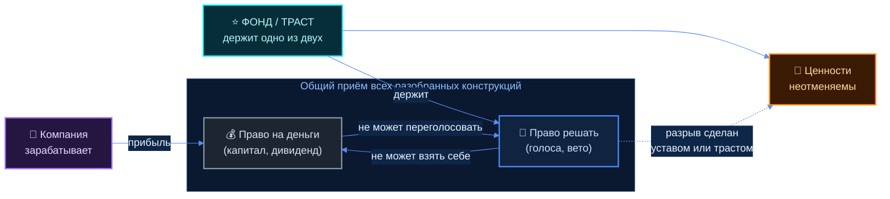
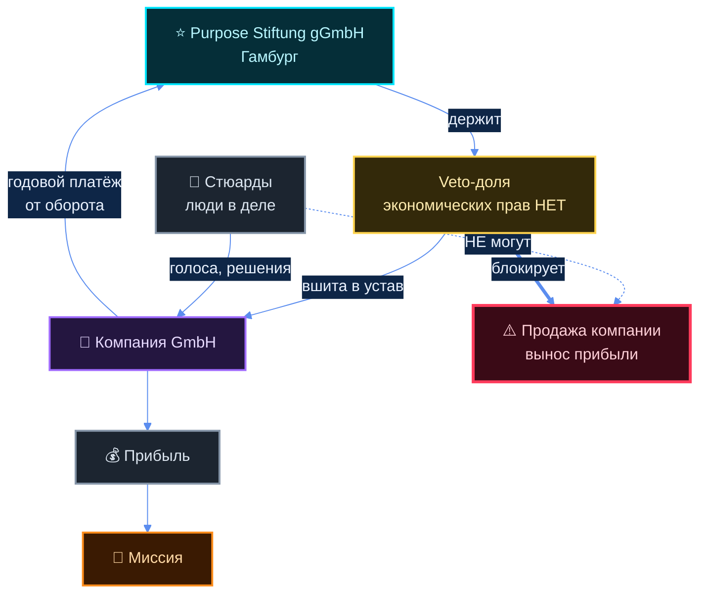
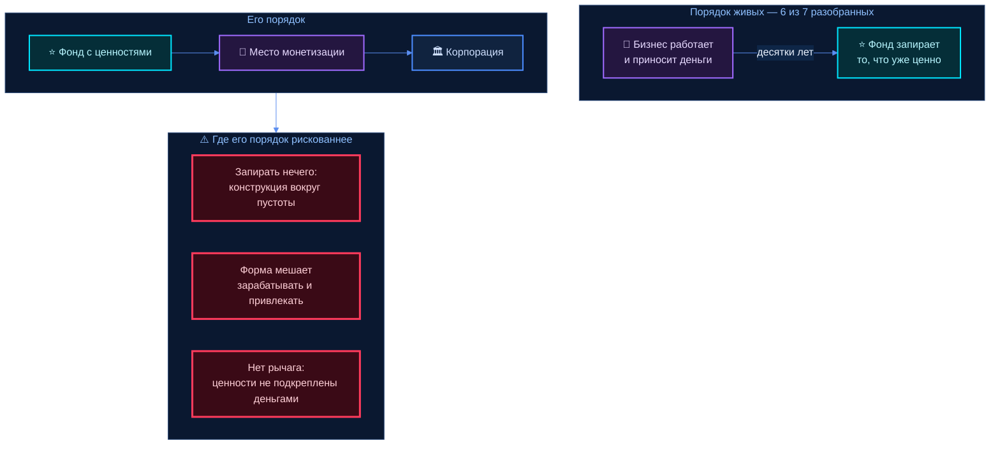

# ФОНД → МОНЕТИЗАЦИЯ → КОРПОРАЦИЯ

> Заказ голосом 15.10 21:37.
>
> «базовую схему нужно мне собрать обратно — то, что я описывал: что у нас будет ФОНД, который
> нацелен на развитие человека и раздачу информации в первую очередь; потом место, где это всё
> МОНЕТИЗИРУЕТСЯ; и КОРПОРАЦИЯ»
>
> «моё предложение эту корпорацию создать и при этом изначально при её создании закладывать
> ценности именно на развитие человека и человечества»
>
> «корпорация, которая сможет поставить порядки мировые, или хотя бы внутренние внутри каких-то
> ниш, которые она посчитает нужным»

**Что в этом документе.** Часть А — разбор живых конструкций «фонд + коммерческая часть», где
ценности закреплены юридически. Часть Б — честная проверка его замысла: что говорит практика,
а не намерения.

**Чего здесь нет.** Юридического заключения — это не наша роль. Вопросы живому юристу собраны
в §Б-5. Долей, процентов и цен про его людей — домовой стоп. Чужие числа (Patagonia, Bosch,
Mozilla) приводятся с источником: это факт о чужой организации, не предложение ему.

**Чего здесь нет-2.** Повтора ресёрча A3 по проекту `konsaltingovaya-firma` — там уже разобраны
12 децентрализованных фирм (Enspiral, Greaterthan, Smart, CoTech, Crisp, Mondragón и другие)
с их схемами денег. Здесь — только слой фонда и защиты ценностей.

---

## Карта документа

| Раздел | Что внутри |
|---|---|
| [А-0](#а-0---главный-вывод-за-минуту) | главный вывод за минуту |
| [А-1](#а-1---steward-ownership--verantwortungseigentum-германия) | steward-ownership / Verantwortungseigentum (Германия) |
| [А-2](#а-2---patagonia-2022) | Patagonia 2022 |
| [А-3](#а-3---фонд-владеет-компанией-bosch-zeiss-novo-nordisk-carlsberg-ikea) | фонд владеет компанией: Bosch · Zeiss · Novo · Carlsberg · IKEA |
| [А-4](#а-4---mozilla-foundation--mozilla-corporation) | Mozilla Foundation ↔ Corporation |
| [А-5](#а-5---раздача-информации-как-основная-функция) | Linux Foundation · Signal · Wikimedia |
| [А-6](#а-6---кто-ставит-порядки-в-нише-и-с-чего-начинал) | кто ставит порядки в нише и с чего начинал |
| [Б](#часть-б--честная-проверка-его-замысла) | проверка его замысла |

---

## А-0 — главный вывод за минуту

Четыре вещи, которые видно по всем разобранным организациям сразу.

**Первое. «Фонд» в этих конструкциях — это не касса на добрые дела, а держатель контроля.**
У Bosch, Zeiss, Novo Nordisk, Carlsberg фонд не финансирует компанию — он ею **владеет**, и
именно это делает ценности неотменяемыми. Фонд как «куда идёт часть прибыли» (модель 1% for the
Planet) защищает ровно ничего: эту строку в бюджете отменяют одним решением правления.

**Второе. Защита ценностей — это всегда разделение двух вещей, которые обычно слиты:
права на деньги и права решать.** Везде один и тот же приём, в разных юридических обёртках.
У Bosch: фонд держит 94 % капитала и ноль голосов, голоса (93 %) у отдельного товарищества.
У Patagonia: трасту отданы все голосующие акции (≈2 % капитала), фонду — все неголосующие.
У Ecosia: внешней гражданско-правовой структуре отдан один-единственный veto-анкер.
Кто может взять деньги — не может решать. Кто решает — не может взять деньги.

**Третье. Почти нигде ценности не были заложены при создании.** Zeiss: компания 1846 →
фонд 1889. Bosch: компания 1886 → фонд 1964. Carlsberg: пивоварня 1847 → фонд 1876. IKEA: 1943 →
Stichting 1982. Patagonia: 1973 → траст 2022. Ecosia: 2009 → steward-ownership 2018. John Lewis:
1864 → первый трастовый акт 1929. **Во всех случаях сначала был работающий бизнес, и только
потом — конструкция, которая его запирала.** Это прямо против порядка, который он предлагает,
и это главная находка документа. Разбор — §Б-3.

**Четвёртое. Исключение из третьего пункта существует, и оно одно — и оно как раз его порядком.**
Мондрагон: священник Аризмендиарриета приехал в город в 1941-м, в 1943-м открыл
**профессиональную школу** — то есть начал с раздачи знания, — и только через **13 лет**, в
1956-м, появился первый кооператив, а ещё через три года, в 1959-м, свой банк. Сегодня это
71 415 человек и 11,3 млрд € оборота (2025). Школа оказалась не прелюдией, а фундаментом:
кооперативы делали её выпускники.
Источник: [Wikipedia: José María Arizmendiarrieta](https://en.wikipedia.org/wiki/Jos%C3%A9_Mar%C3%ADa_Arizmendiarrieta),
[Wikipedia: Mondragon Corporation](https://en.wikipedia.org/wiki/Mondragon_Corporation).

⚠️ Цена этого исключения: тринадцать лет между знанием и первыми деньгами.

---

## А-1 — steward-ownership / Verantwortungseigentum (Германия)

Самый важный раздел, потому что он в Берлине и строить будет по немецкому праву.

### Что это такое

Движение и набор юридических приёмов под общим названием **Verantwortungseigentum**
(«ответственное владение», по-английски steward-ownership). Два принципа, которые
формулирует Purpose Foundation дословно:

> «Self-Determination: The company cannot become an object of speculation but remains
> self-determined and independent in the long term.»
>
> «Purpose-Orientation: Profits are a means to an end, not an end in themselves. They serve
> the company's mission and long-term development.»

Источник: [purpose-economy.org](https://purpose-economy.org/en/).

По-русски без воды: **компанию нельзя продать, и прибыль из неё нельзя вынуть себе в карман.**
Прибыль — топливо, а не добыча.

### Кто это делает практически

**Purpose Stiftung gGmbH** (Гамбург) — держит veto-доли немецких компаний.
**Purpose Foundation** (Базель, Швейцария) — держит veto-доли международных.
Группа работает с 2015 года; инвестиционное плечо Purpose Evergreen Capital заявляет около
250 млн € активированного капитала.
Источники: [purpose-economy.org/en/purpose-veto-share](https://purpose-economy.org/en/purpose-veto-share/),
[purpose-economy.org/en](https://purpose-economy.org/en/).

Вторая организация — **Stiftung Verantwortungseigentum** (лобби за новую правовую форму,
примеры на главной: ZEISS, BOSCH, ALNATURA, ECOSIA).
Источник: [stiftung-verantwortungseigentum.de](https://stiftung-verantwortungseigentum.de/).

### ⭐ Механика veto-доли — чем именно защищены ценности

Как это устроено (по описанию Purpose):

- veto-доля **не несёт экономических прав** — «no economic rights». Держатель не получает
  дивиденд, не участвует в выручке от продажи, не имеет доли в капитале;
- её задача одна: сделать так, «that the steward ownership principles cannot be overturned» —
  чтобы принципы steward-ownership нельзя было отменить голосованием;
- доли **передаются бесплатно** («transferred free of charge»), но компания платит фонду
  ежегодный платёж, привязанный к обороту, на покрытие административных расходов и
  некоммерческую работу фонда;
- есть типовой устав («Model Articles of Association»), в который механика вшивается.

Источник: [purpose-economy.org/en/purpose-veto-share](https://purpose-economy.org/en/purpose-veto-share/).

⚠️ **Чего я не смог проверить.** Точный процент veto-доли, точный перечень решений, которые
она блокирует, и размер годового платежа — на публичных страницах Purpose не раскрыты
(страница ссылается на внешний документ, который я не достал). **ДАННЫХ НЕТ.**

### Ecosia — живой берлинский случай

Основана в декабре 2009 Кристианом Кроллем. В октябре 2018 переведена в steward-ownership
вместе с Тимом Шумахером. Английская Wikipedia формулирует итог так: Кролль и Шумахер
«gave up their right to sell Ecosia or take any profits out of the company» — отказались от
права продать компанию и от права вынимать из неё прибыль.

Деньги: выручка 43 млн € (2025); в посадку деревьев направлено 13,1 млн € в 2025 году и
88,6 млн € накопленно за 2014–2025; более 250 млн деревьев к апрелю 2026.

⚠️ **Расхождение в источниках по долям.** Немецкая Wikipedia пишет, что 99 % капитала GmbH
передано швейцарской Purpose Stiftung, а у фонда 1 % голосов с правом вето. Английская
Wikipedia процентов не называет вовсе. Типовая модель Purpose описана иначе (фонд держит
только veto-анкер без капитала). **Точную конфигурацию Ecosia считаю непроверенной** — брать
её в текст наружу нельзя без первоисточника (устав или заявление компании).

⚠️ Критика: Ethical Consumer (2021) дал Ecosia Ethiscore 11 против 5,5 у Google, но снизил
оценку по семи категориям из-за зависимости от Microsoft и потребовал прозрачности по
отношениям с Bing. То есть конструкция владения чистая, а **операционная зависимость от
большого игрока — нет**, и это бьёт по репутации ровно так же.

Источники: [de.wikipedia.org/wiki/Ecosia](https://de.wikipedia.org/wiki/Ecosia),
[en.wikipedia.org/wiki/Ecosia](https://en.wikipedia.org/wiki/Ecosia),
[purpose-economy.org/en/companies/ecosia](https://purpose-economy.org/en/companies/ecosia/).

### ⭐⭐ Carl-Zeiss-Stiftung — единственная конструкция, где ценности прописаны как устав, а не как намерение

Это важнее Ecosia, потому что показывает **как выглядит текст, который реально держит сто лет.**

Эрнст Аббе учредил фонд **19 мая 1889 года** в Йене (правовой статус — 21 мая 1889 от
Великого герцогства Саксен-Веймар-Эйзенах), назвав его именем умершего в 1888-м партнёра
Карла Цейса. Полный устав — 1896 год. Пять уставных целей: экономическая устойчивость двух
предприятий фонда · социальные обязательства перед работниками · развитие отрасли точной
механики · благополучие общины Йены · поддержка науки и преподавания.

⭐ И одна строка, ради которой этот пример здесь. Устав Аббе **ограничил вознаграждение
руководства**: высший годовой доход должностного лица не может превышать **десятикратного**
среднего годового дохода работника со стажем от трёх лет, считая по среднему за три
предыдущих финансовых года.

Оптическая мастерская Карла Цейса открылась в **1846 году** в Йене (Neugasse 7) — то есть фонд
появился через **43 года** после компании.

Сегодня Carl-Zeiss-Stiftung — **единственный собственник** Carl Zeiss AG и Schott AG, 100 % в
каждой. Отто Шотт передал свои доли фонду в 1919 году. Масштаб сегодня: оборот 11,896 млрд €
и 46 622 сотрудника (финансовый год 2024/25, на 30.09.2025).

⭐ И ещё один замок, который стоит назвать отдельно: **«Das Stiftungsstatut verhindert einen
Börsengang»** — устав фонда прямо запрещает выход на биржу, поэтому акции Zeiss не котируются.
Это и есть образец «ценности, записанной как запрет»: не «мы против спекуляции», а «нельзя».
Источник: [de.wikipedia.org/wiki/Carl_Zeiss_AG](https://de.wikipedia.org/wiki/Carl_Zeiss_AG). В 2004 устав полностью переписан:
фонд перестал быть операционной компанией и стал холдингом, предприятия стали самостоятельными
акционерными обществами в 100 %-й собственности фонда.

⚠️ Что это показывает честно: **устав 1896 года держит до сих пор, но его переписали в 2004-м.**
Не отменили ценности — поменяли конструкцию под них. Это и есть реальный режим жизни такой
бумаги: она не вечна дословно, она вечна по смыслу, если есть кому её хранить.

Источник: [de.wikipedia.org/wiki/Carl-Zeiss-Stiftung](https://de.wikipedia.org/wiki/Carl-Zeiss-Stiftung).

### Статус закона о Gesellschaft mit gebundenem Vermögen (GmbH-gebV)

Хронология, которую удалось подтвердить:

| Год | Что произошло |
|---|---|
| 2020 | Марвин Райфф публикует академический проект закона о «GmbH in Verantwortungseigentum» (ZIP № 36, 2020) |
| 2020, 6 окт. | Биргит Вайтемайер, Петер Раверт и Райнер Хюттеманн публикуют совместную критику в FAZ |
| 2021 | Коалиционный договор SPD–Зелёные–СвДП обещает «geeignete Rechtsgrundlage». По оценке Stiftung Verantwortungseigentum, за созыв это сделано не было |
| 2024 | Анне Зандерс и соавторы публикуют академический законопроект «Gesetz zur Einführung einer Gesellschaft mit gebundenem Vermögen» (Mohr Siebeck) |
| 2025 | Коалиционный договор ХДС/ХСС–СДПГ: «Wir … wollen eine neue, eigenständige Rechtsform ‚Gesellschaft mit gebundenem Vermögen' einführen. Merkmale dieser Rechtsform sind die unabänderliche Vermögensbindung und die Teilhabe nach mitgliedschaftlicher Logik ohne steuerliche Privilegierungen oder Diskriminierungen» |

⛔ **Действующего закона на 15.10.2026 я подтвердить не смог.** Страницы Минюста (BMJ/BMJV) по
этой теме не открылись, опубликованного Referentenentwurf найти не удалось. **ДАННЫХ НЕТ** —
это вопрос к живому юристу (§Б-5), а не к нам. Практический вывод: **строить сегодня надо на
существующих формах** (veto-доля в уставе GmbH, Doppelstiftung, gGmbH, eG), а новую форму
держать как возможное улучшение потом.

⚠️ Критика самой идеи, с именами:
- **Йоахим Хеннрихс** — эффект «lock-in» капитала и налоговые преимущества перед другими формами;
- **Вайтемайер / Раверт / Хюттеманн** (FAZ, 06.10.2020) — критика жизнеспособности конструкции;
- **Руpay Дам** (Agora42) — без соучастия работников самоуправление остаётся декларацией;
- **Оле Нимён и Вольфганг М. Шмитт** — сохранение разделения на работодателя и работника
  противоречит заявленной высшей цели, и это не левый проект, как его продают.

Источник: [de.wikipedia.org/wiki/Verantwortungseigentum](https://de.wikipedia.org/wiki/Verantwortungseigentum).

### Doppelstiftung — немецкий обходной путь, который используют сегодня

Две структуры вместо одной, связанные через холдинг (обычно GmbH):

- **gemeinnützige Stiftung** (благотворительный фонд) — держит **большинство капитала**
  (пример: 90 %) и **меньшинство голосов** (пример: 10 %);
- **Familienstiftung** (семейный фонд) — держит **меньшинство капитала** (10 %) и
  **большинство голосов** (90 %).

Зачем: семья сохраняет управление, а доходы, не нужные семье, идут на общее благо — и при этом
не возникает большого налога на наследование по той части, что ушла в благотворительный фонд.
Самый известный пример — Bosch.

⚠️ Критика: модель прямо называют инструментом налоговой оптимизации — богатая семья
существенно снижает налоговую нагрузку, **сохраняя контроль над бизнесом**.

Источник: [de.wikipedia.org/wiki/Doppelstiftung](https://de.wikipedia.org/wiki/Doppelstiftung).

### Что из этого применимо ему прямо сейчас

| Применимо | Почему |
|---|---|
| ✅ Разделение «право на деньги / право решать» в уставе первой же GmbH | Это работа нотариуса и юриста, а не денег. Единственный приём, который дешевле всего заложить **до** того, как появится что делить |
| ✅ Формулировка цели в уставе по образцу Аббе, а не лозунгом | Ценность, записанная проверяемо (потолок, запрет, обязанность) — работает; записанная как «мы за развитие человека» — нет |
| 🔶 Veto-доля Purpose | Требует компании, которой есть что запирать, и годового платежа от оборота. Разговор на потом, но **модель устава можно взять сейчас** |
| ⛔ Doppelstiftung | Инструмент передачи уже накопленного состояния. У него нечего передавать — это не его инструмент |
| ⛔ Ждать GmbH-gebV | Закона нет, срока нет. Строить на том, что есть |

---

## Часть Б — честная проверка его замысла

### Б-1 — можно ли заложить ценности при создании так, чтобы они пережили рост

Короткий ответ: **да, но только те ценности, которые можно записать как запрет, а не как
намерение.** Практика это разделяет очень жёстко.

**Что переживает рост** — формулировки, которые можно проверить в суде или на собрании:

| Форма записи | Живой пример |
|---|---|
| Потолок, выраженный числом | Устав Аббе 1896: доход руководителя ≤ 10× среднего работника |
| Запрет на действие | Ecosia: отказ от права продать компанию и вынуть прибыль |
| Класс акций без экономических прав | Patagonia Purpose Trust; Purpose veto-доля |
| Привязка имущества к цели | §55 AO Vermögensbindung: при роспуске имущество уходит только на льготные цели |
| Право назначать часть совета | Anthropic Long-Term Benefit Trust: акции класса T дают право избирать и отзывать часть совета |

**Что рост не переживает** — всё, что держится на людях и на доброй воле:

- декларация ценностей без юридического якоря (отменяется решением правления);
- отчисление процента прибыли (пересматривается при первом плохом квартале);
- «культура» и «мы так договорились» (умирает на второй сотне человек — ровно это
  зафиксировано в разборе Enspiral и CoTech в `konsaltingovaya-firma/research/A3`);
- контроль через совет без класса акций (совет меняют — см. ноябрь 2023 в OpenAI, §Б-3).

⚠️ **И честная вторая половина ответа: даже юридический якорь не вечен.** Три факта подряд:

1. **Zeiss переписал устав целиком в 2004 году** — спустя 108 лет. Смысл сохранили,
   конструкцию поменяли.
2. **Anthropic прямо записал в своей же конструкции возможность её изменить**: полномочия
   траста могут быть изменены акционерами квалифицированным большинством, и «the required
   supermajorities increase as the Trust's power phases in» — то есть порог растёт со временем,
   но он конечен ([anthropic.com](https://www.anthropic.com/news/the-long-term-benefit-trust)).
3. **OpenAI, где контроль у некоммерческой организации был заявлен как нерушимый, эту
   конструкцию разобрал** за десять лет (§Б-3).

Вывод, который стоит сказать ему прямо: **замок не бывает вечным — бывает дорогим.**
Задача конструкции не «сделать отмену невозможной», а **сделать её настолько дорогой и
публичной, что отменять станет невыгодно.** Это достижимая цель. «Невозможно» — нет.

### Б-3 — ⚠️ его порядок против порядка живых

Это главный раздел документа.

**Его порядок:** сначала фонд с ценностями → потом место монетизации → потом корпорация.
**Порядок живых:** сначала работающий бизнес → потом фонд, который его запирает.

#### Три места, где его последовательность рискованнее — прямо

**Риск первый: запирать ещё нечего.** У Bosch фонд получил 94 % капитала работающего
концерна. У Patagonia траст получил компанию с оборотом. Фонд, созданный первым, запирает
пустую коробку: защищать нечего, и вся конструкция — издержка без функции. Юридическая
форма не создаёт ценности, она её **консервирует**.

**Риск второй: форма отталкивает тех, кто нужен на старте.** Steward-ownership прямо отрезает
два источника топлива: продажу компании и вынос прибыли. Для зрелого бизнеса это сила. Для
старта это означает, что ни классический инвестор, ни партнёр, рассчитывающий на долю в
будущей продаже, не зайдут. Он собирает группу специалистов (см. `konsaltingovaya-firma`) —
и первый же вопрос умного человека будет: «а что я с этого в итоге получу, если продать
нельзя?» Ответ должен быть готов **до** того, как форма зафиксирована.

**Риск третий, самый неприятный: ценности без денег не имеют рычага.** Его собственная мысль
из 186-OS-17-43 — «выживают те системы, у которых просто больше сил и ресурсов». Фонд без
денег не ставит никаких порядков: ни мировых, ни нишевых. Это прямое противоречие внутри его
же логики, и его лучше назвать самому, чем услышать от собеседника.

#### ⭐ А где его порядком всё-таки сработало

Три подтверждённых случая. Они разного качества — это важно.

**1. Мондрагон (сработало, 70 лет).** Школа 1943 → первый кооператив 1956 → банк 1959 →
сегодня 71 415 человек, 11,3 млрд € (2025). Это **ровно его порядок**: сначала раздача
знания, потом монетизация, потом корпорация кооперативов. Кооперативная форма и её принципы
были заложены при создании первого же предприятия, не добавлены потом.

⚠️ Цена: 13 лет от школы до первого дела. И два признанных изъяна — растущее число
нечленов-временных работников, и Ноам Хомский отмечал, что зарубежные дочерние компании
«still exploit workers in South America» вопреки кооперативным принципам. Плюс банкротство
Fagor Electrodomésticos в октябре 2013 — крупнейший кооператив упал, солидарные механизмы
смогли перераспределить людей, но не спасти предприятие.
Источники: [Mondragon Corporation](https://en.wikipedia.org/wiki/Mondragon_Corporation),
[José María Arizmendiarrieta](https://en.wikipedia.org/wiki/Jos%C3%A9_Mar%C3%ADa_Arizmendiarrieta).

**2. OpenAI (⛔ не сработало — и это самый точный контрпример к его замыслу).**
Хронология, которую стоит прочитать ему целиком, потому что это его порядок в чистом виде:

| Дата | Что было |
|---|---|
| декабрь 2015 | Основана как **некоммерческая организация**. Ценности — в уставе, прибыли нет |
| 2019 | Создана «capped-profit» надстройка: OpenAI LP и OpenAI Global LLC. Прибыль ограничена 100× вложения. Некоммерческая OpenAI Inc. остаётся контролирующим акционером. Microsoft вкладывает 1 млрд $ |
| 17 ноября 2023 | Совет снимает Альтмана «за утрату доверия». 738 из 770 сотрудников подписывают письмо с угрозой уйти |
| 21 ноября 2023 | Альтман возвращается, совет переформирован |
| 28 октября 2025 | Объявлена новая структура: коммерческая часть становится **OpenAI Group PBC**, некоммерческая переименована в **OpenAI Foundation**, **потолок прибыли снят**. Доли: Foundation 26 %, Microsoft 27 %, сотрудники и инвесторы 47 % |
| апрель–май 2026 | Маск пытается отменить реструктуризацию, в мае 2026 проигрывает по сроку давности |

Бывшие сотрудники подали юридическое письмо «Not For Private Gain», требуя от генеральных
прокуроров заблокировать реструктуризацию: она снимает «governance safeguards» и противоречит
изначальной миссии. Реструктуризацию всё равно одобрили прокуроры Калифорнии и Делавэра.
Источник: [en.wikipedia.org/wiki/OpenAI](https://en.wikipedia.org/wiki/OpenAI).

⭐ **Что из этого следует для него.** Конструкция «некоммерческая организация контролирует
коммерческую» — это ровно его схема ФОНД → МОНЕТИЗАЦИЯ. Самый богатый и самый публичный
эксперимент такого рода в истории **развернулся за десять лет**, когда деньги стали больше
конструкции. Причина названа прямо: контроль держался на **составе совета**, а не на классе
акций. Совет сменили за четыре дня.

Из этого один практический урок: **контроль, который держится на людях, не держится.
Контроль должен держаться на бумаге, которую нельзя переписать теми же людьми.**

**3. Mozilla (⚠️ сработало частично, но ценой зависимости).** Разбор — §А-4.

### Б-4 — что это стоит в Германии

⛔ Сразу: **суммы нотариальных и судебных пошлин, сроки регистрации и стоимость юриста я не
нашёл в проверяемом источнике. ДАННЫХ НЕТ.** Ниже — только то, что стоит прямо в законе.

| Форма | Что требует закон | Источник |
|---|---|---|
| **GmbH** | Уставный капитал минимум **25 000 €**: «Das Stammkapital der Gesellschaft muß mindestens fünfundzwanzigtausend Euro betragen» | [§ 5 GmbHG](https://www.gesetze-im-internet.de/gmbhg/__5.html) |
| **UG (haftungsbeschränkt)** | Капитал **ниже** минимума GmbH разрешён, но должен быть **полностью оплачен** до регистрации, вклады в натуре запрещены; в резерв ежегодно откладывается **четверть** годовой прибыли | [§ 5a GmbHG](https://www.gesetze-im-internet.de/gmbhg/__5a.html) |
| **e. V.** | Минимум **семь** членов: «Die Eintragung soll nur erfolgen, wenn die Zahl der Mitglieder mindestens sieben beträgt» | [§ 56 BGB](https://www.gesetze-im-internet.de/bgb/__56.html) |
| **eG (кооператив)** | Минимум **три** члена: «Die Zahl der Mitglieder muss mindestens drei betragen» | [§ 4 GenG](https://www.gesetze-im-internet.de/geng/__4.html) |
| **Stiftung** | Минимальной суммы в законе **НЕТ**. Требование иное: имущество должно обеспечивать «dauernde und nachhaltige Erfüllung» цели; нужны Stiftungsgeschäft и **признание земельным органом** | [§ 80 BGB](https://www.gesetze-im-internet.de/bgb/__80.html) |

#### Что даёт статус Gemeinnützigkeit — и чем за него платят

Его «развитие человека и раздача информации» попадает в каталог льготных целей
[§ 52 AO](https://www.gesetze-im-internet.de/ao_1977/__52.html) как минимум по трём позициям:

- **№ 1** — «die Förderung von Wissenschaft und Forschung»;
- **№ 7** — «die Förderung der Erziehung, Volks- und Berufsbildung einschließlich der
  Studentenhilfe»;
- **№ 25** — «die Förderung des bürgerschaftlichen Engagements zugunsten gemeinnütziger,
  mildtätiger und kirchlicher Zwecke».

⭐ И главное: [§ 55 AO](https://www.gesetze-im-internet.de/ao_1977/__55.html) (Selbstlosigkeit)
**сам по себе есть готовый замок ценностей**, бесплатный и уже действующий:

- участники «dürfen keine Gewinnanteile und in ihrer Eigenschaft als Mitglieder auch keine
  sonstigen Zuwendungen aus Mitteln der Körperschaft erhalten» — никаких долей прибыли;
- «Mittel der Körperschaft dürfen nur für die satzungsmäßigen Zwecke verwendet werden» —
  средства только на уставные цели;
- **Vermögensbindung**: при роспуске имущество уходит другой льготной организации или
  публично-правовому лицу на льготные цели, а не участникам.

Для gGmbH это конкретизируется так: прибыль идёт на уставную цель и **не распределяется
участникам**; исключение — если сами участники являются льготными организациями. Плюсы:
освобождение от Körperschaftsteuer и Gewerbesteuer, право выдавать справки о пожертвованиях,
сниженная ставка НДС 7 % для Zweckbetriebe.
Источник: [de.wikipedia.org/wiki/Gemeinnützige_GmbH](https://de.wikipedia.org/wiki/Gemeinn%C3%BCtzige_GmbH).

⚠️ **Цена этого замка — он настоящий.** Если он через фонд хочет «развитие человека и раздачу
информации», и при этом хочет, чтобы деньги оттуда когда-нибудь вернулись к нему или к
партнёрам — **это несовместимо**. Gemeinnützigkeit — улица с односторонним движением:
вошедшее имущество обратно к людям не выходит никогда, даже при роспуске. Это ровно та
неотменяемость, которой он хочет, и ровно та цена, которую за неё платят.

### Б-5 — вопросы живому юристу

Не юридическое заключение, а список, с которым имеет смысл прийти к немецкому
Rechtsanwalt / Notar и Steuerberater. Это наша роль — подготовить вопросы, не ответить.

1. Можно ли вшить veto-механику (разделение «деньги / голоса») в устав обычной GmbH **при
   учреждении**, и какие конкретно решения такой устав может необратимо закрыть?
2. Может ли gGmbH или Stiftung **владеть долей в коммерческой GmbH**, не теряя
   Gemeinnützigkeit? Где граница между Vermögensverwaltung и wirtschaftlicher Geschäftsbetrieb?
3. Если фонд создан первым и первые годы не ведёт деятельности — чем это грозит по §§ 55, 63 AO
   (Mittelverwendung, своевременное использование средств)?
4. Что реально требует берлинский Stiftungsbehörde как доказательство «dauernde und nachhaltige
   Erfüllung des Stiftungszwecks» по § 80 BGB — какая сумма и какая модель дохода проходят?
5. Статус **Gesellschaft mit gebundenem Vermögen** на сегодня: есть ли Referentenentwurf,
   какой горизонт, и имеет ли смысл ждать?
6. Если участники группы — независимые специалисты, какая форма несёт меньший риск
   Scheinselbständigkeit: eG, GbR, GmbH с договорами, или что-то иное?
7. Что происходит с имуществом gGmbH при роспуске в его конкретной конфигурации, и
   существует ли законный способ оставить обратный путь (ответ может быть «нет» — его тоже
   надо получить письменно).
8. Налоговая сторона: Steuerberater — какие обязанности по отчётности возникают у связки
   «фонд + коммерческая компания» с первого же года.
