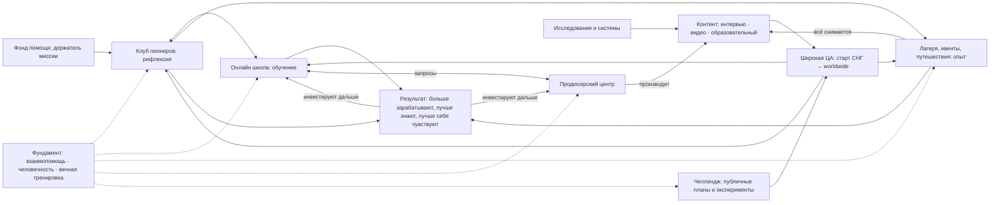

# Jetix Group

> Версия 2 после двух заходов (доска целиком + голос, 2026-11-19). Верхнеуровнево, всё в одном.
> Что дальше, вопросы, ресёрчи, путь к бизнес-плану и манифесту — `02-put-k-biznes-planu-i-manifestu.md`.
> Цитаты в кавычках — его слово. 🔶 — он этого не сказал, не додумываю.
> `[доска]` — есть только на доске, `[голос]` — только в голосе.

---

## 1. Видение и цель

**Что это одной фразой (его слово, сжато):**
Jetix Group — одна группа компаний, которая повышает доверие между людьми и их способность
кооперироваться и сотрудничать, чтобы люди развивались и жили интересно.

**Зачем.** Чтобы люди «интересно проживали свою жизнь, не сидели всю жизнь в одном городе на одной
работе», чтобы «сделать мир чуточку лучше и интересней для каждого из участников» — и для работника
внутри компании, и для пользователя её продуктов и ивентов.

**Конечная цель.** «Культура взаимопомощи» и больше людей-«авантюристов, заинтересованных».

**Что это по сути.** Не набор бизнесов, а **технология взаимоотношений между людьми** —
методология, которую другие люди смогут переиспользовать в своих локальных местах: «где бы вы её ни
использовали, плюс-минус она будет работать».

**Чем является для людей** `[доска]`: «место повышения доверия».

**Для кого.** Широкая аудитория, но ближе всего — те, кто учится и кто учит: учителя, вузы, студенты,
ученики, их родители.

**География.** Старт — СНГ комьюнити. Дальше — **worldwide**. Его слово: «берём пример с MrBeast».

### Цели на первый год `[его слово, 2026-11-19]`

- **Более 5000 участников.**
- **6–7 проведённых мероприятий.**
- **Собранное ядро команды — 30 человек.**

### Стартовая точка `[его слово, 2026-11-19]`

- Бюджет: **ноль**. Деньги будем искать и добавлять по ходу.
- Команда: **ноль**.
- Старт: **блог + онлайн школа**. Порядок остальных систем не догма: «главное — начать, и
  побыстрее»; порядок обсуждается с людьми, которых зовём, и считается по выгоде.

### Фундамент — ценности

На доске фундамент нарисован отдельной рамкой под всей схемой. Всё стоит на нём.

1. **Взаимопомощь.**
2. **Человечность.** `[доска]`
3. **Вечная тренировка себя.**
4. **Быть подготовленным к чему-либо.** `[голос]`

---

## 2. Системы Jetix Group

Шесть систем + две сквозные функции. Порядок — по доске: от фонда наверх, по кругу.

| # | Система | Одной строкой | Деньги по его слову |
|---|---|---|---|
| 0 | **Фонд помощи** | держатель миссии, владеет остальными сущностями | донаты |
| 1 | **Клуб пионеров** | еженедельная рефлексия, вопросы Франклина | 🔶 |
| 2 | **Онлайн школа** | учителя и репетиторы учат взрослых онлайн | «заработок, монетизация» |
| 3 | **Лагеря, ивенты, путешествия** | 15–30 участников, вожатые, квесты по миру, всё снимается | «даём, продаём уникальный опыт в реальном мире» |
| 4 | **Челлендж** | публичные челленджи: опиши план, собери команду, попроси или дай помощь | 🔶 |
| 5 | **Продюсерский центр** | помогает учителям и организаторам: упаковка, реклама, инвестиции, команда | 🔶 |
| ↔ | **Контент** — сквозное | образовательный контент и интервью; «не система, а то, что мы производим» | 🔶 |
| ↔ | **Исследования и разработка систем** — сквозное | научные и социальные эксперименты, вклад в культуру | 🔶 |

### 0. Фонд помощи — держатель миссии

- **Что делает.** Принимает донаты. Держит миссию. «Владеет всеми остальными сущностями».
- **Кто внутри.** Донатеры `[доска]`.
- **Связи.** Донатеры → фонд. Фонд → клуб (длинная стрелка на доске).
- **Его оговорка.** «Сейчас это не сильно важно, просто есть фонд помощи».
- 🔶 Юридическая форма, кто управляет фондом, на что идут донаты.

### 1. Клуб пионеров

- **Что делает.** Место, где люди раз в неделю **рефлексируют**: что сделано, что хотят улучшить.
  Отвечают на **вопросы Франклина**. Его примеры вопросов:
  - какой интересный проект ты видел;
  - чем бы ты хотел заниматься;
  - как ты можешь быть полезен группе Jetix;
  - как группа Jetix может помочь тебе.
- **Кто внутри.** «Пионеры» — люди, которые хотят смотреть на свою жизнь через разные линзы.
- **Связи.** Клуб ↔ онлайн школа. Клуб → ивенты и путешествия. Фонд → клуб.
- 🔶 Платный или бесплатный, формат (созвон, чат, офлайн), кто ведёт, кто фильтрует вход.
- На доске: «составить детальный список, что и кто нужен для первой версии клуба» — это его задача
  в план (§5).

### 2. Онлайн школа

- **Что делает.** Переносит в онлайн учителей и репетиторов, «которые есть уже сейчас».
  Учит взрослых системно, «точно так же, как детей учат, чтобы поступили в университет».
- **Форматы.** Группы + ежедневные индивидуальные занятия.
- **Предметы** `[доска + голос]`: математика · физика · айти / как устроен код · экономика ·
  физкультура · социология · работа с источниками · разработка аналитики · анализ компании ·
  переговоры. Полный список — пришлёт текстом.
- **Кто внутри.** Учителя и репетиторы, ученики, инвесторы — все три стрелки на доске идут сюда.
- **Деньги.** Единственная система, где на доске прямо написано «заработок, монетизация».
- 🔶 Кто эти учителя «которые есть уже сейчас» — конкретные люди или категория.

### 3. Лагеря, ивенты, путешествия

- **Что делает.** Организует:
  - лагеря онлайн и офлайн — «видение лагерей и сбора ивентов сообществ»;
  - локальные ивенты, сбор участников вебинаров;
  - путешествия — обычные, с работой, с волонтёрством внутри.
- **Лагерь — как устроен** `[доска, правая колонка]`:
  - 15–30 участников;
  - 2–3 вожатых, тренера, учителя;
  - квесты по миру, путешествия;
  - обучение разным наукам;
  - интервью с известными, интересными людьми;
  - всё документируется и детально снимается;
  - участники сами себе строят «хату», сообщество;
  - тренируются вместе.
- **Длительность.** «1 неделя — 1 год, сроки будут» — разные форматы по длине.
- **Что продаём.** «Даём, продаём уникальный опыт, экспириенс в реальном мире». Плюс тренировки,
  кружки, изучение чего-либо.
- **Деньги — подтверждено 2026-11-19:** лагеря «в любом случае оформляем так, чтобы на этом
  зарабатывать».
- **Связи.** Клуб → лагеря. Прод. центр помогает организаторам. Съёмка лагеря → контент → маховик.
- 🔶 «Культура та[кая]… участниками» — начало фразы обрезано.

### 4. Челлендж

- **Что это.** Отдельное направление группы — «для всё более широкого распространения».
  Группа сама запускает челленджи и помогает людям организовать свои.
- **Что делаем для человека:**
  - помогаем описать, что он хочет сделать или попробовать — научный эксперимент,
    бизнес-эксперимент и т.д.;
  - воодушевляем делиться планами: как он видит развитие планеты, жизни, своих проектов;
  - даём рассказать, что ему нужна помощь — или что он может помочь, хочет быть полезным.
- **Механика с доски:**
  - собери свою команду или найди подходящую;
  - опиши нормально, что хочешь, с чем нужна помощь, кого ищешь;
  - публикуй на Jetix, используй хештег;
  - инвесторы, голосовалки, доступный контент;
  - челленджи по количеству участников;
  - подбор как в играх;
  - сюжет, план — «иногда такие будут, и иногда соревнование» `[?]`.
- **Роль в машине.** Верхушка воронки наравне с контентом: открытый, публичный вход, через который
  группа растёт. Ориентир — MrBeast.
- 🔶 Где «публикуй на Jetix». Как челлендж зарабатывает или окупается.

### 5. Продюсерский центр

- **Что делает.** Обслуживает тех, кто внутри группы что-то создаёт — учителей, репетиторов,
  организаторов мероприятий:
  - рассказать о мероприятии (реклама, продвижение);
  - организационные моменты, оформление;
  - поиск инвестиций;
  - поиск команды для записи, создание рекламы.
- **Производит контент** — образовательный и интервью (см. сквозное ниже).
- **Связи.** Прод. центр ↔ онлайн школа: «запросы» в обе стороны. Прод. центр → контент →
  широкая ЦА.
- 🔶 Работает только внутри группы или берёт и внешних клиентов. Берёт ли деньги и с кого.

### ↔ Контент — сквозное

- **Что.** В первую очередь образовательный контент и интервью: как работает математика, физика,
  технологии, наука. Плюс мероприятия по совместному обучению.
- **Форма** `[доска]`: видео · мероприятия.
- **Его слово.** «Контент — не отдельная система, это то, что мы производим. Но его надо где-то
  показать».
- **Роль в машине.** Вход в маховик: захватывает людей и ведёт их в клуб и школу.
- 🔶 Где показываем: какие площадки, свой сайт или платформа Jetix.

### ↔ Исследования и разработка систем — сквозное

- **Что.** «Попутно системы разрабатываем и проводим исследования» — научные, социальные
  эксперименты. Не «разбили машину — прикольно», а вклад во всечеловеческую культуру.
- 🔶 Отдельная система со своими людьми или функция, размазанная по всем.

---

## 3. Участники — кто в этой машине

| Кто | Куда входит | Что получает | Что даёт |
|---|---|---|---|
| Донатеры | фонд | 🔶 | донаты |
| Пионеры | клуб | рефлексия, линзы, помощь группы | ответы, пользу группе |
| Учителя, репетиторы | школа | онлайн-формат, учеников, помощь прод. центра | обучение |
| Ученики (взрослые) | школа | системное обучение | 🔶 оплату |
| Участники лагеря | лагеря | уникальный опыт в реальном мире, команду, тренировки | 🔶 оплату; себя в кадре |
| Вожатые, тренеры, учителя лагеря | лагеря, 2–3 на лагерь | 🔶 | ведут лагерь |
| Авторы челленджей | челлендж | помощь описать план, команду, помощь людей | свой эксперимент в публичное |
| Инвесторы | школа; челлендж; прод. центр ищет их для проектов | 🔶 | деньги |
| Организаторы ивентов | ивенты; прод. центр | упаковку, рекламу, команду | ивенты |
| Широкая ЦА: учителя, вузы, студенты, родители, группа поддержки | контент, челлендж | образовательный контент | внимание, приток |
| Работники Jetix Group | все системы | «интересная жизнь» — тоже цель | работу |

---

## 4. Как всё связано — маховик

Его слово: «круг замкнутый … такой маховик раскручиваем».

**Петля словами:**
1. Контент и челленджи захватывают всё больше людей — сначала СНГ, потом весь мир.
2. Люди приходят в клуб, онлайн школу, лагеря: обучаются, рефлексируют, делают свои ивенты.
3. Результат: больше зарабатывают, лучше узнают, лучше себя чувствуют.
4. Инвестируют дальше — в продюсерский центр или онлайн школу.
5. Мы производим больше контента — в том числе снимая лагеря — и исследования → шаг 1.

**Связи, которые есть на доске:**
- Донатеры → фонд → клуб
- Учителя, ученики, инвесторы → онлайн школа
- Клуб ↔ онлайн школа
- Клуб → ивенты и путешествия
- Прод. центр ↔ онлайн школа («запросы»)
- Прод. центр → контент → видео, мероприятия → СНГ комьюнити → «место повышения доверия» → обратно
  к фундаменту

---

## 5. Что я вижу — наблюдения агента

Не решения, а то, что всплыло при сборке. Решает он.

1. **Деньги видны в двух местах из шести.** Школа («монетизация») и лагеря («продаём опыт»).
   Фонд живёт на донатах. Клуб, челлендж и прод. центр — молчат. При этом фонд «владеет»
   коммерческими сущностями — это вопрос юр. формы, который всплывёт при первом же партнёре.
2. **Лагерь — самая готовая система.** У неё уже есть размер (15–30), состав (2–3 вожатых),
   содержание (квесты, науки, интервью, тренировки, стройка «хаты»), длина (неделя — год) и
   продукт («продаём опыт»). Плюс он сам себя снимает — то есть кормит контент. Это кандидат на
   первый запуск и на первый бизнес-план.
3. **Модель MrBeast в его словах — про масштаб и челлендж.** Публичные челленджи + съёмка
   реального опыта + благотворительный фонд — у MrBeast эти три части тоже есть. Что именно
   берём — нужно назвать, иначе «как MrBeast» каждый прочтёт по-своему (см. ресёрч R1).
4. **Ядро сдвинулось.** В прошлом заходе центром была платформа-клуб под чужими именами. Сейчас
   платформа как система не нарисована. Но «публикуй на Jetix, хештег» в челлендже подразумевает,
   что какая-то площадка Jetix есть.
5. **«Технология взаимоотношений» — сильнейшая фраза и пока без описания.** Из материала её
   кирпичи: вопросы Франклина + еженедельная рефлексия + челлендж («опиши, что хочешь, с чем нужна
   помощь, чем можешь помочь») + механики гарантий и арбитраж. Это и есть будущий манифест.
6. **Вопросы Франклина — у Франклина был ровно такой клуб.** Junto (1727): еженедельные встречи,
   постоянный список вопросов, на которые участники отвечают, включая «чем клуб может помочь тебе».
   Его клуб пионеров — прямой потомок. Стоит опереться на это в манифесте (ресёрч R2).
7. **Прод. центр — мост к его текущему ремеслу.** Продюсирование здесь не отдельный бизнес, а
   сервис для своих учителей и организаторов. Это снимает старый шов «я продюсер → клуб».

---

## 6. Открытые вопросы

Полный список, сгруппированный под бизнес-план и манифест, — в
`02-put-k-biznes-planu-i-manifestu.md`. Здесь — пять главных:

1. ~~Что запускаем первым~~ — **решено: блог + онлайн школа**, остальное по ходу с людьми.
2. **Деньги по системам.** Кто за что платит в клубе, челлендже, прод. центре. Как деньги
   доходят до фонда.
3. **Фонд-владелец.** Какая юр. форма и в какой стране.
4. **Что берём у MrBeast.** Масштаб? Формат челленджей? Фонд? Локализацию?
5. **Платформа Jetix** — живёт внутри новой модели или снята.

Закрыто вторым заходом: правый край доски (кроме верха), челлендж — отдельная система,
география — старт СНГ, дальше worldwide.

---

## 7. План действий

План целиком — в `02-put-k-biznes-planu-i-manifestu.md` §5.
