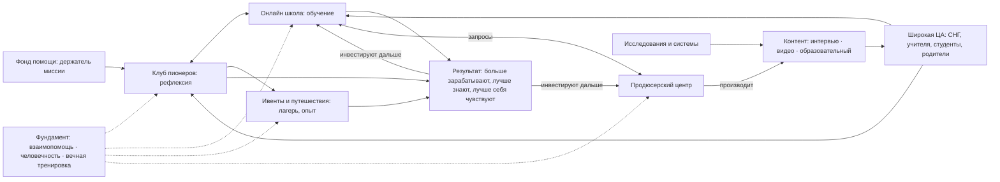

# Jetix Group

> Версия 1 после первого захода (доска + голос, 2026-11-19). Верхнеуровнево, всё в одном.
> Цитаты в кавычках — его слово. 🔶 — он этого не сказал, не додумываю.
> `[доска]` — есть только на доске, `[голос]` — только в голосе.

---

## 1. Видение и цель

**Что это одной фразой (его слово, сжато):**
Jetix Group — одна группа компаний, которая повышает доверие между людьми и их способность
кооперироваться и сотрудничать, чтобы люди развивались и жили интересно.

**Зачем.** Чтобы люди «интересно проживали свою жизнь, не сидели всю жизнь в одном городе на одной
работе», чтобы «сделать мир чуточку лучше и интересней для каждого из участников» — и для работника
внутри компании, и для пользователя её продуктов и ивентов.

**Конечная цель.** «Культура взаимопомощи» и больше людей-«авантюристов, заинтересованных».

**Что это по сути.** Не набор бизнесов, а **технология взаимоотношений между людьми** —
методология, которую другие люди смогут переиспользовать в своих локальных местах: «где бы вы её ни
использовали, плюс-минус она будет работать».

**Для кого.** Широкая аудитория, «СНГ комьюнити, широкая ЦА» `[доска]`, но ближе всего — те, кто
учится и кто учит: учителя, вузы, студенты, ученики, их родители.

### Фундамент — ценности

На доске фундамент нарисован отдельной рамкой под всей схемой. Всё стоит на нём.

1. **Взаимопомощь.**
2. **Человечность.** `[доска]`
3. **Вечная тренировка себя.**
4. **Быть подготовленным к чему-либо.** `[голос]`

---

## 2. Системы Jetix Group

Пять систем + две сквозные функции. Порядок — по доске: от фонда наверх, по кругу.

| # | Система | Одной строкой | Деньги по его слову |
|---|---|---|---|
| 0 | **Фонд помощи** | держатель миссии, владеет остальными сущностями | донаты |
| 1 | **Клуб пионеров** | еженедельная рефлексия, вопросы Франклина | 🔶 |
| 2 | **Онлайн школа** | учителя и репетиторы учат взрослых онлайн | «заработок, монетизация» |
| 3 | **Ивенты и путешествия** | локальные ивенты, путешествия, лагерь онлайн/офлайн | «продаём доступ к уникальным экспириенсам» |
| 4 | **Продюсерский центр** | помогает учителям и организаторам: упаковка, реклама, инвестиции, команда | 🔶 |
| ↔ | **Контент** — сквозное | образовательный контент и интервью; «не система, а то, что мы производим» | 🔶 |
| ↔ | **Исследования и разработка систем** — сквозное | научные и социальные эксперименты, вклад в культуру | 🔶 |

### 0. Фонд помощи — держатель миссии

- **Что делает.** Принимает донаты. Держит миссию. «Владеет всеми остальными сущностями».
- **Кто внутри.** Донатеры `[доска]`.
- **Связи.** Донатеры → фонд. Фонд → клуб (длинная стрелка на доске).
- **Его оговорка.** «Сейчас это не сильно важно, просто есть фонд помощи».
- 🔶 Юридическая форма, кто управляет фондом, на что идут донаты.

### 1. Клуб пионеров

- **Что делает.** Место, где люди раз в неделю **рефлексируют**: что сделано, что хотят улучшить.
  Отвечают на **вопросы Франклина**. Его примеры вопросов:
  - какой интересный проект ты видел;
  - чем бы ты хотел заниматься;
  - как ты можешь быть полезен группе Jetix;
  - как группа Jetix может помочь тебе.
- **Кто внутри.** «Пионеры» — люди, которые хотят смотреть на свою жизнь через разные линзы.
- **Связи.** Клуб ↔ онлайн школа. Клуб → ивенты и путешествия. Фонд → клуб.
- 🔶 Платный или бесплатный, формат (созвон, чат, офлайн), кто ведёт, кто фильтрует вход.
- На доске: «составить детальный список, что и кто нужен для первой версии клуба» — это его задача
  в план (§5).

### 2. Онлайн школа

- **Что делает.** Переносит в онлайн учителей и репетиторов, «которые есть уже сейчас».
  Учит взрослых системно, «точно так же, как детей учат, чтобы поступили в университет».
- **Форматы.** Группы + ежедневные индивидуальные занятия.
- **Предметы** `[доска + голос]`: математика · физика · айти / как устроен код · экономика ·
  физкультура · социология · работа с источниками · разработка аналитики · анализ компании ·
  переговоры. Полный список — пришлёт текстом.
- **Кто внутри.** Учителя и репетиторы, ученики, инвесторы — все три стрелки на доске идут сюда.
- **Деньги.** Единственная система, где на доске прямо написано «заработок, монетизация».
- **Механика «Челлендж»** `[доска]`, нарисована рядом со школой:
  - собери свою команду или найди подходящую;
  - опиши нормально, что хочешь, с чем нужна помощь, кого ищешь;
  - публикуй на Jetix, используй хештег;
  - инвесторы, голосовалки, доступный контент;
  - челленджи по количеству участников;
  - подбор как в играх;
  - сюжет, план — «иногда такие, иногда соответствие» `[?]`.
- 🔶 Челлендж — часть школы, клуба или всей группы. «Публикуй на Jetix» — где именно.
- 🔶 Кто эти учителя «которые есть уже сейчас» — конкретные люди или категория.

### 3. Ивенты и путешествия

- **Что делает.** Организует:
  - локальные ивенты, сбор участников вебинаров;
  - путешествия — обычные, с работой, с волонтёрством внутри.
- **Формат.** «Движуха как лагерь — онлайн и офлайн».
- **Деньги.** «Продаём доступ к уникальным экспириенсам, разному опыту».
- **Связи.** Клуб → ивенты. Прод. центр помогает организаторам.
- 🔶 Детали — пришлёт текстом следующим заходом. Правая колонка доски, видимо, про это
  («1 неделя — 1 год», «даём, продаём уникальный опыт в реальном мире», «тренировки, кружки»),
  но она обрезана кадром.

### 4. Продюсерский центр

- **Что делает.** Обслуживает тех, кто внутри группы что-то создаёт — учителей, репетиторов,
  организаторов мероприятий:
  - рассказать о мероприятии (реклама, продвижение);
  - организационные моменты, оформление;
  - поиск инвестиций;
  - поиск команды для записи, создание рекламы.
- **Производит контент** — образовательный и интервью (см. сквозное ниже).
- **Связи.** Прод. центр ↔ онлайн школа: «запросы» в обе стороны. Прод. центр → контент →
  широкая ЦА.
- 🔶 Работает только внутри группы или берёт и внешних клиентов. Берёт ли деньги и с кого.

### ↔ Контент — сквозное

- **Что.** В первую очередь образовательный контент и интервью: как работает математика, физика,
  технологии, наука. Плюс мероприятия по совместному обучению.
- **Форма** `[доска]`: видео · мероприятия.
- **Его слово.** «Контент — не отдельная система, это то, что мы производим. Но его надо где-то
  показать».
- **Роль в машине.** Вход в маховик: захватывает людей и ведёт их в клуб и школу.
- 🔶 Где показываем: какие площадки, свой сайт или платформа Jetix.

### ↔ Исследования и разработка систем — сквозное

- **Что.** «Попутно системы разрабатываем и проводим исследования» — научные, социальные
  эксперименты. Не «разбили машину — прикольно», а вклад во всечеловеческую культуру.
- 🔶 Отдельная система со своими людьми или функция, размазанная по всем.

---

## 3. Участники — кто в этой машине

| Кто | Куда входит на доске | Что получает | Что даёт |
|---|---|---|---|
| Донатеры | фонд | 🔶 | донаты |
| Пионеры | клуб | рефлексия, линзы, помощь группы | ответы, пользу группе |
| Учителя, репетиторы | школа | онлайн-формат, учеников, помощь прод. центра | обучение |
| Ученики (взрослые) | школа | системное обучение | 🔶 оплату |
| Инвесторы | школа; прод. центр ищет их для проектов | 🔶 | деньги |
| Организаторы ивентов | ивенты; прод. центр | упаковку, рекламу, команду | ивенты |
| Широкая ЦА: учителя, вузы, студенты, родители, группа поддержки | контент | образовательный контент | внимание, приток в клуб и школу |
| Работники Jetix Group | все системы | «интересная жизнь» — тоже цель | работу |

---

## 4. Как всё связано — маховик

Его слово: «круг замкнутый … такой маховик раскручиваем».

**Петля словами:**
1. Контент — интервью, видео, образовательный — захватывает всё больше людей.
2. Люди приходят в клуб или онлайн школу: обучаются, рефлексируют, делают свои ивенты.
3. Результат: больше зарабатывают, лучше узнают, лучше себя чувствуют.
4. Инвестируют дальше — в продюсерский центр или онлайн школу.
5. Мы производим больше контента + исследования → шаг 1.

**Связи, которые есть на доске:**
- Донатеры → фонд → клуб
- Учителя, ученики, инвесторы → онлайн школа
- Клуб ↔ онлайн школа
- Клуб → ивенты и путешествия
- Прод. центр ↔ онлайн школа («запросы»)
- Прод. центр → контент → видео, мероприятия → СНГ комьюнити → обратно к фундаменту

---

## 5. Что я вижу — наблюдения агента

Не решения, а то, что всплыло при сборке. Решает он.

1. **Деньги видны в двух местах из пяти.** Школа («монетизация») и ивенты («продаём экспириенс»).
   Фонд живёт на донатах. Клуб и прод. центр — молчат. При этом фонд «владеет» коммерческими
   сущностями — это вопрос юр. формы, который всплывёт при первом же партнёре.
2. **Ядро сдвинулось.** В прошлом заходе центром была платформа-клуб под чужими именами. Сейчас
   по размеру на доске центр — **онлайн школа**, клуб — один из пяти блоков. Платформа как
   отдельная система не нарисована. Но «публикуй на Jetix, хештег» в челлендже подразумевает, что
   какая-то площадка Jetix есть.
3. **«Технология взаимоотношений» — сильнейшая фраза и пока без описания.** Если суть группы —
   методология, которую можно переиспользовать, то её нужно будет записать отдельно: что в ней
   за правила и шаги. Из нынешнего материала это челлендж + вопросы Франклина + еженедельная
   рефлексия + механики гарантий.
4. **Механики гарантий и арбитраж** на доске стоят как задача. Это и есть «доверие между людьми» в
   железе: без них «повышение доверия» остаётся словами.
5. **Прод. центр — мост к его текущему ремеслу.** Продюсирование здесь не отдельный бизнес, а
   сервис для своих учителей и организаторов. Это снимает старый шов «я продюсер → клуб».

---

## 6. Открытые вопросы — решения за ним

1. **Правый край доски.** Нужен снимок — там, судя по началам строк, ивенты/лагерь и культура
   участника.
2. **Пустой зелёный круг** сверху слева — кто это.
3. **Деньги по системам.** Клуб платный или бесплатный? Прод. центр берёт деньги и с кого?
   Как деньги текут к фонду, который всем «владеет»?
4. **С чего начинаем.** Какая система запускается первой — школа, клуб или контент?
5. **Учителя «которые есть уже сейчас»** — конкретные люди? Сколько, какие предметы закрыты?
6. **Челлендж** — механика школы, клуба или всей группы? Где «публикуй на Jetix»?
7. **Платформа Jetix** (open-source клуб под чужими именами) — живёт внутри новой модели или снята?
8. **Где показываем контент.**
9. **Методология «технология взаимоотношений»** — оформляем отдельным документом?
10. **География и язык.** «СНГ комьюнити» — значит русскоязычная группа; он сам в Берлине. Офлайн
    ивенты и путешествия — где?
11. **Кто ведёт каждую систему.** Сейчас всё на нём?

---

## 7. План действий — ближайшее

| # | Что | Кто | Источник |
|---|---|---|---|
| 1 | Прислать текст: ивенты/лагерь, предметы школы, детали | Руслан | его слово |
| 2 | Сфоткать правый край доски | Руслан | обрезано кадром |
| 3 | Ответить на открытые вопросы §6 (хотя бы 3, 4, 7) | Руслан | — |
| 4 | Составить детальный список, что и кто нужен для первой версии клуба | агент — черновик, Руслан — решение | доска |
| 5 | Прописать механики гарантий для участников, арбитраж | агент — черновик, Руслан — решение | доска |
| 6 | Детализировать каждую систему отдельным документом | агент | его слово |
| 7 | Страница в Notion — окно в этот документ | агент | заход |
| 8 | Кого пингануть — список людей под каждую систему | 🔶 нужны имена от него | — |
| 9 | Книга или презентация Jetix Group | после упаковки | его слово |
