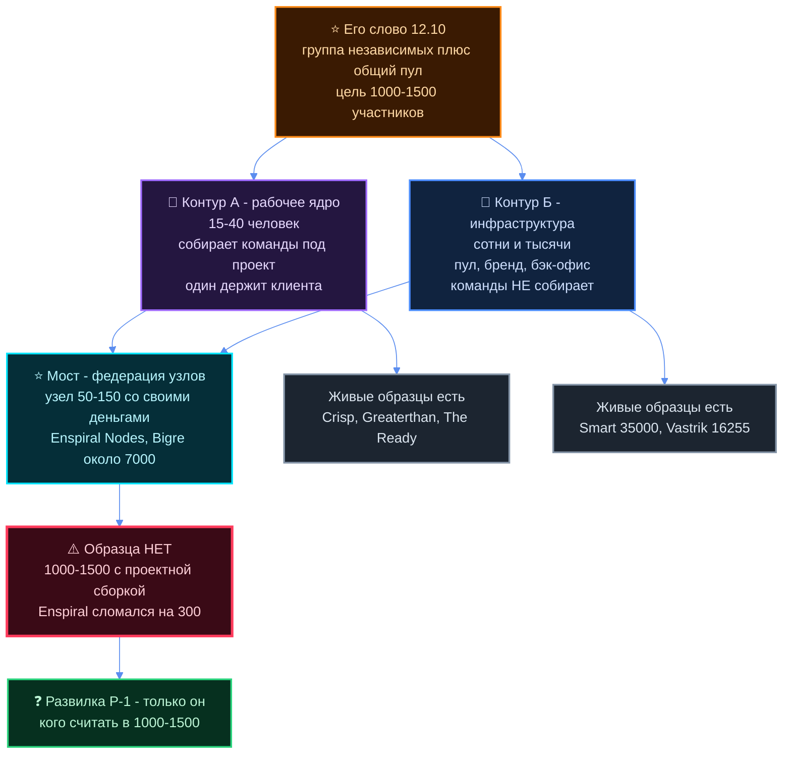

# План: что мы должны получить в конце

> **Что это.** Ответ на его заказ 12.10 16:34: «запустил… другого агента, пусть он план на это всё
> составит — что мы должны получить в конце». План стоит на трёх ресёрчах этого проекта (A1, A2, A3)
> и на его слове целиком (`tochka-b/185-OS-16-34.md`).
>
> **Правила этого документа.** ⛔ Ни одной нашей доли, ни одного нашего процента, ни одной нашей цены
> про людей здесь нет. Чужие проценты — цитаты с источником. Развилки названы, но не решены: выбор
> его. Чего нет — помечено **ДАННЫХ НЕТ**.
>
> **Сроков нет.** Он не назвал ни одной даты. Везде, где в плане стоит этап, **срок не назван** —
> этапы связаны условиями перехода, не числами в календаре.
>
> **Пояснения терминов** даются строкой там, где термин встречается первый раз.

---

## 0. Главная трудность, которую план обязан держать

Ресёрч A3 нашёл двенадцать живых организаций и одну дыру. Дыра важнее находок.

**Живого примера «из группы собирается команда под проект» на масштабе 1000–1500 не существует.**

| Что умеет организация | Живые примеры | Их размер |
|---|---|---|
| Собирает команды под проект, несёт ответственность за результат | Crisp, Greaterthan, The Ready, August | **15–40 человек** |
| Держит тысячи людей: общий бэк-офис, бренд, членство | Smart 35 000+, Vastrik Club 16 255 | **тысячи** — но команды не собирают |
| Пробовала совместить | **Enspiral — сломался на 300** и ушёл в узлы | ~300 на пике |

Плюс три факта, которые дороже всех успехов [A3 «Суть за 30 секунд»]:

1. **Enspiral** — эталон модели — прошёл через состояние предбанкротства 2016–2018 и сам пишет, что
   новички «разочаровываются и выгорают в первые 6–12 месяцев».
2. **Greaterthan** — автор лучшего публичного учебника по этой модели — **закрылся**, юрлицо
   переименовано 20.05.2026. Публичная причина: «processing tensions». Больше ничего.
3. **CoTech** за десять лет **не смог формализовать совместные тендеры**: нет правила «кто берёт
   клиента при пересечении компетенций».

### Чем план отвечает, а не обходит

Ответ структурный, и он прямо следует из таблицы выше: **это не один контур, а два разных, и их
нельзя мерить одним числом.**

- **Контур А — рабочее ядро.** 15–40 человек, собирает команды под проект, кто-то один держит
  клиента и отвечает за результат. Здесь есть живые образцы и проверенные регламенты.
- **Контур Б — сообщество-инфраструктура.** Сотни и тысячи. Общий пул, бренд, бэк-офис, членство.
  Команды под проект **не собирает** и денежной ответственности **не несёт**. Тоже есть образцы.
- **Мост между ними — федерация узлов.** Единственная найденная форма, которая держит масштаб и при
  этом делает проекты: Enspiral Nodes после перелома и Bigre! — ~7 000 человек в пяти кооперативах.
  Узел это самостоятельная группа 50–150 человек со своей политикой приёма и своими деньгами.

**Числа 1000–1500 в природе не встречается в форме «все собираются в команды».** Значит либо
1000–1500 — это контур Б, либо это сумма узлов федерации. **Что из этого имел в виду он — развилка
Р-1 ниже, и решает он.** Наша работа — не дать плану молча считать, что это одно и то же.

---

## 1. Что мы должны получить в конце

Шестнадцать артефактов в четырёх пакетах. По каждому: что это одной строкой · кто делает · приёмка,
на которую можно ответить только «да» или «нет».

Приёмка написана так, чтобы её мог проверить он сам за минуту, не читая исходников.

### Пакет 1 — Описание: то, что можно показать первым партнёрам

Его слово: «должен получиться базовое… такой объёмный рассказ, который можно показать вот сейчас уже
и первым партнёрам» + «за 30 секунд, за одну минуту пояснить человеку».

| № | Артефакт | Что это | Кто делает | Приёмка да/нет |
|---|---|---|---|---|
| **A1** | **Лист на 30 секунд** | Шесть строк, которые он произносит вслух без бумажки. Каркас — заголовки Sequoia «Writing a Business Plan»: назначение фирмы · проблема · решение · бизнес-модель; плюс две строки, которых нет ни в одном шаблоне: **кто мы для специалиста** и **как делится общий котёл** [A3 §14.8] | `concept-explainer` | Он читает вслух по таймеру за ≤60 секунд, **не подглядывая**, и говорит «да». В тексте нет ни одного слова, которое надо пояснять вторым предложением |
| **A2** | **Объёмный рассказ** | Один файл на 15 минут чтения: что за фирма · что получает участник · что обязан · откуда деньги · как собирается команда · куда это растёт | `concept-explainer` пишет, `red-team-critic` разносит до показа | Каждое утверждение в файле — либо **его слово с датой**, либо **чужой факт с источником**, либо помечено «гипотеза». Третьего нет. Проверяется выборкой из десяти абзацев |
| **A3** | **Два ценностных предложения** | Value Proposition Canvas, прогнанный **дважды**: отдельно работа/боли/выгоды клиента, отдельно — специалиста. Это дешёвый способ починить главный дефект обычных шаблонов, где специалисты попадают в «ресурсы фирмы» [A3 §14.1] | клиентский — `sales-funnel-holder`; специалистский — `specialists-keeper` (строка «что мы даём человеку» у него обязательная) | По каждому из двух заполнены все три части, и **каждая выгода привязана к тому, что мы умеем сегодня**, а не к будущему. Ни одной строки «потом будет» |
| **A4** | **Определение продукта** | Ответ на два вопроса: что покупает клиент в **первой** сделке и что покупает специалист, когда входит в группу. Его слово: «тоже там с продуктом определиться» | `sales-funnel-holder` + `strategy-navigator` | На оба вопроса по одной строке, и в первой строке названа **одна** услуга, не список из семи |

### Пакет 2 — Конструкция: как эта штука устроена внутри

| № | Артефакт | Что это | Кто делает | Приёмка да/нет |
|---|---|---|---|---|
| **B1** | **Гибридный холст модели** | Одна страница-схема модели. Собирается из четырёх источников, потому что ни один шаблон целиком не годится: сущности экосистемы, мотивации и обмены — **Platform Design Toolkit** (единственный, где 1000 специалистов это «производящие участники», а не ресурс фирмы) · отбор, роли, правила, управление, финансы — **Community Canvas** · каналы, выручка, затраты — **BMC** · рычаг и позиция на спектре Brains/Grey Hair/Procedure — **Maister 1982** · несправедливое преимущество — **Lean Canvas** [A3 §14.8] | `systems-expert` — сущности, границы, петли; `economy-architect` — финансовый блок; свод `synthesizer` | Все блоки заполнены **или** помечены «решает владелец» с номером развилки. **Ни одного молча пустого блока.** Проверяется подсчётом: заполнено плюс помечено равно всем блокам |
| **B2** | **Service Blueprint с линией видимости** | Трафарет оказания услуги по Шостак, HBR 1984: действия клиента · что он видит · что за кулисами · поддержка · линия видимости. Отвечает на главный риск, который средний бизнес закладывает в цену сети независимых: «кто конкретно делает мою работу и одинаково ли качество». Без этого модель читается как брокерская — как Toptal, от которого уходят напрямую | `mgmt-delivery-expert` | На схеме от первого касания до сдачи **видно одно имя**, которое отвечает за результат перед клиентом. Если имён два или ноль — «нет» |
| **B3** | **Конструкция «что именно децентрализовано»** | Четыре отдельные конструкции, которые в обиходе называют одним словом: собственность · решения · деньги · юрлицо. По каждой — что это значит на практике, живой пример, цена. Слово стоит в названии фирмы и **у нас не определено ни в одном документе** [A1 §7 п.13] | `systems-expert` раскладывает, `red-team-critic` считает цену каждой | По каждой из четырёх конструкций стоит одна строка **его рукой**: да / нет / позже. Четыре строки — «да»; три — «нет» |
| **B4** | **Правило входа и уровни членства** | Фильтр «да-да / нет-нет» его словами. Чужое проверенное: три уровня членства с разными правами (Greaterthan) · фильтр «вето одного плюс кто-то реально с ним работал» (Crisp) · испытательный срок без права голоса (The Ready, Greaterthan). Чужое провалившееся: консенсус всех при приёме — работает на 15, невозможен на 1000 [A3 §15] | `methodology-engineer` пишет регламент, `red-team-critic` ревьюит | Берём трёх настоящих людей из его контактов, прогоняем по фильтру — на каждого получается **бинарный ответ за 10 минут**. Правило отказа написано отдельной строкой |
| **B5** | **Регламент сборки команды под проект** | Как из группы собирается команда: профиль нужен словами · приоритет по приверженности · финальное слово у ведущего проекта · **не собралась команда — проект отклоняется**. Готовые регламенты есть у Greaterthan и The Ready [A3 §15]. Отрицательный опыт: CoTech за десять лет это не сделал, и сборка не поехала | `methodology-engineer` | В регламенте явно написано: **кто держит клиента** · у кого финальное слово · что происходит, если команда не собралась. Три ответа есть — «да» |
| **B6** | **Перечень работ, которые группа делает за свои деньги** | Не процент — процент его слот. **Перечень работ.** Правило, которое читается из чужой таблицы за 30 секунд: 0 процентов это только бренд и знакомства · 5–9 это бэк-офис и снятие риска неплатежа · 13–20 это бэк-офис плюс сопровождение и общие инвестиции · выше 20 это продажи и лиды [A3 §13]. Где процент не умеют назвать работой — там его и не публикуют, и оттуда уходят напрямую | `economy-architect` — перечень работ; `finance-keeper` — во что эти работы обходятся нам в месяц | Под каждой работой стоит **имя того, кто её делает сегодня**, или метка «никто». Напротив процента — **пустой слот владельца**. Если в артефакте появилось наше число — «нет» |
| **B7** | **Пакет вопросов живому юристу** | Не заключение, а список вопросов. Главный риск записан заранее: «доход от результата» плюс зависимый партнёр = риск переквалификации в найм задним числом, немецкое право не разобрано [A1 П-8]. Плюс проверка слова «кооператив» по семи принципам ICA: если честного ответа нет, слово использовать нельзя — это репутационная мина | `legal-data-expert` (вердикт — **живой юрист**, не агент) | Список вопросов можно отдать юристу **без доработки**, и в нём нет ни одного ответа от нас. Форма юрлица в артефакте **не выбрана** — выбирает юрист с ним |

### Пакет 3 — Развитие: куда это идёт

| № | Артефакт | Что это | Кто делает | Приёмка да/нет |
|---|---|---|---|---|
| **C1** | **Pipeline этапов с условиями перехода** | Раздел 4 этого плана, вынесенный в рабочий файл и доведённый до нарядов. Его слово: «сам pipeline дальнейшего развития нужно будет составить» | `mgmt-delivery-expert`, kill-условия — `red-team-critic` | У **каждого** этапа написано условие перехода, которое проверяется фактом, а не мнением. Хоть один этап без условия — «нет» |
| **C2** | **Лист идей** | Его слово: «чёткий лист идей нужно прописать». Каждая идея — одна строка плюс номер этапа pipeline, к которому она относится | `strategy-navigator` режим РЕШЕТО | Каждая идея привязана к этапу. Идей без этапа — ноль |
| **C3** | **Лист открытых вопросов** | Его слово: «какие ещё вопросы останутся — тоже вниз вытянуть, я потом дальше буду на них пытаться отвечать». Каждый вопрос с вариантами ответа | `strategy-navigator` | Ни в одном вопросе нет нашего предложения по долям, процентам и ценам про людей. Проверяется грепом по «процент», «доля», «цена» |

### Пакет 4 — Уборка: привести дом в соответствие с поворотом

| № | Артефакт | Что это | Кто делает | Приёмка да/нет |
|---|---|---|---|---|
| **D1** | **Перенос апрельского слоя Notion в репозиторий** | ⭐⭐ Главная находка A2: в Notion, в «Базе правды» от 05.04, лежит **ровно эта модель** и в репозиторий никогда не переносилась — партнёр-консультант, «Jetix даёт бренд, SOP, тех-часть, шаблоны, юр. броню; партнёр даёт свою сеть, продажи, ведение клиента», «У Jetix нет клиентов — есть партнёры», фазы роста 1→4, защита от растаскивания. Написана под брошенный домен AI-безопасности, но **механика от домена отделима** | `synthesizer` переносит дословно, `notion-builder` не трогает Notion на этом шаге | Механика лежит в репозитории отдельным файлом, домен помечен как снятый, и по каждому блоку стоит его отметка «беру / не беру». Без его отметок — «нет» |
| **D2** | **Разводка восемнадцати противоречий** | A1 §6.2 нашёл 18 мест, где поворот 12.10 бьётся с уже записанным: Хартия «**не** консалтинг-фирма» (LOCKED 12.05) против «строю консалтинговую фирму» · stealth-вход 5–15 игроков против 1000–1500 · «кланы в оффер не выносим» против «строю публично» · «группа выброшена из подачи 11.10» против «группа снова центр 12.10» и так далее | `strategy-navigator` режим РЕШЕТО, реестр у `ops-keeper` | По каждому из 18 — одна строка: снято / осталось / его слот. Строк 18 — «да» |
| **D3** | **Витрина в Notion** | Его слово: «что туда надо — вытянул, добавлю в Ноушен. И в Ноушене у нас там будет командный центр». Мы готовим пакет; **что показывать — решает он** | `notion-builder` по его списку | Он открывает одну страницу Notion и видит с неё **все** артефакты пакетов 1–3 ссылками. Хоть один не виден — «нет» |

### Чего в этом перечне намеренно нет

- **Процента, доли и цены.** Это его слот, стоп дома. В артефактах под них пустые строки.
- **Канваса как главного выхода.** Ни один канвас не читается за 30 секунд — девять блоков это
  артефакт воркшопа на 20–60 минут. За 30 секунд читается нарратив из шести строк [A3 §14.8].
  Поэтому A1 это текст, а B1 — рабочая схема второго слоя, не то, что он показывает партнёру.
- **Модели зрелости SPI и маркетингового трека Visible Expert.** Пригодятся на втором году, сейчас
  это лишний вес [A3 §14.8].

---

## 2. Порядок: что за чем и что параллельно

**Три входа блокируют почти всё.** Это не наша воля — так устроены зависимости:

1. **Его пять строк** (развилки Р-1 и Р-3): кого считать в 1000–1500 и что именно
   децентрализовано. Без них A1 и B1 пишутся наугад.
2. **Его отметка по апрельскому слою** (Р-7): забираем механику партнёра-консультанта или нет. От
   этого зависит половина B1 и весь D1.
3. **Ресёрч про федерацию узлов** (Р-ПЕР ниже): без него этапы Э4–Э5 pipeline — фантазия.

**Что можно делать уже сейчас, не дожидаясь его:** B2 Service Blueprint, B6 перечень работ, B7
вопросы юристу, D2 разводка противоречий, и все ресёрчи. Они не зависят ни от одной развилки.

**Что идёт только последним:** A2 объёмный рассказ (собирается из A1, A3, B1), C1 pipeline (нужны
ресёрчи), D3 витрина (нужно всё).

```mermaid
%%{init: {"theme":"base","themeVariables":{"background":"#05070D","primaryColor":"#0E2A4D","primaryTextColor":"#EAF2FF","primaryBorderColor":"#3D7BFF","lineColor":"#5B8DEF","textColor":"#EAF2FF","clusterBkg":"#0A1830","clusterBorder":"#2B4A7A","nodeBorder":"#3D7BFF","edgeLabelBackground":"#0E2647","fontFamily":"Inter, Arial, sans-serif"}}}%%
flowchart TB
    subgraph VHOD["⛔ Входы - только он"]
        R1V["Р-1 кого считать в 1000-1500"]:::personal
        R3V["Р-3 что именно децентрализовано<br/>четыре строки"]:::personal
        R7V["Р-7 апрельский слой Notion<br/>беру или нет"]:::personal
    end

    subgraph RES["🔎 Ресёрчи - идут параллельно, никого не ждут"]
        RPER["Р-ПЕР федерация узлов"]:::direction
        RVSK["Р-ВСК вскрытие Greaterthan и Crisp"]:::direction
        RKAN["Р-КАН пропущенные кандидаты"]:::direction
        RYUR["Р-ЮР юр-форма Германия"]:::direction
        RVAS["Р-ВАС правила Вастрик Клуба"]:::direction
        RKON["Р-КОН конкуренты первой линии денег"]:::direction
        RDEC["Р-ДЕЦ четыре конструкции децентрализации"]:::direction
        RNEV["Р-НЕВ невидимая работа внутри группы"]:::direction
    end

    subgraph SRAZU["🔨 Можно делать сразу"]
        B2N["B2 Service Blueprint"]:::project
        B6N["B6 перечень работ за деньги группы"]:::project
        B7N["B7 вопросы юристу"]:::project
        D2N["D2 разводка 18 противоречий"]:::project
    end

    A3N["A3 два ценностных предложения"]:::task
    B3N["B3 конструкция децентрализации"]:::task
    B1N["B1 гибридный холст"]:::system
    B4N["B4 правило входа и уровни"]:::task
    B5N["B5 регламент сборки команды"]:::task
    A4N["A4 определение продукта"]:::task
    A1N["⭐ A1 лист на 30 секунд"]:::goal
    A2N["A2 объёмный рассказ"]:::goal
    C1N["C1 pipeline этапов"]:::system
    C2N["C2 лист идей"]:::task
    C3N["C3 лист открытых вопросов"]:::task
    D1N["D1 перенос апрельского слоя"]:::project
    D3N["D3 витрина в Notion"]:::crosscut

    R3V --> B3N --> B1N
    R1V --> B1N
    R7V --> D1N --> B1N
    RDEC --> B3N
    RNEV --> B6N
    RKON --> A4N
    RVAS --> A4N
    RPER --> C1N
    RVSK --> C1N
    RKAN --> C1N
    RYUR --> B7N

    B1N --> A1N
    A3N --> A1N
    A4N --> A1N
    B4N --> B1N
    B5N --> B1N
    B2N --> B1N
    B6N --> B1N

    A1N --> A2N
    B1N --> A2N
    C1N --> C2N
    C1N --> C3N
    D2N --> C3N
    A2N --> D3N
    C1N --> D3N

    classDef goal fill:#3A1A02,stroke:#FF8C1A,stroke-width:2px,color:#FFD9A6
    classDef system fill:#052E38,stroke:#00E5FF,stroke-width:2px,color:#B8F6FF
    classDef direction fill:#10233F,stroke:#4C8DFF,stroke-width:2px,color:#CFE0FF
    classDef project fill:#241640,stroke:#A06BFF,stroke-width:2px,color:#E7DAFF
    classDef task fill:#14202E,stroke:#6E8FB8,stroke-width:1px,color:#D6E4F5
    classDef personal fill:#06301F,stroke:#2BD47D,stroke-width:2px,color:#BDF5D6
    classDef crosscut fill:#33290A,stroke:#FFD34E,stroke-width:2px,color:#FFECB0
```

---

## 3. Какие ещё ресёрчи нужны

Его слово: «все ресёрчи там с агентами делай». Восемь штук. По каждому — вопрос, на который он
отвечает, и почему без него нельзя.

⚠️ **Про исполнителя.** В ростере дома **нет отдельной роли под внешний поиск по сети**. Там, где
нужен веб, исполнитель — `general-purpose` на Opus либо `sales-researcher` (у него есть поиск).
Это дыра ростера, не выбор; помечена в разделе «что здесь слабого».

| № | Вопрос, на который отвечает | Почему без него нельзя | Исполнитель | Выход |
|---|---|---|---|---|
| **Р-ПЕР** | Как устроены **федерации узлов**, которые держат тысячи людей и при этом делают проекты: Bigre! — ~7 000 в пяти кооперативах · Enspiral Nodes после перелома 2018 · Smart как федерация в девяти странах. Кто решает, кто платит, кто отвечает перед клиентом | **Это единственный кандидат-ответ на «1000–1500 с проектной сборкой», и он не разобран.** Без него этапы Э4–Э5 pipeline написаны из головы | `general-purpose` на Opus, веб | Разбор трёх федераций по одной рамке: вход · деньги · решения · ответственность перед клиентом · что у них сломалось |
| **Р-ВСК** | **Почему закрылся Greaterthan** и **почему Crisp сжался с ~40 до 20**. Публично по первому сказано только «processing tensions», по второму — **ДАННЫХ НЕТ** | Мы собираемся копировать их регламенты: три уровня членства, оплату времени на продажи, регламент сборки команды. Надо знать, **что именно из этого не выдержало**. Организация, чьей профессией была прозрачность и работа с конфликтом, развалилась — это самый важный неотвеченный вопрос всей выборки | `general-purpose` на Opus, веб: подкасты, личные блоги участников, LinkedIn-посты, архивы рассылок | Либо названная причина с источником, либо честное **ДАННЫХ НЕТ** после перечисления того, где искали |
| **Р-КАН** | Есть ли **живой пример на ~1000 с проектной сборкой**, который не нашёлся: Hoxby — ~1 000 фрилансеров в 43 странах, собирает команды под бриф, но процент не опубликован · Cocoon Pro / LiquidO · Percolab · Hypha · немецкие Beratungsgenossenschaften помимо SMartDe | Если такой пример есть — **весь план меняет природу**: вместо «форму придётся изобретать» становится «форму можно скопировать». Это разница между годом экспериментов и месяцем переноса | `general-purpose` на Opus, веб | По каждому: размер · собирает ли команды · что берёт группа · жив ли. Или «проверено, не нашлось» |
| **Р-ЮР** | Какая **юридическая форма в Германии** держит «группа независимых плюс общий котёл плюс доход от результата» без переквалификации в найм задним числом | П-8: немецкое право не разобрано вообще. Риск бьёт в **первую же сделку с партнёром**, а не когда-нибудь потом. Плюс без этого нельзя произносить слово «кооператив» | `legal-data-expert` готовит разбор и вопросы; **вердикт — живой юрист** | Разбор форм + список вопросов юристу, который можно отдать без доработки |
| **Р-ВАС** | Что устав и культура **Vastrik Club** разрешают и запрещают при наборе своей группы внутри клуба. Плюс П-9: их жёсткая ИИ-политика против AI-native Jetix | Он назвал клуб точкой входа и первым каналом. Если набор туда не разрешён или разрешён с условиями — **первый канал закрыт или меняет форму**, а это основание всего этапа Э1 | `general-purpose` на Opus, только чтение. ⛔ Наружу ничего не пишет | Что разрешено · что запрещено · как другие там собирали свои движухи · где граница |
| **Р-КОН** | Кто уже продаёт **автоматизацию, ИИ и сайты среднему бизнесу** в Берлине и DACH, что именно продаёт, как упакован | Его слово: «начинаем с внедрения автоматизации, искусственного интеллекта, разработки сайтов — вот уже сейчас». Без карты конкурентов оффер слепой, и A4 «определение продукта» писать не на чем | `sales-researcher` | 10–15 живых игроков: что продают · как упакованы · чем мы отличаемся словом, а не прилагательным |
| **Р-ДЕЦ** | Что значит слово **«децентрализованная»** в каждой из четырёх конструкций — собственность, решения, деньги, юрлицо: живой пример каждой и цена каждой | **Слово стоит в названии фирмы, и у нас оно не определено ни в одном документе.** В доме оно живёт только как нераскрытая тема бэклога. Нельзя называться словом, которого не можешь объяснить | `systems-expert` + `philosophy-epistemics-expert` на проверку | Четыре конструкции, по каждой: пример · что даёт · что стоит · что ломает |
| **Р-НЕВ** | Какие **внутренние роли** придётся оплачивать, чтобы группа не держалась на бесплатном труде | Enspiral назвал это своей «тёмной экономикой» — невидимая работа по поддержанию группы, и именно на ней он надорвался. The Ready на это ответил оплатой 20 внутренних ролей фиксированной суммой [A3 §15]. Без этого списка общий котёл проектируется как касса, а не как зарплата | `economy-architect`, ⛔ без наших чисел | Перечень внутренних ролей и объёма работ по каждой. Числа — пустые слоты |

**Чего ресёрчем не решить и не надо пытаться:** какой из четырёх списков «шести ресурсов»
действующий (A1 нашёл четыре разных списка под одним названием, и вердикта владельца не было ни
разу) — это его слово, развилка Р-6, а не поиск.

---

## 4. Pipeline дальнейшего развития

**Pipeline** — лестница этапов: что идёт за чем и по какому условию переходим на следующую ступень.

Шесть этапов. Между этапами — **условие перехода, которое проверяется фактом**, не настроением.
Логика лестницы прямо из ресёрча: **сначала доказать на самом малом масштабе то, что никем не
проверено, и только потом множить.**

⚠️ Отдельно: «кейсов на масштабе 1–10 человек нет вообще — наш горизонт никем не проверен, это край
применимости» [A1 П-7]. А первые партнёры — это ровно 1–10 человек. То есть **Э1 это не разогрев,
а главный эксперимент.**

```mermaid
%%{init: {"theme":"base","themeVariables":{"background":"#05070D","primaryColor":"#0E2A4D","primaryTextColor":"#EAF2FF","primaryBorderColor":"#3D7BFF","lineColor":"#5B8DEF","textColor":"#EAF2FF","clusterBkg":"#0A1830","clusterBorder":"#2B4A7A","nodeBorder":"#3D7BFF","edgeLabelBackground":"#0E2647","fontFamily":"Inter, Arial, sans-serif"}}}%%
flowchart LR
    E0["🎯 Э0 Описание<br/>он один<br/>выход - лист 30 секунд<br/>и объёмный рассказ"]:::goal
    E1["🔨 Э1 Первые партнёры<br/>3-7 человек<br/>первые деньги - автоматизация,<br/>ИИ, сайты"]:::project
    E2["🔨 Э2 Узел<br/>10-40 человек<br/>регламент сборки работает"]:::project
    E3["⭐ Э3 Второй узел<br/>проверка воспроизводимости<br/>без его участия"]:::system
    E4["🧭 Э4 Федерация узлов<br/>100-300 человек<br/>узлы со своими деньгами"]:::direction
    E5["🧭 Э5 Сообщество-инфраструктура<br/>1000-1500<br/>проекты по-прежнему в узлах"]:::direction

    U1["Условие - он читает<br/>лист вслух за минуту<br/>и говорит да"]:::crosscut
    U2["⭐ Условие - сдан и оплачен<br/>проект, где команда<br/>собралась из группы<br/>двое, не он один"]:::crosscut
    U3["Условие - три проекта подряд<br/>собраны по регламенту<br/>без правок регламента"]:::crosscut
    U4["⭐⭐ Условие - второй узел<br/>сдал проект БЕЗ него"]:::crosscut
    U5["Условие - три узла живут<br/>одновременно, у каждого<br/>свои деньги, внутренние<br/>роли оплачены"]:::crosscut

    E0 --> U1 --> E1 --> U2 --> E2 --> U3 --> E3 --> U4 --> E4 --> U5 --> E5

    K1["⚠️ Стоп на Э1 - если проект<br/>не собрался из группы,<br/>это личная практика,<br/>не фирма"]:::accent
    K2["⚠️ Стоп на Э3 - если без него<br/>не поехало, форма<br/>не воспроизводима<br/>и 1000 недостижимо"]:::accent
    K3["⚠️ Стоп на Э4 - если котёл<br/>не платит внутренние роли,<br/>это повтор Enspiral 2016-18"]:::accent

    E1 --- K1
    E3 --- K2
    E4 --- K3

    classDef goal fill:#3A1A02,stroke:#FF8C1A,stroke-width:2px,color:#FFD9A6
    classDef system fill:#052E38,stroke:#00E5FF,stroke-width:2px,color:#B8F6FF
    classDef direction fill:#10233F,stroke:#4C8DFF,stroke-width:2px,color:#CFE0FF
    classDef project fill:#241640,stroke:#A06BFF,stroke-width:2px,color:#E7DAFF
    classDef crosscut fill:#33290A,stroke:#FFD34E,stroke-width:2px,color:#FFECB0
    classDef accent fill:#3A0A16,stroke:#FF3B5C,stroke-width:3px,color:#FFD0D8
```

| Этап | Кто в нём | Что в нём делаем | Условие перехода дальше | Чей живой образец | Чего у образца нет |
|---|---|---|---|---|---|
| **Э0 Описание** | он один, агенты на подхвате | Пакеты 1, 2, 4 этого плана | Он читает лист на 30 секунд вслух за минуту и говорит «да» | — | — |
| **Э1 Первые партнёры** | 3–7 человек | Деньги по его слову: автоматизация, ИИ, сайты для среднего и малого бизнеса. Он продаёт сам. Параллельно обкатывается регламент входа B4 | ⭐ Сдан и оплачен проект, где **команда собралась из группы**: минимум двое, и не он один | фаза 1–2 апрельского слоя Notion: «основатель продаёт сам» | На масштабе 1–10 проектная сборка **не проверена никем** |
| **Э2 Узел** | 10–40 | Регламент сборки B5 применяется на каждом проекте. Начинают работать внутренние роли из Р-НЕВ | Три проекта подряд собраны по регламенту, **и регламент ни разу не правился по ходу** | Crisp, Greaterthan, The Ready, August — все 15–40 | Ни один из них **не вырос дальше**; Greaterthan закрылся, Crisp сжался |
| **Э3 Второй узел** | 2 узла | Второй узел ведёт **другой человек**. Это единственный честный тест «масштабируется ли форма, а не его личные связи» | ⭐⭐ Второй узел собрал команду и сдал проект **без его участия** | Enspiral Nodes | Enspiral дошёл до узлов **через кризис**, а не до него |
| **Э4 Федерация узлов** | 100–300 | Узлы получают свою политику приёма и свои деньги. Общий котёл покрывает внутренние роли. Появляется резерв | Три узла живут одновременно, у каждого свои деньги, внутренние роли оплачены | Bigre! ~7 000 в пяти кооперативах; Enspiral после 2018 | Денежная механика Bigre! нами **не разобрана** — это ресёрч Р-ПЕР |
| **Э5 Сообщество-инфраструктура** | 1000–1500 | ⚠️ **Этап меняет природу.** На этом масштабе проектную сборку не делает никто. 1000–1500 — это слой членства и инфраструктуры; проекты по-прежнему делают узлы по 15–40 | — вершина, дальше развилка Р-1 | Smart 35 000+ (28 лет), Vastrik Club 16 255 | Ни один из них **не собирает команды** и **не несёт денежной ответственности** |

### Что из чужого опыта берём в pipeline, а что уже оплачено другими как ошибка

**Берём — проверенное у живых** [A3 §15, двенадцать приёмов]: фикс плюс процент с **годовым
потолком**, после потолка 100 процентов его (Crisp) · база «валовая маржа», а не оборот (Coopaname,
Oxalis) · гарантийный фонд и быстрая выплата (Smart) · три уровня членства (Greaterthan) · узлы по
50–150 как ответ на число Данбара (Enspiral) · фильтр входа «вето одного плюс кто-то реально с ним
работал» (Crisp) · испытательный срок без права голоса · оплата внутренних ролей фиксированной
суммой (The Ready) · оплата времени на продажи даже при проигрыше (Greaterthan) · регламент сборки
команды · невозможность продать группу (урок Nearsoft: «владелец — это окончательный начальник»).
⛔ Все проценты в этом абзаце — **чужие, с источником в A3**. Наших здесь нет.

**Не берём — об это уже разбились** [A3 §15, семь вещей]: «сеть соединяет клиента с участниками»
без единого ответственного (CoTech, десять лет) · общий котёл с процента со счёта в чистом виде
(Enspiral шёл в банкротство, заменил подпиской) · комиссия за передачу лида (Crisp попробовал и
отменил: «бюрократия, субоптимизация и путаница») · самоназначение ставки (The Ready и Greaterthan
называют это источником мучений) · консенсус всех при приёме нового члена · общий котёл без фильтра
на входе (французские CAE превратились в соцзащиту: каждый второй до входа был без работы).

---

## 5. Что решает только он

Пятнадцать развилок, по одной строке. ⛔ Мы называем варианты, выбор его. Где варианты — чужие
конструкции, стоит источник.

| № | Развилка | Варианты |
|---|---|---|
| **Р-1** ⭐⭐ | Кого считать в «1000–1500» | всех участников сообщества-инфраструктуры · только тех, кто реально собирается в команды · сумму узлов федерации |
| **Р-2** | Как эта штука называется наружу — его слово «называй как хочешь» | Jetix · Jetix Agency · новое имя |
| **Р-3** ⭐⭐ | Что именно децентрализовано — четыре разные конструкции, нужны четыре ответа | собственность: да/нет/позже · решения: да/нет/позже · деньги: да/нет/позже · юрлицо: да/нет/позже |
| **Р-4** | Слово «кооператив» используем или нет — проверка по семи принципам ICA, особенно по демократическому контролю и экономическому участию членов | используем · не используем, говорим «общий котёл» · решаем после юриста |
| **Р-5** ⛔ | На какой **базе** стоит доля группы — само число его слот, мы к нему не прикасаемся | оборот (Smart 6,5–9 процентов) · валовая маржа (Coopaname 13,5) · счёт (Greaterthan 15) · фикс плюс процент с годовым потолком (Crisp) · ноль процентов, только бренд и знакомства (CoTech). Все числа — **чужие, с источником** |
| **Р-6** | Какой из четырёх списков «шести ресурсов» действующий | TRM 30.04 — финансы, время основателя, аудитория, знания, compute, команда · «Базовая система управления» · Хартия Клана §5.5 · его голос 18.05, где названы только три из шести |
| **Р-7** ⭐ | Апрельский слой Notion — механика партнёра-консультанта | забираю механику целиком · не забираю · забираю по блокам, по каждому скажу |
| **Р-8** | Что первым идёт наружу к первым партнёрам | продюсирование как вход · фирма как суть · оба слоя сразу, лестницей |
| **Р-9** | Хартия Клана 12.05 говорит «**Не** консалтинг-фирма» и это LOCKED. 12.10 — «строю консалтинговую фирму» | правим Хартию · Хартия остаётся про другое · Хартия снимается целиком |
| **Р-10** | Вход: закрытый или открытый | stealth, 5–15 стратегических игроков (Хартия) · открытый набор на 1000–1500 (12.10) · закрытое ядро плюс открытый слой |
| **Р-11** | Что покупает клиент в **первой** сделке | автоматизация · внедрение ИИ · сайт · платная диагностика · позиционирование |
| **Р-12** | Кто имеет право сказать кандидату «нет» | вето одного любого участника (Crisp) · двое, кто реально с ним работал · он лично |
| **Р-13** | Кто отвечает перед клиентом за результат | один человек · правило «двое на контакте» (Greaterthan) · группа |
| **Р-14** | Юрлицо: где и в какой форме | ответ после Р-ЮР и живого юриста; наш выбор здесь не делается |
| **Р-15** | Клуб — это сама фирма (12.10) или удержание выпускников (10.10) | сама фирма · удержание · два разных предмета с разными именами |

⛔ **Отдельно, чтобы не потерялось.** Его слово 12.10: «ну там сколько, я не знаю, 15, может, 10–15
процентов будет идти непосредственно в эту группу». Он сам сказал «я не знаю» — число плавающее.
В доме лежат ещё две записи с другими пропорциями (карточка корпорации 11.08, шкала продюсерского
центра 12.08). **Мы их не сводим и своего не предлагаем.** Какая запись действующая — его слово.

---

## 6. Первый шаг на завтра

**Один голосовой на пять минут: пять строк.**

1. Собственность — децентрализована? да / нет / позже
2. Решения — децентрализованы? да / нет / позже
3. Деньги — децентрализованы? да / нет / позже
4. Юрлицо — децентрализовано? да / нет / позже
5. Кого он считает в «1000–1500»: всех в сообществе / только тех, кто собирается в команды / сумму
   узлов

**Почему именно это, а не что-то другое.** Это развилки Р-3 и Р-1. Они блокируют лист на 30 секунд
и гибридный холст — то есть **оба главных выхода**. Слово «децентрализованная» стоит в названии
фирмы, и у нас оно не определено ни в одном документе из двух репозиториев. А число 1000–1500
определяет, какую из двух разных машин мы вообще строим.

Всё остальное из этого плана **уже можно запускать не дожидаясь его**: восемь ресёрчей, Service
Blueprint, перечень работ, вопросы юристу, разводка восемнадцати противоречий.

---

## ⚠️ Что здесь слабого

1. **Главная дыра не закрыта планом, а обойдена во времени.** Живого образца «1000–1500 с
   проектной сборкой» нет. План отвечает на это лестницей Э1→Э3→Э4: сначала доказать форму на
   трёх–семи людях, потом на двух узлах. Но это **ставка, а не ответ**: если ни одна федерация из
   Р-ПЕР не окажется работающей моделью, форму придётся изобретать, и на это у нас нет ни образца,
   ни оценки срока. **Срок не назван и оценить его нечем.**

2. **Разбиение на два контура — наше чтение ресёрча, а не его слово.** Он сказал «группа», одно
   слово, и назвал одно число. Деление на «рабочее ядро 15–40» и «сообщество-инфраструктура на
   тысячи» вычитано из таблицы живых примеров. **Он может сказать, что имел в виду одно целое** — и
   тогда раздел 0 и весь pipeline переписываются.

3. **Условия перехода и размеры этапов — наши, не его.** «Три проекта подряд», «второй узел без
   него», «три узла одновременно», а также размеры «3–7», «10–40», «100–300» — это предложение
   бригады. Размеры 15–40 и 50–150 взяты у живых примеров [A3], остальные — минимально осмысленные
   для проверки воспроизводимости, а не выведенные из данных. **ДАННЫХ НЕТ** о том, сколько проектов
   подряд достаточно, чтобы считать регламент рабочим.

4. **Шестнадцать артефактов — много.** Если он захочет сократить до того, что можно показать
   партнёру послезавтра, честный минимум — A1, A2, B2, B6: лист на 30 секунд, рассказ, кто отвечает
   за результат, и что группа делает за свои деньги. Остальное отложимо. Какой объём брать — его
   решение, мы его не принимали.

5. **Приёмка «он читает вслух за 60 секунд» зависит от него.** Это единственная приёмка в плане,
   которую нельзя проверить без его участия. Если он не читает — артефакт A1 висит, и за ним висит
   A2. Обхода нет.

6. **В ростере дома нет роли под внешний поиск по сети.** Пять ресёрчей из восьми — веб. Исполнитель
   назначен `general-purpose` на Opus, и это заглушка, а не роль с методом: у него нет ни чек-листа
   источников, ни правила «чему верить». Качество этих пяти ресёрчей будет ниже, чем у доменных.
   Это **открытый вопрос к нему**: заводить роль или жить так.

7. **Юридическая линия может обнулить конструкцию, и мы не знаем заранее.** Риск переквалификации в
   найм задним числом в немецком праве не разобран. Если юрист скажет, что «доход от результата
   плюс зависимый партнёр» в Германии не держится, меняется не формулировка, а **устройство денег**
   — то есть B6, Р-5 и половина pipeline. Р-ЮР поэтому стоит делать параллельно с описанием, а не
   после.

8. **Причины провалов двух ключевых образцов неизвестны.** Почему закрылся Greaterthan — публично
   только «processing tensions». Почему Crisp сжался вдвое — **ДАННЫХ НЕТ**. Мы копируем их
   регламенты, не зная, что в них не выдержало. Р-ВСК может вернуться с тем же «ДАННЫХ НЕТ», и тогда
   этот риск остаётся несмягчённым.

9. **Апрельский слой Notion не прочитан целиком.** A2 читал «Базу правды» и «Company Hub» полностью,
   а «Стратплан 2026–2030», «Jetix: видение» и «Research AI-безопасность» — выборочно. В них может
   лежать ещё механика, которой нет ни в плане, ни в артефакте D1.

10. **План не трогает деньги по существу — и это его слабость тоже.** B6 даёт перечень работ, но
    **никакой экономики группы в плане нет**: ни того, сколько стоит держать общий пул, ни того, из
    чего он кормится в первый год. Это сознательно — доли и цены про людей его слот. Но пока он не
    назовёт базу (Р-5), pipeline остаётся без денежного дна, и этапы Э4–Э5 ничем не обеспечены.
    Записанное предупреждение из нашего же разбора: «процент от оборота — сильный аргумент продажи,
    но плохой фундамент для кэша» [A1 П-16].

11. **Восемнадцать противоречий названы, но ни одно не снято.** D2 только разводит их по трём
    кучкам. Среди них есть структурные: Хартия прямо говорит «не консалтинг-фирма», а подача 11.10
    прямо выбрасывала слово «группа» из шапки. Пока они открыты, **любой текст наружу будет
    противоречить какому-нибудь живому документу дома.**

12. **Шесть ресурсов в план не вплетены.** Он велел вернуть их в оборот, а A1 нашёл под этим
    названием четыре разных списка и вердикта владельца ни по одному. План вынес это в развилку
    Р-6 и всё. То есть **его прямое указание «это у нас сюда тоже подключается» выполнено только
    как вопрос, а не как конструкция.** Пока список не выбран, вплетать нечего.
