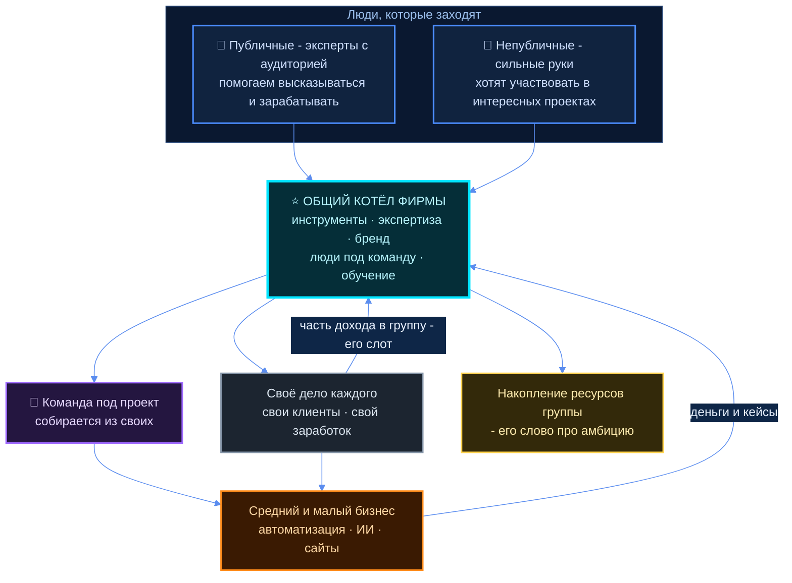
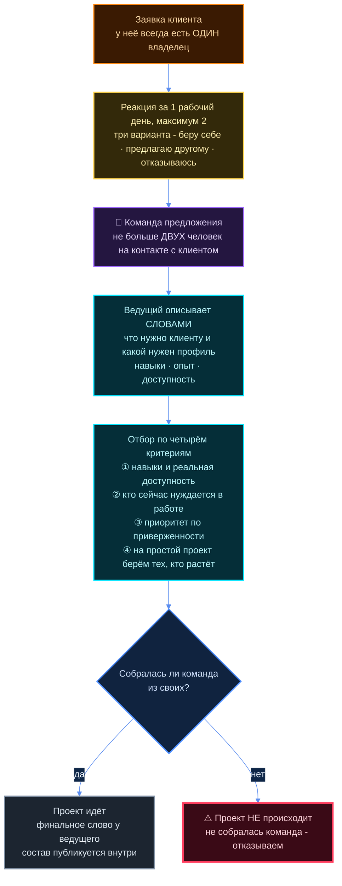
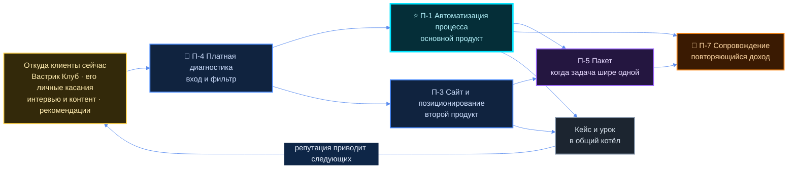

# Описание фирмы — то, что можно показать первым партнёрам

## Как читать этот документ

Заказ 12.10: *«у меня в итоге должно получиться хотя бы базовое вот это вот такой объёмный рассказ,
который можно показать вот сейчас уже и первым партнёрам»* и *«я должен это всё иметь возможность
буквально за 30 секунд, за одну минуту пояснить человеку»*.

Поэтому документ трёхслойный — так, как рекомендовал ресёрч живых примеров
([A3 §14.8](../research/A3-ZHIVYE-PRIMERY.md)): **ни один бизнес-канвас не читается за 30 секунд**,
девять блоков — это артефакт воркшопа на час. За 30 секунд читается рассказ из шести строк.

```
слой 0  → раздел 1 «За 30 секунд» — то, что говорится вслух
слой 1  → разделы 2–3 «За 3 минуты» и «Объёмный рассказ» — гибридный холст
слой 2  → раздел 3.10 — служебная схема услуги: кто конкретно делает работу клиента
```

> ⚠️ **Чей текст.** Всё в кавычках «…» — его слово, адрес источника указан в провенансе (§3.12 и §7).
> Всё остальное — **кандидат агента**: формулировки собраны из его голоса и ресёрча, решает он.
> Доли, проценты и цены про людей здесь не считаются и не предлагаются. Его слово 12.10 про
> «10–15 процентов» цитируется дословно и не развивается — это его слот.
>
> ⚠️ **Чего нет.** Фирмы пока нет. Есть он, замысел и этот текст. Ни одного участника, ни одного
> клиента фирмы на 12.10.2026 не существует. Текст написан так, чтобы это не выглядело иначе.

---

## 1. За 30 секунд — то, что он говорит человеку вслух

Три кандидата. Отличаются адресатом, а не содержанием: А — специалисту, которого зовут внутрь;
Б — клиенту из среднего бизнеса; В — универсальный, когда адресат непонятен.

Каждый кончается вопросом — чтобы сработало его требование *«чтобы мы могли уже чётко понять:
да-да, нет-нет, работаем — не работаем»*.

### КАНДИДАТ А — специалисту (основной)

> Я собираю консалтинговую фирму нового типа. Каждый в ней работает на себя и зарабатывает своё —
> но у фирмы есть общий котёл: инструменты, экспертиза, бренд, клиенты.
> Нужен монтажёр, айтишник, методолог под задачу — находишь внутри за день, а не ищешь месяц.
> Пришёл сложный проект, который один не сделаешь — собираем команду из своих и делаем вместе.
> Взамен одно: ты вкладываешься в это как в своё дело и чуть-чуть помогаешь другим.
> Деньги сейчас делаем на автоматизации, ИИ и сайтах для среднего бизнеса.
> Тебе это интересно?

### КАНДИДАТ Б — клиенту из среднего бизнеса

> Мы консалтинговая фирма для среднего бизнеса: внедряем автоматизацию и ИИ, делаем сайты.
> Большие фирмы на такие проекты либо не идут, либо берут неподъёмные деньги — мы берём.
> Собраны мы иначе: это группа самостоятельных специалистов с общим котлом инструментов и опыта.
> Под вашу задачу собирается команда именно под неё — а не та, что сейчас простаивает.
> За результат отвечает один человек, и с ним вы и разговариваете, не с «аккаунтом».
> Хотите — посмотрим один ваш процесс и скажем, что в нём автоматизируется первым.

### КАНДИДАТ В — универсальный, в одно дыхание

> Я строю фирму, где люди работают на себя, но не в одиночку.
> Каждый со своим ремеслом, у всех общий пул инструментов и экспертизы; под сложный проект
> собирается команда из своих.
> Зарабатываем на автоматизации, ИИ и сайтах для среднего бизнеса — это сейчас.
> Дальше копим экспертизу и ресурсы группы, чтобы делать то, что поодиночке не делается.
> Беру тех, кто хочет развиваться и готов тянуть это как своё дело.
> Тебе это интересно или нет?

### Проверка кандидатов его тестом

| Вопрос собеседника | А | Б | В |
|---|---|---|---|
| Кто это такие? | консалтинговая фирма из самостоятельных специалистов | консалтинговая фирма для среднего бизнеса | фирма, где работают на себя, но вместе |
| Для кого это? | для специалиста со своим ремеслом | для среднего бизнеса | понятно с обеих сторон |
| Мне-то это зачем? | котёл инструментов + команда под сложный проект | берём то, на что большие не идут | вместе делаем то, что одному не поднять |
| Есть ли «да-да / нет-нет»? | да, прямой вопрос | да, предложение одного шага | да, прямой вопрос |
| Длина вслух | ~35 секунд | ~35 секунд | ~30 секунд |

🔶 **Рекомендация агента:** брать **А** как основной — первые партнёры по его же слову 12.10 это
люди, а не компании; **Б** держать отдельной версией для клиента; **В** — когда непонятно, кто перед
тобой. Решает он.

### Слой 0 — шесть строк, из которых собраны все три кандидата

Каркас — первые заголовки одностраничника Sequoia Capital (единственный именованный и устойчивый
формат одной страницы, [A3 §14.5](../research/A3-ZHIVYE-PRIMERY.md)), плюс две строки, которых нет
ни в одном бизнес-шаблоне и которые здесь несут всю новизну.

| Строка | Содержание |
|---|---|
| **Зачем фирма есть** | Самостоятельные специалисты зарабатывают больше и берут проекты крупнее, когда у них общий котёл и возможность собрать команду из своих |
| **Проблема** | Независимый специалист ограничен собой: нет инструментов, нет второго мнения, крупный проект не берёт. Средний бизнес ограничен выбором: большие фирмы дороги и медленны, одиночка не закрывает задачу целиком |
| **Решение** | Группа независимых под одним брендом с общим пулом инструментов и экспертизы; под проект собирается команда; за результат отвечает один человек |
| **Откуда деньги сейчас** | Автоматизация, внедрение ИИ, сайты для малого и среднего бизнеса — его слово: «вот уже сейчас» |
| ⭐ **Кто мы для специалиста** | Общий котёл: инструменты, экспертиза, бренд, клиенты, люди под команду. Своё тянешь сам, но не в одиночку |
| ⭐ **Как делится котёл** | ⬜ **Его слот.** Записанное дословно 12.10: «ну там сколько, я не знаю, 15, может, 10–15 процентов будет идти непосредственно в эту группу, доходов там и так далее, а всё остальное будет оставаться партнёрам» |

Последняя строка — самая неочевидная и потому обязана стоять на первой странице: **ни один из
разобранных шаблонов блока «как делится общий котёл» не содержит вообще**
([A3 §14.8](../research/A3-ZHIVYE-PRIMERY.md)). Числа в ней — только его.

---

## 2. За 3 минуты — развёрнутая версия

> Кандидат агента целиком, кроме цитат.

### Что это за фирма

Консалтинговая фирма, собранная не как пирамида, а как группа. Внутри — самостоятельные
специалисты: каждый со своим ремеслом, со своим ИП или своими клиентами, каждый зарабатывает то,
что зарабатывает. Общее у них бренд, инструменты, накопленная экспертиза и возможность собрать
команду из своих, когда приходит проект, который одному не поднять.

Его слово: *«это как бы у нас будет уже не просто сообщество, а это тогда вот как бы консалтинговая
фирма, у которой далее можно будет и заказывать услуги, и обучаться внутри неё»*.

Фирма нацелена на средний бизнес — *«чтобы быть более проворной, что не смогут себе позволить,
наверное, сейчас большие консалтинговые фирмы»*.

### Что получает участник

Пять вещей, и все пять можно назвать словами:

1. **Инструменты и наработки.** Не «доступ к базе знаний», а готовые станки: шаблоны, системы
   управления, настроенные ИИ-агенты, методички, чужие кейсы.
2. **Людей под команду.** Нужен монтажёр, айтишник, методолог, человек из продаж — внутри, за день.
3. **Проекты крупнее своего размера.** Сложный проект, который один не возьмёшь, берётся группой.
4. **Бренд и репутацию.** Его слово про то, зачем он берёт публичных людей: *«помогаем им публично
   высказываться… чтобы собирать им аудиторию и больше зарабатывали»*.
5. **Обучение внутри.** Его слово: «обучаться внутри неё».

Главное, чего участник **не** теряет: своих клиентов, своё имя, своё дело. Его слово: *«каждый
будет зарабатывать то, что он зарабатывает, плюс вот у этой общей фирмы будет пул инструментов,
экспертизы и так далее, которую каждый человек сможет использовать»*.

### Что участник обязан

Его слово целиком, оно короткое и жёсткое: *«каждый, кто в неё будет вступать, должен будет вот эту
вот культуру поддерживать — по сути вкладываться на сто процентов, верить, ну и работать над этим
как над своим собственным делом, потому что это есть его собственное дело, но при этом чуть-чуть
помогать другим»*.

Переводится в три проверяемых обязанности (кандидат агента, формулировки — его решение):

- тянуть своё дело сам, а не ждать, что группа принесёт клиентов;
- делиться тем, что наработал — методом, шаблоном, контактом;
- помогать другим «чуть-чуть», но по-настоящему: быть доступным, когда к тебе пришли с вопросом.

### Что получает клиент

Средний бизнес приходит с конкретной задачей — автоматизировать процесс, внедрить ИИ, сделать сайт
и позиционирование. Получает:

- команду, собранную под его задачу, а не ту, что простаивает;
- одного ответственного человека, с которым он разговаривает всё время проекта;
- цену и скорость, недоступные большой фирме, потому что нет этажей менеджмента и офисов;
- за спиной этого человека — экспертизу всей группы, а не только его собственную.

### Откуда деньги

Два потока, и их не надо путать.

**Поток первый — работа у клиента.** Деньги идут от клиента к тому участнику, который держит этого
клиента. Часть уходит в группу — на инструменты, бренд, общие расходы. Размер этой части —
⬜ **его решение**; записанное 12.10 слово: «10–15 процентов… а всё остальное будет оставаться
партнёрам».

**Поток второй — проекты самих участников.** Его слово: *«если нужно, закидывают проекты, которые у
них есть либо которые хотели бы реализовать и конкретно заработать на этом денег»*. Группа тогда
работает не как подрядчик клиента, а как соучастник чужого дела.

Что на этом надо сказать честно: в разборах дома уже записано предупреждение, которое стоит прочесть
до того, как число зафиксировано — *«% от оборота — сильный аргумент продажи, но плохой фундамент для
кэша. Фундамент — предоплата и контроль над потоком денег»*
([`sistemnaya-ramka.md`](../../biznes-reserch/docs/razbory/sistemnaya-ramka.md)).

### Куда идём

Его слово: *«это всё снова-таки не просто "да вот консалтинговая фирма", а с амбицией на то, чтобы
по чуть-чуть собирать экспертизу на улучшение мира — конкретно даже… накопление просто ресурсов у
этой группы»*. И: *«чтобы вот люди, которые разделяют масштабы, амбиции, это что они в принципе
могут влиять на мир — они это разделяют, чтобы они вот заходили»*.

Цель по размеру — его слово: *«вот 1000 участников, там что-то полторы тысячи участников»*. Точка
входа — Вастрик Клуб: *«вот эта вот группа Вастрик Клуб конкретно — хорошее место, чтобы начать»*.

---

## 3. Объёмный рассказ

> ⚠️ Весь раздел — **кандидат агента**, кроме прямых цитат. Провенанс не внутри рассказа, а в §3.12.
> Шаблон — гибридный холст из рекомендации [A3 §14.8](../research/A3-ZHIVYE-PRIMERY.md):
> сущности и мотивации берутся из Platform Design Toolkit (единственный трафарет, где специалисты —
> не «ресурс фирмы», а самостоятельная сторона), отбор/роли/правила/управление/финансы — из
> Community Canvas, каналы и выручка — из Business Model Canvas, рычаг и позиция — у Мейстера,
> служебная схема — трафарет Shostack 1984.

### 3.1 Кто мы

Фирма из самостоятельных людей. Разница с обычной консалтинговой фирмой — одна, но она переворачивает
всю конструкцию: в обычной фирме специалисты это её ресурс, её затратная часть, её пирамида. Здесь
специалисты — самостоятельная сторона со своим делом, а фирма — то, что у них общее.

Отсюда всё остальное: фирме не нужно загружать людей работой, чтобы не терять деньги на простое;
фирме не нужно держать в офисе штат; фирма не конкурирует с участником за его клиента.

Три слоя, из которых фирма состоит:



### 3.2 Для кого мы — две стороны, и у каждой своя причина зайти

У фирмы два адресата, и ошибка — говорить с ними одним текстом.

**Сторона клиента: малый и средний бизнес.** Что они покупают — по разбору консалтинга как отрасли,
покупают они не часы, а ответ на вопрос, которого внутри нет, плюс три неочевидные вещи: внешний
авторитет, свободные руки на время проекта и перенос риска решения на того, кто его предложил.

Важная поправка, которую даёт классика профессиональных услуг (Мейстер, 1982): задачи делятся на три
типа — **«Brains»** (фронтирные, никто не знает как, нужны одни сеньоры), **«Grey Hair»** (задача
знакомая, нужен опыт) и **«Procedure»** (задача программируемая, нужен отлаженный порядок). Средний
бизнес покупает в основном второе и третье. Значит продавать надо отлаженный повторяемый порядок, а
не «мы придумаем что-нибудь уникальное».

**Сторона специалиста: два разных входящих потока**, и он их назвал сам.

Первый — публичные люди: *«мы накапливаем довольно сильную экспертизу путём того, что мы берём уже
каких-то крутых людей и помогаем им публично высказываться, ну или публично вести деятельность, если
нужно, чтобы собирать им аудиторию и больше [они] зарабатывали»*. Для них ценность — упаковка и
аудитория.

Второй — те, кому публичность не нужна: *«и с другой стороны даже тех, кто не хочет публично делать,
мы их собираем — чтобы тем людям, которые публично чего-то там нашли клиентов и так дальше, была
возможность в проектах каких-то интересных поучаствовать, поработать»*. Для них ценность — работа и
интересные проекты без необходимости себя продавать.

Эти два потока кормят друг друга: первые приносят клиентов, вторые делают работу. Это и есть несущая
конструкция фирмы, а не красивая фраза.

### 3.3 Что продаём

**Сейчас, его слово:** *«начинается это всё с проектов более таких средних — для каких-то средних
бизнесов, малых бизнесов. Начинаем с внедрения автоматизации, искусственного интеллекта и так далее,
разработки сайтов — вот уже сейчас»*. И: *«попутно как бы наращиваем свою экспертизу плюс ещё в
продажах, маркетинге, позиционировании в интернете, работе с аудиторией»*.

**Как продаём** — три правила, взятые из разбора отрасли:

1. **Результат, а не часы.** Почасовая оплата сажает в ловушку «доход равен нашему времени».
2. **Расширение внутри клиента.** 79% покупателей профессиональных услуг купили бы у текущего
   поставщика больше, но почти половина не знает, что ещё он продаёт. Значит каждому клиенту сразу
   показывается лестница: диагностика → проект → сопровождение.
3. **Удержание важнее привлечения.** У Accenture 195 из топ-200 клиентов работают с ней 10+ лет.
   Репутация важнее цены: цена решила исход сделки лишь в 8% случаев.

Полный набор вариантов продукта на старте — раздел 5.

### 3.4 Как собирается команда под проект

Это центральный механизм, и у него есть живой проверенный регламент — у Greaterthan (UK), которые
опубликовали его целиком. Ниже адаптация; каждый пункт — кандидат, решение по каждому его.



Четыре правила из этой схемы, которые стоит проговорить отдельно, потому что они неочевидны:

- **У любого клиента есть один владелец.** Crisp называет заявку «булочкой» и формулирует прямо:
  у булочки всегда есть хозяин — тот, кто её получил, и реагировать он обязан за день-два. Предложить
  её другому можно, протолкнуть нельзя.
- **Не больше двух человек на контакте с клиентом.** Это и есть источник проворности, которую он
  обещает среднему бизнесу. Проворность даёт не размер пула, а малое число людей на связи.
- **Не собралась команда — отказываемся от проекта.** Это неприятное, но спасительное правило: без
  него фирма берёт работу, которую некому делать, и сжигает репутацию на первом же проекте.
- **Комиссии за передачу клиента нет.** Crisp попробовал её (10% finder's fee) и отменил —
  «бюрократия, субоптимизация и путаница». Отрицательный результат уже оплачен другими.

### 3.5 Что даёт общий котёл

Слово «котёл» вместо «кооператив» — намеренно, причина в §3.8.

Что в котле лежит — шесть слотов. Этот набор не изобретён сейчас: он уже один раз подписан в доме
как «ресурсы, которые участники группы делят между собой», и его же он имел в виду 12.10, сказав
*«управляем там этими ёбаными шестью ресурсами»*.

| Слот | Что это бытовым языком | Что получает участник |
|---|---|---|
| **Деньги** | общая касса группы | оплата общих расходов, инструментов, обучения |
| **Время** | внимание тех, кто внутри | второе мнение, разбор, помощь по своему проекту |
| **Аудитория** | читатели и подписчики каждого | твоё имя доходит до людей, которых ты сам не достаёшь |
| **Знания** | методички, шаблоны, чужие кейсы | не изобретаешь заново то, что уже сделано внутри |
| **Техника** | ИИ-агенты, сервера, подписки, доступы | пользуешься тем, что одному покупать нерентабельно |
| **Связи** | чьи-то контакты и знакомства | интро к человеку, к которому сам бы не зашёл |

⚠️ **Честно про состав.** В доме под названием «шесть ресурсов» лежат **четыре разных списка**, и
в его собственном голосе 18.05 названы только три из шести — «информация, команда, время». Таблица
выше — самый близкий к его слову 12.10 вариант, но **какой список считать действующим, он не
говорил**. Это вопрос В-13 в разделе 6.

Два предохранителя, без которых котёл превращается в сбор дани — оба уже решены в доме:

- **В котёл складывают добровольно.** Пул — это дар и согласие, а не обязательный взнос всем своим.
- **Сервис можно купить снаружи.** Если внутренний монтажёр дороже или хуже внешнего — участник
  берёт внешнего. Общий котёл не становится обязательным монополистом. Это и есть содержание слова
  «децентрализованная» в части денег.

### 3.6 Как входят

Четыре шага, собранные из того, что работает у живых организаций. Числа и сроки — ⬜ его решение.

1. **Приглашение или заявка через человека.** Все живые примеры курируемые: у Enspiral — «вступить
   может не каждый», у Crisp — нужен «puller», кто-то изнутри, кто тянет человека внутрь.
2. **Кто-то изнутри с ним реально работал.** Самый дешёвый и самый надёжный фильтр во всей выборке:
   у Crisp обязательно, чтобы хотя бы один участник раньше с кандидатом работал и сказал «мы были бы
   идиотами, если бы его не взяли». Резюме этого не заменяет.
3. **Испытательный срок без права голоса.** У The Ready и Greaterthan — от 6 до 12 месяцев. Человек
   работает, видно, как он работает, и только потом получает доступ к решениям группы.
4. **Платный или заметный барьер входа.** Вастрик пишет про свой клуб: «$1 оказался весьма
   эффективным способом отсева» — работает сам факт барьера, а не сумма. Плюс обязательный рассказ о
   себе и запрет анонимности: ты входишь как человек, а не как ник.

Фильтр «да-да / нет-нет» на входе, уже записанный в доме и годный как есть: носитель собственного
метода · кооперативен · не строит своё на извлечении из других · есть за плечами сделанное.

### 3.7 Как выходят

Это самый важный раздел для доверия и самый часто забываемый. Уходящий — не предатель, уход должен
быть предусмотрен конструкцией.

- **Никого не удерживаем.** Ушёл — забрал своё; контакты вне системы не блокируем, чёрных списков не
  публикуем. Это уже записанная граница дома, не новое предложение.
- **Не извлекаем из человека больше договорённого.** Вторая записанная граница.
- **Группу нельзя продать.** Самый тяжёлый урок всей выборки — Nearsoft (Мексика): десять лет
  самоуправления, 350 человек, и всё закончилось в день продажи компании, потому что «владелец — это
  окончательный начальник». У Crisp на это ответ конструкцией: вход и выход по номиналу, ни дивиденда,
  ни роста пая. У The Ready — траст работников.
- **Выход из проекта и выход из фирмы — разные вещи.** Первый обсуждается с ведущим проекта, второй
  — объявляется.
- **Санкция должна существовать.** У vas3k это модерация «по форме, а не по содержанию»: модератор
  не решает, кто прав, он наказывает за разрушительное поведение. Это самая переносимая формулировка
  из всего ресёрча. ⚠️ Отдельно: ни у Crisp, ни у The Ready в опубликованных правилах **нет механизма
  исключения** — лестница работы с конфликтом обрывается до вопроса «а что, если человек не
  исправился». Эту дыру стоит закрыть сразу, а не наследовать.

### 3.8 Культура и правила

Его слово про ценности 11.10: *«ценности, получается, открытости»* и *«при каких бы сложных ситуациях
не было, да, вот, не сдаваться, там, искать выход»*. И про то, зачем: *«чтобы вот эта вот аура на
сайте и при контакте с людьми, она как-то вот ощущалась»*.

Его же порядок работы с ценностями, заданный им самим: **собрать примеры → прописать свои → перевести
в правила.** Третий шаг главный и обычно пропускаемый: ценность без правила остаётся лозунгом.
Ниже — попытка сделать третий шаг. Формулировки правил — кандидат агента.

| Ценность | Правило, в котором она видна |
|---|---|
| **Открытость** | результаты всех направлений видны всем внутри; деньги группы — на общей таблице |
| **Не сдаваться** | застрял — приносишь это в группу, а не исчезаешь; разбор, не осуждение |
| **Развитие интеллекта** | каждый проект кончается записанным уроком, который попадает в общий котёл |
| **Окружать себя теми, кто хочет развиваться** | это фильтр входа, а не пожелание: не разделяет — не берём |
| **Прозрачность** | кто держит клиента, кто в команде, кто сколько работы взял — видно внутри |
| **Обмен, выгодный всем участникам** | помощь внутри может быть платной, и в этом суть: помогающему тоже надо на что-то жить |
| **Никого не удерживаем** | уход без штрафов и чёрных списков, прописан заранее |
| **Не извлекаем больше договорённого** | любая доля идёт только за названный словами сервис |
| **Решает и отвечает человек** | ни один проект не ведёт «система»; у всего есть имя ответственного |

Плюс две механики культуры, которые дёшевы и проверены:

- **Недельный созвон на 2–5 человек, и сказанное остаётся внутри.** Это самая конкретная рабочая
  форма взаимопомощи во всём доме, и единственная, которую можно запустить уже сейчас, без платформы.
- **Открытый замер настроения, не анонимный.** У Crisp — один показатель от 1 до 5 в общей таблице,
  и при низком балле член правления обязан позвонить человеку. Не анонимность и есть механизм:
  анонимная форма не обязывает никого ни к чему.

**Про слово «кооператив».** Использовать его нельзя, пока фирма не проходит по семи принципам
Международного кооперативного альянса — особенно по двум: демократический контроль членов и
экономическое участие членов. Если честного ответа на них нет, слово становится репутационной миной.
Пока говорим «общий котёл» и «группа».

### 3.9 Чем мы не являемся

Его собственный список, зафиксированный 11.10, сюда переносится как есть:
не фрилансеры · не обычное маркетинговое агентство, которое производит всё больше нейрослопа ·
не продаём PDF-чек-листы и «запуск за неделю» · не работаем с теми, кто не вкладывает в свой проект
душу и силы · не работаем с теми, кто не разделяет ценности.

К этому списку ресёрч добавляет четыре строки — кандидат агента:

- **Не площадка-посредник.** Мы не «соединяем клиента со специалистом» и не берём процент за
  знакомство. У любого проекта есть один человек, отвечающий за результат. Проверено CoTech: десять
  лет сеть из 27 кооперативов так и не смогла формализовать совместные тендеры — нет правила раздела
  выручки, нет правила «кто берёт клиента при пересечении компетенций». Команда собирается только
  когда кто-то один держит клиента.
- **Не агентство со штатом.** У нас нет людей «на бенче», которых надо чем-то загрузить. Поэтому мы
  не продаём то, что сейчас простаивает.
- **Не фирма, которую можно купить.** См. §3.7.
- **Не социальная защита.** Академическая критика французских кооперативов активности прямо на это
  указывает: без фильтра на входе общий котёл превращается в пространство переквалификации выбитых
  с рынка людей — у них каждый второй до входа был без работы или на минимальном пособии. Котёл
  должен быть усилителем сильных, а не подушкой.

### 3.10 Слой 2 — служебная схема услуги: кто конкретно делает работу клиента

Главный риск, который клиент среднего звена закладывает в цену группы независимых: «кто конкретно
делает мою работу и одинаково ли будет качество». Единственный трафарет, где это рисуется явно —
service blueprint (Шостак, HBR, 1984): то, что клиент видит, то, что он не видит, и линия между.

| Шаг | Что делает клиент | 👁 Что клиент видит (frontstage) | 🔒 Что он не видит (backstage) | Чем опирается |
|---|---|---|---|---|
| 1. Первый контакт | пишет или приходит по рекомендации | один человек отвечает в течение дня | заявка получает владельца внутри; владелец решает — беру, предлагаю другому, отказываюсь | правило одного владельца заявки |
| 2. Разбор задачи | показывает процесс, данные, цифры | разговор с одним-двумя людьми, не больше | ведущий описывает словами профиль нужной команды | шаблон диагностики из общего котла |
| 3. Предложение | читает, задаёт вопросы | фикс-цена, срок, названный результат | команда собрана и подтвердила доступность до отправки предложения | чужие кейсы из котла |
| 4. Работа | даёт доступы, отвечает, принимает этапы | тот же ответственный + названные исполнители | внутренний чат проекта, второе мнение от группы по запросу | инструменты и ИИ-агенты котла |
| 5. Сдача | принимает результат | измеримый итог, инструкция, передача | урок проекта записывается в общий котёл | правило «каждый проект кончается уроком» |
| 6. После | решает, что дальше | лестница следующего шага | владелец клиента остаётся тем же человеком | правило расширения внутри клиента |

Линия между третьей и четвёртой колонкой — та самая «линия видимости». Без неё модель читается как
брокерская, то есть как платформа-посредник, от которой клиенты и исполнители уходят напрямую.

### 3.11 Куда растём

Три ступени, уже сформулированные им самим 11.10 и годные под фирму без переделки:

**① Сейчас, ближайший год.** Фирма зарабатывает: автоматизация, ИИ, сайты, позиционирование для
малого и среднего бизнеса. Параллельно он лично продаёт и затягивает клиентов внутрь — его слово:
*«я как бы всё начинаю с позиционирования, помощи с сайтами и так дальше — выбираю, ищу клиентов,
которым это будет всё интересно, ну и плюс затягиваю их в консалтинговую фирму»*.

**② Дальше.** Общество своих людей — из клиентов, команды и партнёров; не платное членство, а место,
где люди помогают друг другу идеями и работой, и группа помогает им взамен.

**③ Горизонт 5–10 лет.** Сеть деятельных людей и накопленные ресурсы группы — его слово про амбицию
в §2.

Как растёт число людей — ⬜ его решение, и здесь надо сказать самое неприятное из всего ресёрча.

> ⚠️ **Живого примера того, что задумано, в заданном масштабе не существует.**
>
> Все живые организации, которые собирают команды из группы независимых, — это **15–40 человек**:
> Crisp (20, сжались примерно вдвое от пика), Greaterthan (~15 — **закрылись в 2026**), The Ready
> (25), August Public (15). Все живые организации с сотнями и десятками тысяч участников — это **не
> фирмы, а инфраструктура или сообщество**: Smart (35 000+ в год) и vas3k (16 255 человек), и ни
> одна из них **команды под проекты не собирает и денежной ответственности за результат не несёт**.
> Ближайшая попытка совместить — Enspiral (~300 на пике): он прошёл кризис платёжеспособности
> 2016–2018, честно пишет, что новички «разочаровываются и выгорают в первые 6–12 месяцев», и ушёл
> в узлы.
>
> **Прямого образца на 1000–1500 участников с проектной сборкой не найдено.** Это не значит
> «нельзя». Это значит, что копировать не у кого, и форму придётся изобретать — вероятнее всего как
> федерацию узлов по 50–150 человек, у каждого своя политика приёма и свои деньги (так сделал
> Enspiral после 300, так устроен французский Bigre! с ~7 000 человек в пяти кооперативах).
>
> Отсюда же второе противоречие, которое надо назвать вслух: **«нацелена на средний бизнес, чтобы
> быть проворнее больших» против «1000–1500 участников»**. Средний бизнес покупает не сеть, а
> конкретного человека с ответственностью. Проворность даёт правило «двое на контакте с клиентом»,
> а не размер пула. Это два разных рычага, и их нельзя путать.

### 3.12 Провенанс раздела 3 — откуда что взято

| Блок | Его слово | Наши документы | Живые примеры |
|---|---|---|---|
| 3.1 Кто мы | [185-OS-16-34 §2](https://github.com/Bogersebekov/jetix-os/blob/main/tochka-b/185-OS-16-34.md) | [A1 §6.1](../research/A1-NASHI-DOKUMENTY.md) | [A3 §15](../research/A3-ZHIVYE-PRIMERY.md) |
| 3.2 Для кого | 185-OS-16-34 §2, §4 | [konsalting.md](../../biznes-reserch/docs/razbory/konsalting.md) | A3 §14.5 — Мейстер, Sloan Management Review 1982 |
| 3.3 Что продаём | 185-OS-16-34 §5 | konsalting.md «Что берём себе» | A3 §13 |
| 3.4 Сборка команды | 185-OS-16-34 §2 | A1 §6.1 (EMC-договор, МП 10–15) | A3 §2.4 Greaterthan · §8.4 Crisp Bun Protocol |
| 3.5 Общий котёл | 185-OS-16-34 §2, §8 | A1 §1.4 Хартия §5.5 · A1 §6.1 opt-in и «купи снаружи» | A3 §1 Enspiral |
| 3.6 Как входят | — | A1 §6.1 критерии входа | A3 §8.1 Crisp · §1.1 Enspiral · §9 The Ready · §12 vas3k |
| 3.7 Как выходят | — | [`entities/jetix-values.md`](https://github.com/Bogersebekov/jetix-os/blob/main/entities/jetix-values.md) Г-1, Г-2 | A3 §11 Nearsoft · §8 Crisp · §12 vas3k |
| 3.8 Культура | [183-OS-08-42](https://github.com/Bogersebekov/jetix-os/blob/main/tochka-b/183-OS-08-42.md) · [184-OS-09-03](https://github.com/Bogersebekov/jetix-os/blob/main/tochka-b/184-OS-09-03.md) | `entities/jetix-values.md` 10 строк · `entities/jetix-mutual-help.md` | A3 §8.5 Crisp · §12 vas3k · §14.7 ICA |
| 3.9 Чем не являемся | Notion «Jetix Agency», утверждено 11.10 ([A2 §3.1](../research/A2-NOTION.md)) | — | A3 §5 CoTech · §4 критика CAE |
| 3.10 Схема услуги | — | — | A3 §14.4 — Shostack, HBR янв-фев 1984 |
| 3.11 Куда растём | 185-OS-16-34 §6, §7 · Notion лестница ①②③ (A2 §3.1) | — | A3 §15 «не ложится» п.7 |

---

## 4. Лист идей

Его заказ: *«чёткий лист идей нужно прописать»*. Ниже всё, что названо им и что следует из ресёрча.
Нумерация сплошная, чтобы можно было отвечать номером.

### А. Его слово 12.10 и 11.10 — это уже решено или сказано

1. Публично строится **консалтинговая фирма**, а не продюсерский центр.
2. **Продюсирование понижено из сути в инструмент входа.**
3. Внутри фирмы можно **и заказывать услуги, и обучаться**.
4. Фирма **децентрализованная**, работает «на ценностях совместной работы».
5. Адресат — **средний бизнес**; ставка на проворность, недоступную большим фирмам.
6. **Каждый зарабатывает своё** + у фирмы есть общий пул инструментов и экспертизы.
7. Каждый со **своим инструментом** — монтажёр, айтишник, кто угодно — и все делятся.
8. Участники **закидывают свои проекты** в группу, чтобы реализовать и заработать.
9. Обязанность участника: **вкладываться на сто процентов**, как в своё дело, + «чуть-чуть помогать
   другим».
10. ⛔ **Доля группы** — его слово 12.10 дословно: «ну там сколько, я не знаю, 15, может, 10–15
    процентов… а всё остальное будет оставаться партнёрам». Не развивается, его слот.
11. **Два притока людей:** публичные эксперты (им помогаем высказываться) и непубличные (им даём
    интересные проекты).
12. **Старт заработка:** автоматизация, внедрение ИИ, разработка сайтов — «вот уже сейчас».
13. Попутно **наращиваем экспертизу** в продажах, маркетинге, позиционировании, работе с аудиторией.
14. Он лично начинает с **позиционирования и сайтов**, ищет клиентов и затягивает их в фирму.
15. **Точка входа — Вастрик Клуб.**
16. **Масштаб — 1000–1500 участников.**
17. **Амбиция** — копить экспертизу и ресурсы группы на улучшение мира; зовём тех, кто это разделяет.
18. **Управление шестью ресурсами** подключается сюда.
19. **Ценности:** открытость, не сдаваться; цель — чтобы «аура» ощущалась в блоге, на сайте и в
    работе с клиентами.
20. **Порядок работы с ценностями:** собрать примеры → прописать свои → перевести в правила.

### Б. Готовое в наших документах — можно брать сегодня

21. **Пул шести ресурсов группы** — уже подписан как «то, чем участники делятся»: деньги · время ·
    аудитория · знания · техника · связи.
22. **TRM — шесть ресурсов как бизнес-модель управляющей фирмы.** Помечен устаревшим 10.10, но
    причина пометки («сегодняшняя линия — продукт для одного человека, не управляющая компания»)
    поворотом 12.10 снята. Расконсервировать или нет — вопрос В-14.
23. **Обязанность взаимной поддержки с нормативом:** интро в течение 7 дней · делиться методом ·
    публично указывать авторство · не переманивать людей друг у друга.
24. **Критерии входа участника:** носитель своего метода · кооперативен · не строит на извлечении ·
    есть сделанное за плечами.
25. **Десять строк ценностей** — зерно, шесть следствий, три границы; живой список.
26. **Две границы наружу:** никого не удерживаем · не извлекаем больше договорённого.
27. **Складывать в пул только добровольно** (строго по согласию, не обязательный взнос).
28. **Ров фирмы — накопленная методология**, а не инструменты и не аудитория.
29. **Малые предприятия по 10–15 человек** с тремя своими правами — готовая форма «каждый со своим
    инструментом, но внутри фирмы».
30. **Предохранитель «купи сервис снаружи»** — общий котёл не монополист.
31. **Приём управляющих не через владельца**; зрелое направление нанимает само.
32. **Прозрачность результатов всех направлений** для всех внутри.
33. **Договор под совместный проект:** доли договариваются до старта, делёж идёт от общего успеха.
34. **Мастерская как метафора** — единственная формулировка, прошедшая пять месяцев, смену ядра и
    смену модели дела.
35. **Взаимопомощь как отдельное направление**, с его же правилом: помощь может быть платной, и в
    этом суть — помогающему тоже надо на что-то жить.
36. **Недельный созвон 2–5 человек, сказанное остаётся внутри** — самая конкретная рабочая форма
    взаимопомощи в доме, запускается без платформы.
37. **Два треда в Вастрик Клубе:** одни ищут помощь, другие предлагают — свести их. Готовый первый
    шаг.
38. **Готовая фраза наружу:** «Своё тянешь сам, но не в одиночку».
39. ⭐⭐ **Апрельский слой Notion — механика «партнёр-консультант»**, которую он сам написал 05.04 и
    которая в репозиторий никогда не переносилась: «У Jetix нет клиентов — есть партнёры».
40. **Разделение вкладов из того же слоя:** фирма даёт бренд, порядок работы, техчасть, шаблоны,
    юридическую защиту; партнёр даёт свою сеть, продажи и ведение клиента.
41. **Фазы роста 1→4** оттуда же: сначала основатель продаёт сам → потом набор партнёров становится
    главным двигателем → публичность работает на набор партнёров, а не на продажи.
42. **Защита от растаскивания:** NDA до доступа · модульность работ · ключи от всей системы у одного.
43. **Открытые методологии как канал доверия и трафика**, монетизация — доступом к людям и котлу.
44. **Дозировка тона по контекстам:** наружу — язык инженера; внутрь, для партнёров — язык замысла.
45. **Лестница ①②③** (фирма → общество своих → сеть деятельных людей) — единственное место, где
    заработок и видение связаны одной лестницей.
46. **Рамка описания клиента из 13 полей** и 9 вопросов владельцу — готовый инструмент для касдевов.

### В. Проверено другими — механики, за которые уже заплатили чужие ошибки

47. **Фикс плюс процент с годовым потолком**, пересмотр раз в квартал (Crisp, Швеция). Самая умная
    из найденных механик: после потолка заработок полностью твой. ⛔ Числа — его слот.
48. **Считать не с оборота, а с валовой маржи**, прогрессия по траншам (Coopaname и Oxalis, Франция):
    мелкий платит почти ничего, крупный несёт инфраструктуру.
49. **Гарантийный фонд из части взноса + быстрая выплата** участнику, не дожидаясь оплаты клиентом
    (Smart, Бельгия/Франция/Берлин). То, за что независимый специалист реально готов платить.
50. **Три уровня членства** с разными правами и обязанностями (Greaterthan). 1000 человек нельзя
    пускать в котёл одинаково.
51. **Узлы по 50–150 человек**, у каждого своя политика приёма и свои деньги (Enspiral Nodes) — их
    ответ на то, обо что они сломались при 300.
52. **Фильтр входа: вето одного + «кто-то изнутри реально с ним работал»** (Crisp). ⚠️ Вето одного
    на 1000 участниках означает, что не пройдёт никто — механику придётся менять под масштаб.
53. **Испытательный срок без права голоса** — 6 или 12 месяцев (The Ready, Greaterthan).
54. **Письменное обязательство участника + тройки подотчётности раз в 6 недель** (Greaterthan).
    Это «вкладываться на сто процентов» в проверяемой форме.
55. ⭐ **Платить за внутренние роли фиксированной суммой** (The Ready — около 20 таких ролей).
    Закрывает «тёмную экономику» Enspiral: невидимую работу по поддержанию группы.
56. **Платить за время, потраченное на продажи, из общего ведра — даже если сделка проиграна**
    (Greaterthan). Иначе продажами в сети не занимается никто.
57. **Регламент сборки команды** целиком (§3.4), включая «не собралась команда — проект отклоняется».
58. **Конструкция, в которой группу нельзя продать:** вход и выход по номиналу, ни дивиденда, ни
    роста пая (Crisp); траст работников (The Ready). Урок Nearsoft.
59. ⭐ **Модерация «по форме, а не по содержанию»** (vas3k) — самая переносимая культурная санкция:
    не решаем, кто прав, наказываем за разрушительное поведение.
60. **Открытый, не анонимный замер настроения** с обязанностью члена правления позвонить (Crisp).
61. **«Протокол булочки»:** у каждой заявки один владелец, реакция за 1–2 дня, предложить другому
    можно только «тягой», протолкнуть нельзя (Crisp).
62. **Никаких комиссий за передачу клиента** — Crisp пробовал 10% и отменил.
63. **Общий сбор всех два раза в год, расходы делятся на всех поровну** независимо от того, приехал
    ты или нет (Crisp). Явка ~90%.
64. **Платный вход как фильтр + обязательный рассказ о себе + запрет анонимности** (vas3k).
65. **Правило «двое на контакте с клиентом»** — источник обещанной проворности.
66. **Прогон себя по семи принципам кооперативного альянса** до того, как произнесено слово
    «кооператив».
67. **Описать ценность дважды** — отдельно для клиента, отдельно для специалиста. Это починка
    главного дефекта обычного бизнес-канваса, где специалисты попадают в «ресурсы фирмы».
68. **Служебная схема услуги с линией видимости** (§3.10) — ответ на «кто конкретно делает мою
    работу».
69. **Назвать позицию на спектре:** мы продаём отлаженный порядок и опыт, а не фронтир. Мейстер:
    главная причина провала стратегического плана профессиональной фирмы — не определить, где она
    стоит.
70. **Каждый процент надо уметь назвать работой.** Правило, читаемое из сводной таблицы ресёрча:
    0% — только бренд и знакомства; 5–9% — бэк-офис и снятие риска неплатежа; 13–20% — плюс
    сопровождение и общие инвестиции; выше 20% — платформа продаёт лиды. Там, где процент не назван
    работой (Toptal, A.Team, Gigster), он и не публикуется — и именно оттуда уходят напрямую.

### Г. Из разбора консалтинга как отрасли

71. **Продавать результат, а не часы.**
72. **Своя пирамида:** он — «тот, кто находит» (отношения и продажа), дальше ведущий проекта, дальше
    исполнители и ИИ. Прибыль появляется, когда на одного него работает много более дешёвых рук.
73. **Интервью и контент — это и репутация, и канал лидов.** 71% покупателей профессиональных услуг
    приходят через других людей, 11% — через поиск.
74. **Перенос риска — тоже продукт.** Клиент платит за уверенность, а не только за документ.
75. **Расширение внутри клиента:** лестница диагностика → проект → сопровождение, показанная сразу.
76. **Удержание важнее привлечения.** Цена решила исход сделки лишь в 8% случаев; репутация важнее.

---

## 5. Продукт — чем торгуем на старте

Его слово: *«начинаем с внедрения автоматизации, искусственного интеллекта и так далее, разработки
сайтов»* и *«я как бы всё начинаю с позиционирования, помощи с сайтами»*.

Отсюда семь вариантов. ⛔ Цен нет ни в одном — цена его решение; в доме на месте каждой цифры стоит
пустой слот, и этот документ его не заполняет.

| # | Продукт | Что покупает клиент | Чем хорош | Чем плох |
|---|---|---|---|---|
| **П-1** | **Автоматизация одного названного процесса** под фикс | «эта рутина больше не отнимает у нас N часов в неделю» | узко, измеримо, повторяемо; второй клиент дешевле первого | сам по себе мелкий чек |
| **П-2** | **ИИ-ответчик на входящие** (заявки, письма, типовые вопросы) | быстрый ответ клиентам без найма человека | понятная выгода, короткий срок, видно результат | легко сравнить с дешёвыми шаблонными решениями |
| **П-3** | **Сайт + позиционирование** | «наконец понятно, что мы продаём и кому» | он это уже делает своими руками, доказывать нечего | насыщенный рынок, отличаться придётся качеством |
| **П-4** | **Платная диагностика как вход** | карта: что сломано и что чинить первым | фильтрует несерьёзных, окупает пресейл, естественно ведёт к П-1/П-3 | требует готового шаблона разбора, иначе съедает время |
| **П-5** | **Пакет: процесс + сайт + позиционирование** | «нас видно, и внутри не горит» | крупнее чек, задействует сразу несколько участников | дольше продаётся, выше риск перерасхода по фиксу |
| **П-6** | **Установка системы управления клиенту** | порядок в делах, знаниях и людях | наш собственный накопленный метод, трудно скопировать | требует сопровождения, иначе система умирает после сдачи |
| **П-7** | **Сопровождение помесячно** | «эти люди рядом постоянно» | повторяющийся доход, удержание | начинается только после первого проекта, не вход |

**Что из этого — продукт для участников, а не для клиентов.** Его слово «обучаться внутри неё» — это
не отдельная продажа на старте, а часть ценности общего котла. Делать из обучения товар наружу
сейчас значит конкурировать с курсами вместо того, чтобы делать проекты. 🔶 Кандидат агента.

🔶 **Рекомендация агента по старту.** Брать **П-4 как вход** и **П-1 как основной продукт**, а
**П-3 держать вторым** (он его уже умеет). П-7 подключать после первых сдач.

Почему так: П-1 — это «отлаженный порядок», то, что средний бизнес покупает охотнее всего по
Мейстеру; он повторяем, значит второй и третий клиент дешевле; его результат измеряется цифрой, а
не мнением, и поэтому он даёт кейсы, из которых растёт репутация. П-4 при этом окупает время на
продажи и отсеивает тех, кто просто хотел поговорить. Решение — его.



---

## 6. Вопросы ему

Его заказ: *«какие ещё вопросы останутся — тоже вниз вытянуть, я потом дальше буду на них пытаться
отвечать»*. Каждый вопрос одной строкой, варианты ответа — через `·`. Отвечать можно номером.

### Имя и форма

- **В-1. Как эта штука называется наружу?** Jetix · Jetix Agency · другое имя · решу позже
  *(его слово 12.10: «позиционирование фирмы, компании, называй как хочешь»)*
- **В-2. Что именно децентрализовано?** собственность · решения · деньги · юрлицо · несколько
  из перечисленного — назвать какие
- **В-3. Говорим слово «кооператив»?** да — тогда нужен прогон по семи принципам · нет — говорим
  «общий котёл» и «группа» · решу после юриста
- **В-4. Как называется участник?** партнёр · консультант · участник · мастер · другое
- **В-5. Юрформа в Германии — когда идём к живому юристу?** до первых партнёров · после первых трёх ·
  после первых денег *(в доме помечен риск: «доход от результата» + зависимый партнёр = риск
  переквалификации в найм задним числом; закрывается живым юристом, не ресёрчем)*

### Деньги — ⛔ все числа только его

- **В-6. Доля группы: оставляем твоё слово 12.10 как есть?** да, как записано · назову позже ·
  назову после первых трёх партнёров
- **В-7. От чего считается доля — от оборота или от того, что осталось после расходов?**
  от оборота · от маржи · решу позже *(у Smart — от оборота, у Coopaname и Oxalis — от валовой
  маржи, по траншам; оба варианта живые, числа чужие)*
- **В-8. Есть ли годовой потолок, после которого заработок полностью участника?** да · нет · решу
  позже *(у Crisp потолок есть и опубликован)*
- **В-9. Платим ли за внутренние роли фиксированной суммой?** да · нет · позже *(The Ready платит;
  Enspiral не платил и получил «тёмную экономику» невидимой работы)*
- **В-10. Платим ли за время на продажи, когда сделка проиграна?** да, из общего · нет, риск
  продавца · позже
- **В-11. Что действует по деньгам — твоё слово 12.10 или записанное раньше в доме?**
  12.10 побеждает · старое оставить · приведу в соответствие сам
  *(в доме есть более ранняя запись с другой пропорцией; по правилу дома последнее слово побеждает,
  старое приводит в соответствие бригада — вопрос только о подтверждении)*

### Люди и масштаб

- **В-12. 1000–1500 участников — это сразу одна группа или федерация узлов по 50–150?**
  одна группа · узлы · сначала одна, узлы при 150
- **В-13. Какой из четырёх списков «шести ресурсов» действующий?** список из §3.5 · назову свой ·
  решу позже *(в доме четыре разных списка под одним названием; в твоём голосе 18.05 названы только
  три из шести — информация, команда, время)*
- **В-14. Расконсервируем документ «управление шестью ресурсами как модель фирмы»?** да · нет · позже
  *(помечен устаревшим 10.10, но причина пометки поворотом 12.10 снята)*
- **В-15. Уровней членства сколько?** один · три · позже
- **В-16. Испытательный срок есть?** да, с каким сроком · нет · позже
- **В-17. Кто решает о приёме нового?** ты · узел · консенсус участников · вето любого ·
  комбинация *(⚠️ вето одного на 1000 участниках означает, что не пройдёт никто)*
- **В-18. Вход платный?** да · нет · символический барьер · позже
- **В-19. Механизм исключения прописываем сразу?** да · позже *(ни у Crisp, ни у The Ready его в
  опубликованных правилах нет — это известная дыра, а не наша придумка)*

### Что говорим наружу

- **В-20. Первые партнёры — это специалисты или клиенты?** специалисты · клиенты · и те и те
  параллельно
- **В-21. Какой из трёх 30-секундных кандидатов основной?** А · Б · В · переписать по-своему
- **В-22. Корпорация идёт наружу?** да, как 11.10 · нет, остаётся фоном, как в брифе 10.10 ·
  дозированно *(это противоречие между твоими же словами, не замечание)*
- **В-23. Что делаем с записанным «мы не консалтинг-фирма»?** снять как устаревшее · уточнить ·
  оставить и развести понятия *(так записано в Хартии 12.05 с твоим ack; 12.10 ты говоришь обратное —
  по правилу дома побеждает последнее слово, нужно только подтверждение)*
- **В-24. Клуб — это вход в фирму или удержание после проекта?** вход · удержание · и то и то
- **В-25. Вастрик Клуб: как заходим при их запрете на сгенерированный контент?** только человеческим
  текстом · не трогаем эту тему · решу сам
- **В-26. Забираем механику «партнёр-консультант» из апрельского слоя?** да целиком · частично —
  назвать что · нет
- **В-27. Сводим десять строк ценностей дома с твоими «открытость и не сдаваться» в один список?**
  да · нет, пишу новый · позже
- **В-28. Берём правило «не больше двух человек на контакте с клиентом»?** да · нет · позже
- **В-29. Берём правило «не собралась команда — отказываемся от проекта»?** да · нет · позже
- **В-30. Что делаем с продюсированием: оно идёт наружу первым или после фирмы?** первым · после ·
  параллельно *(из твоего слова 12.10 однозначно не следует, ты говоришь и «начинаю с
  позиционирования уже сейчас», и «строю консалтинговую фирму»)*

---

## ⚠️ 7. Что здесь слабого

1. **Фирмы нет.** Ни участника, ни клиента, ни юрлица под эту конструкцию. Текст описывает замысел,
   и первому партнёру это надо сказать вслух — иначе первый же вопрос «а кто у вас уже есть»
   обрушивает доверие. Самая сильная честная формулировка: «я строю это сейчас, и ты — один из
   первых, с кем я об этом говорю».
2. **Живого примера задуманного в заданном масштабе не существует** (§3.11). Все работающие примеры
   сборки команд — 15–40 человек; все примеры на тысячи — не фирмы, а инфраструктура и сообщество.
   Это главная находка ресёрча, и она не спрятана, но и не решена: форму придётся изобретать.
3. **Главное число не названо, и без него описание неполное.** Как делится общий котёл — одна из
   шести строк тридцатисекундного листа, и она пустая. Первый же серьёзный партнёр спросит именно
   про неё. Это его слот, и документ его не заполняет.
4. **«Децентрализованная» по-прежнему не определена.** Пока это слово, а не конструкция. Четыре
   разных ответа (собственность, решения, деньги, юрлицо) дают четыре разные фирмы, и текст описания
   меняется в каждом случае.
5. **Состав «шести ресурсов» выбран по смыслу его слова, а не по его вердикту.** В §3.5 стоит самый
   близкий к 12.10 вариант из четырёх существующих в доме. Если он имел в виду другой — таблица
   §3.5 поедет.
6. **Два адресата склеены в одном документе.** Специалист и клиент покупают разное, и показывать им
   один текст нельзя. Разделение начато (кандидаты А и Б), но объёмный рассказ в §3 написан в
   основном для специалиста; версии для клиента в полном объёме здесь нет.
7. **Противоречия с ранее записанным в доме не сняты, а только названы.** Их восемнадцать штук в
   [A1 §6.2](../research/A1-NASHI-DOKUMENTY.md); в этот документ вынесены самые острые — «не
   консалтинг-фирма» в Хартии, закрытый вход против 1000 участников, клуб как удержание против клуба
   как входа, корпорация наружу. По правилу дома старое приводится в соответствие бригадой, но
   каждое приведение меняет чей-то уже подписанный документ.
8. **Предупреждение про процент с оборота не отработано.** В доме записано: «% от оборота — сильный
   аргумент продажи, но плохой фундамент для кэша». Модель 12.10 стоит на проценте в группу. Это не
   возражение против модели, это дыра в кассовом потоке первых месяцев, и она не закрыта.
9. **Правила культуры в §3.8 — перевод его двух ценностей в девять правил агентом.** Его порядок
   «примеры → прописать → правила» выполнен не им, а за него, и шаг «прописать свои» он не делал.
   Таблицу стоит считать заготовкой, а не ценностями фирмы.
10. **Обучение внутри фирмы почти не раскрыто.** Он сказал «обучаться внутри неё» — здесь это одна
    строка в ценности котла. Как именно учат, кто учит и платно ли — не описано.
11. **Чужие числа не перепроверялись построчно.** Все проценты и размеры в документе перенесены из
    [A3](../research/A3-ZHIVYE-PRIMERY.md) с его источниками; собственной верификации по первичным
    документам организаций здесь не делалось. Выручка почти по всем разобранным организациям —
    данных нет: частные партнёрства не отчитываются.
12. **Причина закрытия Greaterthan неизвестна** — публично сказано только «работали с
    напряжениями». Организация, которая учила весь мир именно этому, закрылась в 2026, и почему —
    самый важный неотвеченный вопрос всего ресёрча. Второй такой же: почему Crisp сжался примерно
    вдвое.
13. **Служебная схема услуги (§3.10) написана до первого проекта.** Это проект схемы, а не описание
    того, как работа идёт на самом деле. После первого клиента её придётся переписать.
