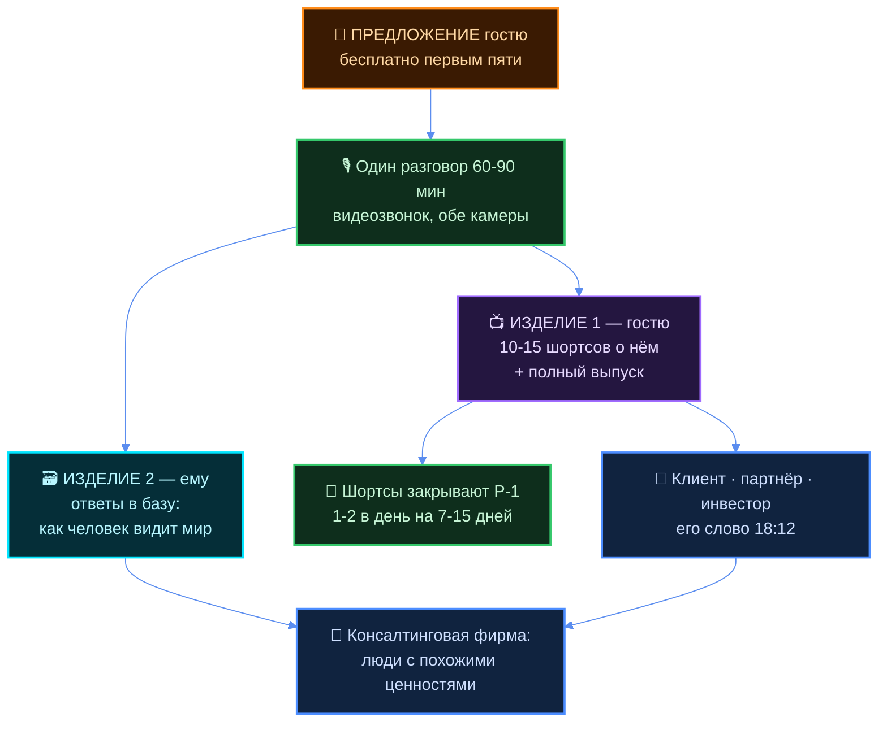
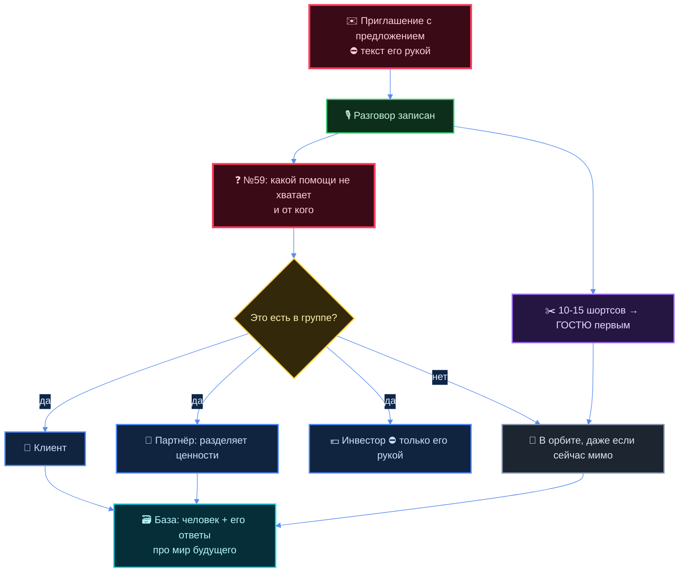

# Формат контента и темы для интервью

## Как читать

Заказ 14.10, два голоса подряд. Первый в 18:05 (`raw/transcripts/tg-2026-10-14-180511.md`):

> «пусть пошёл поискал всё, что я говорил про сбор информации о том, как можно сделать мир
> лучше… как ты видишь мир в будущем, что было бы приемлемо, разумно, что неприемлемо,
> неразумно»

> «я как ведущий буду выступать такой вот зазывала… мне надо формат и темы, которые я могу
> вести, спрашивать — конкретно на какие темы»

Второй в 18:12 (`raw/transcripts/tg-2026-10-14-181203.md`) — он сам закрыл главный вопрос по
формату, и §2 построен уже на нём, а не на догадках.

```
§1  его картина будущего — только его слова, с датой и адресом
§2  формат: его решение 18:12 + шортс как изделие + шесть живых передач + обкатка первых пяти
§3  ⭐ банк из 61 вопроса — главное в документе
§4  роль ведущего: что «зазывала» значит на деле
§5  где интервью стыкуется с набором людей, и где этого стыка быть не должно
§6  слоты ему · §7 что здесь слабого
```

> ⚠️ **Чей текст.** Всё в кавычках «…» — его слово, адрес источника стоит рядом. Расшифровки
> сделаны whisper и местами кривые — цитируется как есть, не причёсывается. Всё остальное
> помечено **«кандидат агента»**.
>
> ⛔ **Чего здесь нет:** текстов, уходящих человеку наружу (приглашения пишет он сам), долей,
> процентов, цен, имён живых людей. ⛔ В Notion по его прямому слову ничего не заносилось.
>
> 📎 Философский слой — интеллект, выживание, владение — уже собран и здесь не повторяется:
> [`B1-EGO-ZAMETKI.md`](../research/B1-EGO-ZAMETKI.md) (319 цитат) и
> [`B2-POHOZHIE-MYSLI.md`](../research/B2-POHOZHIE-MYSLI.md). В §1 — только то, чего там нет.

---

## §1 Его картина будущего — его словами

Замер: прочитано 919 расшифровок его голоса с 30.04.2026 по 14.10.2026, плюс `tochka-b/`,
`entities/`, `decisions/`. Ниже сгруппировано по смыслу. Где он не высказывался — сказано прямо.

### 1.1 ⭐ Сам формат он придумал в апреле — это не новая мысль

Самая важная находка: вопрос, который он 14.10 просит найти, он **сам сформулировал
13.04.2026** — вместе с механикой распространения.

> «задаём вот этот вопрос, короче: а как сделать мир лучше, да? Но для начала среди там
> инженеров. Но не какую-то конкретную штуку, да, допустим: **как мир вообще сделать лучше,
> как ты там видишь мир будущий**, ну там я не знаю, **хорошее будущее, или будущее, которое
> тебе бы хотелось** […] просто задать этот вопрос сперва инженерам, чтобы они на него
> ответили, и потом чтобы они ещё спросили других там хотя бы 2-3 инженеров — этот же вопрос.
> Ну интересно же»
> — 13.04.2026, `raw/transcripts/audio_426@13-04-2026_04-28-29.txt`

Там же — что он хотел с этим делать:

> «это тоже уже сейчас как бы задать, просто чтобы люди вот, и потом на регулярную основу это
> поставить хотя бы раз в неделю, ну или раз в месяц» — 05.06, `audio_2026-06-05_17-30-25.txt`

> «и в итоге вот это тоже ещё задаются вопросы, это тоже ещё учитывается […] я ищу людей,
> которых это тоже волнует»
> — 13.04.2026, `raw/transcripts/audio_429@13-04-2026_04-49-05.txt`

⭐ **Что это значит практически.** Формат интервью не придуман вчера: ему полгода, и в исходной
версии у него была ещё одна деталь, которой нет в заказе 14.10 — **гость передаёт вопрос дальше
двум-трём своим**. Это готовый механизм роста без рекламы, и его стоит вернуть: вопрос №60 в
банке §3 — ровно он.

### 1.2 «Как сделать мир лучше» — что он под этим понимает

Это у него не лозунг, а **процедура сбора**: спросить, записать, свести в таблицу, вернуть
человеку ресурсы под его план.

> «у нас будет отдельный прям раздел — как сделать общество лучше, как сделать самый охуенный
> мир на планете, ещё раз, на всей ебаной планете. Для начала как вот людей объединить, как
> чтобы вот **качество жизни каждого человека улучшилось**, и потом всего общества»
> — 05.06.2026, `raw/transcripts/audio_2026-06-05_17-30-25.txt`

> «пожалуйста, запиши — **если ты знаешь, как улучшить ёбаный мир, запиши, пожалуйста,
> расскажи**. Если ты такой дохуя умный — иди расскажи, показывай, пожалуйста. **Мы каждого
> выслушаем. Ещё раз, каждое мнение важно**, мы тебя послушаем»
> — 05.06.2026, там же

> «потом ты вот нашёл ещё людей, или тебе просто надо ресурсы, чтобы это воплотить —
> **пожалуйста, мы тебе найдём** […] ты напиши, как ты **берёшь за это ответственность**»
> — 05.06.2026, там же

> «отдельно будем такую вот **таблицу вести, в целом базу предложения по тому, как вообще
> улучшить мир**» — 05.06.2026, там же

> «а как вообще сделать мир лучше, какие там есть теории, какие есть варианты, **а что если там
> каждый человек вот смог бы на 10 минут об этом задуматься, а потом что-то сделать** или там
> что-то инвестировать — то что могло бы получиться»
> — 13.04.2026, `raw/transcripts/audio_429@13-04-2026_04-49-05.txt`

⭐ **Структура его вопроса — три шага, и они легли в блок F банка:** ① чего ты хочешь →
② как ты готов внести вклад → ③ берёшь ли ты за это ответственность.

> «сперва, ну, чё ты просто хочешь? Потом уже — **а как ты готов этому помочь, как ты готов
> свой вклад в это внести?**» — 05.06.2026, там же

### 1.3 «Приемлемо / неприемлемо» — всё, что он сказал этими словами

⚠️ **Тут мало.** Слово «приемлемо» встречается в корпусе трижды, «разумно» — один раз, и только
одно место содержательное. Это надо знать до того, как строить вокруг него блок вопросов.

Единственное развёрнутое место — и оно описывает ровно формат интервью:

> «пришёл один человек там с одной точки мира, с одной страны, вот рассказывает: **для меня вот
> это хорошо, интересно, а вот это вот, не знаю, плохо, неприемлемо, я бы хотел вот так вот,
> я бы хотел изменить то-то, то-то** […] такое рассказывает другой, с другой страны пришёл, там
> третий, у которого больше знаний […] все пришли, рассказали, как хотят, рассказали, **на
> основе каких данных хотелось бы, чтобы это всё работало**»
> — 17.09.2026, `raw/transcripts/tg-2026-09-17-204309.md`

Зачем ему это нужно, там же:

> «какая-то главная сеть, или вот рабочая какая-то безопасная, должна быть проработанной и
> должна **собираться из такого общего стека профессионалов** — то есть и с одной стороны
> философов, и с другой стороны вот инженеров, и там как-то политиков ещё» — 17.09.2026

> «**какие теории, информацию должен давать, чтобы вот все согласились**, и как бы должна
> выглядеть тогда одна общая библиотека знаний, совместных каких-то инструментов […] **вот это
> вопросы перед текущими философами, разработчиками, политиками** и в целом авантюристами,
> которые хотят что-то масштабного в жизни замутить» — 17.09.2026

Второе место — про себя, не про других:

> «как у человека, который ответственен за эту всю такую вот здоровенную махину, должны быть
> соответствующие фильтры: **что приемлемо, что неприемлемо — это тоже должно уже быть как-то
> зафиксировано**, описано как минимум для тех людей, для которых мне реально важно […] чтобы
> они и мне, и системе доверяли»
> — 22.08.2026, `raw/transcripts/tg-2026-08-22-170613.md`

⭐ Читается так: **свой список «приемлемо/неприемлемо» он считает не написанным.** Он собирается
собрать его у других и из этого собрать свой. Это и есть замысел интервью.

### 1.4 Что для человека хорошо и что плохо — его ответ

Он говорит об этом не через «добро и зло», а через **развитие против деградации**. Слов
«мерзко», «противно», «предательство», «рабство», «паразит» в корпусе нет вообще.

**Корень: жизнь одна, и её надо не просто сохранить.**

> «вот жизнь одна, да, соответственно вот **сохранить как можно больше жизней** и тогда ресурсов
> и времени людей, которые эти жизни проживают — и не то что просто вот сохранить, а именно
> **дать им возможность узнать, на чтобы ещё они могли эту жизнь потратить** и использовать,
> и своё время» — 03.09.2026, `raw/transcripts/tg-2026-09-03-014342.md`
> *(«на чтобы» — обрыв расшифровки; читается как «на что»)*

> «основные ценности — это вот **не дать человеку, и тогда человеческому интеллекту, и в целом
> интеллекту умереть**. То есть тогда это: жить, не умереть, и вот и развиваться»
> — 24.08.2026, `raw/transcripts/tg-2026-08-24-174610.md`

> «если вот люди не ценят свою жизнь, то тратят на хуйню. **В бизнесе точно так же**: если не
> ценят, когда свой бизнес не любят, качественно его не делают — тоже хуйня получается. Это
> везде. Надо, короче, **ценить**» — 29.04.2026, `raw/transcripts/audio_99@29-04-2026_17-30-50.txt`

**Честность с собой — он ставит её первой, и выводит не из морали.**

> «это всё как раз следствие вот этой вот **любви к себе и честности с самим собой**. И это
> просто позволяет инструмент ещё более честным быть с собой. **Себя не наёбывать**»
> — 01.06.2026, `raw/transcripts/audio_766@01-06-2026_13-59-58.txt`

> «**мастерство в любом деле** — это отключить все свои предрассудки и как-то хладнокровно,
> трезво посмотреть на ситуацию, на себя, то, **насколько честным ты можешь быть с собой**»
> — 01.06.2026, там же

> «**честно себе отвечать, где ты не хочешь, а где ты хочешь**»
> — 03.06.2026, `raw/transcripts/audio_2026-06-03_20-33-34.txt`

**Не наебать другого — и это он формулирует как расчёт, а не как мораль.**

> «мы же **не хотим нашего потенциального партнёра наёбывать** […] мы хотим с ним всей
> информацией поделиться, обширно, открыто. С самого начала начинать наше общение на вот таком
> вот фундаменте — **взаимовыгодном и открытом**»
> — 07.09.2026, `raw/transcripts/tg-2026-09-07-055930.md`

> «никакие там не скамы, не ещё какая залупа — мы сразу это отметаем куда подальше […] **чистыми
> способами, белыми темами просто работать с адекватными людьми** […] какое вообще пятно на
> нашей карьере оставит? **Это даже не обсуждается**»
> — 26.04.2026, `raw/transcripts/audio_552@26-04-2026_09-18-35.txt`

> «любой человек, который профессионал, мастер — он ответственен, и он в какой-то степени
> уважает себя, любит себя, и скорее всего будет уважать и любить других мастеров, которые есть
> вокруг него — **и соответственно хуйни им точно не будет подсовывать**»
> — 01.06.2026, `raw/transcripts/audio_764@01-06-2026_13-31-26.txt`

**Труд ценен и оплачивается — ближайшее у него к слову «справедливость».**

> «в Jetix философия вот с первого дня такая будет, что, пожалуйста, **любой труд ценен, и он
> должен оплачиваться адекватно**. И в целом вот это вот понимание ценности оно должно быть
> с первого дня» — 07.06.2026, `raw/transcripts/audio_2026-06-07_14-04-13.txt`

> «справедливо получается, что **кто натренированный — получает столько, насколько он обученный,
> насколько у него инструментов хватает, насколько амбиций хватает** […] если тогда вот это
> справедливое распределение ресурсов получается, то плюс-минус вот так вот она может звучать,
> **один из вариантов**» — 02.05.2026, `raw/transcripts/audio_594@02-05-2026_03-27-39.txt`

**Граница: добро с кулаками, и фильтр «которым не похуй».**

> «вот это как бы **добро делаем, но это добро с кулаками, только так**»
> — 28.08.2026, `raw/transcripts/tg-2026-08-28-214948.md`

> «он сфокусирован только на тех людях, **которым не похуй**. На тех, которые ответственные,
> которые готовы за свою жизнь брать ответственность и нести её, выполнять определённые
> действия, рисковать» — 18.04.2026, `raw/transcripts/audio_496@18-04-2026_21-55-33.txt`

> «для начала **главное не сколько это стоит, а какие ценности люди внутри этой хуйни
> разделяют**» — 09.10.2026, `raw/transcripts/tg-2026-10-09-082106.md`

> «я ищу людей, которым это тоже интересно и которые готовы на вот эти **ценности децентрализации
> и поддержания и развития жизни интеллекта** — готовы приходить, сотрудничать, работать»
> — 14.10.2026, `raw/transcripts/tg-2026-10-14-180511.md`

### 1.5 Каким мир должен стать

> «уже научились там общаться друг с другом, соответственно **следующий этап будет учиться
> работать совместно**» — 03.09.2026, `raw/transcripts/tg-2026-09-03-014342.md`

> «у каждого места, или у каждой системы, страны, бизнеса — не важно — **будет довольно чёткий
> свод правил** […] и система будет помогать понять эти правила, эту культуру того места, в
> которое ты едешь, приходишь […] это позволит **на одном земном шарике иметь достаточно много
> разных методов управления**» — 03.09.2026, там же

> «мы именно нацелены на показание того, что вот **добрые дела — это намного выгоднее**, а не
> тот, который вот был ранее, типа вот капиталистического: **концентрация всё большего числа
> ресурсов просто у себя, при этом неспособность их эффективно использовать**»
> — 03.09.2026, там же

> «потом будет просто как **метро, нахуй** — настолько много станций, там много-много
> ответвлений […] зашёл в поезд, какие-то интересные люди, все куда-то там едут, стремятся.
> **Но не то что это прям пиздец утопия должна быть**, но как бы такой вот подумать на это»
> — 13.05.2026, `raw/transcripts/audio_651@13-05-2026_04-14-32.txt`

> «это в целом **рабочая гипотеза на то, чтобы вообще весь мир перевести на такой вот
> ответственный, дисциплинированный подход к жизни**. Вот и всё. Но для этого нужно много
> философских вопросов обдумать — **как дальше общество должно работать**»
> — 02.06.2026, `raw/transcripts/audio_771@02-06-2026_01-47-25.txt`

> «чтобы на больших должностях, на сложных, **управляли реальные люди с опытом** […] надо
> сделать более повсеместно, worldwide […] **чтобы везде вот эти одни правила работали** […]
> если этого не будет, ну просто не получится разные разъёмы втыкнуть друг к другу»
> — 14.05.2026, `raw/transcripts/audio_654@14-05-2026_00-31-18.txt`

> «и в целом **делать реальный мир более безопасным**. Если вы вот не хотите сдохнуть, если вы
> хотите реально развиваться» — 16.05.2026, `raw/transcripts/audio_662@16-05-2026_02-20-33.txt`

> «мы здесь, как бы в этой лодке, в Джетиксе, собрались **те, кто верит в будущее**. Ну и хотим
> этого будущего, светлого будущего, готовы это строить **ради себя, ради наших семей, ради
> наших детей**» — 27.04.2026, `raw/transcripts/audio_561@27-04-2026_06-18-41.txt`

### 1.6 Что в мире сломано — его диагноз

⭐ Самая прямая формулировка, и она же записана его рукой текстом, а не голосом:

> «**Делать человеку лучше, а не человека лучше — баг современного общества.** Поголовно сука,
> везде. Эта установка проникла везде. От устройства бизнеса и работы, до учебы, отношений,
> отношения к себе. **И это как раз корень безответственности.** Каждый просто хочет делать то,
> что ему скажут другие, и сам думать/делать не хочет […] Но когда этот подход разрастается на
> всё человечество, и каждый лидер делает человеку лучше, а не человека лучше — мы получаем не
> способных / слабых людей, которые **не могут брать ответственность** (в первую очередь за свою
> жизнь). Потом такие люди безответственным подходом растят следующую генерацию безответственных,
> и так общество и деградирует блять. **Безответственность порождает слабость, ставит в положение
> жертвы, связывает человеку руки**»
> — 02.06.2026, `raw/transcripts/text-notes-2026-06-02-telegram.txt`

Там же, двумя абзацами ниже, — то, что он считает своим ответом на этот баг:

> «Jetix как раз идёт решать эти ебаные баги, и помогает каждому, кого эта тема тоже сильно
> волнует. Воспитываем дисциплину, открытость к новому, признание своего невежества и тд.
> **И самое важное что мы делаем — воспитываем человека, чтобы он был лидером для самого себя
> в первую очередь. Чтобы выбирал сам, во что верить, а во что нет.** На чем свои дальнейшие
> действия, мысли и жизнь строить» — 02.06.2026, там же

⭐ ⚠️ **Эта запись — исключение из предупреждения §7 п. 1: она написана его рукой текстом, а не
расшифрована с голоса.** Значит её, единственную из всего §1, можно цитировать публично без
доработки. Для описания канала и для первого выпуска это самый пригодный материал в корпусе.

> «довольно много **багов общества** есть […] пришло время их решать. Если их не решить, они
> дальше разовьются в ещё более такую **огромную, мощную раковую опухоль** […] чтобы вот
> человеки оттупели, чтобы там как-то ожирели, ослабли»
> — 23.08.2026, `raw/transcripts/tg-2026-08-23-172205.md`

> «эти смартфоны создавали в начале тоже с какими-то **хорошими посылами** — не думали, что
> будут сидеть просто в тиктоке дрочить по 10 часов в день люди, и потом у них будет просто
> башка, психика разваливаться, они не будут знать, кто они такие, чего они хотят от жизни,
> как жить; что **семьи от этого будут рушиться**, что просто **общество от этого может
> распасться**» — 02.06.2026, `raw/transcripts/audio_771@02-06-2026_01-47-25.txt`

> «благодаря этому инструменту можно **просто тупеть**, терять своё свободное время, потреблять
> наоборот неподтверждённую или обманчивую информацию […] **А какой-то полноценной инструкции
> или системы, как этим пользоваться, никто не даёт** […] просто как такой вот **дикий запад**»
> — 02.09.2026, `raw/transcripts/tg-2026-09-02-230034.md`

> «акты общения, акты сотрудничества зачастую, особенно вот в управлении, идут на данный момент
> так, что **"я начальник — ты дурак"** […] И так в целом и армии работают, и государства часто
> так работают […] когда технологий было не так много, такой подход был окей — я там один шаман
> на племя из тысячи человек» — 03.06.2026, `raw/transcripts/audio_2026-06-03_20-33-25.txt`

> «эти камушки много между собой как-то взаимодействуют, много там **трения** […] вместо того
> чтобы благодаря этим ресурсам продвинуться наверх — они стоят на месте, **долбятся друг в
> друга головами** […] и это получается такое вот **замедленное развитие человечества как
> системы**» — 27.04.2026, `raw/transcripts/audio_566@27-04-2026_14-46-52.txt`

> «разные соцсети разных государств **будут выдавать ту информацию, которую им государства и их
> разработчики предоставили**. Вот так просто. То есть сейчас это делают новости, школы,
> какие-то организации» — 17.09.2026, `raw/transcripts/tg-2026-09-17-204309.md`

### 1.7 Что он считает неприемлемым устройством

> «когда система-бизнес и система-работник существуют, и **одно другого хочет наебать, ну или
> просто максимально использовать, ничего не давая взамен** — приводит к такому вот
> неэффективному использованию ресурсов, да и в целом **невыгодно ни одной, ни другой стороне**.
> И то есть основная проблематика, которую именно Jetix Group пытается решить, это поменять вот
> этот слой, подход, видение к жизни и культуры»
> — 03.09.2026, `raw/transcripts/tg-2026-09-03-014342.md`

> «а что, **жить жизнь, чтобы просиживать за компьютером?** Ну как бы идите нахуй […] не надо
> больше человеку сидеть по 8 часов перед монитором и просто вот так вот свою жизнь просиживать.
> Это всё, **каторга прошла** […] возможно, бизнес-встречами, какими-то исследованиями уже
> реально в полях, экспериментами»
> — 26.04.2026, `raw/transcripts/audio_551@26-04-2026_08-04-27.txt`

> «и потом **не приносить никакого толку мастеру**, не развивать его дальше продукт, не
> продвигать дальше его идеи — ну такие **сразу идут нахуй**, они там где-то на обочине будут
> валяться» — 07.06.2026, `raw/transcripts/audio_2026-06-07_14-04-13.txt`

> «адекватно, да, распоряжаться ресурсами, **мразью не быть** […] когда ты не можешь что-то
> сделать, но это и пиздиша ты можешь это сделать, вот, ну либо как-то **крысишь** и так далее.
> В итоге вот **такое должно караться довольно строго**»
> — 11.04.2026, `raw/transcripts/audio_414@11-04-2026_02-08-27.txt`

> «кому не надо, или кто это не ценит, или кто свою жизнь не ценит — ну как бы не слушайте, а
> ещё желательно **съебались нахуй**. На вас время тратить уж точно у меня нет»
> — 07.09.2026, `raw/transcripts/tg-2026-09-07-055950.md`

### 1.8 Роль ИИ в его картине мира

⚠️ Это важно знать до интервью: его позиция по ИИ **расходится с мейнстримом**, и гости
наверняка будут говорить иначе. Это материал для несогласия, а не для кивков.

> «искусственный интеллект — это по сути **мега-калькулятор** […] Но не забываем, сука, что это
> тот же ебаный калькулятор. Всё, не больше. Почему? **Потому что он не может сдохнуть** […] не
> понимает своей конечности […] у него нету желания, что он может как-то откинуться, умереть»
> — 05.06.2026, `raw/transcripts/audio_2026-06-05_17-30-21.txt`

> «и ты мне хочешь сказать, что эта шайтан-машина может быть как-то умнее создателя? Как нахуй?
> […] **человек как раз задаёт законы и правила**, а потом уже это искусственный интеллект идёт,
> выполняет» — 05.06.2026, там же

> «видно, в ней как много возможностей, так и много опасностей. И соответственно **над этим
> должны работать лучшие умы мира**»
> — 25.04.2026, `raw/transcripts/audio_531@25-04-2026_00-37-29.txt`

> «у человека в башке оказывается **такой же промпт есть**, вот какой ты даёшь искусственному
> интеллекту […] И в целом вот те выдумки и те идеи, в которые верит всё человечество, они
> влияют на будущее человечества. **В какой-то степени самоисполняющиеся пророчества**»
> — 13.04.2026, `raw/transcripts/audio_423@13-04-2026_03-49-59.txt`

> «**все вот эти ценности и подход к жизни, интеллект — это инструмент**, и кто-то этим
> пользуется как ебаным намордником, а кто-то этим пользуется **как костюмом железного
> человека. И выбирать только тебе**»
> — 05.06.2026, `raw/transcripts/audio_2026-06-05_02-33-23.txt`

> «в целом логика работы искусственного интеллекта понятна […] **суть обучения и образования —
> давайте вот обратную связь и реально показывать, что хорошо, и точно так же давать обратную
> связь, показывать, что плохо**, чтобы этот вот человек или этот вот интеллект, который
> обучается, получал адекватную обратную связь, которая дальше повлечёт за собой его выживание,
> развитие и плодотворную жизнь, а не деградацию […] **точно по такому же принципу работает
> человеческий интеллект**» — 17.09.2026, `raw/transcripts/tg-2026-09-17-204309.md`

### 1.9 ⛔ ДАННЫХ НЕТ — по чему он не высказывался

Проверено грепом по 919 расшифровкам + `tochka-b/` + `decisions/` + `entities/`. Это не «не
нашли», это **замер отсутствия**. На эти темы у него позиции нет, и выдумывать её нельзя — но
спрашивать о них гостей можно, и тогда он соберёт то, чего у него нет.

| Тема | Состояние в корпусе |
|---|---|
| **Безусловный доход / UBI** | 0 упоминаний |
| **AGI, сверхинтеллект** | «сверхинтеллект» 0; позиция только отрицающая — ИИ это «мега-калькулятор» |
| **Риск захвата власти ИИ** | развёрнутой позиции нет, только отмашка |
| **Климат, экология планеты** | «климат» 0; «экологично» только в смысле «бережно к людям» |
| **Апокалипсис, антиутопия, катастрофа** | 0. Слово «утопия» 1 раз — чтобы от неё откреститься |
| **Бедность и неравенство как мировая проблема** | «бедность» 0, «неравенство» 0 |
| **Исчезновение профессий** | как тема нет; единственный пример — повара и автоматические кухни (18.04) |
| **Роботы** | 2 беглых упоминания, картины роботизированного мира нет |
| **Демография, миграция, перенаселение, старение** | 0 по всем корням |
| **Конкретные горизонты (2030, 2050)** | почти нет; «через 20 лет, через 10» один раз (29.05) |
| **Религия в будущем устройстве** | только как «линза», не как институт |
| **Война великих держав, ядерная угроза** | абстрактно «тратят ресурсы на войны», сценариев нет |
| **Что будет с теми, кто НЕ войдёт в его систему** | только отмашки, позиции нет |
| **Название передачи, канала, рубрики** | 0 упоминаний за всю историю корпуса |
| **Язык его собственного блога** | не решён: английский назван только для проекта Rumsatz (07.10) |

⭐ **Это и есть лучший аргумент в пользу интервью.** Пятнадцать пустых клеток — именно те темы,
по которым он собирается спрашивать других. Через пятьдесят разговоров половина заполнится
чужими ответами, и у него появится своя позиция, собранная из материала, а не выдуманная.

---
## §2 Формат — он задан его словом 18:05 и 18:12, не изобретается

### 2.1 ⭐ Предложение целиком — его слово 14.10 18:12

Через семь минут после первого заказа он сам снял главную неопределённость и назвал формат
изделием, а не передачей. Голос целиком: `raw/transcripts/tg-2026-10-14-181203.md`.

> «хотя бы первым пяти делаю как-то бесплатно, да, просто вот интервью, и потом нарезка на
> нарезка там 10, 15 шортса, и там помогаю донести, показать это до новых 100 или 1000 человек.
> И то есть возможно либо найти клиента, либо партнёра, либо инвестора. Вот что-то типа такого.
> Вот это как бы моё предложение, ебать, это моё предложение. Ну как бы такой лид-магнит, даже
> не то что лид-магнит, но вот просто моё такое предложение»

> «чтоб чётко было до людей, до которых я утичу, чтобы не просто так. И так и поясняю, да, что
> этот сам вот строю консалтинговую фирму, дальше там кому интересно — залетайте. Вот конкретно
> собираю экспертизу экспертов, узнаю, как они видят мир, блять, умных людей. Там как-то вот в
> целом такой проактивный — ну то есть вот конкретно людей собирает, спрашивает, да, там если
> надо просит помощи»

> «и в целом что вот я такую консалтинговую фирму собираю, таких людей, которые разделяют
> похожие ценности»

> «зарабатывать консалтинговая фирма — это уже дальше будет видно, от экспертизы людей, которые
> будут внутри. Я ещё раз целью на продвижение людей тогда в соцсетях… конкретно настройкой
> системы, чтобы люди могли там о себе рассказывать, о своих проектах. Ну и в целом потом
> зарабатывать на внедрении вот этой всей хуйни, которое внедрение конкретно нацеленное на
> децентрализованное и полезное качественное будущее для развития человечества»

**Что здесь названо и больше не обсуждается:**

| Что | Его слово |
|---|---|
| Кому бесплатно | первым пяти |
| Что получает гость | интервью + нарезка **10–15 шортсов** + помощь донести до **100 или 1000** новых людей |
| Зачем это гостю | «возможно либо найти клиента, либо партнёра, либо инвестора» |
| Как это называется | «моё предложение»; слово «лид-магнит» он сам сказал и сам от него отступил |
| Что он говорит о себе | «строю консалтинговую фирму, кому интересно — залетайте» |
| Что он собирает | «экспертизу экспертов», «узнаю, как они видят мир», «умных людей» |
| Кого отбирает | «таких людей, которые разделяют похожие ценности» |
| Его роль | «такой проактивный — людей собирает, спрашивает, если надо просит помощи» |

⭐ **Главное следствие.** Интервью — **не передача. Это услуга, которую он оказывает гостю.**
Гость не оказывает ему любезность, придя в эфир; гость получает готовый пакет контента о себе.
Из этого следует всё остальное в документе: отсюда право звать незнакомых людей, отсюда
отсутствие нужды продавать внутри разговора, отсюда требования к вопросам.

---

### 2.2 Что из этого следует — два изделия с одного разговора



⭐ **Арифметика, которая сходится.** 09.10 он взял обязательство: «хотя бы один-два шортса в день
я **обязан** выкладывать» (Р-1, `tochka-b/179-OS-08-20.md`). 10–15 шортсов с одного интервью
закрывают это обязательство на **7–15 дней**. Значит **одно интервью в одну-две недели** — и
норма Р-1 выполняется без ежедневного придумывания. Два заказа, разделённые пятью днями,
складываются в одну машину.

---

### 2.3 ⭐ Шортс как изделие — из чего режется сильный короткий ролик

Это второе изделие и, по его же заказу, предмет отдельного разбора.

#### Сколько надо исходника

| Величина | Значение | Откуда |
|---|---|---|
| Нужно шортсов | 10–15 | его слово 18:12 |
| Длина шортса | 40–60 секунд | это длина, на которой самодостаточная мысль ещё помещается, а внимание ещё держится |
| Чистого материала нужно | 8–13 минут | 15 × 50 сек |
| Доля годного в сыром разговоре | примерно 1 сильный момент на 5–6 минут | **кандидат агента**, замера у нас нет |
| Значит длина разговора | **60–90 минут** | 75 мин ÷ 5,5 ≈ 13 моментов — попадает в его 10–15 |

⚠️ Это и есть ответ на «какой длины интервью»: не «сколько интересно», а **столько, сколько нужно
для 10–15 нарезок**. Разговор на 30 минут физически не даёт его цифру.

#### Шесть признаков куска, который станет шортсом

> Весь этот список — **кандидат агента**. Он признаков шортса не называл.

| № | Признак | Почему |
|---|---|---|
| 1 | **Самодостаточность** | понятен без вопроса и без предыдущих пяти минут. Если нужна подводка длиннее 7 секунд — не шортс |
| 2 | **Поворот в первые 3 секунды** | кусок начинается не с «ну, я думаю», а с утверждения, которое хочется оспорить |
| 3 | **Одна мысль** | ответ, где три мысли, не режется — он разваливается при любой обрезке |
| 4 | **Конкретика: сцена, число или имя** | «мы потеряли клиента в день запуска» режется; «важно правильно расставлять приоритеты» — нет |
| 5 | **Законченность** | кусок кончается точкой, а не вдохом перед продолжением |
| 6 | **Есть лицо** | гость в этот момент не читает с листа. Это видно на записи и это половина силы ролика |

#### Что НЕ режется никогда — не тратить на это время интервью

- объяснение процесса («сначала мы делаем A, потом B»);
- ответ, начинающийся с «это зависит»;
- хронология («в 2019-м мы, потом в 2021-м»);
- внутренняя кухня отрасли, понятная только коллегам;
- любая похвала в адрес ведущего или проекта — это выглядит как реклама и работает против.

#### Какие типы ответов дают шортсы — и какими вопросами они вызываются

| Тип ответа | Вопрос, который его вызывает | № в банке |
|---|---|---|
| **Контр-утверждение** | «назови убеждение, которое разделяешь ты и почти никто из коллег» | 15 |
| **Отказ** | «за что ты готов потерять деньги», «что для тебя неприемлемо настолько, что ты ушёл бы» | 16, 42 |
| **Сцена** | «где проект чуть не умер и что его вытащило» | 9 |
| **Признание** | «чего ты до сих пор не умеешь», «в чём ты сам себе не нравишься» | 13, 31 |
| **Картинка будущего** | «опиши обычный вторник обычного человека через двадцать лет» | 33 |
| **Правило** | «какое одно правило ты бы ввёл для всех, включая себя» | 53 |

⭐ **Поэтому в банке §3 стоит метка 🎬** — ею помечены вопросы, ответ на которые обычно сам
становится шортсом. Их в банке 25. Если за разговор задать все 25 и хотя бы половина выстрелит —
его цифра 10–15 закрыта.

#### Работа после записи

1. Во время разговора ставить таймкод каждый раз, когда внутри звучит «вот это пойдёт».
   Пятнадцать отметок за 75 минут — это и есть готовый список нарезок.
2. После записи пройти по отметкам, у каждой взять 45–60 секунд, обрезать до точки.
3. ⛔ **Ничего не публиковать до согласия гостя.** Он отдаёт нарезку гостю как часть предложения —
   значит гость видит её первым.
4. ⬜ **Кто режет — слот.** Позиция монтажёра есть в реестре
   (`tochka-b/shagi/docs/f1-kogo-zovem.md` §4.6), человека нет. На 08.10 он отметил приложение
   Антона как возможный нарезчик — `raw/transcripts/tg-2026-10-08-092032.md`.

---

### 2.4 Reference-first — шесть живых передач и что у них работает

Метод дома: формат берётся из лучшего существующего, не выдумывается. Все шесть проверены чтением
их собственных страниц 14.10.2026. У каждой взят один приём.

#### ① The 80,000 Hours Podcast — ближайший структурный аналог

- Ведущие: Rob Wiblin, Luisa Rodriguez, Zershaaneh Qureshi, Tom Reed · https://80000hours.org/podcast/
- Заявленная суть: «unusually in-depth conversations about the world's most pressing problems and
  how you can use your career to solve them»
- Размер: 150 000+ подписчиков, 30 000+ часов прослушивания в месяц
- Гости: академики, предприниматели, чиновники, активисты

⭐ **Почему это ближе всего.** 80,000 Hours — организация, которая **набирает людей**, а подкаст
её главный вход. Ровно его конструкция: содержательный разговор о том, как сделать мир лучше, и
он же — первое касание. У них это работает открыто: слушатель знает, что за подкастом стоит
организация, и разговору это не мешает.

**Приём:** зазыв объявлен один раз в начале и один раз в конце. Внутри разговора организация не
продаётся ни словом.

#### ② Dwarkesh Podcast — глубина подготовки

- Dwarkesh Patel · https://www.dwarkesh.com/ · 111 000+ подписчиков на Substack
- По описанию площадки: «deeply researched», гости — «obscure intellectuals»

**Приём:** ведущий приходит, прочитав всё, что гость сделал. Вопрос звучит как «вы утверждали X,
но из этого следует Y — согласны?». Единственная техника, превращающая интервью из анкеты в
разговор. Дорого по времени, ничем не заменяется.

#### ③ Conversations with Tyler — вопрос, который провоцирует

- Tyler Cowen, Mercatus Center · https://conversationswithtyler.com/
- Рамка: «wide-ranging explorations» с «today's most underrated thinkers»
- Их формулировка метода: «intense research leads to stimulating and surprising questions that
  provoke guests into deep examinations of their work»
- И про смысл формата: «You can't imitate a worldview. But you can form your own by listening
  and learning»

**Приём:** вопрос ставится так, чтобы гость не смог ответить заготовкой. Не «что вы думаете о
будущем», а «назовите убеждение, которое разделяете вы и почти никто из ваших коллег».

#### ④ The Diary of a CEO — видео-первое производство

- Steven Bartlett · https://thediaryofaceo.com/ · выпуски 1–2+ часа, аудио + видео
- 12,1 млн подписчиков на ютубе, 850 млн просмотров, 1+ млрд прослушиваний; в декабре 2025 —
  самый популярный подкаст Британии на Spotify, обошёл Джо Рогана

**Приём, который у него уже заложен:** выпуск снимается как видео, аудио — побочный продукт,
короткие вертикальные нарезки — третий. Это буквально схема §2.2.

> ⚠️ Приём «гость оставляет карточку с вопросом следующему» этой передаче часто приписывают — в
> проверяемом описании его **не нашлось**. Как факт не берём.

#### ⑤ How I Built This — арка одного дела

- Guy Raz, NPR · https://www.npr.org/podcasts/510313/how-i-built-this · около 60 минут
- Формат: интервью с «innovators, entrepreneurs, idealists» о том, как строилось их дело

**Приём:** первая треть выпуска — одна арка: с чего начал → где чуть не умер → где повернул →
где сейчас. Готовый каркас для блока A в §3.

#### ⑥ Acquired — право выпускать редко

- Ben Gilbert и David Rosenthal · https://www.acquired.fm/ · 1 млн+ слушателей на выпуск
- 2026: The Home Depot (14.09), Disney: The Renaissance and the Empire (10.08), The Walt Disney
  Company (22.06), Vanguard (18.05) — четыре выпуска за четыре месяца

**Приём:** редко, но огромно. Прямое опровержение правила «надо часто». ⚠️ Это НЕ интервью —
двое разбирают компанию. Берём только право на редкий плотный выпуск.

| Передача | Что берём | Что НЕ берём |
|---|---|---|
| 80,000 Hours | зазыв объявлен, но вынесен за края разговора | тему ИИ-рисков как рамку всего |
| Dwarkesh | подготовка по следам гостя | ставку на известных интеллектуалов |
| Conversations with Tyler | вопрос, на который нет заготовки | академический тон |
| Diary of a CEO | видео-первое производство, один разговор → три носителя | исповедальность и работу с болью гостя |
| How I Built This | арку одного дела как каркас первой трети | редакторскую машину NPR |
| Acquired | право выпускать редко и плотно | формат «двое разбирают компанию» |

---

### 2.5 Параметры формата — кандидат агента поверх его решений

| Параметр | Кандидат | Почему так |
|---|---|---|
| **Длина записи** | 60–90 минут | выводится из его цифры 10–15 шортсов, §2.3 |
| **Длина выпуска** | полный разговор без монтажа содержания | монтаж содержания — работа, которой нет; режется тишина и начало |
| **Главное изделие** | 10–15 вертикальных по 40–60 секунд | его слово 18:12 |
| **Ритм** | одно интервью в 1–2 недели | столько держит норму Р-1 и столько тянет одна пара рук |
| **Где снимается** | видеозвонок с записью, обе камеры | он в Берлине, люди везде. Про стримы 06.06 он говорил «хата свободная, камеру можно ебануть» — для интервью с незнакомцами выезд и студия убивают ритм на первом году |
| **Платформы** | нарезки → инстаграм и тикток; полный выпуск → ютуб | его решение 09.10 «инстаграм, тикток для начала, потом далее ютуб» |
| **Язык** | ⬜ слот С-1, не закрыт с 09.10 | русский даёт глубину, английский — объём. Смешивать в одном канале нельзя |
| **Подготовка** | 60–90 минут на гостя | приём Dwarkesh; без этого выпуск = анкета |
| **Кто режет** | ⬜ слот С-5 | позиция в реестре есть, человека нет |

#### Три кандидата названия

Названия он не давал — по замеру корпуса слово «название канала» не звучало ни разу.

| | Название | Логика | Риск |
|---|---|---|---|
| **А** | **«Каким будет мир»** | прямо называет главный вопрос; работает и в переводе | обобщённое |
| **Б** | **«Что ты строишь»** | два предмета сразу — дело и человек; это первый вопрос выпуска | звучит как подкаст про стартапы |
| **В** | **«Приемлемо / неприемлемо»** | его собственная пара слов из заказа 18:05; сразу задаёт, что разговор про границы | требует пояснения в первой строке описания |

🔶 **Рекомендация агента: А.** Выдерживает и русский, и английский канал, не сужает гостей до
предпринимателей. Решает он.

---

### 2.6 Что происходит в начале, середине и конце

Каркас на 75 минут. Минуты — доли времени, не жёсткий хронометраж.

| Часть | Минуты | Что происходит | Откуда |
|---|---|---|---|
| **Холодное открытие** | 0:00–0:40 | кусок из середины, где гость сказал самое острое. Без приветствия | видео-первое производство, Diary of a CEO |
| **Кто это и зачем смотреть** | 0:40–1:30 | фраза о госте + его собственная фраза «строю консалтинговую фирму, кому интересно — залетайте» | его слово 18:12 |
| **Дело** | 1:30–20:00 | блок A: что строит, как дошёл, где чуть не сломался | арка How I Built This |
| **Человек** | 20:00–40:00 | блоки B и C: ценности, что хорошо и что плохо | заказ 18:05 |
| **Мир** | 40:00–65:00 | блоки D, E, F: будущее, неприемлемое, что изменил бы | заказ 18:05, ядро |
| **Закрытие** | 65:00–75:00 | блок Z: чего гостю не хватает и от кого; кого звать следующим | §5.3 |

⚠️ **Порядок не переставлять.** Человек не отвечает честно на «что для вас неприемлемо» на
пятнадцатой минуте — он ещё не разогрелся и выдаёт социально одобряемое. Блоки D–F работают
только после сорока минут. Это вторая причина, по которой формат не ужимается до получаса.

---

### 2.7 ⭐ Первые пять — это обкатка. Что проверяем на каждом

Он сказал «хотя бы первым пяти делаю как-то бесплатно». Значит пять — это не милость, а серия
проверок, после которой формат либо стоит, либо переделывается. Предложение агента: на каждом
выпуске проверяется **одна** вещь, остальное держится неизменным.

| № | Что проверяем | Чем меряем — бинарно | Что меняем, если нет |
|---|---|---|---|
| **1** | **Хватает ли материала на 10–15 нарезок** | после записи насчитали 10+ отметок | удлинить разговор или добавить 🎬-вопросов |
| **2** | **Работает ли порядок блоков** | на вопросах блока E (неприемлемое) гость отвечает конкретикой, а не общими словами | сдвинуть границу «Мир» с 40-й минуты |
| **3** | **Держится ли доля речи** | гость говорит явно больше ведущего | срезать свои реплики, ввести правило «после ответа молчу 3 секунды» |
| **4** | **Понятен ли шортс без контекста** | дать 3 нарезки человеку, не смотревшему выпуск, — понял без пояснений | резать длиннее, брать только ответы с подводкой внутри |
| **5** | **Срабатывает ли предложение** | гость САМ спросил, что за фирма, или сам предложил кого-то позвать | ⚠️ если ни на одном из пяти не спросил — проблема не в вопросах, а в открытии |

После пятого — решение его: формат стоит, или шестой пишется по-другому.

⚠️ **Чего в этих пяти нет и быть не должно:** проверки «сколько просмотров». На нулевой
аудитории просмотры меряют не формат, а отсутствие дистрибуции — это разные вещи, и путать их
значит выбросить рабочий формат по чужой причине.

---

### 2.8 ⚠️ Арифметика, которая не сходится — называю прямо

Его слово 18:05: «я там первую тысячу человек специалистов ищу, там с каждым интервью провожу».

Считаю: 1000 интервью при одном в неделю — **19 лет**. При двух в неделю — **9,6 года**. Каждый
день без выходных — **2,7 года**, и это полная занятость одного человека, без остатка на фирму.

Развилка его:

- **вариант 1** — интервью для первых 30–50; остальные входят другим касанием (сайт, группа,
  рекомендация участника);
- **вариант 2** — два формата: длинное интервью с нарезкой (редко, по его предложению 18:12) и
  короткий разговор-знакомство на 15 минут без записи (часто, для всех);
- **вариант 3** — интервью ведёт не только он, когда в группе появятся люди.

🔶 Рекомендация агента: **вариант 2 сейчас, вариант 3 как цель.** Вариант 2 прямо следует из его
же слова — «первым пяти бесплатно» означает, что для остальных предложение другое. Решает он.

---

## §3 ⭐ Банк вопросов — главное в документе

### 3.0 Как пользоваться

- **Все вопросы открытые.** Ни на один нельзя ответить «да» или «нет» — требование заказа,
  каждый по нему проверен.
- **Банк — не сценарий.** На выпуск берутся 12–18, остальные лежат про запас. Вопрос, прозвучавший
  неестественно, пропускается, а не дожимается.
- 🔥 — **десять самых сильных**, сводка в §3.9.
- 🎬 — **ответ обычно сам становится шортсом**. Таких 25. Это прямая работа на его цифру 10–15.
- ⚙️ — **его собственная формулировка**, он её произносил голосом; провенанс рядом.
- Всё непомеченное — **кандидат агента**.
- После каждого острого вопроса — один уточняющий: **«а можешь пример?»**. Без примера ответ
  остаётся словами и в нарезку не годится.

---

### Блок 0 · Разогрев — первые пять минут

Задача: снять ощущение экзамена. Ответы отсюда почти никогда не идут в выпуск.

1. Чем ты занимался сегодня до того, как мы сели записывать?
2. Как ты объясняешь, чем занимаешься, человеку не из твоей области?
3. 🎬 Что в твоей работе люди обычно понимают неправильно?
4. Какой вопрос тебе надоело слышать в интервью настолько, что я его сейчас точно не задам?

---

### Блок A · О его проекте — 20 минут

5. Что ты строишь прямо сейчас, и что в этом будет стоять через десять лет, когда тебя в проекте
   уже не будет?
6. С какого момента это перестало быть идеей и стало делом — назови день или событие.
7. 🔥🎬 Какую задачу ты решаешь, которую до тебя в твоей области решать не брались, и почему
   не брались?
8. Что тебе пришлось перестать делать, чтобы это стало возможно?
9. 🎬 Где этот проект чуть не умер, и что его вытащило?
10. ⚙️🎬 Если бы у тебя сейчас была команда из пяти тысяч человек — что бы ты делал первым?
    *(его формулировка 23.08: «что бы ты делал, если бы у тебя сейчас были все возможности,
    команда из 5000 человек»)*
11. Что в твоём деле ты до сих пор делаешь руками, хотя знаешь, что это должна делать машина?
12. Кого ты считаешь настоящим конкурентом — не по рынку, а по смыслу?
13. 🔥🎬 Чего ты до сих пор не умеешь, и это тормозит тебя больше всего?

---

### Блок B · О его ценностях — 10 минут

14. Что ты решил про себя один раз и с тех пор не пересматривал?
15. 🔥🎬 Назови убеждение, которое разделяешь ты и почти никто из твоих коллег.
    *(приём Conversations with Tyler — вопрос, на который нет заготовки)*
16. 🎬 За что ты готов потерять деньги?
17. Кто научил тебя тому, как ты работаешь, — и чему конкретно?
18. Что ты обещал себе в двадцать лет и до сих пор держишь?
19. 🔥🎬 Был случай, когда тебе предложили хорошие деньги, а ты отказался. Что это было?
20. Что в тебе изменилось за последние три года так, что ты сам удивился?
21. Какую черту в других ты уважаешь больше всего, и у кого ты её видел?
22. 🎬 Когда ты последний раз признал, что был неправ в чём-то важном, — в чём именно?

---

### Блок C · Что для него хорошо и что плохо — 10 минут

23. ⚙️ Что ты в последний месяц делал хорошо, а что плохо?
    *(его формулировка 15.09: «а что ты там делал хорошо, а что плохо?»)*
24. По чему ты понимаешь, что день прожит правильно?
25. 🔥🎬 Опиши свой идеальный день от подъёма до сна — час за часом, без обобщений.
    *(его формулировка 23.08: «как бы ты видел свой идеальный день»)*
26. Что ты считаешь хорошей работой — не хорошим результатом, а хорошей работой?
27. Какую помощь ты считаешь настоящей, а какую — медвежьей услугой?
28. 🎬 Что для тебя значит «человек состоялся»?
29. Чем ты измеряешь, что твоё дело приносит пользу, а не только деньги?
30. Что вокруг нас сейчас устроено хорошо, а мы этого не замечаем?
31. 🎬 В чём ты сам себе не нравишься?

---

### Блок D · Каким он видит мир будущего — 15 минут, ядро выпуска

32. ⚙️ Как вообще может мир дальше выглядеть?
    *(его формулировка 23.08: «а как может мир дальше выглядеть»)*
33. 🔥🎬 Опиши обычный вторник обычного человека через двадцать лет. Не тренды — один день одного
    человека, с утра до вечера.
34. ⚙️ Какое будущее тебе бы хотелось?
    *(его формулировка 13.04: «как ты там видишь мир будущий — хорошее будущее или будущее,
    которое тебе бы хотелось»)*
35. 🎬 Что в сегодняшнем мире через двадцать лет будет выглядеть дикостью?
36. 🔥🎬 Что из того, что сейчас кажется неизбежным, на самом деле выбор, и мы можем выбрать иначе?
37. 🎬 Какая работа должна исчезнуть, и что люди будут делать вместо неё?
38. 🎬 Чему должен научиться ребёнок, который пойдёт в школу в следующем году?
39. ⚙️ Как сделать так, чтобы качество жизни каждого человека улучшилось?
    *(его формулировка 05.06: «как чтобы качество жизни каждого человека улучшилось»)*
40. 🎬 Что искусственный интеллект должен уметь отвечать человеку, а чего не должен никогда?
41. Если ты ошибаешься в своём прогнозе — в какую сторону вероятнее?

---

### Блок E · Что он считает неприемлемым — 10 минут

42. 🔥🎬 Что для тебя неприемлемо настолько, что ты вышел бы из проекта, даже если он успешен?
43. 🎬 Что делают сегодня в твоей области и считают нормальным, а ты считаешь недопустимым?
44. Где проходит твоя граница между «жёстко, но честно» и «так нельзя»?
45. 🎬 Какое будущее тебе показывают, и ты говоришь: только не это?
46. Что тебе предлагали, а ты отказался, и до сих пор считаешь, что правильно отказался?
47. 🔥🎬 Если бы кто-то завтра делал ровно твоё дело, но нечестно — что именно он делал бы такого,
    чего не делаешь ты?
48. 🎬 За что человека, по-твоему, нельзя простить?
49. Что в том, как устроена сегодня работа, ты считаешь сломанным, а не просто неудобным?

---

### Блок F · Что бы он изменил, если бы мог — 10 минут

50. ⚙️🎬 Как бы ты изменил мир к лучшему — что бы ты добавил, а что бы убрал, и почему?
    *(его формулировка 23.08, цитируется почти дословно)*
51. ⚙️ Все карты у тебя в зубах — люди, инструменты, информация. Что ты будешь делать и в каком
    порядке? *(его формулировка 05.06: «все карты у тебя в зубах… что ты будешь делать, в каком
    порядке, расскажи мне»)*
52. 🔥 Что ты изменил бы, если бы менять надо было на себе первым?
53. 🎬 Какое одно правило ты бы ввёл для всех, включая себя?
54. ⚙️ Чего ты реально желаешь себе, своей семье и обществу?
    *(его формулировка 05.06)*
55. Что мешает тебе сделать это уже сейчас — деньги, люди, разрешение или что-то ещё?
56. ⚙️ Как ты готов свой вклад в это внести?
    *(его формулировка 05.06: «как ты готов свой вклад в это внести»)*
57. Что ты сделаешь по этому поводу на следующей неделе?

---

### Блок Z · Закрытие — 10 минут

58. Что ты хочешь, чтобы человек сделал, посмотрев этот разговор?
59. ⭐ Какой помощи тебе сейчас не хватает, и от кого?
60. Кого из тех, кого ты знаешь, мне стоит позвать следующим — и какой вопрос задать именно ему?
61. Что я не спросил, а надо было?

---

### 3.9 ⭐ Десять самых сильных — те, что вскрывают человека быстрее всего

Отбор по одному признаку: **заготовкой не ответишь**. Человек либо вспоминает конкретный случай,
либо признаёт, что случая не было, — второе так же информативно.

| № | Вопрос | Что вскрывает | Шортс |
|---|---|---|---|
| 1 | **№15.** Убеждение, которое разделяешь ты и почти никто из коллег | своя голова или пересказ отрасли | 🎬 |
| 2 | **№42.** Что неприемлемо настолько, что ушёл бы из успешного проекта | есть ли граница вообще — главный фильтр для фирмы | 🎬 |
| 3 | **№19.** Случай, когда предложили хорошие деньги, а ты отказался | ценность, подтверждённая поступком, а не словом | 🎬 |
| 4 | **№33.** Обычный вторник обычного человека через двадцать лет | думал ли сам или повторяет заголовки | 🎬 |
| 5 | **№25.** Идеальный день час за часом | что он на самом деле хочет, в отличие от того, что говорит | 🎬 |
| 6 | **№13.** Чего до сих пор не умеешь, и это тормозит | способность признать слабость — прямой предиктор обучаемости | 🎬 |
| 7 | **№7.** Задача, которую до тебя не брались решать, и почему | отличает человека с делом от человека с занятостью | 🎬 |
| 8 | **№47.** Что делал бы нечестный человек на твоём месте | этика через конкретику, а не через декларацию | 🎬 |
| 9 | **№36.** Что кажется неизбежным, а на самом деле выбор | агентность — считает ли он, что на мир можно влиять | 🎬 |
| 10 | **№52.** Что изменил бы, если менять надо на себе первым | отделяет готового действовать от готового советовать |  |

⭐ **Если времени мало — эти десять и есть выпуск.** Сорок минут, человек понятен, и девять из
десяти ответов режутся в шортс.

---

## §4 Роль ведущего — что такое «зазывала» на практике

### 4.1 Его слово: «зазывала» он сказал не впервые

> «я как ведущий буду там выступать такой вот зазывала»
> — 14.10 18:05, `raw/transcripts/tg-2026-10-14-180511.md`

> «по позиционированию — снова-таки как такой **учитель, тренер / зазывала**, плюс снова-таки
> профессионал в этой узкой сфере»
> — 07.09, `raw/transcripts/tg-2026-09-07-055950.md`

⭐ **Слово не одинокое.** В сентябре «зазывала» стоит в одном ряду с «учитель» и «тренер», а не
рядом с «продавец». Читается так: зазывала — тот, кто **собирает людей на дело**, а не тот, кто
сбывает товар. Разница в том, что он зовёт в то, что делает сам.

Через семь минут после «зазывалы» он сказал то же самое другим словом:

> «такой проактивный — ну то есть вот конкретно людей собирает, спрашивает, да, там если надо
> **просит помощи**»
> — 14.10 18:12, `raw/transcripts/tg-2026-10-14-181203.md`

⭐ **«Просит помощи» — это и есть разгадка роли.** Зазывала у него не тот, кто предлагает, а тот,
кто **спрашивает и просит**. Это полностью меняет осанку в кадре: не продавец с офером, а человек,
который строит и которому нужны люди.

Ещё две его формулировки той же роли:

> «я себя позиционирую как такой человек, который **воодушевляет, мотивирует**, плюс наводит на
> какие-то умные мысли… И находит людей, которые точно так же этими знаниями-идеями делятся, и
> людей, которые хотят развиваться» — 09.10, `tochka-b/179-OS-08-20.md` §5

> «я как бы такой **исследователь**: вроде направление понятно, что конкретно делать вроде базово
> тоже понятно, но дальше будет видно. Я готов учиться, хочу развиваться» — 09.10, там же

---

### 4.2 Пять правил ведущего (кандидат агента)

| Правило | Как выглядит |
|---|---|
| **Зовёт не себе, а на дело** | «мне нужны люди» — про него. «Я собираю людей, которые разделяют похожие ценности» (его слово 18:12) — про дело. Второе и есть зазыв |
| **Зовёт один раз** | рамка названа в открытии (30 секунд) и повторена в закрытии (минута). Внутри часа — ни слова про фирму, пока гость сам не спросит |
| **Просит, а не предлагает** | его собственное «если надо просит помощи». Просьба ставит гостя выше, предложение — ниже. Для набора людей работает первое |
| **Делает гостя главным** | гость говорит явно больше ведущего. Это проверяемо по записи и стоит пунктом 3 в обкатке §2.7 |
| **Признаёт, что не знает** | «я сам в этом не разобрался» — его рамка исследователя. Снимает роль эксперта, которую он не хочет и не потянет |

---

### 4.3 Когда молчать

1. **После острого ответа.** Человек сказал настоящее и замолчал. Три секунды тишины — и он
   продолжит сам. Продолжение почти всегда сильнее первого ответа, и чаще всего именно оно
   становится шортсом.
2. **Когда гость думает.** Пауза в десять секунд в видео выглядит нормально. Подсказка убивает
   собственную формулировку гостя — а нужна именно она.
3. **Когда гость противоречит себе.** Молчать и дать ему услышать себя. Если не заметил —
   вернуться через пять минут одной фразой: «ты сказал X, а раньше сказал Y».

Приём против соблазна заполнить паузу: держать перед глазами одну строку —
**«моя работа задать вопрос и заткнуться»**.

---

### 4.4 Три провала и как они видны на записи

| Провал | Как звучит | Признак на записи | Что делать |
|---|---|---|---|
| **Допрос** | вопрос — ответ — следующий вопрос по списку, без реакции на сказанное | ни одного переспроса; банк пройден подряд | после каждого второго ответа — «а можешь пример?» вместо следующего пункта |
| **Самореклама** | гость отвечает, ведущий отвечает длиннее | ведущий говорит сопоставимо с гостем; фирма упоминается в середине | убрать упоминание из середины совсем; рассказ о себе — только в закрытие и только если гость спросил |
| **Соглашательство** | ведущий кивает тому, с чем не согласен | за 75 минут ведущий ни разу не возразил | формула несогласия без ссоры: «я вижу это иначе — объясни, где я ошибаюсь» |

⚠️ **Третий у него вероятнее двух первых.** Он сам назвал ценностью честную обратную связь —
«комьюнити, в котором ты видишь честную картину по отношению к тебе» (09.10). Если гость говорит
то, с чем он не согласен, а он кивает, — выпуск обесценивается, и гость это чувствует.

---

### 4.5 Чек-лист одного выпуска

**До (60–90 минут):** прочитать, что гость сделал · выписать 5 своих вопросов поверх банка ·
выбрать 12–18, из них минимум 10 с меткой 🎬 · проверить звук и запись · написать одну фразу о
госте для открытия.

**Во время:** первые 5 минут — блок 0 · ставить таймкод на каждое «вот это пойдёт» (цель 15
отметок) · следить, чтобы говорил в основном гость · после острого ответа молчать 3 секунды ·
не защищать свои взгляды в споре · последние 10 минут — блок Z.

**После:** нарезать 10–15 по отметкам · **отдать нарезку гостю первым** · занести человека и его
ответы в базу · ⛔ ничего не публиковать до его согласия.

---

## §5 Как интервью связано с набором людей

### 5.1 Это не связь — это одно и то же действие

Его слово 18:12 снимает вопрос: интервью **и есть** первое касание, потому что оно и есть
предложение.

> «вот это как бы моё предложение… чтоб чётко было до людей, до которых я утичу, чтобы не просто
> так. И так и поясняю, да, что этот сам вот строю консалтинговую фирму, дальше там кому
> интересно — залетайте»
> — 14.10 18:12, `raw/transcripts/tg-2026-10-14-181203.md`

> «интервью провожу и ищу каких-то клиентов, людей в команду через блог»
> — 09.10, `tochka-b/179-OS-08-20.md` §2

> «возможно либо найти клиента, либо партнёра, либо инвестора»
> — 14.10 18:12

⭐ **Три исхода, а не один.** Он назвал три, и они требуют разного продолжения:

| Исход | Что гость увидел в разговоре | Что дальше, и чьей рукой |
|---|---|---|
| **Клиент** | у него есть задача, которую решает фирма | второй разговор, предметный. ⛔ его рукой |
| **Партнёр** | «разделяют похожие ценности» — его условие отбора | второй разговор про участие. ⛔ его рукой |
| **Инвестор** | масштаб замысла, а не услуга | ⛔ его рукой целиком; агент этой линии не касается |

### 5.2 Рамка первого касания — его слово, и она здесь главная

> «для начала в любом случае это просто как такой вот **звонок-знакомство**. И чтобы человека
> **ни до чего не обязывать** с одной стороны, и с другой стороны — чтобы я тоже как-то
> **навязчиво сильно не выглядел**. Это первая очередь. Потом дальше уже — кого заинтересовало,
> кому интересно, те дальше переходят»
> — 26.09, `tochka-b/163-OS-07-30.md` §2, голос `raw/transcripts/tg-2026-09-26-073101.md`

⭐ Правило «ни до чего не обязывать» **уже выполнено конструкцией предложения**: гость получает
нарезку бесплатно, ничего не должен, и если фирма ему не интересна — он просто уходит с
контентом о себе. Именно поэтому внутри разговора зазыва быть не должно: он там уже не нужен.

### 5.3 Где в разговоре место для зазыва — три точки, и всё

| Точка | Когда | Что звучит | Сколько |
|---|---|---|---|
| **① Приглашение** | **до записи**, при договорённости | предложение целиком: интервью, 10–15 нарезок, помощь донести. ⛔ текст пишет он сам | — |
| **② Открытие** | 0:40–1:10 | его собственная фраза: «я строю консалтинговую фирму, собираю экспертизу экспертов, узнаю, как они видят мир» | 30 секунд |
| **③ Вопрос №59** | в блоке Z | «какой помощи тебе сейчас не хватает, и от кого» — это не зазыв, это **повод**: если нужное есть в группе, гость спросит сам | 0 секунд рекламы |

⭐ **Вопрос №59 — несущая конструкция.** Он переворачивает направление: не «вот что я предлагаю»,
а «что тебе нужно». И он же — прямая форма его собственного «если надо просит помощи». Если
нужное у группы есть, дальше разговор ведёт гость, и правило «не навязчиво» не нарушено ни разу.

### 5.4 ⛔ Где зазыва быть НЕ должно

1. **В блоках A–F.** Час содержательного разговора — и есть доказательство. Вставка предложения
   в середину обнуляет его.
2. **В ответ на уязвимость.** Гость рассказал, где у него тяжело, — и тут же получил предложение.
   Это ровно то, что он назвал «навязчиво выглядеть». Запрет жёсткий.
3. **В разговоре про деньги, доли и проценты.** В эфире условия участия не обсуждаются: это
   разговор после и один на один, и числа в нём только его.
4. ⛔ **В тексте приглашения гостю.** Тексты, уходящие человеку наружу, пишет он сам своей рукой.
   В этом документе их нет и не будет.
5. ⛔ **В обещании результата гостю.** «Найдёшь клиента, партнёра или инвестора» — это его слово
   о возможности («**возможно** либо найти»). Превращать его в обещание нельзя: аудитории,
   которая это обеспечит, пока нет (§7 п. 5).

### 5.5 Что происходит после выпуска

Он уже задал правило: «в личный Obsidian добавляются только те, с кем он уже лично общался»
(Р-7, 09.10). Интервью этому правилу удовлетворяет — час разговора это и есть личное общение.



⭐ **Побочный продукт, который может оказаться главным.** Каждый выпуск кладёт в базу ответы
живого человека на «каким должен быть мир» и «что неприемлемо». Через пятьдесят разговоров это
корпус, которого нет больше ни у кого, — и он прямо отвечает его же замыслу 05.06:

> «отдельно будем такую вот таблицу вести, в целом базу предложения по тому, как вообще улучшить
> мир» — 05.06, `raw/transcripts/audio_2026-06-05_17-30-25.txt`

И его же слову 18:12: «конкретно собираю **экспертизу экспертов**, узнаю, как они видят мир».
То есть интервью закрывает четыре его задачи сразу: контент (Р-1), предложение человеку, набор
людей в фирму и сбор того самого корпуса, который он заказал искать 18:05.

---

## §6 Слоты ему — агент их не закрывает

| № | Вопрос | Почему не агенту |
|---|---|---|
| С-1 | **Язык канала:** русский, английский или оба отдельными каналами | слот В-5 от 09.10, не закрыт; по корпусу он язык своего блога не называл ни разу |
| С-2 | **Название** — А «Каким будет мир», Б «Что ты строишь», В «Приемлемо / неприемлемо», своё | его вещь; по корпусу названия он не произносил ни разу |
| С-3 | **Арифметика 1000 интервью** (§2.8) — вариант 1, 2, 3 или свой | развилка замысла |
| С-4 | **Имя в кадре** — личное, Jetix или оба | слот В-4 от 09.10 |
| С-5 | **Кто режет 10–15 шортсов** | позиция в реестре есть, человека нет |
| С-6 | **Первые пять гостей поимённо** | имён живых людей агент не предлагает |
| С-7 | **Чем он выполнит «донести до 100 или 1000 человек»** | §7 п. 5 — главный невыполненный кусок предложения |
| С-8 | **Что из §1 он подтверждает как свою позицию**, а что устарело | последнее слово его |

---

## ⚠️ §7 Что здесь слабого

1. ⭐ **§1 собран из расшифровок whisper, и они кривые.** В цитатах есть оборванные и искажённые
   места («иисус интеллект» вместо, по-видимому, «независимый интеллект»; «джетик с» вместо
   Jetix). Смысл читается, но ни одну цитату отсюда нельзя вставить в публичный текст без его
   проверки. Для внутренней работы годится, наружу — нет. **Единственное исключение** —
   `raw/transcripts/text-notes-2026-06-02-telegram.txt` (§1.6): это его письменный текст, не
   расшифровка, и он пригоден к показу как есть.

2. ⭐ **Про «приемлемо / неприемлемо» у него почти ничего нет.** Слово встречается трижды на 919
   расшифровок, и содержательно — один раз (17.09). Заказ 18:05 строится вокруг пары слов,
   которую он сам почти не разрабатывал. Блок E банка — **почти целиком кандидат агента**, а не
   развёртка его позиции. Это надо знать до того, как он начнёт по нему спрашивать других.

3. **Доля годного материала «1 момент на 5–6 минут» — число агента.** Замера у нас нет ни одного,
   своих записей нет. Вся арифметика §2.3 на нём стоит. Первое же интервью её проверит, и она
   может уехать вдвое в любую сторону.

4. **Банк вопросов не обкатан на живом человеке.** «Нельзя ответить да/нет» проверено логически,
   не практикой. Часть вопросов на записи окажется вычурной или пустой. Метки 🎬 — тоже прогноз:
   какие ответы реально режутся, покажет только первая нарезка.

5. ⭐⭐ **Самое слабое в самом предложении: «помогаю донести, показать это до новых 100 или 1000
   человек».** Это единственная часть его предложения, которая **не обеспечена ничем**. Интервью
   он проведёт, нарезку сделает (или найдёт, кому) — а дистрибуции нет: в репозитории нет ни
   одного замера его аудитории, своя оценка в соседнем доке — «нулевая аудитория»
   (`projects/upakovka-specialista/docs/03-TEHNICHESKAYA.md` §4). Варианты, которые я вижу, все
   требуют его решения: ① выпускать нарезки прежде всего **на канале гостя**, где аудитория уже
   есть, и тогда «донести до 100–1000» обеспечивает сам гость; ② считать обещанием не охват, а
   **работу** — «сделаю и буду продвигать», без цифры; ③ начинать с vas3k.club, где люди уже есть
   (его слово 24.09: «в астрике начать всю движуху наводить, здесь отличная аудитория»).
   🔶 Рекомендация агента: **① плюс ②** — цифру из устного предложения убрать, пока нет замера.

6. **«Первым пяти бесплатно» не говорит, что для шестого.** Если дальше платно — это цена, а цены
   агент не предлагает (домовой стоп). Если дальше тоже бесплатно — слово «первым пяти» лишнее.
   Развилка его, и она встанет через пять разговоров.

7. **Арифметика 1000 интервью (§2.8) может быть придиркой к обороту речи.** Он мог сказать «с
   каждым интервью провожу» в смысле «с каждым разговариваю». Я прочитал буквально и вынес
   развилкой, потому что разница между чтениями — девятнадцать лет.

8. **Пять из шести референсов англоязычные.** Русскоязычных передач этого типа не проверено ни
   одной: бюджет поиска в сессии кончился, а называть передачи по памяти без проверенной ссылки
   — брак по правилам дома. Если канал будет русским, референс-набор надо достраивать.

9. **Роль «зазывалы» прочитана через соседние слова «учитель/тренер» (07.09) и «просит помощи»
   (18:12).** Это интерпретация. Он мог иметь в виду буквального зазывалу — громкого человека,
   который собирает толпу. Если так, §4 написан мимо, и поймать это может только его ответ.

10. **Чего в документе нет сознательно:** текстов приглашения гостям, формулировок предложения
    людям, любой каденции касаний, любых долей, цен и процентов, имён живых людей. Всё это —
    его рука либо отдельный наряд. ⛔ В Notion по его слову 18:05 ничего не заносилось.
