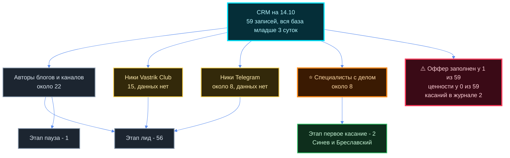
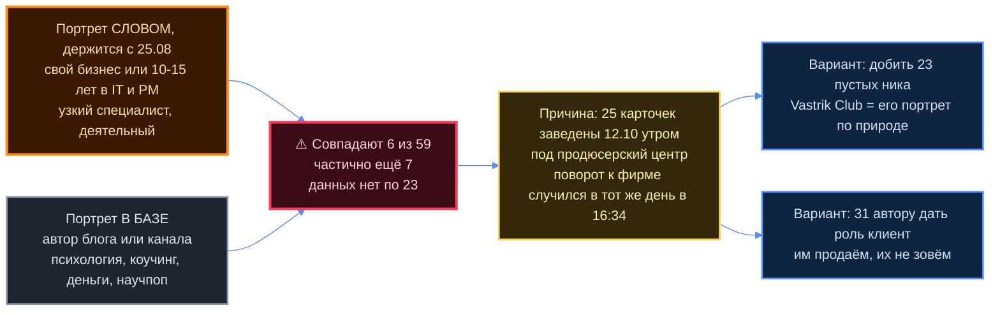
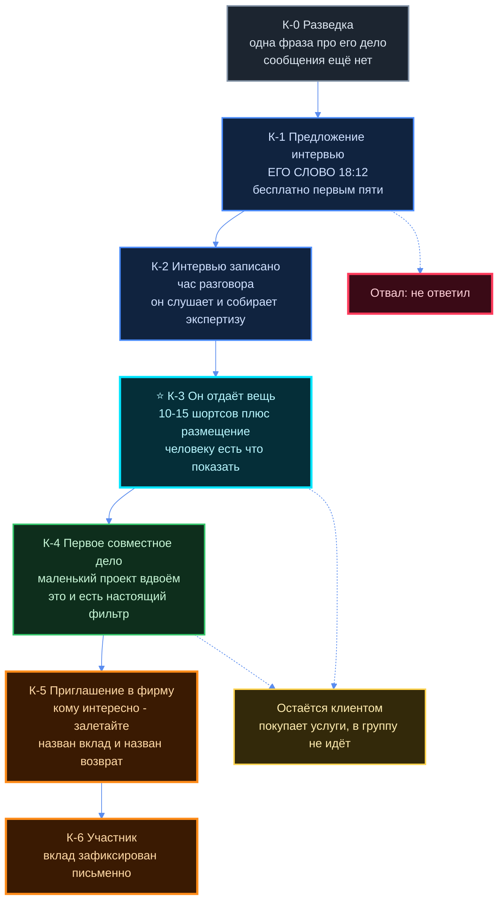
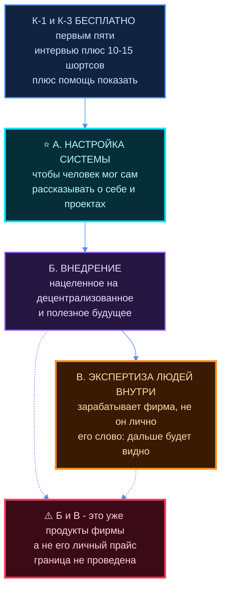
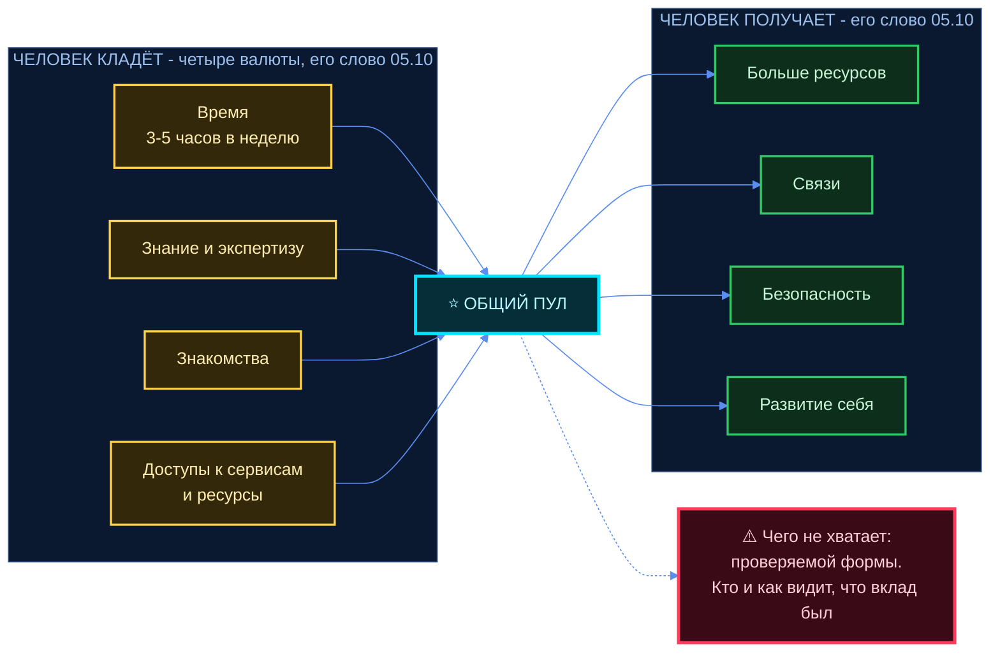

# Портрет человека, которого он зовёт, и что ему предлагать

Два его голоса 14.10, один за другим:
`~/jetix-os/raw/transcripts/tg-2026-10-14-180511.md` (18:05) и
`~/jetix-os/raw/transcripts/tg-2026-10-14-181203.md` (18:12).

**18:05 — портрет и заказ:**

> «чтобы агент посмотрел CRM, базово. И портрет моего типичного сейчас человека, которого я аутричу —
> чтобы он собрал: это по сути человек, у которого либо свой бизнес, либо у него своя экспертиза
> в IT или project management, 10–15 лет, в чём-то довольно узко специализированный»

> «чтобы я мог ему предложить как первое касание — типа либо интервью, либо ещё чего-то. И потом что
> я ещё могу с ним делать: пригласить в эту консалтинговую фирму. И потом какие бы услуги я мог лично
> ему предоставлять и брать за это какую-то плату»

**18:12 — он сам назвал первое касание и то, что продаёт:**

> «хотя бы первым пяти делаю как-то бесплатно, да, просто вот интервью, и потом нарезка на 10–15
> шортсов, и там помогаю донести, показать это до новых 100 или 1000 человек. И то есть возможно
> либо найти клиента, либо партнёра, либо инвестора. Вот это как бы моё предложение»

> «чтоб чётко было до людей, до которых я аутричу, чтобы не просто так»

> «целю на продвижение людей тогда в соцсетях… ну или нет, даже не то что в соцсетях, а конкретно
> **настройкой системы**, чтобы люди могли о себе рассказывать, о своих проектах»

> «и в целом потом зарабатывать на **внедрении** — внедрение, конкретно нацеленное на
> децентрализованное и полезное качественное будущее для развития человечества»

> «зарабатывать консалтинговая фирма — это уже дальше будет видно, **от экспертизы людей, которые
> будут внутри**»

## Как читать этот документ

- **Жирным и в цитатах — его слово или чужой проверенный факт с источником.** Всё остальное помечено
  🔶 **кандидат агента** — это предложение, не решение.
- Разделы 1–2 отвечают на «кто у меня есть». Раздел 3 — «что я ему говорю и в каком порядке».
  Раздел 4 — «на чём я лично зарабатываю». Разделы 5–6 — «что он получает внутри». Раздел 7 — «кого
  не беру». Раздел 8 — развилки.
- ⛔ **Цен, долей и процентов про людей здесь нет ни одной.** Это его решение, домовой стоп. Чужие числа
  (Crisp, Smart, Mondragón, Greaterthan, vas3k) цитируются с источником — это факт о чужой организации.
- ⛔ **В Notion ничего не заведено и не изменено.** Его прямое слово: «ты пока сам не заноси». CRM читалась
  только на чтение, запросами, которые приведены в разделе 1.
- ⛔ **Любой текст человеку — его рукой.** Варианты формулировок в разделе 3 — черновики, не отправки.
- Граница с уже написанным: `02-RASSKAZ.md` §5 — это **продукты фирмы клиенту-бизнесу** (П-1…П-7).
  Раздел 4 здесь — **другое**: то, что он продаёт **лично**, в первую очередь тому самому специалисту,
  которого зовёт. Это два разных прайса и два разных адресата, и смешивать их нельзя.

---

## 1. Портрет по фактам CRM

### 1.1 Сколько и что заполнено — числа с запросами

Источник: Notion, `Командный центр → Базы → CRM`,
data source `collection://fe5bd38b-fa8f-4711-b101-c41a56f5184a`. Срез снят 14.10.2026.

**Запрос на общий счёт и пустоты:**

```sql
SELECT COUNT(*) AS всего,
       SUM(CASE WHEN "Кто это" IS NULL THEN 1 ELSE 0 END)                  AS без_описания,
       SUM(CASE WHEN "Роль" IS NULL THEN 1 ELSE 0 END)                     AS без_роли,
       SUM(CASE WHEN "Сегмент" IS NULL THEN 1 ELSE 0 END)                  AS без_сегмента,
       SUM(CASE WHEN "Оффер" IS NULL THEN 1 ELSE 0 END)                    AS без_оффера,
       SUM(CASE WHEN "Совпадение с ценностями" IS NULL THEN 1 ELSE 0 END)  AS без_ценностей,
       SUM(CASE WHEN "Чек, $" IS NULL THEN 1 ELSE 0 END)                   AS без_чека
FROM "collection://fe5bd38b-fa8f-4711-b101-c41a56f5184a"
```

| Что | Число | Доля от 59 |
|---|---|---|
| **Записей всего** | **59** | 100% |
| Без описания «Кто это» | 24 | 41% |
| Без роли (клиент / партнёр / команда / пример) | 32 | 54% |
| Без сегмента | 24 | 41% |
| **Без оффера** | **58** | **98%** |
| **Без оценки «Совпадение с ценностями»** | **59** | **100%** |
| Без суммы чека | 59 | 100% |

**Запрос на этапы и источники:**

```sql
SELECT "Этап", "Источник", COUNT(*) AS n
FROM "collection://fe5bd38b-fa8f-4711-b101-c41a56f5184a"
GROUP BY "Этап", "Источник" ORDER BY n DESC
```

| Этап | Сколько | Источник |
|---|---|---|
| **лид** | **56** | источник не проставлен 24 · Vastrik Club 15 · Telegram 10 · другое 5 · Instagram 2 |
| **первое касание** | **2** | знакомые (Максим Синев, Антон Бреславский) |
| **пауза** | **1** | Светлана (коуч) |

Дальше этапа «первое касание» не ушёл **никто**. Этапы «интервью проведено», «предложение», «оплата»,
«в работе» — пустые. Это совпадает с его собственной оценкой 29.09:

> «людям за последние вот несколько месяцев очень мало написал, позвонил — считать что вообще 0»
> — `raw/transcripts/tg-2026-09-29-140950.md`

**Запрос на возраст базы:**

```sql
SELECT date("Создано") AS день, "Чей ход", COUNT(*) AS n
FROM "collection://fe5bd38b-fa8f-4711-b101-c41a56f5184a"
GROUP BY день, "Чей ход" ORDER BY день
```

| День | Заведено | Из них помечено «🟢 наш ход» |
|---|---|---|
| 12.10 | 25 | 0 |
| 13.10 | 1 | 0 |
| 14.10 | 33 | 30 |

**Вся база младше трёх суток.** Это не накопленная за месяцы воронка, а свежий срез набора.

**Связанная база «Касания»** (`collection://042aae6d-4adf-41ce-8417-da4aeb81e375`):

```sql
SELECT COUNT(*) AS касаний FROM "collection://042aae6d-4adf-41ce-8417-da4aeb81e375"
```

→ **2 записи на 59 контактов.** История общения в системе практически не ведётся.

**Соседняя база «Люди»** (`collection://5c8c9c87-4dfc-4ac9-99dd-f6046aa99b6d`) — **2 записи**: Максим Синев
(первое касание 09.10) и Антон Бреславский (08.10), обе со статусом «знакомый». Это те же двое, что
на этапе «первое касание» в CRM.

### 1.2 Кто там реально — по ролям, сегментам и площадкам

**Запрос** (multi-select считается через `LIKE`, поэтому суммы по сегментам больше 59 — у записи может быть
два сегмента):

```sql
SELECT SUM(CASE WHEN "Сегмент" LIKE '%Технологии и ИИ%' THEN 1 ELSE 0 END) AS it_ai, ...
       SUM(CASE WHEN "Роль"     LIKE '%клиент%'         THEN 1 ELSE 0 END) AS роль_клиент, ...
       SUM(CASE WHEN "Площадки" LIKE '%YouTube%'        THEN 1 ELSE 0 END) AS youtube, ...
FROM "collection://fe5bd38b-fa8f-4711-b101-c41a56f5184a"
```

| Срез | Факт |
|---|---|
| **Роль** | клиент **25** · партнёр **4** · пример **1** · **роль не проставлена 32** |
| **Тип** | человек 45 · организация 3 · сообщество 1 · не проставлен 10 |
| **Сегмент** | 🤖 Технологии и ИИ **13** · 🚀 Бизнес **10** · 🧠 Психология и коучинг 6 · 🌱 Саморазвитие 5 · 💰 Деньги 4 · 📚 Наука 4 · 🎨 Дизайн 3 · 🎮 Развлечения 1 · 🌐 Комьюнити 1 |
| **Площадки** | Telegram **25** · YouTube **20** · Instagram 8 · **сайт 8** (то есть у 51 из 59 сайта нет) |
| **Размер аудитории** | заполнен у **12 из 59**: до 1K — 5 · 1–10K — 5 · 10–50K — 5 · 50K+ — 2 |
| **Приоритет 🔥 высокий** | **3**: Светлана (коуч) · Саня Технадзор · Вадим Тимакин |

**Четыре кучи, на которые база делится по факту содержания карточек** — 🔶 разбивка агента, в самой CRM
такого поля нет:

| Куча | Сколько | Кто это |
|---|---|---|
| **Авторы блогов и каналов** | ~22 | pablo insights, Андрей Анищенко, Спартак Суббота, Павел Зыгмантович, Денис Борисов, Seva торгует, Александр Файб, Наталья Симоненко, ЛИХИЙ, RUSSU, Алексей Верютин, Рустам Агамалиев, Кухня менеджера, Money of Central Asia, Простое Сообщество, Tim Gabe, DevsKingdom, Гегам Шакарян, Дмитрий Нижебецкий, Артём Жутов, Ход Гения, Research Scientist's Diary |
| **Ники из Vastrik Club без данных** | **15** | ashirmanov, malandin, ab5v, jenesaisquoi, kalaidin, DenNoDen, iamkent/JJAnt, paladik, razberis_ka, bsevryukov, igorbunov, spiridonovalex, Polina, zharkouski, iomguy |
| **Ники из Telegram без данных** | ~8 | West Marketing, podtesov, Sprut_AI, product_pulse, fedulka_product, ascorpcult, qualified_lead, tihonsm |
| **Специалисты и предприниматели с делом** | ~8 | Максим Синев, Антон Бреславский, Вадим Тимакин, Ильяс Агадилов, Юрий Максимов (Positive Technologies), Александр Судоргин, Иван Абрамов (Influtics), Катерина Коновец |



### 1.3 Единственный заполненный оффер — и он же готовый образец

Карточка **Максим Синев**, поле «Оффер», дословно из CRM:

> «Бесплатно за 2 недели: сайт, интервью, 15–20 шортсов, упаковка соцсетей + место в Jetix Group;
> от него — экспертиза и готовность залететь в проекты по внедрению локального ИИ»

Это **единственная запись из 59**, где сформулировано, что человеку предлагают. Следующий шаг там же:
«Созвон 14.10: предложение по фрейму на странице → дата интервью».

⭐ **Важно: его слово 18:12 почти дословно повторяет этот оффер** («интервью, и потом нарезка на 10–15
шортсов»), только уже как общее правило для первых пяти. То есть предложение не придумано задним числом —
оно уже заведено в CRM на живого человека и сейчас отрабатывается.

---

## 2. Портрет, который он описал словом, и сверка с CRM

### 2.1 Что он сказал — и насколько это устойчиво

| Признак | Его слово 14.10 |
|---|---|
| Основа | «либо **свой бизнес**, либо своя **экспертиза в IT или project management**» |
| Стаж | «**10–15 лет**» |
| Глубина | «в чём-то довольно **узко специализированный**» |
| Ценности | «готовы на эти ценности **децентрализации** и поддержания и **развития жизни интеллекта**» |
| Поведение | «в первую очередь для **деятельных людей**» |
| Условие участия | «надо не просто находиться, а именно делать какой-то **вклад** в виде финансов, знаний и так дальше — и **получать обратно**» |

**Портрет не новый — он держится с августа.** Это важно: значит это не настроение одного вечера.

> 25.08: «основные деятельности, которые меня волнуют, это вот **IT, IT-менеджмент**, управление
> предприятиями, консультации какого-либо типа… либо чтобы у него была компания, которая занимается
> чем-то вот таким, либо он занимает какую-то **верхнюю должность** в компании»
> — `raw/transcripts/tg-2026-08-25-225434.md`

> 25.08: «насчёт опыта по продажам — **неважно, опыт не фильтруем**»
> — `raw/transcripts/tg-2026-08-25-225434.md`

> 16.09: «люди, которые занимаются бизнесом, частными консультациями, **управляют командами от 5 до 2000
> человек**» — `raw/transcripts/tg-2026-09-16-210625.md`

> 05.10: «для начала это **айтишники**, и дальше… собрать точно так же и этих, блять, продавцов-блогеров»
> — `raw/transcripts/tg-2026-10-05-105432.md`

Последняя цитата важнее всех: **он сам ставит порядок — сначала айтишники, блогеры потом.** В CRM
ровно наоборот.

### 2.2 Кто из 59 подходит под портрет — поимённо

🔶 Оценка агента по тексту поля «Кто это» в CRM. Стаж «10–15 лет» в базе **не хранится вообще** —
такого поля нет, поэтому он оценён по косвенным признакам в описании.

**Подходят уверенно — 6:**

| Кто | Чем подходит | Чего не хватает в карточке |
|---|---|---|
| **Максим Синев** | делает NoemaForge (локальные LLM) один, узкая ниша; **уже на первом касании** | стаж, город, чем жил раньше |
| **Антон Бреславский** | разработчик, самостоятельный стартапер, своё приложение; **уже на первом касании** | стаж, ниша его прежней работы |
| **Вадим Тимакин** | Senior ML Engineer, Kaggle Competitions Master, **основатель** datamentor.tech | стаж цифрой |
| **Ильяс Агадилов** | software engineer **и** предприниматель, свои продукты (AGAI, QuizEdTech) | стаж, размер бизнеса |
| **Дмитрий Нижебецкий** | IT project management, канал **с 2016 года** → ≈10 лет в теме, PMP/PRINCE2/Scrum | контакт, подписчики |
| **Юрий Максимов (ЗАПИСКИ)** | сооснователь Positive Technologies, CTO → CEO → председатель совета | ⚠️ фигура такого масштаба — это не «типичный», и бесплатное интервью ему не предложение |

**Подходят частично — 7:** Александр Судоргин (монтажёр + разработчик плагинов + наставник, «20 000 часов,
700 проектов» — узкий специалист со своим делом, но не IT/PM), Иван Абрамов (основатель Influtics, SaaS),
Катерина Коновец (свой поток клиентов в e-commerce-рекламе), Кухня менеджера (аналитик, консультант,
преподаватель ВШЭ — стратегия, PM-смежное), Research Scientist's Diary (учёный-программист, РАН → Германия,
узко, но своего дела нет), Артём Жутов (Claude Code + Obsidian — но это ремесло младше 10 лет),
Seva торгует («8+ лет в рекламе, свои проекты и команды»).

**Не подходят — ~31:** психологи, коучи, научпоп, игровой канал, финансовые каналы, PR. Это аудитория
**продюсерского центра**, а не специалисты в его смысле.

**Данных нет — 23:** 15 ников Vastrik Club + 8 ников Telegram. Поле «Кто это» пустое.
⚠️ Про них **нельзя сказать ни да, ни нет** — но именно они, скорее всего, и есть его портрет: Vastrik
Club это клуб айтишников, а он сам сказал «для начала это айтишники». Это не оценка, а отсутствие данных.

### 2.3 ⚠️ Расхождение, которое надо назвать прямо



**Расхождение словами.** Он описал портрет **партнёра** — человека, которого зовут внутрь фирмы.
В CRM лежит портрет **клиента-блогера** — человека, которому продают упаковку. Из 59 записей **25 помечены
ролью «клиент» и только 4 ролью «партнёр»**.

**Это не ошибка базы.** 25 записей заведены 12.10 утром — за восемь часов **до** поворота 16:34, когда
продюсерский центр перестал быть сутью. База отражает вчерашнюю рамку. Записи 14.10 (33 штуки, из них
15 из Vastrik Club) — уже новая рамка, но они пустые.

**Что из этого следует — 🔶 три вещи, решает он:**

1. **Два портрета, а не один.** В CRM нужны две разные воронки: «клиент, которому мы продаём» и
   «партнёр, которого мы зовём». Поле «Роль» для этого уже есть и наполовину пустое.
2. **Стаж в базе не хранится.** Признак, который он назвал первым («10–15 лет»), проверить запросом
   нельзя. Без него портрет остаётся на глаз.
3. **23 карточки без данных — это 39% базы.** Пока их не добьют, любой портрет по CRM — портрет
   меньшинства. И это же — **главный тормоз перед «первыми пятью»** из раздела 3: выбирать пятерых
   пока не из кого, кроме восьми уже описанных.

---

## 3. Лестница касаний

### 3.1 Первое касание — ЭТО УЖЕ ЕГО СЛОВО, не кандидат

> «хотя бы первым пяти делаю как-то бесплатно, да, просто вот интервью, и потом нарезка на 10–15
> шортсов, и там помогаю донести, показать это до новых 100 или 1000 человек. И то есть возможно
> либо найти клиента, либо партнёра, либо инвестора. Вот это как бы моё предложение. Ну как бы такой
> лид-магнит, даже не то что лид-магнит, но вот просто моё такое предложение — дальше чтоб чётко было
> до людей, до которых я аутричу, чтобы не просто так»

Предложение разбирается на **четыре обещания**. Три первых — работа, четвёртое — результат, и это
разные по надёжности вещи:

| # | Обещание | Что это значит делом | Чем обеспечено сегодня |
|---|---|---|---|
| **О-1** | **Интервью** | час разговора, запись | ✅ полностью в его руках. Заявлено ещё 12.10: «вести интервью какие-то, я могу это сделать» |
| **О-2** | **Нарезка на 10–15 шортсов** | монтаж вертикальных роликов из часа записи | ⚠️ **узкое место**, см. §3.2 |
| **О-3** | **«Помогаю донести, показать»** | разместить и продвинуть | ⚠️ **самое слабое**, см. §3.2 |
| **О-4** | **«Возможно найти клиента, партнёра или инвестора»** | исход, а не работа | ✅ сказано через «возможно» — это честная формулировка, её нельзя превращать в гарантию |

**Почему это сильное предложение.** Оно отвечает ровно на то, чего он сам от него хочет — «чтобы не просто
так». Человек на выходе получает **вещь, которую можно показать**, а не разговор. Это тот же приём, что
в его оффере Максиму Синеву, уже заведённом в CRM. И это вход, который не требует от человека ничего,
кроме часа времени, — то есть барьер почти нулевой.

### 3.2 ⚠️ Проверка выполнимости — три места, где это ломается

**① Монтаж (О-2).** Пять человек × 10–15 шортсов = **50–75 вертикальных роликов**. Это не вечер.
В CRM есть монтажёр — **Александр Судоргин** («20 000 часов за производством контента, 700 закрытых
проектов», свои плагины SFX Machine), но он на этапе «лид», роль не проставлена, и в его карточке стоит
«🔶 Руслан решает: партнёр в фирму, пример для разбора или мимо». То есть ресурс виден и не подключён.
🔶 **Развилка:** делать монтаж самому · подключить Судоргина как первого партнёра (красиво: первый
партнёр делает работу для следующих пяти) · резать меньше, чем обещано · нанять.

**② «До новых 100 или 1000 человек» (О-3) — здесь названо число, и это самое опасное место.**
Он сам дал вилку в десять раз, то есть и для него это не расчёт. У него **нет своей аудитории,
подтверждённой цифрой нигде в доме**: в CRM поле «Размер аудитории» заполнено у 12 из 59 — и это
**чужие** аудитории, не его. Если человек получит ролики и 40 просмотров, первое же касание закончится
испорченной репутацией — а это люди, с которыми он собирается работать годами.
🔶 **Три честных выхода:** (а) убрать число совсем, оставить «помогу разместить и показать»;
(б) назвать, чем число обеспечено — чьими каналами, чьей рассылкой, какими площадками; (в) обещать
не охват, а **действие**: «размещу у себя, разошлю по своей базе, представлю лично N людям».
⛔ Какое число называть и называть ли — его решение, агент его не ставит.

**③ Первых пяти ещё не было ни одного.** В `B1-EGO-ZAMETKI.md` §9.1 зафиксировано: **записи его интервью
в репозитории нет** — ссылка «что я говорил в интервью» (12.10) ни на что внутри дома не указывает.
Этап «интервью проведено» в CRM пуст. То есть «первые пять» — это буквально первые пять в жизни проекта,
и у него нет ни одного примера, который можно показать шестому. 🔶 Из этого следует порядок: **первый
из пяти должен быть тем, с кем не страшно сделать неидеально** — скорее всего, кто-то из двоих уже
на первом касании (Синев или Бреславский), оба «знакомые».

### 3.3 Механика «первых пяти» — кто, по какому признаку, и что с шестым

Он назвал число вслух: «хотя бы первым пяти». Названное число работает как обещание — значит у него должны
быть ответы на четыре вопроса. 🔶 Всё ниже — кандидаты агента.

**Кто эти пятеро.** Выбирать сегодня можно только из восьми описанных карточек (§1.2, куча «специалисты
с делом») — остальные либо не подходят по портрету, либо пустые. Кандидаты по готовности:

| Приоритет | Кто | Почему он |
|---|---|---|
| 1 | **Максим Синев** | уже на первом касании, оффер заведён, созвон назначен, «знакомый» — риск неидеального первого блина минимален |
| 2 | **Антон Бреславский** | тот же статус, «знакомый», своё приложение = есть о чём говорить |
| 3 | **Вадим Тимакин** | помечен 🔥 высокий приоритет, узкий специалист с делом, уже умеет быть публичным |
| 4 | **Ильяс Агадилов** | свои продукты, карточка полная, в ней уже стоит вопрос «Руслан решает роль» |
| 5 | **Дмитрий Нижебецкий** | единственный чистый project management в базе, ведёт канал с 2016 — умеет говорить на камеру |

**По какому признаку выбирать** — четыре критерия, и они тянут в разные стороны:

| Критерий | За | Против |
|---|---|---|
| **Ближе всех к портрету** | материал будет тот, который нужен фирме | у таких людей часто меньше всего времени |
| **Уже есть что показать** (готовый проект) | интервью получится содержательным без вытягивания | смещает выборку в сторону тех, кто и так справляется |
| **Своя аудитория** | ролики живут не только у него, О-3 выполняется чужими руками | противоречит «для начала это айтишники»: аудитория чаще у блогеров |
| **Быстро отвечает** | пять закроются за недели, а не за квартал | скорость ответа не коррелирует ни с чем полезным |

🔶 **Рекомендация агента:** брать по **готовности сделать прямо сейчас** (приоритет 1–2) для первых двух
и по **близости к портрету** (3–5) для остальных. Первые два — тренировка процесса, следующие три — уже
то, ради чего всё.

**Что он получает взамен.** Это уже сформулировано — в оффере Синеву: «**от него — экспертиза и готовность
залететь в проекты**». И в его слове 18:12: «конкретно собираю экспертизу экспертов, узнаю, как они
видят мир». 🔶 То есть встречный вклад — **не деньги, а материал и готовность**. Это надо говорить вслух
на входе, иначе бесплатное читается как благотворительность и обесценивает и услугу, и приглашение.

**⚠️ Что происходит с шестым — не решено, и это цена названного числа.**

| Вариант | Что получается | Чем плох |
|---|---|---|
| **(а) Шестому — то же самое платно** | «пять» становится честной акцией, а не обманом | нужна цена, а цены нет (⛔ его решение) |
| **(б) Шестому — то же бесплатно** | «пять» обесценивается, и первые пять это увидят | слово перестаёт стоить, а он строит группу на доверии |
| **(в) Шестому — интервью без нарезки** | снимает проблему монтажа (②) | предложение теряет главное — вещь на руках |
| **(г) Очередь: шестой ждёт следующего набора** | держит дефицит, и это честно | требует, чтобы первые пять реально закрылись в срок |

🔶 **Рекомендация агента: (а) или (г).** Оба сохраняют слово. (б) — единственный вариант, который
не стоит брать: он тихо ломает именно то, чем он собирается отличаться.

### 3.4 Полная лестница



| № | Ступень | Что он говорит | Что человек получает | По какому признаку видно, что можно дальше |
|---|---|---|---|---|
| **К-0** | **Разведка** | ничего, сообщения нет | ничего | у него есть **одна конкретная фраза про дело этого человека**, которую нельзя было бы написать никому другому. Нет такой фразы — на К-1 не идём |
| **К-1** | **Предложение интервью** | его слово 18:12 целиком (§3.1) | повод, внимание и понятная выгода | **он ответил по существу** и назвал дату. Встречный вопрос — сильный сигнал |
| **К-2** | **Интервью** | «расскажи о своём проекте, о своих ценностях; как ты видишь мир будущего» (его слово 18:05) | час внимания к его делу, бесплатно | он **сам назвал проблему**, которую не закрывает один. Это точка, где появляется предмет |
| **К-3** | **Он отдаёт вещь** | «вот 10–15 шортсов, вот где я это разместил» | материал, который можно показать | ⭐ **человек этим воспользовался** — выложил, разослал, поставил на сайт. Не воспользовался = не нужно, и дальше идти незачем |
| **К-4** | **Первое совместное дело** | «есть маленькая задача, сделаем вдвоём» | деньги или кейс, и опыт работы бок о бок | ⭐ **как он себя вёл в работе**: ответил ли за свой кусок, сказал ли «не успею» заранее. Это и есть проверка ценностей, §7.3 |
| **К-5** | **Приглашение в фирму** | «я строю консалтинговую фирму, дальше кому интересно — залетайте… собираю таких людей, которые разделяют похожие ценности» (его слово 18:12) | место, доступ к котлу, команда под его проект | он **спросил про условия деньгами**, а не «а что это даёт». Вопрос про цену = вопрос серьёзного |
| **К-6** | **Участник** | письменно: что он кладёт и чего ждёт | то, за чем шёл | вклад **зафиксирован в тексте**, а не в разговоре |

**Три вещи про лестницу, которые стоит держать:**

- **К-3 и К-4 — разные, и это главная развилка.** На К-3 он работает человеку бесплатно и один.
  На К-4 они работают вместе. Проверенный факт: у Crisp главный критерий приёма — «**хотя бы один
  Crisper раньше РЕАЛЬНО с ним работал**» ([recruiting](https://dna.crisp.se/docs/recruiting.html)).
  Пропускать К-4 — значит звать людей по разговору, а не по работе.
- **Отвал на К-3 — не провал.** Человек, взявший ролики и не пошедший в группу, остаётся клиентом,
  и это нормальный исход.
- **На К-5 есть готовая формулировка «мягкого нет».** Его приём 05.10: «я сейчас предлагаю вступить,
  и **если не хочешь — то как минимум дать обратную связь, почему** и что должно было бы быть, чтобы ты
  вступил» (`raw/transcripts/tg-2026-10-05-105432.md`). Это превращает отказ в данные и оставляет дверь
  открытой.

### 3.5 Варианты текста первого касания — ⛔ черновики, отправляет он своей рукой

У него уже есть **собственный отработанный формат** — видеосообщение, не текст:

> 17.09: «я буду где-то записывать видео длиной может 3–5 минут, просто чтобы вот сказать, что я тебя
> там нашёл там-то, у меня есть предложение… если тебе там интересно — выйти на звонок, вот и всё,
> и в целом это весь как бы запрос»
> — `raw/transcripts/tg-2026-09-17-133550.md`

> 17.09: «мне важно… зафиксировать, что мы в этом видео говорим, что не говорим — просто чтобы
> заинтересовать человека, при этом в подробности как-то не сильно вникая, но при этом суть донести»

🔶 **Структура видеосообщения под предложение 18:12** — кандидат агента, собран из его же слова:

```
① Где я тебя нашёл и что именно зацепило   ← одна фраза про ЕГО дело, не про себя
② Кто я в двух строках                      ← «строю консалтинговую фирму», без длинной биографии
③ Предложение                               ← интервью + 10-15 шортсов + помогу показать
④ Что мне с этого                           ← честно: собираю экспертизу, узнаю, как люди видят мир
⑤ Один вопрос и всё                         ← «интересно? если да — когда тебе удобно час»
```

Про ④ отдельно: его собственный приём 05.10 — говорить, что предложение ещё дописывается, и просить
обратную связь. Это снимает с бесплатного запах подвоха.

**Три варианта первой фразы под разные кучи из §1.2:**

- **Для специалиста с делом (основной путь):** «Смотрю, что ты делаешь с <конкретная вещь>. Я записываю
  серию разговоров со специалистами, у которых своё дело — про устройство, а не про успех: что работает,
  что развалилось, что бы сделал иначе.»
- **Для 15 ников из Vastrik Club:** зацепка из интро-поста. В клубе **обязателен интро-пост и запрещена
  анонимность** ([vas3k.club/post/values](https://vas3k.club/post/values/)) — то есть зацепка есть всегда
  и бесплатно. ⚠️ Но сперва надо заполнить 15 пустых карточек, иначе зацепки нет.
- **Для автора с аудиторией (куча «клиенты»):** здесь предложение работает слабее — у него уже есть
  и камера, и нарезка, и аудитория. 🔶 Ему интереснее не О-2, а О-4 («найти партнёра или инвестора»)
  и раздел 4. Это другой разговор, и путать его с первым не надо.

---

## 4. ⭐ Что он может продавать лично

Его слово 18:05: «какие бы услуги я мог лично ему предоставлять и брать за это какую-то плату».
18:12 он назвал **три вещи** — и здесь они разложены, а не заменены своим списком.

### 4.1 Три его слова



#### А. «Настройка системы» — и он сам себя на этом поправил

> «целю на продвижение людей тогда в соцсетях… **ну или нет, даже не то что в соцсетях, а конкретно
> настройкой системы**, чтобы люди могли о себе рассказывать, о своих проектах»

**Поправка существенная, и её нельзя склеивать обратно.** Это два разных бизнеса:

| | Продвижение в соцсетях | ⭐ Настройка системы |
|---|---|---|
| Что продаётся | его работа руками | механизм, которым человек пользуется сам |
| Кто работает после сдачи | он | человек |
| Чем кончается | он становится подрядчиком-SMM | у человека остаётся способность, которой не было |
| Масштабируется? | нет — упирается в его часы | да — систему можно поставить многим |
| Что будет через год с 20 клиентами | 20 каналов на нём, он тонет | 20 человек работают сами |

**Что такое «система» по делу** — 🔶 разложение агента, его слово этого не детализирует:
место, где человек публикуется · ритм, по которому выходит · заготовки, из которых делается выпуск ·
инструменты записи и нарезки · способ превращать работу в материал, не отвлекаясь от работы.

**Чем он это закроет сам.** Это его **самое редкое преимущество, и единственное, которое доказано делом**:
он живёт внутри такой системы каждый день — репозиторий, агенты, транскрипция голоса, база. Никто из 59
в CRM этого про себя сказать не может, кроме двух-трёх (Артём Жутов, Рустам Агамалиев).

**⚠️ Чего не хватает.** Система у него **под себя**, а не переносимая. Нет имени, нет границы («что входит,
что нет»), нет срока установки, нет ответа «что будет, если человек перестанет ею пользоваться через
месяц». Пока это не названо — это не продукт, а его личный быт.

#### Б. «Внедрение»

> «и в целом потом зарабатывать на внедрении — внедрение, конкретно нацеленное на децентрализованное
> и полезное качественное будущее для развития человечества»

Что внедряется, 18:12 не сказано. Ближайшее его слово — 12.10: «начинаем с **внедрения автоматизации,
искусственного интеллекта** и так далее, разработки сайтов — вот уже сейчас».

**⚠️ Это ровно то, что в `02-RASSKAZ.md` §5 стоит продуктом ФИРМЫ (П-1, П-6), а не его личной услугой.**
Граница не проведена, и это надо решить до первого платящего человека: если «внедрение» продаёт он лично,
фирма остаётся без основного продукта; если фирма — непонятно, что тогда лично его.
🔶 **Кандидат агента:** А (настройка системы) — лично его; Б (внедрение) — фирмы, а он в нём один из
исполнителей. Тогда у двух сущностей разные продукты и нет внутренней конкуренции. Решает он.

Про оговорку «нацеленное на децентрализованное и полезное качественное будущее»: это **фильтр на заказ**,
а не описание услуги. То есть он заранее отказывается от части внедрений. 🔶 Это надо сформулировать как
правило «что мы не внедряем» — иначе оно останется словом и не сработает в момент, когда придут деньги.

#### В. «От экспертизы людей, которые будут внутри»

> «зарабатывать консалтинговая фирма — это уже **дальше будет видно, от экспертизы людей, которые будут
> внутри**»

**⚠️ Это не личная услуга, а модель заработка фирмы**, и он сам пометил её «дальше будет видно».
Здесь она названа, чтобы не смешалась с А и Б. Механика — раздел 5, доля — ⛔ его число.

### 4.2 Что он уже делает руками — его собственная оценка

Важно, что он сказал это сам и без прикрас:

> «учитывая тогда мою ситуацию сейчас: то, что я по сути всё, что могу делать — **и то, блядь, не сильно
> хорошо** — это вот там настроить сайт, да, это там вот вести соцсети» — 14.10, 18:05

> «у меня уже есть… **два года опыта**, ну или даже более, в продвижении онлайн, понимаю, как это
> работает, как инфоповоды происходят», «аналитика у меня там очень хорошая, дисциплина тоже»
> — `tochka-b/183-OS-08-42.md`

> «продукт я по сути сейчас буду продавать — вот это вот **позиционирование** да и **продюсирование**»
> — 12.10, `raw/transcripts/tg-2026-10-12-163432.md`

> «по Jetix услугам, которые мы предоставляем, для начала это: **упаковка профиля, монтаж видео,
> выбор дизайна, разработка сайта**» — 09.10, `raw/transcripts/tg-2026-10-09-082106.md`

> «у меня уже есть скрайпер YouTube… доступ там до десятков тысяч этих ютуберов, есть как бы этот
> pipeline, который вроде ещё недавно работал, как вот этих блогеров аутричить, чтобы это было
> персональное аутрич» — 08.10, `raw/transcripts/tg-2026-10-08-092032.md`

Последнее — **рабочий актив, который в CRM нигде не отражён**: инструмент массового персонального
аутрича к авторам YouTube. 🔶 Если он работает, это прямой ответ на вопрос «откуда брать следующих после
первых пяти».

### 4.3 Что из этого складывается в прайс

⛔ **Цен в таблице нет ни одной. Ни вилок, ни «от», ни порядков величин. Это его решение.**

| # | Услуга | Откуда взялась | Кому из базы | Чем закроет сам | ⚠️ Чего не хватает |
|---|---|---|---|---|---|
| **У-A** | ⭐ **Настройка системы самопрезентации** | **его слово 18:12**, с его же поправкой | всем 8 из кучи «специалисты с делом»: у них есть что рассказать и нет способа | живёт внутри такой системы ежедневно; это доказано, а не заявлено | имя, граница «что входит», срок установки, ответ «а если забросит» |
| **У-Б** | **Внедрение автоматизации и ИИ** | **его слово 18:12** + 12.10 | ⚠️ не этим людям — это продукт бизнес-клиенту | заявлено как направление с 12.10 | **решить: его лично или фирмы.** См. §4.1-Б. И правило «что не внедряем» |
| **У-1** | **Позиционирование** | его слово 12.10 «продукт буду продавать — позиционирование» | острее всего тем, у кого в карточке «имя автора не указано»: Саня Технадзор, Кухня менеджера, ЛИХИЙ, RUSSU, DevsKingdom | его прямое ремесло, делает себе | **чужих кейсов.** Ни одного публичного «до/после» на другом человеке |
| **У-2** | **Сайт** | его слово 14.10 «всё, что могу — настроить сайт» | **у 51 из 59 сайта нет** (поле «Площадки») | сам ставит сайты первыми в списке | **станка**: шаблона, на котором сайт собирается за день. И его же оговорка «и то не сильно хорошо» |
| **У-3** | **Упаковка профиля и соцсетей** | его слово 09.10 | авторам с «ведёт слабо» — 8 записей | два года в онлайн-продвижении | **чужих цифр роста.** Нужен хотя бы один канал с «было → стало» |
| **У-4** | **Интервью + шортсы** | его слово 18:12 | первым пяти | уже стоит в оффере Синеву | ⚠️ **на К-1/К-3 это бесплатно.** Платным становится только для шестого, см. §3.3 и §4.4 |
| **У-5** | **Упаковка знаний в рабочий продукт** | его слово 11.10: «упаковать знания и строить бизнес вокруг аудитории», **«а не просто продавать чек-листы PDF»** | Вадим Тимакин (уже продаёт менторство), Рустам Агамалиев, Спартак Суббота, Павел Зыгмантович | заявлено как часть позиционирования | **метода.** «Упаковка знаний» — пока название, а не процедура с шагами и сроком |
| **У-6** | **Платный разбор как вход** | 🔶 кандидат агента; в `02-RASSKAZ` §5 это П-4 | всем на К-1/К-2, у кого бесплатное место занято | это У-1 в урезанном виде | **шаблона разбора.** Без него каждый разбор съедает день |
| **У-7** | ⛔ **Подключение к людям за плату** | 🔶 **помечено как ловушка, не как вариант** | — | — | у Crisp **отменили** комиссию за передачу клиента: «бюрократия, субоптимизация и путаница» ([sales](https://dna.crisp.se/docs/sales.html)). Брать плату за знакомство внутри группы — прямо против её смысла |

### 4.4 ⚠️ Главное противоречие раздела: одно и то же бесплатно и платно

На К-1/К-3 он отдаёт **интервью + шортсы** (У-4) бесплатно. В оффере Синеву туда же входят **сайт и
упаковка соцсетей** — то есть У-2 и У-3. А в таблице выше те же У-2, У-3, У-4 стоят платными.

**Одно и то же нельзя одновременно продавать и дарить.** Люди из одного круга, они узнают — и платная
версия обесценится в тот же день.

🔶 **Три выхода, решает он:**

| Вариант | Как звучит вслух | Чем хорош | Чем плох |
|---|---|---|---|
| **(а) По роли** | бесплатно тем, кого зову в партнёры; платно клиентам | честно и объяснимо: это не подарок, а вход в группу | требует решать роль человека **до** работы, а не после |
| **(б) По счёту** | бесплатно первым пяти, дальше платно | ровно его слово 18:12, ничего не надо менять | надо реально остановиться на пятом (§3.3) |
| **(в) Через вход** | бесплатного нет, вместо него У-6 по символической плате | фильтрует несерьёзных с первого шага | противоречит его слову 18:12, и порог на К-1 перестаёт быть нулевым |

🔶 **Рекомендация агента: (б) как сказано, плюс (а) как правило после пятого.** Тогда «пять» остаётся
словом, которое он сдержал, а дальше работает понятная граница «партнёрам — вход, клиентам — счёт».

### 4.5 Как услуги стыкуются с лестницей

| Ступень | Что уместно | Почему |
|---|---|---|
| К-1 | ничего платного | продажа в первом сообщении убивает К-2 |
| К-2 | ничего | это час, когда он слушает; продавать здесь — сломать доверие |
| К-3 | **У-4 (+У-2, У-3)** бесплатно первым пяти | это вход в группу, а не продажа; встречная плата — его экспертиза и готовность |
| К-4 | ⭐ **У-A (настройка системы)**, У-5 — за плату | человек уже видел работу, доверие есть, можно брать деньги. И это именно то, что он назвал своим |
| К-5 | ничего лично | дальше работают механики фирмы (раздел 5) |
| после К-6 | **У-Б (внедрение)** — но уже как работа фирмы, не его личная | см. §4.1-Б |

---

## 5. Механика «вклад → отдача»

Его условие 14.10:

> «в этой консалтинговой фирме надо не просто находиться, а именно делать какой-то вклад в виде финансов,
> знаний и так дальше — и получать обратно»

> «распределение информации и благ… не просто всем поровну и всё — нет, а конкретно в первую очередь
> для деятельных людей»

### 5.1 ⭐ У него уже есть своя версия этой механики — 05.10

Это не кандидат агента, это его слово, и оно подробнее, чем 14.10:

> «каждый описывает, чем он занимается, чем он может быть полезен; **уделять хотя бы 3–5 часов своего
> времени в неделю** проекту — у кого какая есть экспертиза… возможно знакомствами, возможно ресурсами,
> доступами до каких-то сервисов и так далее — **всё это собираем в общий пул**»
> — `raw/transcripts/tg-2026-10-05-105432.md`

> «здесь **риск на каждого участника довольно маленький** — по сути 3–5 часов в неделю, что не прям уж
> так много является. Но потенциальный выхлоп, который можно получить» — там же

> «предложение такое: стать как бы со-инвестором, со-создателем вот этой группы… **группа, которая
> нацелена на развитие своих участников, на поиск им того, что им нужно: большего количества ресурсов,
> связей, обеспечение безопасности им**» — там же

> «причастность будет доступна только вот путём вот вкладывания — и не только там тогда финансов,
> а ещё и вот времени, возможно идей, сил» — 15.09, `raw/transcripts/tg-2026-09-15-222221.md`

> «не просто платят за членство, а возможно как-то помогают идеями, инсайтами делятся, и группа им
> помогает взамен» · «**качество этой группы зависит от того, насколько каждый из её участников
> адекватно, нормально контрибутит**» — 09.10, `research/B1-EGO-ZAMETKI.md` цит. 4.53–4.54

**Что из этого следует.** У него уже названы **четыре валюты вклада** — время (3–5 часов в неделю),
знание, знакомства, доступы к сервисам — и названа **отдача**: ресурсы, связи, безопасность, развитие.
Это не надо изобретать, это надо **привести в проверяемую форму**. Чем — §5.3.

### 5.2 Как это сделано у живых — с источниками

Всё в таблице — **чужие числа и чужие правила**, процитированные с источником. Разбор целиком:
`research/A3-ZHIVYE-PRIMERY.md`.

| Организация | Что обязан вложить | Что получает обратно | Источник |
|---|---|---|---|
| **Crisp** (Швеция, ~20 человек) | фикс **SEK 3 500–5 000/мес** + **8–12% выручки**, потолок **~kSEK 250–300/год**; после потолка держит 100% | офис, бренд, курсы, двое штатных, лиды по Bun Protocol, сбор дважды в год | [how-crisp-works](https://dna.crisp.se/docs/how-crisp-works.html) |
| **Greaterthan** (UK) | **15% со всей контрактной работы** через юрлицо; ассоциат обязан держать актуальным **«commitment statement» — чем именно намерен вкладываться** и «вносить вклад в деятельность, приносящую доход» | юрлицо для счетов, бренд, база знаний, **приоритет на платных проектах**, 25–50% match на обучение, оплата времени на продажи | [People Agreement](https://handbook.greaterthan.works/agreements/people-agreement), [Financial Agreement](https://handbook.greaterthan.works/agreements/financial-agreement) |
| **Smart** (BE/FR/DE, 20–35 тыс.) | пай **30 €/год** (BE) или **50 €** разово (DE) + **6,5% / 8,5% / 9%** с оборота. Правило: **«пока у тебя нет деятельности — никаких взносов»** | счета и взыскание долгов, трудовой договор, соцпакет, профответственность, **выплата J+7 с гарантией** | [брошюра 2024](https://smartbe.be/wp-content/uploads/2024/02/smart_brochure_utilisateurs_FR_2024_WEB.pdf), [smartde.coop](https://smartde.coop/en/freelancers/) |
| **Coopaname** (Франция) | **30 €/мес** + **13,5% от валовой маржи**. Их формулировка: это не плата за услугу, а «**способ, которым мы вместе обзаводимся рабочим инструментом**» | 38 штатных (админ, налоги, право), мастерские, солидарные механизмы | [coopaname.coop](https://www.coopaname.coop/integrer-cooperative-activites-emploi/accompagnement-entrepreneur-salarie) |
| **Oxalis** (Франция, ~300) | **прогрессивная шкала по траншам** оборота минус затраты; ставки обсуждают сами члены | тот же бэк-офис кооператива | [oxalis-scop.fr](https://www.oxalis-scop.fr/nous-rejoindre/se-concentrer-sur-votre-activite-et-en-developper-de-nouvelles) |
| **Mondragón** (70 085 человек) | **паевой взнос 15 000 €** при приёме, срок **36 месяцев**, можно гасить из зарплаты или кредитом кооперативного банка | членство, голос, доля прибыли, фонд солидарности, банк, университет | [drpop.org](https://drpop.org/mondragon-how-do-you-become-a-member/) ⚠️ источник не официальный |
| **The Ready** (NY, ~25) | **20 внутренних ролей оплачиваются фиксированной месячной суммой** — ввели, поняв, что на добровольчестве люди «отдают слишком много себя, выгорают и чувствуют себя недооценёнными» | гарантированный оклад, своя ставка, profit share, дивиденды | [Inside The Ready](https://medium.com/the-ready/inside-the-ready-80a35acfb219) |
| **vas3k.club** (16 255 человек) | **25 €/год** + обязательный интро-пост, анонимность запрещена | 16 255 человек, 100 стран, 80+ чатов | [vas3k.club/join](https://vas3k.club/join/) |
| **Enspiral** | раньше **20% дохода в общий котёл** → сейчас **месячная подписка** + взносы компаний | бренд, Loomio, Cobudget, сборы, справочник | [Cobudget](https://cobudget.com/resources/sharing-power-by-sharing-money-cobudget-in-enspiral) |

### 5.3 Что из этого — кандидаты для него

🔶 Все шесть — кандидаты агента. **Выбор его, числа его.**



| # | Механика | Откуда взято | Чем закрывает его слово |
|---|---|---|---|
| **В-1** | **Commitment statement**: человек письменно называет, **чем именно** вкладывается, и раз в год подтверждает | [Greaterthan](https://handbook.greaterthan.works/agreements/people-agreement) | ⭐ **прямо достраивает его собственное «каждый описывает, чем он может быть полезен»** (05.10) — переводит это из разговора в документ |
| **В-2** | **Фикс + процент с годовым потолком**, ставка пересматривается раз в квартал | [Crisp](https://dna.crisp.se/docs/how-crisp-works.html) | «каждый зарабатывает то, что он зарабатывает» — после потолка 100% его |
| **В-3** | **Оплата внутренних ролей фиксированной суммой** | [The Ready](https://medium.com/the-ready/inside-the-ready-80a35acfb219) | «в первую очередь для деятельных» — тот, кто тянет группу, получает за это, а не выгорает молча |
| **В-4** | **Вклад проектом**: человек заводит своё дело в группу, группа даёт команду | его слово 12.10: «закидывают проекты, которые у них есть либо которые хотели бы реализовать» | связывает вклад и отдачу в одном действии |
| **В-5** | **Срок на самоопределение**: 12 месяцев объяснить, в какой роли остаёшься, — или выйти | [Greaterthan, уровень Explorer](https://handbook.greaterthan.works/agreements/people-agreement) | убирает «просто находиться» автоматически, без разговора и конфликта |
| **В-6** | **«Нет деятельности — нет взносов»** | [Smart](https://smartbe.be/wp-content/uploads/2024/02/smart_brochure_utilisateurs_FR_2024_WEB.pdf) | снимает главный страх независимого: «а если месяц без клиента» |

⚠️ **Одно замечание к его «3–5 часов в неделю».** Это самая конкретная формулировка вклада из всех, что он
давал, и одновременно самая трудная в проверке: часы никто не считает, а если считает — это превращается
в табель. У Greaterthan ту же задачу решают **не часами, а заявленным предметом**: не «сколько», а «что
именно». 🔶 Кандидат агента: оставить «3–5 часов» как ориентир усилия в разговоре, а фиксировать
commitment statement.

### 5.4 ⚠️ Что уже сломалось у других — не повторять

| Что | У кого | Чем кончилось |
|---|---|---|
| **«20% со счёта в общий котёл»** в чистом виде | Enspiral | «модель выручки сообщества **пересохла**, а расходы остались… мы шли в состояние банкротства» (2016–2018), заменили подпиской ([Financial Transparency](https://handbook.enspiral.com/money/financial_transparency.html)) |
| **Комиссия за передачу лида** | Crisp | пробовали 10% finder's fee и **отменили**: «бюрократия, субоптимизация и путаница» ([sales](https://dna.crisp.se/docs/sales.html)) |
| **Общий котёл без фильтра на входе** | французские CAE | «**каждый второй до входа был в прекарной ситуации, без работы или на минимальном пособии**», котёл стал соцзащитой, а не усилителем ([Mouvements 2021/2](https://shs.cairn.info/revue-mouvements-2021-2-page-72?contenu=resume&lang=fr)) |
| **Процент, который нельзя объяснить построчно** | Smart | члены насчитали рост с 4% до ~12% и обвинили кооператив в том, что он «навязывает свои правила» ([abdil.be](https://abdil.be/Actualites/article/smart-societe-qui-meprise-les-artistes)) |

---

## 6. «Страховка деятельным» — разбор

Его слово 14.10:

> «страховка им просто на то, что если они будут чего-то делать либо рисковать — если что,
> их эта фирма или это сообщество, группа поддерживает»

Он говорил это и раньше, и там **названо конкретнее**:

> «человек по сути работает как бы внутри корпорации, но при этом этот человек как-то вот он **защищён
> юридически, финансово, если нужно — вот там местом, чтобы поспать**»
> — 08.06, `research/B1-EGO-ZAMETKI.md` цит. 5.29

> «чтобы ощущение было… на уровне, когда ты в своём селе личном купил себе дом… и знаешь, что тебе,
> если что, **полиция придёт**… вот это ощущение при работе с Jetix должно быть таким же»
> — 26.04, `research/B1-EGO-ZAMETKI.md` цит. 4.7

> «первый стоппер — это вот нету безопасности у обезьян; как только она появляется, дальше смогут уже
> более эффективно сотрудничать» — 16.05, `research/B1-EGO-ZAMETKI.md` цит. 5.12

То есть у него это **три разных защиты: юридическая, финансовая и бытовая** — плюс чувство, что за тобой
кто-то стоит. Чтобы это стало механикой, на каждую надо ответить четырьмя вопросами:
**от чего · чем именно · за чей счёт · кто решает**.

### 6.1 Семь рисков — и что отвечает живая практика

| Риск | Есть ли живой пример | Чем именно поддерживает | За чей счёт | Кто решает |
|---|---|---|---|---|
| **① Клиент не заплатил** | ✅ **ДА** | **Smart**: выплата **на J+7 после оказанной услуги и гарантия выплаты, даже если клиент задержал или не заплатил**; из брошюры: «**индивидуальное банкротство внутри общего предприятия невозможно**» | **гарантийный фонд: во Франции — четверть от взноса 8,5%** | никто, работает автоматом по правилу |
| **② Потратил время на продажу, сделка не закрылась** | ✅ **ДА, и это ближе всего к его словам** | **Greaterthan, Biz Dev Bucket**: платят за **время** на звонки, ответы на RFP, предложения + 50–100% расходов на поездки. Дословно: «**Если продажа не удалась, твоё время и расходы могут быть компенсированы из этого ведра**» | **+5% выручки с контрактов, ставших долгими** (через 3–5 месяцев) | проектная команда по совету Biz Dev Stewards; бронь на 4 месяца, потом истекает |
| **③ Бизнес-единица ушла в убыток** | ✅ **ДА** | **Mondragón, фонд солидарности**: выравнивание и частичная компенсация убытков тех, кто в минусе. В 2021 — **29,7 млн €** | **минимум 13% прибыли** каждого кооператива в дивизионный фонд; в дивизионах **15–40% доналоговой прибыли** | совет дивизиона назначает процент |
| **④ Нет клиента, простой** | ⛔ **НЕТ — и прямо наоборот** | **Crisp говорит обратное**: «**Люди, которые хотят стабильности, не подходят Crisp… когда у тебя нет клиента, ты каждый месяц теряешь деньги!**» Зарплаты на bench нет, страховка не пулится | — | — |
| **⑤ Болезнь, пенсия, безработица** — его «защищён финансово» | ✅ **ДА, но ценой статуса** | **Smart**: трудовой договор, а с ним медстраховка, пенсия, страховка от безработицы | взнос 6,5–9% | автоматом по закону |
| **⑥ Юридический риск** — его «защищён юридически» | ✅ **ДА** | **Smart**: страхование профответственности + юридические консультации; **Greaterthan**: юрлицо, через которое выставляются счета | тот же взнос / 15% | автоматом |
| **⑦ Репутационный риск от публичности** | ⛔ **ДАННЫХ НЕТ** | ни в одной из 12 разобранных организаций механизма поддержки того, кто рискнул публичным высказыванием, **не описано** | — | — |

⚠️ Отдельно про «**место, чтобы поспать**» (его цит. 5.29): ни у одной из двенадцати организаций бытовой
поддержки такого рода **не найдено**. Ближайшее — рабочие пространства у Smart и офис у Crisp, но это
рабочие места, а не жильё. **ДАННЫХ НЕТ.**

### 6.2 Мутуаль как найденная форма

**Bigre!** (Франция, 2016) — федерация поверх кооперативов, которую участники назвали «**mutuelle de
travail associé**», первая мутуаль ассоциированного труда: SMart, Coopaname, Oxalis, Grands Ensemble и
Vecteur Activités, вместе **~7 000 человек, 25 заведений по Франции**
([ESS et société](https://www.ess-et-societe.net/SMart-Coopaname-Oxalis-Grands), [bigre.coop](https://www.bigre.coop/pourquoi-bigre/)).
Единственный найденный живой пример «взаимной кассы» независимых работников **в масштабе тысяч** —
то есть в том порядке, о котором он говорит (1000–1500). Что эта федерация делает со взаимопомощью
за пределами общего бэк-офиса, в публичных материалах не раскрыто — **ДАННЫХ НЕТ**.

### 6.3 ⚠️ Прямой ответ

**Что живого есть.** Страховка «деятельным» существует и работает — но **всегда в узкой, названной форме**:
назван конкретный риск, назван конкретный фонд, названа доля, из которой фонд наполняется, названо,
кто решает. Четыре работающих образца: Smart (①, ⑤, ⑥), Greaterthan (②, ⑥), Mondragón (③).

**Чего живого НЕТ.** Ни в одной из двенадцати организаций нет механики «**группа поддержит, если что**» —
без названного риска и без названного фонда. Такой формы не нашлось, и это не пробел поиска: там, где
она пробовалась без фильтра на входе (французские CAE), она превратилась в соцзащиту для людей, выбитых
с рынка труда, а не в усилитель деятельных. Нет живого примера и у двух вещей, которые он называет сам:
поддержки на простое (④) и бытовой защиты «местом, чтобы поспать».

**Два факта, которые бьют по самой идее:**

1. **Солидарный фонд спасает людей, но не спасает дело.** Fagor Electrodomésticos, флагман Mondragón,
   16 октября 2013 подал на защиту от банкротства с долгом **1,1 млрд €**, под риском **5 600 рабочих
   мест** ([Columbus CEO / AP](https://www.columbusceo.com/story/business/2013/10/16/spanish-company-fagor-seeks-bankruptcy/22865083007/)).
   Людей расселили по группе — досрочная пенсия, переобучение. Бизнес умер. Страховка покрывает человека,
   а не его затею.
2. **Чем больше в группе тех, кто не вложился, тем меньше работает страховка.** В том же Fagor работало
   **5 642 человека, но членами кооператива были только ~2 000**
   ([Kasmir, FocaalBlog](https://www.focaalblog.com/2015/06/29/sharryn-kasmir-mondragon-coops-and-the-anthropological-imagination/)).
   Отсюда их правило: **не менее 80% работающих должны быть полноправными членами**.

🔶 **Что из этого следует — кандидат агента.** Фразу «группа поддерживает» в тексте наружу заменить на
**один названный риск с названным фондом**. Самый дешёвый на старте и точнее всего попадающий в его
слова — **②, время на продажу, которая не закрылась**: он сам говорит «если они будут чего-то делать
либо рисковать». Человек, взявший на себя продажу общего проекта и не продавший, — ровно тот, кто рискнул
ради группы. Механика у Greaterthan готовая и копируемая. ⛔ Доля, из которой наполняется такое ведро, —
его число, здесь не предлагается.

---

## 7. Фильтр на входе

> «я ищу людей, которым это тоже интересно и которые готовы на эти ценности децентрализации
> и поддержания и развития жизни интеллекта» — 14.10

### 7.1 ⚠️ Важное наблюдение: списка «кого не беру» у него нет

Сплошной проход по 920 расшифровкам и по `B1-EGO-ZAMETKI.md` даёт один устойчивый результат:
**фильтр у него везде сформулирован положительно** — «кто разделяет ценности», «деятельные», «адекватные».
Прямых формулировок «халявщики», «потребители», «таких не беру» — **НЕ НАЙДЕНО**.

Отсев он мыслит как **побочный эффект ясного позиционирования**:

> «чтобы до человека могла легко эта идея дойти… чтобы он сразу: ага, вот что этот человек делает…
> мне интересно или нет. Я там если развиваюсь — мне интересно; если я долбоёб — вообще мне поебать,
> ну тогда **он сразу будет отпадать**» — 09.10, `raw/transcripts/tg-2026-10-09-082106.md`

И при этом планка заявлена высокой:

> «должны попадать только там адекватные люди, какие-то **планки прям нихуя себе ебейшие** должны быть»
> — 17.04, `research/B1-EGO-ZAMETKI.md` цит. 4.3

> «есть определённые законы, правила — **не нравится, съебался нахуй**» · «если ты этих правил не
> придерживаешься, то и **не имеешь доступа к другим людям**, которые этих правил придерживаются…
> и **локина никакого нет**, потому что это всё будет на добровольной основе»
> — 22.08, `research/B1-EGO-ZAMETKI.md` цит. 5.51–5.52

**Вывод:** у него есть высокая планка и есть санкция (нет доступа), но **нет перечня признаков, по которым
человека не берут**. Текст ниже — попытка такой перечень предложить. 🔶 Весь он кандидат агента, и это
ровно то место, где нужно его слово.

### 7.2 Как фильтруют живые

| Кто | Процедура | Источник |
|---|---|---|
| **Crisp** | три минимума: ① кто-то изнутри готов быть «**puller**»; ② **хотя бы один Crisper раньше РЕАЛЬНО с ним работал** и говорит «мы были бы идиотами, если бы его не взяли»; ③ **никто не наложил вето — одного «против» достаточно**. Цель: **1–3 человека в год** | [recruiting](https://dna.crisp.se/docs/recruiting.html) |
| **Greaterthan** | критерии: «**существующие и установившиеся рабочие отношения с несколькими членами**» и «**наблюдаемая приверженность** развитию GT как общего, commons-based бизнеса». Кандидат публично отвечает на четыре вопроса: почему важно · что буду вкладывать в commons · что хочу от commons · что ещё должны знать | [People Agreement](https://handbook.greaterthan.works/agreements/people-agreement) |
| **CoTech** | критерии + **доказательство документом** + голосование существующих членов | [How to join](https://wiki.coops.tech/wiki/How_to_join_CoTech) |
| **The Ready** | **6 месяцев «prologue membership»**: платят как всем, участвуют во всём, но **без права consent в governance**. Через 6 месяцев — если у полных членов нет «hell yes», человека просят уйти | [Inside The Ready](https://medium.com/the-ready/inside-the-ready-80a35acfb219) |
| **vas3k.club** | обязательный интро-пост, **анонимность запрещена**, платный вход. Вастрик: «**$1 оказался весьма эффективным способом отсева**» | [vas3k.blog](https://vas3k.blog/notes/the_club/) |
| **Mondragón** | паевой взнос **15 000 €** ≈ минимальная годовая зарплата системы | [drpop.org](https://drpop.org/mondragon-how-do-you-become-a-member/) |

⚠️ **Ограничение из `A3` §15.** Вето одного (Crisp) и консенсус всех (Greaterthan) **физически не работают
на 1000 участниках**: при тысяче всегда найдётся один против, и никто никогда не работал со всеми.
На больших числах это превращается в узлы или в уровни членства.

### 7.3 Кого НЕ берём — 🔶 кандидат агента, выведено из его ценностей

| Кого | Признак в разговоре | Почему не подходит именно этому замыслу |
|---|---|---|
| **Того, кому нужна стабильность** | «а какой тут гарантированный доход?» первым вопросом | прямая цитата Crisp: «люди, которые хотят стабильности, не подходят». В модели «каждый зарабатывает своё» ему будет плохо, и он будет прав |
| **Того, кто пришёл за лидами** | интересуется только «сколько клиентов вы дадите» | противоположно его «надо не просто находиться, а делать вклад» |
| **Того, кто не может назвать, что кладёт** | на прямой вопрос «что ты вносишь» отвечает «опыт» или «энергию» | без commitment statement вклад не существует (В-1) |
| **Того, кто держит знание при себе** | «методику не раскрываю», «это моё ноу-хау» | общий пул экспертизы из такого человека не наполняется — а это его «от экспертизы людей, которые будут внутри» |
| **Того, кто ждёт начальника** | «скажите, что делать» | в группе без менеджеров он зависнет |
| **Того, кто про «всем поровну»** | уравниловка как ценность | его прямое «нет»: «не просто всем поровну и всё — нет, а конкретно в первую очередь для деятельных» |
| **Анонимного** | не называет имя, не показывает дело | у vas3k анонимность запрещена, и это работающий фильтр. В CRM **24 карточки из 59 без описания** — ровно та же проблема |
| **Продавца воздуха** | продаёт курсы про курсы, PDF-чеклисты | его слово 11.10: «а не просто там продавать какие-то эти [неразб.] и **чек-листы PDF**». И его же 05.05: «это не должно быть какая-то там ебаная пирамида» |

### 7.4 ⭐ Как проверить ценности в разговоре, а не на словах

Правило: **вопрос про мнение проверяется словами, вопрос про прошлое действие проверяется фактом.**
Все вопросы ниже — 🔶 кандидаты агента; спрашивает он сам и своими словами.

| Ценность | ⛔ Так не спрашивать | ✅ Так спрашивать | Что слушать в ответе |
|---|---|---|---|
| **Деятельность** | «ты деятельный человек?» | «что ты сделал за последние три месяца, чего раньше не существовало? покажи» | есть артефакт — ссылка, файл, продукт. Нет артефакта — есть планы |
| **Децентрализация** | «ты за децентрализацию?» | «что у тебя работает **без тебя**? и когда ты в последний раз отдал решение другому, хотя мог решить сам?» | называет конкретный случай и конкретного человека — или говорит «всё на мне» |
| **Вклад без немедленного возврата** | «ты готов вкладываться?» | «что ты сделал для какого-то сообщества, за что ничего не получил?» | есть пример — или пауза |
| **Жизнь интеллекта** | «ты за развитие интеллекта?» | «чему ты научился в этом году — и **кого** ты этому научил?» | вторая половина вопроса важнее первой |
| **Отношение к риску** | «ты рискуешь?» | «когда ты последний раз потерял деньги или месяц на собственной ставке — и что сделал на следующий день?» | рассказывает спокойно и по делу — или не терял никогда |
| **Готовность к условию входа** | — | **прямо:** «от тебя будет нужен вклад — временем, знанием, знакомствами — **до** того, как ты что-то получишь. Это нормально?» | единственный вопрос, который можно задать в лоб: он сам по себе фильтр |
| ⭐ **Проверка работой** | — | **«с кем ты работал так, что он скажет про тебя: были бы идиотами, если бы не взяли?»** — и спросить этого человека | перенос критерия Crisp. Самый сильный и самый дешёвый |

⭐ **Интервью (К-2) и есть лучший момент для этих вопросов.** Его собственная формулировка повестки
интервью — «узнаю, как они видят мир», «что для них хорошо, что плохо», «как бы они хотели, чтобы мир
будущего развивался» — это **уже ценностное интервью**, просто не названное так. Вопросы выше в него
встают без натяжки, и человек отвечает на них как на интересные, а не как на экзамен.

🔶 **Но главный фильтр — не вопросы, а ступень К-4.** Ни один разговор не даёт того, что даёт одна
совместная маленькая работа. Crisp на этом построил весь приём. Практический вывод: **прежде чем звать
в группу — сделать с человеком одно дело**, пусть крошечное. Всё остальное в этом разделе — способ дожить
до К-4, не потратив месяц.

---

## 8. Что здесь решает только он

Отвечать можно номером и одной строкой.

| # | Вопрос | Варианты |
|---|---|---|
| **Р-1** | Два портрета в CRM разводим? | да, «клиент» и «партнёр» — разные воронки · нет, одна воронка · иначе |
| **Р-2** | 23 пустых ника добивать или чистить? | добить все · добить только Vastrik Club (15) · удалить · оставить |
| **Р-3** | Кто эти первые пять? | список из §3.3 · свой список · не фиксировать, брать по ходу |
| **Р-4** | ⚠️ Что говорим вместо «до новых 100 или 1000 человек»? | оставить число · «помогу разместить и показать» без числа · назвать, чем обеспечено |
| **Р-5** | Монтаж 50–75 шортсов — кто? | сам · Судоргин как первый партнёр · меньше роликов · нанять |
| **Р-6** | Что с шестым? | (а) платно · (б) так же бесплатно · (в) без нарезки · (г) очередь |
| **Р-7** | «Настройка системы» (У-A) — что входит и как называется? | его слово |
| **Р-8** | «Внедрение» (У-Б) — лично его или продукт фирмы? | лично · фирмы · обе, но разным людям |
| **Р-9** | Бесплатно/платно — по какому правилу? | (а) по роли · (б) по счёту «первые пять» · (в) только платно через У-6 |
| **Р-10** | Вклад фиксируем часами или предметом? | «3–5 часов в неделю» · commitment statement · и то и другое |
| **Р-11** | Какой риск страхуем первым? | ① клиент не заплатил · ② продажа не закрылась · ③ убыток · ничего пока |
| **Р-12** | Испытательный срок перед полным участием? | да, 6 месяцев (The Ready) · да, 12 месяцев (Greaterthan) · нет |
| **Р-13** | Обязателен ли опыт совместной работы (К-4) до приглашения? | да, всегда · да, кроме рекомендаций изнутри · нет |
| **Р-14** | Список «кого не берём» (§7.3) — берём как есть? | да · правлю · пишу свой · не нужен |
| **Р-15** | Стаж «10–15 лет» заводим полем в CRM? | да · нет, на глаз · вместо стажа другое поле |

⛔ Числа — доли, проценты, цены, суммы взносов — **в этот список намеренно не вынесены**. Они не вопрос
агенту, они его решение без вариантов от агента.

---

## ⚠️ Что здесь слабого

1. **Портрет по CRM собран по базе младше трёх суток.** 59 записей, 33 из них заведены в день заказа.
   Это не воронка, а стартовый срез. Через неделю выводы могут перестать быть верными.

2. **Главный признак портрета — стаж «10–15 лет» — проверить было нечем.** Поля стажа в CRM нет.
   Шесть «подходящих уверенно» отобраны по тексту описания, а не по данным. Это оценка агента,
   и она может быть неверной по любому из шести.

3. **39% базы — пустые карточки.** 23 записи без поля «Кто это». Статистика по сегментам и ролям
   описывает только 36 записей, а не 59; проценты в §1.1 считаны от 59 и потому занижают долю
   заполненного среди реально описанных.

4. **Поле «Совпадение с ценностями» в CRM существует и не заполнено ни разу.** Инструмент для §7
   встроен в базу и не используется. Ни одного интервью по этой схеме ещё не проведено — проверить
   вопросы было не на ком.

5. **Главное слабое место раздела 3 — обещание «до новых 100 или 1000 человек».** Вилка в десять раз
   говорит, что это не расчёт. Подтверждённой цифры собственной аудитории в доме нет нигде.
   Это единственное место предложения, которое можно не выполнить публично, и агент его не чинит —
   выносит развилкой Р-4.

6. **Первых пяти ещё не было ни одного, и записи интервью в доме нет.** Вся лестница собрана из одного
   заведённого оффера (Синев, не доведённый до конца) и из чужих практик. Признаки перехода между
   ступенями — предположения агента, а не наблюдения.

7. **Монтаж 50–75 роликов не обеспечен.** Ресурс (Судоргин) виден в CRM и не подключён. Это не вопрос
   текста, это вопрос рук, и он останется открытым, пока не будет решён Р-5.

8. **Раздел 4 держится на трёх его фразах, две из которых — не личные услуги.** «Внедрение» и «экспертиза
   людей внутри» — это заработок фирмы, а не его прайс; он сам сказал про второе «дальше будет видно».
   Реально личной остаётся одна вещь — **настройка системы**, и у неё пока нет ни имени, ни границы,
   ни срока. Плюс его собственная оценка своего ремесла: «и то, блядь, не сильно хорошо».

9. **Публичных доказательств на других людях у него нет ни одного.** У шести услуг из девяти в колонке
   «чего не хватает» стоит «кейсов», «метода» или «станка». Это не лечится текстом.

10. **Противоречие «бесплатно на К-3 против платно в прайсе» не разрешено**, а вынесено развилкой Р-9.
    Пока оно не решено, пользоваться разделом 4 рискованно: человек из одного круга узнает цену
    от человека из другого.

11. **По «страховке деятельным» честный итог скорее отрицательный.** Из семи рисков живые механики
    нашлись у четырёх, и ни одна не называется «страховкой». Двух вещей, которые он называет сам, —
    поддержки на простое и «места, чтобы поспать» — в живой практике **не нашлось вообще**.
    Если он хочет именно эту форму, прецедента нет, придётся изобретать.

12. **Списка «кого не берём» у него нет, и §7.3 целиком сочинён агентом** из его положительных
    формулировок. Это самое «придуманное» место документа, и оно помечено как таковое.

13. **Разделы 5 и 6 опираются на `A3-ZHIVYE-PRIMERY.md`** и наследуют все его слабости: числа Mondragón
    из вики-источников, числа Smart расходятся в разы между источниками, выручка большинства организаций —
    ДАННЫХ НЕТ. Перепроверка первоисточников здесь не делалась.

14. **Масштаб.** Почти все приёмы взяты у организаций на 15–40 человек. Его цель — 1000–1500. `A3` §15
    прямо фиксирует: «**числа 1000–1500 в природе не встречается в этой форме**». Документ переносит
    механики, зная это, и проблему масштаба не решает — только помечает.

15. **CRM читалась только на чтение; ничего не заведено и не изменено** — по его прямому слову
    «ты пока сам не заноси». Все находки разделов 1–2 остались в документе и в Notion не отражены.
