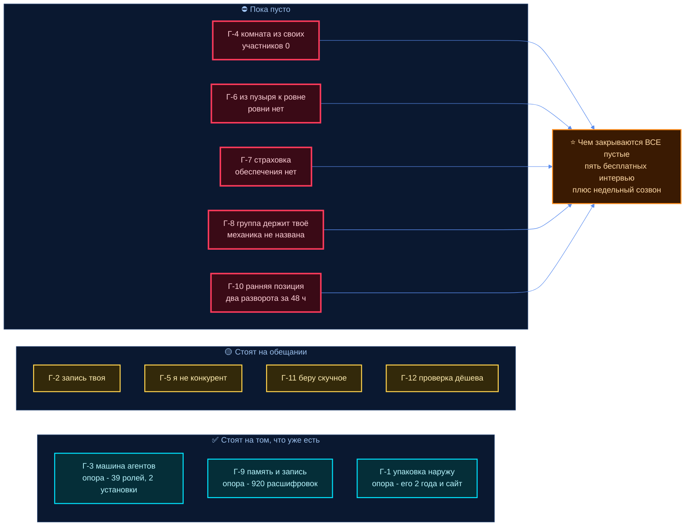
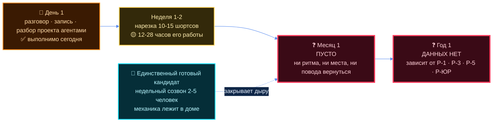
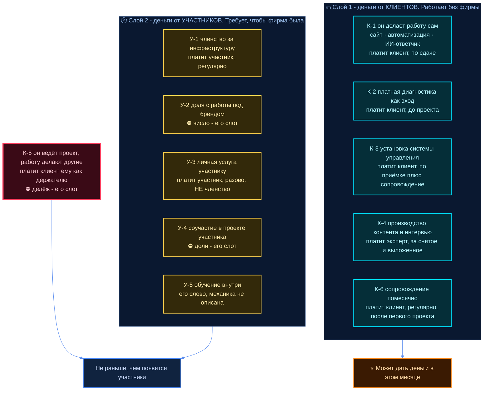

# Почему стоит зайти ко мне прямо сейчас

## Как читать этот документ

Заказ 14.10 18:05, голос. Его слово, с которого всё начинается, приведено дословно и **не смягчено** —
он сам потребовал:

> «учитывая мою ситуацию сейчас — то, что я, по сути, всё, что могу делать, и то, блять, не сильно
> хорошо, это вот настроить сайт, это вести соцсети… тем, у которых по сути есть бизнес, деньги и
> так дальше — почему им стоит присоединиться ко мне? Вот это мне надо тоже хотя бы накидать
> каких-то гипотез, вариантов, исходя из моих заметок»

> «мне надо чёткое предложение этим первым людям собрать, потому что сейчас оно не сильно чёткое:
> сейчас там что-то типа консалтинговая фирма, на чём зарабатывать непонятно»

Через семь минут, 18:12, он сам ответил на половину вопроса — назвал первое предложение и три
источника заработка. Это встроено в разделы 4 и 5 его словами.

```
раздел 1  инвентарь — что есть на самом деле, с замером
раздел 2  асимметрия — что есть у него, чего нет у человека с деньгами
раздел 3  ⭐ двенадцать гипотез, у каждой поле «чем легко разбить»
раздел 4  разбор «залетайте ко мне»: день · месяц · год
раздел 5  ⛔ на чём зарабатывать — механика, без цен
раздел 6  шесть плюс четыре причины сказать «нет»
раздел 7  что можно показать на этой неделе
```

> ⚠️ **Чей текст.** Всё в кавычках «…» — его слово, адрес источника рядом. Всё остальное —
> **кандидат агента**. Доли, проценты и цены про людей здесь не считаются и не предлагаются.
> Чужие числа — с источником. Где данных нет, написано **ДАННЫХ НЕТ**.
>
> ⛔ **В Notion ничего не заносится** — его прямое слово 14.10: «ты пока сам не заноси».
> Текстов наружу здесь нет: наружу он пишет сам.

---

## 1. ⭐ Честный инвентарь: что у него есть на 14.10.2026

Ниже не то, что планируется, а то, что проверено командой на машине. Где документ дома расходится
с замером — стоит замер.

### 1.1 Работает и можно потрогать

| Что | Состояние | Чем подтверждается |
|---|---|---|
| **Публичный сайт `jetixagency.com`** | ✅ живой, HTTP 200 | GitHub Pages, репозиторий `Bogersebekov/website-own-v1`, 68 файлов, 18 коммитов, последний 14.10. Живые страницы `/`, `/agency/`, `/firm/`, `/v/`. Сертификат до 11.01.2027 |
| **Свой сервер** | ✅ работает | Hetzner, Берлин, 4 ядра, 7,6 ГБ, диск 150 ГБ (занято 40%). Наружу только 80/443/22. Tailscale `100.99.156.28` онлайн |
| **Хостинг записи видео (Cap) на своём сервере** | 🟡 серверная часть работает | 5 контейнеров живы 4 суток, `video.jetixagency.com` отвечает, Let's Encrypt до 08.01.2027, хранилище MinIO закрыто (403), бэкап на кроне |
| **Форк vas3k.club** | ✅ поднят локально | `club_app` + Postgres + Redis, Up 8 недель, отвечает 200 на `127.0.0.1:8000`. Наружу не торчит |
| **Система агентов** | ✅ работает | **39** ролей в реестре (36 core + 3 слота, `agents-command-center/agents/registry.yaml` meta v12), 45 карточек, **75 скиллов**, 3 хука-предохранителя. Проверено живым прогоном: карточки читаются, агенты спавнятся, предохранитель на секреты срабатывает |
| **Пульт в Telegram** | ✅ работает с 24.08 | процесс `claude --channels plugin:telegram`, 1661 минута CPU. Через него он диктует голосом, речь попадает в репозиторий |
| **Miro** | ✅ 59 досок | проверено обращением к API: «Jetix OS», «Jetix group», «Agents CC», «Rumsatz», разборы созвонов с живыми людьми |
| **Notion** | ✅ командный центр живой | «🎮 Jetix Command Center» + «Jetix Agency» (обновлена 11.10) |

### 1.2 ⭐ Корпус знаний — единственное, что объективно велико

| Что | Сколько | Как считано |
|---|---|---|
| Расшифровок его голоса | **920** | `raw/transcripts/`, с 30.04.2026 |
| Документов `.md` в `jetix-os` | **13 645** | подсчёт файлов |
| Коммитов | **4 332** | `git log` |
| Страниц в `wiki/` | **1 187** (9,9 МБ) | подсчёт |
| Рёбер в графе знаний | **1 414** | `wiki/graph/edges.jsonl` |
| Карточек-сущностей | **295** | `entities/` |
| Папок отчётов · проектов | **495** · **62** | `reports/` · `projects/` |
| Второй репозиторий | **76** документов | `jetix-production-company`, в том числе по этой фирме: 319 его дословных цитат, разбор 12 живых организаций, ~70 именованных научных опор |
| Реестр позиций специалистов | **112 строк-позиций** | `projects/point-b3/docs/reestr-pozitsiy-specialistov.md` v3, у каждой позиции заполнена строка «что мы даём человеку» |
| Собранный, но **не опубликованный** пакет «мастерская» | **235 файлов** (101 шаблон + 134 демо), MIT | `projects/yadro-dlya-lyudey/shablon` и `/demo`; установлен на чужой машине дважды — `projects/pak-partneru/pak/02-CHTO-PREDLAGAEM.md`. Шаг «публикация на GitHub» **не сделан** |
| Выгрузка по Берлину под Rumsatz | **3 512 объектов**, из них **1 378 с сайтом** | OSM + скрапер Google Maps (`~/google-maps-scraper-kit` — чужой открытый набор, не его код), сводная таблица на 10 листов. Касаний по этой выгрузке — **ноль** |

⚠️ **Один актив назван им, но на диске не найден.** 08.10 он сказал: «у меня уже есть скрайпер
YouTube… доступ там до десятков тысяч этих ютуберов есть, как бы этот pipeline, который вроде ещё
недавно работал». Поиском по домашней папке и обоим репозиториям **он не найден**, и он сам
говорит «вроде работал». До проверки руками это **не актив**.

### 1.3 ⛔ Чего нет — и это надо говорить первым

| Что | Факт |
|---|---|
| **Денег** | **ноль**. Поиск по обоим репозиториям по «заработал / оплачен / первый клиент / invoice» даёт только шаблоны, планы и вымышленные примеры. Ни одной реальной транзакции |
| **Клиентов** | **ноль** |
| **Участников фирмы** | **ноль** |
| **Записанных видео** | **ноль**. `SELECT COUNT(*) FROM videos` → 0, бакет пустой, том MinIO 37 КБ служебного. Клиент на Windows **не начат** (`⬜` в плане), машина `mashinachui` офлайн |
| **Аудитории** | его собственные числа на его же сайте: **TikTok 0 · YouTube 0 · Instagram ~200** |
| **Живых контактов в CRM** | 125 карточек, но: `warm` — **1**, `active` — **1**, карточек с непустой историей касаний — **1**. 86 «холодных» — это не воронка, а список имён для ресёрча (Маск, Хинтон, Карпатый, MrBeast) |
| **Ответа от единственного тёплого** | Цэрэн Цэрэнов (управляющий партнёр МИМ), в карточке дословно: *«Video sent 04.05 (response unknown)»*. Ответа не было |
| **Денег по Rumsatz** | цель 2000 € до 31.10, осталось 17 дней. Сделан только ресёрч: 11 документов, 8 разборов на 3 953 строки, выгрузка 3 512 объектов Берлина (1 378 с сайтом), скрапер. **Касаний клиента — ноль, счетов — ноль** |
| **Юрлица под фирму** | нет. Немецкое право не разобрано (П-8) |
| **Запаса по деньгам** | его слово 07.09: «бабок сейчас у меня нету… иду уже инвесторов искать». Его слово 18.09: «я с работы уволился, у меня ещё **один месяц ранвея** — один месяц, дальше я всё». ⚠️ Сказано месяц назад; какое состояние сегодня — **ДАННЫХ НЕТ**, это его знание, не репозитория |
| **Технических рук** | его слово 01.10: «технических навыков сейчас недостаточно — и как бы ищу человека, у которого этих навыков достаточно, с ним объединиться» |

### 1.4 ⚠️ Две формулировки, которые надо поправить до того, как их проверят

1. **«Своя сборка Cap».** Это не своя сборка. Запущены официальные образы
   `ghcr.io/capsoftware/cap-web:latest` и `cap-media-server:latest` — `docker inspect` подтверждает.
   Своё здесь: сервер, домен, база, хранилище, конфиг, бэкап. Код не собирался и не менялся.
   Честная формулировка: **«поднял self-hosted Cap на своём сервере»**.
2. **«Труба записал-загрузил».** Замкнута наполовину: место, куда грузить, готово; **грузить ещё
   нечем и нечего**. Если это уйдёт партнёру как «мы записываем и выкладываем видео» — первая же
   проверка это вскроет.

### 1.5 Что мёртвое, чтобы не считать его активом

Бот Димы `@bublikjetixbot` — контейнер Exited 6 недель. Клетки `yana-cage`, `dima-cage` — выключены
его словом 02.09. Дашборды на портах 8787 / 8788 / 8790 — **ни один порт не слушает**. Нарядная
механика (`order-dispatcher`) — на паузе с 27.08. `jetix-falkordb` — Exited 7 недель.
Скрипт CRM `crm.py dash` падает с ImportError. На сервере нет подкачки (swap 0).

### 1.6 Его умения, подтверждённые делом — кандидат агента

| Умение | Подтверждение | Масштаб |
|---|---|---|
| Сделать сайт | `jetixagency.com` живой, деплой через Actions | **один** сайт, строил с агентом |
| Поднять инфраструктуру | self-hosted Cap, Caddy, Let's Encrypt, MinIO, Docker, бэкап на кроне | работает |
| ⭐ Оркестрировать ИИ-агентов | 4 332 коммита, 39 ролей, 75 скиллов, 920 расшифровок, 13 645 документов | **самый сильный его навык по объёму следа**, и единственный, где он выше среднего рынка |
| Ресёрч и структурирование | Rumsatz 3 953 строки + 3 512 объектов; консалтинг-ресёрч 12 организаций и ~70 опор | работает |
| Соцсети | Instagram ~200, TikTok 0, YouTube 0 | по его же слову — «не сильно хорошо» |
| Видео | 0 записано, 0 опубликовано | нет |
| Продажи | 0 клиентов, 0 касаний | нет |

**Вывод инвентаря — кандидат агента.** Из двух умений, которые он сам себе назвал («настроить
сайт», «вести соцсети»), первое подтверждено одним экземпляром, второе не подтверждено ничем.
Зато есть третье, которое он себе не засчитал и которое по следу сильнее обоих: **он умеет
собирать и держать машину из ИИ-агентов и корпус знаний вокруг своей работы**. Это и есть
единственный реальный фундамент предложения. Всё остальное — замысел.

```mermaid
%%{init: {"theme":"base","themeVariables":{"background":"#05070D","primaryColor":"#0E2A4D","primaryTextColor":"#EAF2FF","primaryBorderColor":"#3D7BFF","lineColor":"#5B8DEF","textColor":"#EAF2FF","clusterBkg":"#0A1830","clusterBorder":"#2B4A7A","nodeBorder":"#3D7BFF","edgeLabelBackground":"#0E2647","fontFamily":"Inter, Arial, sans-serif"}}}%%
flowchart TB
    subgraph EST["✅ Есть и работает"]
      SITE["Сайт jetixagency.com<br/>публичный, живой"]:::system
      SRV["Свой сервер Hetzner<br/>Cap · форк клуба · пульт"]:::system
      AG["⭐ 39 ролей агентов<br/>75 скиллов, 3 предохранителя"]:::system
      KB["⭐ Корпус 13 645 документов<br/>920 расшифровок, граф 1414 рёбер"]:::system
    end
    subgraph HALF["🟡 Полработы"]
      CAP["Хостинг записи видео<br/>место есть - записей 0"]:::crosscut
      PKG["Пакет мастерской 235 файлов<br/>собран, НЕ опубликован"]:::crosscut
    end
    subgraph NET["⛔ Нет"]
      MON["Денег - 0"]:::accent
      CLI["Клиентов - 0"]:::accent
      MEM["Участников - 0"]:::accent
      AUD["Аудитории - Insta около 200,<br/>TikTok 0, YouTube 0"]:::accent
      PEO["Живых касаний - 1 карточка"]:::accent
    end
    OFFER["❓ Предложение человеку<br/>с бизнесом и деньгами"]:::goal

    AG --> OFFER
    KB --> OFFER
    SITE --> OFFER
    SRV --> OFFER
    CAP -.->|"пока не считается"| OFFER
    PKG -.->|"пока не считается"| OFFER
    MON -.->|"бьёт по доверию"| OFFER
    CLI -.-> OFFER
    MEM -.-> OFFER
    AUD -.->|"бьёт по обещанию охвата"| OFFER

    classDef goal fill:#3A1A02,stroke:#FF8C1A,stroke-width:2px,color:#FFD9A6
    classDef system fill:#052E38,stroke:#00E5FF,stroke-width:2px,color:#B8F6FF
    classDef crosscut fill:#33290A,stroke:#FFD34E,stroke-width:2px,color:#FFECB0
    classDef accent fill:#3A0A16,stroke:#FF3B5C,stroke-width:3px,color:#FFD0D8
```



---

## 2. Асимметрия: что есть у него, чего нет у человека с бизнесом и деньгами

Деньги у того уже есть — значит продаём не деньги. Весь раздел — **кандидат агента**, кроме цитат.

### 2.1 Семь настоящих асимметрий

| # | Что у него есть | Почему этого нет у человека с деньгами | Насколько это прочно |
|---|---|---|---|
| **А-1** | **Нераспределённое внимание.** Полный рабочий день, направленный наружу: собирать людей, разбирать, записывать | Человек с бизнесом продал своё внимание бизнесу. Его день забит операционкой, и «познакомиться с интересным человеком» всегда проигрывает срочному | Прочно, пока у него нет клиентов. **Исчезает в день, когда он начнёт зарабатывать** |
| **А-2** | **Нет репутационного якоря.** Может говорить вслух то, что человеку с именем говорить дорого; может публично пробовать и ошибаться | У человека с именем каждая публичная ошибка стоит денег. Он физически не может строить что-то на людях | Прочно сейчас. Чем он известнее, тем меньше остаётся |
| **А-3** | ⭐ **Полная записанность.** 920 расшифровок своего голоса, граф на 1 414 рёбер, 13 645 документов. Он знает дословно, что думал полгода назад | Почти ни у кого этого нет. Эксперт с 15-летним стажем держит метод в голове, и при смене работы он уходит вместе с ним | Прочно и растёт. **Самая настоящая из всех** |
| **А-4** | ⭐ **Рабочий слой ИИ-агентов на реальных делах, а не слайд.** 39 ролей, 75 скиллов, предохранители, которые реально срабатывают | У большинства бизнесов ИИ — это подписка на чат. Собранного слоя с ролями, правилами и памятью нет | Прочно по факту, **но ни разу не поставлено чужому человеку**. См. Г-3 |
| **А-5** | **Он собирает людей как основное дело, а не как побочный эффект.** Его слово 15.09: «ключевой продукт — это не система, куда ты просто знания записываешь, а это именно комьюнити людей, которые готовы помогать, хотят развиваться, готовы как-то выслушать, имеют ресурсы» | Для человека с бизнесом нетворк — остаточная функция от конференций. Он же 15.09 называет, в чём там выгода: «человеку это сделать — это там вот 5 минут, а другому человеку это там вот один год жизни» | Прочно, но требует, чтобы он действительно собирал. Сегодня собрано: 1 карточка с историей касаний |
| **А-6** | **Не заперт в отрасли.** Ходит между нишами, не конкурирует ни с кем из них | Человек с бизнесом заперт в своей нише и видит только её | Прочно сейчас. ⚠️ Ломается, как только он сам начнёт продавать сайты и автоматизацию — см. Г-5 |
| **А-7** | **Готовность делать скучное.** Писать, раскладывать, вести порядок, повторять | Это дефицитный ресурс. Люди с деньгами за него платят, но хорошего исполнителя не находят | Прочно и подтверждено следом в 4 332 коммита |

### 2.2 ⛔ Что нельзя выдавать за асимметрию

Денег. Клиентов. Имени. Команды. Отраслевой экспертизы. Доказанных результатов. Аудитории.
Связей. Опыта продаж. По каждому пункту у человека с бизнесом **больше, чем у него**, и попытка
зайти с любого из них проигрывается в первую минуту разговора.

**Единственная честная рамка, которая из этого следует — кандидат агента:** он идёт не как тот, у
кого больше, а как тот, у кого **свободно то, что у собеседника занято**. Время, право
ошибаться, нейтральность между нишами и дисциплина записывать. Это узко, но это правда.

### 2.3 ⚠️ Чего в его собственных словах по этой теме НЕТ

Проверено сплошным поиском по 920 расшифровкам:

- **«Почему именно ко МНЕ, а не к другому»** — прямого ответа у него нет нигде. 14.10 он сам это
  и говорит, и просит накинуть гипотез. Всё, что есть в его речи, — отличие **формы** (группа,
  клуб, защита человека вместо защиты границ), а не отличие **его лично**. Семь асимметрий выше —
  **кандидат агента**, а не его слово.
- **«У человека с деньгами нет времени»** — **ДАННЫХ НЕТ**. Он этого не говорил.
- **«Одиночество как боль богатого человека»** — **ДАННЫХ НЕТ**. Про одиночество он говорит
  только про своё собственное: 22.08, «реально вот так вот один в квартире, ни с кем не общаясь,
  никуда, ни с кем не обсуждая, ничего далеко не выведешь — 100 процентов».

---

## 3. ⭐ Двенадцать гипотез «почему стоит зайти»

По каждой: как он скажет это вслух · кому заходит · ⚠️ **чем легко разбить** · есть ли живой
пример · что должно появиться, чтобы гипотеза стала правдой.

Формулировки «вслух» — **кандидат агента**, собраны из его голоса. Наружу он пишет сам.

---

### Г-1 · «Я снимаю с тебя работу, которую ты всё равно не сделаешь: упаковать и вынести наружу то, что ты знаешь»

**Кому.** Владелец бизнеса с экспертизой и без публичности. IT-эксперт 10–15 лет, которого не
знают за пределами его компании.

**⚠️ Чем легко разбить.** Это **услуга, а не партнёрство**, и её покупают у агентств за деньги —
их сотни. Он сам сказал, что делает это «не сильно хорошо». Доказательств качества ноль: ни
одного опубликованного кейса чужой упаковки, видео записано 0. Человек с деньгами ответит: «я
найму продюсера», и будет прав.

**Живой пример.** Жанр существует как индустрия. **У него — ДАННЫХ НЕТ**: ни одного чужого
человека он не упаковывал.

**Что должно появиться.** Один чужой человек, упакованный от начала до конца, с его согласия
показываемый как кейс. Это ровно то, что он сам предложил 18:12 — пять бесплатных. См. раздел 4.

---

### Г-2 · «Час твоего времени — и у тебя на руках запись, которую ты забираешь себе»

**Кому.** Всем трём портретам, сильнее всего — владельцу бизнеса: он ценит встречу, у которой
есть выход.

**⚠️ Чем легко разбить.** У интервью нет дистрибуции: TikTok 0, YouTube 0, Instagram ~200 —
**его собственные числа на его собственном сайте**. Запись без зрителей — это файл. И «час» —
неправда: с подготовкой, съёмкой и согласованием это полдня его времени и минимум два часа
собеседника. Плюс запись через его собственную трубу сегодня физически невозможна — клиент не
начат, записей 0.

**Живой пример.** Да: эксперт идёт в подкаст за лидами — рабочая механика. Но **цена входа туда
— аудитория ведущего**, и именно её у него нет.

**Что должно появиться.** Труба замкнута end-to-end хотя бы один раз: записал — смонтировал —
выложил — ссылка живая. Плюс честная формула вслух: «аудитории у меня нет, запись твоя, я её
выложу, и если не взлетит — ты потерял два часа, а не деньги».

---

### Г-3 · «Ты получаешь не меня, а машину: собранную систему управления, агентов и память, которой у тебя нет»

**Кому.** IT-эксперт и project-менеджер поймут за минуту. Владелец бизнеса — через боль «всё в
голове и в переписках».

**⚠️ Чем легко разбить.** ИИ-обвес сейчас продают все. **Ни одного внешнего внедрения у него
нет.** Система заточена под него и его способ думать. «13 645 файлов и граф на 1 414 рёбер» не
впечатляет человека, который уже платит за Notion и ChatGPT, — он спросит «а что это мне даёт в
деньгах», и ответа нет. И главное: он не разработчик, значит **поддерживать поставленное он не
сможет**, а брошенная система хуже отсутствующей.

**Живой пример.** Частично есть: шаблон мастерской установлен на чужой машине **дважды**, с
плагинами и живым использованием (`projects/pak-partneru/pak/02-CHTO-PREDLAGAEM.md`). Это
ближайшее к доказательству из всего, что есть. ⚠️ Но пакет **не опубликован** — шаг «публикация
на GitHub» в проекте `publikaciya-github` до сих пор `⬜`.

**Что должно появиться.** Третья установка — человеку не из близкого круга, с его отзывом своими
словами. И ответ на «кто это поддерживает через полгода».

---

### Г-4 · «Ты попадаешь не в толпу, а в комнату, которую я собираю по одному — с каждым разговариваю лично»

**Кому.** Всем. Это ответ на вопрос «почему не LinkedIn».

**⚠️ Чем легко разбить.** Классический холодный старт: комната пустая, и «зайти первым» — это и
есть вся просьба. Человек с деньгами уже в пяти комнатах получше. А **«с каждым из тысячи
интервью» арифметически невозможно одним человеком**: тысяча разговоров по два часа — это больше
года полного рабочего времени, без монтажа, без продаж и без всего остального.

**Живой пример.** vas3k.club — 16 255 человек, собран **платным фильтром и обязательным
интро-постом**, а не интервью с каждым ([A3 §12](../research/A3-ZHIVYE-PRIMERY.md)). Вастрик
прямо пишет: «$1 оказался весьма эффективным способом отсева».

**Что должно появиться.** Назвать реальный размер первой когорты — не 1000 — и показать первых
пять-десять уже вошедших по именам и с их согласия.

---

### Г-5 · «Я не конкурент: я не борюсь с тобой за твоих клиентов»

**Кому.** Владелец бизнеса и консультант-одиночка — они инстинктивно боятся, что сообщество
уведёт клиентов.

**⚠️ Чем легко разбить.** Сегодня не конкурент — завтра конкурент. Он сам говорит: «начинаем с
внедрения автоматизации, искусственного интеллекта и так далее, разработки сайтов — вот уже
сейчас». Это ровно то, что продаёт половина целевых. Нейтральность не закреплена **ничем, кроме
обещания**: правило «не переманиваем друг у друга» в доме записано (Хартия §4.5), но никем не
подписано.

**Живой пример.** Да, и проверенный: «протокол булочки» Crisp — у заявки всегда один владелец,
реакция за один–два дня, предложить другому можно, протолкнуть нельзя; **комиссию за передачу
лида они пробовали и отменили** как «бюрократию, субоптимизацию и путаницу»
([A3 §8.4](../research/A3-ZHIVYE-PRIMERY.md)).

**Что должно появиться.** Написанное правило «чьи клиенты чьи» и явный список того, что он сам
**не** продаёт.

---

### Г-6 · «Ты сидишь в своём пузыре. Я вытаскиваю деятельных людей из разных пузырей в одно место»

Это **его собственная мысль**, не наша. Дословно, 09.10:

> «сейчас эти люди разделены в разных бизнесах, государствах, нишах — то есть это всё есть разные
> деятельные люди, но они как бы по разным нишам расходятся, и получается, они в своих таких
> пузыриках находятся»

> «собрать людей, которые хотят что-то делать, учиться, но у них нету доступа к ресурсам, и
> людей, у которых есть ресурсы»

**Кому.** Всем; сильнее всего — владельцу бизнеса, у которого нет равных собеседников.

Чем это ценно, он тоже сказал сам, 15.09:

> «если ты задашь кому-то вопрос, они, например, тебе подкинут ответ, ну или не ответ, а идею…
> подсказать тебе партнёра, подсказать тебе какой-то материал… **человеку это сделать — это там
> вот 5 минут, а другому человеку это там вот один год жизни**»

**⚠️ Чем легко разбить.** Одиночество деятельного человека **лечится деньгами**: он покупает
мастермайнд, борд, коуча, закрытый клуб. Рынок большой и зрелый, и там уже есть люди его уровня.
А «вытащить из пузыря» работает, только если в новом месте есть ровня, — а её пока нет ни одной.
Вторая половина его же фразы ломает первую: **он соединяет тех, у кого ресурсы, с теми, у кого
их нет.** Человек с деньгами слышит в этом «меня зовут кормить».
⚠️ Отдельно: рамка «богатому одиноко» — **кандидат агента**, в его словах её нет.

**Живой пример.** Мастермайнды, YPO, Вастрик Клуб — все живые, все платные, все с фильтром.

**Что должно появиться.** Недельный созвон на 2–5 человек, запущенный и проживший месяц.
Механика уже лежит в доме готовой ([A1 §6.1](../research/A1-NASHI-DOKUMENTY.md), его слово 18.09),
и это единственная форма, которую можно запустить **без платформы, без денег и на этой неделе**.

---

### Г-7 · «Страховка деятельному человеку: ты рискуешь — группа подставляет плечо»

Его слово из заказа:

> «конкретно вот в первую очередь для деятельных людей страховка им просто на то, что если они
> там будут чего-то делать либо рисковать, что если что — вот их эта фирма или это там сообщества
> группа поддерживает»

Он говорил это и раньше, и там формулировка лучше — 19.04:

> «улучшаем качество жизни своих клиентов, своей команды, с одной стороны, и даём все инструменты
> для жизни… **Показываем рудник, даём лопату, даём страховку, даём инструкцию**»

И 05.10, уже про группу:

> «там просто вот будет как бы такой каркас, группа, которая нацелена на развитие своих
> участников, на поиск им того, что им нужно, большего количества ресурсов, связей, **обеспечение
> безопасности им**»

**Кому.** Тем, кто собирается что-то запускать и боится остаться один.

**⚠️ Чем легко разбить. Это самая опасная гипотеза в списке.** Страховка — это обязательство. За
ним сегодня нет ни денег, ни фонда, ни людей, ни юрлица. **Обещание поддержки, не выполненное
один раз, убивает репутацию навсегда.** И у человека с бизнесом собственная подушка больше, чем
всё, что группа может собрать.

**Живой пример.** Да, и он стоит денег: Smart (Бельгия/Франция/Берлин) держит **гарантийный фонд
из доли взноса** и платит участнику, не дожидаясь оплаты клиентом; за это берёт
**6,5 % (BE) · 8,5 % (FR) · 9,0 % (DE)** ([A3 §13](../research/A3-ZHIVYE-PRIMERY.md), чужие числа
с источником). Обратный пример: Enspiral держал общий котёл и именно он «пересох, а расходы
остались» — кризис 2016–2018, шли в банкротство.

**Что должно появиться.** Назвать **словами**, что именно покрывается: юридическая помощь?
второе мнение? замена исполнителя на проекте? деньги? И чем обеспечено. **До этого слово
«страховка» произносить нельзя** — кандидат агента, но настойчивый.

---

### Г-8 · «Копировать стало дёшево. То, чем ты владеешь, держится не на бумаге, а на том, что группа это признаёт»

Его слово 12.10 17:45, он сам назвал это главным:

> «сейчас довольно легко что-то скопировать, особенно вот код, software… соответственно вот эти
> все штуки типа владения своей там аудиторией, своим аккаунтом, ещё чего-то — по сути это
> вообще… которое держится на соплях»

> «и тебе нужно просто общество, которое поддерживает то, что ты имеешь — группа, которая
> поддерживает то, что ты имеешь»

**Кому.** Тем, кто владеет нематериальным: аудиторией, методикой, кодом, аккаунтом.

**⚠️ Чем легко разбить.** Самая красивая и самая пустая. **Чем именно группа удерживает твою
аудиторию или твой аккаунт — не названо** (это уже помечено в разборе его же слова,
`tochka-b/186-OS-17-43.md` §8 п.4a). Против работают две именованные опоры:
**Джеймс Бойл** («The Second Enclosure Movement», 2003) описывает движение в сторону
**усиления** прав на знание, а не их размывания; **Пол Ромер** (1990, Нобель) говорит, что идеи
«partially excludable» — механизмы удержания существуют: патенты, секреты, скорость
([B2 §3.4](../research/B2-POHOZHIE-MYSLI.md)). А человек с бизнесом держит своё юристами и
контрактами, и они работают лучше, чем признание незнакомой группы.

**Живой пример.** **ДАННЫХ НЕТ.** Ни одна из двенадцати разобранных организаций чью-либо
собственность не удерживала.

**Что должно появиться.** Один конкретный механизм вместо красивой фразы. Кандидаты уже лежат в
доме: публичное указание авторства и запрет переманивать (Хартия §4.5), общая юридическая защита,
резерв на спор. Выбрать **один** и сделать.

---

### Г-9 · «Я записываю всё, что мы делаем, и это остаётся. Твоё знание перестаёт жить только в твоей голове»

**Кому.** Эксперту 10–15 лет, у которого «всё в голове». У таких это самая острая и самая
непроговорённая боль.

**⚠️ Чем легко разбить.** Это обещание **дисциплины**, а не технологии. Дисциплина доказана на
себе (920 расшифровок) и **ни разу на другом человеке**. Дальше встаёт механика: либо он сидит на
чужих созвонах — тогда это дорого и он не масштабируется, либо человек пишет сам — тогда зачем он.
И сразу всплывает вопрос, на который у него ответа нет: **кому принадлежит записанное.**

**Живой пример.** Сам его репозиторий. Наружу — **ДАННЫХ НЕТ**.

**Что должно появиться.** Сделать это одному человеку бесплатно и показать результат: до — после.

---

### Г-10 · «Ранняя позиция: ты не участник номер семьсот, ты один из тех, кто пишет правила»

**Кому.** Предпринимателям, которые любят быть у начала и у кого уже есть деньги, чтобы не
зависеть от исхода.

**⚠️ Чем легко разбить.** Ранняя позиция в том, что никуда не дошло, стоит ноль. **Он развернул
рамку дважды за 48 часов** — 11.10 сменился адресат, 12.10 продюсерский центр стал входом, а
сутью стала фирма; через час он поправил и само название. Это задокументировано в его же
репозитории и легко читается как «человек не определился». Плюс «пишешь правила» без юрлица, без
доли и без отзываемого обязательства — это просто **бесплатная работа консультантом**.

**Живой пример.** Все двенадцать организаций из A3 начинались так. Из них: Greaterthan
**закрылся** (юрлицо переименовано 20.05.2026), Crisp сжался примерно с 40 до 20, Nearsoft
растворился в поглощении, Enspiral прошёл через предбанкротство. То есть живых примеров много, и
половина из них — предупреждение.

**Что должно появиться.** Написанное словами, что ранняя позиция реально даёт, и что он **не
может отозвать в одностороннем порядке**.

---

### Г-11 · «Я беру на себя то, что ты не хочешь делать: писанину, порядок, скучное»

**Кому.** Владельцу бизнеса и эксперту, у кого дело стоит на их личном внимании.

**⚠️ Чем легко разбить.** Это работа помощника, и человек с деньгами **нанимает помощника за
деньги** — без фирмы, без сообщества и без доли. Асимметрия исчезает в ту секунду, когда вопрос
переведён в найм. И свободных рук у него нет: он один, и уже держит два репозитория, сервер и
920 расшифровок своей собственной работы.

**Живой пример.** Рынок ассистентов и operations-людей, огромный и дешёвый.

**Что должно появиться.** Названная словами разница между ним и наёмным ассистентом. Кандидат
агента: **ассистент уходит и уносит контекст, а собранная система остаётся** — но это надо
доказать, а не заявить, и доказывается оно той же третьей установкой из Г-3.

---

### Г-12 · «Проверить меня стоит тебе два часа и больше ничего»

**Кому.** Всем. Это не про ценность, а про **цену риска** — единственный аргумент, который
работает, когда ценность пока недоказуема.

**⚠️ Чем легко разбить.** Для человека с бизнесом час — **самое дорогое, что у него есть**, а не
самое дешёвое. Фраза «это тебе ничего не стоит» в его ушах — ложь, и она обнуляет всё сказанное
до неё. А «дальше ты решаешь» прямо сообщает, что предложения пока нет.

**Живой пример.** Вся индустрия бесплатных диагностик. ⚠️ Но собственный разбор дома советует
обратное: **платная диагностика как вход** фильтрует несерьёзных и окупает пресейл
([02-RASSKAZ §5, П-4](02-RASSKAZ.md)). Это прямое противоречие внутри его же материала, и
решать его.

⭐ **Но у него же есть ход, который снимает всю эту гипотезу** — его слово 05.10:

> «я сейчас как бы предлагаю вступить, и **если не хочешь — то как минимум дать обратную связь:
> почему, и что должно было бы быть, чтобы ты как бы вступил**»

Это сильнее Г-12 в её исходном виде: он не просит поверить, он просит **сказать, чего не
хватает**. Отказ становится результатом, а разговор — не проигранным.

**Что должно появиться.** Решение — бесплатно или платно — и держаться его. Сейчас он сказал
«первым пяти бесплатно» (18:12), и это ответ; надо только не метаться.

---

### Сводка гипотез



🔶 **Рекомендация агента.** Из двенадцати в разговор сегодня годятся **три**: Г-3 (машина),
Г-9 (память) и Г-1 через конкретику его предложения 18:12. Остальные девять — это то, во что
человек должен поверить на слово, а слова пока нечем подкрепить. Решает он.

---

## 4. Разбор «залетайте ко мне» как предложения

### 4.1 ⭐ Что он сам назвал предложением — его слово 18:12

> «какое-то первое предложение… хотя бы первым пяти делаю как-то бесплатно, да, просто вот
> интервью, и потом нарезка на 10–15 шортсов, и там помогаю донести, показать это до новых 100
> или 1000 человек. И то есть возможно либо найти клиента, либо партнёра, либо инвестора — вот
> что-то типа такого. Вот это как бы моё предложение… ну как бы такой лид-магнит, даже не то что
> лид-магнит, но вот просто моё такое предложение»

> «чтоб чётко было до людей, до которых я аутричу, чтобы не просто так»

Что он при этом поясняет человеку:

> «я вот строю консалтинговую фирму, дальше там кому интересно — залетайте. Конкретно собираю
> экспертизу экспертов, узнаю, как они видят мир… умных людей. В целом такой проактивный —
> конкретно людей собираю, спрашиваю, если надо прошу помощи»

> «собираю таких людей, которые разделяют похожие ценности»

**Это уже предложение, а не лозунг.** В нём есть адресат, действие, выход и цена для человека.
Проверяем его по трём горизонтам.

#### ⭐⭐ Ещё одна его формулировка, 05.10 — и она конкретнее, чем сегодняшняя

Девятью днями раньше он уже собрал предложение, и в нём закрыты ровно те дыры, которые пусты в
версии 14.10. Дословно:

> «**предложение такое — стать как бы со-инвестором, со-создателем вот этой группы, компании,
> чьё дальнейшее развитие будет напрямую зависеть от того, какие люди внутри этой системы
> находятся**»

> «собираем там первую когорту **30 человек**, каждый описывает, чем он занимается, чем он может
> быть полезен, **чтобы уделять хотя бы 3–5 часов своего времени в неделю проекту**; у кого какая
> есть экспертиза, кто чем может поделиться — возможно знакомствами, возможно ресурсами,
> доступами до каких-то сервисов — всё это собираем в общий пул»

> «здесь **риск на каждого участника довольно маленький, по сути 3–5 часов в неделю**, что не
> прям уж так много является. Но потенциальный выхлоп, который можно получить, даже собрав там
> группу из 50 айтишников…»

> «я сейчас как бы предлагаю вступить, и **если не хочешь — то как минимум дать обратную связь:
> почему, и что должно было бы быть, чтобы ты как бы вступил**»

**Что здесь сильного — кандидат агента.** Четыре вещи, которых нет в версии 14.10:

1. **Названа цена для человека в единицах, которые он понимает** — 3–5 часов в неделю. Не
   «залетайте», а конкретный счёт.
2. **Названа роль** — со-создатель, а не член клуба.
3. **Названо число первой когорты — 30**, а не 1000. Это выполнимо и проверяемо.
4. ⭐ **Назван запасной выход, который невозможно проиграть**: «не хочешь — дай обратную связь,
   что должно было бы быть, чтобы ты вступил». Это превращает отказ в результат и снимает самый
   тяжёлый риск первых касаний.

⚠️ **И здесь же противоречие, которое надо снять ему самому.** 05.10 — «первая когорта 30
человек»; 14.10 — «первую тысячу человек специалистов ищу, с каждым интервью провожу». Это два
разных предложения с разной арифметикой. По правилу дома побеждает последнее слово, но здесь
последнее слово — **менее выполнимое**, и стоит проверить, не оговорка ли это.

#### Как он описывал первое касание 17.09

> «я буду где-то записывать видео длиной может 3–5 минут, просто чтобы сказать, что вот я тебя
> там нашёл, у меня есть предложение: вступить как бы для начала в группу, изучить материалы
> буквально там полчаса-час, и в целом если тебе там интересно — выйти на звонок, и всё»

Это **третья** версия входа, и она дешевле обеих: персональное видео на 3–5 минут вместо интервью
на два часа. Какая из трёх действует — его слово.

### 4.2 Что человек получает в первый день

| Что он получает | Выполнимо сегодня? |
|---|---|
| Разговор с тем, кто подготовился и слушает | ✅ да — это он умеет, и это бесплатно |
| Запись интервью | 🟡 **не через его трубу.** Записей 0, клиент на Windows не начат. Через обычную видеосвязь — да |
| Разбор его проекта, сделанный агентами за вечер | ✅ да. Это самый дешёвый и самый недооценённый пункт — он может отдать человеку документ, которого у того нет |
| 10–15 шортсов | 🟡 выполнимо руками, но дорого по времени — см. 4.4 |
| «показать новым 100 или 1000 человек» | ⛔ **нечем.** См. 4.3 |

### 4.3 ⚠️ Главная дыра: обещание охвата

Он обещает «донести, показать это до новых 100 или 1000 человек». Проверка по его же числам,
опубликованным на его же сайте: **TikTok 0 · YouTube 0 · Instagram ~200**.

Что это значит честно — кандидат агента:

1. **Через подписчиков он не донесёт ни до ста, ни до тысячи.** Двухсот человек в Instagram не
   хватает даже на сотню просмотров одного ролика.
2. **Единственный механизм, которым это в принципе достижимо, — алгоритмическая раздача** в
   TikTok и Reels, которая не зависит от числа подписчиков. Но она **не гарантирована**, и ею
   управляет не он. Обещать её как результат нельзя.
3. **Разброс «100 или 1000» — в десять раз.** Это признак того, что число не посчитано, а
   названо. Умный собеседник услышит это мгновенно.
4. **«Просмотры» ≠ «люди».** Тысяча просмотров — не тысяча человек, и уж точно не тысяча тех, кто
   что-то сделал.

🔶 **Кандидат агента, как это починить, не соврав.** Обещать не охват, а **работу**: «я записываю,
режу на 10–15 коротких роликов, выкладываю на своих площадках и отдаю тебе все исходники и
нарезку — ты выкладываешь их у себя тоже. Моя аудитория сейчас: Instagram около двухсот, TikTok и
YouTube — ноль, я их только начинаю. Охвата я тебе не обещаю, я обещаю материал и работу».
Это слабее звучит и **сильно** работает: человек с деньгами покупает честность в прогнозе, потому
что сам каждый день слышит обратное. Решает он.

### 4.4 Выполнимо ли «пять бесплатных» им одним

Оценка трудоёмкости на одного человека — **кандидат агента**, не чужой факт, не замер:

| Этап | Часы |
|---|---|
| Подготовка к разговору (разобрать проект человека, собрать вопросы) | 1–2 — **его агенты это ускоряют сильно** |
| Сама запись | 1–2 |
| Расшифровка | ~0 — автоматическая, у него работает |
| Отбор моментов под нарезку | 2–3 |
| **Монтаж 10–15 шортсов** | **7–20** — самое дорогое место |
| Публикация, обложки, подписи | 1–2 |
| **Итого на одного человека** | **≈ 12–28 часов** |

**Пять человек — это примерно 60–140 часов, то есть от двух до четырёх недель полного рабочего
времени.** И это при нуле продаж, нуле Rumsatz и при том, что до 31.10 у него стоит цель 2000 €.

⚠️ **Вывод — кандидат агента.** Пять бесплатных упаковок одним человеком вручную **съедают весь
октябрь**. Либо монтаж автоматизируется, либо «пять» превращается в «один-два».

🔶 **Рычаг, который у него уже назван и не подключён.** В доме лежит идея
`entities/idea-narezchik-bolshih-video.md` — приложение Антона по нарезке шортсов, плюс там же
записан выход на блогеров через его же скрейпер YouTube. Если нарезчик работает, самая дорогая
строка таблицы схлопывается, и «пять» снова становится реальным. **Это первое, что стоит
проверить до того, как обещать пятерым.**

### 4.5 Что он получает взамен за «бесплатно», и что если пятеро возьмут и уйдут

Что он получает — кандидат агента:

- **пять кейсов**, которых у него нет ни одного — это закрывает Г-1, Г-2 и половину Г-10;
- **право ссылаться** на имена, если люди разрешат, — самое дорогое из всего списка;
- **пять интервью как собственный контент**: это не только их материал, это его канал, его
  журнал стройки, его доказательство, что труба работает;
- **ответы на вопрос, ради которого он всё затеял** — «как они видят мир», то есть тот самый
  корпус экспертизы, из которого он собирается строить фирму;
- **проверку собственного предложения на живых людях** — пять отказов тоже результат.

**Что если все пятеро возьмут и уйдут.** Риск ограничен, и это надо понимать трезво: **он всё
равно остаётся с пятью опубликованными интервью, рабочей трубой и пятью разобранными проектами**.
Потеряно время, не деньги и не репутация. ⚠️ Единственный настоящий риск здесь другой: если он
**пообещал охват и не дал его**, пятеро уйдут не молча, а с рассказом. Поэтому 4.3 важнее, чем
кажется.

### 4.6 Что человек получает через месяц

**⛔ В версии 14.10 здесь пусто, и это главная дыра предложения.** Вход описан; жизни после входа
нет — не назван ни ритм, ни место, ни повод вернуться. «Залетайте ко мне» без второго шага
означает «приходите никуда»: человек записал интервью, и больше ничего не произошло.

**Но в его же версии 05.10 месяц назван** — и это единственное место, где он есть:

- ритм — **3–5 часов в неделю**;
- содержание — каждый описывает, чем занимается и чем может быть полезен; всё складывается в
  общий пул (знакомства, ресурсы, доступы);
- размер — **первая когорта 30 человек**.

Второй готовый кандидат, который можно запустить **без платформы, без денег и на этой неделе**, —
**недельный созвон на 2–5 человек, где сказанное остаётся внутри** (механика лежит в доме, его
слово 18.09, [A1 §6.1](../research/A1-NASHI-DOKUMENTY.md)).

🔶 **Кандидат агента: месяц собирается из двух этих кусков и больше ниоткуда.** Ритм 05.10 плюс
созвон 18.09 — это весь материал, который есть. Надо только произнести его как часть предложения,
а не держать в разных записях с разницей в три недели.

### 4.7 Что человек получает через год

**ДАННЫХ НЕТ.** Это не фигура речи: год зависит от четырёх вещей, ни одна из которых не решена —
что именно децентрализовано (Р-3), кого считать в 1000–1500 (Р-1), на какой базе стоит доля
группы (Р-5) и какая юрформа держит конструкцию в Германии (Р-ЮР).
Все четыре перечислены в [01-PLAN §5](01-PLAN.md) и ждут его.

🔶 **Кандидат агента: что честно сказать про год.** «Через год я не знаю. Я знаю, что собираюсь
сделать за три месяца, и могу это назвать. Всё, что дальше, — зависит от того, кто зайдёт.» Это
хуже продаёт и лучше держит.



---

## 5. ⛔ На чём он зарабатывает — назвать прямо

Он сам сказал 14.10, что это непонятно. Через семь минут он сам назвал три источника. Разложены
ниже по одной рамке: **кто платит · за что · когда · что должно быть готово**.

⛔ **Цен и процентов здесь нет и не будет.** Чужие числа — с источником.

### 5.1 Три источника его словами, 18:12

> «зарабатывать… консалтинговая фирма — это уже дальше будет видно, от экспертизы людей, которые
> будут внутри»

> «я ещё раз, целю на продвижение людей тогда в соцсетях… ну или нет, даже не то что в соцсетях,
> а конкретно настройкой системы, чтобы люди могли там о себе рассказывать, о своих проектах»

> «и в целом потом зарабатывать на внедрении вот этой всей хуйни — внедрение, конкретно
> нацеленное на децентрализованное и полезное качественное будущее для развития человечества»

Переведено в механику — **кандидат агента**:

| Источник его словами | Кто платит | За что | Когда | Что должно быть готово |
|---|---|---|---|---|
| **И-1** «настройкой системы, чтобы люди могли о себе рассказывать» | **сам эксперт** или его компания | поставленный и работающий контур публичности: площадки, труба записи, нарезка, порядок выпуска, разбор | по этапам: запуск → первый месяц работы | ⚠️ **Труба. Сегодня записей 0.** Плюс один доведённый до конца чужой пример |
| **И-2** «внедрение» | **бизнес-клиент** | внедрённая и принятая система: автоматизация процесса, ИИ-ответчик на входящие, система управления делами и знаниями | по сдаче этапов; дальше — сопровождение помесячно | Один внедрённый кейс. Сегодня **ноль внешних внедрений**; две установки шаблона на чужую машину — ближайшее, что есть |
| **И-3** «от экспертизы людей, которые будут внутри» | **участник**, когда он заработал через группу | ⬜ **его слот**: перечень работ, которые группа делает за эти деньги | только после того, как участник через группу заработал | **Участников ноль.** Этот источник не существует, пока не существует фирма |

### 5.1б То же самое он говорил раньше — и там конкретнее

Три записи до 14.10, которые уточняют те же три источника. Это не новые источники, это та же
механика более внятными словами:

| Дата | Его слово | Что уточняет |
|---|---|---|
| **07.10** | «у нас сейчас основное можно зафиксировать, **решено: это разработка сайтов, это вот SEO, и боты — ИИ-ответчики на вопросы, и упаковка какой-то информации**, которая у человека есть или у фирмы, чтобы они могли быстро пользоваться» | И-2: четыре направления названы и помечены словом **«решено»** |
| **09.10** | «в итоге зарабатывать там для начала **на вот внедрениях каких-то AI, на каких-то базовых штуках — вот эта вот систематизация данных, управление; то, что ранее было доступно только большим корпорациям, сейчас просто идти на уровень пониже — людям, командам поменьше** » | И-2: назван адресат и назван сам аргумент продажи |
| **08.10** | «основная идея — далее **зарабатывать на продажах вот этой установки и внедрения, или настройки** вот этой онтологии… **Плюс заработок на проектах, которые далее вот эти участники, пользующиеся вот этой системой, будут делать — группа будет часть от этого получать**» | И-2 и И-3 связаны в одну лестницу: сначала продаём установку, потом живём с проектов тех, кому поставили |
| **14.10** | «**какие бы услуги я бы мог лично ему предоставлять, и то есть брать за это какую-то плату** — то есть распределение там информации и благ; и то есть не просто "всем поровну и всё", нет» | Прямо подтверждает, что **личная услуга участнику** (У-3) — отдельная от членства линия, и он это так и задумывает |

⭐ **Самое важное в этой таблице — связка 08.10.** Она отвечает на вопрос «на чём зарабатывать»
лучше, чем всё сказанное 14.10: **сначала платят за установку системы, потом группа живёт с
проектов тех, кому её поставили.** Это цельная лестница, и она уже его словами. ⛔ Размер доли —
его слот, здесь не трогается.

### 5.2 Что из этого может дать деньги в ближайший месяц, а что нет



### 5.3 Самое важное, что из этого следует — кандидат агента

**Сегодня он зарабатывает не как фирма, а как исполнитель-одиночка.** Фирма — второй слой, и он
кормится **только** тогда, когда внутри есть люди, которые уже зарабатывают. Это не упрёк, это
порядок: сначала К-1…К-4, потом У-1…У-5.

Отсюда прямое следствие для разговора с человеком, у которого есть бизнес и деньги: **ему сегодня
нельзя продавать членство.** Ему можно продавать работу (И-1, И-2) и звать во второй слой
бесплатно. Любая попытка взять деньги за вход в то, чего нет, — это и есть «неясно, на чём
зарабатывать», которое он сам у себя и назвал.

### 5.4 Три чужих правила, которые стоит знать до того, как число названо

| Правило | Откуда | Почему важно |
|---|---|---|
| **Каждый процент надо уметь назвать работой.** Где процент не называют работой — его и не публикуют, и оттуда уходят напрямую | [A3 §13](../research/A3-ZHIVYE-PRIMERY.md), сводная таблица 12 организаций | Это переводит разговор с «сколько» на «за что» — туда, где у него есть ответ |
| **«Процент со счёта в общий котёл» в чистом виде провалился у Enspiral:** «модель выручки сообщества пересохла, а расходы остались… мы шли в состояние банкротства» (2016–2018). Заменили подпиской | [A3 §1.7](../research/A3-ZHIVYE-PRIMERY.md) | Прямое предупреждение против того, на чём стоит его модель 12.10 |
| **«% от оборота — сильный аргумент продажи, но плохой фундамент для кэша»** | записано в доме раньше: `biznes-reserch/docs/razbory/sistemnaya-ramka.md` | Это уже его собственное записанное предупреждение самому себе, и оно не отработано |

⛔ **Его число не трогаем.** Сказанное 12.10 — «ну там сколько, я не знаю, 15, может, 10–15
процентов будет идти непосредственно в эту группу» — записано дословно и не развивается. Он сам
сказал «я не знаю».

---

## 6. Что убивает это предложение

Двенадцать причин, по которым умный человек с деньгами скажет «нет». Каждая всерьёз, без
поддавков. По каждой — есть ли ответ.

| # | Почему «нет» | Есть ли ответ |
|---|---|---|
| **У-1** ⭐⭐ | **Ноль доказательств.** Ни участника, ни клиента, ни евро, ни записанного видео. На вопрос «кто с тобой уже работает» честный ответ — «никто» | 🟡 **частичный.** Ответ не «у меня есть результаты», а «вот что я построил на себе: 39 агентов, 920 расшифровок, 13 645 документов, свой сервер, живой сайт». Это переводит разговор с результата на **способность**. Слабее, но правда |
| **У-2** ⭐ | **Он сам сказал, что умеет мало и то не очень.** Сайты и соцсети — товар массовый, дешёвый и легко сравнимый | 🟡 **частичный.** Ответ — перестать продавать эти два умения и продавать третье, которое он себе не засчитал: оркестрацию агентов и собранность. ⚠️ Но на него нет ни одного внешнего кейса |
| **У-3** ⭐⭐ | **Модель провалилась у лучших, и это гуглится за вечер.** Greaterthan — автор лучшего публичного учебника по этой модели — **закрылся**, юрлицо переименовано 20.05.2026. Enspiral шёл в банкротство 2016–2018 и признаёт, что новички «разочаровываются и выгорают в первые 6–12 месяцев». Crisp сжался примерно с 40 до 20. Nearsoft растворился в поглощении. CoTech за 10 лет не смог формализовать совместные тендеры | ✅ **есть, и он сильный.** Назвать это **первым**, до собеседника, и сказать, что берём и чего не берём. Двенадцать проверенных приёмов и семь вещей, о которые уже разбились, разложены в [A3 §15](../research/A3-ZHIVYE-PRIMERY.md). Человек, который приходит с чужим кладбищем в руках, выглядит сильнее того, кто про него молчит |
| **У-4** ⭐⭐ | **Один человек — единая точка отказа, и он развернулся дважды за 48 часов.** 11.10 сменился адресат, 12.10 суть, через час — название. Всё задокументировано в его же репозитории | ⛔ **ответа нет.** Единственное, что можно честно показать: за полгода разворотов **ядро не менялось** — [B1 §2](../research/B1-EGO-ZAMETKI.md) показывает, что мысль 12.10 это четвёртая редакция того, что он формулировал 19.05, 02.06 и 14.06. Менялась обёртка, не фундамент. Это смягчает, но не снимает |
| **У-5** ⭐ | **Деньги не определены.** «10–15 процентов, я не знаю» звучит как неопределённый налог за неопределённую услугу | ✅ **есть.** Не брать ничего до первого результата и сказать это вслух. Решение его |
| **У-6** ⭐⭐ | **Юридически мутно.** Юрлица нет, немецкое право не разобрано, есть записанный риск переквалификации «доход от результата» + зависимый партнёр в найм **задним числом** (П-8). Слово «кооператив» не проверено по семи принципам ICA. Слово «децентрализованная» не определено ни в одном документе. Человек с активами слышит в этом риск для себя | 🟡 **частичный.** Единственная честная форма: «юрформы нет, и до живого юриста я никого ни во что не оформляю; сейчас мы просто разговариваем и работаем». Это снимает риск, но и снимает обязательства — то есть снимает половину предложения |
| **У-7** | **Альтернативная стоимость его часа.** Два часа на интервью плюс вовлечение — это больше, чем вся измеримая выгода на горизонте года | 🟡 **частичный.** Сделать выход первого дня материальным: не только интервью, но и **разбор его проекта агентами** — документ, который человек уносит. Это единственное, что у Руслана дёшево, а у собеседника дорого |
| **У-8** | **Репутационный риск.** Поставить своё имя и лицо рядом с непроверенным. Запись опубликована — ассоциация зафиксирована | ✅ **есть.** Дать право отозвать запись в любой момент и не публиковать ничего без его слова. Записать это одной строкой заранее |
| **У-9** | **Пул пустой.** Всё, что в «общем котле», покупается: агенты, шаблоны, подписки, контакты. Рва нет | 🟡 **частичный.** В доме записано, что ров — **накопленная методология**, а не инструменты (Хартия §4.3). Это верно, но накопление для чужих ещё не начиналось |
| **У-10** ⭐⭐ | **На вопрос «почему именно к тебе» ответа нет — и это проверено.** Сплошной поиск по 920 его расшифровкам: прямого ответа «чем я отличаюсь от другого человека, который зовёт туда же» **нет нигде**. Всё, что есть, — отличие **формы** (группа, клуб, защита человека вместо защиты границ), а не отличие **его лично**. Он сам это и говорит 14.10, когда просит накидать гипотез | 🟡 **частичный, и он в разделе 2.** Единственная рамка, которая не врёт: «у меня свободно то, что у тебя занято». ⚠️ Семь асимметрий раздела 2 — кандидат агента, а не его слово; на живом человеке ни одна не проверена |
| **У-11** ⚠️ | **Одна его старая формулировка, которая убьёт разговор мгновенно, если прозвучит.** 11.05: «Мы даже зарплаты не сильно много будем платить. Ну, просто **берите пользу здесь инструментами — вам этого уже как вместо зарплаты достаточно будет**». Для человека с бизнесом это дословно «плачу экспозицией» | ✅ **есть: не произносить.** Это запись полугодовой давности, не действующее предложение. Но она лежит в корпусе, и если всплывёт в чьём-то пересказе — отбиваться будет нечем. Назвать её снятой стоит сейчас, а не потом |
| **У-12** ⭐⭐ | **Асимметрия вклада читается как сбор.** Его собственное слово: в фирме надо «делать какой-то вклад в виде финансов, знаний и так дальше». То есть у того, у кого есть ресурсы, просят ресурсы, а взамен дают доступ к тем, у кого их нет. **Это ровно то, как звучит пирамида** | ✅ **есть, и он уже записан.** В доме стоит предохранитель: «пул — это дар и согласие, а не обязательный взнос» и «сервис можно купить снаружи». ⚠️ Но предохранитель надо произносить **первым**, а не вторым: если он прозвучит после просьбы о вкладе, ему уже не поверят |

### Четыре именованных возражения, которые задаст подготовленный собеседник

Он не обязан их знать — но если собеседник из них один, разговор кончится на первом.
Все четыре с контраргументами разобраны в [B2 §4.2](../research/B2-POHOZHIE-MYSLI.md).

| Кто | Возражение | Короткий ответ, который существует |
|---|---|---|
| **Джо Фримен**, «Тирания бесструктурности» (1970/1972) | «there is no such thing as a structureless group» — отказ от структуры не убирает власть, а делает её невидимой и неподотчётной | Она не против децентрализации, она против **бесструктурности**. «Мы не отменяем структуру, мы делаем её видимой и отзываемой» |
| **Роберт Михельс** (1911), железный закон олигархии | любая организация приходит к власти укоренившегося меньшинства — не по злой воле, а по механике роста | Ломается двумя вещами: **дешёвый выход** и **реальный голос**. Эмпирика против: замеры DAO 2022–2024 показывают концентрацию голосов; Zappos отменил менеджеров и вернул их, потеряв ~18 % штата |
| **Генри Хансманн**, «The Ownership of Enterprise» (1996) | кооперативов мало не по идеологии: «absent substantial homogeneity of interest, the costs of collective decision-making among the owners become very large». А группа разношёрстных независимых — это максимум разнородности | Рецепт, а не запрет: **вместе решать узкий однотипный список, остальное — автономия участника** |
| **Мансур Олсон** (1965), логика коллективного действия | чем больше группа, тем выгоднее ехать бесплатно. 1000–1500 — ровно та величина | Избирательные стимулы: **доступ к общему зависит от вклада**. Иначе пул растащат не из злобы, а по арифметике |

---

## 7. Что он может показать уже на этой неделе

Семь вещей. Все выполнимы им одним, без денег и без чужого согласия, кроме пункта 3.
Порядок — **кандидат агента**, по отношению «цена работы к весу доказательства».

| # | Что сделать | Что это доказывает | Цена |
|---|---|---|---|
| **1** ⭐⭐ | **Замкнуть трубу один раз.** Записать что угодно — хоть разговор с самим собой на десять минут — смонтировать, выложить, дать живую ссылку | Что обещание из раздела 4 исполнимо вообще. Сегодня **записей ноль**, и это самое слабое место всего предложения | полдня |
| **2** ⭐⭐ | **Разбор чужого дела агентами за вечер — одному живому человеку, бесплатно, с разрешения показать результат** | Г-3 и Г-9 сразу, и это единственная демонстрация, где он объективно сильнее собеседника. Самое дешёвое доказательство из существующих | вечер |
| **3** ⭐ | **Страница «что у меня есть сегодня» — раздел 1 этого документа, его словами, наружу.** Включая «денег ноль, клиентов ноль, видео ноль» | Ни у одного конкурента такой страницы нет, и **это и есть отличие**. Он уже публикует точку А на сайте (TikTok 0, YouTube 0) — значит готов. Это превращает У-1 из поражения в позицию | полдня |
| **4** | **Опубликовать пакет «мастерская» на GitHub.** 235 файлов, MIT, собран, шаг публикации до сих пор `⬜` | Доказательство без слов: это можно скачать и поставить. Сейчас оно лежит в столе | час-два |
| **5** | **Запустить первый недельный созвон на 2–5 человек** | Закрывает дыру «через месяц ничего» (4.6). Механика лежит в доме готовой, платформа не нужна | час в неделю |
| **6** | **Проверить нарезчик шортсов** (`entities/idea-narezchik-bolshih-video.md`) | От этого зависит, «пять бесплатных» — это реально или это весь октябрь. См. 4.4 | полдня |
| **7** | **Написать одной страницей, чего он НЕ обещает** | Дороже любого обещания: охвата не обещаю, страховки пока нет, юрформы нет, доли не называю. Снимает У-5, У-6, У-8 разом и строит то единственное, что у него есть на старте, — доверие | час |
| **8** ⭐ | **Свести три своих версии входа в одну и произнести вслух.** 05.10 — когорта 30, 3–5 часов в неделю, со-создатель; 17.09 — персональное видео на 3–5 минут; 14.10 — пять бесплатных интервью с нарезкой. Три разные двери в одно место | Это не новая работа, а выбор из уже сделанной. Пока дверей три, у собеседника нет ни одной | час |
| **9** | **Добавить в каждое касание запасной выход 05.10:** «не хочешь — скажи, чего не хватает, чтобы ты зашёл» | Делает отказ результатом. Самая дешёвая строчка во всём документе и единственная, которая работает **при нуле доказательств** | минута |

🔶 **Рекомендация агента: если делать только три — делать 1, 2 и 9.** Первое снимает единственное
обвинение, которое невозможно отбить словами. Второе — единственное, что он может дать человеку
с деньгами бесплатно и чего тот сам себе не сделает. Девятое стоит минуту и меняет исход каждого
разговора. Решает он.

---

## ⚠️ Что здесь слабого

1. **Фирмы нет, и ни одна гипотеза этого не меняет.** Двенадцать гипотез — это двенадцать причин
   поверить на слово. Из них только три (Г-1, Г-3, Г-9) опираются на то, что существует. Документ
   честно их помечает, но **не создаёт** доказательств — их создаёт только работа из раздела 7.

2. **Оценка трудоёмкости в 4.4 — моя, не замер и не чужой факт.** «12–28 часов на человека» и
   «60–140 часов на пятерых» выведены из общих представлений о монтаже, а не из его реального
   прогона. Он не смонтировал ни одного шортса, значит проверить оценку нечем. **Она может быть
   неверна в обе стороны**, и первое же реальное интервью её заменит.

3. **Три портрета из его заказа — владелец бизнеса, IT-эксперт, project-менеджер — разведены
   слабо.** Поле «кому заходит» у большинства гипотез говорит «всем». Это признак того, что
   предложение пока одно на всех, а эти три человека покупают разное: владелец — время и
   результат, эксперт — признание и выход наружу, менеджер — порядок и интересные задачи.
   Настоящего разведения в документе нет.

4. **Асимметрии в разделе 2 не проверены на живом человеке.** Все семь — рассуждение. Ни одна не
   подтверждена тем, что кто-то за них заплатил или хотя бы сказал «да, мне этого не хватает».
   Первое же интервью может показать, что человеку с деньгами не нужно ничего из списка.

5. **Раздел 5 не содержит никакой экономики.** Названо, кто кому за что платит, — и всё. Сколько
   стоит держать сервер, трубу и время, из чего это кормится в первый год, при каком объёме
   работы он выходит в ноль — ничего этого нет, и это сознательно: цены и доли его слот. Но пока
   он не назовёт базу, механика остаётся без дна.

6. **Обещание охвата (4.3) разобрано, но не решено.** Я предложил формулировку, которая не врёт,
   — но она делает предложение заметно слабее, и **это его выбор, а не мой**. Может оказаться,
   что без обещания охвата на интервью никто не согласится; тогда предложение надо менять целиком,
   а не смягчать формулировку.

7. **Противоречие «бесплатно или платно» не снято.** Он сказал «первым пяти бесплатно» (18:12),
   а собственный разбор дома советует платную диагностику как вход и фильтр
   ([02-RASSKAZ §5](02-RASSKAZ.md)). Документ назвал противоречие и не разрешил его.

8. **Причины провала двух ключевых образцов по-прежнему неизвестны.** Почему закрылся
   Greaterthan — публично только «processing tensions». Почему Crisp сжался вдвое — **ДАННЫХ
   НЕТ**. Раздел 6 советует выкладывать чужое кладбище первым, но часть этого кладбища мы сами не
   понимаем.

9. **Я не проверял, работает ли нарезчик шортсов.** Он числится идеей в `entities/`, не проектом.
   Пункт 6 раздела 7 поэтому написан как «проверить», а не как «подключить». Если нарезчика нет
   или он сырой, арифметика «пяти бесплатных» становится заметно хуже.

10. **Ни одна формулировка отсюда не готова к тому, чтобы её произнести наружу как есть.** Всё
    «вслух» в разделе 3 — заготовки, собранные из его голоса. Он пишет сам, и это правило дома,
    а не осторожность.

11. **Инвентарь снят один раз, 14.10.** Числа (920 расшифровок, 39 ролей, 1 414 рёбер, 125
    карточек CRM) протухают. Через неделю их надо пересчитать, а не переписать из этого файла.

12. **У него три разных предложения, и документ их не свёл — только назвал.** 05.10 (когорта 30,
    3–5 часов, со-создатель), 17.09 (видео на 3–5 минут, материалы на час, звонок) и 14.10 (пять
    бесплатных интервью с нарезкой). Самое проработанное — **05.10**, самое свежее — **14.10**, и
    по правилу дома побеждает свежее. Но свежее **менее выполнимо** (раздел 4.4) и в нём нет ни
    цены для человека, ни второго шага. Выбор его, и документ его не сделал.

13. **Противоречие «30 человек ↔ 1000 специалистов» не снято.** Разница в тридцать раз между его
    же словами с разницей в девять дней. От ответа зависит всё: арифметика интервью, форма
    (одна группа или федерация узлов — развилка Р-1), и то, что он говорит первому собеседнику.

14. **Про его финансовое положение в документе стоит запись месячной давности.** «Один месяц
    ранвея» сказано 18.09; что сегодня — **ДАННЫХ НЕТ**. Это важно, потому что все семь
    асимметрий раздела 2 держатся на А-1 («нераспределённое внимание»), а она держится на том,
    что он может позволить себе не зарабатывать. Если не может — половина раздела 2 неверна.
