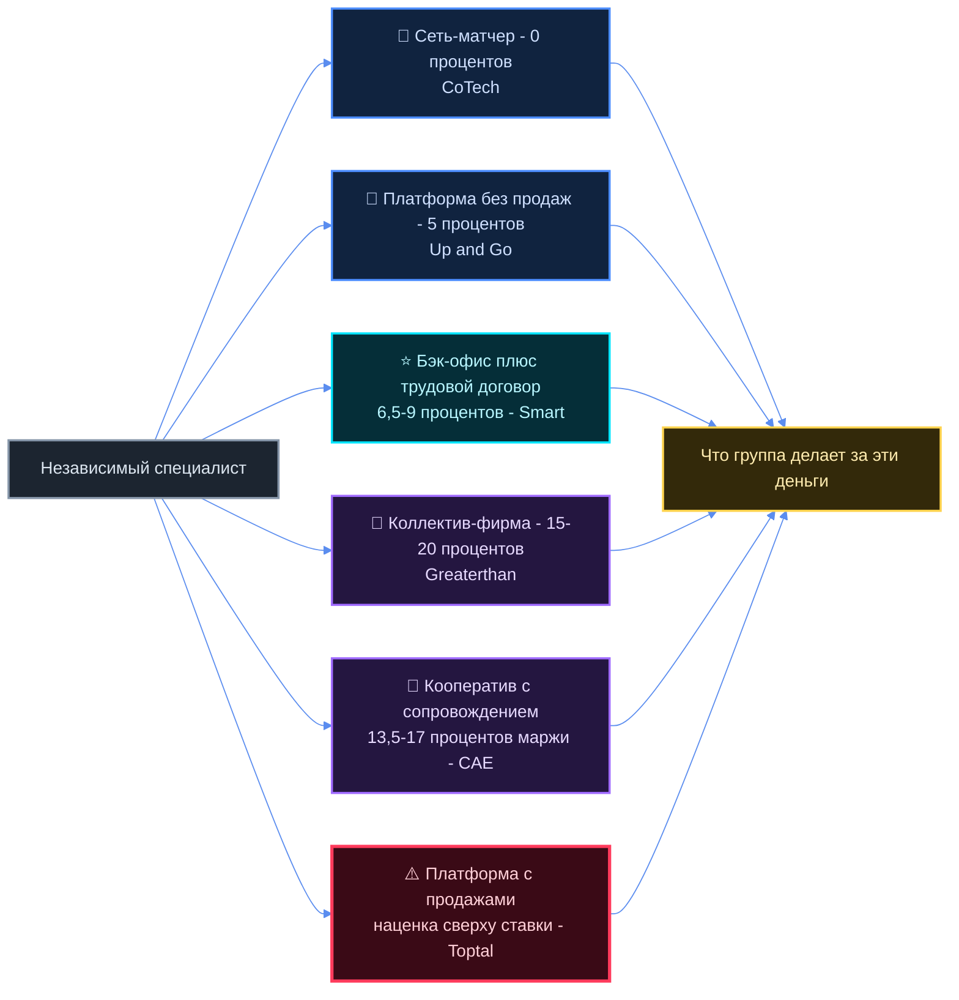
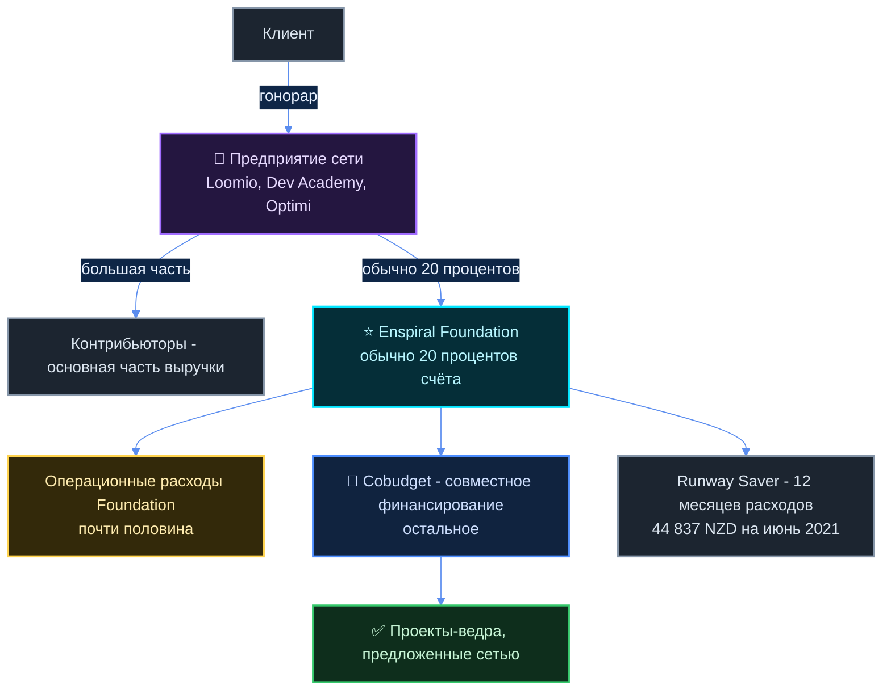
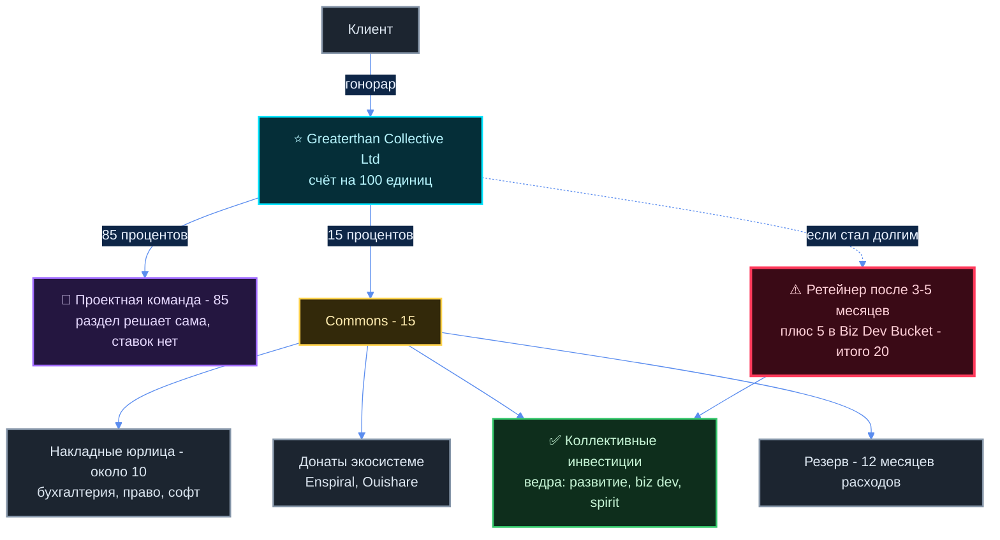
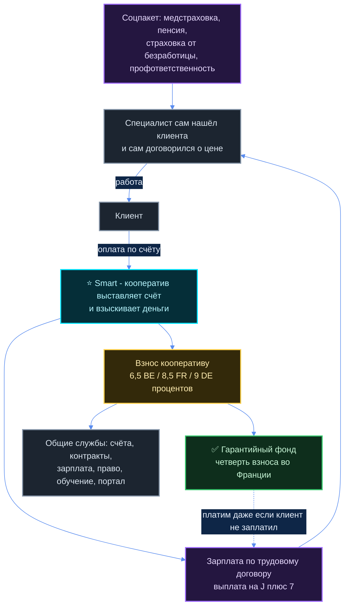
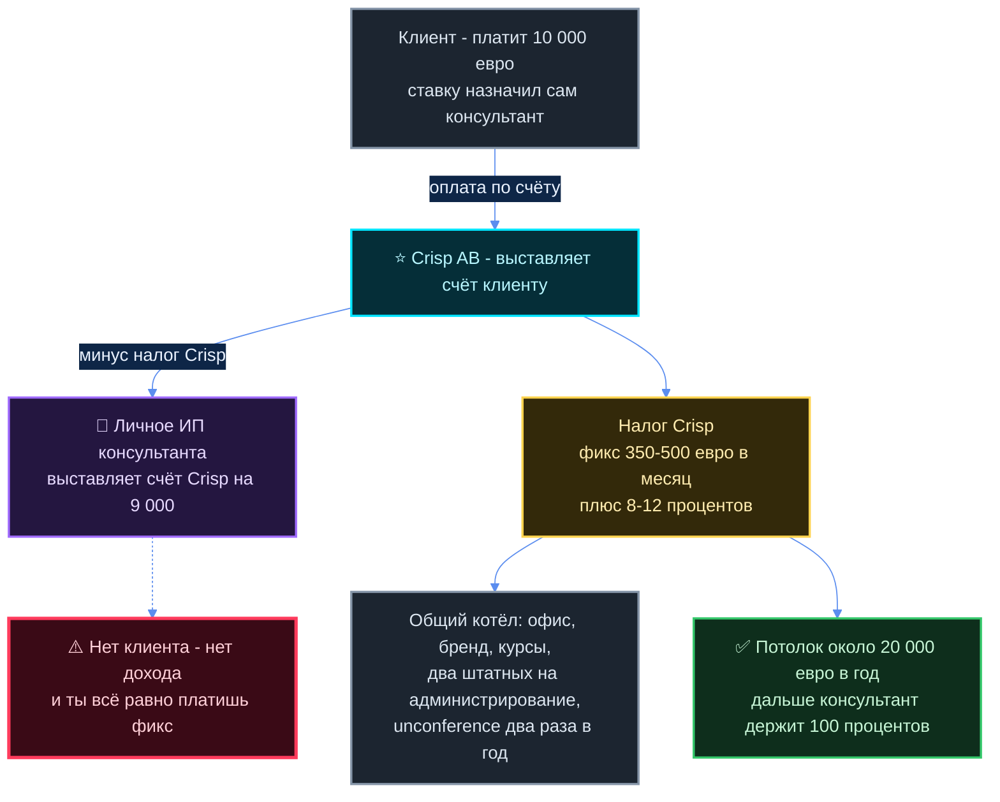
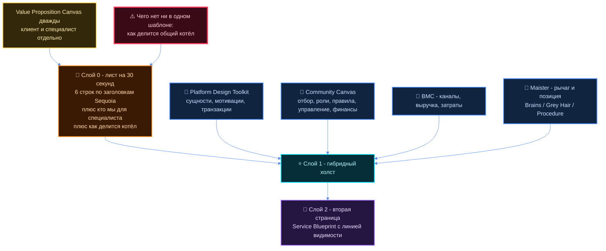

# Живые примеры: децентрализованные консалтинговые фирмы и сети специалистов

Это разбор **реально существующих** организаций, которые работают так, как задумано: группа независимых
специалистов, общий пул инструментов и экспертизы, команда собирается под проект. Ничего не придумано —
каждое число со ссылкой на источник. Где источника нет, так и написано: **ДАННЫХ НЕТ**.

**Чего здесь нет намеренно.** Классический консалтинг с цифрами Accenture, leverage-пирамида, модели оплаты
и риски уже разобраны в
[`biznes-reserch/docs/razbory/konsalting.md`](../../biznes-reserch/docs/razbory/konsalting.md), системная рамка
«как разбирать любой бизнес» — в
[`sistemnaya-ramka.md`](../../biznes-reserch/docs/razbory/sistemnaya-ramka.md). Этот документ не повторяет их,
а добавляет то, чего там нет: **сетевые, кооперативные и самоуправляемые модели**.

⛔ **Что здесь не делается.** Доли, проценты и цены для группы Руслана не предлагаются — это его решение.
Цитировать чужие числа можно и нужно, считать свои — нельзя.

---

## Суть за 30 секунд

Мир уже перепробовал семь разных ответов на вопрос «что берёт группа с независимого специалиста».
Разброс — от 0% до 17%, и он не случайный: **процент ровно равен тому, сколько работы группа берёт на себя.**

| Архетип | Живой пример | Что берёт группа | Размер | Жив? |
|---|---|---|---|---|
| Сеть-сообщество, деньги почти не общие | Enspiral (NZ) | членские взносы узлов; раньше 20% счёта | ~300 участников на пике | жив, но сжался |
| Коллектив-фирма с общим котлом | Greaterthan (UK) | 15% счёта, 20% на ретейнерах | 7 партнёров + 8 ассоциатов | ⚠️ **закрылся 2026** |
| Общий бэк-офис + трудовой договор | Smart (BE/9 стран), SMartDe eG (Берлин) | 6,5% (BE) · 8,5% (FR) · 9% (DE) | 35 000+ в год | жив, 28 лет |
| Кооператив с сопровождением | Coopaname, Oxalis (FR) | 13,5% маржи · ~17% маржи | ~300 (Oxalis) | жив |
| Сеть-матчер без котла | CoTech (UK) | **0% с проекта** | 27–28 кооперативов | жив |
| Платформа-пул экспертов | Toptal, A.Team, Catalant | наценка на ставку | десятки тысяч | жив |
| Кооператив кооперативов | Mondragón (ES), LKS Next | 13%+ прибыли в общий фонд | 70 085 человек | жив, 70 лет |



**Три факта, которые дороже всех успехов:**

1. **Enspiral** — самый известный в мире пример «сети независимых с общим капиталом» — пережил кризис
   платёжеспособности 2016–2018, честно пишет в своём же справочнике, что новички «разочаровываются и
   выгорают в первые 6–12 месяцев», и что «все люди внутри Enspiral не равны».
2. **Greaterthan** — организация, которая учила весь мир самоуправлению и чей справочник является лучшим
   публичным учебником по этой модели, — **закрылась**. Юрлицо переименовано 20 мая 2026.
3. **CoTech** за десять лет так и **не смог формализовать совместные тендеры**: нет ставок раздела выручки,
   нет правила «кто берёт клиента при пересечении компетенций».

---

## 1. Enspiral (Новая Зеландия, с 2010) — эталон «сети независимых»

### Что это

Сеть людей, которые поддерживают друг друга в «работе над тем, что имеет значение». Основал
**Joshua Vial** в 2010: он сам ушёл из веб-студии, делил время между волонтёрством и контрактами, и решил —
«если я помогу другим получать более дорогие контракты, вместе мы сможем делать интересные вещи»
([Shareable](https://www.shareable.net/enspiral-changing-the-way-social-entrepreneurs-do-business/)).
Началось с **двенадцати друзей, в основном программистов**
([там же](https://www.shareable.net/enspiral-changing-the-way-social-entrepreneurs-do-business/)).

В центре — **Enspiral Foundation**, благотворительная компания с ограниченной ответственностью, созданная в
2012. Она — юридический хранитель коллективных активов и то юрлицо, с которым у людей и компаний формальные
отношения. Каждый член держит **одну акцию без права на дивиденды**, то есть голос, а не деньги
([профиль Foundation в справочнике](https://github.com/enspiral/handbook/blob/master/ventures/venture_profiles/enspiral_foundation.md)).

### 1. Членство

- **Войти можно только по приглашению.** «Чтобы стать контрибьютором, тебя должен позвать член»; членов
  утверждали **решением с кворумом 75%** ([кейс CoTech 2016](https://wiki.coops.tech/wiki/Enspiral_Case_Study_2016)).
  Прямая формулировка: «Enspiral — курируемая сеть, вступить может не каждый».
- **Сейчас решение делегировано узлам.** «У узла есть власть пригласить нового человека в Enspiral. Каждый
  член узла автоматически член глобальной сети. Узел также имеет власть **заставить одного из своих членов
  покинуть сеть**» ([Nodes Agreement](https://handbook.enspiral.com/agreements/nodes.html)).
- **Деление «член / контрибьютор» убрали в середине 2022** — теперь решения формально доступны всем в сети
  ([гайд для новичков](https://handbook.enspiral.com/guides/newcomers.html)).
- Обязанности узла: минимум **два представителя** для связи с советом; **минимум два сбора в год**;
  письменная документация; своя политика членства с ответом на вопрос «на каком основании человека попросят
  уйти»; сообщать в Ops **в течение 5 рабочих дней** о приходе и уходе членов; брать с членов подписку
  ([Nodes Agreement](https://handbook.enspiral.com/agreements/nodes.html)).

### 2. ⭐ Схема денег

**Модель раннего Enspiral (2013 и далее).** Участники складывали **20% своего дохода в общий котёл**
([Cobudget: Sharing Power by Sharing Money](https://cobudget.com/resources/sharing-power-by-sharing-money-cobudget-in-enspiral)).
Из этих 20% примерно четверть уходила в Foundation, остальное — на прочие расходы сети. Независимое описание:
«предприятия распределяют выручку обратно контрибьюторам, а часть (обычно 20%) идёт в Foundation. Почти
половина этих средств покрывает операционные расходы Foundation, остальное инвестируется через совместное
финансирование в проекты, предложенные сообществом»
([Commons Transition Primer](https://primer.commonstransition.org/4-more/5-elements/case-studies/case-study-enspiral/)).
Отдельные предприятия выбирали свою ставку: **Enspiral Labs отдавала 10% выручки**; стартапы — **около 5%**
([кейс CoTech 2016](https://wiki.coops.tech/wiki/Enspiral_Case_Study_2016)).

**Модель сегодняшнего Enspiral.** Перешли на **месячные членские взносы плюс взносы компаний**
([Cobudget](https://cobudget.com/resources/sharing-power-by-sharing-money-cobudget-in-enspiral)).
Foundation получает деньги из пяти источников: индивидуальные подписки, взносы предприятий, CoBudget,
подписки Google Workspace, спонсорство рабочих групп и профицит со сборов
([Financial Transparency](https://handbook.enspiral.com/money/financial_transparency.html)).
**100% дохода Foundation реинвестируется в сеть** — она намеренно не зарабатывает сама
([профиль Foundation](https://github.com/enspiral/handbook/blob/master/ventures/venture_profiles/enspiral_foundation.md)).



**Cobudget — как общие деньги реально распределяются.** Совет решает провести раунд и выделяет сумму
(пример из справочника — **20 000 NZD**). Фасилитатор объявляет тему и даты. Любой в сети предлагает «ведро»
(проект) с запрошенной суммой. **Выделенные деньги делятся поровну между всеми участниками раунда**, и каждый
распределяет свой кусок как хочет — можно дать своему же проекту, можно не дать никому и вернуть в Foundation.
Получивший финансирование выставляет Foundation счёт по факту сдачи
([Collaborative Funding](https://handbook.enspiral.com/money/collabfunding.html)).
За три фасилитированных раунда израсходовали **около 40 000 USD**
([Cobudget](https://cobudget.com/resources/sharing-power-by-sharing-money-cobudget-in-enspiral)).

**Порядок величин, по которому видно реальный масштаб.** Средние расходы Foundation за 12 месяцев до июня
2021 — **3 100 NZD в месяц**, всего 34 959 NZD; на счёте «Runway Saver» лежало **44 837 NZD — 14 месяцев
запаса**, и доступ к ним требует 30 дней ожидания
([Financial Transparency](https://handbook.enspiral.com/money/financial_transparency.html)).
То есть ядро всемирно известной сети стоит примерно **2 000 € в месяц**.

### 3. Что даёт общий пул

Бренд и домены (все права на бренд Enspiral принадлежат Foundation, коммерческое использование — только с
одобрения совета или brand-группы), глобальная база членов, Loomio для решений, Slack, Google Workspace,
общая касса Cobudget, сборы и ретриты, справочник-handbook как общая память
([Nodes Agreement](https://handbook.enspiral.com/agreements/nodes.html),
[Financial Transparency](https://handbook.enspiral.com/money/financial_transparency.html)).

### 4. Как собирается команда под проект

**Через предприятия, а не через сеть.** Enspiral с самого начала «отказался от зарплат и сделал ставку на
маркетплейс-модель распределения ресурсов, с ясными бюджетами и результатами по разным проектам»
([Shareable](https://www.shareable.net/enspiral-changing-the-way-social-entrepreneurs-do-business/)).
Работу брали и делали **отдельные компании сети** (Enspiral Services, Enspiral Labs, Loomio, Dev Academy),
а сеть давала им людей, бренд и культуру. **На сегодня: «развитие предприятий больше не является активной
частью Enspiral»** ([Ventures](https://handbook.enspiral.com/ventures)). Остались четыре компании, которые
вносят деньги в сеть: Dev Academy, Optimi, Loomio и Greaterthan.

### 5. Как держится культура и что бывает за нарушение

- Формальные решения — **консенсусом** (не единогласием, а «ты можешь с этим жить»), в Loomio; «результат в
  Loomio считается официальным исходом» ([Decisions Agreement](https://handbook.enspiral.com/agreements/decisions.html)).
- Отдельные соглашения на личное поведение, домогательства и насилие, разнообразие, разрешение конфликтов
  ([список соглашений](https://handbook.enspiral.com/agreements/)).
- Санкция: **узел может заставить своего члена покинуть сеть**; совет может **распустить неактивный или
  «мятежный» узел** ([Nodes Agreement](https://handbook.enspiral.com/agreements/nodes.html)).
- Роль «катализатора» — распределённое исполнительное лидерство с ограниченным сроком. **Сейчас активных
  катализаторов нет** ([Catalyst Agreement](https://handbook.enspiral.com/agreements/catalyst.html)).

### 6. Размер

| Год | Что было | Источник |
|---|---|---|
| 2010 | 12 друзей-программистов | [Shareable](https://www.shareable.net/enspiral-changing-the-way-social-entrepreneurs-do-business/) |
| 2016 | 200–300 контрибьюторов, 50 членов Foundation, 15 предприятий | [кейс CoTech](https://wiki.coops.tech/wiki/Enspiral_Case_Study_2016) |
| 2016 | ~300 контрибьюторов, 17 предприятий | [Enlivening Edge](https://enliveningedge.org/field-reports/open-enspiral-lessons-participatory-network/) |
| 2026 | 3 узла (Europe, Forge, Kūmara), 4 компании вносят деньги, катализаторов нет | [Nodes](https://handbook.enspiral.com/nodes/index.html), [Ventures](https://handbook.enspiral.com/ventures) |

Публичной выручки сети нет — **ДАННЫХ НЕТ**: Foundation по конституции не зарабатывает, а предприятия
отчитываются сами за себя.

### 7. ⚠️ Что сломалось — самое ценное

**Кризис платёжеспособности 2016–2018.** Собственная формулировка Enspiral в разделе финансов, объясняющая,
зачем теперь держат 12-месячный запас: «Кризис сведения баланса, через который сообщество Enspiral прошло в
2016–2018, когда **модель выручки сообщества пересохла, а расходы остались**, что означало, что мы быстро
теряли деньги и шли в состояние банкротства»
([Financial Transparency](https://handbook.enspiral.com/money/financial_transparency.html)).
То есть модель «20% со счетов» не выдержала — её заменили на подписку.

**Новички выгорают.** Из официального гайда для новичков: «многие **разочаровываются, расстраиваются и
выгорают в первые 6–12 месяцев**. Энтузиазм сменяется разочарованием от отсутствия прогресса, от того, что их
не слышат, или от самого уровня энергии, необходимого для того, чтобы оставаться вовлечённым на высоком
уровне». И отдельно: «**Многие новички уходят из Enspiral в первые 12–18 месяцев**»
([Newcomers](https://handbook.enspiral.com/guides/newcomers.html)).

**Равенства нет, и они это признают.** «Не все мнения и перспективы имеют равный вес в этих процессах… есть
значительный социальный капитал, который держат конкретные люди, хотят они того или нет… **Все люди внутри
Enspiral не равны, и это стоит признать с самого начала**» ([Newcomers](https://handbook.enspiral.com/guides/newcomers.html)).

**Разрыв между картинкой и реальностью.** «Картина Enspiral, которая представлена вне сети, может заметно
отличаться от опыта, который ты находишь, присоединившись… Присоединяйся потому, что думаешь, что тебе здесь
место, а не потому, что тебе нужно, чтобы Enspiral делал, был или доставлял что-то конкретное»
([Newcomers](https://handbook.enspiral.com/guides/newcomers.html)).

**«Тёмная экономика» и число Данбара.** Названные ими же проблемы: «как убедиться, что узкая группа
энтузиастов не оказывается делающей невидимую, неблагодарную работу и не начинает чувствовать себя
обесцененной?»; «как масштабировать культуру доверия и заботы, когда размер группы становится слишком большим,
чтобы поддерживать стабильные социальные отношения между всеми?»; «является ли отсутствие связности и
безбилетничество просто ценой, которую приходится платить за автономию в неиерархических организациях?»
([Enlivening Edge](https://enliveningedge.org/field-reports/open-enspiral-lessons-participatory-network/)).
При ~300 участниках они обсуждали «митоз» — деление на меньшие группы. **Это и стало узлами.**

**Cobudget тоже чинили.** Честный список проблем ранней версии: финансировали «много мелочи, которая была
скорее nice-to-have, чем критичной» (поездки на конференции, подписка на газету, фирменные футболки, еда на
командные события); «стратегические разговоры о том, как лучше тратить наши деньги, случались недостаточно»;
деньги «застревали» — накапливались на личных счетах участников и не тратились, и было непонятно, копят они
намеренно или просто выпали из процесса
([Cobudget](https://cobudget.com/resources/sharing-power-by-sharing-money-cobudget-in-enspiral)).
Лечение — фасилитированные раунды с темой, датами и ведущим.

### 8. Что ложится на замысел, а что нет

**Ложится:**
- Юрлицо-хранитель с голосующей акцией без дивидендов: контроль есть, выхода-продажи нет.
- Узлы как ответ на Данбара. Если цель 1000–1500 человек, **монолит невозможен физически** — Enspiral
  столкнулся с этим на 300. Узел = группа до ~50–150 со своей политикой приёма и своими деньгами.
- Право узла выгнать своего члена — санкция есть и она локальна.
- Гайд для новичков, который честно гасит завышенные ожидания. Это дешёвый и сильный инструмент.
- Запас на 12 месяцев расходов ядра как обязательное правило, а не как пожелание.

**Не ложится:**
- «20% со счёта в общий котёл» в чистом виде **провалилось у них же**. Подписка оказалась устойчивее.
- Cobudget с равным делением общей суммы между участниками — это механика на 20–40 тысяч в год, не на бизнес.
- Enspiral — не консалтинговая фирма. Он никогда не продавал проекты как единая фирма: продавали отдельные
  компании внутри. Для «из группы собирается команда под сложный проект» прямого примера у них **нет**.

---

## 2. Greaterthan (UK + узлы, 2017–2026) — ⚠️ лучший учебник и закрытый эксперимент

### Что это и почему это главный экспонат

Самоуправляемый консалтинговый коллектив, который учил организации участию, самоуправлению и прозрачным
деньгам. Начался в ноябре 2016 с **Francesca Pick** и **Jessy-Kate Schlinger** вокруг совместного
бюджетирования; в январе 2017 они встретились на сборе Enspiral в Новой Зеландии, чтобы работать над
Cobudget, и **Enspiral передал Greaterthan опеку над софтом Cobudget**. Летом 2018 к ним пришли
Susan Basterfield и Anthony Cabraal, и Greaterthan стал кооперативной компанией; **Enspiral Venture с 2018**
([History](https://handbook.greaterthan.works/about-greaterthan), раздел History).

**⚠️ Их больше нет.** Юрлицо **GREATERTHAN COLLECTIVE LTD** (регистрация 30 мая 2018, Companies House
№ 11387616) носило это имя **с 30 мая 2018 по 20 мая 2026**, после чего переименовано в
**COMMON GROUND LAB LTD** ([Companies House 11387616](https://find-and-update.company-information.service.gov.uk/company/11387616)).
Домен `greaterthan.works` сейчас редиректит на страницу-мемориал
«[Greaterthan Collective Legacy](https://greaterthan.my.canva.site/)», а `commonground.now` — новая
инициатива, которую «начало подмножество бывших членов Greaterthan» как «следующую эволюцию того
эксперимента» ([Common Ground: Seeding Common Ground](https://commongroundcollective.substack.com/p/seeding-common-ground),
[Welcome to Field Notes](https://commongroundcollective.substack.com/p/welcome-to-field-notes)).

**Их справочник остаётся открытым и это самый подробный публичный учебник по этой модели.** Ниже — его
механика целиком.

### 1. Членство: три уровня

| Уровень | Самоопределение | Права | Обязанности |
|---|---|---|---|
| **Partner** | «Greaterthan — мой профессиональный дом» | равный акционер материнской UK-компании, **1 акция на человека**; минимум участия и консента по значимым решениям; 50% match-фондирования на обучение | **всю работу в областях фокуса GT вести через GT**; участвовать в значимых решениях; ходить на встречи партнёров |
| **Associate** | «GT — одно из мест моей профессиональной активности» | приоритет на платных проектах GT; право выставлять счёт через бренд и юрлицо GT; представлять GT публично; доступ к общей базе знаний; домен-почта; участие в стратегических решениях; 25% match-фондирования | квартальные встречи всех членов; держать актуальным **«commitment statement»** — чем именно намерен вкладываться; участвовать в процессе подотчётности; годовой ритуал «opt-in»; **вносить вклад в деятельность, приносящую доход** |
| **Explorer** | «GT — профессиональная сеть, в которую я присматриваюсь» | Slack, календарь открытых встреч, дашборды людей и проектов | **в течение 12 месяцев объяснить, в какой роли остаётся — или выйти**; соблюдать ценности |

([People Agreement](https://handbook.greaterthan.works/agreements/people-agreement))

**Как входят.**
- **Explorer** — приглашает любой член через advice process: пост в канале `#inviting-explorers` с
  **3-дневным окном на возражения** и обязательным @-упоминанием тех, кто тоже знает человека.
- **Associate** — предлагает существующий член или просит сам explorer при поддержке члена. **Минимальные
  критерии: «существующие и установившиеся рабочие отношения с несколькими членами» и «наблюдаемая
  приверженность развитию Greaterthan как общего, commons-based бизнеса и бренда».** Кандидат публично
  отвечает на четыре вопроса (почему важно, что буду вкладывать в commons, что хочу от commons, что ещё
  должны знать). **Утверждается консенсусом всех членов в Loomio.**
- **Partner** — приглашает партнёр или просит ассоциат; **консенсус партнёров** + совет ассоциатов;
  **минимум год в статусе ассоциата**.

**Как выходят.** Ассоциат — в любой момент, но «уместно» предупредить за 3 месяца; каждый сентябрь — ритуал
«opt-in» как естественный момент смены роли. Партнёр — за 3 месяца, и дальше **закрывающая встреча лично с
участием минимум 75% всех партнёров**: круг рефлексии о его времени в GT + договорённость о «справедливых
условиях выхода, учитывающих личные вложения в бизнес» (варианты: участие в решениях о профиците на
несколько лет вперёд, capped return на будущий профицит). **После этой встречи его акции выкупаются обратно
за £0,01 за акцию.** Встреча должна пройти не позже года с момента заявления о выходе.
**Общий принцип: любой член может созвать экстренную встречу по поводу неприемлемого поведения любого
участника, ассоциата или партнёра, что может привести к его удалению.**
([People Agreement](https://handbook.greaterthan.works/agreements/people-agreement))

**Alumni** — подмножество Explorer'ов, которые были членами минимум год: остаются в Loomio без права голоса,
сохраняют доступ к диску и почту-алиас. Логика: «мы хотим поощрять людей входить и выходить из членства,
когда меняются обстоятельства».

### 2. ⭐ Схема денег — опубликована полностью

**«Вся контрактная работа, выставленная через Greaterthan Collective Ltd, вносит 15% в commons
Greaterthan.»** В эти 15% входят:
- **примерно 10%** — накладные на содержание юрлица: операционная поддержка, бухгалтерия, юридические
  расходы, фиксированная стоимость софта;
- регулярные донаты сообществам экосистемы (исторически — Enspiral и Ouishare);
- коллективные «инвестиции» в существующие и новые проекты и внутренние инициативы.

**Исключение вниз:** «для определённых типов контрактов, над которыми работают не-партнёры, процент в commons
может быть ниже, предмет переговоров» — в зависимости от размера и сложности контракта.

**Исключение вверх до 20%:** если контракт после первой фазы (**через 3–5 месяцев**) превращается в
регулярный ретейнер или долгую работу, **дополнительные 5% выручки контракта идут в отдельный Biz Dev
Bucket** по факту оплаты счетов. Когда именно включаются эти 5%, решает проектная команда по совету
Biz Dev Stewards. Правило принято в мае 2021.

**Резервы:** commons-бюджет держится с **12-месячным запасом** от средних месячных операционных расходов;
если запас рискует упасть ниже порога, Minimum Viable Board обязан предупредить партнёров. Решение принято в
Loomio в сентябре 2022.
([Financial Agreement](https://handbook.greaterthan.works/agreements/financial-agreement))

**Ставки и раздел внутри проекта — намеренно НЕ стандартизированы.** Прямая цитата: «**Нет стандартизированных
дневных или часовых ставок за работу, нет и процессов того, как распределяются проектные бюджеты**, поскольку
они варьируются между контрактами, типами работы и уровнем экспертизы контрибьюторов. Каждая проектная
команда вольна выбрать подход к распределению своего бюджета, пока намерение остаётся — найти справедливое
распределение бюджета между членами команды». Условие одно: бюджет прозрачен для всей организации и у него
есть один названный ответственный. Многие команды используют практику **Happy Money Story**.
([Financial Agreement](https://handbook.greaterthan.works/agreements/financial-agreement))



**Решения о деньгах — два порога.** До **1500 €** любой член решает сам через advice process, но обязан:
объявить в Slack-канале `#moneydecisions`, задокументировать, у кого брал совет, в трекере решений, и
опубликовать итог. Выше 1500 € — consent-решение в Loomio в отдельной финансовой ветке. Этим же путём решают
пополнение «вёдер» и стратегическое распределение профицита commons. Для детального распределения профицита
используют Cobudget **1–2 раза в год**.
([Decision Agreement](https://handbook.greaterthan.works/agreements/decision-making-agreement))

**Три «ведра» общих денег, устройство которых стоит скопировать:**
- **Development Bucket** — фиксированный годовой бюджет (на момент публикации **2000 €**) на обучение.
  Партнёрам **50% match-фондирования**, ассоциатам **25%**. Чтобы взять — получить совет у одного-двух членов,
  заполнить форму, выставить счёт. Остаток виден всем в Open Books.
- **Biz Dev Bucket** — наполняется **теми самыми +5% с долгих контрактов**, ежемесячно. Из него платят за
  **время**, потраченное на продажи (звонки, ответы на RFP, написание предложений, заявки на гранты) и
  **50–100% расходов** на поездки и участие в событиях. Важное правило: «если лид конвертировался в проект,
  ожидается, что проект покрывает компенсацию за biz dev и работу по продаже. **Если продажа не удалась,
  твоё время и расходы могут быть компенсированы из этого ведра.**» Средства бронируются на 4 месяца, после
  чего заявка «истекает».
- **Spirit Bucket** — отдельное ведро, назначение в справочнике не раскрыто подробно.
([Development Bucket](https://handbook.greaterthan.works/working-together/development-bucket),
[Biz Dev Bucket](https://handbook.greaterthan.works/working-together/biz-dev-bucket))

### 3. Что даёт общий пул

Юрлицо для выставления счетов (UK + Новая Зеландия с сентября 2021 + немецкий e.V., перешедший из
Ouishare Deutschland в январе 2025), бренд и его лицензия, домен-почта, общая база знаний, Loomio, дашборды
людей и проектов, приоритет на платных проектах, бюджет на обучение с match-фондированием, оплата времени на
продажи даже при проигрыше, 12-месячный резерв, квартальные встречи с финансовым обзором, выездные сборы
3–5 дней каждые 3–6 месяцев.
([Regional nodes & entities](https://handbook.greaterthan.works/about-greaterthan/constitution-and-governance/regional-nodes-and-entities),
[Rhythms & Rituals](https://handbook.greaterthan.works/working-together/rhythms-and-rituals))

**Форма собственности — steward-ownership с «золотой акцией».** Контроль не является товаром; прибыль —
средство, а не цель. Чтобы это нельзя было отменить, **благотворительный Purpose Foundation держит
«Guardian Share» с правом вето**. Их собственная формулировка: «**Наша компания построена не для того, чтобы
из неё выйти, а чтобы быть источником непрерывного создания ценности для всех её стейкхолдеров.**»
([Constitution & Governance](https://handbook.greaterthan.works/about-greaterthan/constitution-and-governance))

### 4. ⭐ Как собирается команда под проект — готовый регламент

Это ровно тот вопрос, который у Руслана в центре. У Greaterthan он написан как **принципы, а не правила**
(версия 1.0, август 2022):

**Продажа.**
- **Маленькая команда предложения, не больше двух человек на контакте с клиентом.** Логика: продажи чаще не
  конвертируются, а предложение требует глубокого погружения — не надо жечь время многих. «Клиент на этой
  стадии не должен встретить больше двух человек из GT.»
- **В команде предложения обязателен партнёр или ассоциат.** Возможность может принести и вести кто угодно,
  но нужен «линк и сенсор», который принесёт исторический контекст, опыт других проектов, понимание подхода и
  знание, кого ещё из GT подтянуть.

**Решение брать проект или нет.** Если предложение выиграно и работа соответствует миссии — решение
неформальное: **consent тех, кто продал, и команды исполнения.** «Если внутри GT никого нет или недостаточно
людей, готовых работать над проектом, **то он не происходит**». Для больших долгих проектов (примерно
**4+ человека на part-time**) в решение включаются минимум **2 партнёра**.

**Сборка команды.**
- **Проекты ведут партнёры или ассоциаты** — это форма «контроля качества». Если ведёт explorer, его должен
  активно поддерживать партнёр или ассоциат.
- Ведущий продажу обязан внятно сформулировать и понимание нужды клиента, и **требуемый профиль** (навыки,
  опыт, сеньорность, география) — чтобы другие сами поняли, подходят ли.
- **Четыре критерия отбора:** ① география, навыки, доступность (люди обязаны честно говорить о своей
  загрузке, не перебирая на себя); ② **«учитывать, как сейчас распределена работа в GT» — то есть кто
  сейчас нуждается в работе и доходе**; ③ **приоритет по уровню приверженности: сначала партнёры, потом
  ассоциаты, потом explorer'ы**; если берут вообще внешнего человека — публично объясняют, почему;
  ④ «разные проекты допускают разный риск» — где ставки ниже, туда намеренно берут тех, с кем ещё не
  работали, или тех, кто растёт в теме.
- **Финальное слово — у ведущего проекта.** Если кого-то не взяли и человеку некомфортно, предлагается
  открытый разговор с обратной связью, почему он может не подходить.
- Как только команда собрана, это публикуется в канале `#pipeline-and-new-projects` вместе с рефлексией о
  том, что было сложно при сборке.
([Sales process & team formation](https://handbook.greaterthan.works/working-together/sales-process-and-team-formation))

### 5. Как держится культура и что бывает за нарушение

- **Пять принципов:** «больше, чем сумма наших частей»; «заземляйся в практике»; «работай с властью»;
  «оставайся бесконечно любопытным»; «веди с (со)страданием и аутентичностью»
  ([Our Values & Principles](https://handbook.greaterthan.works/about-greaterthan/our-principles)).
- **Принципы решений:** недоминирование («поэтому мы избегаем голосования»); **«предпринимательство равно
  власти решать»** — решают те, кто реально и регулярно в работе; субсидиарность; открытая коммуникация.
  Чем больше последствия — тем больше людей вовлекают.
- **Два типа групповых решений:** Standard — проходит, если нет блоков, порога вовлечения нет, минимум
  3 рабочих дня, «ленивый консент» (не голосуешь — значит согласен). Significant — проходит, если нет блоков
  **и больше 50% высказавшихся согласны**, **все партнёры обязаны участвовать**, минимум 5 рабочих дней
  (поощряется 10). Significant — это изменения соглашений и инвестирование профицита.
- **Исключение из правила «консент»: приглашение новых партнёров и ассоциатов решается КОНСЕНСУСОМ** — все
  члены должны согласиться.
- **Подотчётность через «пузыри»:** группы минимум по 3 человека, встречаются минимум раз в 6 недель,
  рефлексируют и обновляют свои commitment statements.
- **Санкция:** экстренная встреча по поводу неприемлемого поведения → возможное удаление.
([Decision Agreement](https://handbook.greaterthan.works/agreements/decision-making-agreement),
[People Agreement](https://handbook.greaterthan.works/agreements/people-agreement))

### 6. Размер

На октябрь 2025: **7 партнёров** (Francesca Pick с февраля 2017, Susan Basterfield с июля 2018, Elena Denaro,
Mary O'Keeffe, Lucia Die Gil, David Weingartner, Alicia Trepat) и **8 ассоциатов**. В списке «Previous Members»
— **16 человек**, включая соосновательницу Cobudget-линии Jessy-Kate Schlinger (7 месяцев), Kate Beecroft
(6,5 лет), Anthony Cabraal (3 года), Tom Nixon, Lisa Gill, Patrick Andrews
([Partners and Associates](https://handbook.greaterthan.works/about-greaterthan/partners-and-associates)).
То есть **примерно 15 активных членов при 16 ушедших за 9 лет** — текучесть выше 50% состава.
Выручка — **ДАННЫХ НЕТ**, публично не раскрывалась.

### 7. ⚠️ Что сломалось

**Закрылись.** После почти десяти лет стало ясно, что форма Greaterthan больше не служит цели коллектива;
после «долгой фазы рефлексии, исследования и проработки напряжений» решили закрыть Greaterthan как глобальный
коллектив в **апреле 2026**; он превратился в сеть отдельных инициатив, связанных историей, практикой и
отношениями ([Greaterthan Collective Legacy](https://greaterthan.my.canva.site/) — страница-мемориал на
домене greaterthan.works). Юридическое подтверждение: переименование 20 мая 2026
([Companies House](https://find-and-update.company-information.service.gov.uk/company/11387616)).
**Детальных причин они публично не называют** — формулировка «напряжения» без расшифровки. Это сама по себе
информация: организация, чья профессия — прозрачность и работа с конфликтом, закрылась, не опубликовав разбор.

**Что видно по справочнику ещё до закрытия:**
- Раздел «Больше не активно или сейчас не активно» перечисляет **встречу партнёров каждые 2 недели** и
  **«Services Exchange» каждые 2 недели** — тот самый обмен, где кросс-опыляли проекты и просили людей на
  проекты. Главный механизм «кто кого берёт в команду» **перестал собираться**
  ([Rhythms & Rituals](https://handbook.greaterthan.works/working-together/rhythms-and-rituals)).
- Там же помета на разделе коммуникаций: «*[больше не актуально — будет пересмотрено в сентябре 2023]*».
- Текучесть: 16 ушедших против 15 оставшихся; из семи партнёров в списке 2025 года **двое** в коллективе с
  2017–2018, остальные пять стали партнёрами в 2020–2023.
- Правило для партнёра «**всю свою работу в областях фокуса GT вести через GT**» — это очень жёсткая
  эксклюзивность для «независимого специалиста». Именно в этом месте модель «каждый зарабатывает своё плюс
  общий пул» ломается: партнёр больше не свободен.

### 8. Что ложится на замысел, а что нет

**Ложится почти целиком — это и есть искомый трафарет:**
- **Три уровня членства с разными правами и разными обязанностями.** Это прямой ответ на «1000–1500
  участников»: большинство — Explorer, узкое ядро — партнёры. Нельзя давать всем одинаковый доступ к общему
  котлу.
- **Критерий приёма в члены словами, а не анкетой:** «существующие и установившиеся рабочие отношения с
  несколькими членами» + «наблюдаемая приверженность развитию как общего бизнеса». Это проверяемо и не
  требует собеседования.
- **Commitment statement + пузыри подотчётности.** Руслан говорит «каждый обязан вкладываться на сто
  процентов». У Greaterthan это оформлено: публичное заявление, чем вкладываюсь, и тройка, которая раз в
  6 недель спрашивает.
- **Регламент сборки команды под проект** (раздел 4 выше) — готовый, рабочий, с критерием «кто сейчас
  нуждается в работе» и с приоритетом по уровню приверженности.
- **Оплата времени на продажи из общего ведра, даже если продажа не состоялась.** Это решает главную болезнь
  сетей: никто не хочет вкладываться в продажи, потому что это бесплатный риск.
- **Два порога решений по деньгам** (сам / все) вместо согласования всего со всеми.
- **Правило «если внутри никого нет, кто хочет это делать — проект не происходит»**: честное признание, что
  сеть не может обещать клиенту ресурс.
- **Выход с выкупом акции за £0,01 и закрывающей встречей.** Вход и выход описаны заранее — это снимает
  половину будущих конфликтов.

**Не ложится:**
- **Эксклюзивность партнёра** («всю работу через GT») противоречит формуле «каждый зарабатывает то, что он
  зарабатывает». Либо эксклюзивность только в областях фокуса группы, либо её нет совсем — и тогда нужен
  другой стимул вести контракты через общее юрлицо.
- **Отсутствие стандартных ставок.** На 15 человеках «команда сама договорится по-справедливости» работает.
  На 1000–1500 это гарантированный источник обид и бесконечных разговоров о деньгах.
- **Консенсус всех членов при приёме нового.** На 15 людях — фильтр. На 1000 — физически невозможно; это и
  есть причина, почему Enspiral ушёл в узлы.
- Масштаб: это была организация **примерно из пятнадцати человек**. Весь её справочник написан под эту
  величину. Переносить механику целиком на 1000+ нельзя — переносятся **принципы и форма документов**.

---

## 3. Smart (Бельгия, с 1998) и SMartDe eG (Берлин) — ближайший структурный аналог

### Что это

«Общее предприятие» (*entreprise partagée*): кооператив, который берёт на себя всё, кроме самой работы.
Человек сам находит клиента, сам договаривается о цене и условиях — а кооператив выставляет счёт, взыскивает
деньги, платит ему **зарплату по трудовому договору** и держит юридическую и социальную оболочку.
Создан в Бельгии в **1998** людьми из культурного сектора, в **2017** оформлен как кооператив
([ЕС, Social Innovation Match](https://european-social-fund-plus.ec.europa.eu/en/social-innovation-match/case-study/smart-coop)).

### 1. Членство

Фильтра по квалификации нет — это принципиальное отличие от всех остальных примеров. Чтобы пользоваться
инструментами Smart, надо стать пайщиком, покупая **одну или несколько кооперативных долей по 30 € ежегодно**
(Бельгия) — и это даёт право голоса на общем собрании, участия в рабочих группах и выдвижения в совет
директоров ([брошюра Smart Belgique 2024, PDF](https://smartbe.be/wp-content/uploads/2024/02/smart_brochure_utilisateurs_FR_2024_WEB.pdf)).
В Германии вход — **разовый взнос 50 €**
([Social Economy Berlin](https://socialeconomy.berlin/stakeholder/smartde-eg/), числа взноса там нет;
цифра 50 € — из [разбора copetri](https://www.copetri.com/smartde-eg-soziale-absicherung-von-soloselbstaendigen/)).
Ограничение по виду деятельности: только **услуги без лицензирования** — консалтинг, IT-поддержка, разработка,
образование, перевод, творческая работа; **торговля товарами исключена**
([smartde.coop](https://smartde.coop/selbstaendige/)).
Порог для социального страхования в Германии: заработок минимум **800 €/месяц** через Smart
([там же](https://smartde.coop/selbstaendige/)).

### 2. ⭐ Схема денег — опубликована, с процентами

| Страна | Что удерживает кооператив | Источник |
|---|---|---|
| Бельгия | **6,5% от оборота** (фиксированный взнос) **+ переменный взнос ~8% от «Бюджета, выделенного на занятость»** | [брошюра Smart Belgique 2024](https://smartbe.be/wp-content/uploads/2024/02/smart_brochure_utilisateurs_FR_2024_WEB.pdf) |
| Франция | **8,5%** от суммы услуг без налогов, из которых **четверть идёт в гарантийный фонд** | [Essentiel Santé Magazine](https://www.essentiel-sante-magazine.fr/societe/economie-sociale-et-solidaire/smart-cooperative-europeenne-aux-30000-associes) |
| Германия | **9,0% от net-суммы счёта** («The Smart fee… is 9% of the net invoiced amount») | [smartde.coop/en/freelancers](https://smartde.coop/en/freelancers/) |

Немецкую ставку поднимали: с изначальных 7% до 9% решением общего собрания членов, чтобы финансировать
цифровизацию сервисов ([copetri](https://www.copetri.com/smartde-eg-soziale-absicherung-von-soloselbstaendigen/)).
Правило, которое стоит отметить отдельно: **«пока у тебя нет деятельности — никаких взносов»**
([брошюра](https://smartbe.be/wp-content/uploads/2024/02/smart_brochure_utilisateurs_FR_2024_WEB.pdf)).
И ещё одно: **Smart не вознаграждает пайщиков за капитал — ни дивиденда, ни роста стоимости пая.**
Вся прибыль идёт обратно в сервисы.



### 3. Что даёт общий пул

Выставление счетов и взыскание долгов, контракты, расчёт зарплаты и учёт расходов, трудовой договор (а с ним
медстраховка, пенсия, страховка от безработицы), страхование профессиональной ответственности, юридические
консультации, обучение, портал управления, рабочие пространства, общий номер VAT.
**Главное: оплата человеку на J+7 после оказанной услуги и гарантия выплаты, даже если клиент задержал или не
заплатил.** И отдельная формулировка из брошюры: «**индивидуальное банкротство внутри общего предприятия
невозможно**»
([брошюра Smart Belgique 2024](https://smartbe.be/wp-content/uploads/2024/02/smart_brochure_utilisateurs_FR_2024_WEB.pdf),
[smartde.coop](https://smartde.coop/selbstaendige/)).

### 4. Как собирается команда под проект

**Никак — и это честная граница модели.** Smart не продаёт проекты и не собирает команды. Он даёт оболочку.
Коллективы могут работать внутри него как группа, но клиента ищут сами. Публично описанного механизма
«бриф → команда» у Smart **нет**.

### 5. Культура и санкции

Участие в управлении открыто всем пайщикам (голос, рабочие группы, выдвижение в совет). Это соцзащита и
солидарность, а не культура взаимопомощи по работе. Механизма исключения за нарушение культуры в публичных
документах не описано — **ДАННЫХ НЕТ**.

### 6. Размер

- **40 городов, 9 стран ЕС**: Бельгия, Франция, Италия, Испания, Германия, Австрия, Нидерланды, Швеция,
  Венгрия. **«Более 35 000 фрилансеров пользуются Smart Coop каждый год.»** В Бельгии и Франции —
  **261 штатный сотрудник**. Оборот **200 млн € в 2018**. **250 частных и государственных партнёров**
  ([ЕС, Social Innovation Match](https://european-social-fund-plus.ec.europa.eu/en/social-innovation-match/case-study/smart-coop)).
- Собственная брошюра 2024 даёт более скромные числа: **более 20 000 работников пользовались услугами Smart
  в Бельгии в 2022**, сеть партнёров в **7 странах**, в Бельгии кооператив в **9 городах**
  ([брошюра](https://smartbe.be/wp-content/uploads/2024/02/smart_brochure_utilisateurs_FR_2024_WEB.pdf)).
- Германия: **1 200+ членов, из них ~300 трудоустроенных фрилансеров** на декабрь 2024
  ([platform.coop](https://platform.coop/blog/smart-coop-germany-reinventing-freelance-work/)).

⚠️ Числа по Smart в разных источниках расходятся в разы (120 000 / 35 000 / 30 000 / 20 000), потому что
считают разные вещи: «когда-либо пользовались», «пользуются ежегодно», «стали пайщиками». Какая цифра к какой
категории относится, источники формулируют нечётко.

### 7. ⚠️ Что сломалось

**Паспортный процент не равен реальному.** Бельгийская отраслевая организация audiovisuel пишет, что цифра
6,5% больше не отражает реальную цену после законодательных изменений **2015 года**: сверху ложатся расходы
при создании контракта (страховки, ~+2%), а сама Smart упоминает средний **7,5% операционного бюджета**
([mediarte.be: «Pourquoi vous feriez mieux de (ne pas) travailler avec SMart ?»](https://www.mediarte.be/fr/dossiers/carriere/autres-conditions-de-travail/pourquoi-vous-feriez-mieux-de-ne-pas-travailler-avec)).

**Жёсткая критика от членов (март 2024).** Объединение художников утверждает: сборы выросли с изначальных 4%
до **~12% суммарно** (6,5% на выставление + 5,5% «мутуализированная часть») плюс 30 €/год за паи; Smart
приостановила контракты по «article 1bis», **не посоветовавшись с затронутыми членами**, что противоречит её
же кооперативным и солидарным ценностям; её «largely dominant» позиция посредника в арт-секторе используется,
чтобы навязывать свои правила
([abdil.be: «Smart : Société qui Méprise les Artistes ?»](https://abdil.be/Actualites/article/smart-societe-qui-meprise-les-artistes)).

**Это и есть главный урок: общий бэк-офис со временем дрейфует в собственные интересы и начинает решать за
членов.** Чем больше людей, тем сильнее дрейф — 35 000 человек не контролируют свой кооператив реально.

### 8. Что ложится, а что нет

**Ложится:**
- Процент как **плата за конкретную работу**, а не как «налог на принадлежность». У Smart каждый процент
  объясним: счёт, взыскание, зарплата, страховка.
- **«Нет деятельности — нет взносов»** снимает главный страх независимого специалиста.
- **Гарантийный фонд из доли взноса** (Франция: четверть от 8,5%) — вот как получается платить человеку,
  даже если клиент не заплатил. Это прямая, работающая механика переноса риска с человека на группу.
- Отсутствие дивиденда и роста стоимости пая — та же логика, что у steward-ownership у Greaterthan.
- **Берлинская привязка.** SMartDe eG физически в Берлине (Wilhelmstraße 150, 10963), занимается ровно
  консалтингом и IT, берёт 9%. Это ближайший живой образец для сравнения на том же рынке.

**Не ложится:**
- Нет фильтра на входе — и поэтому нет общей экспертизы и нет культуры взаимопомощи по работе. Это
  инфраструктура, а не фирма.
- **Никто не продаёт проекты.** В замысле Руслана главное — «из группы собирается команда под сложный
  проект». Smart этого не делает и не умеет.

---

## 4. Французская модель CAE — кооператив активности и занятости

Юридическая форма, придуманная ровно под «независимый, но с общей оболочкой»: кооператив даёт фрилансеру
трудовой договор **«entrepreneur-salarié»** и общий бэк-офис за опубликованный процент.

**Coopaname (Париж).** Сейчас: **фиксированная плата 30 €/месяц** (снимается, если человек на минимальных
соцпособиях) + **переменная 13,5% от валовой маржи**. Исторически было **10% от оборота**, потом перешли на
**11,5% от валовой маржи** — чтобы те, у кого много закупок, могли вычесть их из базы. Эти деньги держат
**38 штатных** (админ, налоги, право), мастерские и солидарные механизмы. Их собственная формулировка: это не
плата за услугу, а «**способ, которым мы вместе обзаводимся рабочим инструментом**»
([coopaname.coop](https://www.coopaname.coop/integrer-cooperative-activites-emploi/accompagnement-entrepreneur-salarie)).

**Oxalis (SCOP CAE).** Почти **300 кооператоров, из них ~250 предпринимателей**. Вклад считается от оборота
минус производственные затраты, **по траншам**: 0–2 000 € / 2 001–100 000 € / 100 001–150 000 € / свыше
150 001 €, к каждому своя ставка; ставки обсуждаются самими предпринимателями-членами. Один источник даёт
**в среднем ~17% от сгенерированной маржи**
([oxalis-scop.fr](https://www.oxalis-scop.fr/nous-rejoindre/se-concentrer-sur-votre-activite-et-en-developper-de-nouvelles),
[ESS Bretagne](https://www.ess-bretagne.org/oxalis)).

**Bigre! — федерация поверх кооперативов.** В 2016 SMart, Coopaname, Oxalis, Grands Ensemble и Vecteur
Activités объединились в первую «**mutuelle de travail associé**»: четыре SCOP + одна SCIC собрали общность
**~7 000 человек, 25 заведений по Франции**
([ESS et société](https://www.ess-et-societe.net/SMart-Coopaname-Oxalis-Grands), [bigre.coop](https://www.bigre.coop/pourquoi-bigre/)).
Это «федерация поверх независимых» в рабочем виде.

### ⚠️ Академическая критика CAE — самый важный абзац этого раздела

Исследователи называют модель «**хрупкой организационной альтернативой**»: CAE работают в основном как
пространство переквалификации людей, выбитых с рынка труда, и тем самым **продлевают формы объективной
прекарности**. Сам статус — оксюморон: человек одновременно автономен (сам ставит цены и график) и наёмен
(то есть подчинён); это зачисляют в «серые зоны занятости». **Каждый второй до входа в CAE был в прекарной
ситуации, без работы или на минимальном пособии; женщин большинство, чаще на частичной занятости.**
Источники:
[«Les coopératives d'activités et d'emploi, une alternative organisationnelle fragile», Mouvements 2021/2](https://shs.cairn.info/revue-mouvements-2021-2-page-72?contenu=resume&lang=fr),
[Revue Française de Socio-Économie 2015/1](https://cairn.info/revue-francaise-de-socio-economie-2015-1-page-213.htm?contenu=resume),
[CJDES](https://www.cjdes.org/wp-content/uploads/sites/2/2019/03/28_CAE-au-croisement-des-logiques-entrepreneuriales-et-coope%CC%81ratives.pdf).

**Вывод для замысла: если в общий котёл идут слабые, котёл становится соцзащитой, а не усилителем.
Фильтр на входе — не прихоть, а условие жизнеспособности.**

### Что ложится

- **Прогрессивная шкала по траншам оборота** (Oxalis): мелкий зарабатывающий платит почти ничего, крупный
  несёт инфраструктуру.
- **База «валовая маржа», а не оборот** (Coopaname): снимает несправедливость для тех, у кого большие
  закупки и субподряд.
- **Фикс + переменная** вместо чистого процента: 30 €/мес держит систему даже в месяцы без работы.
- Формулировка «это не плата за услугу, а то, как мы вместе обзаводимся рабочим инструментом» — готовый
  язык для объяснения процента людям.

---

## 5. CoTech (Великобритания, с 2016) — сеть-матчер с нулевым процентом

### Что это и как устроено членство

Сеть цифровых кооперативов, которые вместе выходят к клиентам. Основана в Wortley Hall в **2016**; в
**сентябре 2024** стала первым отраслевым крылом федерации **workers.coop**. На сайте **28 логотипов**
членов, в вики перечислены **27 активных** + 3 на рассмотрении
([cotech.uk/about](https://cotech.uk/about), [wiki.coops.tech/Members](https://wiki.coops.tech/wiki/Members)).

**Фильтр на входе формализован.** Критерии: быть членом workers.coop; соглашаться с 7 кооперативными
принципами и практиковать их; быть **во владении и демократическом управлении своих работников**; оказывать
tech/digital-услуги; быть в UK или иметь существенные связи с UK. Подать нужно краткое описание плюс
**доказательство** (например, Articles of Association). **Решают существующие члены голосованием через
предложение в Loomio** ([How to join CoTech](https://wiki.coops.tech/wiki/How_to_join_CoTech)).

### ⭐ Схема денег

**«There is no fee to join CoTech»** — собственного взноса у сети нет. Платёж идёт на уровень федерации:
членство в workers.coop стоит **0,1% от затрат на труд за прошлый финансовый год, минимум £150 + VAT**
([wiki.coops.tech/Workers.coop](https://wiki.coops.tech/wiki/Workers.coop)).
**Единого процента с проекта или общей кассы с revenue-share — ДАННЫХ НЕТ.** Публично зафиксированной ставки
раздела выручки между кооперативами не существует.

### Как собирается команда под проект

Клиенту обещают: «дайте нам бриф или расскажите задачу, и мы соединим вас с нужными кооперативами»
([cotech.uk/about](https://cotech.uk/about)). То есть это **реферальная сеть-матчер, а не единый подрядчик**.

### 7. ⚠️ Что сломалось — ключевой разбор для замысла Руслана

Протокол рабочей сессии 2016 называет вещи как есть: совместная работа держится на **неформальных приёмах** —
«найди кооператив, который, как тебе кажется, может помочь, и свяжись с ним» + каналы в Slack. Юрист
нарисовал **шаблон SLA**, но **конкретных процентов revenue-share или реферальных ставок не зафиксировано**;
один кооператив «предлагает finder's fees», суммы не названы. Прямо перечисленные проблемы:

- при перекрывающихся услугах непонятно, «**конкурируют ли они? первый откликнувшийся забирает?**» —
  формальной процедуры нет;
- нет способа видеть загрузку и доступность участников;
- участники сами беспокоились, что это «не игра с нулевой суммой», но протоколов против нездоровой
  конкуренции не завели.

Автор протокола помечает всё это как **аспирации, а не практику**
([wiki.coops.tech/Collaboration_2016](https://wiki.coops.tech/wiki/Collaboration_2016)).

Отдельный факт: предыдущая инкарнация, кооператив **Gilded Splinters** (42 специалиста разных дисциплин),
строился на «networking to tenders» — **было дорого и работало плохо**
([тот же протокол](https://wiki.coops.tech/wiki/Collaboration_2016),
[профиль Gilded Splinters](https://www.uk.coop/directory/gilded-splinters)).
То есть идею «собираемся, чтобы вместе брать тендеры» в этой среде уже пробовали, и она не окупилась.

Ещё один живой сигнал: член сети **We Are Open Co-op** (инкорпорирован и вступил в 2016, трое основателей)
**закрылся 1 мая 2026** — на их сайте стоит «2016–2026» ([weareopen.coop](https://weareopen.coop/)).

**Ориентир по участникам.** **Outlandish** (Лондон) — соосновательница CoTech, стала worker-coop в декабре
2015, **~15–20 совладельцев и коллабораторов**; вилка зарплат **3:1** — по
[CECOP](https://www.cecop.coop/stories/outlandish-uk), но на собственном сайте Outlandish подтверждения не
нашлось, относиться как к непроверенному. В «[Outlandish 4.0](https://outlandish.com/blog/outlandish-4-0-outlandish-is-becoming-a-co-operative-consortium/)»
они стали кооперативным консорциумом с двумя уровнями: **Core Members (4 человека)** и «Freelance
Outlanders» с меньшими правами, и там же честно пишут: «создавать радикально другие организации трудно, как
мы выяснили с Outlandish 2.0 (у которого были наёмные сотрудники) и Outlandish 3.0».
Честный взгляд одного члена сети на напряжение «кооперативные ценности против финансовой устойчивости» —
[Agile Collective: «Co-tech Reflections»](https://agile.coop/blog/co-tech-reflections/).

### 8. Что ложится, а что нет

**Ложится:** формализованный фильтр на входе с доказательством и голосованием существующих членов через
Loomio. Это дешёвая, работающая, воспроизводимая процедура.

**Не ложится — и это главное предупреждение документа:** сама идея «сеть соединяет клиента с участниками»
без единого ответственного за результат **проверена на практике и не заработала за десять лет**. Нет ставок
раздела выручки, нет правила приоритета при пересечении компетенций, нет видимости загрузки. Матчинг
«бриф → команда» работает только когда **кто-то один держит клиента и отвечает за результат** (модель
Greaterthan: «проектом управляет партнёр или ассоциат, финальное слово за ведущим проекта»), а не когда сеть
«соединяет».

---

## 6. Mondragón (Страна Басков, с 1956) — кооператив кооперативов, 70 лет

### Размер и форма

**81 самостоятельный кооператив + 12 R&D-центров, 70 085 человек**, продажи промышленных и торговых
кооперативов **11,213 млрд €** за 2024, EBITDA 1,661 млрд €, чистая прибыль 632 млн €
([Co-operative News](https://www.thenews.coop/mondragon-worker-co-op-federation-reports-sales-of-e11-213bn/)).
Каждая единица юридически самостоятельна, корпорация сверху — координация, фонды и общие службы.

### ⭐ Вход и деньги

- **Паевой взнос при приёме: 15 000 €** — примерно равно минимальной годовой зарплате системы. Срок на внос
  — **36 месяцев**, можно гасить вычетами из зарплаты или взять кредит в кооперативном банке. До членства —
  6-месячный временный контракт. Требование: **не менее 80%** работающих в кооперативе должны быть
  полноправными членами ([drpop.org](https://drpop.org/mondragon-how-do-you-become-a-member/)).
  ⚠️ Это не официальный документ корпорации, и сумма со временем менялась.
- **Вилка оплаты 1:6** между самым низким и самым высоким. Исторически: 1:3 при основании в 1956 → 1:4,5 в
  1970-х → **1:6 с 1988** ([Co-operative News](https://www.thenews.coop/co-operative-approaches-to-pay/),
  [CSMonitor, 2024](https://www.csmonitor.com/Business/2024/0513/income-inequality-capitalism-mondragon-corporation)).
- **Фонд солидарности.** Каждый кооператив отчисляет **минимум 13% прибыли** в дивизионный фонд — на
  выравнивание и частичную компенсацию убытков тех, кто в минусе. В разных дивизионах в общий котёл уходит
  **15–40% доналоговой прибыли**, процент назначает совет дивизиона
  ([Explore MONDRAGON](https://exploremondragon.com/en/video/inter-cooperative-funds/),
  [P2P Foundation](https://wiki.p2pfoundation.net/Mondragon)). В 2021 **29,7 млн €** превратили в солидарную
  компенсацию возможных убытков. ⚠️ Источники вики-уровня, не аудированный отчёт.
- **Как делят убыток внутри кооператива:** не более 30% на коллективные резервы, **70% и больше — на паевые
  счета самих членов**. То есть член несёт убыток кошельком.
- **Своя консалтинговая рука — LKS Next.** Технологии, управленческий консалтинг, юридические услуги,
  корпоративные финансы. **854 специалиста в 2025** (+47 за год, +6%, было 807 в 2024), консолидированная
  выручка **~85 млн € в 2025** (+15%); стратплан 2025–2028 — больше **100 млн € и 1000 человек**
  ([TU Lankide](https://www.tulankide.com/en/lks-next-is-set-to-exceed-85-million-in-2025-following-15-per-cent-growth-and-is-forecast-to-grow-by-19-per-cent-in-2026),
  [parke.eus](https://parke.eus/en/lks-next-aims-to-exceed-100-million-turnover-and-reach-1000-professionals-by-2028/)).
  Это прямой аналог «группы на 1000 специалистов», но внутри кооператива и на зарплате.

### 7. ⚠️ Fagor Electrodomésticos, 2013 — что показало

16 октября 2013 подали на защиту от банкротства, чтобы перезанять **1,1 млрд € долга**; под риском
**5 600 рабочих мест** ([Columbus CEO / AP](https://www.columbusceo.com/story/business/2013/10/16/spanish-company-fagor-seeks-bankruptcy/22865083007/)).
Факт, ломающий легенду: во флагмане Мондрагона работало **5 642 человека на 13 заводах в 5 странах, но
членами кооператива были только ~2 000** — компания выросла за пределы собственной кооперативной формы, и
большинство работников были наёмными не-членами
([Sharryn Kasmir, FocaalBlog](https://www.focaalblog.com/2015/06/29/sharryn-kasmir-mondragon-coops-and-the-anthropological-imagination/)).
Остальным предложили досрочную пенсию или переобучение внутри группы — массовых увольнений избежали.
Разборы: [CIRIEC 2015](https://www.researchgate.net/publication/320143919_Learning_from_the_Bankruptcy_of_Fagor_Electrodomesticos_Reflections_at_the_2015_CIRIEC_Conference_in_Lisbon_Portugal_in_English),
[юридическая хроника процедуры](https://iuscooperativum.org/article/a-brief-chronicle-of-and-some-notes-on-the-bankruptcy-proceeding-of-fagor-electrodomesticos-s-coop/).

**Вывод: солидарный фонд спасает ЛЮДЕЙ, но не спасает бизнес-единицу. И чем больше в единице не-членов, тем
меньше модель вообще работает.**

### 8. Что ложится

- **Серьёзный денежный вход** как фильтр приверженности (15 000 € = годовая минимальная зарплата). Это ровно
  про «работать над этим как над своим собственным делом — потому что это и есть его собственное дело».
- **Опубликованная вилка оплаты** (1:6 у Mondragón, 3:1 у Outlandish) как культурный инвариант, который
  видно снаружи.
- **Фонд солидарности с фиксированным процентом прибыли** — механика, по которой сильные держат слабых, не
  обсуждая это каждый раз заново.
- **Правило «не менее 80% работающих должны быть членами»** — прямая прививка от того, что случилось с Fagor:
  группа не должна расти наёмными не-членами.

**Не ложится:** всё остальное. Mondragón — это 70 лет, региональный банк, свой университет и промышленность.
Прямое копирование невозможно; берутся четыре приёма выше.

---

## 7. Платформы-пулы экспертов — другая модель, сравнение

Это не сети взаимопомощи, а посредники. Разбираются, потому что они **конкуренты** за того же специалиста и
за того же клиента среднего звена, и потому что их главный дефект — ровно то, что замысел Руслана обещает
исправить.

**Первое наблюдение, которое стоит всех остальных: ни одна «премиальная» платформа экспертов не публикует
свой take rate.** Официальные цифры есть только у публичных компаний. Закрытость наценки — часть модели.

| Платформа | Год | Фильтр | ⭐ Что берёт | Размер |
|---|---|---|---|---|
| **Toptal** | 2010 | «top 3%» — **своё маркетинговое утверждение**, независимой проверки нет | **ДАННЫХ НЕТ**. Наценка сверху ставки, клиент видит слитную цену. Оценки 20–60% — SEO-блоги и конкуренты, **анекдотично** | $200 млн выручки (2018), 35 000+ клиентов, 140+ стран (2026). Выручка после 2018 — **ДАННЫХ НЕТ** |
| **A.Team** | 2020 | **acceptance rate < 2%** (официально) | «**No fees skimmed off your rate**» — с исполнителя 0%. **Наценка на клиента: ДАННЫХ НЕТ** | 11 000+ builders; медиана по US **$115/час**, размах $90–130 |
| **Gigster** | 2015 | воронка опубликована: 100% → 10% резюме → 3% письменный → 1% телефон → **0,5% новый участник → 0,2% опытный** | **ДАННЫХ НЕТ**: фикс клиенту минус фикс исполнителю | 50 000+ разработчиков, 42 страны (сайт нового владельца) |
| **Catalant** | 2013 | открытая регистрация с проверкой профиля, жёсткой воронки нет | **20–30% от общей стоимости проекта** (= 25–43% наценки на гонорар) — [собственная справка Catalant](https://gocatalant.my.site.com/consultantsupport/s/article/Catalant-Fees); старый разбор HBS даёт 20% | 70 000+ консультантов + 1 000–1 500 бутиков, 35%+ Fortune 1000 |
| **Malt** (купил берлинский COMATCH в 2022) | 2013 | — | по [справке Malt](https://help.malt.com/hc/en-150/articles/29539691425938-How-do-the-Malt-service-fees-work-for-freelancers): **5%** с фрилансера стандартно, **2%** если привёл своего клиента, **в Германии, UK и Нидерландах 0%** — платит клиент. Клиент: 10% / 15% / договорно | 340 000 фрилансеров, 40 000 клиентов |
| **Umbrex** | 2015 | — | «**Umbrex does not charge membership fees**», «**мы добавляем скромную маржу**» — **числа нет** | 50+ стран, 50+ закрытых событий в год |
| **Upwork** (базовая линия) | 2015 | нет | **take rate 18,7% за FY2025** (18,0% в 2024, 15,4% в 2023) | GSV ~$4,03 млрд, выручка $787,8 млн |
| **Fiverr** (базовая линия) | 2010 | нет | **take rate 27,7% за FY2025**; 20% с продавца + 5,5% с покупателя | GMV $1 073 млн (**−2,2%**), выручка $430,9 млн |

Источники по публичным: [Upwork 10-K FY2024](https://www.sec.gov/Archives/edgar/data/1627475/000162747525000011/upwk-20241231.htm),
[Upwork Q4/FY2025](https://www.globenewswire.com/news-release/2026/02/09/3234886/0/en/upwork-reports-fourth-quarter-and-full-year-2025-financial-results.html),
[Fiverr 20-F FY2024](https://www.sec.gov/Archives/edgar/data/0001762301/000117891325000559/zk2532679.htm),
[Fiverr Q4/FY2025](https://investors.fiverr.com/news-releases/news-release-details/fiverr-announces-fourth-quarter-and-full-year-2025-results).
Отраслевой ориентир: take rate маркетплейсов «от низких однозначных до середины 30-х процентов» в зависимости
от фрагментации и реальной операционной ценности ([a16z Marketplace Glossary](https://a16z.com/the-marketplace-glossary/)).

### Единственный полностью прозрачный кейс экономики пула экспертов

**Business Talent Group → Heidrick & Struggles.** Сделка апреля 2021, **62,6 млн $** всего: 32,6 млн сразу +
20–30 млн earnout по целям выручки и операционной прибыли
([пресс-релиз Heidrick](https://heidrick.mediaroom.com/2021-04-06-Heidrick-Struggles-Accelerates-the-Future-of-Work-by-Acquiring-Business-Talent-Group),
[MarketScreener](https://www.marketscreener.com/quote/stock/HEIDRICK-STRUGGLES-INTERN-9583/news/Heidrick-Struggles-International-Inc-acquired-Business-Talent-Group-LLC-for-62-6-million-33449619/)).
Поскольку покупатель публичный, видна экономика изнутри: сегмент On-Demand Talent дал **152,5 млн $ (2023) →
168,3 млн $ (2024, +10,4%)**, Q3'25 — 50,9 млн $
([10-K 2024](https://www.sec.gov/Archives/edgar/data/1066605/000106660525000017/hsii-20241231.htm),
[Heidrick Q3 2025](https://heidrick.mediaroom.com/2025-11-03-Heidrick-Struggles-Delivers-16-Revenue-Growth-in-Q3,-Driving-Strong-Profitability)).
**Рост ~10–14% в год, не гипер-рост.** Наценка BTG официально не раскрыта; вторичные источники называют
15–25% — **анекдотично**. Официально BTG публикует только экономию для клиента: **48–63% против традиционных
фирм** ([BTG](https://resources.businesstalentgroup.com/btg-blog/consulting-costs-value-analysis)).

### ⚠️ Что сломалось у платформ

**Дезинтермедиация — подтверждена первоисточником.** Риск-фактор в 10-K Upwork дословно: клиенты «обходят
наш маркетплейс и взаимодействуют или принимают оплату другими способами, чтобы избежать наших сборов, и
**измерить потери, связанные с обходом, трудно или невозможно**»
([SEC](https://www.sec.gov/Archives/edgar/data/1627475/000162747525000011/upwk-20241231.htm)).
Публичная компания признаёт, что утечку даже измерить нельзя. В профессиональных услугах сделки повторяемые:
первая идёт через платформу, последующие уходят напрямую
([Sharetribe](https://www.sharetribe.com/marketplace-glossary/disintermediation-platform-leakage/)).

**Выдаивание базы.** У Fiverr GMV падает (−2,2%), а take rate растёт (27,6% → 27,7%); marketplace-выручка
−1,8%, весь рост на услугах (+50,9%). Upwork поднял take rate с 15,4% до 18,7% за два года, отменив
ступенчатую комиссию исполнителя в пользу плоских 10%, увеличив Connects и добавив **плату за инициацию
контракта для клиентов**.

**Жанр теряет независимость.** Comatch → Malt (2022), BTG → Heidrick (2021), Gigster → Ionic (2021) →
Virtasant (2024), Graphite → Toptal (январь 2026), Expert360 → Swipejobs (2026, фактически fire sale).
Выжили независимыми: Toptal (100% у одного человека, без внешнего капитала после $1,4 млн seed) и Catalant
(пивотнул в enterprise-SaaS).

**Gigster — показательная траектория.** $32,5 млн привлечено ($10 млн a16z 2015, $20 млн Redpoint 2017).
Январь 2019 — основатель **Roger Dickey ушёл** ([TechCrunch](https://techcrunch.com/2019/01/21/roger-dickey/)).
Май 2021 — продан Ionic Partners, и со-основатель Ionic прямо говорит: компания была «**обременена
операционными и балансовыми проблемами, которые мешали бизнесу**»
([Ionic Partners](https://ionicpartners.com/blog/ionic-partners-completes-sale-of-gigster-to-virtasant)).
Март 2024 — продан Virtasant, цены сделок не раскрыты.

**Expert360 — самый поучительный провал.** Основан 2013 (Bridget Loudon, Emily Yue, ex-Bain), take rate
**15% от часовой ставки**, минимальная ставка $100/час; в 2017 — 15 000 консультантов из 90+ стран, берут
1 из 6 заявок (~17%), привлечено $21 млн
([consultancy.uk](https://www.consultancy.uk/news/2503/online-consultants-platform-expert360-gets-4-million),
[TechCrunch](https://techcrunch.com/2017/07/24/australias-expert360-raises-10m-for-its-freelance-consultant-marketplace/)).
Итог: **сентябрь 2026 — продажа Swipejobs за $16 млн при ~$30 млн привлечённых; основательница получила 0%** —
деньги ушли держателям преференциальных акций. Её слова: «Founders are paid last. That's the deal you sign,
and I'd sign it again»
([SmartCompany](https://www.smartcompany.com.au/startupsmart/expert360-16-million-sale-founder-early-investors-no-share-payout-swipejobs/)).

**Toptal — спор о доле.** Du Val владеет компанией на 100%. Seed-инвесторы получили конвертируемые ноты,
конвертируемые только при следующем priced round — и он его никогда не поднял. Со-основатель и COO
Beneschott, которому обещали **17%** акций, говорит, что его уволили после требования доли
([The Information](https://www.theinformation.com/articles/at-booming-toptal-no-stock-for-employees-or-investors),
судебный след: [Beneschott v. Toptal, Флорида, 2025](https://law.justia.com/cases/florida/sixth-district-court-of-appeal/2025/6d23-3769.html)).

### 8. Что ложится, а что нет

**Ложится:**
- **Формулировка A.Team «no fees skimmed off your rate»** — это именно то обещание, которое задумано: ты
  получаешь свою ставку целиком. Но у A.Team наценка просто невидимо лежит на клиенте. Честный вариант —
  открыто назвать, что берёт группа и за что.
- **Выплата дважды в месяц гарантированно, независимо от того, заплатил ли клиент** (A.Team) и **J+7**
  (Smart) — вот за что независимый специалист реально готов платить процент.
- **Опубликованная воронка отбора** (Gigster: 100% → 0,2%) — честнее, чем лозунг «top 3%», и работает как
  фильтр и как маркетинг одновременно.
- **Слой сообщества как продукт.** У Toptal официально: Community Leaders проводят **150+ событий в год**,
  участники сами организовали **107 событий за год**, сообщества в 100+ странах
  ([toptal.com/community](https://www.toptal.com/community)). У A.Team — **AI/ML Guild** по приглашениям,
  Knowledge Vault, оплата сертификаций. У Umbrex — **50+ закрытых событий в год** и офшорная
  research-команда для членов. Это и есть «общий пул экспертизы» в исполнении платформ.

**Не ложится:**
- **Непрозрачная наценка.** Это их главный долгосрочный дефект: он порождает дезинтермедиацию, которую, по
  собственному признанию Upwork, невозможно даже измерить.
- **Венчурные деньги.** Четыре кейса из шести закончились продажей, два — фактическим обнулением
  основателей. Steward-ownership у Greaterthan и отсутствие дивиденда у Smart — осознанный ответ на это.

---

## 8. Crisp AB (Швеция, с ~2000) — ⭐ самый близкий живой аналог замысла

Если во всём документе искать одну организацию, которая уже делает ровно то, что задумано — это Crisp.
Независимые консультанты, каждый со своим ИП, каждый сам ставит ставку клиенту и сам забирает деньги, общий
бренд, общий офис, общий отбор, общая культура — и **опубликованная до последней цифры денежная механика**
под Creative Commons на [dna.crisp.se](https://dna.crisp.se/docs/).

### 1. Членство — три жёстких минимума

Чтобы человека взяли, нужно всё три
([recruiting](https://dna.crisp.se/docs/recruiting.html)):
1. кто-то из Crisp готов быть его «**puller**» — тянуть его внутрь;
2. **хотя бы один Crisper раньше РЕАЛЬНО с ним работал** и говорит «мы были бы идиотами, если бы его не
   взяли»;
3. **никто не наложил вето — одного «против» достаточно, чтобы не брать.**

Решение голосуется на unconference, по умолчанию берут **одного кандидата за конференцию**, цель —
**1–3 человека в год**. Новый член подписывает team contract и **обязан зарегистрировать своё личное
предприятие**: Crisp его не нанимает.

### 2. ⭐ Схема денег — фикс плюс процент с потолком

Консультант сам ставит клиентскую ставку. Crisp выставляет счёт клиенту, консультант выставляет счёт Crisp'у
минус «**налог Crisp**». Пример из их [economic-model](https://dna.crisp.se/docs/economic-model.html):
клиент платит 10 000 € → консультант выставляет Crisp'у 9 000 €, то есть 10%.

Структура сбора ([how-crisp-works](https://dna.crisp.se/docs/how-crisp-works.html)):
**фиксированная плата SEK 3 500–5 000 в месяц + 8–12% от выручки, с потолком ~kSEK 250–300 в год.**
В евро-варианте их же примера: 10% + 500 €/мес, потолок 5 000 €/квартал = 20 000 €/год; в другом примере
снижено до 9% + 400 €/мес и 18 000 €/год. **После потолка консультант держит 100% заработка.**
Ставка **пересматривается каждый квартал** под цель «нулевой результат года» плюс буфер ликвидности.

Зачем две части, их собственное объяснение: «если бы была только фиксированная, консультанты на bench быстро
остались бы без денег».



**Риск целиком на человеке, и они это говорят прямо.** Зарплаты на bench нет, страховка не пулится.
Цитата из [recruiting](https://dna.crisp.se/docs/recruiting.html): «**Люди, которые хотят стабильности, не
подходят Crisp… ты платишь взнос… Поэтому когда у тебя нет клиента, ты каждый месяц теряешь деньги!**»

**Собственность: «naked in, naked out».** Капитала на входе не нужно, на выходе получить нечего. После
**2 лет** любой может стать владельцем; акции по минимальной цене по шведскому закону — «чуть больше
1000 евро»; **у всех владельцев ровно одинаковый пакет**; дивидендов и кэш-аута нет; при уходе продаёшь
обратно по той же цене ([ownership-model](https://dna.crisp.se/docs/ownership-model.html)). Логика: деньги,
накопленные в компании, — это и стимул цепляться за владение, и повод для конфликта. Они сознательно
**«сделали свои собственные акции ничего не стоящими»**.

### 3. Что даёт общий пул

Офис в Стокгольме; **office team из двух постоянных сотрудников** — выставление счетов, администрирование
курсов, офис, организация unconference. Эти двое **сами себе ставят зарплаты** и выбирают себе «buddy»
вместо начальника ([office-team](https://dna.crisp.se/docs/office-team.html)). Плюс бренд, курсы, Crisp
Friday раз в месяц, Hack Summit, библиотека материалов.

### 4. ⭐ Как распределяются лиды — «Bun Protocol»

Заявка от клиента = «**булочка**». У булочки всегда есть владелец — тот, кто её получил. Реагировать надо
за **1 рабочий день, максимум 2**. Три варианта: **съесть** (взять себе), **предложить другому** (⭐ только
pull: предложить можно, протолкнуть нельзя), **выбросить**
([bun-protocol](https://dna.crisp.se/docs/bun-protocol.html)).

**Комиссий за передачу клиента нет.** Прямая цитата: «Nope. Если ты передаёшь клиента коллеге, ты не
заработаешь ни провизию, ни finder's fee» — и, что важнее, **прежнюю модель 10% finder's fee они отменили**,
потому что она родила «бюрократию, субоптимизацию и путаницу» ([sales](https://dna.crisp.se/docs/sales.html)).
Бизнес-девелопер получает **фиксированную плату в месяц, а не процент**.

### 5. Как держится культура

Нет титулов, менеджеров, CEO. Меритократия плюс консенсус, голосование — только fallback. «Проси прощения,
а не разрешения». Градиент решений: своё → своё с мнениями → своё с якорением → командное
([decisions](https://dna.crisp.se/docs/decisions.html)).

Все решения высокого воздействия — на **unconference два раза в год** (2 дня под Стокгольмом / 4 дня в
Европе); **стоимость делится на всех поровну независимо от того, приехал ты или нет**, явка ~90%.

Единственная метрика — **Happiness Index 1–5, НЕ анонимный**, в общей таблице; при низком балле член
правления **обязан позвонить человеку**. Конфликты по лестнице: «gravel» (камешек) → медиатор →
«moose-head meeting» ([conflict-handling](https://dna.crisp.se/docs/conflict-handling.html)).
Правление: 4 места, ежегодные выборы закрытым голосованием, голосуют **все** Crispers — и владельцы, и нет
([board](https://dna.crisp.se/docs/board.html)).

### 6. Размер

Старт «около 2000 года» (Crunchbase указывает 1999 — **расхождение не разрешено**), 15–20 человек в 2009
([блог Книберга, 2010](https://blog.crisp.se/2010/05/08/henrikkniberg/what-is-crisp)); DNA говорит «более
30 консультантов», пресс-истории середины 2010-х — «40 человек»
([Oddity Central](https://www.odditycentral.com/news/swedish-company-where-nobody-is-in-charge-proves-bosses-are-overrated.html)).
**Сегодня на [crisp.se/en/consultants](https://www.crisp.se/en/consultants) — 20 консультантов** плюс
3 человека в штате. Фирма жива в 2026, но **сжалась примерно вдвое от пика**.
Выручка — **ДАННЫХ НЕТ** (цифры ZoomInfo/GetLatka относятся к другой компании «Crisp», американскому SaaS).

### 7. ⚠️ Что сломалось

- **Единственная уязвимость, которую они называют сами** ([why-this-works](https://dna.crisp.se/docs/why-this-works.html)):
  «Если мы начнём получать консультантов ниже планки, положительные петли выше легко превратятся в
  отрицательные». Модель держится **исключительно** на планке найма. Отсюда и вето, и «один человек за
  конференцию».
- **В DNA нет механизма увольнения.** Лестница работы с конфликтом обрывается до вопроса «а что если человек
  не исправился». Это та же дыра, что и у The Ready.
- Сжатие с ~40 до 20 человек за десять лет. Почему — публично не объяснено, **ДАННЫХ НЕТ**.

### 8. Что ложится, а что нет

**Ложится — больше, чем у кого-либо:**
- **Фикс + процент с ГОДОВЫМ ПОТОЛКОМ.** Это самая умная из найденных механик. Фикс держит инфраструктуру
  даже в плохой месяц; процент делает вклад справедливым; потолок означает, что **сильный зарабатывающий не
  наказан за успех** — после потолка он держит всё. Руслан говорит «каждый зарабатывает то, что он
  зарабатывает» — вот как это сделано в цифрах.
- **Квартальный пересмотр ставки под цель «нулевой год»** вместо раз и навсегда зафиксированного процента.
- **Три минимума на входе, из которых главный — «кто-то реально с ним работал» и «вето одного».** Это ответ
  на «каждый, кто вступает, должен поддерживать эту культуру»: проверяется не резюме, а живой опыт работы.
- **Bun Protocol: только pull, никогда push, и никаких комиссий за передачу.** Они **пробовали 10%
  finder's fee и отменили** — это готовый, проверенный отрицательный результат по вопросу, который у любой
  сети встаёт первым.
- **Naked in, naked out.** Снимает вопрос «а что я получу при выходе» заранее и навсегда.
- **Happiness Index не анонимно + обязанность члена правления позвонить.** Дешёвый, работающий датчик
  состояния людей.
- **Стоимость общего сбора делится на всех поровну независимо от явки** — тонкая, но сильная механика: это
  делает сбор общим делом, а не услугой.

**Не ложится:**
- **Масштаб 20–40 человек, и он не случаен.** Вето одного человека и правило «кто-то уже с ним работал»
  физически не работают на 1000 участниках: при 1000 всегда найдётся один против, и никто никогда не
  работал со всеми. На больших числах это превращается в узлы (как у Enspiral) или в уровни членства
  (как у Greaterthan).
- **Полный риск на человеке.** «Нет клиента — ты теряешь деньги каждый месяц» — честно, но это отсекает
  всех, кому нужна хоть какая-то устойчивость. Противоположный полюс — Smart с гарантией выплаты.
- **Отсутствие комиссии за передачу лида** работает в культуре, где все друг друга знают. На 1000 человек
  это, скорее всего, означает, что продавать не будет никто.

---

## 9. The Ready (Нью-Йорк, с 2015) — самое подробное признание проблем

### Размер и траектория

Основана в 2015. На 2021: 1 → 25 человек → **вниз до 15** → снова 25. Один владелец → public benefit
corporation с **24 акционерами**. 1 → 20 городов. 1 → 80+ клиентов.
**Выручка: $800 тыс. в первый год → $5,9 млн в 2020**
([Aaron Dignan, «Inside The Ready», 28.05.2021](https://medium.com/the-ready/inside-the-ready-80a35acfb219)).
Сегодня [theready.com](https://theready.com) заявляет «**11 лет, 300 клиентов**» и позиционирует себя как
«A Work Design Company».

### ⭐ Схема денег — «compensation stack» из шести слоёв

1. **Гарантированный базовый оклад, одинаковый у всех** — для участников из США **$58 500/год**
   ([People First Jobs](https://peoplefirstjobs.com/companies/the-ready)).
2. **Consultant rate — человек ставит себе сам**, после advice process; проверяют на bias и соответствие
   опыту. Дословно: «Если один член команды хочет брать $4 тыс. в месяц, а другой чувствует себя комфортно
   с $20 тыс. в месяц — мы это допускаем». Кто ставит себе слишком много, просто меньше востребован и должен
   сам себе продавать проекты.
3. **Key role pay** — **20 внутренних «ключевых» ролей** оплачиваются фиксированной месячной суммой. Ввели
   после того, как поняли, что на добровольчестве люди «отдают слишком много себя, выгорают и чувствуют себя
   недооценёнными». ⭐ Это прямой ответ на «тёмную экономику» Enspiral.
4. Инициативы. 5. Profit share. 6. Дивиденды акционерам (только текущие и бывшие сотрудники).

**Трата денег.** Корпоративная карта **без лимита** у каждого. По member role agreement:
**до $3 000 за триместр — свободно; $3 000–20 000 — с advice всей команды; выше — коллективное решение.**
Единственный контрольный рычаг — **целевая маржа на уровне проекта: каждая команда ведёт свой P&L как
микро-предприятие.** Компания была в прибыли «11 месяцев из каждых 12 и каждый год с момента основания».
Порядок распределения: счета → резерв на несколько месяцев → фонд инициатив → profit share участникам →
дивиденды. **Фонд инициатив: ~$110 тыс. за триместр, три раза в год ≈ 2–3% всех расходов.**

### Как собирается команда — двусторонний маркетплейс

Нет staffing-менеджера. **Каждый вправе сказать «да/нет» роли на проекте, и каждая команда вправе сказать
«да/нет» человеку**; недовольная команда может попросить человека уйти с проекта. Так же решается, брать ли
клиента вообще: **если не собирается команда добровольцев — проект отклоняется.** Из-за этого отказывали
клиентам из Fortune 100 и, наоборот, брали спорные проекты.

### Вход

Полностью **анонимизированный** отбор (переделали, признав, что до этого The Ready была «преимущественно
белым рабочим местом»), затем **шесть месяцев «prologue membership»**: платят как всем, участвуют во всём,
**но не имеют права consent/object в governance**. Через 6 месяцев — если у полных членов нет «hell yes»,
человека просят уйти, «максимально безболезненно финансово».

### Управление

~**35 письменных agreements**, меняются через consent-процесс; права решений привязаны к ролям; где нужно —
advice process. Ритм: 90 минут каждую пятницу по четырём чередующимся темам (Governance / Operations /
OS Coffee / JEDI) плюс ретрит «Ready Week» каждые 4 месяца.

### 7. ⚠️ Что сломалось — Дигнан признаёт сам

- **Власть стажа не исчезла.** Предложения в governance вносят почти только люди с долгим стажем и
  неформальной властью — «даже через пять лет». Та же находка, что у Enspiral («все люди не равны»).
- **«Чего мы до сих пор не поняли — так это как расставаться с коллегами после того, как они стали полными
  членами.»** Механизма расставания с полным членом нет.
- **«Мы также не овладели умением быть в конфликте друг с другом»** — и это «возвращалось бумерангом».
- Ритм встреч «сдвигался больше всего за всю историю, и мы никогда им не довольны».
- Люди реально мучаются с самоназначением ставки.

**Что произошло дальше.** Выделенный из The Ready софтверный стартап **Murmur** поднял **$11,7 млн**
(Lerer Hippeau, Human Ventures, Scott Belsky, Eric Ries), свернул с async-решений на AI-автоматизацию под
брендом Plumb и на [сайте Дигнана](https://www.aarondignan.com/) значится как «**Plumb/Murmur Labs
(2020–2025)**» — то есть закрыт. Сам **Дигнан полностью отошёл от The Ready к 2023 году**, а в **феврале
2025 фирма переведена в Employee Ownership Trust** — 25 работников-владельцев, сделка оплачена из собственных
резервов плюс seller note, без внешнего финансирования; ESOP отвергли как слишком сложный, продажу вовне — как
риск для культуры ([кейс Common Trust](https://www.common-trust.com/case-studies/the-ready-employee-ownership-trust)).

⚠️ **Поправка к постановке задачи: August — не спин-офф Дигнана.** Прежняя фирма Дигнана — **Undercurrent**
(2007–2015, соосновал с Josh Spear и Rob Schuham, продана в 2015, [aarondignan.com](https://www.aarondignan.com/)).
После развала Undercurrent из неё вышли **две** независимые фирмы: The Ready (Дигнан) и **August Public Inc.**,
которую основали Mike Arauz и пять других выходцев Undercurrent
([Alpine Review](https://www.thealpinereview.com/articles/in-conversation-with-august-s-mark-raheja-and-organizational-thinker-jon-husband),
[Digiday, «автопсия» Undercurrent](https://digiday.com/marketing/undercurrent-demise/)). Родство — общий
предок, а не спин-офф. Sam Spurlin — партнёр The Ready, не August.

### Что ложится

- ⭐ **Оплата внутренних ролей фиксированной суммой** (20 ролей). Самый важный приём этого раздела: он
  закрывает «тёмную экономику» — невидимую работу по поддержанию группы.
- **Проектный P&L как микро-предприятие** — единственный контроль, который заменяет бюджетное согласование.
- **Двусторонний маркетплейс** и правило «не собралась команда — проект отклоняется» (то же, что у
  Greaterthan).
- **Испытательные шесть месяцев без права голоса в governance** — чище, чем у Greaterthan (12 месяцев на
  explorer), и честнее.
- **Три порога трат: сам / с советом всех / коллективно.**

### Не ложится

- **Гарантированный одинаковый базовый оклад** несовместим с «каждый зарабатывает то, что он зарабатывает»:
  это не сеть независимых, а фирма с зарплатой.
- **Самоназначение ставки** — у них же источник мучений и у Greaterthan источник бесконечных разговоров о
  деньгах. На 1000 человек это почти наверняка не сработает.

---

## 10. August Public (Бруклин, с 2015) — ФОРМУЛА вместо самоназначения, и дрейф в обычную фирму

Это модель-антипод The Ready, и она ценна именно поэтому: **August явно отказался от self-set salaries.**
Их аргумент: «мы хотим минимизировать возможность того, что различия в способности или склонности человека
торговаться внесут непреднамеренные перекосы». Принцип — «**Fair even over Equal**»; модель меняется только
целиком, и изменение задевает всех одинаково. Прародитель схемы — открытая модель Buffer.

### ⭐ Единственная публичная ФОРМУЛА в выборке

```
Годовая зарплата = (Relationship Base Value) × (Capacity Level Value) + Location + Role
```

Relationship ∈ {Founder, Partner, Member}; Capacity Level 1–6 — определяется **коллективно командой вместе
с самим человеком**. Опубликованный пример: **Mike Arauz — $110 000 (база Founder) × 1,60 (Capacity 5) =
$176 000/год**
([Open Compensation Model v1.0, 14.12.2015](https://medium.com/21st-century-organizational-development/the-august-open-compensation-model-for-self-managed-organizations-69f2c5d9649c)).

**Капитал: 50% на founding team, 50% зарезервировано сотрудникам.**
`Relative Equity Value = [Relationship × Capacity] ÷ [Time Risk × Cash Risk]`; пример: 0,333 × 10 000 акций =
3 333 акции = **0,231% компании**. Основатели сознательно **не брали полную зарплату**, пока не набрался
кэш-буфер.

### Цифры 2016–2017

Бруклин — **$2,73 млн выручки при марже 22%**; Лондон — **£222 тыс. при марже 66%**; янв–фев 2017 —
$700 тыс. + £110 тыс. Штат: 5 основателей → наняли 9 за 2016 → **2 ушли** → к апрелю 2017 план 16 человек
([August State of the Union, март 2017](https://www.aug.co/insights/august-state-of-the-union-march-2017)).

### 7. ⚠️ Что сломалось

**Их собственные признания 2017:** «Поддержание прозрачности занимает время… это дополнительная работа».
Высокие Capacity-уровни **скошены в сторону мужчин** при равной оплате внутри уровня. По диверсификации
правления — «не много прогресса». Переход от неявного самоуправления к явному governance случился ровно
тогда, когда команда вышла за «7±2».

**Дрейф к обычной фирме.** В 2026 [aug.co](https://www.aug.co/) жив (Бруклин, B Corp, сертифицированный
Women-Owned Business), но на [странице команды](https://www.aug.co/team) — **15 человек с титулами**:
Founding Partners, **President & Partner**, Partners, Practice Leads, Consultants, Director of Operations,
Head of Growth. Из пяти авторов модели 2015 года в команде остались **двое**. Формулировка «self-managed
team» на сайте сохранилась, а иерархия названий — появилась.

### Что ложится

⭐ **Формула вместо самоназначения.** Это прямое лекарство от болезни, которую признают и The Ready, и
Greaterthan: «каждый ставит себе сам» нагружает человека торгом и воспроизводит неравенство в умении
торговаться. Формула «база × уровень + поправки», где уровень определяется коллективно вместе с человеком, —
проверяемый, объяснимый за 30 секунд механизм. **И их же наблюдение, что высокие уровни скосились в сторону
мужчин, показывает: формула не отменяет перекос, а делает его видимым.**

### Не ложится

Зарплатная формула предполагает, что человек на зарплате. Для сети независимых её надо переводить в ставку
или в долю проектного бюджета — прямого примера такого перевода **не найдено**.

---

## 11. Nearsoft (Мексика, 2007–2017) — ⚠️ модель умерла вместе с продажей

Основана в 2007 Roberto Martinez и Matt Perez; без менеджеров; оценка и обратная связь — только от коллег
(360); онбординг **6 недель**, новичков намеренно «оставляют потерянными в джунглях», чтобы они начали брать
инициативу
([Inc.](https://www.inc.com/chuck-blakeman/at-nearsoft-no-managers-and-complete-freedom-create-responsibility-not-anarchy.html),
[Predictable Revenue](https://predictablerevenue.com/blog/nearsoft)).
Great Place to Work Mexico с 2008 и до 2021 (№1 в IT), WorldBlu — «самое демократичное».
На момент продажи — «**более 250 инженеров-разработчиков**», центры Эрмосильо, Мехико, Чиуауа, HQ Сан-Хосе.

**⭐ Денежная схема — ДАННЫХ НЕТ.** Ни опубликованной формулы зарплат, ни процента в общий котёл, ни механики
self-set salary у Nearsoft публично не существует. Вторичные источники говорят про «open books» и «полную
прозрачность», но ни одного числа с источником.

**⚠️ Поправка к постановке задачи: купили в 2017, а не в 2019.** 3 июля 2017 Indecomm Global Services купила
Nearsoft ([пресс-релиз](https://7958737.fs1.hubspotusercontent-na1.net/hubfs/7958737/Press%20Releases/Press-Release_Indecomm-Nearsoft_FINAL.pdf)),
сумма не раскрыта. В 2019 был только **ребрендинг** Indecomm Digital + Nearsoft + Söoryen в Encora
([Nearshore Americas](https://nearshoreamericas.com/indecomm-rebrands-as-encora-bringing-subsidiaries-under-a-single-umbrella/)).

### 7. ⚠️ Что сломалось — самый важный вывод всей выборки

Соосновав фирму без начальников и десять лет её прожив, **Matt Perez разнёс собственную модель**:
со-управление **без со-владения** — «в лучшем случае временно. Это держится какое-то время», потому что
«**владелец — это и есть окончательный начальник**». Ключевое признание: **к идее со-владения они пришли
только через пару лет ПОСЛЕ продажи компании** — то есть исправить было уже нечего
([интервью Leadermorphosis](https://leadermorphosis.co/episodes/74-matt-perez-on-going-from-a-fiat-hierarchy-to-a-radical-company-without-bosses-or-employees/)).

Дальше: 2019 — ребрендинг в Encora; **26 декабря 2025 Coforge договорилась купить Encora за $2,35 млрд**
all-stock (equity value $1,89 млрд, +3 100 человек в Латинской Америке)
([SiliconANGLE](https://siliconangle.com/2025/12/26/coforge-acquire-encora-2-35b-technology-services-deal/),
[Nearshore Americas](https://nearshoreamericas.com/indias-coforge-goes-nearshore-with-2-35-billion-encora-acquisition/)).
Домен encora.com сегодня редиректит на coforge.com. Самоуправляемая фирма целиком растворилась в обычном
индийском IT-аутсорсере. Matt Perez умер — сообщено 6 августа 2025
([radical.world](https://www.radical.world/blog/two-weeks-ago-we-lost-matt-perez)).

### Что ложится

**Один вывод, но он центральный: самоуправление без со-владения не держится.** Если у группы есть
собственник, который может её продать, вся «культура взаимопомощи» живёт на его доброй воле и исчезает в день
сделки. Отсюда понятен смысл трёх механизмов из этого документа:
[steward-ownership с вето у Purpose Foundation](https://handbook.greaterthan.works/about-greaterthan/constitution-and-governance)
(Greaterthan), [«naked in, naked out»](https://dna.crisp.se/docs/ownership-model.html) (Crisp),
[Employee Ownership Trust](https://www.common-trust.com/case-studies/the-ready-employee-ownership-trust)
(The Ready, февраль 2025), и «ни дивиденда, ни роста стоимости пая» (Smart). Все четыре делают одно:
**закрывают возможность продать группу.**

---

## 12. Vastrik Club (vas3k.club) — планируемая точка входа

Это не консалтинговая фирма, но это **механика закрытого сообщества с платным фильтром, которая работает на
16 тысячах человек** — то есть на порядок больше задуманного.

**Цена и размер — всё опубликовано.** На странице вступления: **1 год — 25 € + VAT, 3 года — 70 € + VAT,
50 лет — 350 € + VAT**. Платежи из России и части банков Беларуси не проходят из-за санкций; есть обходной
путь — донат, **3 300 рублей за +1 год** ([vas3k.club/join](https://vas3k.club/join/),
[vas3k.club/docs/blocked_dolor](https://vas3k.club/docs/blocked_dolor/)).
На главной выведена статистика: **16 255 человек, 100 стран, 80+ чатов** ([vas3k.club](https://vas3k.club/)).

**Как работает фильтр.** Обязателен заполненный профиль и честный рассказ о себе, **обязательный интро-пост**,
прохождение модерации; **анонимность запрещена**; удаление интро наказывается. Платность сама работает как
фильтр: Вастрик пишет, что «**$1 оказался весьма эффективным способом отсева**» — барьер между «бесплатно» и
«платно» срабатывает даже при смешной сумме ([vas3k.blog/notes/the_club](https://vas3k.blog/notes/the_club/)).

**Культура и санкции — готовая к копированию механика.** Пять ценностей: живой человеческий опыт вместо
хайпа; искренность и честность; легкость и открытость; **долгие отношения вместо экспоненциального роста**
(качество участников важнее количества); децентрализованная инициатива — участники сами заводят чаты и
события. Принцип модерации: ⭐ «**по форме, а не по содержанию**» — модераторы не определяют, кто прав, а
банят за разрушительное поведение; «**все, кто посрался**» получают бан независимо от причины. Токсичных
банят быстро, системных нарушителей — навсегда, грубые интро отклоняются сразу. Есть «душнила-контроль» с
профилактическими банами на 1–3 дня ([vas3k.club/post/values](https://vas3k.club/post/values/)).
Деньги с подписок дают независимость от инвесторов и рекламы.

### Что ложится

- **Платный вход как фильтр.** Подтверждено и у vas3k (25 €), и у Mondragón (15 000 €), и у Smart (30 €/год).
  Сумма вторична, работает сам факт барьера.
- **Обязательный интро-пост и запрет анонимности** — дешёвая, работающая механика «ты входишь как человек,
  а не как ник».
- ⭐ **«Модерация по форме, а не по содержанию».** Это самая переносимая формулировка культурной санкции из
  всего документа: не надо решать, кто прав — надо наказывать за разрушительное поведение. У Crisp аналог —
  лестница конфликта, у Greaterthan — экстренная встреча по неприемлемому поведению.
- **«Долгие отношения вместо экспоненциального роста»** — прямое противоречие цели «1000–1500 участников»,
  и это противоречие стоит проговорить, а не обойти.

### Не ложится

Vas3k — сообщество по интересам, а не рабочая группа. 16 тысяч человек там **не собираются в команды под
проекты и не несут друг за друга денежной ответственности**. Как канал набора клуб годится; как образец
устройства фирмы — нет.

---

## 13. Сводная таблица: кто сколько берёт и за что

| Организация | База | Что берёт группа | Потолок | За что конкретно | Источник |
|---|---|---|---|---|---|
| **CoTech** (UK) | — | **0% с проекта**; взнос федерации 0,1% от затрат на труд, мин. £150 | — | бренд сети, матчинг «бриф → кооператив» | [wiki](https://wiki.coops.tech/wiki/How_to_join_CoTech) |
| **Up & Go** (US) | заказ | **5%** | — | только технология и клиентский сервис; продажи у самих кооперативов | [Fast Company](https://www.fastcompany.com/40420806/up-go-is-a-worker-owned-alternative-to-on-demand-home-cleaning-services) |
| **Smart Belgique** | оборот | **6,5%** + ~8% переменного от «бюджета занятости» | — | счёта, взыскание, трудовой договор, соцпакет, выплата J+7, гарантия | [брошюра 2024](https://smartbe.be/wp-content/uploads/2024/02/smart_brochure_utilisateurs_FR_2024_WEB.pdf) |
| **Smart France** | услуги без налогов | **8,5%**, из них **четверть в гарантийный фонд** | — | то же | [Essentiel Santé](https://www.essentiel-sante-magazine.fr/societe/economie-sociale-et-solidaire/smart-cooperative-europeenne-aux-30000-associes) |
| **SMartDe eG** (Берлин) | net-сумма счёта | **9,0%** (поднято с 7%) | — | то же; порог 800 €/мес для соцстраха | [smartde.coop](https://smartde.coop/en/freelancers/) |
| ⭐ **Crisp** (SE) | выручка | **8–12% + фикс SEK 3 500–5 000/мес** | ⭐ **~kSEK 250–300/год, дальше 100% твои** | офис, бренд, курсы, 2 штатных, 2 unconference/год | [dna.crisp.se](https://dna.crisp.se/docs/how-crisp-works.html) |
| **Coopaname** (FR) | **валовая маржа** | **13,5% + 30 €/мес** | — | 38 штатных, админ/налоги/право, мастерские, солидарность | [coopaname.coop](https://www.coopaname.coop/integrer-cooperative-activites-emploi/accompagnement-entrepreneur-salarie) |
| **Greaterthan** (UK) | счёт | **15%**, из них ~10% накладные; **20%** на ретейнерах 3–5+ мес | — | юрлицо, бренд, резерв 12 мес, ведра развития и biz dev | [Financial Agreement](https://handbook.greaterthan.works/agreements/financial-agreement) |
| **Oxalis** (FR) | маржа, **по траншам оборота** | ~**17%** в среднем | прогрессия 4 транша | бэк-офис + сопровождение | [oxalis-scop.fr](https://www.oxalis-scop.fr/nous-rejoindre/se-concentrer-sur-votre-activite-et-en-developper-de-nouvelles) |
| **Upwork** | GSV | **18,7%** (FY2025) | — | платформа, эскроу, споры | [Q4/FY2025](https://www.globenewswire.com/news-release/2026/02/09/3234886/0/en/upwork-reports-fourth-quarter-and-full-year-2025-financial-results.html) |
| **Catalant** | стоимость проекта | **20–30%** (= 25–43% наценки на гонорар) | — | лиды Fortune 1000, контракты, SaaS | [справка Catalant](https://gocatalant.my.site.com/consultantsupport/s/article/Catalant-Fees) |
| **Fiverr** | GMV | **27,7%** (FY2025) | — | платформа | [Q4/FY2025](https://investors.fiverr.com/news-releases/news-release-details/fiverr-announces-fourth-quarter-and-full-year-2025-results) |
| **Mondragón** | прибыль кооператива | **мин. 13%** в дивизионный фонд; **15–40% доналоговой** в разных дивизионах | — | солидарная компенсация убытков, R&D, банк, университет | [Explore Mondragon](https://exploremondragon.com/en/video/inter-cooperative-funds/) |
| **Toptal / A.Team / Gigster / Comatch / BTG / Umbrex** | — | **ДАННЫХ НЕТ** — не публикуют | — | — | — |

**Правило, которое читается из таблицы за 30 секунд:**
**0% = только бренд и знакомства. 5–9% = бэк-офис и снятие риска неплатежа. 13–20% = бэк-офис плюс
сопровождение, обучение и общие инвестиции. Выше 20% = продажи и лиды.**
Каждый процент надо уметь назвать работой. Там, где это не названо (Toptal, A.Team, Gigster), процент и не
публикуется — и именно оттуда клиенты и исполнители уходят напрямую.

---

## 14. По каким ШАБЛОНАМ описывают такой бизнес

Он просил «по трафарету, по шаблону реальных консалтинговых фирм». Разбор настоящих трафаретов — что они,
кто автор, какие именно блоки, и чего каждый не умеет.

### 14.1. Business Model Canvas — универсальный, но не про сети

Автор — **Александр Остервальдер**, диссертация 2004 (Лозанна, научрук **Ив Пиньёр**), массовая публикация —
книга *Business Model Generation* (Wiley, **2010**)
([Strategyzer research report, PDF](https://s3.amazonaws.com/strategyzr/assets/research_report.pdf)).

**9 блоков:** Customer Segments · Value Propositions · Channels · Customer Relationships · Revenue Streams ·
Key Resources · Key Activities · Key Partnerships · Cost Structure. Раскладка несёт смысл: справа рынок,
слева «машина», ценностное предложение по центру, деньги внизу — выручка под рынком, затраты под машиной
([whichframework.org](https://whichframework.org/frameworks/business-model-canvas.html)).

**Кто правда пользуется.** Strategyzer опросили более 1300 пользователей и проинтервьюировали 35 компаний из
Fortune 500 / FT Global 500; главная причина внедрения по их же данным — «**общий язык для стратегии и
инноваций**», а не точность модели
([research report](https://s3.amazonaws.com/strategyzr/assets/research_report.pdf)). Громкие имена в списках
BMC-пользователей идут из маркетинга Strategyzer — независимого аудита **ДАННЫХ НЕТ**.

**⚠️ Критика (академическая).** Обзор
[«Criticisms, Variations and Experiences with Business Model Canvas»](https://eajournals.org/wp-content/uploads/Criticisms-Variations-and-Experiences-with-Business-Model-Canvas.pdf)
выделяет пять основных претензий, включая **игнорирование конкуренции и отсутствие измерения
результативности**.
[«The Limits of the Business Model Canvas as a Dynamic Framework»](https://www.researchgate.net/publication/324969453_THE_LIMITS_OF_THE_BUSINESS_MODEL_CANVAS_AS_A_DYNAMIC_FRAMEWORK)
и [магистерская работа Твенте](https://essay.utwente.nl/fileshare/file/64749/Coes_MA_MB.pdf) фиксируют:
BMC внутренне ориентирован, не держит внешние силы и применяется как **статический снимок**, из-за чего
теряются взаимозависимости и обратные связи.

**Главный дефект под этот случай:** в BMC 1000 специалистов попадают в «Key Resources» — то есть в ресурс
фирмы. Для сети независимых это структурно неверно и тянет за собой неверную экономику.

### 14.2. Lean Canvas — для проверки гипотезы, не для описания

Автор — **Эш Маурья**, *Running Lean* (самиздат февраль 2010, 2-е изд. O'Reilly март 2012).
**9 блоков:** Problem · Customer Segment · Unique Value Proposition · Solution · Channels · Revenue Streams ·
Cost Structure · Key Metrics · Unfair Advantage.

Он снял четыре блока BMC и объяснил каждое снятие лично
([ashmaurya.com](https://ashmaurya.com/blog/why-lean-canvas-versus-business-model-canvas)):

| снято | его довод |
|---|---|
| Key Activities | «outside-in»; выводится из Solution уже после проверки MVP |
| Key Resources | интернет и облако обрушили ресурсоёмкость; пересекается с Unfair Advantage |
| Customer Relationships | лучше ложится в Channels |
| Key Partners | «**погоня за ключевыми партнёрствами с первого дня — форма waste**» |

Добавил: Problem («проблема, хорошо сформулированная, — половина решения»), Solution (намеренно сужен, чтобы
не прилипать к первой идее), Key Metrics, Unfair Advantage («то, что нельзя скопировать или купить»).

### 14.3. Value Proposition Canvas — зум в один блок

Остервальдер и соавторы, *Value Proposition Design* (Wiley, **2014**)
([Wiley](https://www.wiley.com/en-us/Value+Proposition+Design:+How+to+Create+Products+and+Services+Customers+Want-p-9781118968055)).
Две половины: **Customer Profile** — Jobs · Pains · Gains; **Value Map** — Products & Services ·
Pain Relievers · Gain Creators ([Strategyzer](https://www.strategyzer.com/library/the-value-proposition-canvas)).

### 14.4. Service Blueprint — трафарет для услуги

**G. Lynn Shostack** (вице-президент Citibank), «Designing Services That Deliver», **Harvard Business Review,
vol. 62, no. 1, январь–февраль 1984, pp. 133–139**
([Wikipedia с полной ссылкой](https://en.wikipedia.org/wiki/Service_blueprint)).
Оригинал имел **две** дорожки (frontstage / backstage); канонический современный набор:
**Customer Actions · Frontstage · Backstage · Support Processes · Physical Evidence**, разделённые
**линией видимости**.

### 14.5. ⭐ Трафареты именно для профессиональных услуг

**OS Canvas (The Ready, Аарон Дигнан).** v1.0 — 9 полей
([PDF v1.0](https://masterfacilitator.com/wp-content/uploads/2017/05/TheReady_OS_Canvas_1.0.pdf));
актуальная v2.0 — **12 элементов**: Purpose · Authority · Structure · Strategy · Resources · Innovation ·
Workflow · Meetings · Information · **Membership · Mastery · Compensation**
([Enlivening Edge, с определениями](https://enliveningedge.org/tools-practices/operating-system-canvas-part-2/),
оригинал — [theready.com/os-canvas](https://www.theready.com/os-canvas)). Это трафарет **как устроена
организация изнутри**, не как она продаётся. Три его элемента — **Membership, Authority, Compensation** —
ровно те, из-за которых сети взрываются при росте.

**David Maister, *Managing the Professional Service Firm*** (1993, Free Press / Simon & Schuster,
ISBN 9780684834313). Типология **Brains / Grey Hair / Procedure** появилась раньше книги — статья
«Balancing the Professional Service Firm», **Sloan Management Review, Fall 1982, 24(1), 15–29**
([ProQuest](https://www.proquest.com/scholarly-journals/balancing-professional-service-firm/docview/1302973302/se-2)).
Brains = фронтирные задачи, мало рычага, много сеньоров; Grey Hair = знакомые задачи, средний рычаг;
Procedure = программируемые задачи, высокий рычаг. В книге то же как спектр **Expertise / Experience /
Efficiency** с требованием подогнать управленческие практики под позицию на спектре; главная причина провала
стратплана, по Maister, — **не определить, где фирма стоит**
([конспект книги, PDF](https://static1.squarespace.com/static/63e5e3a5498bad79817546a7/t/64b56fee2ddcb8500f5f5829/1689612270312/Managing+the+Professional+Services+Firm.pdf)).
Формула прибыли, развёрнутый вид (в отрасли известен как **LUBRM**):
`NIPP = (1 + L) × BR × U × R × M` — Leverage, Billing Rate, Utilization, Realization, Margin
([Rosenberg Associates](https://rosenbergassoc.com/beware-of-lubrm-why-is-it-misleading/)).
Упрощённый вид (margin × rate × utilization × leverage) уже разобран в
[`konsalting.md`](../../biznes-reserch/docs/razbory/konsalting.md).

**SPI Research, Professional Services Maturity Model™.** Пять «service performance pillars»:
**Leadership · Client Relationships · Talent · Service Execution · Finance & Operations**; пять уровней
зрелости: Initiated (Heroic) → Piloted (Functional) → Deployed (Project Excellence) → Institutionalized
(Portfolio Excellence) → Optimized (Collaborative) ([spiresearch.com](https://spiresearch.com/ps-maturity-model/)).
Бенчмарк платный у автора, но полные PDF ежегодно раздают спонсоры бесплатно — например
[2025 PS Maturity Benchmark](https://get.kantata.com/rs/677-LEJ-696/images/2025-ps-maturity-benchmark.pdf).

**Hinge Research Institute, Visible Expert®.** Реальный именованный фреймворк, но это трафарет **маркетинга
эксперта**, не описания бизнеса: 5 уровней известности и 7-шаговая программа
([hingemarketing.com](https://hingemarketing.com/blog/story/a-7-step-program-to-becoming-a-visible-expert)).

**«Бизнес-модель на одной странице».** Единого отраслевого стандарта **ДАННЫХ НЕТ** — всё, что выдаётся за
«business model one-pager», это шаблоны вендоров. Единственный именованный, авторитетный и устойчивый каркас
одной страницы — **Sequoia Capital, «Writing a Business Plan»**, 10 заголовков дословно: Company purpose ·
Problem · Solution · Why now? · Market potential · Competition / alternatives · Business model · Team ·
Financials · Vision ([sequoiacap.com](https://www.sequoiacap.com/article/writing-a-business-plan/)).

### 14.6. Трафареты для сетей и сообществ

**Platform Design Toolkit — Simone Cicero.** Версия 2.0 опубликована **6 ноября 2015**, лицензия
**CC-BY-SA 4.0** ([meedabyte](https://meedabyte.com/2015/11/06/platform-design-toolkit-2-0-open-for-comments/)).
Канвасы «essential set»: **Ecosystem Canvas / Ecosystem Map · Motivations Matrix · Platform Design Canvas ·
Transactions Board · Experience Learning Canvas**
([релиз 2.0](https://stories.platformdesigntoolkit.com/releasing-platform-design-toolkit-2-0-final-213b0c794757)).
Типы сущностей экосистемы: **Platform Owners · Stakeholders · Peers (producing / consuming) · Partners**.
⭐ Это единственный из рассмотренных трафаретов, у которого **1000 специалистов — это producing peers, а не
«Key Resources»**.

**Community Canvas — Fabian Pfortmüller, Nico Luchsinger, Sascha Mombartz, 2017**
([community-canvas.org](https://community-canvas.org/)). **3 секции, 17 тем** (счёт подтверждён):
Identity — Purpose, Member Identity, Values, Success, Brand; Experience — **Selection**, Transition,
Shared Experiences, Rituals, Content, **Rules, Roles**; Structure — Organization, **Governance, Financing**,
Channels & Platforms, Data Management ([Commons Library, полный список](https://commonslibrary.org/community-canvas/)).

**Value Network Analysis — Verna Allee**, разработан в 1993, адаптирован в 1997 под нематериальные активы;
раскладывает сеть на роли, транзакции и «deliverables», различая материальные и нематериальные обмены
([Journal of Intellectual Capital, 2008](https://www.emerald.com/insight/content/doi/10.1108/14691930810845777/full/html)).

### 14.7. Кооперативы: рамка идентичности, не канвас

Единого «кооперативного business model canvas» **ДАННЫХ НЕТ**. Есть рамка идентичности — ICA,
*Statement on the Co-operative Identity*, **1995**: определение, 6 ценностей и **7 принципов**:
Voluntary and Open Membership · **Democratic Member Control** · **Member Economic Participation** ·
Autonomy and Independence · Education, Training and Information · Co-operation among Co-operatives ·
Concern for Community ([ica.coop](https://ica.coop/en/cooperatives/cooperative-identity)).
Плюс планы, а не канвасы: [Co-operatives UK «Create your business plan»](https://www.uk.coop/start-new-co-op/start/create-your-business-plan),
[шаблоны финпрогнозов](https://www.uk.coop/resources/financial-projection-templates),
[модельные уставы](https://www.uk.coop/resources/model-governing-documents-co-operatives),
[BCCM Co-op Builder Guide](https://bccm.coop/wp-content/uploads/2020/05/BCCM-Coop-Builder-Business-and-Operations-Plan-Guide.pdf).

### 14.8. ⭐ Какой шаблон брать под этот случай и почему

**Главное, что надо сказать первым: ни один канвас не читается за 30 секунд.** Девять блоков — это артефакт
воркшопа на 20–60 минут. За 30 секунд читается **нарратив из шести строк**. Поэтому решение трёхслойное, и
слои нельзя путать.

**Слой 0 — лист на 30 секунд.** Не канвас, а первые заголовки Sequoia:
**Company purpose · Problem · Solution · Business model** — плюс две строки, которых у Sequoia нет и которые
в этом случае несут всю новизну:
- **кто мы для специалиста** (второе ценностное предложение, у классических трафаретов его просто нет);
- **как делится общий котёл** (ни один шаблон этого блока не содержит, а он самый неочевидный).

Инструмент под эти две строки — **Value Proposition Canvas, прогнанный дважды**: отдельно jobs / pains /
gains клиента, отдельно — специалиста. Это самый дешёвый способ починить главный конструктивный дефект BMC.

**Слой 1 — гибридный холст. По блокам и источникам:**

| Блок | Откуда | Зачем именно он |
|---|---|---|
| Сущности экосистемы + Motivations Matrix + Transactions Board | [Platform Design Toolkit](https://stories.platformdesigntoolkit.com/releasing-platform-design-toolkit-2-0-final-213b0c794757) | единственный трафарет, где 1000 специалистов — producing peers, а не ресурс фирмы |
| Selection · Roles · Rules · Governance · Financing | [Community Canvas](https://commonslibrary.org/community-canvas/) | PDT молчит про то, кого впускают, кого выгоняют и кто решает; Community Canvas это держит |
| Channels · Revenue Streams · Cost Structure | BMC | три блока BMC, которые для сети остаются верными; остальные шесть либо дублируются, либо врут |
| Leverage + позиция на спектре **Brains / Grey Hair / Procedure** | [Maister 1982](https://www.proquest.com/scholarly-journals/balancing-professional-service-firm/docview/1302973302/se-2) | сеть независимых — это рычаг без фонда оплаты труда, главное экономическое отличие; и средний бизнес покупает в основном Grey Hair и Procedure, а не Brains |
| Unfair Advantage | [Lean Canvas](https://ashmaurya.com/blog/why-lean-canvas-versus-business-model-canvas) | для сети это обычно сама сеть — плотность и переключаемость; надо сказать словом |

**Слой 2 — вторая страница: Service Blueprint.** Главный риск, который клиент среднего звена закладывает в
цену сети независимых: «**кто конкретно делает мою работу и одинаково ли качество**».
[Трафарет Shostack](https://en.wikipedia.org/wiki/Service_blueprint) — единственный, где это рисуется явно:
customer actions · frontstage · backstage · support processes и **линия видимости**. Без неё модель выглядит
как брокерская — то есть как Toptal, от которого и уходят напрямую.

**Проверка на честность слова «кооператив».** Прогнать себя по
[7 принципам ICA](https://ica.coop/en/cooperatives/cooperative-identity), особенно по принципам 2 и 3
(демократический контроль членов, экономическое участие членов). Если честного ответа нет, слово
«кооператив» использовать нельзя — это репутационная мина; формулировать надо как «общий котёл».

**Чего не брать сейчас.** [SPI](https://spiresearch.com/ps-maturity-model/) — это KPI-скелет для бенчмарка
зрелости, не описание; пригодится на втором году.
[Hinge Visible Expert](https://hingemarketing.com/blog/story/a-7-step-program-to-becoming-a-visible-expert) —
маркетинговый трек, не трафарет модели.
[OS Canvas](https://enliveningedge.org/tools-practices/operating-system-canvas-part-2/) — внутренняя
операционка, но держать на полке стоит из-за трёх его элементов: Membership, Authority, Compensation.

**⚠️ Чего не покрывает ни один трафарет.** Распределение общего котла. Ближайшее, что есть: Community Canvas
→ Financing, OS Canvas → Compensation, ICA → принцип 3. **Ни один шаблон не даёт блока «как делится излишек
между членами»** — и именно он обязан стоять на 30-секундной странице, потому что он неочевиден. Отдельно:
ни PDT, ни Community Canvas не содержат юнит-экономики, а BMC и Lean Canvas — конкуренции и динамики. Значит
ответ на «почему это выигрывает у агентства» ни один шаблон не напишет.



---

## 15. Что ложится на замысел и что не ложится — сухой остаток

### Ложится: двенадцать проверенных приёмов

| Приём | У кого работает | Чем закрывает его слова |
|---|---|---|
| **Фикс + процент с ГОДОВЫМ ПОТОЛКОМ**, пересмотр раз в квартал | [Crisp](https://dna.crisp.se/docs/how-crisp-works.html) | «каждый зарабатывает то, что он зарабатывает» — после потолка 100% его |
| **База «валовая маржа», а не оборот**; прогрессия по траншам | [Coopaname](https://www.coopaname.coop/integrer-cooperative-activites-emploi/accompagnement-entrepreneur-salarie), [Oxalis](https://www.oxalis-scop.fr/nous-rejoindre/se-concentrer-sur-votre-activite-et-en-developper-de-nouvelles) | мелкий платит почти ничего, крупный несёт инфраструктуру |
| **Гарантийный фонд из доли взноса** + выплата J+7 | [Smart FR](https://www.essentiel-sante-magazine.fr/societe/economie-sociale-et-solidaire/smart-cooperative-europeenne-aux-30000-associes), [A.Team](https://www.a.team/join) | то, за что независимый специалист реально платит процент |
| **Три уровня членства** с разными правами и обязанностями | [Greaterthan](https://handbook.greaterthan.works/agreements/people-agreement) | 1000–1500 человек нельзя пускать в котёл одинаково |
| **Узлы по 50–150 человек** со своей политикой приёма и своими деньгами | [Enspiral Nodes](https://handbook.enspiral.com/agreements/nodes.html) | ответ на число Данбара, на которое они напоролись при 300 |
| **Фильтр входа: вето одного + «кто-то реально с ним работал»** | [Crisp](https://dna.crisp.se/docs/recruiting.html) | «должен эту культуру поддерживать» — проверяется опытом, не резюме |
| **Испытательный срок без права голоса** (6 мес / 12 мес) | [The Ready](https://medium.com/the-ready/inside-the-ready-80a35acfb219), [Greaterthan](https://handbook.greaterthan.works/agreements/people-agreement) | вкладываться на сто процентов — но доступ к власти заработать |
| **Commitment statement + тройки подотчётности раз в 6 недель** | [Greaterthan](https://handbook.greaterthan.works/agreements/people-agreement) | «вкладываться на сто процентов» в проверяемой форме |
| ⭐ **Оплата 20 внутренних ролей фиксированной суммой** | [The Ready](https://medium.com/the-ready/inside-the-ready-80a35acfb219) | закрывает «тёмную экономику» Enspiral: невидимую работу по поддержанию группы |
| **Оплата времени на продажи из общего ведра даже при проигрыше** | [Greaterthan Biz Dev Bucket](https://handbook.greaterthan.works/working-together/biz-dev-bucket) | иначе продажами в сети не занимается никто |
| **Регламент сборки команды: профиль нужен словами, приоритет по приверженности, финальное слово у ведущего проекта, не собралась команда — проект отклоняется** | [Greaterthan](https://handbook.greaterthan.works/working-together/sales-process-and-team-formation), [The Ready](https://medium.com/the-ready/inside-the-ready-80a35acfb219) | «из которой под сложный проект собирается команда» |
| **Невозможность продать группу**: steward-ownership с вето / naked in–naked out / EOT / ни дивиденда, ни роста пая | [Greaterthan](https://handbook.greaterthan.works/about-greaterthan/constitution-and-governance), [Crisp](https://dna.crisp.se/docs/ownership-model.html), [The Ready EOT](https://www.common-trust.com/case-studies/the-ready-employee-ownership-trust), [Smart](https://smartbe.be/wp-content/uploads/2024/02/smart_brochure_utilisateurs_FR_2024_WEB.pdf) | урок Nearsoft: «владелец — это окончательный начальник» |

Плюс два приёма культуры: **модерация «по форме, а не по содержанию»** (vas3k) и **неанонимный
Happiness Index с обязанностью члена правления позвонить** (Crisp).

### Не ложится: семь вещей, о которые уже разбились другие

1. **«Сеть соединяет клиента с участниками» без единого ответственного за результат.** Проверено CoTech за
   десять лет: нет ставок раздела выручки, нет правила приоритета при пересечении компетенций, нет видимости
   загрузки; предыдущая попытка (Gilded Splinters, 42 специалиста, «networking to tenders») была **дорогой
   и работала плохо**. Команда собирается только когда **кто-то один держит клиента**.
2. **«20% со счёта в общий котёл» в чистом виде.** Провалилось у самого Enspiral: «модель выручки сообщества
   пересохла, а расходы остались… мы шли в состояние банкротства» (2016–2018). Заменили подпиской.
3. **Комиссия за передачу лида.** Crisp **пробовал 10% finder's fee и отменил** — «бюрократия,
   субоптимизация и путаница». Отрицательный результат, уже оплаченный другими.
4. **Самоназначение ставки.** И The Ready, и Greaterthan называют это источником мучений. August сознательно
   отказался в пользу формулы `база × уровень + поправки` — но и у него уровни «скосились в сторону мужчин».
5. **Консенсус всех при приёме нового члена.** Работает на 15 людях (Greaterthan), невозможен на 1000. И
   вето одного человека (Crisp) на 1000 участниках означает, что не пройдёт никто.
6. **Общий котёл без фильтра на входе.** Академическая критика французских CAE: модель становится
   пространством переквалификации выбитых с рынка, **каждый второй до входа был без работы или на минимальном
   пособии**; котёл превращается в соцзащиту, а не в усилитель.
7. **Цель «1000–1500 участников» в прямом противоречии с опытом всех живых примеров.** Enspiral сломался на
   300 и ушёл в узлы. Crisp сжался с ~40 до 20. Greaterthan был ~15 и закрылся. The Ready — 25.
   August — 15 и обзавёлся титулами. Единственные, кто работает на десятках тысяч, — **Smart (35 000+) и
   vas3k (16 255)**, и ни один из них не собирает команды под проекты и не несёт денежной ответственности.
   **Числа 1000–1500 в природе не встречается в этой форме.** Это не значит «нельзя» — это значит, что
   пример скопировать не у кого, и форма придётся изобретать (вероятнее всего — как федерацию узлов, как
   [Bigre!](https://www.bigre.coop/pourquoi-bigre/) с его ~7 000 человек в пяти кооперативах).

### Два открытых противоречия в самом замысле

- **«Каждый зарабатывает то, что он зарабатывает» против «общего пула, которым каждый сможет
  пользоваться».** Пул стоит денег, и деньги берутся с заработка. У Crisp это решено потолком, у Smart —
  понятным перечнем услуг за каждый процент, у Greaterthan — 10% накладных + 5% на общее. Нерешённым это
  быть не может.
- **«Нацелена на средний бизнес, чтобы быть проворнее больших фирм» против «1000–1500 участников».** Средний
  бизнес покупает не сеть, а **конкретного человека с ответственностью** (по Maister это Grey Hair и
  Procedure, не Brains). Проворность даёт малая команда с одним ответственным, а не большой пул.
  **Пул на 1000 человек не делает группу проворнее — проворность даёт правило «двое на контакте с клиентом»
  (Greaterthan).** Это два разных рычага, и их надо не путать.

---

## ⚠️ Что здесь слабого

**1. Главный пробел: нет ни одного живого примера того, что задумано, в заданном масштабе.** Все живые
примеры «сборки команды из группы независимых» — это **15–40 человек** (Crisp, Greaterthan, The Ready,
August). Все живые примеры «сотен и десятков тысяч участников» — это **не фирмы, а инфраструктура или
сообщество** (Smart, vas3k), и они команды не собирают. Трёхсотенный Enspiral — ближайшая попытка совместить,
и он честно описал, что сломалось. **Прямого образца на 1000–1500 с проектной сборкой не найдено.**
Возможно, он есть и не нашёлся; возможно, его нет.

**2. Выручка по большинству организаций — ДАННЫХ НЕТ.** Нет публичных цифр по Enspiral, Greaterthan, Crisp,
Nearsoft, Toptal (после 2018), A.Team, Gigster, Comatch, Umbrex. Это не лень поиска, а свойство жанра:
частные партнёрства и коллективы не отчитываются. Сравнить модели «по деньгам как бизнес» поэтому нельзя —
сравнимы только проценты удержания и размеры.

**3. Проценты платформ (Toptal, A.Team, Gigster, Comatch, BTG, Umbrex) не публикуются вообще.** Всё, что
ходит в сети (20–60% у Toptal, 15–25% у BTG), — SEO-блоги и конкуренты. В документе они помечены как
**ДАННЫХ НЕТ**, и так с ними и надо обращаться.

**4. Числа по Smart расходятся в разы** (120 000 / 35 000 / 30 000 / 20 000), потому что считают разные
категории. Собственная брошюра даёт самые скромные цифры и 7 стран против 9 в документах ЕС.

**5. Числа по Mondragón опираются на источники вики-уровня.** Паевой взнос 15 000 € — из
[drpop.org](https://drpop.org/mondragon-how-do-you-become-a-member/), не из официального документа
корпорации, и он менялся со временем. «Минимум 13% прибыли» и «15–40% доналоговой прибыли» могут описывать
разные механизмы, а не один. Вилка 1:6 — официальный максимум, но источники упоминают фактические 1:9 в
отдельных кооперативах.

**6. Вилка зарплат 3:1 у Outlandish** взята из [CECOP](https://www.cecop.coop/stories/outlandish-uk);
на собственном сайте Outlandish подтверждения не нашлось. Относиться как к непроверенному.

**7. Причины закрытия Greaterthan неизвестны.** Публично сказано только «**processing tensions**» — и это
при том, что их профессия была прозрачность и работа с конфликтом. Самый важный для замысла вопрос («почему
развалилась организация, которая делала именно это и делала правильно») **остался без ответа**.

**8. Почему Crisp сжался с ~40 до 20 человек — ДАННЫХ НЕТ.** Публичного объяснения нет. Это второй по
важности неотвеченный вопрос документа.

**9. Два ошибочных предположения в постановке задачи исправлены, но могут быть и другие:** August — не
спин-офф Дигнана (общий предок Undercurrent), Nearsoft купили в 2017, а не в 2019. Остальные вводные не
перепроверялись построчно.

**10. Что не разобрано и стоило бы:** Haier RenDanHeYi (есть отдельный ресёрч в репозитории),
Percolab (Канада), Hypha (Канада), Cocoon Pro / LiquidO (Италия — модель опубликована, но **денежная
механика в публичном whitepaper не раскрыта**), Hoxby (~1000 фрилансеров в 43 странах, собирает команды под
бриф — но **процент, который удерживает с клиентского счёта, не опубликован**), немецкие
Beratungsgenossenschaften помимо SMartDe. Также не разобрана юридическая форма под Германию — это вопрос к
живому юристу, не к ресёрчу.

**11. Чего в документе нет по правилу дома:** никаких предложений по долям, процентам и ценам для группы
Руслана. Все проценты в документе — **чужие, с источником**. Перевод этих чужих чисел в своё решение — его
работа, не агента.
