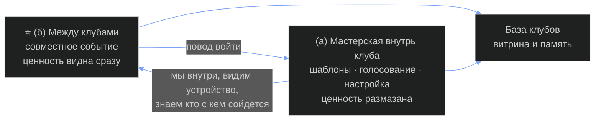

# Мастерская для клубов — концепция

> Сборка трёх разборов в один документ. Решений здесь нет: где развилка — стоит 🔶 и выбирает он.
> Цен, долей и процентов нет нигде — это его слот. Источники — машинные расшифровки, цитаты
> расчищены от мусора распознавания, смысл не менялся.

---

## §1 Что это, в трёх предложениях

Это сервис для людей, которые уже ведут клуб или сообщество: набор инструментов, чтобы вести
его лучше, плюс — и это главное — механика, по которой два и более клуба делают вместе то,
что поодиночке не тянут. Мы не заводим свой клуб и не зовём людей к себе: мы приходим к уже
собранным сообществам и становимся для них площадкой, организатором и гарантом совместных
событий — пишем правила, раздаём роли людям из разных клубов, отвечаем за то, чтобы гости вели
себя по-человечески. Рядом живёт библиотека: какие клубы вообще есть, как они устроены и как
собрать свой.

Его формула ценности: *«мы по сути берём уже отфильтрованные сообщества и помогаем на основе
вот этих уже людей дальше производить синергию»*.

---

## §2 Что сменилось 23.10 и что осталось

Разворот объявлен одной фразой: **«то, что я раньше пизданул — просто создавать клуб с нуля —
в этом варианте мы это не берём»**. Отменён не текст заметки о клубе, а стройка. Философию он
приказал нести дальше целиком и без изъятий.

### ⭐ Три вещи, которые теперь лежат в доме рядом

Их легко спутать — все три про группы независимых людей. Развожу его собственными словами.

| | **Клуб** (12:48) | **Группа консультантов** (12.10) | **Продукт-мастерская** (14:46) |
|---|---|---|---|
| Это кто/что | сообщество | сообщество | инструмент для сообществ |
| Кому принадлежит | ему | ему и участникам | ему, пользуются другие |
| Статус его словом | **не строим** — «в этом варианте не берём» | **собираем в любом случае** — «но это не то, что я говорил ранее, как просто ещё один клуб» | **строим** |
| Что с ним делаем | ценности переносим целиком, функции и воронку — нет | живёт параллельно, не клуб и не продукт | эта папка |

### Что переносится и что нет

**Переносится** (оплачено работой и переживает разворот): ценностный слой заметки 12:48 —
он сам требует его перенести; десять осей сравнения клубов — теперь они меряют не нас, а
клиента, и применение стало точнее прежнего; живые примеры кооперативов с механиками правил
и выживания без основателя; корпус его цитат; честный инвентарь 20.10, годный для любой рамки;
трёхслойная форма рассказа «30 секунд / 3 минуты / полный»; сервер, видеохостинг, контур агентов.

**Не переносится**: воронка «полное видео → бесплатный клуб в телеграме → охват» с доски 12:49;
механика членства клуба; всё, что было приценено к конкретной аудитории.

🔶 Три вещи его словом не разводятся, и это слоты ему: **как группа консультантов относится
к продукту** (первый клуб на нём? команда, которая его делает? отдельное дело?) · **та ли это
группа, что 12.10** (слова совпадают почти буквально, но он себя с собой не сверял) · **куда
девается воронка клуба** — прежний следующий шаг после его видео исчез, новый не назван.

---

## §3 Философия под этим

### Ядро — девять пунктов из заметки о клубе

1. **Линзы, и готовность допустить, что твоя не единственная.** Капитализм, государство, рынок —
   не устройство мира, а оптика: «это всё просто ебаная линза, через которую люди смотрят
   на мир». Нужные люди — те, кто может свою поставить под сомнение, и **«им интересно»** это
   сделать. Интерес, а не долг — его вступительный взнос.
2. **Линзу меняют прагматично** — «чтобы лучшее решение принимать в своих каких-то проектах».
   Всё упирается в чьё-то конкретное решение; иначе это философский кружок, который он сам
   отвергает.
3. **Самое ценное у человека — его жизнь и уникальный опыт**, и оберегать его надо в первую
   очередь **«от самого себя же»**. Первая угроза изнутри.
4. **Правила — то, чем общество защищается от самого себя**, тем же жестом, которым взрослый
   ставит правила себе. 🔶 Ни одного конкретного правила он не назвал.
5. **Не победить, а стать непобедимым** — «сюда приходят те, кто хочет сохранить то, что у них
   уже есть».
6. **Твой бизнес небезопасен, если рушится система уровнем выше** — «заработал влияния
   на уровне города, а потом хуяк, в стране военная заварушка». Не альтруизм: уровень выше
   твоего — твой риск-контур.
7. **USB-C порты между людьми с разными взглядами** — разъём, по которому разные стыкуются,
   не становясь одинаковыми.
8. **Люди — один вид с разными настройками.**
9. **Совместная работа эффективнее иерархии и использования слабых** — и клуб существовал,
   чтобы это **показать**, а не заявить.

### ⭐ Главное: что разворот с этой философией делает

Шов один и проходит через все девять пунктов. **Философия написана про ЧЕЛОВЕКА** — его линза,
его жизнь, его решение. **Продукт продаётся ГРУППЕ** — клубу, его админу, его кассе. Между
нашей ценностью и её адресатом встало юридическое лицо с собственным интересом.

| Пункт | Что разворот с ним делает |
|---|---|
| **6 →** ⭐ | **Усиливает сильнее всего: тезис получил предмет.** «Уровень выше — твой риск» был аргументом без рук. Если клуб — система уровня N, то инфраструктура между клубами и есть N+1: события, «которые один клуб не мог бы самостоятельно воплотить в жизнь». 🔶 Отвечаем мы за этот уровень или только продаём доступ — не сказано |
| **5 →** | **Усиливает: ценность стала критерием сделки.** Клуб, который хочет победить (удержать, не выпустить, не дать сравнить), наш продукт не купит ни за какие деньги. Купит тот, кто хочет, чтобы его ценности пережили его самого. ⚠️ И это же режет рынок на порядок — вслух он этого не признал. ⚠️ Прямой спор с §8.2: линия рисков говорит, что согласятся первыми как раз те, у кого защищать нечего |
| **8 →** | **Усиливает: дешевеет исполнение.** Разные настройки приходят готовыми пачками. Отбор, который он собирался делать входным интервью, уже сделан чужими клубами |
| **3 →** | **Усиливает: из личной гигиены в функцию.** Главная угроза клубу — его собственный пузырь. То, что у человека было самодисциплиной, у группы становится продаваемой услугой |
| **7 →** | **Усиливает: из метафоры в предмет поставки** |
| **1 →** | ⚠️ **Теряется опаснее всего: условие входа подменяется обещанием результата.** В своём клубе готовность сменить линзу была ФИЛЬТРОМ. В чужом фильтровать некого — покупатель приходит целиком, со всеми своими. То, что требовалось на входе, продукт теперь должен ПРОИЗВОДИТЬ. Отобрать любопытных легко; сделать любопытным не-любопытного не умеет никто. 🔶 Чем продукт это берёт — ни слова |
| **9 →** | ⚠️ **Теряется: доказательство становится обещанием, и мы встаём на чужую сторону.** Клуб был доказательством тезиса собой. Продукт им быть не может. Хуже: посредник между группами — структурно самая удобная позиция для извлечения: мы видим всех, нас видит каждый, через нас идёт трафик. Ровно та конфигурация, против которой написан пункт 9. 🔶 Что мешает нам самим стать этой иерархией — не сказано |
| **4 →** | **Становится чужим: в чужом клубе правила не наши** |
| **2 →** | **Размывается: единица выгоды реже и дальше от плательщика.** У человека «лучшее решение» случается еженедельно и видно ему самому. У клуба решений мало, принимает их админ, а выгоду получают участники: платит один, ценность достаётся другим |
| **1-2-3 общий →** | **Адресат смещается с человека на организацию.** Сказать клубу «ваша культура вредит вашим людям» поставщик не может — не его место. Пока нет прямого канала к участнику минуя админа, пункты 1-3 работают только в режиме рекламы. 🔶 Есть ли такой канал — не сказано |

### Новый тезис, добавленный сегодня, и четыре дыры в нём

**Его слово:** «какое бы сообщество ни было, у него в любом случае цель — это благополучие
участников этого сообщества… если вы узнаете о другом, то вы перейдёте в более полезное,
позитивное. **Но это же вот логично**».

Тезис несёт весь этический фундамент продукта. Без него показывать клубам чужие клубы — это
поставлять отток под видом сервиса; с ним — помощь всем сторонам сразу. Это единственное, что
отличает нашу позицию от хедхантера, обходящего компании с предложениями их сотрудникам.
⚠️ И ни одна из четырёх дыр в нём не закрыта:

1. **Противоречит его же пункту 9.** Там мир полон систем, «нацеленных на жёсткую иерархию
   и использование более слабых»; здесь цель любого сообщества — благополучие участников.
   Одновременно верны быть не могут. Он это почувствовал («конечно, есть сообщества, где
   используют одни других») и продолжил, как будто исключения нет.
2. **Норматив, выданный за описание.** Как должно быть — не как есть. Ставить норматив
   в основание продукта можно, но тогда называть его позицией.
3. **«Скорее всего перейдёт в более полезное» — эмпирика без проверки,** и закономерность
   обратная: чем дороже обошёлся вход и чем жёстче идентичность, тем крепче держит. Тезис
   работает лучше всего там, где не нужен.
4. **«Но это же вот логично» — слабое место, помеченное им самим.** Ни примера, ни механизма.
   Именно сюда ударит первый админ клуба, которому мы это продаём.

**Деловое следствие, которого он не назвал.** Если тезис верен, покупатель покупает инструмент,
который может увести его людей — и первыми уйдут самые деятельные. Его ответ — одна фраза:
«моя компания увеличивает этот шанс, при этом **позволяет сохранить вот эту культуру, ценности
клуба, которые там уже есть**». Это утверждение, а не механизм. 🔶 Чем именно продукт сохраняет
клуб, через который прошёл, — **первая по важности дыра всей идейной части**.

### Пчёлы — рабочая модель пользователя

**Его слово:** «вот такие вот пчёлки, которые ходят, что-то изучают, исследуют и **приносят это
обратно в группу**. И это мы такой инструментарий и помощник для вот этих пчёлок». Доза —
«эти вот **10 процентов**, чтобы люди узнавали чего-то нового».

- **Кто вылетает.** Не клуб и не все его участники, а примерно десятая часть: «авантюристы,
  исследователи», за которыми «большая часть общества просто подтягивается». Остальные продукт
  в руках не держат и получают результат вторым касанием, через своего. Это меняет всё — от того,
  кому показывать интерфейс, до того, кто платит.
- **Что приносит.** Он назвал знание и возможность. Реально возвращаются ещё две вещи, которых
  он не упомянул: **контакт** (живой человек из чужого клуба) и **формат** («у них это устроено
  вот так»). Формат, похоже, самое ценное: он тиражируется и не требует повторного вылета.
- **⭐ Почему группа это терпит — главный пустой узел.** Улей терпит вылет, пока принос дороже
  отсутствия. Межклубная активность читается либо как вклад, либо как утечка, и читает её
  не пчела, а остальные девяносто процентов. Отсюда функция, которая следует из метафоры прямо
  и которой в его описании НЕТ: **продукт должен делать принос видимым внутри родного клуба** —
  не у нас на платформе, а в их чате, их созвоне, их библиотеке. Это кандидат в центральную фичу.
- **Где метафора врёт — четыре места.** У пчелы нет личного интереса сменить улей, у человека
  есть · цветы не конкурируют с ульем за пчелу, а чужие клубы конкурируют, и мы сами пчелу
  к ним привели · у улья одна валюта и общий желудок, а у клубов валюты несоизмеримы, и принос
  может быть бесполезен не потому, что плох, а потому, что не конвертируется · улей не платит
  за пчёл и не выбирает им маршрут, а клуб-клиент будет платить и захочет маршрут согласовывать —
  **пчела с утверждённым маршрутом уже не разведчик, а курьер**, и из вылета исчезает то
  непредвиденное, ради чего он нужен.
- **Что метафора сделала хорошо — назвала нашу роль:** «инструментарий и помощник». Это
  снаряжение, а не управление; честная и узкая позиция. ⚠️ Но в том же голосовом он называет
  себя ещё дважды: «площадкой и организатором» и «площадкой-гарантом». Снаряжение, организатор
  и гарант — три роли с разной ответственностью и разной властью. 🔶 Он не выбрал, а выбор
  меняет продукт сильнее любой функции.

### Что это меняет, если сработает

**Для человека** — граница того, что ты можешь узнать, перестаёт совпадать с границей группы,
в которую ты попал более или менее случайно: ты остаёшься у своих, но твоё информационное поле
больше не равно их полю. **Для группы** — клуб перестаёт платить за своё качество изоляцией.
**Для мира** — только то, что он сказал: «повышать синергию между людьми, между разными
сообществами», и ни слова больше. **Единственный наблюдаемый признак успеха, который он дал,** —
события, которых без нас бы не было. Считается поштучно. 🔶 Других критериев успеха в материале
нет: ни что считается работающим продуктом, ни через сколько, ни сколько таких событий достаточно.

---

## §4 Продукт: две половины

### (а) Мастерская — инструменты внутрь одного клуба

Голосование, шаблоны, анонимный рассказ о клубе, настройка взаимообмена ресурсами, шаблоны
встреч, библиотека «как собрать клуб».

**Чем ценна:** клуб живёт лучше — меньше ручной работы у организатора, меньше мёртвых чатов.
**Чем слаба:** ценность размазана и не срочна. Клуб, который уже существует, по определению
как-то справляется без нас — иначе бы не существовал. Платят за боль, а боль организатора
наши шаблоны лечат косвенно.
**Что даёт нам:** повод войти внутрь, увидеть устройство клуба и быть рядом каждую неделю.

### (б) ⭐ Инфраструктура между клубами

Метод, по которому клубы находят друг друга, договариваются и проводят общее событие; правила,
роли, гарантия; база клубов как витрина.

**Чем ценна:** это единственное, чего клуб не может сделать сам — своих людей он уже имеет,
чужих нет. Ценность видна сразу и меряется одним событием.
**Чем слаба:** не работает на одном клиенте. Пока у нас один клуб — продукта нет, есть обещание.

### Какая половина тянет какую

Он перечислил их в порядке «сначала инструменты, потом самое уникальное». ⚠️ **Тяга идёт
в обратную сторону.** Инструменты — слабый повод пустить постороннего в закрытое место.
Совместное мероприятие — сильный: у него есть дата, выгода и видимый результат. Клуб
соглашается ради события, а инструменты получает потом, как продолжение отношений.

Но у обратного порядка есть цена: **половина (б) не продаётся первому клиенту** — ему не с кем
встречаться. Значит первые две-три сделки делаются руками, парой сразу, без продукта.

---

## §5 Инструменты

Все из его перечисления. 🔶 — названо одним словом и не раскрыто.

| # | Инструмент | Что делает | ⚠️ Что должно быть правдой, чтобы он был нужен | Цена |
|---|---|---|---|---|
| И-1 | **Общее голосование** | клуб решает числом голосов, а не словом владельца | в клубе вообще принимаются решения сообща. В нашем движке есть апвот записи («апвот — единственная реакция»), голосования **как решения группы** нет | **просто** в коде, **трудно** в жизни: голосование без последствий убивает доверие сильнее, чем его отсутствие |
| И-2 | 🔶 **Шаблоны** | назвал отдельно от шаблонов мероприятий; чего именно — правил? описания клуба? постов? ролей? — не сказал | — | 🔶 не оценить |
| И-3 | 🔶 **Поделиться о клубе анонимно** | два прочтения, он не выбрал: **(а)** участник анонимно рассказывает наружу — разведка пчёл · **(б)** клуб публикует данные о себе, не раскрывая состав | ⚠️ **противоречит дому**: устав платформы П11 «ноль анонимности» (его ack 13.08) и требование «раскрытая личность»; в движке свободной регистрации нет по устройству. Чтение (а) ещё и ставит участника против его клуба | **просто** в коде, **дорого** репутацией: анонимный слив — первое, за что нас выставят из клуба |
| И-4 | 🔶 **Настройки и эксперты для взаимообмена ресурсами** | кто чем может помочь, кто что ищет | 🔶 **софт или живые люди — не сказано**: настройки = один раз написать код; эксперты = нанимать и платить, у продукта появляется себестоимость часа. В клубе из двадцати знакомых обмен идёт сам, в личке | настройки **средне**, эксперты **дорого и не масштабируется** |
| И-5 | **Шаблоны мероприятий и встреч** | порядок, тайминг, роли, что делать до и после | у организатора есть встречи, и они идут плохо. Самый конкретный найденный формат — «десять минут что могу / что надо от каждого, потом полчаса на ответы» — **ни разу не прогнан живьём** | **просто** — это текст, не код. Самый дешёвый в списке |
| И-6 | ⭐ **Метод и инфраструктура взаимодействия клубов** | как два клуба находят друг друга, договариваются, проводят общее | клубы **хотят** встречаться (главный вопрос, §8) и в каждом есть человек с правом сказать «да» от имени клуба. Для большого клуба второе часто ложно | **очень сложно**, и сложность переговорная, не техническая. Кодом не закрывается |
| И-7 | **Площадка · организатор · гарант** | пишем правила, раздаём роли, вносим «те 10 процентов» | ⚠️ гарантия стоит чего-то, только если за нарушение что-то следует. Нет ни договора, ни санкции, ни денег в залоге — за словом «гарант» стоит только репутация Руслана | **сложно**: это не функция, а обязательство |
| И-8 | **Платформа, защищённо работающая с данными** | хранит и обрабатывает данные людей из разных клубов | ⚠️ данные участников чужого клуба нам **никто не отдаст**, и правильно сделает. Речь может идти только о тех, кто сам пришёл на наше событие. Плюс GDPR: держим данные — отвечаем | **средне** по коду, **дорого** по юр-части |
| И-9 | **База клубов — маркетплейс или библиотека** | видно, какие клубы есть и куда попроситься | клубы согласны быть видимыми. ⚠️ для закрытого клуба видимость — минус: больше заявок на отсев, никакой выгоды. Согласятся те, кто набирает; откажутся те, кто полон — то есть самые интересные | **просто** по форме, **трудоёмко** по содержанию: ручной сбор. Записей сегодня **ноль** |
| И-10 | **«Как собрать крутой клуб»** — виды сообществ, как функционировали общины | обучающий корпус, он же приманка | тема ищется людьми и приводит их к нам. ⚠️ это контент, а не продукт: приводит, но не удерживает | **просто**, частично уже собрано (см. §9) |

**По цене.** Дёшево и сразу: И-5, И-10, И-9 по форме. Средне: И-1, И-8. Дорого или нерешаемо
кодом: И-6, И-7, И-4 в варианте «живые эксперты». Под вопросом целиком: И-2, И-3.

---

## §6 Как это работает в теории

Его сценарий: **Вастрик.Клуб** и **блогеры Берлина**, общее мероприятие «как работает AI
в текущем мире», спикеры из двух-четырёх сообществ.

**Шаг 1. Кто инициирует.** В замысле — любая сторона: клуб видит в базе другой клуб и предлагает.
Сегодня — только мы: нет базы, нет места, куда кладут предложение, нет повода его заметить.
Пока клубов меньше десятка, «сам найдёт» не работает нигде.

**Шаг 2. Как клубы узнают друг о друге.** Сегодня — через человека, состоящего в обоих.
Доступ внутрь Вастрика у нас живой (разведка 05.08 через залогиненный аккаунт), и его
собственный план 03.10 — «сейчас конкретно на Вастрике я собираю 30-50 человек». Это полстороны.
⚠️ Вторая сторона — «блогеры Берлина» — **в доме не существует**: ни одного конкретного клуба
или человека под этим описанием не записано. Это не сообщество, а категория. Пока за ней
не стоит один живой человек с правом позвать своих, сценарий беспредметен.

**Шаг 3. Кто решает, что мероприятие состоится.** В замысле — клуб как сторона. В реальности —
конкретный человек с правом поставить анонс туда, где его увидят. ⚠️ У большого клуба такого
единого лица может не быть: у Вастрика 70 комнат, у части по тридцать с лишним админов, ивенты
вынесены на отдельный сервис `events.vas3k.club`. Договариваться придётся не «с клубом»,
а с комнатой или с организатором ивентов. Согласие даёт не шестнадцатитысячный клуб, а один
его угол.

**Шаг 4. Кто пишет правила и роли.** Мы — он прямо назвал это нашей функцией. Минимальный набор:
**принимающая сторона** (чей клуб даёт площадку и анонс) · **спикер** (один-два от каждого
сообщества) · **ведущий** (держит время, нейтрален к обоим) · **гость** (пришёл разово).
И два правила, без которых чужой клуб не пустят: **не продаём** со сцены и в кулуарах,
**не переманиваем** людей. Норматив «не переманивать» уже записан в Хартии первого клана,
принятой его ack'ом 12.05.

**Шаг 5. Что происходит с участниками из чужого клуба.** Три развилки, он их не называл:
гость разово (проще всего, но следа почти не оставляет) · отдельное пространство события,
не принадлежащее ни одному клубу (⚠️ такого у нас нет: в движке нет сущности «группа внутри
платформы»; сегодня это телеграм-чат события плюс форма записи, руками) · двойное членство
(это уже не межклубная механика, а приток, и принимающая сторона будет считать именно так).
🔶 От ответа зависит, нужен ли код вообще.

**Шаг 6. Что остаётся после.** Запись (труба видео `video.jetixagency.com` живая, регистрация
в ней закрыта — есть куда класть приватные записи уже сегодня), конспект, список познакомившихся,
повод для второго события. ⚠️ **Здесь спрятан конфликт:** если след остаётся у нас — запись,
список, контакты, — клубы справедливо читают это как «они собрали наших людей себе». Если след
остаётся у клубов — у нас не накапливается ничего, и продукта снова нет.

### ⚠️ Где сценарий спотыкается

| Где | Что ломается |
|---|---|
| ⭐ **Асимметрия сторон** | Вастрику (~16 000 человек на 05.08, свои комнаты, свой сервис ивентов) от «блогеров Берлина» не нужно почти ничего. Выгода течёт в одну сторону, работа предлагается обеим. **Самый сильный стопор во всём сценарии** |
| **Явка ≠ размер клуба** | из шестнадцати тысяч придут те же двадцать активных. Эффект «вышли из пузыря» получат они, а не клуб |
| **Деньги и площадка** | у события есть расходы и вопрос, кто платит. 🔶 Его слот |
| **Второе событие** | одно мероприятие делается на энтузиазме и личных отношениях. Продукт начинается там, где второе и третье идут без ручного разогрева. Механики повторения в замысле нет (см. §8.3) |

---

## §7 Чем это отличается от прежних замыслов

### Шесть мест, где меняется суть (клуб → продукт)

| | Клуб | Продукт-мастерская |
|---|---|---|
| **Предмет** | группа людей | инструмент и правила, которыми пользуются чужие группы |
| **Пользователь** | человек, выбирающий, куда вложить вечер в неделю | клуб как организация — а решает за неё один живой организатор |
| **Источник ценности** | люди внутри: кто пришёл, тот и ценность | связь между клубами: ценность в том, чего у одного нет |
| **Роль Руслана** | хозяин: держит тон, ведёт созвоны, отбирает людей | «площадка и организатор… и площадка-гарант» — не участник разговора, а тот, кто пишет правила для чужих людей |
| **Что надо построить** | ритм и репутацию; софта почти ноль | софт, библиотеку, метод стыковки и живых экспертов |
| **Когда первый результат** | в день, когда собрались десять человек на первый созвон | в день, когда **два** клуба провели общее мероприятие |

Самая тяжёлая строка — последняя. У клуба первый результат зависит от одной стороны: его.
У продукта — минимум от трёх: двух чужих организаторов и от него. Срок до первого
доказательства вырастает не на проценты, а в разы, и **перестаёт быть под его контролем**.

### По десяти осям сравнения клубов

⚠️ Оси строились, чтобы сравнивать клубы глазами человека, который выбирает, куда зайти.
Теперь они описывают **клиента**, а не нас. Это само по себе отличие: линейка больше не меряет нас.

| Ось | У клуба | У продукта |
|---|---|---|
| **О-1** вокруг чего собираются | люди с готовностью сменить линзу | не про нас; становится входным фильтром: какие клубы вообще стыкуемы |
| **О-2** вход и фильтр | интервью, анти-анонимность — наш рычаг | фильтрует чужой клуб. «Берём уже отфильтрованные сообщества» — чужой фильтр, чужое право |
| **О-3** первая неделя | архив и библиотека работают в день входа | **пусто по устройству**: нет второго клуба — смотреть не на что |
| **О-4** кто производит ценность | он + участники | клубы производят всё, мы производим стык. Доля нашего вклада нигде не названа |
| **О-5** деньги | на доске `FREE` + `Sell…` сбоку | **в голосовом 14:46 о деньгах нет ни одного слова.** Дыра переехала из проекта в проект неизменной |
| **О-6** размер и рост | больше людей, линейно | больше **пар** клубов. Ниже порога пар продукт бесполезен. 🔶 Порога он не назвал |
| **О-7** нарушение и кто решает | его правила, его клуб | структурно ничьи: участник принадлежит своему клубу |
| **О-8** что теряешь при уходе | архив, связи, доля в проектах | **ничего.** Клубы познакомились — и унесли знакомство с собой |
| **О-9** держится без основателя | ось была уязвимой | ось стала критической: сводить два клуба руками может пока только он |
| **О-10** обещание | «стать непобедимым» | «узнать то, чего не знал» — адресовано участнику, а решение принимает организатор. Обещание и плательщик смотрят в разные стороны |

**Наблюдение, не вывод.** За одиннадцать дней три рамки: группа консультантов (12.10) → свой
клуб (23.10 12:48) → продукт для чужих клубов (23.10 14:46), между вторым и третьим два часа.
Во всех трёх неизменно одно: он хочет быть **соединительной тканью между независимыми людьми
и группами**, а не производителем одного изделия. Меняется ёмкость, инвариант стоит. Если так,
дешевле проверять инвариант, а для этого выбирать ёмкость не обязательно.

---

## §8 ⚠️ Где ломается

Предпосылка жанра: продукт мёртв через год, вскрываем причины. По убыванию силы, у каждого —
механика провала и допущение, при котором он снимается.

**8.1. Плательщик не найден, и подрывается именно он.** Четыре кандидата, у каждого своя
поломка. *Клуб-организация* платит за то, чтобы его людей водили смотреть на другие клубы;
для платного клуба удержание и есть бизнес — берут бесплатный период, не продлевают, причину
не называют. *Участник* уже платит своему клубу, а второй платёж покупает возможность, которой
ещё не было: отваливается на второй-третьей неделе и уносит довод «я пробовал, там пусто».
*Мы себе, продавая мероприятия* — тогда это событийный бизнес: доход упирается в его календарь,
продукт — декорация вокруг услуги. *Пока бесплатно, деньги потом* — та же конструкция
`FREE` + `Sell…` с доски клуба: вопрос не решён, а перенесён в новую папку. ⚠️ Сильная форма:
**тот, кто должен платить, и тот, чью работу продукт усложняет, — один человек.** Под этим
лежат пять его причин сказать «нет»: закрытость и есть продукт клуба · доступ к аудитории —
это деньги организатора · риск переманивания · совместное мероприятие добавляет ему часов,
а не снимает · репутацией перед своими рискует он, а организуем мы.
→ *Снимается:* плательщик, у которого эта строка в бюджете уже есть, найден фактом —
одна реальная оплаченная сделка до постройки.

**8.2. Отрицательный отбор: соглашаются первыми те, чьё согласие обесценивает продукт.**
Его объяснение разобщённости — пузырь, значит препятствие это неведение. Но закрытость клуба
оплачена: фильтр, интервью, модерация, запрет анонимности — его собственный клуб из заметки
двумя часами раньше устроен ровно так, он лично спроектировал стену. Организатор читает
предложение привести своим людям чужих и отвечает «нет». Остаются те, кому нечего защищать:
открытые чаты, площадки за охватом. Каталог наполняется ими, воспринимаемое качество падает,
и клубы, которые он назвал сам, не зайдут уже никогда — им там не с кем стыковаться.
⚠️ **Спор внутри материала.** Линия продукта выводит обратное: продукт легче заходит
в маленькие и молодые клубы, им нечего защищать и нужны люди, значит с них и начинать,
признав, что первый клиент будет не Вастриком. Линия рисков отвечает: именно это и есть
механизм смерти. Спор не разрешён — развилка ему (С-8).
→ *Снимается:* продукт продаётся **закрытости**, а не против неё. Единица обмена — названный,
поручившийся человек, а не аудитория: клуб не открывается, а выдаёт троих по имени и ничем
не рискует.

**8.3. Посредник исчезает сразу после знакомства.** Ценностное событие «два клуба встретились»
одноразовое: после него у двух организаторов есть телеграм друг друга, и второе мероприятие
делается в личке за двадцать минут. Продукт его не видит, не считает, на него не ссылается.
Метрика использования падает при растущей пользе — худший вид смерти, потому что выглядит как
успех замысла. Через год: десяток знакомых между собой клубов и продукт, которым никто
не пользуется. Единственный кандидат на удержание в его словах — «площадка-гарант, которая
продумывает правила и роли». Это одна фраза.
→ *Снимается:* назван один артефакт, живущий только внутри, и названа цена его отсутствия.
Кандидаты из его же слов: гарантия · правила и роли · поток денег за мероприятие. Тест:
если убрать — кому и чем станет хуже.

**8.4. Порог двух клубов, и переходить его придётся руками.** Пар не N²: после фильтров
(хотят наружу · интересы пересекаются · у организатора есть руки · один язык и часовой пояс)
остаётся горстка. Первый клуб заводится; на второй неделе организатор видит себя одного;
перестаёт открывать; перестаёт звать своих; через месяц единственный живой контент в продукте —
наш собственный. Порог переходится его руками — режимом, который не масштабируется и съедает
его календарь. Классический выход — сделать половину (а) полезной клубу **в одиночку**,
с первого дня. ⚠️ Но это переход в рынок инструментов для сообществ, где игроки существуют
и куда он заходит последним. Развилка, а не возражение: он выбирает, на какой половине умирать
первой. (Разбор поля заказан отдельным ресёрчем — до его результата имён и чисел здесь нет.)

**8.5. Это пять продуктов, а не один.** В голосовом названы: ① мастерская внутрь клуба ·
② инфраструктура стыковки · ③ каталог-маркетплейс клубов · ④ библиотека знаний о сообществах ·
⑤ эксперты, которые приезжают и настраивают. Разные покупатели, разная стоимость постройки,
разный срок до результата. Один человек доводит четыре из пяти до тридцати процентов, ни одно —
до состояния, за которое платят: через год демо, библиотека статей и ноль сделок. Не
гипотетика — тот же разброс зафиксирован в его инвентаре 20.10.
→ *Снимается:* из пяти названо одно, остальные записаны его рукой как «позже». Признак:
на вопрос «что вы продаёте» отвечается одним предложением без союза «и».

**8.6. Веса внутри этих клубов у него нет.** Чтобы свести Вастрик и блогеров Берлина, нужно
стоять внутри обоих. Инвентарь 20.10 его рукой: денег ноль, клиентов ноль, участников ноль,
опубликованных видео ноль, Instagram около двухсот, TikTok и YouTube ноль, юрлица нет, живого
примера такой компании он не нашёл. Письмо организатору звучит как «дайте ваших людей
на эксперимент» от человека, чей ответ на «кто вы» — описание несуществующего продукта.
Ответ: «приходите, когда проведёте хоть одно». Круг замкнут: вес даёт первое мероприятие,
а чтобы его провести, нужен вес. Что у него есть — сервер, видеохостинг, около сорока ролей
агентов, ~900 расшифровок, тысячи документов — покупает вес в **одной** аудитории: среди тех,
кто строит себе ИИ-контур. Не среди «клубов вообще».
→ *Снимается:* первое мероприятие делается **изнутри** клуба, где он участник, а не снаружи,
где он поставщик. 🔶 Членства ни в одном из названных клубов в документах дома не зафиксировано.

**8.7. Гарант без права исключать.** Фильтровал чужой клуб, по своим критериям, для себя.
На совместном вечере участник клуба А ведёт себя скверно, клуб Б предъявляет площадке —
а у площадки нет власти: человек принадлежит А, членство у А, исключение — право А. Дыра
структурная, не по недосмотру. Один такой случай стоит дороже десяти удачных: клуб Б больше
не приведёт своих и расскажет остальным.
→ *Снимается:* либо площадка получает право исключать с совместных мероприятий, и это записано
в правилах, которые клубы подписывают, либо гарантия не обещается вовсе.

**8.8. Единица продажи — не клуб, а перегруженный организатор.** У клуба нет органа,
принимающего решения: решает один человек, обычно основатель, обычно единственная точка отказа.
Каждая функция из списка — сначала работа для него и только потом польза для участника.
Он регистрируется, не настраивает, а мы считаем его «подключённым клубом»: счётчик растёт,
жизнь — нет, и видно это только когда пробуешь собрать мероприятие.
→ *Снимается:* у функции есть ценность для организатора **до** настройки, в первые десять минут.

**8.9. «Десять процентов пчёлок» — допущение, выданное за свойство.** На этой доле стоит вся
экономика внимания продукта, источника у числа нет. Если разведчиков двое-трое на сотню и если
культура клуба не поощряет тащить внутрь чужое, то на мероприятие двух клубов по сто человек
приходит не двадцать, а пять. Для обоих организаторов это провал, и второй попытки не будет.
→ *Снимается:* доля замерена одним реальным вечером, а не оценена.

**8.10. Срок жизни решения сейчас короче срока постройки софта.** Три рамки за одиннадцать дней
(§7), до этого в реестре уже числились продюсерский центр 10.10 и кланы с корпорацией 15.10.
Без морали, только следствие для планирования: всё, что дороже нескольких дней работы, рискует
осиротеть к следующему развороту.
→ *Снимается:* следующий дорогой шаг выбран так, что его одинаково использует и клуб, и группа
консультантов, и продукт.

**8.11. Идейный риск, невидимый из бизнес-линзы.** Посредник между группами — структурно самая
удобная позиция для извлечения (§3), а пункт 9 его философии написан против ровно такой
конфигурации. Пока нет механизма, держащего нас от превращения в иерархию, через которую всё
проходит, продукт опровергает собственное основание — и тем сильнее, чем лучше работает.

---

## §9 Что у нас уже есть руками, а чего нет

Проверено живым прогоном 23.10, не по докам.

**✅ Годится и работает сегодня**

- **Труба видео** `video.jetixagency.com` — своя сборка, контейнеры живы, бэкап на кроне,
  регистрация закрыта по устройству. Записи совместных мероприятий есть куда класть уже сегодня,
  без YouTube. ⭐ Из всего построенного это единственное, что ложится прямо в межклубную половину.
- **Домен и привратник** — `jetixagency.com` живой, Caddy выдаёт поддомены: поддомен под событие
  или витрину это четыре строки конфига плюс запись DNS.
- **Картотека людей** — `jetix-os/crm/`, 154 карточки (125 людей, 29 организаций), CLI и скилл
  `/crm`, журнал касаний. Основа для базы клубов, но ⚠️ сущности «клуб» в ней нет.
- **Доступ внутрь Вастрика** (залогиненный аккаунт, разведка 05.08) плюс его план 03.10 собрать
  там 30-50 человек — полстороны живого сценария.
- **Готовые тексты, которые можно отдавать завтра:** разведка Вастрика изнутри (первый экспонат
  библиотеки клубов), трафарет Community Canvas на 17 тем, три красные линии «клуб ≠ секта»,
  Хартия первого клана как образец конституции входа, формат созвона «десять минут что могу /
  что надо», корпус education из 42 «островов». Это наполнение И-10 и И-5 почти целиком.
  ⚠️ Education ни разу не вычитан им — под его именем отдавать нельзя.
- **Замысел уже описан документами** — карточка «Федерация клубов + USB-C порт» от 07.09 и пакет
  `pereezd-platforma/staging/05-model-raboty/` + `07-vision/` от 03.10. Писать модель с нуля
  не надо — надо развести её с новой.

**❌ Нет вообще — делать с нуля:** всё межклубное (ни единицы «клуб» в данных, ни механики
согласия, ни ролей гостя, ни пространства события) · база клубов — ноль записей, и это ручная
контент-работа, а не код · голосование как решение группы · инструмент под созвоны (грепом
по репозиториям пусто) · анонимная механика (и она спорит с его же уставом П11) · эксперты —
живых людей под эту роль нет.

**⚠️ Архитектурное расхождение — назвать прямо.** Движок умеет **один** клуб, продукт требует
многих. Форк vas3k.club работает два месяца (`club_app` / `club_postgres` / `redis`, healthy,
порт прибит к `127.0.0.1:8000`); внутри комнаты, каталог людей с картой, 113 тегов профиля,
12 типов записей, удаление по GDPR, свободной регистрации нет по устройству. Но сущности «группа
внутри платформы» в коде **нет**: «один запуск кода = один клуб целиком» (проверено поиском
по коду 03.10). Много клубов — это либо много отдельных запусков, либо переписанная модель данных.

И это ещё не самое острое:

| | **Модель 03.10** (pereezd-platforma) | **Замысел 23.10** (эта папка) |
|---|---|---|
| Где живёт клуб | **у нас** — мы передаём свой движок человеку с аудиторией, он разворачивает группу под своим именем | **у себя** — клуб уже существует, на своей платформе, в своём телеграме |
| Что мы продаём | хостинг, настройку, ведение | метод, организацию, гарантию, витрину |
| Чем полезен движок | это и есть продукт | почти никак — Вастрик на нашу платформу не переедет |

Это **две разные стройки**, и обе записаны его словом с разницей в двадцать дней. 🔶 Какая
из них идёт, он не сказал, и пока не скажет, половина инвентаря будет считаться активом в одном
чтении и мёртвым грузом в другом.

**Трезвый итог.** Под половину (а) движок годится, но только для клубов, согласных переехать
к нам. Под половину (б) — ту, которую он назвал самой уникальной, — из построенного годятся
**труба видео, домен и CRM**. Остальное к ней отношения не имеет.

---

## §10 ⭐ Самый маленький первый шаг

**За неделю довести до «да» одно реальное совместное мероприятие двух сообществ. Без платформы,
без кода, без базы клубов.**

Главная гипотеза продукта — не «мы умеем делать инструменты», а **«два клуба согласятся
встретиться»**. Она проверяется разговором, а не строкой кода, и ответ приходит за дни.

| День | Что | Чья рука |
|---|---|---|
| 1-2 | Найти **второй клуб** — не категорию «блогеры Берлина», а одного живого человека с правом позвать своих. Источник — CRM и его знакомства | он (первое касание — только его рукой) |
| 2 | Одна страница предложения для обеих сторон: тема, дата, формат, кто что делает, что получает каждая сторона, два правила — не продаём и не переманиваем | бригада пишет, он правит |
| 3-4 | Получить «да» от двух людей, имеющих право поставить анонс | он |
| 4-5 | Правила и роли на одну страницу: принимающая сторона · спикер · ведущий · гость. Анонс в обоих местах | бригада · он публикует |
| 6-7 | Сбор записавшихся, напоминание, подготовка записи (труба видео готова) | бригада |

**Что считаем проверкой.** ① Согласие: обе стороны сказали «да» за семь дней и без денег.
⚠️ Если одна отказала — узнать настоящую причину и записать её дословно; **отказ ценнее
согласия**, он покажет, какой из барьеров §8.1 реален. ② Смешанная явка: пришли люди из обоих
клубов, а не из одного с гостями-одиночками. ③ След: хотя бы одна пара из разных клубов
продолжила общение после.

**Что НЕ делаем на этой неделе:** не трогаем движок, не заводим базу клубов, не пишем ни строки
продуктового кода, не обещаем гарантий, которых нечем обеспечить. Запись кладём в трубу видео.

⭐ **Чем этот шаг силён.** Один вечер закрывает сразу семь из одиннадцати пунктов §8: 8.1 (заплатил
ли кто-нибудь хоть за что-нибудь — первый факт), 8.2 (согласятся ли и кто именно), 8.3 (уйдут
ли в личку), 8.4 (сколько пар реально стыкуемо), 8.6 (пустят ли его), 8.7 (что будет при
конфликте), 8.9 (сколько придёт). И он не требует выбирать между тремя рамками §2.

⚠️ **Чем обманчив.** Одно удавшееся мероприятие доказывает, что **мы умеем организовать
мероприятие**, а не что продукт нужен. Настоящая проверка — второе: пойдёт ли оно без ручного
разогрева. Поэтому в конце первого обе стороны спрашиваются прямо: *«повторили бы это без
нас?»* Ответ «да, сами» — продукт в этой части не нужен. Ответ «повторили бы, но с вами» —
надо назвать словом, за что именно, и это будет первая настоящая строка продукта.

---

## §11 🔶 Что решает он

Сводный список открытых слотов из трёх частей, без дублей, по убыванию важности.

### Несущие — без них не двигается

| # | Слот | Почему несущий |
|---|---|---|
| **С-1** | **Клубы у нас или клубы у себя?** | Модель 03.10 и замысел 23.10 — две разные стройки. Пока не выбрано, половина инвентаря одновременно и актив, и балласт (§9) |
| **С-2** | **Кто пользователь и кто платит: организатор клуба, участник-пчела или человек без клуба?** | Три читаемых ответа лежат рядом в его же словах. От этого зависит, чью сторону держит продукт, когда пчела смотрит наружу, а организатор держит своих (§3, §4, §8.1) |
| **С-3** | **Какая у нас роль — снаряжение, организатор или гарант? И чем именно мы гарантируем?** | Он назвал все три в одном голосовом. Разная ответственность, разная власть. Гарантия без договора, санкции и права исключать — слово (§3, §5 И-7, §8.7) |
| **С-4** | **Что остаётся после события — у нас или у клубов?** | Останется у нас — клубы читают это как «собрали наших людей себе». Останется у них — продукт не накапливается и умирает по §8.3 |
| **С-5** | ⭐ **Чем именно продукт сохраняет клуб, через который прошёл?** | Он пообещал это одной фразой. Без механизма продукт — поставка оттока под видом сервиса. Первая по важности дыра идейной части |
| **С-6** | **Делает ли продукт принос видимым внутри родного клуба?** | Из метафоры пчёл это следует прямо, в его описании этого нет. Похоже на центральную фичу — и она не названа |
| **С-7** | **Деньги вообще.** В голосовом 14:46 о них нет ни одного слова | Дыра переехала из проекта в проект неизменной. Цен и долей бригада не назначает — это только он |
| **С-8** | **С каких клубов начинаем — с маленьких открытых или с сильных закрытых?** | ⚠️ Прямой спор внутри материала: линия продукта говорит «с тех, у кого барьер ниже», линия рисков — «именно так продукт и умирает отрицательным отбором» (§8.2) |
| **С-9** | **Из пяти названных продуктов — какой один?** | Пока их пять, через год будет пять демо и ноль сделок (§8.5) |

### Устройство — нужны, чтобы начать строить

| # | Слот | Что непонятно |
|---|---|---|
| **С-10** | **Гость, пространство события или двойное членство** | Шаг 5 сценария. От ответа зависит, нужен ли код вообще |
| **С-11** | **Отвечаем ли мы за уровень N+1 или только продаём доступ к нему** | Самое крупное приобретение разворота упирается в это |
| **С-12** | **Есть ли у продукта прямой канал к участнику, минуя админа** | Без него пункты 1-3 философии работают только в режиме рекламы |
| **С-13** | **Чего шаблоны** (И-2) | Назван одним словом, содержания нет |
| **С-14** | **Анонимная механика: участник наружу или клуб о себе?** | Первое чтение ставит нас против организаторов и спорит с его же уставом П11 «ноль анонимности» |
| **С-15** | **«Эксперты» — софт или живые люди?** | Разные бизнесы: код один раз или себестоимость часа навсегда |
| **С-16** | **Порог: сколько пар клубов нужно, чтобы половина (б) включилась** | Ниже порога продукт бесполезен. Числа нет |
| **С-17** | **Критерии успеха** | Что считается работающим продуктом, через сколько, сколько совместных событий достаточно. Кроме «событий, которых без нас бы не было», критериев нет |

### Рамка — можно нести дальше, но однажды придётся ответить

| # | Слот | Что непонятно |
|---|---|---|
| **С-18** | **Группа консультантов: что она продукту** — первый клуб на нём, команда, которая его делает, или отдельное дело? И та ли это группа, что 12.10? | Он сказал только «что-то другое» |
| **С-19** | **Куда девается воронка «видео → бесплатный клуб → охват»** | Прежний следующий шаг после его видео исчез, новый не назван |
| **С-20** | **Тезис «цель любого сообщества — благополучие участников» — это позиция или наблюдение? И что мешает нам самим стать той иерархией, против которой написан пункт 9?** | Тезис противоречит его же философии и подан как факт. Второе — структурный вопрос: посредник и есть удобнейшая позиция для извлечения |

---

## Подкладка

Три части писались независимо, тремя линиями, в один день. Этот документ — их сборка;
при расхождении обе стороны показаны, выбор не сделан.

- [`_chasti/a-ideya.md`](_chasti/a-ideya.md) — **линия идеи**: перенос философии из заметки
  о клубе, что разворот усиливает и что ломает, новый тезис о благополучии участников, разбор
  метафоры пчёл как конструкции. Её находки: шов «философия про человека / продукт про группу»,
  четыре дыры в новом тезисе, «принос видимым внутри клуба» как неназванная центральная фича,
  три несовместимые роли в одном голосовом.
- [`_chasti/b-produkt.md`](_chasti/b-produkt.md) — **линия продукта**: две половины, разбор
  десяти инструментов с условием нужности, пошаговая механика сценария, инвентарь живым прогоном,
  первый шаг на неделю. Её находки: тяга идёт от межклубной половины к мастерской, а не наоборот;
  барьер — нежелание, а не незнание; архитектурное расхождение «модель 03.10 против замысла
  23.10», раньше нигде не зафиксированное.
- [`_chasti/v-otlichie-i-riski.md`](_chasti/v-otlichie-i-riski.md) — **линия отличия и рисков**:
  разведение трёх замыслов, шесть мест смены сути, десять осей, премортем Р-0..Р-9 и таблица
  допущений. Её находки: отрицательный отбор клубов, исчезновение посредника после знакомства,
  гарант без права исключать, срок жизни решения короче срока постройки, инвариант
  «соединительная ткань» через все три разворота.
- Его слово: [`00-EGO-SLOVO-2026-10-23-1446.md`](00-EGO-SLOVO-2026-10-23-1446.md) — расшифровка
  целиком.
