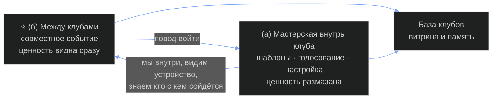

# Б. Продукт и как он устроен

## Б1. Что это за продукт — в трёх предложениях

Это сервис для людей, которые уже ведут клуб или сообщество: набор инструментов и шаблонов,
чтобы вести его лучше, плюс — и это главное — механика, по которой два и более клуба делают
вместе то, что поодиночке не тянут. Мы не заводим свой клуб и не зовём людей к себе: мы
приходим к уже собранным сообществам и становимся для них площадкой, организатором и гарантом
совместных событий — пишем правила, раздаём роли людям из разных клубов и отвечаем за то,
чтобы гости вели себя по-человечески. Рядом с этим живёт библиотека: какие клубы вообще есть,
как они устроены и как собрать свой.

### ⚠️ Пользователь — клуб или участник клуба? Он этого не разделил

🔶 **Слот Б-1. Он не сказал.** В расшифровке обе стороны стоят рядом: *«инфраструктура для
взаимодействия разных клубов **и их участников** друг с другом»*. От ответа зависит всё
устройство — вот чем варианты отличаются:

| | **Вариант А: пользователь — клуб** | **Вариант Б: пользователь — участник** |
|---|---|---|
| Кто заводит у нас учётную запись | организатор, админ, создатель клуба | конкретный человек, сам, без спроса у клуба |
| Что он у нас делает | настраивает свой клуб, ставит шаблоны, договаривается о совместном событии | видит, какие клубы есть; ходит на межклубные события; носит находки обратно к своим |
| Кто даёт согласие на совместное событие | клуб как сторона | никто — человек идёт сам |
| Чем меряем рост | число клубов | число людей |
| На чьей стороне мы, когда интересы разошлись | на стороне организатора | на стороне человека |
| Главный риск | клубов мало, каждый долгий, продажа штучная | клуб видит в нас тех, кто уводит его людей |

**Рекомендация линии (решение — его).** Пользователь и плательщик — **организатор клуба**
(вариант А); участник появляется как **гость механики**, а не как клиент. Причина простая:
совместное событие без согласия принимающей стороны не состоится физически — анонс некуда
поставить. Его же образ «пчёлок, которые летают, изучают и приносят обратно в группу» —
это описание участника, и он прямо противоречит интересу организатора (см. Б5). Два этих
взгляда нельзя держать в одном продукте молча.

⚠️ Третья категория, которую он назвал мимоходом и которая не помещается ни в А, ни в Б:
*«мастерская для клубов, для создания вот клубов»* и блок «как собрать крутой клуб» — это
человек, у которого клуба **ещё нет**. Для него межклубная половина бесполезна, а библиотека
и шаблоны — наоборот, главное. Это третий пользователь с другой воронкой. 🔶 Берём или нет —
его слово.

---

## Б2. Две половины продукта

### (а) Мастерская — инструменты внутрь одного клуба

Голосование, шаблоны, механика анонимного рассказа о клубе, настройка взаимообмена ресурсами,
шаблоны встреч и мероприятий, библиотека «как собрать клуб».

**Чем ценна.** Клуб живёт лучше: меньше ручной работы у организатора, меньше мёртвых чатов.
**Чем слаба.** Ценность размазана и не срочна. Клуб, который уже существует, по определению
как-то справляется без нас — иначе он бы не существовал. Платят за боль, а боль организатора
(выгорание, тишина в чате, никто ничего не делает) наши шаблоны лечат косвенно.
**Что она даёт нам.** Повод войти внутрь, увидеть устройство клуба и быть рядом каждую неделю,
а не раз в полгода. Это удержание.

### (б) ⭐ Инфраструктура между клубами

Метод, по которому клубы находят друг друга, договариваются и проводят общее событие; правила,
роли, гарантия; база существующих клубов как витрина.

**Чем ценна.** Это единственное, чего клуб не может сделать сам: своих людей он уже имеет,
чужих — нет. Событие, *«которое один клуб не мог бы самостоятельно воплотить в жизнь»* — его
формулировка, и она точная. Ценность видна сразу и измеряется одним событием.
**Чем слаба.** Не работает на одном клиенте. Пока у нас один клуб — продукта нет вообще, есть
обещание. Половина (б) включается только при плотности: минимум две стороны одновременно,
реально — несколько клубов в одном городе или в одной теме.

### Какая половина тянет какую

Он перечислил их в порядке «сначала инструменты, потом самое уникальное». ⚠️ **Тяга идёт в
обратную сторону.**

Инструменты внутрь клуба — слабый повод пустить постороннего в закрытое место. Совместное
мероприятие — сильный: у него есть дата, выгода и видимый результат. Клуб соглашается ради
события, а инструменты мастерской получает потом, как продолжение уже начавшихся отношений.

Но у обратного порядка есть цена: **половина (б) не продаётся первому клиенту**, потому что
первому клиенту не с кем встречаться. Значит первые две-три сделки делаются руками, парой
сразу, без продукта — и это ровно то, что предлагается в Б7.

---

## Б3. Инструменты — разбор по одному

Все из его перечисления. 🔶 — названо одним словом и не раскрыто.

| # | Инструмент | Что делает | Кто пользуется | ⚠️ Что должно быть правдой, чтобы он был нужен | Сложно или просто |
|---|---|---|---|---|---|
| И-1 | **Общее голосование** | клуб принимает решение числом голосов, а не словом владельца | организатор ставит, участники голосуют | в клубе вообще принимаются решения сообща. Если решает один человек — голосование это декорация. ⚠️ В нашем движке есть апвот записи и комментария (разведка 05.08: *«апвот — единственная реакция»*), но голосования **как решения группы** нет | **просто** в коде, **трудно** в жизни: голосование без последствий убивает доверие сильнее, чем его отсутствие |
| И-2 | 🔶 **Шаблоны** (чего — не сказал) | он назвал «какие-то шаблоны» отдельно от шаблонов мероприятий. Чего именно: правил клуба? описания клуба? постов? ролей? — **он не сказал** | 🔶 | — | 🔶 нельзя оценить без ответа |
| И-3 | 🔶 **Поделиться информацией о клубе анонимно** | два разных прочтения, он не выбрал: **(а)** участник анонимно рассказывает наружу, что у него в клубе происходит — разведка «пчёлок»; **(б)** клуб публикует данные о себе, не раскрывая состав | (а) участник · (б) организатор | ⚠️ **Прямое противоречие с домом.** Анти-анонимность записана дважды и его же рукой: устав платформы П11 «ноль анонимности» (ack 13.08) и требование «раскрытая личность» к касанию. В движке свободной регистрации нет по устройству. Чтение (а) ещё и ставит участника против его клуба: он выносит наружу то, что внутри считается закрытым | **просто** в коде (форма без имени), **дорого** репутацией: механика анонимного слива — первое, за что нас выставят из клуба |
| И-4 | 🔶 **Настройки и эксперты для взаимообмена ресурсами и инструментами внутри клуба** | помогают клубу настроить обмен: кто чем может помочь, кто что ищет | организатор + участники | 🔶 **Софт или живые люди — он не сказал.** Это два разных бизнеса: настройки = один раз написать код; эксперты = нанимать и оплачивать людей, и тогда у продукта появляется себестоимость часа. ⚠️ Чтобы обмен был нужен, в клубе должны быть ресурсы, которыми есть смысл меняться — в клубе из двадцати знакомых людей обмен происходит сам, в личке | настройки — **средне**; эксперты — **дорого и не масштабируется** |
| И-5 | **Шаблоны хорошо организованных мероприятий и встреч** | готовый сценарий встречи: порядок, тайминг, роли, что делать до и после | организатор, ведущий встречи | у организатора есть встречи, и они идут плохо. ⚠️ У нас уже лежит самый конкретный найденный формат — *«десять минут „что могу / что надо" от каждого, потом полчаса на ответы»*, но он **ни разу не прогнан живьём** | **просто** — это текст, не код. Самый дешёвый инструмент в списке |
| И-6 | ⭐ **Метод и инфраструктура взаимодействия клубов** | как два клуба находят друг друга, договариваются и проводят общее | организаторы обоих клубов + мы как третья сторона | клубы **хотят** встречаться (⚠️ главный вопрос, разбор в Б5) и в каждом есть человек, имеющий право сказать «да» от имени клуба. ⚠️ Для большого клуба второе условие часто ложно: решают комнаты и модераторы, единого «представителя» нет | **очень сложно** — и сложность не техническая, а переговорная. Кодом не закрывается |
| И-7 | **Площадка · организатор · гарант** | мы пишем правила совместного события, раздаём роли людям из разных клубов, вносим интерактив и *«те 10 процентов, чтобы люди узнавали новое»* | мы; роли получают участники | ⚠️ Гарантия чего-то стоит, только если за нарушение что-то следует. У нас нет ни договора с клубом, ни санкции к нарушителю, ни денег в залоге. Пока «гарант» — это слово, за которым стоит только репутация Руслана | **сложно**: это не функция, а обязательство. Организовать — часы; отвечать — риск |
| И-8 | **Технологическая платформа, защищённо работающая с данными пользователей** | хранит и обрабатывает данные людей из разных клубов | мы; косвенно — клубы и участники | ⚠️ Данные участников чужого клуба нам **никто не отдаст**, и правильно сделает. Реально речь может идти только о данных тех, кто сам пришёл на наше событие. Плюс GDPR: если мы держим данные, мы и отвечаем | **средне** по коду, **дорого** по юридической части. Отдельный разбор — не в этой части |
| И-9 | **База существующих клубов — маркетплейс или библиотека** | видно, какие клубы есть, как устроены, куда можно попроситься | участники и люди со стороны; клубы — как витрина себя | клубы согласны быть видимыми. ⚠️ Для закрытого клуба видимость — минус: больше заявок, которые надо отсеивать, и никакой выгоды. Согласятся те, кто набирает людей; откажутся те, кто уже полон — то есть самые интересные | **просто** по форме (список), **трудоёмко** по содержанию: это ручной сбор, каждая карточка — работа. Записей сегодня **ноль** |
| И-10 | **Инструменты «как собрать крутой клуб»** — виды сообществ, как функционировали общины раньше, что есть сейчас | обучающий корпус, он же приманка | человек, собирающий клуб; организатор молодого клуба | тема ищется людьми и приводит их к нам. ⚠️ Это контент, а не продукт: он приводит, но сам по себе не удерживает | **просто**, и частично уже собрано: разведка Вастрика изнутри, трафарет Community Canvas (17 тем), три красные линии «клуб ≠ секта», корпус education из 42 «островов» по единому шаблону |

**Сводка по цене.** Дёшево и сразу: И-5, И-10, И-9 (по форме). Средне: И-1, И-8. Дорого или
нерешаемо кодом: И-6, И-7, И-4 в варианте «живые эксперты». Под вопросом целиком: И-2, И-3.

---

## Б4. ⭐ Механика взаимодействия клубов — как это в теории работает

Его собственный сценарий: **Вастрик.Клуб** и **блогеры Берлина**, общее мероприятие
*«как работает AI в текущем мире»*, спикеры из двух-четырёх сообществ. Разбираю по шагам.

### Шаг 1. Кто инициирует

**В замысле** — любая из сторон: клуб видит в базе другой клуб и предлагает.
**Сегодня** — только мы. Механики, по которой клуб сам инициирует, не существует: нет базы, нет
места, где предложение кладут, нет повода его заметить. Первые события инициируются рукой
Руслана, и это не временный костыль, а свойство: пока клубов меньше десятка, «сам найдёт» не
работает нигде.

### Шаг 2. Как клубы узнают друг о друге

Сегодня — **через человека, который состоит в обоих**. У нас такой человек есть: доступ внутрь
Вастрика у нас живой (разведка 05.08 делалась через залогиненный аккаунт, read-only), и его
собственный план от 03.10 гласит — *«сейчас конкретно на Вастрике я собираю 30-50 человек»*.
То есть одна сторона сценария уже наполовину в руках.

⚠️ Вторая сторона — «блогеры Берлина» — **в доме не существует**: ни одного конкретного клуба,
сообщества или человека под этим описанием у нас не записано. Это не сообщество, а категория.
Пока за ней не стоит один живой человек с правом позвать своих, сценарий беспредметен.

### Шаг 3. Кто решает, что мероприятие состоится

**В замысле** — клуб как сторона.
**В реальности** — конкретный человек, у которого есть право поставить анонс туда, где его
увидят. ⚠️ У большого клуба такого единого лица может не быть вовсе: по разведке 05.08 у
Вастрика 70 комнат, у части комнат по тридцать с лишним админов, ивенты вынесены на отдельный
сервис `events.vas3k.club`. Договариваться придётся не «с клубом», а с комнатой или с
организатором ивентов. Это меняет масштаб ожиданий: согласие даёт не шестнадцатитысячный клуб,
а один его угол.

### Шаг 4. Кто пишет правила и роли

Мы — он прямо назвал это нашей функцией. Минимальный набор, вытекающий из его же слов:

- **принимающая сторона** — чей клуб даёт площадку и анонс;
- **спикер** — по одному-двум от каждого сообщества (*«спикеры из двух или из трёх-четырёх»*);
- **ведущий** — держит время и переходы, нейтрален к обоим клубам;
- **гость** — человек из чужого клуба, пришёл разово.

И два правила, без которых чужой клуб не пустят: **не продаём** со сцены и в кулуарах и **не
переманиваем** людей. Оба уже записаны у нас — норматив «не переманивать» стоит в Хартии
первого клана, принятой его ack'ом 12.05.

### Шаг 5. Что происходит с участниками из чужого клуба

Три развилки, он их не называл:

1. **Гость разово** — приходит на событие, внутрь клуба не попадает. Проще всего, ничего не
   ломает, но и следа почти не оставляет.
2. **Отдельное пространство события** — чат или страница самого мероприятия, не принадлежащая
   ни одному клубу. ⚠️ Такого пространства у нас нет: в движке **нет сущности «группа внутри
   платформы»**, и общего места для события тоже нет. Сегодня это телеграм-чат события плюс
   форма записи, руками.
3. **Двойное членство** — гость подаётся в чужой клуб по обычному фильтру. Это уже не
   межклубная механика, а приток, и принимающая сторона будет считать именно так.

🔶 Какой из трёх — его решение. От него зависит, нужен код вообще или не нужен.

### Шаг 6. Что остаётся после

Запись (труба видео `video.jetixagency.com` живая, регистрация в ней закрыта — есть куда класть
приватные записи уже сегодня), конспект, список тех, кто познакомился, и повод для второго
события.

⚠️ **Здесь спрятан конфликт.** Если след остаётся у нас — запись, список участников, контакты, —
клубы справедливо читают это как «мы собрали их людей себе». Если след остаётся у клубов — у нас
не накапливается ничего, и продукта снова нет. Это развилка, а не деталь, и в его слове её нет.

### ⚠️ Где сценарий спотыкается в реальности

| Где | Что именно ломается |
|---|---|
| ⭐ **Асимметрия сторон** | Вастрику (~16 000 человек на 05.08, свои комнаты, свой сервис ивентов) от «блогеров Берлина» не нужно почти ничего. Выгода течёт в одну сторону, а делать работу предлагается обеим. **Это самый сильный стопор во всём сценарии** |
| **Нет единицы «клуб»** | договариваться не с кем: у большого клуба решение распределено по комнатам, у блогера клуб — это он сам, и его согласие зависит от настроения |
| **Явка ≠ размер клуба** | из шестнадцати тысяч на встречу придут те же двадцать активных. Эффект «вышли из информационного пузыря» получат они, а не клуб |
| **Деньги и площадка** | у совместного события есть расходы и есть вопрос, кто платит. ⚠️ Цен и долей здесь не назначаю — это его слот |
| **Ответственность гаранта** | гость нахамил, спикер продал свой курс со сцены, кто-то увёл чужого человека. Мы назвались гарантом — значит отвечаем. Чем именно, кроме извинений, не определено |
| **Второе событие** | одно мероприятие делается на энтузиазме и личных отношениях. Продукт начинается там, где второе и третье идут без ручного разогрева. Механики повторения в замысле нет |

---

## Б5. Ограничения сегодняшнего дня — почему этого ещё нет

Он назвал три: клубы не знают друг о друге, участники не знают о существовании других клубов,
люди сидят в информационном пузыре. Разбираю честно.

### Это не главным образом незнание

Незнание — настоящая причина ровно в двух местах:

- **на уровне участника** — человек в одном клубе действительно не знает, что рядом есть
  другой; это и есть его «пузырь», и это правда;
- **на уровне маленьких и новых клубов** — у них нет ни веса, ни ивентов, ни выхода наружу.

На уровне зрелого клуба незнание — **не барьер**. Вастрик знает, что в мире есть другие клубы;
у него есть гео-комнаты и отдельный сервис ивентов. Если бы он хотел совместных мероприятий,
он бы их делал — у него есть для этого всё, кроме желания.

### Настоящий барьер — нежелание, и у него пять причин

1. **Закрытость и есть продукт клуба.** Человек платит или проходит фильтр ровно за то, что
   внутри не все. Любое разбавление уменьшает то, за чем он пришёл. Мы предлагаем клубу
   поделиться своим главным активом.
2. **Доступ к аудитории — это деньги организатора.** Наша же модель от 03.10 прямо строится на
   *«заработке этих блогеров и ютуберов»* на их аудитории. Просить его пустить чужих — просить
   отдать то, чем он зарабатывает.
3. **Риск переманивания.** Чужой спикер понравился — часть людей уходит к нему. Для организатора
   это не гипотеза, а очевидный исход.
4. **Совместное мероприятие — это работа, а не возможность.** Организатору оно добавляет часов
   и хлопот, а не снимает их. Выгода должна перекрывать часы, иначе вежливое «давай потом».
5. **Ответственность перед своими.** Он привёл чужаков — он и виноват, если кто-то повёл себя
   плохо. Репутацией рискует он, а организуем мы.

### Что из этого следует для продукта

**Продукт продаёт не узнавание, а снятие риска.** «Гарант» — правильное слово, он его уже
сказал; но гарантия без договора, без санкции и без денег — только обещание. Чем именно мы
гарантируем — 🔶 не определено нигде, и это несущая дыра.

Второе следствие неприятнее: **продукт легче заходит в маленькие и молодые клубы** — им нечего
защищать и нужны люди. А в пример он взял самый большой. Начинать придётся с тех, у кого
барьер ниже, и признать, что первый клиент будет не Вастриком.

Третье: ⚠️ **механика на уровне участников идёт против интереса организатора.** Его «пчёлки»,
которые летают по чужим клубам и приносят находки обратно, — красивый образ и ровно то, чего
организатор не хочет: его люди смотрят наружу. Пока не решено, чью сторону держит продукт
(слот Б-1), этот шов будет расходиться в каждом разговоре.

---

## Б6. Что у нас уже есть руками под это

Проверено живым прогоном 23.10, не по докам.

### ✅ Годится и работает сегодня

- **Труба видео** `video.jetixagency.com` — своя сборка, контейнеры живы, бэкап на кроне,
  **регистрация закрыта по устройству**. Записи совместных мероприятий есть куда класть уже
  сегодня, без YouTube. ⭐ Из всего построенного это единственное, что ложится прямо в
  межклубную половину.
- **Домен и привратник.** `jetixagency.com` живой, Caddy выдаёт поддомены — поддомен под
  событие или витрину клубов это четыре строки конфига плюс запись DNS.
- **Картотека людей.** `jetix-os/crm/` — 154 карточки (125 людей, 29 организаций), CLI и скилл
  `/crm`, журнал касаний. Основа для базы клубов, но ⚠️ сегодня это люди и организации, сущности
  «клуб» в ней нет.
- **Доступ внутрь Вастрика** (залогиненный аккаунт, разведка 05.08) и его собственный план
  03.10 собрать там 30-50 человек. Это полстороны живого сценария.
- **Готовые тексты, которые можно отдавать завтра:** разведка Вастрика изнутри (первый экспонат
  библиотеки клубов), трафарет Community Canvas на 17 тем, три красные линии «клуб ≠ секта»,
  Хартия первого клана как образец конституции входа, формат созвона «десять минут что могу /
  что надо», корпус education из 42 «островов» по единому шаблону. Это наполнение И-10 и И-5
  почти целиком. ⚠️ Education ни разу не вычитан им — отдавать под его именем нельзя.
- **Замысел уже описан документами.** Карточка «Федерация клубов + USB-C порт» от 07.09 и пакет
  `pereezd-platforma/staging/05-model-raboty/` + `07-vision/` от 03.10 содержат ивенты
  соединением клубов и переток людей между группами. Писать модель с нуля не надо — надо её
  развести с новой (см. расхождение ниже).

### ❌ Нет вообще — делать с нуля

- **Всё межклубное.** Ни единицы «клуб» в данных, ни механики согласия, ни ролей гостя, ни
  пространства события.
- **База клубов** — ноль записей. Это ручная контент-работа, а не код.
- **Голосование как решение группы** — есть только апвот записи.
- **Инструмент под созвоны** — ни одного, грепом по репозиториям пусто.
- **Анонимная механика** — и она ещё и спорит с его же уставом П11 «ноль анонимности».
- **Эксперты** — живых людей под эту роль нет; это позиция в реестре, а не строка кода.

### ⚠️ Архитектурное расхождение — назвать прямо

**Движок умеет один клуб, продукт требует многих.** Форк vas3k.club стоит и работает два месяца
(`club_app` / `club_postgres` / `redis`, healthy, порт прибит к `127.0.0.1:8000`). Внутри него
есть комнаты, каталог людей с картой, 113 тегов профиля, 12 типов записей, удаление данных по
GDPR, и свободной регистрации нет по устройству — фильтр на входе встроен. Но сущности «группа
внутри платформы» в коде **нет**: *«один запуск кода = один клуб целиком»* (проверено поиском по
коду 03.10). Много клубов — это либо много отдельных запусков, либо переписанная модель данных.

**И это ещё не самое острое.** Расхождение глубже:

| | **Модель 03.10 (pereezd-platforma)** | **Замысел 23.10 (эта папка)** |
|---|---|---|
| Где живёт клуб | **у нас** — мы передаём свой движок человеку с аудиторией, он разворачивает группу под своим именем | **у себя** — клуб уже существует, на своей платформе, в своём телеграме |
| Что мы продаём | хостинг, настройку, ведение | метод, организацию, гарантию, витрину |
| Чем нам полезен движок | это и есть продукт | почти никак — Вастрик на нашу платформу не переедет |

Это **две разные стройки**, и обе записаны его словом с разницей в двадцать дней. 🔶 Какая из
них идёт — он не сказал, и пока не скажет, половина инвентаря будет считаться активом в одном
чтении и мёртвым грузом в другом.

**Трезвый итог.** Под половину (а) — мастерскую — движок годится, но только для клубов,
согласных переехать к нам. Под половину (б) — межклубную, ту самую, которую он назвал самой
уникальной, — из построенного годятся **труба видео, домен и CRM**. Остальное к ней отношения
не имеет.

---

## Б7. Самый маленький работающий первый шаг

**Шаг: за неделю довести до «да» одно реальное совместное мероприятие двух сообществ. Без
платформы, без кода, без базы клубов.**

Главная гипотеза продукта — не «мы умеем делать инструменты», а **«два клуба согласятся
встретиться»**. Она проверяется разговором, а не строкой кода, и ответ приходит за дни.

### Что делается в неделю

| День | Что | Чья рука |
|---|---|---|
| 1-2 | Найти **второй клуб** — не категорию «блогеры Берлина», а одного живого человека с правом позвать своих. Источник — CRM и его знакомства | он (первое касание — только его рукой) |
| 2 | Одна страница предложения для обеих сторон: тема, дата, формат, кто что делает, что получает каждая сторона, два правила — не продаём и не переманиваем | бригада пишет, он правит |
| 3-4 | Получить «да» от двух людей, имеющих право поставить анонс | он |
| 4-5 | Правила и роли на одну страницу: принимающая сторона · спикер · ведущий · гость. Анонс в обоих местах | бригада · он публикует |
| 6-7 | Сбор записавшихся, напоминание, подготовка записи (труба видео готова) | бригада |

### Что считаем проверкой

1. **Согласие.** Обе стороны сказали «да» за семь дней и без денег. ⚠️ Если одна отказала —
   узнать настоящую причину и записать её дословно. **Отказ ценнее согласия**: он покажет, какой
   из пяти барьеров Б5 реален.
2. **Смешанная явка.** Пришли люди из обоих клубов, а не из одного с гостями-одиночками.
3. **След.** Хотя бы одна пара из разных клубов продолжила общение после.

### Что на этой неделе НЕ делаем

Не трогаем движок, не заводим базу клубов, не пишем ни строки продуктового кода, не обещаем
гарантий, которых нечем обеспечить. Запись кладём в трубу видео — она уже живая.

### ⚠️ Чем этот шаг обманчив

Одно удавшееся мероприятие доказывает, что **мы умеем организовать мероприятие**, а не что
продукт нужен. Настоящая проверка — второе: пойдёт ли оно без ручного разогрева. Поэтому в
конце первого обе стороны спрашиваются прямо: *«повторили бы это без нас?»* Ответ «да, сами» —
продукт в этой части не нужен. Ответ «повторили бы, но с вами» — надо назвать словом, за что
именно, и это будет первая настоящая строка продукта.

---

## Рабочая часть

### 🔶 Слоты, которые закрывает только он

| # | Слот | Почему без него не двигается |
|---|---|---|
| **Б-1** | **Пользователь — клуб или участник?** | От ответа зависит, чью сторону держит продукт в конфликте «пчёлка смотрит наружу / организатор держит своих». Сегодня обе записаны рядом |
| **Б-2** | **Чего шаблоны** (И-2) | Назван одним словом, содержания нет |
| **Б-3** | **Анонимная механика — наружу от участника или о клубе от клуба?** | Первое чтение ставит нас против организаторов и спорит с его же уставом П11 |
| **Б-4** | **«Эксперты» — софт или живые люди?** | Разные бизнесы: код один раз или себестоимость часа навсегда |
| **Б-5** | ⭐ **Клубы у нас или клубы у себя?** | Модель 03.10 и замысел 23.10 — две разные стройки. Пока не выбрано, половина инвентаря и актив, и балласт одновременно |
| **Б-6** | **Чем именно мы гарантируем** | Без санкции и без обеспечения «гарант» — слово. А гарантия — ядро предложения |
| **Б-7** | **Что остаётся после события — у нас или у клубов** | От этого зависит, накапливается ли продукт и как нас читают клубы |
| **Б-8** | **Берём ли третьего пользователя — человека без клуба** | Он назвал «для создания клубов» и библиотеку. Это отдельная воронка |
| **Б-9** | **Гость, пространство события или двойное членство** | Шаг 5 сценария. От ответа зависит, нужен ли код вообще |

### Чего в этой части сознательно нет

Цен, долей, процентов и любых чисел про деньги — это его слот. Конкурентов и аналогов —
отдельная линия, его заказ: *«пусть поищут какие-то вот уже примеры, идеи, продуктов,
направлений, которые уже в этом рынке, нише существуют»*. Философии и ценностей — отдельная
часть документа.

### Что проверялось руками

Живой прогон инвентаря 23.10 (движок, труба видео, CRM, домен), чтение кодовой правды о модели
клубов (`pereezd-platforma/staging/06-komu-eto/03-roli-vnutri-gruppy.md`, проверка по коду
03.10), разведка Вастрика изнутри от 05.08, модель работы платформы и vision от 03.10.
Расхождение между моделью 03.10 и замыслом 23.10 найдено в этой части и раньше нигде не
зафиксировано.
