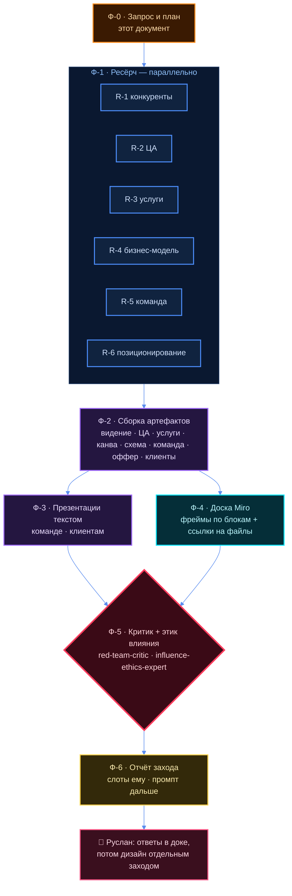

# Упаковка продюсерского центра — запрос и план на 10.10

> Заказ — его слово 13:58 10.10: [`tochka-b/181-OS-13-58.md`](../../../tochka-b/181-OS-13-58.md),
> бриф — [`00-BRIEF.md`](00-BRIEF.md). Всё ниже, что не в цитате, — **кандидат агента**:
> структура, порядок и формулировки мои, решение его.

## ⚠️ Три вещи, которые надо знать до чтения плана

1. **Центр в доме уже есть, и это не чистый лист.** Карточка
   [`entities/jetix-producer-center.md`](../../../entities/jetix-producer-center.md), каталог услуг
   от 12.08 (У-1…У-6: упаковка знаний, воронки и трафик, мероприятия, тест гипотез, дизайн, полное
   продюсирование), цели от 27.08 (Ц-1…Ц-6) и канва 17.09 с критиком
   ([`09a`](../../../projects/biznes-model/docs/09a-KRITIK-PRODYUSERSKIY.md): глубина 0,5 из 6).
   Бриф 10.10 **сужает** центр: ЦА только IT, стартапы, агенты, инфобиз; услуги — новые семь.
   Поэтому план не пишет второй центр рядом, а делает **новую редакцию упаковки**, где старое —
   источник, а расхождения названы явно. Что из старого снимается — решает он (слот В-1).
2. **Бриф просит «собрать цены и посчитать, сколько клиентов нужно».** Делаю наполовину, и вот
   почему: **рыночные цены конкурентов** с источником и датой — собираем, это факт рынка.
   **Наши цены и проценты команде** — не предлагаю числами: домовой запрет стоп #64 и правило
   режима «деньги про людей — его слово». Счёт «сколько клиентов» даю **формулой**: целевая
   выручка центра (Ц-4 в `goals.md`) у него пустая с 27.08 — пока её нет, ответа числом нет.
3. **Вчерашняя упаковка, по его слову, не получилась.** Моя догадка, почему: вчера рамка была
   «корпорация · группа · система взглядов» — абстрактно, человеку снаружи не за что зацепиться.
   Сегодня рамка конкретная: **центр, семь услуг, две ЦА, команда**. Позиционирование
   пересобирается через неё: «Руслан — основатель продюсерского центра для IT и стартапов».
   Вчерашние документы — сырьё, не основа. Это догадка, он поправит.

---

## §1 Предмет

Собрать за 10.10 **текстовый пакет упаковки продюсерского центра**: что за центр и зачем, кому
продаёт и кого не берёт, что именно делает (услуги и входной продукт), как зарабатывает (Lean
Canvas и бизнес-схема с рыночными вилками), кто в команде и что команде предлагается на первый
месяц, какие клиенты первые (шаблонами), как Руслан позиционирует себя и о чём снимает, и две
презентации текстом — для будущей команды и для клиентов. Всё на опоре ресёрча с источниками и
со ссылкой на конкурентов; ключевое залито на доску Miro `uXjVEcLaeBs=`.

## §2 Термины

| Слово | Бытовое пояснение |
|---|---|
| **Продюсерский центр (ПЦ)** | команда, которая берёт человека с продуктом и помогает ему выйти к людям и продавать: упаковка, контент, техника, воронки |
| **Входной продукт** | первое, что покупают; маленькое, понятное, с быстрым результатом. Остальное продаётся после |
| **Апсейл** | следующая услуга, которую предлагают тому, кто уже купил входной продукт |
| **Lean Canvas** | одна страница из девяти клеток: проблема, сегменты, ценность, решение, каналы, деньги, издержки, метрики, преимущество |
| **Бизнес-схема** | на чём и сколько центр зарабатывает: потоки денег, рыночные вилки, формула «сколько клиентов» |
| **Шаблон клиента** | обезличенный типаж («джун-разработчик, ведёт TG-канал на 500 человек, делает пет-проект»), не живой человек |
| **Оффер команде** | что получает человек, который входит в команду на месяц теста, и что от него ждут |
| **Позиционирование** | одна-две фразы, после которых чужой человек понимает, кто Руслан и интересно ли ему |
| **Ресёрч-блок (R-N)** | одно направление глубокой разведки, один агент, один файл в `research/` |
| **R12-пара** | правило дома: любой убеждающий текст наружу проверяет этик влияния `influence-ethics-expert` |

## §3 Цели на сегодня — что должно существовать к вечеру 10.10

Цели взяты из чек-листа брифа §9 и его слова 13:58; номера мои.

| # | Цель — завершённым действием | Откуда | Артефакт |
|---|---|---|---|
| Ц-01 | Видение и описание центра написаны: абзац для партнёров + что делаем и чего не делаем | бриф §1, §9 | `02-VIDENIE-I-OPISANIE.md` |
| Ц-02 | ЦА описана: сегменты A и B, фильтр входа, где живут, боли их словами | бриф §2 | `03-CA.md` |
| Ц-03 | Услуги расписаны, входной продукт выбран кандидатом, лестница апсейлов собрана | бриф §3 | `04-USLUGI-I-VHODNYE.md` |
| Ц-04 | Конкуренты собраны со ссылками, ценами и чем мы отличаемся | слово 13:58 | `05-KONKURENTY.md` |
| Ц-05 | Lean Canvas заполнена плотно, каждая клетка с источником | бриф §6 | `06-LEAN-CANVAS.md` |
| Ц-06 | Бизнес-схема собрана: потоки, рыночные вилки RU и EU, формула клиентов | бриф §6 | `07-BIZNES-SHEMA.md` |
| Ц-07 | Команда расписана: роли, кого из знакомых звать, план обзвона | бриф §4, слово 13:58 | `08-KOMANDA.md` |
| Ц-08 | Оффер команде на первый месяц собран — без чисел долей | бриф §5 | `09-OFFER-KOMANDE.md` |
| Ц-09 | Шаблоны первых клиентов и места, где их искать, собраны | слово 13:58 | `10-SHABLONY-KLIENTOV.md` |
| Ц-10 | Позиционирование Руслана: варианты + био для профилей | бриф §8 | `11-POZICIONIROVANIE.md` |
| Ц-11 | Направление контента: темы первых видео, границы «что не рассказываю» | бриф §7 | `12-KONTENT.md` |
| Ц-12 | Презентация для будущей команды написана текстом по слайдам | слово 13:58 | `13-PREZENTACIYA-KOMANDE.md` |
| Ц-13 | Презентация для клиентов написана текстом по слайдам | слово 13:58 | `14-PREZENTACIYA-KLIENTAM.md` |
| Ц-14 | Цели центра на первые недели названы кандидатом с мерилом | слово 13:58 «цели… четко на сейчас» | `15-CELI-CENTRA.md` |
| Ц-15 | Доска Miro наполнена: ресёрч, канва, услуги, ссылки на файлы | слово 13:58 | борд `uXjVEcLaeBs=` |
| Ц-16 | Пакет прогнан критиком и этиком влияния, правки названы | слово 13:58 «критиком» | `16-KRITIK.md` |

## §4 Требования — каждое с мерилом

| # | Требование | Мерило | Как проверить |
|---|---|---|---|
| Т-1 | Каждое утверждение о рынке — с источником | у строки есть URL или путь в репозитории | `grep -c "http" research/R-*.md` больше нуля в каждом файле |
| Т-2 | Каждое число — с источником и датой, иначе «ДАННЫХ НЕТ» | сторож ПИС-3 молчит | `bash swarm/lib/hooks/number-without-command-check.sh <файлы>` |
| Т-3 | Конкуренты — реальные, ссылки живые | ссылка открывается | выборочно `curl -sI <url>` на пять ссылок блока R-1 |
| Т-4 | Люди в списке команды — только из репозитория, не выдуманы | имя находится грепом | `grep -rl "<имя>" crm/ tochka-b/` |
| Т-5 | Клиенты — шаблонами, без живых имён | в `10-…` нет фамилий и ссылок на личные профили | чтение владельцем |
| Т-6 | Наши цены и проценты команде не проставлены | в `07-…` и `09-…` на их месте слот | `grep -n "ждёт владельца" docs/07-*.md docs/09-*.md` |
| Т-7 | Каждый артефакт — с шапкой и разделом «что здесь слабого» | поля на месте | `grep -L "Что здесь слабого" docs/*.md` пусто |
| Т-8 | Убеждающие тексты (презентации, био) прошли этика влияния | вердикт лежит файлом | `ls research/R12-*.md` |

## §5 Ограничения

- ⛔ **Наружу ничего не уходит.** Ни одно сообщение, пост, звонок от имени Руслана. Тексты
  презентаций — внутренние драфты; наружу только его рукой из `outbound/` (ПИС-12).
- ⛔ **Наши цены, доли, проценты команде** — не считаем и не предлагаем числами (стоп #64).
  Рыночные вилки конкурентов — можно, с источником, с подписью «рынок, не наша цена».
- ⛔ **Живых людей не ищем в сети** и не выдумываем. Кандидаты в команду — только те, кто уже
  есть в `crm/`, `tochka-b/` или назван им (Антон).
- ⛔ **Канон не трогаем**: карточку `entities/jetix-producer-center.md`, каталог 12.08, цели 27.08
  и канву 17.09 агенты не правят. Новое пишется в папку проекта; расхождение — строкой.
- ⛔ **Дизайн не делаем**: ни вёрстки, ни картинок. Только текст и схемы инлайном.
- ⛔ **Отдельный репозиторий не заводим** сегодня.

## §6 Критерии приёмки — да или нет

| # | Критерий | Команда |
|---|---|---|
| К-1 | Все шестнадцать целей §3 имеют файл | `ls docs/ \| wc -l` против таблицы §3 |
| К-2 | Шесть файлов ресёрча лежат и в каждом есть источники | `ls research/R-*.md` · `grep -c http research/R-*.md` |
| К-3 | Сторож чисел молчит или каждое его срабатывание объяснено в отчёте | прогон сторожа |
| К-4 | На доске Miro есть фреймы по блокам | ответ инструмента Miro: создано N, провалилось 0 |
| К-5 | Отчёт захода лежит | `ls sessions/2026-10-10.md` |
| К-6 | В презентациях нет первого лица от имени Руслана без пометки «драфт» | `grep -n "agent-draft" docs/13-*.md docs/14-*.md` |

## §7 Вне объёма — сознательно не делаем сегодня

- дизайн презентаций и доски (его отдельный заход);
- отдельный репозиторий центра;
- сайт и лендинг центра (бриф §9: «дальше, после сборки команды»);
- реальный обзвон и рассылка — только план и структура разговора, звонит он;
- договоры, юрлицо, налоги;
- правка старой канвы 17.09 и каталога 12.08.

## §8 Открытые вопросы — слоты владельцу

Он отвечает **в этом файле**, правкой строки. Мой кандидат — в скобках, решение его.

| № | Вопрос | Блокирует | Кандидат агента |
|---|---|---|---|
| В-1 | Каталог 12.08 (У-1…У-6) заменяется семью услугами брифа или живёт рядом | `04-…`, канву | заменяется для внешней подачи, остаётся в каноне до его «да» |
| В-2 | Целевая выручка центра в месяц — какое число | счёт в `07-…` | ждёт владельца |
| В-3 | Деньги команде: процент из выручки или фикс за задачу | `09-…` | ждёт владельца; покажу обе схемы словами |
| В-4 | Кто из знакомых на какую роль — список имён | `08-…` | ждёт владельца; соберу из `crm/` то, что есть |
| В-5 | Рынок сначала только русскоязычный или сразу и Европа | `03-…`, цены | только RU, Европу — для сравнения цен |
| В-6 | Под каким именем центр выходит наружу | презентации | ждёт владельца |
| В-7 | Пятая роль команды: монтажёр, коуч или дизайнер | `08-…` | монтажёр-контент-продюсер, потому что входной продукт — контент |

---

## §9 Блоки ресёрча — кто что копает

Шесть блоков идут параллельно, каждый — отдельный агент, свой файл. Сборка артефактов §3 —
после того, как все шесть легли.

| Блок | Что копаем | Вопросы, на которые обязан ответить | Файл | Кормит цели |
|---|---|---|---|---|
| **R-1 Рынок и конкуренты** | продюсерские центры экспертов и блогеров, агентства личного бренда для IT и фаундеров, сервисы ИИ-нарезки, студии воронок; RU и Европа | кто они, ссылка, что продают, за сколько публично, чем отличаемся, где пусто | `research/R-1-KONKURENTY.md` | Ц-04, Ц-05, Ц-06 |
| **R-2 ЦА и где её искать** | сегменты A и B: технари, вкатывающиеся в IT, стартаперы; люди с аудиторией без техники | боли их словами из публичных обсуждений, где живут (сообщества, чаты, площадки), шаблоны клиентов | `research/R-2-CA.md` | Ц-02, Ц-09 |
| **R-3 Услуги и входной продукт** | как рынок пакует вход: диагностика, спринт, пакет; лестница от дешёвого к дорогому | что продаётся первым и почему, разбор семи услуг на пакеты, кандидат 1-2 входных | `research/R-3-USLUGI.md` | Ц-03, Ц-13 |
| **R-4 Бизнес-модель** | канвы агентств и студий, рыночные цены по потокам, юнит-экономика формулой | клетки Lean Canvas с источником, вилки RU и EU, формула «сколько клиентов на выручку X» | `research/R-4-BIZNES-MODEL.md` | Ц-05, Ц-06, Ц-14 |
| **R-5 Команда и оффер** | как собирают команды в агентствах на старте, роли, рыночные схемы оплаты как практика | описание пяти ролей, где таких ищут, кандидаты из репозитория, структура звонка, оффер без чисел | `research/R-5-KOMANDA.md` | Ц-07, Ц-08, Ц-12 |
| **R-6 Позиционирование и контент** | вчерашние доки через сегодняшнюю линзу; русскоязычные фаундеры и IT-блогеры, которые строят публично | варианты позиционирования, био, темы первых видео, границы, референсы со ссылками | `research/R-6-POZICIONIROVANIE.md` | Ц-10, Ц-11 |

## §10 Порядок работы — схема

## §11 Что откуда берётся в доме — чтобы агенты не начинали с нуля

| Есть в доме | Путь | Для каких блоков |
|---|---|---|
| Канва центра 17.09, второй проход | `projects/biznes-model/docs/04-MODEL-PRODYUSERSKIY-CENTR.md` | R-4 |
| Эталон отрасли: как работают центры | `projects/biznes-model/docs/07a-ETALON-PRODYUSERSKIY.md` | R-1, R-4 |
| Критик канвы: что в ней пусто | `projects/biznes-model/docs/09a-KRITIK-PRODYUSERSKIY.md` | R-4 |
| Каталог услуг 12.08 и бенчмарки | `entities/jetix-producer-center/service-catalog.md` · `benchmarks.md` | R-1, R-3 |
| Цели центра 27.08 | `entities/jetix-producer-center/plan/goals.md` | R-4 |
| Вчерашнее позиционирование | `projects/upakovka-specialista/docs/` | R-6 |
| Реестр позиций специалистов | `projects/point-b3/docs/reestr-pozitsiy-specialistov.md` | R-5 |
| Люди | `crm/` · встреча с Антоном `projects/vstrecha-anton/` | R-5 |
| Ресёрч ниш Берлина 08.09 | репозиторий rumsatz-de (вне этого) | — |

## ⚠️ Что здесь слабого

1. Шестнадцать артефактов за один день — много. Если ресёрч ляжет поздно, первыми режутся
   Ц-14 и вторая презентация; порядок резки — мой, он может переставить.
2. Цели §3 — мои формулировки его чек-листа; «цели центра на сейчас» (Ц-14) он не расписал,
   там будет кандидат, не решение.
3. Догадка о том, почему вчера «хуёво получилось», — моя, не его. Если причина другая,
   позиционирование R-6 надо перенастроить.
4. Ресёрч рынка из сети несёт риск устаревших цен и мёртвых ссылок; проверка Т-3 выборочная.
5. Без его чисел (выручка, деньги команде) бизнес-схема и оффер останутся формулой и словами —
   это честное состояние, а не недоделка.
