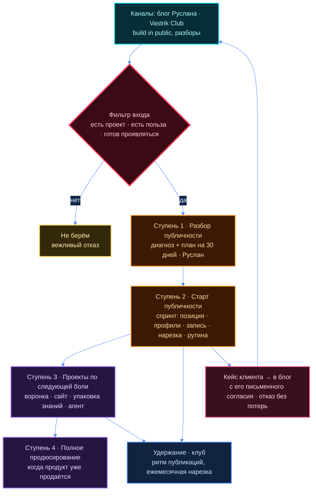

# Продюсерский центр — видение и описание

> Цель Ц-01 плана [`01-ZAPROS-I-PLAN.md`](01-ZAPROS-I-PLAN.md) §3. Его слова — только в цитатах
> с источником (бриф [`00-BRIEF.md`](00-BRIEF.md)). **Всё остальное — кандидат агента**: текст мой,
> решение его. ⛔ Это внутренний драфт: наружу — только его рукой из `outbound/` и после R12-пары
> (проверка убеждающего текста этиком влияния `influence-ethics-expert`).

## ⚡ За минуту

1. **Что это.** Команда, которая выводит IT-людей и авторов продуктов в публичность и помогает
   регулярно рассказывать о продукте — с ИИ-инструментами, которые снимают рутину. Продаж числом
   не обещаем (Э-22).
2. **Кому первым.** Автору пет-проекта или стартапа, у которого продукт есть, а пользователей нет
   (подсегмент A-2, [`03-CA.md`](03-CA.md)). Канал — Vastrik Club и блог Руслана.
3. **С чего начинается работа.** «Разбор публичности» → «Старт публичности» (спринт). Остальное —
   следующие шаги ([`04-USLUGI-I-VHODNYE.md`](04-USLUGI-I-VHODNYE.md)).
4. **Чем отличаемся.** Рынок продаёт куски разным людям; связку «публичность + ИИ-продакшн +
   воронка» одной командой для технарей поиск не нашёл ни у кого ([`05-KONKURENTY.md`](05-KONKURENTY.md)).
5. **Чего нет.** Цен, процентов команде, целевой выручки — это слоты владельца (стоп #64 —
   домовой запрет агенту предлагать числами деньги про людей).

## Термины

| Слово | Бытовое пояснение |
|---|---|
| Продюсерский центр (ПЦ) | команда, которая помогает человеку с продуктом выйти к людям и регулярно о нём рассказывать |
| Публичность | человек регулярно и понятно показывается там, где его клиенты: посты, видео, статьи |
| Упаковка | позиция одной фразой + оформленные профили + понятное «что я делаю и для кого» |
| ИИ-нарезка | из одного длинного видео сервис режет пачку коротких роликов с субтитрами |
| Рутина проявления | календарь и простые инструменты, чтобы публиковаться без героизма |
| Воронка | путь человека от «увидел пост» до «заплатил», по шагам |
| Входной продукт | первое, что покупают: малое, понятное, с быстрым результатом |
| Апсейл | следующая услуга тому, кто уже купил вход |
| Build in public | строить на виду: показывать ход работы, ошибки и цифры |
| Vastrik Club | закрытое русскоязычное IT-сообщество (vas3k.club), канал входа из брифа |

---

## §1 Видение — одним абзацем для партнёров

**Его слово** (бриф §1, 10.10): «Помогаем людям из IT, агентов, инфобизнеса и стартапов выйти в
публичность, найти аудиторию и продавать свои продукты — технически и маркетингово. Берём в
работу только адекватные, полезные миру продукты, не „хуйню ради денег“».

**Кандидат агента — абзац для партнёров:**

> Продюсерский центр помогает IT-людям, авторам стартапов и пет-проектов выйти в публичность и
> регулярно рассказывать о продукте — с ИИ-инструментами, которые снимают рутину. Продаж числом
> не обещаем. Мы берём людей, которые уже умеют делать, но не умеют показываться: у них есть
> продукт, нет пользователей. Мы даём им позицию, оформленные профили, поток контента без ручного
> монтажа и путь от поста до первого разговора с клиентом. Хотим делать это одной командой, а не
> пятью подрядчиками, — команду собираю. Берём только продукты, которые полезны людям.
> *(правка по Э-22, Э-28)*

⛔ **Что в абзац сознательно не вошло.** Долгосрочное видение — корпорация независимых команд и
кланов. Его слово (бриф §1): «остаётся фоном. **В оффер на старте не выносится.** Продюсерский
центр — это первая команда/первый клан». Внутри команды об этом можно говорить, наружу — нет
(бриф §7: «сырое долгосрочное видение… до появления первых результатов» не рассказывается).

## §2 Что это — описание центра

**Кандидат агента.** Продюсерский центр — небольшая команда вокруг Руслана: он ведёт продажи,
упаковку и воронки; рядом — роли технаря, методолога, менеджера проектов и монтажёра (состав и
поиск — Ц-07, `08-KOMANDA.md`, ещё не собран). Работа идёт по лестнице: малый вход, затем
спринт с видимым итогом, затем проекты по следующей боли клиента, затем удержание в клубе.

Центр в доме не новый: карточка [`entities/jetix-producer-center.md`](../../../entities/jetix-producer-center.md)
и каталог услуг 12.08 существуют. Эта редакция **сужает** центр под бриф 10.10: только IT,
стартапы и авторы продуктов; семь услуг брифа вместо шести старых. Что из старого снимается —
слот В-1 ([`04-USLUGI-I-VHODNYE.md`](04-USLUGI-I-VHODNYE.md) §5).
⬜ Бриф §1 называет и инфобизнес («людям из IT, агентов, инфобизнеса и стартапов»), здесь он
выпал без слота (критик К-3): решение Руслана, см. [`18-RESHENIYA-VLADELCA.md`](18-RESHENIYA-VLADELCA.md).

## §3 Для кого

| Сегмент | Кто | Когда берём |
|---|---|---|
| **A · «Выйти в публичность»** | технари и стартаперы, которые ещё не выходили или выходят криво | **первым** — подсегмент A-2 |
| **B · «Уже есть аудитория»** | авторы с аудиторией без техники, автоматизации и воронок | вторым, после первого кейса A-2 |

Язык и рынок — русскоязычные (бриф §2: «первый фильтр, тестируем»). Подробно — [`03-CA.md`](03-CA.md).

## §4 Что делаем

Семь направлений брифа §3 (его формулировки — в [`04-USLUGI-I-VHODNYE.md`](04-USLUGI-I-VHODNYE.md)):

1. **Анализ и настройка аудитории** — кто клиент продукта и что у него болит.
2. **Персональные приложения и ИИ-инструменты** — нарезка, трекинг публикаций, база ответов, агенты.
3. **Сайты** — допил, лендинги, проверка безопасности.
4. **Выход в публичность** — позиция, упаковка профилей, рутина проявления. ⭐ ядро входа.
5. **Воронки продаж** — путь от поста до оплаты под инфопродукт или приложение.
6. **Упаковка знаний** — экспертиза → курс, образовательный продукт или бот.
7. **Клуб** — дисциплина и продвижение вокруг своего продукта; держит выпускников.

## §5 Чего не делаем — фильтр

**Его слово** (бриф §1, §2): «не „хуйню ради денег“»; не берём «без технического бэкграунда (для
сегмента A)», «совсем „нулевых“, у кого нет проекта, о котором можно рассказать», «продукты,
которые не несут пользы».

**Кандидат агента — та же мысль приличными словами для внешних текстов:**

> Мы работаем только с продуктами, которые решают настоящую задачу людей. Не берём схемы быстрого
> заработка, обещания гарантированного дохода и проекты, где за упаковкой нет продукта.

| Не делаем | Почему | Опора |
|---|---|---|
| не берём продукты без пользы, схемы и «гарантии заработка» | фильтр брифа; IT-среда читает такое как инфоцыганство | бриф §1, §2; R-2 §5 |
| не берём человека без проекта, о котором можно рассказать | рассказывать не о чем, кейса не будет | бриф §2; R-2 §5 |
| не обещаем подписчиков числом и не закупаем трафик во входе | результат зависит от продукта и ритма клиента | R-3 §5 «Что НЕ входит» |
| не пишем свой нарезчик на продажу | нарезка стала товаром дешёвой подпиской; ценность — что резать | R-1 ⚡ п.4; R-3 §3 |
| не ведём аккаунт вместо клиента во входе | вход учит ритму; ведение — отдельная услуга после | R-3 §5 |
| не публикуем тексты от имени клиента без его правки | голос — его | R-3 §5 |
| не выносим наружу долгосрочное видение | его слово, бриф §1, §7 | бриф §1 |

## §6 Чем отличаемся — из карты пустот рынка

«Пусто» значит: в поиске R-1 игрок не встретился. Это не доказательство, что его нет
([`05-KONKURENTY.md`](05-KONKURENTY.md) §5). Каждая строка — кандидат агента.

| Отличие | Что на рынке рядом | Пустота R-1 |
|---|---|---|
| **Технари — технарям.** Продюсер именно для IT и фаундеров | русскоязычные ПЦ живут в инфобизе и Instagram | П-1 |
| **Одна команда на всю связку**: упаковка → контент с ИИ → воронка | куски продают разные люди, клиент собирает сам | П-2 |
| **Рутина, а не брендбук**: система, в которой проявляться легко | либо разовая упаковка-документ, либо SMM-руки | П-3 |
| **Нарезка под ключ на русском поверх готовых сервисов** | русский нарезчик — самообслуживание | П-4 |
| **Каналы технарей**: Telegram и Хабр от первого лица (⬜ расходится с ритмом Reels/TikTok в 12 §5, К-2 — решение Руслана, см. [`18`](18-RESHENIYA-VLADELCA.md)) | ведение TG — от лица бизнеса; на Хабр от себя помощи нет | П-5, П-6 |
| **Витрина — сам Руслан строит центр на виду** | у инфобиз-ПЦ — обещания результата без отчёта | R-1 §4 п.6 |
| **Фильтр «полезный продукт»** как условие входа | инфобиз-ПЦ продюсируют «любого эксперта» | R-1 §4 п.1 |

⚠️ Отличие «дешевле агентства за счёт ИИ» сознательно не вынесено: наших цен нет, сравнивать нечего
(R-4 клетка 3).

## §7 Как работаем — путь клиента

Цвета: оранжевый — входные продукты · фиолетовый — проекты · синий — удержание · бирюзовый —
каналы · красный — развилка-фильтр · розовый — кейс, который возвращается в канал.

Согласие клиента на показ проекта в блоге — отдельно и письменно, до съёмки; можно отказаться, цена
и объём работы от этого не меняются (Э-24).

**Состояния клиента** (кандидат агента, по правилу FPF — завершённым действием):
`lead-identified` → `qualified` → `razbor-delivered` → `start-delivered` → `upsell-proposed` →
`club-joined` или `closed`. Канон машин состояний не правлю — это кандидат для карточки клиента.

## §8 Рассказ о центре — за 30 секунд и за 2 минуты

> ⛔ Кандидат агента, внутренний драфт. Убеждающий текст — до любого показа наружу проходит
> R12-пару. Имя центра — слот В-6. От имени Руслана говорит только он.

**За 30 секунд:**

> Я собираю продюсерский центр для технарей и авторов стартапов. Типичная история: человек сделал
> продукт, а пользователей нет — потому что делать и продавать это разные навыки. Первым
> клиентам даём позицию одной фразой, оформленные профили, поток роликов из одной записи с
> помощью ИИ и ритм, в котором публиковаться легко. Берём только полезные продукты. *(Э-28)*

**За 2 минуты:**

> Я Руслан, собираю продюсерский центр и делаю это на виду — в блоге.
>
> **Проблема.** При разборе рынка мне попался комментарий на Хабре (автор не установлен), где
> это сказано точнее меня: «разработка и привлечение пользователей — это очень разные скиллы».
> Технари делают сильные продукты, а потом упираются в тишину: нет
> времени, непонятно, о чём писать, страшно показывать сырое.
>
> **Что есть на рынке.** Агентства личного бренда делают разовую упаковку. SMM ведёт каналы от
> лица бизнеса. Техспецы собирают воронки для онлайн-школ. ИИ-сервисы режут видео, но смысл и
> тему клиент придумывает сам. Всё это куски — и собирает их сам клиент.
>
> **Что делаем мы.** Сейчас разбор и старт веду я сам с ИИ-инструментами. Команду под остальное
> собираю. Сначала короткий разбор: где ты сейчас и план на 30 дней. Потом двухнедельный спринт:
> позиция, профили, одна длинная запись разговора о проекте, из неё ИИ режет ролики, и рутина,
> чтобы дальше публиковаться без нас. Дальше — по следующей боли: воронка, сайт, курс или бот из
> твоих знаний, агенты под проект. Клуб — когда будут первые выпускники. *(Э-28)*
>
> **Кого берём.** Тех, у кого есть проект, о котором можно рассказать, и который полезен людям.
> Схемы быстрого заработка не берём.
>
> **Сейчас** собираю первых клиентов и команду. Если узнал себя — напиши.

Цитата Хабра — A-q1 из [`03-CA.md`](03-CA.md) §3; она из поисковой выдачи, страница не открыта —
перед выносом наружу открыть руками; не откроется — без кавычек: «мне встречались такие
комментарии» (Э-27).

---

## ⚠️ Что здесь слабого

1. **Ни одна опора не проверена разговором с клиентом.** Боли — из поисковой выдачи (R-2), пустоты
   рынка — «не нашёл за 32 запроса» (R-1), а не «нет». Отличия §6 — гипотезы до 5-10 разговоров.
2. **Отличие «одна команда на всю связку» держится на команде, которой ещё нет.** Сегодня без
   команды сдаётся только то, где исполнитель Руслан (R-3 §3): ступень 1 и большая часть ступени 2.
3. **Рассказы §8 — убеждающие тексты.** R12-пара пройдена 10.10, вердикт ⚠️ с правками
   ([`R12-ETIKA.md`](../research/R12-ETIKA.md)); Э-22, Э-24, Э-27, Э-28 внесены правщиком. До выноса
   наружу — открыть цитату Хабра руками.
4. **Состояния клиента §7** — мои имена, в каноне ядра их нет; сторож прошедшего времени их не
   проверял.
5. Приличная формулировка фильтра §5 — моя; его слово грубее и точнее, смысл мог сместиться.

## Слоты владельцу

Отвечает здесь, правкой строки. Кандидат агента — во втором столбце.

| № | Вопрос | Кандидат агента | Ответ |
|---|---|---|---|
| В2-1 | Абзац видения §1 — берём, правим или пишешь свой | берём как основу | ⬜ ждёт владельца |
| В2-2 | Приличная формулировка фильтра §5 — годится для внешних текстов | да | ⬜ ждёт владельца |
| В2-3 | Под каким именем центр выходит наружу (= В-6 плана) | — | ⬜ ждёт владельца |
| В2-4 | Рассказы за 30 секунд и 2 минуты — отдать на R12-пару сейчас или после имени | после имени | ⬜ ждёт владельца |
| В2-5 | Про «одну команду» говорим наружу до того, как команда собрана | нет, пока нет технаря | ⬜ ждёт владельца |
