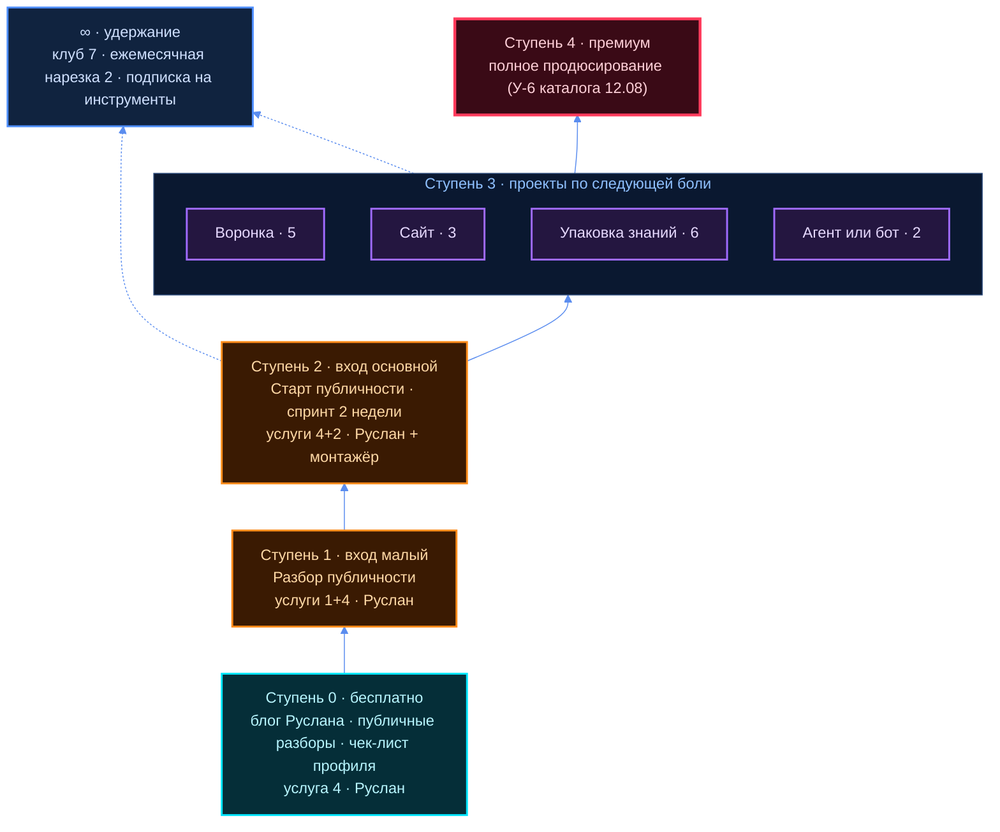

# Услуги и входные продукты

> Цель Ц-03 плана [`01-ZAPROS-I-PLAN.md`](01-ZAPROS-I-PLAN.md) §3. Опора — ресёрч
> [`R-3-USLUGI.md`](../research/R-3-USLUGI.md). Услуги — его слова (бриф §3); сроки, роли по шагам,
> лестница, состав пакетов — **кандидат агента**. ⛔ Наших цен здесь нет — слоты «ждёт владельца»
> (стоп #64: домовой запрет агенту предлагать числами деньги про людей). Рыночные цены — в
> [`05-KONKURENTY.md`](05-KONKURENTY.md) и R-3 §1, с пометкой «рынок, не наша цена».

## ⚡ За минуту

1. **Вход — двумя ступенями:** «Разбор публичности» (диагностика + план на 30 дней, Руслан один) →
   «Старт публичности» (спринт 2 недели). Названия рабочие.
2. **Гипотеза брифа «публичность + ИИ-нарезка» верна, но с дырой:** сегмент A «ещё не выходил» —
   нарезать ему нечего. Чинится так: **одна длинная запись входит в пакет**, из неё и режем.
3. **Апсейлы:** воронки (5), сайты (3), упаковка знаний (6), агенты (2). **Клуб (7) — удержание.**
4. **Без команды сегодня продаётся только то, где исполнитель Руслан:** услуга 4 целиком, 1 базово,
   логика 5. Остальное ждёт технаря, методолога или монтажёра.
5. **С каталогом 12.08 совпадают две позиции из шести** (упаковка знаний, воронки). Что снимается —
   слот В-1.

## Термины

| Слово | Бытовое пояснение |
|---|---|
| Входной продукт | первое, что покупают: малое, понятное, с быстрым видимым результатом |
| Лестница продуктов | ряд продуктов от бесплатного к дорогому; клиент поднимается по ступеням |
| Трипваер | первая платная покупка за малые деньги, связанная с основным продуктом |
| Спринт | работа с фиксированным объёмом и сроком, результат известен заранее |
| Апсейл | следующая услуга тому, кто уже купил вход |
| Continuity | повторяющийся платёж: подписка, клуб, ежемесячный сервис |
| ИИ-нарезка | из одного длинного видео сервис режет короткие ролики с субтитрами |
| Роль / исполнитель | роль — тип работы («монтажёр»); исполнитель — конкретный человек на ней |

---

## §1 Семь услуг — что сдаём, срок, кто, чем

Услуги и их состав — бриф §3. Сроки — **оценка агента по рыночным аналогам, не замер** (живой
практики у центра ноль). Роль — тип работы; кто сейчас на ней — в скобках (бриф §4).

| # | Услуга (бриф §3) | Что сдаём | Срок (оценка) | Роль (сейчас) | Инструменты | Ступень |
|---|---|---|---|---|---|---|
| 1 | **Анализ и настройка аудитории** | портрет сегмента, 5-10 интервью, боли словами клиента, гипотезы оффера | 1-2 недели | аналитик ЦА (Руслан — базово) | транскрибация и разбор интервью ИИ | 1, внутри 2 |
| 2а | **ИИ: монтаж, нарезка, трекинг** | пачка коротких роликов с субтитрами из длинной записи; трекер публикаций | дни | монтажёр (кандидат — Антон) | OpusClip, Submagic, Vizard, Descript; таблица или бот | 2, ∞ |
| 2б | **ИИ: база знаний, агенты** | бот по материалам автора; агенты и автоматизации под проект | 1-4 недели | технарь (нет) | Chatbase и аналоги; опыт бригады Jetix OS | 3 |
| 3 | **Сайты** | допил, лендинг, проверка безопасности с отчётом | 1-3 недели | технарь (нет) | сканеры безопасности (TLSguard как ориентир) | 3 |
| 4 | **Выход в публичность** ⭐ | три варианта позиции, упаковка профилей, контент-план, рутина | 2 недели | продюсер-упаковщик (Руслан); коуч — при страхе камеры | ИИ-черновики текстов, нарезка из 2а | 1, 2 |
| 5 | **Воронки продаж** | карта воронки, бот-цепочка, лендинг, разметка этапов | 2-4 недели | архитектор воронки (Руслан) + технарь (нет) | SaleBot для TG-воронок | 3 |
| 6 | **Упаковка знаний** | структура курса, программа, сценарии уроков, бот-ассистент | 3-6 недель | методолог (нет) | ИИ-черновики программы, Chatbase | 3 |
| 7 | **Клуб** | ритм встреч, трекер целей, чат, доступ по оплате | запуск 1-2 недели, далее постоянно | менеджер проектов (нет) + Руслан | Tribute, автодоступ SaleBot, Skool | ∞ |

Источники инструментов — R-3 §3-б (И-18…И-27). Антон — кандидат, не исполнитель: слот R3-4.
⬜ Кто режет ролики (монтажёр, технарь или нарезчик Антона) и какая пятая роль — по пакету расходится
(критик К-1): решение Руслана, см. [`18-RESHENIYA-VLADELCA.md`](18-RESHENIYA-VLADELCA.md).

**Что из таблицы следует** (вывод агента, R-3 §3):

- ИИ-нарезка дешева как сервис — **ценность центра не в нарезке, а в том, что резать** (позиция,
  тема, крючок), и в регулярности.
- Слайд встречи с Антоном 08.10 ([`s08-narezchik.html`](../../vstrecha-anton/slides/s08-narezchik.html)):
  «нарезчик больших видео… для тех, кто уже делает длинные видео» — это и есть дыра п.2 «За минуту».

## §2 Лестница продуктов

Цвета: бирюзовый — бесплатный слой · оранжевый — входы · фиолетовый — проекты · красный —
премиум · синий — удержание. Порядок ступеней — кандидат агента; цена каждой — ждёт владельца.
Канал ступени 0 — бриф §2: Vastrik Club + блог Руслана.

**Почему так** (R-3 §2, §5): практика лестницы требует, чтобы первая платная покупка была **связана
с основным продуктом** ([src: И-17 в R-3]); выход «Разбора» — план — сам продаёт «Старт». Воронка-спринт
для сегмента B хуже как вход сейчас: без технаря её не сдать — это ступень 3, когда технарь есть.

## §3 Карточка «Разбор публичности» (рабочее название)

**Ступень 1. Для кого:** сегмент A, прошедший фильтр входа ([`03-CA.md`](03-CA.md) §5, §7).
**Исполнитель:** Руслан один. **Срок:** дни (оценка агента).
**Рыночный аналог:** разбор-сессия 60-90 минут с планом на 30 дней, roadmapping (R-3 §1, табл. 1-а).

| Шаг | Что делаем | Что получает клиент |
|---|---|---|
| 1 | Анкета: проект, кому полезен, что уже пробовал, где сейчас присутствует | проговорённая цель |
| 2 | Разбор текущих профилей, публикаций и позиции — до созвона | взгляд со стороны |
| 3 | Созвон-разбор: где теряются люди, что сказать о себе одной фразой | диагноз |
| 4 | План на 30 дней: площадки, темы первых публикаций, ритм, следующий шаг | документ-план |

**Результат.** Клиент знает, кто он для своей аудитории, где ему быть и что публиковать ближайшие
30 дней. План сам называет следующий шаг — «Старт публичности».

**Что НЕ входит:** исполнение плана · упаковка профилей руками центра · запись и нарезка роликов ·
воронка, сайт, бот · любые гарантии подписчиков или продаж.

**Главный риск** (R-3 §5): читается как «бесплатная консультация». Защита — анкета до созвона и
план документом на выходе. ⬜ Решение 17.09 о бесплатной диагностике в первом касании и платный
Разбор не разведены (критик К-5): граница — решение Руслана, см.
[`18-RESHENIYA-VLADELCA.md`](18-RESHENIYA-VLADELCA.md); кандидат агента — §4а шаг ④.

**Цена:** ⬜ ждёт владельца. **Засчитывается ли в «Старт»:** ⬜ ждёт владельца (слот R3-2).

## §4 Карточка «Старт публичности» (рабочее название)

**Ступень 2. Для кого:** технарь или стартапер с проектом, о котором можно рассказать; публично не
выходил или выходит криво. Фильтр входа брифа §2 действует.
**Срок:** 2 недели — кандидат (рыночный аналог спринта — 2-3 недели, R-3 §1, табл. 1-б).

| Шаг | Что делаем | Роль (сейчас) | Что получает клиент |
|---|---|---|---|
| 0 | «Разбор публичности» (если не покупал отдельно — слот R3-2) | Руслан | диагноз и план |
| 1 | Позиционирование: три варианта, клиент выбирает один | продюсер-упаковщик (Руслан) | фраза «кто я и для кого» |
| 2 | Упаковка профилей на выбранных площадках: шапка, био, закреп, первый пост | продюсер-упаковщик (Руслан) | готовые профили |
| 3 | Одна длинная запись: интервью-эфир о проекте, Руслан — ведущий | Руслан + монтажёр | исходник для роликов |
| 4 | ИИ-нарезка записи в короткие ролики с субтитрами | монтажёр (кандидат — Антон) | пачка роликов к публикации |
| 5 | Рутина: контент-план, календарь, трекер «вышел / не вышел» | Руслан / менеджер проектов | система регулярности |
| 6 | Сдача: созвон, разбор первой недели публикаций, предложение следующей ступени | Руслан | итог и путь дальше |

**Результат.** Позиция одной фразой, упакованные профили, первая пачка роликов к публикации,
план и ритм, чтобы проявляться дальше без центра.

**Что НЕ входит** (тишина читается как «сделаем»):

- ведение аккаунтов после сдачи — это удержание: ежемесячная нарезка или клуб;
- закуп трафика и рост подписчиков числом — **никаких гарантий подписчиков**;
- воронка, бот, сайт, лендинг — ступень 3;
- студийная съёмка, айдентика, логотип;
- упаковка знаний в курс — ступень 3, услуга 6;
- тексты наружу от имени клиента без его правки;
- показ проекта клиента в блоге центра без его согласия. **Согласие клиента на показ проекта в
  блоге — отдельно и письменно, до съёмки; можно отказаться — цена и объём работы от этого не
  меняются** (вердикт этика Э-24, [`R12-ETIKA.md`](../research/R12-ETIKA.md)). То же — для Разбора.

**Риски пакета.** Монтажёра в команде нет, Антон — кандидат (бриф §4; ⬜ К-1 — решение Руслана, см.
[`18`](18-RESHENIYA-VLADELCA.md)); страх камеры у технарей —
бриф сам называет коуча 5-й ролью; одной записи может не хватить на месячный поток — это повод
для апсейла, а не дефект.

**Цена:** ⬜ ждёт владельца. **Сколько роликов и какие площадки:** ⬜ ждёт владельца (слот R3-3).

## §4а Продажный разговор: Разбор публичности

> Правка П-3 критика ([`16-KRITIK.md`](16-KRITIK.md) §6). **Кандидат агента** — речь «от Руслана»
> здесь черновик его голоса, не его слова. ⛔ Это убеждающий текст: этик влияния его ещё не читал —
> до первого живого разговора R12-проход (`influence-ethics-expert`). Составлен по правилам его
> вердикта по соседним текстам ([`R12-ETIKA.md`](../research/R12-ETIKA.md)): без обещания продаж,
> без срочности и дефицита, деньги называются прямо, «нет» — нормальный ответ.
> ⛔ Чисел цены нет (стоп #64).

**Кому:** лид, который сам написал или откликнулся на касание. **Длительность:** 15-20 минут —
план, не замер. **Цель разговора:** человек понимает, что такое Разбор, сколько стоит и что на
выходе, — и сам решает: да, подумаю или нет. Цель — не «закрыть».

**Шаг ① Открытие — 1-2 минуты.**
- Кто я, сколько займёт, что будет в конце: «Минут пятнадцать-двадцать. Спрошу про проект,
  расскажу, что такое Разбор и сколько он стоит. Решать сегодня ничего не надо».
- Честно о нуле сразу: «Центр новый, кейсов пока нет — мы делаем это впервые» (Э-26).

**Шаг ② Диагностика боли — 6-8 минут. Говорит человек.** Вопросы — чек-лист квалификации
[`03-CA.md`](03-CA.md) §7, своими словами, не анкетой:
- первый вопрос (03 §7): «Что изменится, если через 3 месяца у проекта будет 100 живых
  пользователей, — и что ты уже делал, чтобы их получить?»;
- К-1 есть ли что показать сейчас · К-2 кому он полезен одной фразой · К-3 технический бэкграунд;
- К-4 что уже пробовал и чем кончилось · К-5 готов ли появляться сам хотя бы текстом раз в неделю ·
  К-6 какой результат через 3 месяца будет «стоило того».
- Слушать, переспрашивать его словами. Не подбирать «больное место» как рычаг: человек вправе не
  отвечать на любой вопрос.
- Не проходит фильтр (К-1…К-3 или 03 §5) — сказать прямо и без продажи: «Сейчас мы тебе не нужны,
  и вот почему», плюс один совет, что сделать самому (как в [`14`](14-PREZENTACIYA-KLIENTAM.md) сл.10).

**Шаг ③ Что такое Разбор и что на выходе — 3 минуты.** По карточке §3:
- анкета → разбор профилей и публикаций до созвона → созвон-разбор → план на 30 дней документом;
- на выходе: кто ты для своей аудитории, где тебе быть, что публиковать ближайшие 30 дней;
- что не входит: исполнение плана, упаковка руками центра, ролики, воронка, сайт, **никаких
  гарантий подписчиков или продаж**;
- «План можно делать и без нас» (14 сл.4). Следующую ступень называю, но не продаю здесь.
- Показ его проекта в блоге — только с отдельного письменного согласия; отказ ничего не меняет (Э-24).

**Шаг ④ Граница: что бесплатно в первом касании, что уже Разбор.**
- ⬜ **Граница — решение Руслана** (критик К-5, решение 17.09 о бесплатной диагностике), см.
  [`18-RESHENIYA-VLADELCA.md`](18-RESHENIYA-VLADELCA.md).
- *Кандидат агента рядом:* бесплатно — этот разговор: вопросы шага ② и одна общая мысль вслух, где,
  по-моему, главная дыра. Уже Разбор — всё, что требует работы до созвона и документа на выходе:
  разбор его профилей и публикаций, план на 30 дней. Сказать это вслух, а не держать в уме:
  «Сейчас я скажу, что вижу с разговора. Подробный разбор твоих профилей и план — это уже Разбор».

**Шаг ⑤ Цена — 1-2 минуты.**
- Назвать прямо, одним числом: `[цена Разбора — ждёт владельца, слот R3-2]`.
- Засчитывается ли в «Старт»: `[ждёт владельца, слот R3-2]`.
- Как платить: `[способ оплаты — ждёт владельца]` (ДАННЫХ НЕТ, критик ПМ-9).
- Если можно остановиться после Разбора без обязательств по Старту — сказать (Э-26, слот R12-4):
  «После Разбора можно остановиться — за Старт ты ничего не должен».
- Про проценты, если спросит: «Процентов с твоих продаж нет. Если когда-нибудь предложим такую
  схему — только отдельным договором и только если ты сам захочешь» (Э-25).
- Вопрос К-7 о предоплате — один раз, спокойно, без «скидки сегодня».

**Шаг ⑥ Следующий шаг — 1-2 минуты.** Одна вещь с датой, выбирает человек:
- «да» → анкета и оплата `[канал — ждёт владельца]`, дата созвона-разбора;
- «подумаю» → «Напиши сам, когда захочешь. Сам я напомню один раз, если ты разрешишь»;
- «нет» → «Нормальный ответ. Спасибо, что рассказал про проект».
- Касание после разговора — в CRM скиллом `crm` его рукой.

**Что НЕ говорить** (из вердикта этика по соседним текстам):

| Не говорим | Почему | Вместо |
|---|---|---|
| обещания продаж, подписчиков, выручки числом | гарантировать нечем, кейсов ноль (14 сл.7) | «обещаем то, что можно проверить: что сделаем и к какому сроку» |
| срочность: «только сегодня», «цена вырастет» | давление (Э-17, Э-18 по смыслу) | «решать сегодня ничего не надо» |
| дефицит: «осталось два места», «первым — особые условия» | игра на первенстве (Э-36) | ничего — молчать о местах |
| «проблема не в продукте и не в тебе» | лесть-утешение, продукт мы не знаем (Э-21) | «часто проблема не в продукте: это вторая работа» |
| цитаты Хабра в кавычках и «так пишут разработчики» | страницы не открыты (Э-27) | «мне встречались такие комментарии» |
| «у нас команда», «выпускники в клубе» | их нет (Э-28) | «разбор веду я сам с ИИ-инструментами» |
| чужие кейсы «до и после» | фальшивое доказательство (14 сл.6) | экран своей операционки с агентами |

## §5 Сверка с каталогом 12.08

Каталог [`service-catalog.md`](../../../entities/jetix-producer-center/service-catalog.md) — канон
с его «да» 12.08; здесь **не правится**, только сверяется.

| Каталог 12.08 | Семь услуг брифа 10.10 | Статус | Комментарий агента |
|---|---|---|---|
| У-1 Упаковка знаний | 6 Упаковка знаний | ✅ совпадает | бриф добавляет «или бот» |
| У-2 Воронки + трафик | 5 Воронки продаж | 🟡 частично | воронки есть; закупа трафика в брифе нет |
| У-3 Мероприятия | — | ❌ выпадает | в брифе ни слова |
| У-4 Тестирование гипотез | 1 анализ ЦА + 3 лендинги | 🟡 растворена | отдельным пакетом не названа |
| У-5 Дизайн | — (5-я роль «дизайнер» [открыто]) | ❌ выпадает как услуга | живёт как роль-кандидат |
| У-6 Полное продюсирование | — | 🟡 нет явно | ложится ступенью 4 лестницы |
| — | 1 Анализ и настройка ЦА | 🆕 новое | — |
| — | 2 Персональные приложения и ИИ | 🆕 новое | ИИ-инструментов в каталоге не было |
| — | 3 Сайты (+ безопасность) | 🆕 новое | лендинг был только внутри У-2, У-4 |
| — | 4 Выход в публичность | 🆕 новое | ядро нового входа |
| — | 7 Клуб | 🆕 новое | удержания в каталоге не было |

**Расхождение в модели денег** (без чисел): каталог 12.08 считает процент с продаж для У-1 и У-6 и
фикс или бюджет для остальных; бриф 10.10 говорит пакетами, разовыми услугами, подпиской и
членством, а процент — «позже» (бриф §6). Это **две разные модели входа**, а не правка слов.

**Решение В-1** — слот ниже. Кандидат агента: внешняя подача — семь услуг брифа; каталог 12.08
остаётся в каноне до его «да».

---

## ⚠️ Что здесь слабого

1. **Сроки и состав пакетов — оценка агента**, а не замер: живой практики у центра ноль
   (R-3 «слабое» п.4).
2. **Спрос на вход в RU не доказан.** Публичных RU-цен почти нет, оценка «есть спрос» в R-3 §5
   опирается на англоязычный рынок.
3. **Дыра «нарезать нечего» — вывод агента** из брифа §2 и слайда Антона, у владельца не
   подтверждён. Если у сегмента A длинные видео есть — две ступени упрощаются до одной.
4. **Ступени 3 и 4 без исполнителей**: технаря и методолога в команде нет; продавать их сейчас —
   обещать то, что некому сдать.
5. **«Никаких гарантий подписчиков», тексты карточек и скрипт §4а — убеждающие**; этик 04 не читал
   (его вердикт 10.10 — по 02, 08, 09, 11–14). Скрипт §4а собран по правилам того вердикта, но
   R12-проход именно по нему — до первого разговора.
6. Источники инструментов — из поисковой выдачи R-3; страницы не открывались.
7. **Скрипт §4а — кандидат агента без проверки на живом лиде.** Время шагов — план, не замер;
   граница шага ④ и цена — его решения.

## Слоты владельцу

Отвечает здесь, правкой строки. Номера R3-N совпадают с R-3.

| № | Вопрос | Кандидат агента | Ответ |
|---|---|---|---|
| В-1 | Каталог 12.08 (У-1…У-6) заменяется семью услугами брифа или живёт рядом | замена для внешней подачи; каталог в каноне до «да» | ⬜ ждёт владельца |
| R3-1 | Вход из двух ступеней (Разбор → Старт) или одна | две ступени | ⬜ ждёт владельца |
| R3-2 | Цена «Разбора» и «Старта»; засчитывается ли Разбор в Старт | — | ⬜ ждёт владельца |
| R3-3 | Сколько роликов и какие площадки в «Старте» | — | ⬜ ждёт владельца |
| R3-4 | Антон — исполнитель нарезки в пакете или только инструмент | разговор с Антоном | ⬜ ждёт владельца |
| R3-5 | Клуб открыт всем или только выпускникам пакета | только выпускникам на старте | ⬜ ждёт владельца |
| R3-6 | Рабочие названия пакетов | — | ⬜ ждёт владельца |
| R3-7 | Граница «бесплатно в первом касании / уже Разбор» (§4а шаг ④, К-5) | разговор и одна мысль — бесплатно; разбор профилей и план — Разбор | ⬜ ждёт владельца ([`18`](18-RESHENIYA-VLADELCA.md)) |
| R3-8 | Скрипт §4а — отдать этику влияния до первого разговора? | да, обязательно (R12) | ⬜ ждёт владельца |
