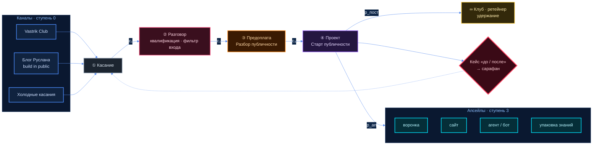

# Бизнес-схема: на чём центр зарабатывает

> Цель Ц-06 плана [`01-ZAPROS-I-PLAN.md` §3](01-ZAPROS-I-PLAN.md), ответ на задачу брифа §6:
> «собрать цены по каждому потоку… посчитать, сколько клиентов в месяц нужно для целевой выручки».
> Главный источник — [`R-4`](../research/R-4-BIZNES-MODEL.md). **Весь текст — кандидат агента.**
>
> ⛔ **Стоп #64** (домовой запрет: наши цены, доли и проценты людям, целевую выручку агент не
> считает и не предлагает числами). Ниже каждое число — **рынок, не наша цена**, с источником;
> дата обращения у всех рыночных чисел — **10.10.2026**, способ — веб-поиск, почти везде по
> поисковой выдаче, а не по открытой странице ([R-4, шапка](../research/R-4-BIZNES-MODEL.md)).
> Наша цена и целевая выручка — ⬜ «ждёт владельца». Поэтому «сколько клиентов» — **формулой**.

## Термины

| Слово | Бытовое пояснение |
|---|---|
| **Поток выручки** | отдельный способ получать деньги: разовая услуга, подписка, членство, процент |
| **Вилка** | диапазон цен, по которым это продают другие — «от и до» |
| **Юнит-экономика** | сколько центр зарабатывает и тратит на **одном** клиенте |
| **CAC** | цена привлечения: сколько стоит получить одного платящего клиента — деньгами и временем |
| **LTV** | сколько денег один клиент приносит за всё время с нами |
| **Конверсия** | какая доля людей переходит на следующий шаг воронки |
| **Отток** | какая доля подписчиков клуба или ретейнера уходит за месяц |
| **Ретейнер** | ежемесячный платёж за постоянную работу |

## ⚡ За минуту

1. **Деньги идут пятью группами:** вход (Разбор → Старт), разовые проекты-апсейлы, постоянные
   платежи (ретейнер и подписка), клуб, позже — % от продаж клиента. Наших цен нет ни в одной.
2. **Рынок продаёт «выход в публичность» ретейнером, а не пакетом** ([R-4 §1.2](../research/R-4-BIZNES-MODEL.md)
   П-1). Наш вход — разовый; значит, постоянный платёж должен родиться после Старта, иначе каждый
   месяц начинается с нуля.
3. **Главная издержка — люди, их цена — слот.** Публичные тарифы инструментов малы против
   проектных чеков, но сумма стека не считается: состав не выбран.
4. **На один проект при рыночных конверсиях — порядка пяти-семи разговоров**; из холодной почты —
   сотни писем ([R-4 §5.2](../research/R-4-BIZNES-MODEL.md)). Узкое место — время Руслана на
   разговоры, а не цена.

---

## §1 Потоки денег — рынок, не наша цена

Ступени — по лестнице [R-3 §2](../research/R-3-USLUGI.md). Валюты — как в источнике, без пересчёта.

| # | Поток | Ступень | Механика | RU — вилка (рынок) | EU / US — вилка (рынок) | Наша цена |
|---|---|---|---|---|---|---|
| Д-1 | **Разбор публичности** | 1 · вход малый | разово | ДАННЫХ НЕТ; интенсив-распаковка 3 500 → 7 500 ₽, 2022 [src: R-3 И-4] | разбор-сессия £150–179, €180, $199–275 [src: R-3 И-1] | ⬜ ждёт владельца |
| Д-2 | **Старт публичности** | 2 · вход основной | разово, спринт | пакетом — ДАННЫХ НЕТ; упаковка TG-канала от 15 тыс. ₽ [src: R-3 И-5]; монтаж ролика ~2 990 ₽ [src: R-4 И-22] | личный бренд $249 … $5 000 за 12 недель [src: R-3 И-7, И-1]; спринт стратегии Builderz 7 000 € [src: R-1 S20] | ⬜ ждёт владельца |
| Д-3 | Воронка продаж | 3 · апсейл | фикс | бот с автоворонкой от 200 тыс. ₽ [src: R-4 И-3] | агентство $8 000–30 000+ [src: R-4 И-14] | ⬜ ждёт владельца |
| Д-4 | Сайт / лендинг | 3 · апсейл | фикс | фриланс 5–25 тыс. ₽; студия, средний чек 89 тыс. ₽ [src: R-4 И-1, И-2] | DE: фриланс 500–1 500 €, агентство 1 000–3 000 € [src: R-4 И-11] | ⬜ ждёт владельца |
| Д-5 | ИИ-агент / автоматизация | 3 · апсейл | фикс + поддержка | агент 250–500 тыс. ₽ + 20–30 тыс. ₽/мес [src: R-4 И-5] | запуск $1 500–5 000 + $300–1 500/мес [src: R-4 И-16] | ⬜ ждёт владельца |
| Д-6 | Аудит безопасности сайта | 3 · апсейл | фикс | свежих — ДАННЫХ НЕТ | пентест витрины 4 000–6 000 € [src: R-4 И-12]; скан от $50 [src: R-3 И-23] | ⬜ ждёт владельца |
| Д-7 | Упаковка знаний в курс / бота | 3 · апсейл | фикс или фикс + % | от 70 тыс. ₽, в среднем ~250 тыс. ₽ [src: R-4 И-8] | средний уровень $3 000–15 000 [src: R-4 И-17] | ⬜ ждёт владельца |
| Д-8 | Ретейнер: ежемесячная нарезка, контент | ∞ · постоянный | в месяц | ДАННЫХ НЕТ; ведение TG 30–100 тыс. ₽/мес [src: R-1 S15] | нарезка $800–1 200/мес [src: R-3 И-8]; ретейнер фаундера $2 000–5 000/мес [src: R-1 S30] | ⬜ ждёт владельца |
| Д-9 | Подписка на инструменты | ∞ · постоянный | в месяц | ИИ-SaaS от 10 тыс. ₽/мес [src: R-4 И-5]; Reels-Boss 3 490 ₽/мес [src: R-1 S13] | ИИ-нарезка $15–29/мес [src: R-4 И-31] | ⬜ ждёт владельца |
| Д-10 | Клуб | ∞ · удержание | в месяц | 490 ₽/мес, пилот 2020 [src: R-4 И-9]; 5 000 ₽/мес [src: R-4 И-10] | медиана Skool $33/мес [src: R-4 И-18] | ⬜ ждёт владельца |
| Д-11 | % от продаж клиента — **позже** | 4 · премиум | доля выручки | продюсер запусков 30–50 % [src: R-4 И-6] | менеджер креатора 10–20 % [src: R-4 И-21] | ⬜ ждёт владельца; бриф §6: «позже» |

**Что видно** (вывод агента):

- **Входа «выход в публичность» как товара в RU нет** — ни у одного потока Д-1, Д-2 нет прямой
  RU-цены. Это и пустота рынка ([R-1 §3](../research/R-1-KONKURENTY.md) П-1), и риск: сравнить нашу
  цену будет не с чем, кроме кусков.
- **Апсейлы Д-3…Д-7 дороже входа на порядок и требуют технаря или методолога** ([R-3 §3](../research/R-3-USLUGI.md)).
  Пока их нет в команде, выручка — только Д-1 и Д-2, то есть только руками Руслана.
- **Постоянные платежи Д-8…Д-10 — единственное, что не начинается с нуля каждый месяц.** Критик
  17.09 назвал их отсутствие дырой ([09a Д-2](../../biznes-model/docs/09a-KRITIK-PRODYUSERSKIY.md)).
- **Д-11 — не стартовый поток.** Процент с продаж клиента приходит после его продаж, а у A-2
  продаж нет по определению сегмента.

## §2 Издержки — публичные тарифы инструментов

Цены поставщиков, **не наша смета**; сумма стека не считается — состав не выбран
([R-4 §2](../research/R-4-BIZNES-MODEL.md)). Тарифы — дата обращения 10.10.2026.

| Статья | Инструмент | Публичный тариф | Источник | Нужен с |
|---|---|---|---|---|
| ИИ-ассистент | Claude Pro / Max / Team | Pro $20/мес; Max от $100; Team $25 за место | [src: R-4 И-33] ✅ страница открыта | дня 1 |
| ИИ-ассистент | ChatGPT Plus / Business | Plus $20; Business $25 за место | [src: R-4 И-34] обзор | по выбору |
| Код | Cursor Pro | $20/мес | [src: R-4 И-35] | технарь в команде |
| Автоматизации | n8n Cloud / self-host | Starter €24/мес; self-host бесплатно | [src: R-4 И-36] | воронки Д-3 |
| Автоматизации | Make | от ~9 €/мес | [src: R-4 И-37] | по выбору |
| Сервер | Hetzner CX23 | €3,49 → €5,49, источники расходятся | [src: R-4 И-38] | агенты Д-5 |
| Хостинг фронта | Vercel Pro | $20 за пользователя/мес | [src: R-4 И-35] | сайты Д-4 |
| Конструктор сайтов | Tilda | Personal $15/мес; Business $25 | [src: R-4 И-39] | сайты Д-4 |
| Нарезка видео | OpusClip | Starter $15, Pro $29/мес | [src: R-4 И-31] | Старт Д-2 |
| Площадка клуба | Skool | Hobby $9/мес + 10 % с транзакции; Pro $99 + 2,9 % | [src: R-4 И-19] | клуб Д-10 |
| Соцсеть | LinkedIn Premium Business | 44 €/мес при оплате за год | [src: R-4 И-40] | по выбору |

**Чего в таблице нет, а весит больше:**

| Статья | Тип | Вес | Чем держится |
|---|---|---|---|
| **Люди — исполнители** (монтажёр, технарь, методолог, PM) | переменная или фикс — решение В-3 | ⬜ стоп #64 | бриф §5 |
| **Время Руслана на разговоры** | скрытая, растёт с числом клиентов | ДАННЫХ НЕТ | §5 ниже |
| **Бесплатная диагностика** в первом касании (⬜ граница с платным Разбором — К-5, решение Руслана, см. [`18`](18-RESHENIYA-VLADELCA.md)) | цена привлечения | ДАННЫХ НЕТ, потолка нет | [04 З-4а](../../biznes-model/docs/04-MODEL-PRODYUSERSKIY-CENTR.md) |
| Юрлицо, договор, приём оплат | разовая | ДАННЫХ НЕТ | [R-4 клетка 7](../research/R-4-BIZNES-MODEL.md) |

## §3 Юнит-экономика — формулой

```
Вклад одного клиента     В    = Ч − С_люди − С_инстр − С_прочие
                                Ч — чек клиента; С_* — себестоимость его проекта
Время на одного клиента  t    = M₁ × t_разг + T₁ × t_кас
                                M₁, T₁ — разговоров и касаний на одного клиента (§4)
Цена привлечения         CAC  = t × ставка_часа_Руслана + С_диагностики + С_рекламы
Ценность клиента         LTV  = Ч_вход + p_ап × Ч_ап + p_пост × Ч_мес × L
                                p_ап — доля купивших апсейл; p_пост — доля ушедших в клуб/ретейнер
Срок жизни подписки      L    ≈ 1 / отток_в_месяц   (месяцев)
Правило здоровья         LTV > CAC  и  В > 0 уже на входе Д-1/Д-2
```

**Слоты:** `Ч`, `Ч_ап`, `Ч_мес` — ⬜ наши цены, ждут владельца · `С_люди` — ⬜ решение В-3 ·
`ставка_часа_Руслана` — ⬜ его · `p_ап`, `p_пост` — ДАННЫХ НЕТ, замеряются первыми клиентами.

**Рыночный ориентир для L** — чужой, вендорский [src: R-3 И-31]: средний отток платных членств
5,57 % в месяц [src: R-3 И-31] → `L ≈ 1 / 0,0557 ≈ 18` месяцев (счёт агента по этому числу). У сильных клубов
отток 2–3 % в месяц [src: R-3 И-31]. Свой отток — только замером.

**Вывод, который не зависит от цен** (догадка, проверяется первым месяцем): пока исполнитель
входа — один Руслан, `С_люди` на Д-1 близка к нулю, а `CAC` почти целиком — его время. Значит, вход
окупается или нет **временем Руслана на разговор**, а не тарифами инструментов.

## §4 Воронка «касание → разговор → предоплата → проект»



Цвета: синий — каналы, серый — касание, розовый — разговор (руки Руслана), оранжевый — первая
оплата, фиолетовый — проект, голубой — апсейлы, жёлтый — удержание, красный — кейс.

**Рыночные конверсии — чужие, не наши** (дата обращения 10.10.2026):

| Переход | Обозн. | Рыночное значение | Источник | Сила источника |
|---|---|---|---|---|
| касание → ответ, холодное письмо | — | средний ответ 3,43 % | [src: R-4 И-46] | вендор, данные 2025 |
| касание → ответ, LinkedIn после коннекта | — | 10,4 %; ответ ≠ разговор | [src: R-4 И-46] | вендор |
| касание → разговор, холодное письмо | c₁ | 1–3 % встреч на письмо | [src: R-4 И-46] | вендор |
| касание → разговор, тёплое сообщество (Vastrik) | c₁ | ДАННЫХ НЕТ | — | замер первым месяцем |
| разговор → предоплата | c₂ | 14 % «консультация → услуга» | [src: R-4 И-47] | Хабр, без методики |
| разговор → предоплата, вариант | c₂ | >20 % как цель закрытия | [src: R-4 И-48] | цель вендора, не замер |
| предоплата → проект | c₃ | ДАННЫХ НЕТ | — | принять 1 — оптимистично |
| проект → апсейл / клуб | p_ап, p_пост | ДАННЫХ НЕТ | — | замер первыми клиентами |

## §5 Калькулятор «если выручка X и чек Y — сколько клиентов и разговоров»

| Что | Формула | Значение |
|---|---|---|
| Целевая выручка в месяц | X | ⬜ **ждёт владельца** (Ц-4 [goals.md](../../../entities/jetix-producer-center/plan/goals.md) пуста с 27.08) |
| Средний чек по миксу потоков | Y = Σ (wᵢ × Чᵢ) | ⬜ **ждёт владельца** — наши цены и выбор микса |
| Клиентов в месяц | N = X / Y | считается после X и Y |
| Предоплат | P = N / c₃ | c₃ — ДАННЫХ НЕТ → P = N |
| Разговоров | M = P / c₂ | c₂ = 14…20 % [src: R-4 И-47, И-48] → M ≈ N × 5…7 |
| Касаний холодной почтой | T = M / c₁ | c₁ = 1…3 % [src: R-4 И-46] → T ≈ M × 33…100 |
| Разговоров в неделю | M / 4 | считается после X и Y |

**Пример — только на одном проекте, как в [R-4 §5.2](../research/R-4-BIZNES-MODEL.md),
без нашей выручки и без наших цен:**

| N | P (c₃ = 1) | M — разговоров | T — писем холодной почтой |
|---|---|---|---|
| 1 проект | 1 | 1 / 0,20 = 5 … 1 / 0,14 ≈ 7 [src: R-4 И-47, И-48] | 5 / 0,03 ≈ 170 … 7 / 0,01 = 700 [src: R-4 И-46] |

**Как подставить его число.** Руслан называет X и цену входа. Тогда `N = X / Y`, разговоров
`M ≈ N × 5…7`. Если M в неделю больше, чем он готов провести, — модель упирается в одного
продавца, и выход один из трёх: выше чек, тёплый канал с лучшей c₁ и c₂, продавец в команде
(роль брифа §4 «Продажи и переговоры»).

## §6 ⚠️ Пять чисел, которые надо проверить руками до опоры на них

Все взяты из поисковой выдачи, страница не открыта ([R-4 «слабое» п.1](../research/R-4-BIZNES-MODEL.md)).
Проверять с машины, где сайты открываются: открыть, найти число, записать «подтверждено / нет».

| # | Число | На что опирается | Где проверить | Статус |
|---|---|---|---|---|
| Ч-1 | c₂ = 14 % «консультация → услуга» [src: R-4 И-47] | калькулятор: 5–7 разговоров на проект | https://habr.com/ru/articles/418183/ — есть ли методика и выборка | ⬜ |
| Ч-2 | c₁ = 1–3 % встреч на письмо; ответ 3,43 % [src: R-4 И-46] | касаний на проект: сотни писем | https://www.cleverly.co/blog/cold-email-statistics | ⬜ |
| Ч-3 | разбор-сессия £150–179, €180, $199–275 [src: R-3 И-1] | рыночный якорь входа Д-1 | https://cal.eu/noorarmando · https://cal.eu/jaiku — какая цена на какой странице | ⬜ |
| Ч-4 | Vastrik Club: €25 + VAT в год [src: R-1 S45] против «15 евро» [src: R-2 «слабое» п.4] | канал №1: цена входа самого Руслана и правила | https://vas3k.club/join/ | ⬜ |
| Ч-5 | ретейнер фаундера: большинство $2 000–5 000/мес [src: R-1 S30] | вывод «рынок продаёт публичность ретейнером» | https://www.1dscollective.com/blog-posts/personal-branding-agency-cost | ⬜ |

---

## ⚠️ Что здесь слабого

1. **Числа почти целиком из сниппетов поиска**, источники — продающие блоги вендоров; независимых
   исследований цен нет ни одного ([R-4 «слабое» п.1–2](../research/R-4-BIZNES-MODEL.md)).
2. **Медианы нет ни у одного потока, кроме клуба Skool.** Вилки «от-до» из разных выборок нельзя
   усреднять в «рыночную цену».
3. **RU-данные тоньше EU**: у обоих входных потоков Д-1, Д-2 прямой RU-цены нет. EU местами
   подменён США — помечено в строках.
4. **Конверсии — самые слабые числа документа**, а калькулятор держится на них.
   14 % — Хабр без методики [src: R-4 И-47]; «>20 %» — цель вендора [src: R-4 И-48];
   почтовые — данные вендоров [src: R-4 И-46].
5. **Валюты не сведены**: RUB, EUR, USD рядом без пересчёта; RU и EU напрямую не сравнивать.
6. **Отток 5,57 % и `L ≈ 18` месяцев** — вендорская цифра про платные членства вообще, не про
   клубы технарей; счёт L — агента.
7. **Без X и Y калькулятор отвечает только «на один проект».** Это честное состояние, а не недоделка.
8. Строки таблиц длиннее 120 символов — ячейки с источниками; текст держит предел.

## Слоты владельцу

Отвечает здесь, правкой строки. Кандидат агента — в скобках.

| № | Вопрос | Блокирует | Кандидат агента | Ответ |
|---|---|---|---|---|
| БС-1 | Целевая выручка центра в месяц — X (= Ц-4, В-2 плана) | §5 | ждёт владельца | ⬜ |
| БС-2 | Цены Разбора и Старта; засчитывается ли Разбор в Старт (= R3-2) | §1, §5 | ждёт владельца | ⬜ |
| БС-3 | Деньги команде: процент из выручки или фикс за задачу (= В-3) | §2, §3 | ждёт владельца | ⬜ |
| БС-4 | Какой постоянный платёж предлагаем после Старта: ретейнер нарезки, подписка или клуб | §1 Д-8…Д-10 | клуб только выпускникам — как [R-3 R3-5](../research/R-3-USLUGI.md) | ⬜ |
| БС-5 | Сколько разговоров в неделю Руслан готов вести сам | §5 | ждёт владельца | ⬜ |
| БС-6 | Кто открывает пять страниц §6 и записывает «подтверждено / нет» | §6 | Руслан или агент с открытой сетью | ⬜ |
