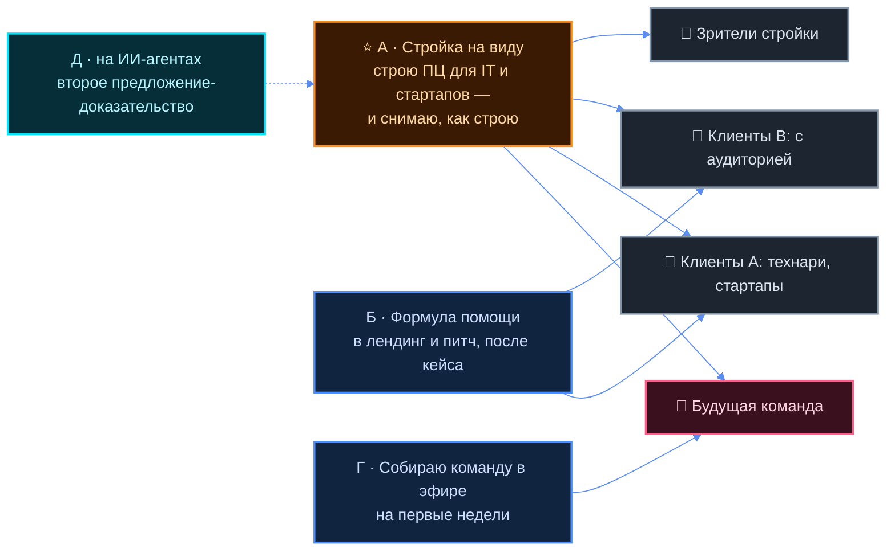

# R-6 · Позиционирование и контент

> Блок R-6 плана [`01-ZAPROS-I-PLAN.md`](../docs/01-ZAPROS-I-PLAN.md) §9. Кормит Ц-10 и Ц-11.
> ⛔ **Внутренний драфт.** Всё, что не в блок-цитате, — **кандидат агента**. Ни одна строка
> не уходит наружу сама: только его рукой и только из `outbound/` (ПИС-12). Убеждающие места
> до публикации идут через `influence-ethics-expert` — список в §9.

## ⚡ За минуту

- **Почему вчера не легло (догадка):** вчерашняя фраза описывала **мир** Руслана (корпорация ·
  группа · система взглядов), а не **дело**. Снаружи не было ни услуги, ни адресата, ни повода
  смотреть. Сегодняшний бриф даёт всё три: центр, две ЦА, блог-стройку.
- **Переносится:** «делаю публично и показываю как есть», три типа контента (стройка · люди ·
  метод), фильтр «идея за одно-два предложения», Р-1 ритм, Р-8/Р-9 отбор по ценностям.
  **Выбрасывается из подачи:** «корпорация», «группа», «система взглядов», адресат «все, кто
  работает с информацией», мега-мастерская.
- **⭐ Рекомендация — вариант А:** «Строю продюсерский центр для IT-людей и стартапов — и снимаю,
  как я это делаю». Второе предложение — что центр делает; третье, по желанию, — «на ИИ-агентах».
- **Био** под Telegram, Instagram, YouTube, LinkedIn — §5, длины посчитаны командой.
- **Рубрики:** стройка центра · кого ищу · кейсы и ошибки · ИИ-инструменты; пятнадцать тем с
  хуками — §6. Первое видео-кандидат: «Вчера я упаковал себя — и получилось плохо. Вот почему».
- **⚠️ Честно о ресёрче:** чтение страниц (WebFetch и curl) в этом контейнере закрыто прокси —
  ни одну ссылку я не открыл. Все URL ниже **найдены поиском**, существование подтверждено
  выдачей, а не открытием. Дословных био с самих профилей поэтому почти нет — стоит «ДАННЫХ НЕТ».

## Термины

| Слово | Бытовое пояснение |
|---|---|
| **Позиционирование** | одна-две фразы, после которых чужой понимает, кто ты, для кого и интересно ли ему |
| **Build in public** | строить дело на виду: регулярно показывать процесс, цифры, ошибки, а не только итог |
| **Хук** | первая строка или первые секунды ролика, из-за которых человек не пролистывает дальше |
| **Рубрика** | повторяющийся тип выпуска с узнаваемой формой; зритель знает, чего ждать |
| **Био** | короткое описание в шапке профиля; у каждой площадки свой лимит знаков |
| **R12-пара** | правило дома: убеждающий текст проверяет этик влияния `influence-ethics-expert` |
| **Анти-референс** | пример, на который смотрят, чтобы понять, **как не надо** |

---

## §1 Разбор вчерашнего — что переносится, что выбросить, почему не легло

### Его слово

> «мы вчера там делали какую-то вот, блять, упаковку меня… в итоге у меня хуево получилось»
> — [`tochka-b/181-OS-13-58.md`](../../../tochka-b/181-OS-13-58.md) §1

> «Формат: снимаю, как строю продюсерский центр» — [`00-BRIEF.md`](../docs/00-BRIEF.md) §7

> «Долгосрочное видение (корпорация независимых команд/кланов…) остаётся фоном. **В оффер на
> старте не выносится.**» — [`00-BRIEF.md`](../docs/00-BRIEF.md) §1

### Почему не легло — семь гипотез (все — **догадка агента**, он поправит)

| # | Гипотеза | Что в тексте 09.10 на это указывает |
|---|---|---|
| Г-1 | **Нет дела в фразе.** «Строю корпорацию» не говорит, что я делаю для тебя | [`02-POZICIONIROVANIE.md`](../../upakovka-specialista/docs/02-POZICIONIROVANIE.md) §1: «корпорацию Jetix… собирая людей» |
| Г-2 | **Адресат — почти все.** «Эксперты, учителя, профессионалы, работающие с информацией» — так можно назвать любого | там же §2 вариант А, §5 |
| Г-3 | **Три идеи в одной фразе** (корпорация · группа · система взглядов) — его же фильтр «за одно-два предложения» не проходится | там же §4 |
| Г-4 | **Масштаб без доказательства.** «Корпорация» при нуле клиентов звучит как претензия, а не как факт | там же §10 п.1: «мега-корпорация» против «не надо мега-дрочку» |
| Г-5 | **Нечего купить и некуда идти.** Услуги вчера сознательно вынесены «не в первую волну» | [`03-TEHNICHESKAYA.md`](../../upakovka-specialista/docs/03-TEHNICHESKAYA.md) §7 |
| Г-6 | **Текст собран из транскрипта, не из его голоса на камеру** — фразы канцелярские, их неудобно сказать вслух | сравнить §1 «кандидат — абзац» с его цитатами там же |
| Г-7 | **Форма документа тяжёлая**: слоты, таблицы, девять решений — а ему нужна была фраза для первого видео | [`sessions/2026-10-09.md`](../../upakovka-specialista/sessions/2026-10-09.md): 13 строк слотов |

### Что переносится в новую рамку

| Из 09.10 | Куда в новой рамке | Почему |
|---|---|---|
| Вариант Б: «публично строю с нуля и показываю всё как есть» | ядро блога: «снимаю, как строю центр» | совпадает с брифом §7 дословно по смыслу |
| «Исследователь: направление понятно, дальше видно» (его слово 08:20) | тон блога — честная стройка без позы «у меня всё получилось» | это и есть отличие от инфобиз-продюсеров (см. анти-референс №11) |
| Три типа контента: стройка · люди · метод | рубрики §6: стройка центра · кого ищу · ИИ-инструменты/метод | переносится почти один в один |
| Фильтр «идея за одно-два предложения» | тест в §3 для каждого варианта | его критерий, не мой |
| Р-1 «один-два шортса в день» | ритм §7 | ждёт его «да», как и вчера |
| Р-8, Р-9 «не сколько стоит, а какие ценности» | фильтр клиентов брифа §1: «только адекватные, полезные миру продукты» | та же мысль, но теперь про продукт клиента |
| «Что человек получает»: упаковка знаний · камера · подпинывание | услуги 4 и 6 брифа, клуб (7) | вчерашние пять «получает» = сегодняшние услуги |
| Обкатка формулировки на созвонах | §3 — как проверять выбранный вариант | без живого человека проверки нет |

### Что выбросить из подачи (из канона — не трогаем)

| Из 09.10 | Почему выбросить |
|---|---|
| «Корпорация Jetix» в первой фразе | бриф §1 и §7: долгосрочное видение «не выносится», «не рассказываю… до первых результатов» |
| «Группа» и «система взглядов» как три кита | Г-3; группа теперь — клуб (услуга 7), система — внутренняя кухня, не подача |
| Адресат «все, кто работает с информацией» | бриф §2 сузил: IT, стартапы, агенты, инфобиз; русскоязычные |
| Портрет «не наш» из шести пунктов | заменяется фильтром брифа §2: без техбэкграунда (для A), «нулевые», бесполезные продукты |
| Мега-мастерская ([`04-RASSKAZ…`](../../upakovka-specialista/docs/04-RASSKAZ-PRO-MASTERSKUYU.md)) | материал для разговора с партнёром один на один, не для шапки профиля |

⚠️ **Прямое противоречие, которое надо поймать.** 09.10 центр подачи — «строю корпорацию
публично» (Р-5). 10.10 бриф §7 ставит корпорацию в «о чём **не** рассказываю». Это не уточнение, а
разворот. Я читаю бриф как более позднее и более конкретное слово — 🔶 слот С-1 в §11.

---

## §2 Референсы — кто строит дело публично

**Как собрано.** WebSearch: 35 запросов прошли, 4 отказаны лимитом поиска на ход (счёт по журналу
вызовов этого агента, 10.10; команды-замера нет). WebFetch и curl: 9 попыток открыть страницы
(t.me, tgstat.ru, vas3k.ru, levels.io, habr.com, zamesin.me, aprildunford.com) — все отказаны
прокси «connect_rejected» / DNS. Поэтому столбец «как себя называет» — **пересказ поисковой
выдачи**, не снятое с профиля био; дословного текста нет — «ДАННЫХ НЕТ».

### Русскоязычные

| № | Кто / канал | Источник (URL) | Площадка · формат | Как себя называет | Что работает — для нас |
|---|---|---|---|---|---|
| 1 | **Эдуард Трубченинов**, PrivateSEO | [sostav.ru/blogs/287951/85825](https://www.sostav.ru/blogs/287951/85825) · [workspace.ru](https://workspace.ru/id/eduard-trubcheninov-2/) | Telegram-канал + колонки | по выдаче: гендиректор PrivateSEO, «основатель агентства»; дословно ДАННЫХ НЕТ | ⭐ ближайший аналог: канал, чтобы «сделать работу агентства прозрачной» — гипотезы, ошибки, бюджеты, результаты |
| 2 | **Дмитрий Бескромный**, канал «Бескромный», bQ Group | [theblueprint.ru](https://theblueprint.ru/career/ownexperience/kak-a-stal-dmitrij-beskromnyj) · [tenchat.ru/0253399](https://tenchat.ru/0253399) · [rutube](https://rutube.ru/video/49f3bfd56fdcde85723dd76b35fbccf8/) | Telegram + подкаст | по TenChat-выдаче: «Основатель digital-агентства bQ Group и руководитель проекта «ТопБЛОГ»» | личный бренд основателя тащит агентство; ищет «стратега персонального бренда» — значит, такая роль на рынке есть |
| 3 | **Владимир Назаров**, Head Promo | [finance.rambler.ru](https://finance.rambler.ru/business/56472272-digital-assotsiatsiya-predstavila-masshtabnyy-reyting-biznes-kanalov-dlya-predprinimatelstva-i-marketinga-v-2026/) | Telegram | по выдаче: «основатель агентства Head Promo»; дословно ДАННЫХ НЕТ | «внутрянка» агентства + нейросети для автоматизации — та же связка, что у нас (рубрики 1 и 4) |
| 4 | **Денис Галенок**, «Инди-хакеры: стартапы из 💩 и 🥢» | [habr.com/en/posts/942440](https://habr.com/en/posts/942440) | Telegram вдвоём + статья | по выдаче: SEO-специалист, в свободное время делает IT-продукты с другом | регулярные апдейты с метриками и фичами; дуэт — формат «двое строят» |
| 5 | автор канала **t.me/sasha_pilit_service** | [habr.com/ru/post/898624](https://habr.com/ru/post/898624) | Telegram + Хабр | ДАННЫХ НЕТ | build in public = рассказ про фичи «не с позиции разработчика»; предупреждает, что в Рунете продвигать такое трудно |
| 6 | автор «Мой опыт Build in Public в X.com» | [vc.ru/2221637](https://vc.ru/2221637-moi-opyt-build-in-public-v-xcom) | X + vc.ru | имя в выдаче не показано — ДАННЫХ НЕТ | ⭐ урок: на аккаунте в ~30 подписчиков стройка не слышна — выгоднее профильные сообщества (у нас — Vastrik Club, бриф §2) |
| 7 | **Ваня Замесин**, @zamesin | [vc.ru/id23886](https://vc.ru/id23886) · [secrets.tbank.ru](https://secrets.tbank.ru/lichnyj-opyt/ivan-zamesin-interview/) | Telegram + блог zamesin.me | по выдаче: «Ваня Замесин», ведёт @zamesin и zamesin.me; дословного био ДАННЫХ НЕТ | продуктовый метод от первого лица; имя уменьшительное — тон «свой», не «гуру» |
| 8 | **Вастрик** (Василий Зубарев), vas3k.club | [de.linkedin.com/in/vas3k](https://de.linkedin.com/in/vas3k) | блог + клуб | по выдаче LinkedIn: инженер из Берлина, 15+ лет опыта; дословно ДАННЫХ НЕТ | ⭐ клуб, где сидит наша ЦА, и движок которого у нас форкнут (`platform/engine/`); тон «невсратый» — честно и смешно |
| 9 | **Денис Ширяев**, «Denis Sexy IT» | [kod.ru](https://kod.ru/top-10-kanalov-pro-it-v-telegram/) · [iphones.ru](https://www.iphones.ru/iNotes/neyroset-prevratila-personazhey-sovetskih-multfilmov-v-realistichnye-foto-lyudey-karlson-prosti-06-28-2021) | Telegram | по выдаче kod.ru: основатель neural.love, экс-продакт «Комитета» | ИИ-канал, который вирусится показом **результата** работы нейросети, а не рассказом о ней — образец для рубрики 4 |
| 10 | **Михаил Гребенюк**, Resulting | [secrets.tbank.ru](https://secrets.tbank.ru/lichnyj-opyt/mihail-grebenyuk/) | YouTube: «Разборы на миллион», Telegram | по выдаче: предприниматель, основатель Grebenuk Resulting; дословно ДАННЫХ НЕТ | формат **разбора чужого бизнеса** — готовая рубрика «кейсы»; продажи как личная сила основателя |
| 11 | ⛔ **анти-референс:** Аяз Шабутдинов, «Like Центр» | [snob.ru](https://snob.ru/news/blogera-ayaza-shabutdinova-arestovali-po-delu-o-moshennichestve/) · [kommersant.ru](https://www.kommersant.ru/doc/8177821) · [novayagazeta.eu](https://novayagazeta.eu/articles/2023/11/17/vesma-kouchitelnaia-istoriia) | Instagram, курсы | по выдаче snob.ru: называл себя «инвестором, миллиардером»; по выдаче — приговор по ч. 4 ст. 159 УК РФ | как **не надо**: громкий статус вместо дела, обещания дохода. Бриф §1 «не хуйню ради денег» — наше отличие, его стоит проговаривать |

### Англоязычные

| № | Кто | Источник (URL) | Площадка · формат | Как себя называет | Что работает — для нас |
|---|---|---|---|---|---|
| 12 | **Liam Ottley**, Morningside AI | [automationatlas.io](https://automationatlas.io/creators/liam-ottley/) · [marksinsights.com](https://marksinsights.com/liam-ottley-review/) | YouTube + Skool | дословно ДАННЫХ НЕТ; по выдаче — автор модели «AI Automation Agency» | ⭐ ближайший EN-аналог: канал рос **как маркетинг агентства**, потом стал отдельным бизнесом. ⚠️ критик (marksinsights) пишет, что обещания дохода «правда лишь частично» |
| 13 | **Pieter Levels**, @levelsio | [favikon.com](https://favikon.com/blog/who-is-levelsio) · [cheekypint.transistor.fm/4](https://cheekypint.transistor.fm/4) | X | дословно ДАННЫХ НЕТ | эталон build in public: открытые цифры, десятки запусков на виду |
| 14 | **Marc Lou** (Louvion), ShipFast | [thebootstrappedfounder.com](https://thebootstrappedfounder.com/marc-louvion-becoming-a-product-launch-beast/) · [noahkagan.com](https://noahkagan.com/marc-louvion/) | X + YouTube | дословно ДАННЫХ НЕТ | публичные **провалы** до первого успеха собрали аудиторию к запуску — ошибки как контент работают |
| 15 | **Justin Welsh** | [kajabi.com](https://kajabi.com/creator-stories/justin-welsh) · [behindthebrilliance.com](https://behindthebrilliance.com/227justinwelsh/) | LinkedIn | по выдаче: «Solopreneur + Advisor»; дословность не проверена | «быть известным **одной** вещью» + личная история происхождения — прямой ответ на Г-3 |

**Что общее у работающих (кандидат агента):** ① одно дело в первой фразе, не три;
② показ процесса с цифрами и ошибками; ③ ИИ показывают **результатом**, а не рассуждением;
④ на малой аудитории — опора на профильное сообщество (№6, №8); ⑤ основатель-продавец ведёт
продажи сам, канал кормит его воронку (№1, №2, №12).

### Методика позиционирования — источники

| Источник | Что берём | URL |
|---|---|---|
| April Dunford, *Obviously Awesome* | пять частей: альтернативы · уникальные свойства · ценность и доказательство · кому · категория. Для Руслана важна «категория» — «продюсерский центр» уже понятная категория, ничего не надо объяснять | [goodreads.com/book/show/45166937](https://www.goodreads.com/book/show/45166937) · [youngurbanproject.com](https://www.youngurbanproject.com/how-to-write-a-positioning-statement-that-actually-differentiates-your-product/) |
| Daniel Priestley, *Key Person of Influence* | пять шагов: Pitch · Publish · Product · Profile · Partnerships; первый — короткий честный запоминающийся питч | [makingbusinessmatter.co.uk](https://makingbusinessmatter.co.uk/?p=34048) · [suzannetaylorking.substack.com](https://suzannetaylorking.substack.com/p/book-review-key-person-of-influence) |
| Формула «я помогаю **кому** получить **что** через **как**» | в выдаче как готовая именная формула **не найдена**; собрана из определения позиционирования (кому помогаешь · какую проблему · чем отличаешься) | [inblog.ai](https://inblog.ai/ru/glossary/brand-positioning) · [skyeng.ru](https://skyeng.ru/it-industry/marketing/vsyo-o-lichnom-brende-chto-eto-i-kak-sozdat/) |
| «Одно простое предложение как формула бренда» | вместо набора громких фраз | [vc.ru/marketing/1483109](https://vc.ru/marketing/1483109-strategiya-razvitiya-lichnogo-brenda) |
| Justin Welsh: «known for one thing» | одна ниша + история происхождения | [behindthebrilliance.com](https://behindthebrilliance.com/227justinwelsh/) |

---

## §3 ⭐ Варианты позиционирования — все **кандидат агента**

Тест его словом: «чтобы до человека могла легко эта идея дойти, буквально за одно-два
предложения… ага, вот что этот человек делает. Мне интересно или нет»
([`tochka-b/179-OS-08-20.md`](../../../tochka-b/179-OS-08-20.md) §7).

### А · «Стройка на виду» — ⭐ рекомендую

**Фраза:** «Строю продюсерский центр для IT-людей и стартапов — и снимаю, как я это делаю.»

**Расширение:** Мы помогаем тем, кто умеет делать продукт, выйти в публичность и продавать:
упаковка, регулярный контент, ИИ-инструменты, воронки. В блоге показываю стройку изнутри — кого
ищу в команду, как ищу первых клиентов, что пробую и где ошибаюсь.

| | |
|---|---|
| На кого | сразу на три аудитории: будущая команда, клиенты A и B, зрители стройки |
| Сильное | это **его** формулировка формата (бриф §7); категория понятна без объяснений; честно при нуле кейсов — обещает процесс, а не результат |
| Слабое | «продюсерский центр» многим звучит как инфобиз (см. №11) — надо снимать это делом, не словом; клиенту обещание результата слабее, чем в Б |
| Тест 1-2 предложения | ✅ проходит: что делает + для кого + почему смотреть |

### Б · «Формула помощи»

**Фраза:** «Помогаю технарям и фаундерам, которые умеют делать, научиться показываться и
продавать.»

**Расширение:** Упаковка, позиционирование, контент без рутины — монтаж и нарезку берут
ИИ-инструменты, — плюс сайт и воронка. Для тех, у кого аудитория уже есть, — техническая база и
автоматизация.

| | |
|---|---|
| На кого | клиенты A и B |
| Сильное | ясный результат для клиента; ложится в шапку лендинга и в питч на созвоне |
| Слабое | ⚠️ обещание результата **без единого кейса** — этик влияния спросит, чем подтверждено; не объясняет, почему смотреть блог; команда в ней себя не видит |
| Тест | ✅ проходит для клиента, ❌ для будущей команды |

### В · «Продюсер технарей» — короткий ярлык

**Фраза:** «Продюсер для тех, кто пишет код и строит стартапы.»

**Расширение:** Технари делают сильные продукты, но не умеют о них рассказывать. Я беру эту
часть на себя — с командой и ИИ-инструментами.

| | |
|---|---|
| На кого | сегмент A |
| Сильное | запоминается, годится как подпись под именем |
| Слабое | теряет сегмент B (у кого уже аудитория) и инфобиз из брифа §1; «технари не умеют рассказывать» — обобщение без замера; догадка: сам Руслан не разработчик, и технарь может спросить «а ты кто» |
| Тест | ✅ одна фраза, но про узкую часть дела |

### Г · «Собираю команду в эфире» — на первые недели

**Фраза:** «Собираю команду продюсерского центра публично: ищу методолога, продажника, PM и
технаря.»

**Расширение:** Центр для IT и стартапов, первая команда собирается на ваших глазах. Каждый
выпуск — кого ищу, с кем говорю, что предлагаю.

| | |
|---|---|
| На кого | будущая команда (бриф §4), зрители |
| Сильное | ровно то, что ему надо **на этой неделе** (заказ 09.10: «завтра-послезавтра собирать команду»); конкретно и проверяемо |
| Слабое | срок годности — до сборки команды; клиент в ней себя не видит |
| Тест | ✅ проходит |

### Д · «Центр на ИИ-агентах»

**Фраза:** «Строю продюсерский центр, где рутину делают ИИ-агенты, — и показываю, как это работает.»

**Расширение:** Один человек плюс бригада агентов ведут операционку уже сейчас (это факт дома:
CLAUDE.md «Один человек плюс бригада агентов»). Те же инструменты — нарезка, трекинг публикаций,
базы знаний — получают клиенты центра.

| | |
|---|---|
| На кого | сегмент A, IT-аудитория, создатели агентов |
| Сильное | ⭐ единственное **уже существующее доказательство** — Jetix OS работает, её можно показать на экране; отличает от продюсеров «старой школы» |
| Слабое | притягивает любителей ИИ-инструментов, а не покупателей услуг; рискует превратить блог в обзор тулзов |
| Тест | ✅ проходит, но «ИИ-агенты» снаружи может требовать пояснения |

### ⭐ Рекомендация агента — А как главная, Д вторым предложением, Б в продающих местах

**Беру А**, потому что:

1. Это единственный вариант, где слова — **его** («снимаю, как строю продюсерский центр», бриф
   §7). Вчера, по Г-6, не легли мои слова; сегодня ставлю его.
2. Он работает **на всех трёх адресатов сразу**: команда видит «строю», клиент видит «для IT и
   стартапов», зритель видит «снимаю». Б теряет команду, В теряет сегмент B, Г истекает.
3. Он **честен при нуле кейсов**: обещает показ процесса, а не результат. Это ровно то, что
   этик влияния пропустит легче всего, и то, что отличает его от анти-референса №11.
4. Он проходит его фильтр: дело + адресат + повод смотреть в одной фразе.

**Второе предложение — из Д**, когда нужна плотность: «Рутину в центре делают ИИ-агенты — показываю
и это». Это доказательство, которое уже есть. **Б** — не в шапку блога, а в лендинг и питч, после
первого кейса.

**Как проверить (его же механика 09.10 §9):** на ближайших созвонах произносит А и смотрит,
пришлось ли объяснять второй раз. 🔶 Сколько созвонов считать проверкой — слот С-3.

---

## §4 Схема — как варианты ложатся на аудитории

---

## §5 Био по площадкам — **кандидат агента**, под вариант А

### Лимиты площадок

| Поле | Лимит | Источник | Надёжность |
|---|---|---|---|
| Telegram, био личного профиля | 70 знаков, Premium — 140 | [bugs.telegram.org/c/4896/9](https://bugs.telegram.org/c/4896/9) (подтверждает удвоение для Premium с июня 2022) · [postiz.com](https://postiz.com/tools/telegram-character-counter) (числа) | medium: числа из сторонних таблиц, официальный текст не открыт |
| Telegram, описание канала | ДАННЫХ НЕТ надёжно; одна слабая страница пишет 255 | выдача по запросу о лимитах Telegram, 10.10 | low — держу описание короче 255 на всякий случай |
| Instagram, био / имя | 150 / 30 знаков | [napoleoncat.com](https://napoleoncat.com/blog/instagram-character-limit/) · [replug.io](https://replug.io/blog/instagram-bio-character-limit) | medium: Help Center не открыт |
| YouTube, описание канала | 1000 знаков, в выдаче видно первые ~150 | [influencermarketinghub.com](https://influencermarketinghub.com/youtube-character-limits/) · [howmanywords.app](https://howmanywords.app/blog/youtube-character-limits) | medium |
| LinkedIn, заголовок / About | 220 / 2600 знаков; заголовок обрезается в поиске примерно до 60-70 | [authoredup.com](https://authoredup.com/blog/linkedin-character-limit) · [UQ guide](https://www.stjohns.uq.edu.au/downloads/Professional_Development/university-of-queensland-LinkedIn-profile-guide.pdf) | medium |

Длины ниже посчитаны `python3 -c "print(len(s))"` для каждой строки, 10.10.

### Telegram

| Вариант | Текст | Знаков |
|---|---|---|
| Личный профиль, без Premium (≤70) | Строю продюсерский центр для IT и стартапов. Снимаю, как строю | 62 |
| Личный профиль, без Premium, альт. | Основатель продюсерского центра для IT, стартапов и инфобиза | 60 |
| Личный профиль, Premium (≤140) | Строю продюсерский центр для IT и стартапов: помогаем выйти в публичность и продавать. Снимаю стройку — кого ищу, что пробую, где ошибаюсь | 138 |
| Описание канала, вариант 1 | Строю продюсерский центр для IT-людей, стартапов, авторов агентов и инфопродуктов — и показываю это открыто: кого ищу в команду, первые клиенты, ошибки, ИИ-инструменты, которыми работаем. Берём только полезные продукты. Написать: @🔶 | 232 |
| Описание канала, вариант 2 | Дневник стройки продюсерского центра. Помогаем технарям и фаундерам выйти в публичность и продавать — упаковка, контент, ИИ-инструменты, воронки. Здесь — как это собирается изнутри. Ищу людей в команду: @🔶 | 205 |

### Instagram

| Вариант | Текст (переносы строк — как в шапке) | Знаков |
|---|---|---|
| Имя профиля (≤30) | Руслан · продюсерский центр | 27 |
| Био 1 (≤150) | Строю продюсерский центр для IT и стартапов ⏎ Помогаем технарям выйти в публичность и продавать ⏎ Снимаю, как строю ↓ | 113 |
| Био 2 (≤150) | Продюсер для IT, стартапов и авторов ИИ-агентов ⏎ Упаковка · контент · ИИ-инструменты · воронки ⏎ Дневник стройки центра ↓ | 118 |

### YouTube — описание канала (≤1000, первые ~150 — самое важное)

> Я Руслан, строю продюсерский центр для IT-людей, стартапов, авторов ИИ-агентов и инфопродуктов.
> Мы помогаем тем, кто умеет делать, научиться показываться и продавать: упаковка, регулярный
> контент, ИИ-инструменты, которые снимают рутину, сайты и воронки.
>
> Этот канал — дневник стройки. Показываю, кого ищу в команду, как ищу первых клиентов, какие
> инструменты собираем на ИИ-агентах и где ошибаюсь. Берём в работу только продукты, которые
> приносят пользу.
>
> Хочешь в команду или есть продукт, о котором пора рассказать, — пиши: 🔶 контакт

535 знаков. ⚠️ Блок-цитата здесь — оформление черновика, **не его слово**.

### LinkedIn — заголовок (≤220; в поиске видно ~60-70)

| Вариант | Текст | Знаков |
|---|---|---|
| RU | Основатель продюсерского центра для IT и стартапов · помогаем технарям и фаундерам выйти в публичность и продавать · ИИ-инструменты и воронки · строю публично | 158 |
| EN | Founder, producer center for tech founders & startups · helping builders get visible and sell · AI tools, content, funnels · building in public from Berlin | 155 |

LinkedIn — единственная площадка, где EN-вариант осмыслен: Берлин, европейская сеть. Но бриф §2
ставит рынок русскоязычным — 🔶 слот С-4 (языки, вчерашний В-5).

---

## §6 Рубрики и темы первых видео

### Четыре рубрики — **кандидат агента**

| # | Рубрика | Что внутри | Откуда | Кого кормит |
|---|---|---|---|---|
| Р-А | **Стройка центра** | дневник: что сделал сегодня, какое решение принял, что сломалось | бриф §7 «процесс сборки»; 09.10 «стройка» | зрители, команда |
| Р-Б | **Кого ищу** | роли команды, кого ищем в клиенты, с кем говорил (с согласия) | бриф §4, §7 «кого ищу в команду»; 09.10 «люди» | команда, клиенты |
| Р-В | **Кейсы и ошибки** | свои ошибки сейчас; разборы клиентов — когда будут и с согласием | бриф §7 «первые кейсы и ошибки»; №10, №14 | клиенты |
| Р-Г | **ИИ-инструменты** | как агенты делают рутину: показ на экране, результат, а не рассуждение | бриф §7 «ИИ-инструменты»; вариант Д; №9 | сегмент A |

### Пятнадцать тем с хуком в одну строку

Хуки — черновик для его голоса; ⚠️ все проходят этика до публикации (§9).

| # | Рубрика | Тема | Хук |
|---|---|---|---|
| 1 | Р-В | ⭐ Первое видео: вчерашняя неудачная упаковка | «Вчера я упаковал себя — и получилось плохо. Вот почему.» |
| 2 | Р-А | Почему продюсерский центр и для кого | «Я строю продюсерский центр для технарей. Объясняю за минуту зачем.» |
| 3 | Р-Б | Кого ищу: первая роль — методолог | «Ищу человека, который превращает экспертизу в продукт. Вот кто это.» |
| 4 | Р-А | Семь услуг — слишком много | «У меня семь услуг и ноль команды. Выбираю, с чего начать.» |
| 5 | Р-Г | Мой день с бригадой ИИ-агентов | «Мою операционку ведут ИИ-агенты. Показываю экран.» |
| 6 | Р-В | Кого не беру даже за деньги | «Есть клиенты, которых я не возьму. Вот три признака.» |
| 7 | Р-Б | Кого ищу: технарь под агентов и сайты | «Нужен технарь, которому интересно собирать агентов под живые проекты.» |
| 8 | Р-Г | ИИ-нарезка видео | «Как из часа разговора сделать шортсы без монтажёра.» 🔶 если с Антоном — его согласие |
| 9 | Р-А | Где ищу первых клиентов | «Первых клиентов ищу не в рекламе. Вот где.» |
| 10 | Р-В | Ошибка недели | «Ошибка этой недели, которая стоила мне …» — 🔶 только реальная, без выдуманной |
| 11 | Р-А | О чём я не рассказываю и почему | «Цифры клиентов вы здесь не увидите. И вот почему это правильно.» |
| 12 | Р-Б | Что я предлагаю команде | «Что получает человек, который приходит в центр первым.» ⚠️ без денежных условий до его решения |
| 13 | Р-Г | Трекинг публикаций своим инструментом | «Я не пользуюсь планировщиками контента. Показываю, чем заменил.» |
| 14 | Р-А | Почему публично | «Строить молча было проще. Почему я включил камеру.» |
| 15 | Р-В | Пре-мортем: что, если центр не взлетит | «Представим, что через год центра нет. Что пошло не так?» |

⚠️ **Тема 6** опирается на фильтр брифа §2; «три признака» = три пункта «кого не берём» из брифа,
не мои. **Тема 9** зависит от того, можно ли публично называть Vastrik Club — слот С-5.

---

## §7 Границы — что не рассказываю (уточнение брифа §7)

Бриф §7 называет три границы. Ниже — его три **плюс** мои кандидаты, каждый с причиной.

| # | Не рассказываю | Чьё | Почему |
|---|---|---|---|
| Н-1 | Цифры клиентов без согласия | его, бриф §7 | — |
| Н-2 | Внутренние договорённости с партнёрами | его, бриф §7 | — |
| Н-3 | Сырое долгосрочное видение (корпорация кланов) до первых результатов | его, бриф §7 | ⚠️ разворот к 09.10 Р-5 — слот С-1 |
| Н-4 | **Имена и лица людей без их согласия** — кандидатов в команду, Антона, собеседников | кандидат агента | первая рубрика «кого ищу» сама будет тянуть показать человека; согласие до съёмки, не после |
| Н-5 | **Деньги команде** — проценты, доли, фикс — до его решения | кандидат агента | бриф §5 помечает это гипотезой; показанное в блоге становится обещанием |
| Н-6 | **Уязвимости и слабые места сайтов клиентов** (услуга 3 «анализ безопасности») | кандидат агента | показ дыры = подсказка атакующему; только после исправления и с согласием |
| Н-7 | **Содержимое закрытого клуба** (Vastrik Club) | кандидат агента | у сообщества свои правила; продавать изнутри клуба — риск потерять канал №1 |
| Н-8 | **Обещания результата числом** («выведем на N подписчиков», «сделаем выручку X») | кандидат агента | кейсов нет; это и есть путь анти-референса №11 |
| Н-9 | Личное (семья, здоровье, деньги на жизнь) | 🔶 его слово | рамку личного ставит только он |

🔶 **Обратный вопрос — что можно:** показывает ли он **свои** цифры (выручка центра, расходы на
инструменты)? Build in public в EN-референсах (№13, №14) держится на открытых цифрах. Это сильный
ход и его решение — слот С-6.

---

## §8 Ритм и место под контент

### Ритм — кандидат агента, сверено с Р-1

> «хотя бы один-два шортса в день я **обязан** выкладывать» — Р-1,
> [`tochka-b/179-OS-08-20.md`](../../../tochka-b/179-OS-08-20.md) §6. 🔶 Фиксация его «да» — ещё
> ждёт ([`02-POZICIONIROVANIE.md`](../../upakovka-specialista/docs/02-POZICIONIROVANIE.md) §8).

| Что | Ритм | Куда |
|---|---|---|
| Шортс | **один в день — нижняя граница Р-1**; второй — когда есть | один и тот же ролик в Instagram Reels и TikTok (его 09.10: «инстаграм, тикток для начала»); YouTube Shorts — когда он скажет «далее ютуб» |
| Пост-дневник в Telegram | раз в неделю, итог недели: что построил, кого ищу, ошибка | Telegram-канал = дом блога и архив |
| Длинное видео | ДАННЫХ НЕТ — он про длинное не говорил | 🔶 слот |

Ротация рубрик по неделе (кандидат): Р-А чаще всех, потому что это и есть формат брифа;
Р-Б — пока команда не собрана; Р-В и Р-Г — по материалу. Жёсткой сетки не ставлю: на объёме
один-два ролика в день сетка — та же «мега-дрочка», от которой он отказался 09.10.

⚠️ Бриф §2 ставит каналом старта **Vastrik Club + блог**, а Instagram и TikTok — это слово 09.10.
Не противоречие, но порядок важен: урок референса №6 — на нулевой аудитории сообщество приносит
больше, чем свой профиль. Кандидат: в клубе — текстовые посты о стройке по правилам клуба, шортсы
— параллельно.

### Место под контент — коротко, по дому

| Что | Где | Почему |
|---|---|---|
| Темы и план | карточка-проект [`entities/proj-kontent-plan.md`](../../../entities/proj-kontent-plan.md) уже есть (родитель `media-center`, состояние `scoped`) — темы заводить под неё **дверью** (`python3 -m tools.door create`) | не изобретать новое место; репозиторий = правда, Obsidian показывает вид |
| Состояния темы | `proposed → recorded → edited → published` — прошедшим временем, как требует FPF | сторож `past-participle-check.sh` |
| Список из §6 | ляжет в `docs/12-KONTENT.md` (Ц-11), оттуда — карточками | один источник, без копий |
| Внешний планировщик | не ставить сейчас | вчерашняя рекомендация 03 §3 остаётся в силе: на таком объёме хватит списка |

⚠️ Вчера 03 §6 насчитал 15 карточек идей; сегодня `ls entities/idea-*.md | wc -l` → 5 (10.10).
Причину я не выяснял — переносили, переименовали или удалили. Перед заносом тем стоит понять.

---

## §9 Что на проверку этику влияния (`influence-ethics-expert`)

| Место | Что спросить |
|---|---|
| Все био §5 | «Помогаем выйти в публичность и продавать» при нуле кейсов — не обещание ли это результата |
| Вариант Б целиком | то же, сильнее всех: формула помощи без доказательства |
| «Берём только полезные продукты» (описание канала, YouTube) | кто решает, что полезно; не становится ли это рычагом статуса «тебя отобрали» |
| Хуки §6, особенно 1, 6, 10, 14, 15 | драматизация и любопытство-крючок: где граница честного хука |
| Темы 3, 7, 12 и вариант Г | набор в команду через блог: нет ли обещания заказов, которых пока нет (бриф §5 «заказы, которые приносит Руслан») |
| Призыв «пиши в ЛС» | давление, срочность — не добавлять; проверить формулировку |
| Работа с Vastrik Club | продажи в сообществе, где люди пришли не за этим |
| Публичный показ людей (Антон, кандидаты) | согласие, цена выхода из кадра |

Триггеры условной пары из маршрутной таблицы (люди, вовлечение, закрытость) здесь есть: набор
людей, сообщество, вовлечение зрителя. Поэтому этик нужен **до** публикации, не после.

---

## §10 Источники

**Дом:** [`00-BRIEF.md`](../docs/00-BRIEF.md) · [`01-ZAPROS-I-PLAN.md`](../docs/01-ZAPROS-I-PLAN.md) ·
[`02-POZICIONIROVANIE.md`](../../upakovka-specialista/docs/02-POZICIONIROVANIE.md) ·
[`03-TEHNICHESKAYA.md`](../../upakovka-specialista/docs/03-TEHNICHESKAYA.md) ·
[`04-RASSKAZ-PRO-MASTERSKUYU.md`](../../upakovka-specialista/docs/04-RASSKAZ-PRO-MASTERSKUYU.md) ·
[`sessions/2026-10-09.md`](../../upakovka-specialista/sessions/2026-10-09.md) ·
[`tochka-b/179-OS-08-20.md`](../../../tochka-b/179-OS-08-20.md) ·
[`tochka-b/181-OS-13-58.md`](../../../tochka-b/181-OS-13-58.md) ·
[`entities/proj-kontent-plan.md`](../../../entities/proj-kontent-plan.md).

**Сеть (все — из выдачи WebSearch 10.10, страницы не открывались):**

- build in public, RU: [habr.com/en/posts/942440](https://habr.com/en/posts/942440) ·
  [habr.com/ru/post/898624](https://habr.com/ru/post/898624) ·
  [vc.ru/2221637](https://vc.ru/2221637-moi-opyt-build-in-public-v-xcom)
- агентства: [sostav.ru/blogs/287951/85825](https://www.sostav.ru/blogs/287951/85825) ·
  [workspace.ru/id/eduard-trubcheninov-2](https://workspace.ru/id/eduard-trubcheninov-2/) ·
  [theblueprint.ru](https://theblueprint.ru/career/ownexperience/kak-a-stal-dmitrij-beskromnyj) ·
  [tenchat.ru/0253399](https://tenchat.ru/0253399) ·
  [finance.rambler.ru](https://finance.rambler.ru/business/56472272-digital-assotsiatsiya-predstavila-masshtabnyy-reyting-biznes-kanalov-dlya-predprinimatelstva-i-marketinga-v-2026/) ·
  [vc.ru/marketing/2887705](https://vc.ru/marketing/2887705-luchshie-biznes-kanaly-v-telegram-i-max)
- люди: [vc.ru/id23886](https://vc.ru/id23886) ·
  [secrets.tbank.ru — Замесин](https://secrets.tbank.ru/lichnyj-opyt/ivan-zamesin-interview/) ·
  [de.linkedin.com/in/vas3k](https://de.linkedin.com/in/vas3k) ·
  [kod.ru](https://kod.ru/top-10-kanalov-pro-it-v-telegram/) ·
  [secrets.tbank.ru — Гребенюк](https://secrets.tbank.ru/lichnyj-opyt/mihail-grebenyuk/) ·
  [snob.ru](https://snob.ru/news/blogera-ayaza-shabutdinova-arestovali-po-delu-o-moshennichestve/) ·
  [kommersant.ru/doc/8177821](https://www.kommersant.ru/doc/8177821)
- EN: [automationatlas.io](https://automationatlas.io/creators/liam-ottley/) ·
  [marksinsights.com](https://marksinsights.com/liam-ottley-review/) ·
  [favikon.com](https://favikon.com/blog/who-is-levelsio) ·
  [thebootstrappedfounder.com](https://thebootstrappedfounder.com/marc-louvion-becoming-a-product-launch-beast/) ·
  [kajabi.com](https://kajabi.com/creator-stories/justin-welsh) ·
  [behindthebrilliance.com](https://behindthebrilliance.com/227justinwelsh/)
- методика: [goodreads.com/book/show/45166937](https://www.goodreads.com/book/show/45166937) ·
  [makingbusinessmatter.co.uk](https://makingbusinessmatter.co.uk/?p=34048) ·
  [inblog.ai](https://inblog.ai/ru/glossary/brand-positioning) ·
  [vc.ru/marketing/1483109](https://vc.ru/marketing/1483109-strategiya-razvitiya-lichnogo-brenda)
- лимиты: [bugs.telegram.org/c/4896/9](https://bugs.telegram.org/c/4896/9) ·
  [postiz.com](https://postiz.com/tools/telegram-character-counter) ·
  [napoleoncat.com](https://napoleoncat.com/blog/instagram-character-limit/) ·
  [influencermarketinghub.com](https://influencermarketinghub.com/youtube-character-limits/) ·
  [authoredup.com](https://authoredup.com/blog/linkedin-character-limit)

---

## §11 Слоты владельцу — пустые, отвечает в этом файле

| № | Вопрос | Кандидат агента |
|---|---|---|
| С-1 | «Строю корпорацию публично» (09.10, Р-5) снято брифом §7 «не рассказываю» — да? | да, бриф позже и конкретнее |
| С-2 | Какой вариант позиционирования твой: А, Б, В, Г, Д или свой | А + Д вторым предложением |
| С-3 | Сколько созвонов считать проверкой формулировки | ждёт владельца |
| С-4 | Языки: только русский или LinkedIn по-английски | RU везде, LinkedIn — EN |
| С-5 | Можно ли публично называть Vastrik Club как место поиска клиентов | ждёт владельца |
| С-6 | Показываешь ли свои цифры центра (выручка, расходы) | ждёт владельца |
| С-7 | Имя наружу: личное, Jetix, имя центра (вчерашний В-4, сегодняшний В-6 плана) | ждёт владельца — блокирует все био |
| С-8 | Р-1 «один-два шортса в день» — фиксируешь | ждёт его «да» |
| С-9 | Первое видео — тема 1 «вчера получилось плохо»: готов показать неудачу | рекомендую: это самый честный старт |

---

## ⚠️ Что здесь слабого

1. **Ни одной страницы я не открыл.** WebFetch и curl в этом контейнере отказаны прокси (9 попыток,
   10.10). Все URL — из поисковой выдачи; существование подтверждено тем, что поиск их вернул, но
   содержимое и актуальность — нет. Выборочная проверка Т-3 плана (`curl -sI`) здесь невыполнима.
2. **Дословных био почти нет.** Столбец «как себя называет» — пересказ выдачи; там, где дословно
   не подтверждено, стоит «ДАННЫХ НЕТ» или «по выдаче». Цитировать эти строки как био нельзя.
3. **Поиск упёрся в общий лимит хода** — четыре запроса отказаны; не добраны: Михаил Табунов
   («Пет Проект»), Павел Митюхин (Flowmap), критика build in public, формула StoryBrand.
   Упомянуты в выдаче vc.ru/2221637, но сами не проверены — в таблицу не внесены.
4. **Русскоязычных «строю продюсерский центр публично» один в один не найдено.** Ближайшее —
   агентства (№1-3). Возможно, ниша пуста; возможно, поиск по-русски слаб (поиск US-only). Это
   либо окно для него, либо пробел ресёрча — различить я не могу.
5. **Гипотезы «почему не легло» — мои.** Он сказал только «хуево получилось», без причины. Если
   причина другая (например, не нравится само слово «продюсер»), рекомендация А падает.
6. **Лимиты площадок — из сторонних таблиц**, официальные справки не открыты; лимит описания
   Telegram-канала не подтверждён вовсе.
7. **«Руслан не разработчик» в варианте В — догадка** по брифу §4 (его сильные стороны — продажи,
   упаковка, воронки). Если он пишет код, слабость В снимается.
8. Расхождение карточек идей (15 вчера, 5 сегодня) найдено и не разобрано.
9. Ревью критиком и этиком не было — это делается на шаге Ф-5 плана.
